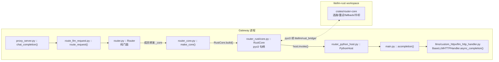

# LiteLLM 是什么

> 所属层级：第一层（系统骨架） | 建议阅读顺序：1

## 一句话定位

LiteLLM 用一套统一接口，把「调用 100+ 家 LLM API」和「把 LLM API 做成企业网关」两件事打包成了一个项目。它对外呈现两种形态：

```text
形态一：SDK（Python 库）     你的 Python 代码 ──▶ litellm.completion() ──▶ OpenAI / Anthropic / Bedrock / ...
形态二：Gateway（服务）      任意 HTTP 客户端 ──▶ litellm-proxy (FastAPI) ──▶ 内部仍调用 SDK ──▶ LLM API
```

两种形态是包含关系而非并列关系：Gateway 在每个请求里调用 SDK 完成真正的 LLM 调用。仓库根目录的 `ARCHITECTURE.md` 的「How It Works」一节就是这张关系图，并写明「The AI Gateway adds authentication, rate limiting, budgets, and routing on top of the SDK」。另外项目还有第三个形态：`litellm-rust/` 下的 Rust 核心在 `LITELLM_RUST_FIRST` 开启时可以直接承接公网流量，细节见下文「Rust 路由核心」。

## 包元数据

| 项 | 值 | 源码位置 |
|---|---|---|
| 包名 | `litellm` | `pyproject.toml` 顶部 |
| 版本 | `1.110.0` | `pyproject.toml`，运行时由 `litellm/_version.py :: _installed_version() :: +0` 读已安装发行版元数据 |
| 一句话描述 | "Library to easily interface with LLM API providers" | `pyproject.toml` |

## SDK 形态能做什么

SDK 的公共 API 由 `litellm/__init__.py` 末段的 `from .main import *` 批量转出，入口集中在 `litellm/main.py`，全部是 OpenAI 风格签名，换模型只换 `model` 字符串前缀：

| 函数 | 用途 | 源码位置 |
|---|---|---|
| `litellm.completion()` | 同步 chat completion | `litellm/main.py :: completion() :: +0` |
| `litellm.acompletion()` | 异步 chat completion（Gateway 内部用的就是它） | `litellm/main.py :: acompletion() :: +0` |
| `litellm.embedding()` | 向量嵌入 | `litellm/main.py :: embedding() :: +0` |
| `litellm.text_completion()` | 文本补全 | `litellm/main.py :: text_completion() :: +0` |
| `litellm.completion_with_retries()` | 带重试包装 | `litellm/main.py :: completion_with_retries() :: +0` |

一个最小例子（SDK 直用）：

```python
import litellm
resp = litellm.completion(model="anthropic/claude-sonnet-4-5", messages=[{"role": "user", "content": "hi"}])
```

`model` 字符串的「前缀/路由」解析由 `litellm/litellm_core_utils/get_llm_provider_logic.py :: get_llm_provider() :: +0` 负责，这是 SDK 里被调用最频繁的纯函数之一。

## Gateway 形态能做什么

Gateway 是 `litellm/proxy/` 下的 FastAPI 应用，app 对象在 `litellm/proxy/proxy_server.py :: app :: +0` 创建（`app = FastAPI(...)`），全部端点注册在同一个文件里（实测 23099 行）。它在 SDK 之上叠加了企业能力：

| 能力 | 说明 | 主要源码位置 |
|---|---|---|
| 鉴权 | API key / JWT / OAuth2 / SSO 校验 | `litellm/proxy/auth/user_api_key_auth.py :: user_api_key_auth() :: +0` |
| 限流 | 按 key/user/team 的 TPM/RPM/并发限制，注册类在 `litellm/proxy/hooks/__init__.py` 以公开别名 `PROXY_MaxParallelRequestsHandler_v3` 转出；计数可落 `litellm/redis/stores/rate_limits/__init__.py :: RateLimitStore :: +0`（Rust 后端 store） | `litellm/proxy/hooks/parallel_request_limiter_v3.py :: _PROXY_MaxParallelRequestsHandler_v3 :: +0` |
| 预算与计费 | 每次调用算钱、累加 spend、超预算拒绝 | `litellm/cost_calculator.py`、`litellm/proxy/db/db_spend_update_writer.py` |
| 多部署路由 | 在多个 deployment 间做选路、重试、fallback、冷却与用量统计 | `litellm/router.py :: Router :: +0`（纯门面），决策在 Rust 核心内完成，见下节 |
| 持久化 | PostgreSQL（Prisma schema）存 key、团队、花费日志；Redis 做共享缓存与计数 | `litellm/proxy/schema.prisma` |
| 管理 UI | 内置 dashboard 的后端接口 | `litellm/proxy/management_endpoints/` |
| 协议兼容 | 同时暴露 OpenAI `/v1/chat/completions`、Anthropic `/v1/messages`、Responses API 等 | `litellm/proxy/proxy_server.py :: chat_completion() :: +0`、`litellm/proxy/anthropic_endpoints/`、`litellm/proxy/response_api_endpoints/` |

## 三种进程入口

同一个 FastAPI app 有三个启动方式，这是数据面与管理面分离的结果：

| 入口 | 端口 | 暴露什么 | 源码位置 |
|---|---|---|---|
| 传统 `litellm --config ...` | 4000 | 全部端点（数据面 + 管理面） | `litellm/proxy/proxy_cli.py :: run_server() :: +0` |
| `gateway.main:app` | 4000 | 只裁剪保留 LLM 数据面路由 | `gateway/main.py` 模块 docstring |
| `backend.main:app` | 4001 | 只保留管理/后台路由 | `backend/main.py` 模块 docstring |

`gateway/main.py` 与 `backend/main.py` 的模块 docstring 都写明：复用 `litellm.proxy.proxy_server` 的 app，对路由表做「additive（纯增量）」裁剪，不修改任何既有模块。容器化部署还有 `gateway/launch.py`，它在 uvicorn worker 起来之前组装 `DATABASE_URL` 并先拉起容器内 PgBouncer，再把 uvicorn 交给同一个 `gateway.main:app`。

## Rust 路由核心

这是本代基线相对旧文档最大的架构变化：Router 的决策逻辑已经下沉到一个进程内的 Rust 核心，Python 侧只剩门面与宿主。

- **Router 是纯门面**：`litellm/router.py`（实测 506 行）里的 `litellm/router.py :: Router :: __init__() :: +0` 只做一件事，`self._attach(make_core(build_router_config(...), python_host))`；成员读写经元类转发给 `_core`，子类化会被 `__init_subclass__` 直接 `raise TypeError` 拒绝，扩展只能走 `register_plugin()` / `apply()` / `observe()` 三个入口。对外的端点名清单收敛在 `litellm/router_rust/invoke/endpoints.py :: endpoint_names() :: +0`。
- **核心只有一个**：`litellm/router_core.py :: make_core() :: +0`（全文件 55 行）无条件 `RustCore.build(config, host)`，没有任何「选 Python 核心还是 Rust 核心」的分支。旧文档描述的 `router_python_core.py`（Python 版路由核心，约 1.8 万行）已被删除，双核 `Route.ROUTER` 时代随之终结。
- **RustCore 是 pyo3 句柄**：`litellm/router_rust/core.py :: RustCore :: +0` 通过 `litellm/rust_bridge/`（绑定桩在 `litellm/rust_bridge/_native.pyi`）指向 `litellm-rust/crates/router-core`，在进程内拥有选路、重试、fallback、冷却与用量统计。Rust 侧规模实测约 22 万行、76 个 crate 目录。
- **核心不直接碰 litellm**：provider 调用、退避 sleep、回调注册、进程级缓存都经 `litellm/router_python_host.py :: PythonHost :: +0` 的 `.invoke` 回 litellm 执行，其 docstring 写明「The core never touches `litellm.*` directly」。有状态负载均衡与 pre-routing 仍留在 Python 宿主 step，见 `litellm/router_rust/steps/`。
- **执行层由 catalog 决定**：`chat_completions` 端点是 PYTHON_ONLY 执行（Rust 只做选路）；anthropic messages 是 RUST_REQUIRED，`litellm/messages/dispatch.py :: _rust_only_refusal() :: +0` 会在缺 Rust 路径时抛 `UnsupportedParamsError`。两条路由走同一个 Router。
- **`LITELLM_RUST_FIRST` 是独立开关**：`litellm/proxy/rust_forward/mode.py :: SWITCH_ENV :: +0` 定义该环境变量，独立于 `LITELLM_RUST`（`litellm/rust_bridge/configuration.py :: ENV_NAME :: +0`，只决定 SDK 内是否走 Rust 路径），两者互不启用。开启后由 `litellm/proxy/rust_forward/supervisor/__init__.py :: supervise() :: +0` 起一个 Rust 网关进程占公网端口，Python 退到 loopback；Rust 起不来则回退纯 Python。gunicorn 场景的私有监听走 `litellm/proxy/server_listener.py :: PrivateListener :: +0`。这个模式不替代上表三种进程入口，它是同一入口下的部署形态开关。



## 输入输出总览

| 形态 | 输入 | 输出 |
|---|---|---|
| SDK | Python 函数调用（OpenAI 风格参数） | OpenAI 风格的 `ModelResponse` 对象 |
| Gateway | HTTP 请求（OpenAI/Anthropic/Responses 等协议） | 同协议的 HTTP 响应 + `x-litellm-*` 元数据头 |
| Gateway 管理 | 配置 YAML / 管理 API / UI 操作 | key、预算、模型配置等 CRUD 结果 |
| Rust 网关（`LITELLM_RUST_FIRST`） | 公网端口的 HTTP 请求 | 由 Rust 直接转发，Python 退 loopback 供其回调 |

下一篇我们去走一遍仓库目录，把上面提到的每个模块落到具体目录上。
