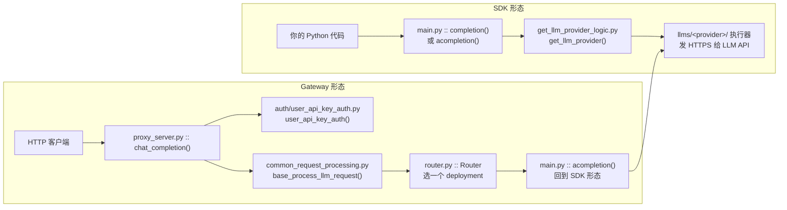

# LiteLLM 是什么

> 所属层级：第一层（系统骨架） | 建议阅读顺序：1
> 本篇基准提交：`411b64dc7a`（工作区当前 HEAD）

## 这篇讲什么

用大白话说清楚三件事：LiteLLM 是干什么的、它以哪几种形态跑在你机器上、每种形态能做什么。读完你应该能回答「我该把它当库用，还是当服务用」，并且知道「统一接口」这四个字在代码里对应哪几个入口。

## 一句话定位

LiteLLM 用一套统一的 OpenAI 风格接口，把「调用上百家 LLM API」和「把 LLM API 做成企业级网关」两件事打包进同一个项目。`pyproject.toml` 里的一句话说得很实在：`Library to easily interface with LLM API providers`（一个方便对接各家 LLM API 提供方的库），包名 `litellm`，版本 `1.111.0`。

它对外呈现两种形态，而且这两种形态是**包含关系**，不是并列关系：

```text
形态一：SDK（Python 库）
  你的 Python 代码 ──▶ litellm.completion() / litellm.acompletion()
                       └──▶ OpenAI / Anthropic / Bedrock / ...

形态二：Gateway（AI 网关，一个 FastAPI 服务）
  任意 HTTP 客户端 ──▶ litellm proxy (FastAPI) ──▶ 内部仍然调用 SDK ──▶ LLM API
```

包含关系的关键在于：Gateway 处理每个请求时，真正的模型调用最终还是落到 SDK 那几个函数上。Gateway 是在 SDK 外面套了一层企业能力（鉴权、限流、记账、多部署路由）。所以理解了 SDK 就理解了「怎么调模型」，理解了 Gateway 就理解了「怎么把调模型这件事管起来」。

术语提示：后文反复出现两个词。**SDK** 指你 `import litellm` 之后直接调用的那批 Python 函数；**Gateway** 指 `litellm/proxy/` 下那个常驻运行的 HTTP 服务，也叫 Proxy，两者在本文里是同义词。

## SDK 形态：统一入口在哪里

SDK 的公共函数集中定义在 `litellm/main.py`，再由 `litellm/__init__.py` 末尾的 `from .main import *` 批量转出到包的命名空间，所以你写的是 `litellm.completion(...)` 而不是 `litellm.main.completion(...)`。这些函数签名全部是 OpenAI 风格，换模型只改 `model` 字符串：

| 函数 | 用途 | 源码锚点 |
|---|---|---|
| `litellm.completion()` | 同步 chat completion | `litellm/main.py :: completion() :: +0` |
| `litellm.acompletion()` | 异步 chat completion（Gateway 内部走的就是它） | `litellm/main.py :: acompletion() :: +0` |
| `litellm.text_completion()` | 文本补全（老的 completion API 形态） | `litellm/main.py :: text_completion() :: +0` |
| `litellm.embedding()` | 向量嵌入 | `litellm/main.py :: embedding() :: +0` |
| `litellm.completion_with_retries()` | 带自动重试的包装 | `litellm/main.py :: completion_with_retries() :: +0` |

一个最小例子（SDK 直接用，不用起服务）：

```python
import litellm

resp = litellm.completion(
    model="openai/gpt-4o-mini",
    messages=[{"role": "user", "content": "hi"}],
)
print(resp.choices[0].message.content)
```

`model` 字符串里那个 `openai/` 前缀不是随便写的，它决定「这个请求交给哪家 provider」。解析它的纯函数是 `litellm/litellm_core_utils/get_llm_provider_logic.py :: get_llm_provider() :: +0`，它把 `openai/gpt-4o-mini` 拆成「provider=openai、model=gpt-4o-mini」，并顺带解析出该用的 api_base 和 api_key。这是 SDK 里被调用最频繁的函数之一。

## Gateway 形态：在 SDK 上叠了什么

Gateway 是 `litellm/proxy/` 下的一个 FastAPI 应用。app 对象在 `litellm/proxy/proxy_server.py :: app :: +0` 创建（`app = FastAPI(...)`），全部 HTTP 端点也注册在这同一个文件里（实测 23033 行，是全仓最大的单文件）。

它在 SDK 之上叠加的企业能力，以及各自的主要落点：

| 能力 | 通俗解释 | 主要源码位置 |
|---|---|---|
| 鉴权 | 校验 API key / JWT / OAuth2，认出「这是哪个 key、哪个用户、哪个团队」 | `litellm/proxy/auth/user_api_key_auth.py :: user_api_key_auth() :: +0` |
| 限流 | 按 key / user / team 限 TPM、RPM、并发数，超了返回 429 | `litellm/proxy/hooks/parallel_request_limiter_v3.py :: _PROXY_MaxParallelRequestsHandler_v3 :: +0`（公开别名 `PROXY_MaxParallelRequestsHandler_v3` 由 `litellm/proxy/hooks/__init__.py` 转出）；计数可落 `litellm/redis/stores/rate_limits/__init__.py :: RateLimitStore :: +0` |
| 预算与计费 | 每次调用按 token 算钱、累加花费、超预算拒绝 | `litellm/cost_calculator.py`；写库在 `litellm/proxy/db/db_spend_update_writer.py` |
| 多部署路由 | 同一个模型名背后挂多个 deployment，在它们之间选路、重试、fallback、冷却 | `litellm/router.py :: Router :: +0`（门面），决策本体在 Rust 核心，见下节 |
| 持久化 | PostgreSQL（Prisma schema）存 key、团队、预算、花费日志；Redis 做共享缓存与计数 | `litellm/schema.prisma`（包内唯一来源） |
| 管理 API / UI | 给 Dashboard 用的 key/team/budget CRUD 与报表接口 | `litellm/proxy/management_endpoints/` |
| 多协议兼容 | 同时暴露 OpenAI `/v1/chat/completions`、Anthropic `/v1/messages`、Responses API 等 | `litellm/proxy/proxy_server.py :: chat_completion() :: +0`、`litellm/proxy/anthropic_endpoints/`、`litellm/proxy/response_api_endpoints/` |

## 一次请求在两种形态里分别走多深



这张图的重点是右侧那根线：Gateway 走到最后一步时，落点是 `main.acompletion()`，也就是 SDK 那个异步入口。所以说 Gateway 包含 SDK。

## Router：多部署路由这件事由谁做

「同一个模型名背后挂多个 deployment，该调哪个」这个决策，在当前基线上已经下沉到一个**进程内的 Rust 核心**。Python 侧只剩门面和宿主。这是相对旧版仓库最大的架构变化，第一层只需要记住四个事实：

- **`Router` 是纯门面。** `litellm/router.py :: Router :: __init__() :: +0` 只做一件事：`self._attach(make_core(build_router_config(...), python_host))`。成员读写通过 `__getattribute__` / `__setattr__` 转发给内部的核心对象 `_core`；子类化会被 `__init_subclass__` 直接 `raise TypeError` 拒绝，扩展只能走 `register_plugin()` / `apply()` / `observe()` 三个入口。
- **核心只有一个，就是 Rust 核心。** `litellm/router_core.py :: make_core() :: +0`（全文件 55 行）无条件返回 `RustCore.build(config, host)`，没有任何「选 Python 核心还是 Rust 核心」的分支。旧版的 Python 版路由核心 `router_python_core.py` 已被删除，双核并存的 `Route.ROUTER` 时代随之终结。
- **Rust 核心不直接调 litellm。** 它要执行 provider 调用、退避 sleep、注册回调时，都经宿主 `litellm/router_python_host.py :: PythonHost :: invoke() :: +0` 回到 Python 侧，按 `op` 名字查出 `litellm.<op>`（例如 `acompletion`）再调用。
- **端点名清单收敛在一处。** `litellm/router_rust/invoke/endpoints.py :: endpoint_names() :: +0` 列出 Router 认识的全部端点名，`acompletion` 对应的实现是同文件 `RustEndpoints.acompletion() :: +0`，它调用 `self._core.drive(PLANS["acompletion"], request)` 驱动 Rust 核心的执行计划。

Rust 核心本体在 `litellm/rust/crates/router-core`（Rust workspace 已从根级 `litellm-rust/` 挪进包内 `litellm/rust/`），Python 侧的绑定句柄是 `litellm/router_rust/core.py :: RustCore :: +0`，它经 `litellm/rust_bridge/`（绑定桩 `_native.pyi`）跨到 Rust。Rust 侧规模实测约 22.6 万行、1052 个 `.rs` 文件、76 个 crate 目录。

## 三种进程入口

同一个 FastAPI app 有三种启动方式，这是「数据面」（转发模型请求）与「管理面」（key/预算管理）分离的结果：

| 入口 | 暴露什么 | 源码位置 |
|---|---|---|
| 传统 `litellm --config ...` | 全部端点（数据面 + 管理面） | `litellm/proxy/proxy_cli.py :: run_server() :: +0` |
| `gateway.main:app` | 裁剪后只保留 LLM 数据面路由 | `litellm/runtime/gateway/main.py` 模块 docstring |
| `backend.main:app` | 裁剪后只保留管理后台路由 | `litellm/runtime/backend/main.py` 模块 docstring |

后两个入口的模块 docstring 写明：它们复用 `litellm.proxy.proxy_server` 的 app，对路由表做「纯增量（additive）」的裁剪，不修改任何既有模块。容器化部署还有 `litellm/runtime/gateway/launch.py`，它在 uvicorn worker 起来之前组装 `DATABASE_URL` 并先拉起容器内的 PgBouncer，再把 uvicorn 交给同一个 `gateway.main:app`。

## 输入输出总览

| 形态 | 输入 | 输出 |
|---|---|---|
| SDK | Python 函数调用（OpenAI 风格参数） | OpenAI 风格的 `ModelResponse` 对象 |
| Gateway | HTTP 请求（OpenAI / Anthropic / Responses 等协议） | 同协议的 HTTP 响应 + `x-litellm-*` 元数据头 |
| Gateway 管理 | 配置 YAML / 管理 API / UI 操作 | key、预算、模型配置等 CRUD 结果 |

## 还有一个部署形态开关：`LITELLM_RUST_FIRST`

这个开关**不替代**上表三种进程入口，它是同一入口下的部署形态选择。环境变量 `LITELLM_RUST_FIRST` 定义在 `litellm/proxy/rust_forward/mode.py :: SWITCH_ENV :: +0`，它独立于 `LITELLM_RUST`（定义在 `litellm/rust_bridge/configuration.py :: ENV_NAME :: +0`，只决定 SDK 内部是否走 Rust 路径），两者互不启用。开启后由 `litellm/proxy/rust_forward/supervisor/__init__.py :: supervise() :: +0` 起一个 Rust 网关进程占公网端口，Python 退到 loopback；Rust 起不来则回退纯 Python。gunicorn 场景的私有监听走 `litellm/proxy/server_listener.py :: PrivateListener :: +0`。这一支的细节属于更深的层，第一层知道有这个开关即可。

## 源码索引

- `pyproject.toml` :: 包名 / 版本 `1.111.0` / 一句话描述
- `litellm/_version.py :: _installed_version() :: 6`
- `litellm/main.py :: completion() :: 5564`
- `litellm/main.py :: acompletion() :: 652`
- `litellm/main.py :: text_completion()`、`embedding()`、`completion_with_retries()`
- `litellm/litellm_core_utils/get_llm_provider_logic.py :: get_llm_provider() :: 187`
- `litellm/proxy/proxy_server.py :: app :: 2168`
- `litellm/proxy/proxy_server.py :: chat_completion() :: 13290`
- `litellm/proxy/auth/user_api_key_auth.py :: user_api_key_auth() :: 4761`
- `litellm/proxy/hooks/parallel_request_limiter_v3.py :: _PROXY_MaxParallelRequestsHandler_v3 :: +0`
- `litellm/redis/stores/rate_limits/__init__.py :: RateLimitStore :: +0`
- `litellm/router.py :: Router :: __init__() :: 418`
- `litellm/router_core.py :: make_core() :: 51`
- `litellm/router_rust/core.py :: RustCore :: 1464`
- `litellm/router_python_host.py :: PythonHost :: invoke() :: 107`
- `litellm/router_rust/invoke/endpoints.py :: endpoint_names() :: +0`、`RustEndpoints.acompletion() :: 2016`
- `litellm/proxy/rust_forward/mode.py :: SWITCH_ENV :: +0`
- `litellm/rust_bridge/configuration.py :: ENV_NAME :: +0`
- `litellm/proxy/rust_forward/supervisor/__init__.py :: supervise() :: +0`
- `litellm/proxy/server_listener.py :: PrivateListener :: +0`
- `litellm/proxy/proxy_cli.py :: run_server() :: +0`
- `litellm/runtime/gateway/main.py`、`litellm/runtime/backend/main.py`、`litellm/runtime/gateway/launch.py`
- `litellm/schema.prisma`、`litellm/cost_calculator.py`、`litellm/proxy/db/db_spend_update_writer.py`
