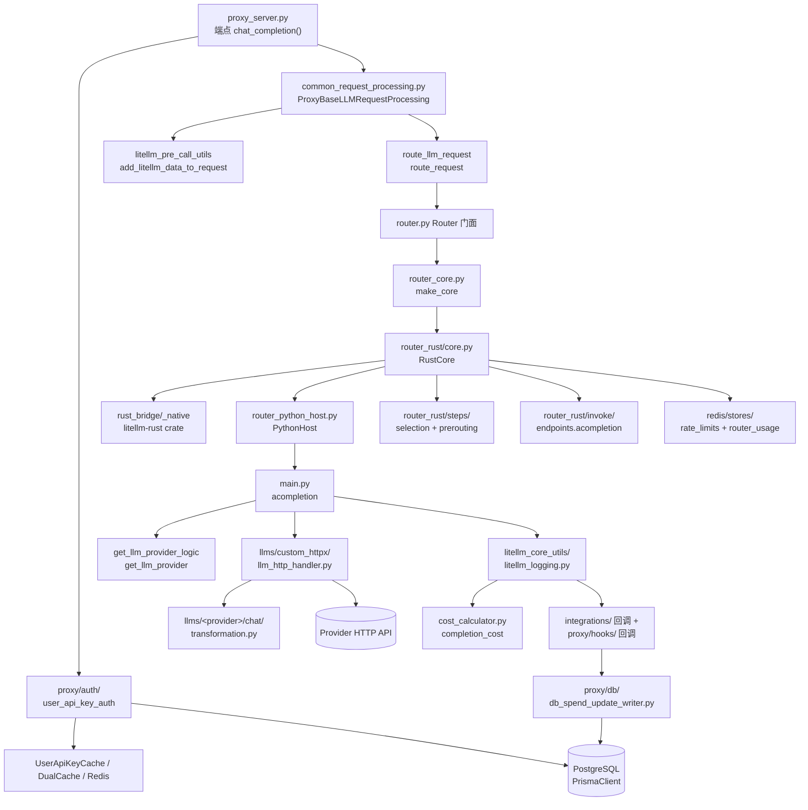

# 核心模块职责与依赖关系

> 所属层级：第一层（系统骨架） | 建议阅读顺序：3

## 模块职责表

按一次请求经过的先后顺序排列（职责细节在后三层展开，这里先建立「谁负责什么」的心智地图）。基线 `0608a41a07` 起 Python 选路核心（`router_python_core.py` 整文件）已被删除，选路、重试、fallback、冷却全部下沉到 Rust 路由核心（`litellm/router_rust/core.py :: RustCore`），本表按新架构列：

| 模块 | 文件位置 | 职责 | 输入 | 输出 |
|---|---|---|---|---|
| Proxy 端点 | `litellm/proxy/proxy_server.py` | 注册全部 HTTP 端点，持有全局单例（`llm_router`、`user_api_key_cache`、`proxy_logging_obj`） | HTTP 请求 | 委托给处理流程 |
| 请求处理流程 | `litellm/proxy/common_request_processing.py :: ProxyBaseLLMRequestProcessing` | LLM 请求统一处理骨架（读 body、total_timeout 包夹、调 route_request、异常转 HTTP） | 请求数据 dict | LLM 响应或 ProxyException |
| 鉴权 | `litellm/proxy/auth/user_api_key_auth.py :: user_api_key_auth` | 校验 API key/JWT，检查预算、模型访问、限流前置 | 请求头/体 | `UserAPIKeyAuth`（已认证身份） |
| Pre-call 注入 | `litellm/proxy/litellm_pre_call_utils.py :: add_litellm_data_to_request` | 把 key/team/用户元数据写进请求 | data + `UserAPIKeyAuth` | 带元数据的 data |
| 代理层路由 | `litellm/proxy/route_llm_request.py :: route_request` | 解析 model group、通配模型、per-request 路由设置，返回 provider 协程 | data + Router | 一个未 await 的 provider 协程 |
| Router 门面 | `litellm/router.py` | 纯门面：`__init__`/`from_config` 仅 `_attach(make_core(...))`，成员读写转发 `_core`；禁子类化，扩展走 `register_plugin`/`apply`/`observe` | data + model group | 委托给 Rust 核心 |
| 核心装配 | `litellm/router_core.py :: make_core` | 无条件 `RustCore.build(config, host)`，选定 Rust 核心 | RouterConfig + `PythonHost` | `RouterCore`（= `RustCore`） |
| Rust 路由核心 | `litellm/router_rust/core.py :: RustCore` | pyo3 句柄（经 `rust_bridge/_native` 绑定 litellm-rust/crates/router-core）：进程内拥有选路、重试、fallback、cooldown、用量 | data + model group | 单个 deployment 的调用结果 |
| 宿主回桥 | `litellm/router_python_host.py :: PythonHost` | 核心唯一的外出通道：`.invoke(op)` 查 `litellm.<op>` 并回 litellm 执行；另提供 sleep、routing_cache、回调注册 | op 名 + kwargs | `litellm.*` 的函数引用 |
| 选路步 | `litellm/router_rust/steps/selection.py :: StrategySelectors` | 按路由策略（least-busy/加权随机等）挑一个 deployment | 候选 deployments | 单个 deployment |
| 预路由步 | `litellm/router_rust/steps/prerouting.py :: PreRouter`、`PreRoutingStrategies` | 有状态 LB 与 pre-routing 的宿主步（`as_output_cap`、`stamped_client_ceiling`） | 请求 + 候选 | 裁剪后的候选集 |
| 执行层门面 | `litellm/router_rust/invoke/endpoints.py :: RustEndpoints`、`endpoint_names` | 端点名清单与调用驱动（`acompletion` → `_routed_acompletion` → `RustCore._drive`） | op 名 | 逐 deployment 调用计划 |
| 执行 catalog | `litellm/rust_bridge/catalog.py` | 决定每条路由的执行层：`chat_completions` 是 PYTHON_ONLY，anthropic messages 是 RUST_REQUIRED | 路由上下文 | `Rollout` |
| 原生绑定层 | `litellm/rust_bridge/`（`_native.pyi`、`bindings.py`、`chat_completions/`、`messages/`） | `_native` 是编译后的 Rust crate 绑定（litellm-rust），`NativeBinding` 解析原生属性，chat/messages 提供原生完成入口 | 原生调用 | `ModelResponse` 等 |
| Rust store | `litellm/redis/`（`stores/rate_limits :: RateLimitStore`、`stores/spend_counters :: SpendCounterStore`、`stores/router_usage :: RouterUsageStore`、`stores/auth_cache :: AuthCacheStore`、`store_settings :: RedisStoreSettings`） | Rust 后端的 Redis store 家族：限流计数、spend counters、路由冷却与用量、auth cache | 路由/限流事件 | 计数/缓存写读 |
| SDK 入口 | `litellm/main.py :: acompletion` | 参数规范化、provider 解析、建 `Logging`、分发执行（openai 走官方 SDK） | OpenAI 风格参数 | `ModelResponse` 或异步生成器 |
| Provider 解析 | `litellm/litellm_core_utils/get_llm_provider_logic.py :: get_llm_provider` | 把 model 字符串解析成 provider + model | model 字符串 | `(model, provider, api_key, api_base)` |
| HTTP 执行器 | `litellm/llms/custom_httpx/llm_http_handler.py :: BaseLLMHTTPHandler.async_completion` | 统一执行非 openai 的 HTTP 型 provider 调用（含流式） | 参数 + ProviderConfig | 原始 httpx 响应 |
| Provider Config | `litellm/llms/<provider>/<模态>/transformation.py` | 请求/响应/错误的三向翻译 | OpenAI 格式 | provider 私有格式（及反向） |
| 日志管线 | `litellm/litellm_core_utils/litellm_logging.py :: Logging` | 驱动全部回调的 pre/post/success/failure 事件 | 调用上下文 + 响应 | 各回调收到标准化事件 |
| 成本计算 | `litellm/cost_calculator.py :: completion_cost` | 按 usage × 价目表算钱 | 响应/usage | `response_cost: float` |
| Proxy 回调 | `litellm/proxy/hooks/proxy_track_cost_callback.py :: _ProxyDBLogger` | 在 Gateway 里接管成本记账 | 成功事件 + cost | 触发 DB 写入 |
| 花费持久化 | `litellm/proxy/db/db_spend_update_writer.py :: DBSpendUpdateWriter` | 批量聚合 spend 更新，写 Postgres | spend 增量 | `LiteLLM_SpendLogs` 表记录 |
| Rust 网关代理 | `litellm/proxy/rust_forward/`（`mode.py :: SWITCH_ENV`、`supervisor/__init__.py :: supervise`、`peer.py :: RustPeerMiddleware`） | `LITELLM_RUST_FIRST` 独立开关：起 Rust 网关占公网端口、Python 退 loopback，起不来回退纯 Python | 环境变量 + 启动 | 端口/监听决策 |
| 缓存 | `litellm/caching/caching.py`、`dual_cache.py`、`caching_handler.py` | LLM 响应缓存（内存+Redis 两级） | 请求参数 | 缓存命中或未命中 |
| 类型系统 | `litellm/types/` | 全部请求/响应/配置的 Pydantic、TypedDict 定义 | — | — |

## 全局状态（proxy 进程内单例）

`proxy_server.py` 在模块级声明了一组全局变量，整个 Gateway 靠它们协作：

| 全局变量 | 类型 | 定义位置 | 赋值时机 |
|---|---|---|---|
| `llm_router` | `Router \| None` | `proxy_server.py :: llm_router :: +0`（3173） | 启动/配置变更时 `ProxyConfig._update_llm_router()` 里 `litellm.Router.from_config(...)`（`router.py :: Router :: from_config :: +0` 内部走 `_attach(make_core(config, host))`） |
| `user_api_key_cache` | `UserApiKeyCache` | `proxy_server.py :: user_api_key_cache :: +0`（3205） | 进程启动即创建 |
| `proxy_logging_obj` | `ProxyLogging` | `proxy_server.py :: proxy_logging_obj :: +0`（3288） | 进程启动即创建（构造参数里注入 `user_api_key_cache`） |
| `llm_model_list` | `list \| None` | `proxy_server.py :: llm_model_list :: +0`（3174） | 随 Router 配置一起更新 |
| `general_settings`、`user_model` 等 | 配置项 | `proxy_server.py :: 模块级` | 加载 YAML 配置时 |

## 模块依赖关系图

**请求路径上的依赖（自上而下单向）**：



**关键读法**：

- 依赖是严格分层的，上层只认识下一层的公共接口。`proxy_server.py` 不直接碰 `llms/`，`main.py` 不直接碰数据库
- 最大的架构变化：`Router` 门面（`litellm/router.py`）下面不再挂 Python 核心，而是 `make_core` 无条件造一个 `RustCore`。`RustCore` 自身不直接调 `litellm.*`，一切对外只经 `PythonHost.invoke`（`router_python_host.py :: PythonHost :: invoke :: +0`），回 litellm 执行
- 类型定义（`litellm/types/`）是所有模块的公共依赖，图中省略以免连线爆炸
- 日志管线（`Logging`）是唯一一个「回流」点：请求结束后由它反向驱动所有回调（含写 DB），主链路不直接写库

**Proxy 与 SDK 的边界**：

```
litellm/proxy/**   只做「网关的事」：鉴权、限流、记账、管理 API、多协议暴露
litellm/**（其余） 只做「调 LLM 的事」：翻译、执行、缓存、重试、成本
边界处只传两种东西：OpenAI 风格的参数 dict，和 litellm_logging.Logging 对象
```

Rust 路由核心位于 `litellm/router_rust/**` 与 `litellm/rust_bridge/**`，它们不是「Proxy」也不是「调 LLM」任何一侧，而是夹在中间的第三方：`RustCore` 决定选哪个 deployment，真正的 provider 调用仍经 `PythonHost.invoke` 回到 `main.acompletion` 走 SDK 执行层。

## 两条横切线

横切线 1，回调（callback）体系。所有「额外动作」（可观测、限流、guardrail、记账）都实现 `CustomLogger` 接口（`litellm/integrations/custom_logger.py`），注册进 `litellm.callbacks`（SDK 侧）或 Proxy 侧配置，由日志管线在固定时机调用：

| 时机 | 回调方法 | 典型用途 |
|---|---|---|
| 请求前 | `async_pre_call_hook` | 限流、guardrail 注入 |
| 调用成功后 | `async_log_success_event` | 上报 Langfuse、记账 |
| 调用失败后 | `async_log_failure_event` | 告警、错误统计 |

横切线 2，配置体系。`litellm/proxy/proxy_config.yaml` 定义模型列表、router 设置、回调、数据库连接，由 `proxy_cli.py` 加载后喂给 `Router.from_config()`。绝大多数行为差异最终都能追溯到这份 YAML 的某个键。

下一篇把一次请求的宏观生命周期串起来。