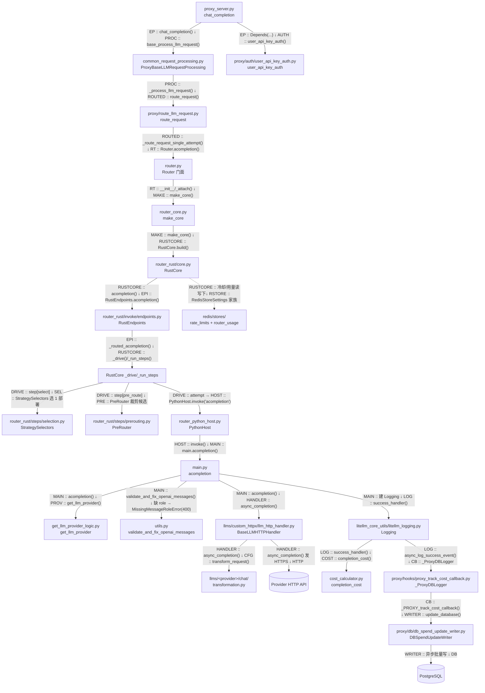

# 一条请求的宏观生命周期

> 所属层级：第一层（系统骨架） | 建议阅读顺序：4

以 Gateway 收到 `POST /v1/chat/completions` 为例。本篇只建立宏观地图，每一跳的细节在第二、三层展开。基线 `0608a41a07` 起选路由核心进入进程内 Rust 核心，`chat_completions` 仍由 Python 执行层（`main.acompletion`）跑真正的 provider 调用。

## 阶段总览

一次请求分四个阶段，跨越三个世界（Proxy 世界、Rust 核心、SDK 世界）：

| 阶段 | 发生在哪 | 做什么 | 失败会怎样 |
|---|---|---|---|
| 1. 接入与鉴权 | Proxy | 读 body、校验 key、检查预算/模型权限/限流 | 直接返回 4xx，不碰 LLM |
| 2. 路由与调度 | Proxy + Router + Rust 核心 | 选一个 deployment，套上重试/fallback 策略 | 冷却/无可用部署时返回错误 |
| 3. 执行 | SDK + Provider | 翻译请求、发 HTTP、翻译响应、（可选）流式 | 进入异常映射，可能触发重试/回退 |
| 4. 记账与回传 | Proxy | 算成本、加响应头、异步写日志/DB | 记账失败不影响已返回的响应 |

## ASCII 主流程

```
客户端 (OpenAI SDK / curl / 任意 HTTP)
  │  POST /v1/chat/completions + Authorization: Bearer sk-xxx
  ▼
┌─────────────────────── Proxy 世界 ───────────────────────┐
│                                                          │
│ [1] FastAPI 路由匹配                                      │
│     proxy_server.py :: chat_completion()                 │
│     （Depends(user_api_key_auth) 先于函数体执行）          │
│                                                          │
│ [2] 鉴权 user_api_key_auth()                             │
│     key → 缓存/DB → UserAPIKeyAuth                        │
│     ├─ 预算检查（key/team/user/组织四级）                  │
│     ├─ 模型访问检查                                       │
│     └─ 限流 hook（TPM/RPM/并发）                           │
│                                                          │
│ [3] 读 body + 注入 metadata（user/team/org/agent id）     │
│     ProxyBaseLLMRequestProcessing.base_process_llm_request│
│     ├─ _within_total_timeout 包夹（total_timeout 408）    │
│     └─ open_sse_before_first_byte（ttft keepalive）        │
│                                                          │
│ [4] Pre-call：回调钩子 + add_litellm_data_to_request      │
│     （把 litellm_call_id、key 元数据写进 data）            │
│                                                          │
│ [5] route_request() → 返回 provider 协程                  │
│     常量时间取到「该调哪个函数」                            │
│                                                          │
└──────────────────────────┬───────────────────────────────┘
                           ▼
┌──────────────────── Rust 路由核心（进程内）───────────────┐
│                                                          │
│ [6] Router.acompletion()（门面 → _core → RustCore）        │
│     ├─ 端点：invoke/endpoints.py RustEndpoints.acompletion│
│     ├─ _start → _run_steps：select / pre_route / attempt  │
│     ├─ 选路（steps/selection 按策略挑 1 个 deployment）    │
│     ├─ 重试 / fallback / cooldown 由 Rust core 持有       │
│     └─ 每次 attempt 经 PythonHost.invoke("acompletion")   │
│                                                          │
└──────────────────────────┬───────────────────────────────┘
                           ▼
┌─────────────────────── SDK 世界 ─────────────────────────┐
│                                                          │
│ [7] main.acompletion()（Python 执行层，chat_completions   │
│     是 PYTHON_ONLY；由 PythonHost.invoke 回桥触发）        │
│     ├─ validate_and_fix_openai_messages（缺 role → 400）  │
│     ├─ get_llm_provider() 解析 model 字符串               │
│     ├─ 建 Logging 对象（回调管线的引擎）                    │
│     └─ 找到 provider 的执行器                              │
│                                                          │
│ [8] 执行器（按 provider 二选一）                          │
│     ├─ openai      → OpenAIChatCompletion（官方 SDK）     │
│     └─ 其他 provider → BaseLLMHTTPHandler                 │
│         ├─ ProviderConfig.transform_request()  翻译请求   │
│         ├─ httpx.AsyncClient 发 HTTPS ────▶ LLM API      │
│         └─ ProviderConfig.transform_response() 翻译响应   │
│                                                          │
└──────────────────────────┬───────────────────────────────┘
                           ▼
┌─────────────────── 回到 Proxy 世界 ───────────────────────┐
│                                                          │
│ [9] 日志管线 Logging.success_handler                     │
│     ├─ completion_cost() 算钱 → response_cost            │
│     ├─ async_log_success_event → 全部回调                 │
│     └─ proxy_track_cost_callback → DBSpendUpdateWriter   │
│        （异步批量写 Postgres，不阻塞响应）                  │
│                                                          │
│ [10] 组响应头 x-litellm-*（含 x-litellm-call-id、          │
│      x-litellm-response-cost），返回 ModelResponse JSON   │
│      （流式则切换成 SSE 生成器）                            │
│                                                          │
└──────────────────────────┬───────────────────────────────┘
                           ▼
                        客户端收到响应
```

## 主数据流图（事实 8-12，每条边标调用方 :: 符号 ↓ 被调用方 :: 符号）



**图读法**：第 6 跳是架构分界。`Router` 门面 → `make_core` → `RustCore.build`，选路与重试/fallback 全在 Rust 核心内；但 provider 调用这一步，`RustCore` 的每次 `attempt` 都要经 `PythonHost.invoke("acompletion")` 回 `main.acompletion`，所以 chat_completions 的执行层是 PYTHON_ONLY（`rust_bridge/catalog.py` 的 `RouteRule`）。anthropic messages 则走 RUST_REQUIRED 执行层，与 chat 共用同一个 Router 门面。

## 三个关键设计点

**设计点 1：鉴权发生在端点函数体之前。** `chat_completion()` 的路由装饰器上挂着 `dependencies=[Depends(user_api_key_auth)]`，所以 401/429 根本不会进入函数体。

**设计点 2：`route_request()` 返回的不是结果，是未 await 的 provider 协程。** `common_request_processing.py :: _process_llm_request :: +86` 处 `await route_request(...)`，调用点上方注释写着 "Do not change this - it should be a constant time fetch - ALWAYS"。它按 `route_type` 查表拿到 `llm_router.acompletion` 等方法引用并立刻调用返回一个协程，随后被 `asyncio.create_task(with_proxy_compaction_executor(llm_call, request))` 包起来异步执行，真正的调度（选路、重试、fallback）在 Rust 核心内部 `_run_steps` 时才发生。

**设计点 3：响应先回客户端，记账异步做。** 成本与 spend 写入通过批量写入器（`DBSpendUpdateWriter`）解耦，用户延迟不受记账影响；`x-litellm-response-cost` 头在响应里同步带上（值取自 `_hidden_params["response_cost"]`），`x-litellm-call-id` 头也统一加上（`common_request_processing.py :: resolve_litellm_call_id :: +0` 生成请求的 `litellm_call_id`）。

## 落在请求生命周期内的行为变化（基线后新增）

| 变化 | 落在哪一阶段 | 锚点 |
|---|---|---|
| 非流式 `total_timeout`（body 或头 `x-litellm-total-timeout`）超时回 408 | 阶段 1，`base_process_llm_request` 用 `_within_total_timeout` 包夹处理，`route_request` 内也调 `enforce_total_timeout_scope` | `common_request_processing.py :: ProxyBaseLLMRequestProcessing :: _within_total_timeout :: +0`（3280）；`total_deadline.py :: enforce_total_timeout_scope :: +0`（162） |
| 缺 role 消息改抛 `MissingMessageRoleError`（HTTP 400），不再自动补 role | 阶段 3，`main.acompletion` 调 `validate_and_fix_openai_messages` | `exceptions.py :: MissingMessageRoleError :: +0`（372）；`utils.py :: validate_and_fix_openai_messages :: +0`（9496） |
| 响应统一回 `x-litellm-call-id` | 阶段 4，响应头组装 | `proxy/common_utils/openai_error_payload.py :: LITELLM_CALL_ID_HEADER :: +0`（19）；`common_request_processing.py :: resolve_litellm_call_id :: +0`（387） |

## 状态变化一览

| 对象 | 请求前 | 请求后 |
|---|---|---|
| `data["metadata"]` | 客户端传入（可为空） | 被注入 user/team/org/agent id |
| `data["model"]` | 客户端请求的名字（可能是别名/通配） | 归一化为 model group 名 |
| Redis 限流计数 | N | N+1（按 key/user/team 维度，走 Rust store） |
| Router 冷却表 | 部署健康 | 若失败则该部署进入冷却窗口（Rust core 内持有） |
| Postgres spend | 余额 X | 异步扣减 X - cost |

到这里第一层结束。下一篇进入第二层：把一个真实可复现的请求从命令行到响应完整走一遍。