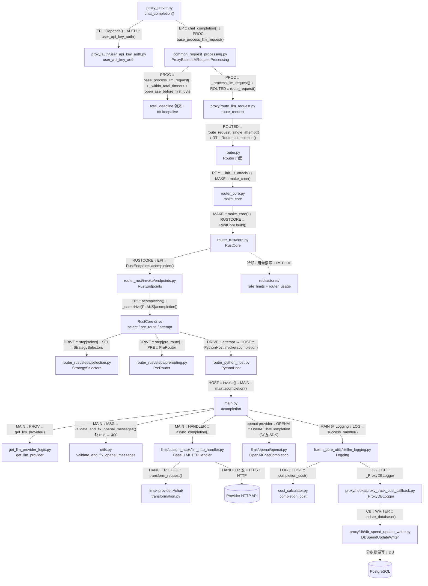

# 一条请求的宏观生命周期

> 所属层级：第一层（系统骨架） | 建议阅读顺序：4
> 本篇基准提交：`411b64dc7a`（工作区当前 HEAD）

## 这篇讲什么

把前三章的静态地图动起来：以 Gateway 收到 `POST /v1/chat/completions`、路由到 `openai/gpt-4o-mini` 并返回为例，走完一次请求从进来到出去的全过程。本篇只建立宏观地图，每一跳的函数级细节在第三、四层展开。

## 阶段总览

一次请求分四个阶段，跨越三个世界（Proxy 世界、Rust 路由核心、SDK 世界）：

| 阶段 | 发生在哪 | 做什么 | 失败会怎样 |
|---|---|---|---|
| 1. 接入与鉴权 | Proxy | 读 body、校验 key、检查预算 / 模型权限 / 限流 | 直接返回 4xx，不碰 LLM |
| 2. 路由与调度 | Proxy + Router + Rust 核心 | 选一个 deployment，套上重试 / fallback 策略 | 冷却 / 无可用部署时返回错误 |
| 3. 执行 | SDK + Provider | 翻译请求、发 HTTP、翻译响应、（可选）流式 | 进入异常映射，可能触发重试 / 回退 |
| 4. 记账与回传 | Proxy | 算成本、加响应头、异步写日志 / DB | 记账失败不影响已返回的响应 |

## ASCII 主流程

```text
客户端 (OpenAI SDK / curl / 任意 HTTP)
  |  POST /v1/chat/completions + Authorization: Bearer sk-xxx
  v
+----------------------- Proxy 世界 -----------------------+
|                                                           |
| [1] FastAPI 路由匹配                                       |
|     proxy_server.py :: chat_completion()                  |
|     （Depends(user_api_key_auth) 先于函数体执行）           |
|                                                           |
| [2] 鉴权 user_api_key_auth()                              |
|     key -> 缓存/DB -> UserAPIKeyAuth                       |
|     +- 预算检查（key/team/user/组织四级）                   |
|     +- 模型访问检查                                        |
|     +- 限流 hook（TPM/RPM/并发）                            |
|                                                           |
| [3] base_process_llm_request()                            |
|     +- open_sse_before_first_byte（ttft keepalive）        |
|     +- _within_total_timeout 包夹（total_timeout 408）     |
|     +- _process_llm_request：读 body + 注入 metadata       |
|                                                           |
| [4] Pre-call：回调钩子 + add_litellm_data_to_request       |
|     （把 litellm_call_id、key 元数据写进 data）             |
|                                                           |
| [5] route_request() -> 返回 provider 协程                  |
|     常量时间取到「该调哪个函数」                             |
|                                                           |
+---------------------------+-------------------------------+
                            v
+------------------- Rust 路由核心（进程内）-----------------+
|                                                           |
| [6] Router.acompletion()（门面 -> _core -> RustCore）       |
|     +- 端点：invoke/endpoints.py RustEndpoints.acompletion |
|     +- _core.drive(PLANS["acompletion"], request)          |
|     +- 选路（steps/selection 按策略挑 1 个 deployment）     |
|     +- 重试 / fallback / cooldown 由 Rust core 持有        |
|     +- 每次 attempt 经 PythonHost.invoke("acompletion")    |
|                                                           |
+---------------------------+-------------------------------+
                            v
+------------------------ SDK 世界 -------------------------+
|                                                           |
| [7] main.acompletion()（Python 执行层，chat_completions    |
|     是 PYTHON_ONLY；由 PythonHost.invoke 回桥触发）         |
|     +- validate_and_fix_openai_messages（缺 role -> 400）  |
|     +- get_llm_provider() 解析 model 字符串                |
|     +- 建 Logging 对象（回调管线的引擎）                    |
|     +- 找到 provider 的执行器                              |
|                                                           |
| [8] 执行器（按 provider 二选一）                            |
|     +- openai      -> OpenAIChatCompletion（官方 SDK）     |
|     +- 其他 provider -> BaseLLMHTTPHandler.async_completion|
|         +- transform_request()  翻译请求                   |
|         +- httpx.AsyncClient 发 HTTPS ----> LLM API       |
|         +- transform_response() 翻译响应                   |
|                                                           |
+---------------------------+-------------------------------+
                            v
+------------------- 回到 Proxy 世界 -----------------------+
|                                                           |
| [9] 日志管线 Logging.success_handler                       |
|     +- completion_cost() 算钱 -> response_cost            |
|     +- async_log_success_event -> 全部回调                 |
|     +- proxy_track_cost_callback -> DBSpendUpdateWriter   |
|        （异步批量写 Postgres，不阻塞响应）                  |
|                                                           |
| [10] 组响应头 x-litellm-*（含 x-litellm-call-id、           |
|      x-litellm-response-cost），返回 ModelResponse JSON    |
|      （流式则切换成 SSE 生成器）                            |
|                                                           |
+---------------------------+-------------------------------+
                            v
                         客户端收到响应
```

## 主数据流图



**图读法**：第 6 跳是架构分界。`Router` 门面经 `make_core` 到 `RustCore.build`，选路与重试 / fallback 全在 Rust 核心内；但 provider 调用这一步，`RustCore` 的每次 `attempt` 都要经 `PythonHost.invoke("acompletion")` 回 `main.acompletion`，所以 chat_completions 的执行层是 PYTHON_ONLY（`litellm/rust_bridge/catalog.py :: RouteRule :: 108` 里 `Route.CHAT_COMPLETIONS` 配的是 `Rollout.PYTHON_ONLY`）。anthropic `/v1/messages` 对 anthropic provider 则配 `Rollout.RUST_REQUIRED`，缺 Rust 路径时由 `litellm/messages/dispatch.py :: _rust_only_refusal() :: +0` 抛 `UnsupportedParamsError`。两条路由共用同一个 Router 门面。

## 三个关键设计点

**设计点 1，鉴权发生在端点函数体之前。** `chat_completion()` 挂了四个路由装饰器（`/v1/chat/completions`、`/chat/completions`、`/engines/{model:path}/chat/completions`、`/openai/deployments/{model:path}/chat/completions`），每个都写 `dependencies=[Depends(user_api_key_auth)]`，所以 401 / 429 根本不会进入函数体。函数签名上还有 `user_api_key_dict: UserAPIKeyAuth = Depends(user_api_key_auth)`（`litellm/proxy/proxy_server.py :: chat_completion() :: +5`）。

**设计点 2，`route_request()` 返回的不是结果，是未 await 的 provider 协程。** `common_request_processing.py :: _process_llm_request :: +82` 处 `llm_call = await route_request(...)`，调用点上方注释写着 `Do not change this - it should be a constant time fetch - ALWAYS`。它按 `route_type` 查表拿到 `llm_router.acompletion` 等方法引用并立刻调用，返回一个协程；随后 `asyncio.create_task(with_proxy_compaction_executor(llm_call, request))` 把它包起来异步执行。真正的调度（选路、重试、fallback）在 Rust 核心内部 `drive` 时才发生。

**设计点 3，响应先回客户端，记账异步做。** 成本与 spend 写入通过批量写入器 `DBSpendUpdateWriter` 解耦，用户延迟不受记账影响。响应统一带上 `x-litellm-call-id` 头（常量 `litellm/proxy/common_utils/openai_error_payload.py :: LITELLM_CALL_ID_HEADER :: 19`，值 `x-litellm-call-id`；call id 由 `litellm/proxy/common_request_processing.py :: resolve_litellm_call_id :: 388` 生成）。

## 落在请求生命周期内的两个行为约束

| 约束 | 落在哪一阶段 | 锚点 |
|---|---|---|
| 非流式 `total_timeout`（body 字段或头 `x-litellm-total-timeout`）超时回 408 | 阶段 1，`base_process_llm_request` 用 `_within_total_timeout` 包夹（`+105`），`route_request` 内也调 `enforce_total_timeout_scope` | `litellm/proxy/common_request_processing.py :: ProxyBaseLLMRequestProcessing :: _within_total_timeout :: 3285`；`litellm/litellm_core_utils/total_deadline.py :: enforce_total_timeout_scope :: 162` |
| 缺 role 消息改抛 `MissingMessageRoleError`（HTTP 400），不再自动补 role | 阶段 3，`main.acompletion` 调 `validate_and_fix_openai_messages` | `litellm/exceptions.py :: MissingMessageRoleError :: 372`（`MalformedRequestFieldError` 子类）；`litellm/utils.py :: validate_and_fix_openai_messages :: 9495` |

这两条是「代码与旧文档不一致时以代码为准」的例子：早期实现会静默补全缺 role 的消息，现在会直接拒绝。

## 状态变化一览

| 对象 | 请求前 | 请求后 |
|---|---|---|
| `data["metadata"]` | 客户端传入（可为空） | 被注入 user / team / org / agent id |
| `data["model"]` | 客户端请求的名字（可能是别名 / 通配） | 归一化为 model group 名 |
| Redis 限流计数 | N | N+1（按 key / user / team 维度，走 Rust store） |
| Router 冷却表 | 部署健康 | 若失败则该部署进入冷却窗口（Rust core 内持有） |
| Postgres spend | 余额 X | 异步扣减 X - cost |

## 源码索引

- `litellm/proxy/proxy_server.py :: chat_completion() :: 13290`（路由装饰器 `13268`-`13289`，四个路径都挂 `Depends(user_api_key_auth)`）
- `litellm/proxy/common_request_processing.py :: ProxyBaseLLMRequestProcessing :: base_process_llm_request() :: 3180`
- `litellm/proxy/common_request_processing.py :: ProxyBaseLLMRequestProcessing :: _within_total_timeout :: 3285`
- `litellm/proxy/common_request_processing.py :: ProxyBaseLLMRequestProcessing :: _process_llm_request :: 3307`（`route_request` 调用点在 `+82`，`create_task` 在 `+93`）
- `litellm/proxy/common_request_processing.py :: resolve_litellm_call_id :: 388`
- `litellm/litellm_core_utils/total_deadline.py :: enforce_total_timeout_scope :: 162`
- `litellm/proxy/auth/user_api_key_auth.py :: user_api_key_auth() :: 4761`
- `litellm/proxy/litellm_pre_call_utils.py :: add_litellm_data_to_request() :: 2707`
- `litellm/proxy/route_llm_request.py :: route_request() :: 832`、`_route_request_single_attempt :: 878`
- `litellm/router.py :: Router :: acompletion() :: 287`、`__init__() :: 418`
- `litellm/router_core.py :: make_core() :: 51`
- `litellm/router_rust/core.py :: RustCore :: 1464`
- `litellm/router_rust/invoke/endpoints.py :: RustEndpoints :: acompletion() :: 2016`、`_routed_acompletion() :: 2030`
- `litellm/router_rust/steps/selection.py :: StrategySelectors :: 99`、`litellm/router_rust/steps/prerouting.py :: PreRouter :: 761`
- `litellm/router_python_host.py :: PythonHost :: invoke() :: 107`
- `litellm/rust_bridge/catalog.py :: RouteRule :: 108`
- `litellm/messages/dispatch.py :: _rust_only_refusal() :: +0`
- `litellm/main.py :: acompletion() :: 652`
- `litellm/litellm_core_utils/get_llm_provider_logic.py :: get_llm_provider() :: 187`
- `litellm/utils.py :: validate_and_fix_openai_messages :: 9495`
- `litellm/exceptions.py :: MissingMessageRoleError :: 372`
- `litellm/llms/custom_httpx/llm_http_handler.py :: BaseLLMHTTPHandler :: async_completion :: 820`
- `litellm/llms/openai/openai.py :: OpenAIChatCompletion :: 415`
- `litellm/litellm_core_utils/litellm_logging.py :: Logging :: 743`
- `litellm/cost_calculator.py :: completion_cost() :: 1797`
- `litellm/proxy/hooks/proxy_track_cost_callback.py :: _ProxyDBLogger :: 405`
- `litellm/proxy/db/db_spend_update_writer.py :: DBSpendUpdateWriter :: 748`
- `litellm/proxy/common_utils/openai_error_payload.py :: LITELLM_CALL_ID_HEADER :: 19`
