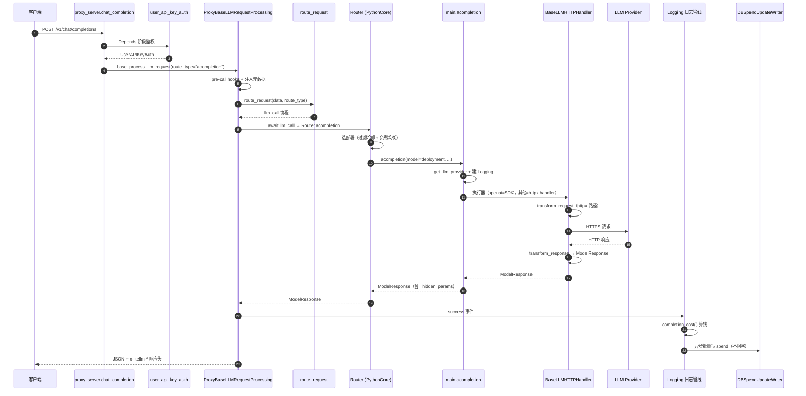

# 一条请求的宏观生命周期

> 所属层级：第一层（系统骨架） | 建议阅读顺序：4

以 Gateway 收到 `POST /v1/chat/completions` 为例。本篇只建立宏观地图，每一跳的细节在第二、三层展开。

## 阶段总览

一次请求分四个阶段，跨越两个世界（Proxy 世界与 SDK 世界）：

| 阶段 | 发生在哪 | 做什么 | 失败会怎样 |
|---|---|---|---|
| 1. 接入与鉴权 | Proxy | 读 body、校验 key、检查预算/模型权限/限流 | 直接返回 4xx，不碰 LLM |
| 2. 路由与调度 | Proxy + Router | 选定一个 deployment，套上重试/fallback 策略 | 冷却/无可用部署时返回错误 |
| 3. 执行 | SDK + Provider | 翻译请求、发 HTTP、翻译响应、（可选）流式 | 进入异常映射，可能触发重试/回退 |
| 4. 记账与回传 | Proxy | 算成本、加响应头、异步写日志/DB | 记账失败不影响已返回的响应 |

## ASCII 主流程

```
客户端 (OpenAI SDK / curl / 任意 HTTP)
  │  POST /v1/chat/completions + Authorization: Bearer sk-xxx
  ▼
┌─────────────────────── Proxy 世界 ───────────────────────┐
│                                                          │
│ [1] FastAPI 路由匹配                                      │
│     proxy_server.py :: chat_completion()                 │
│     （Depends(user_api_key_auth) 先于函数体执行）          │
│                                                          │
│ [2] 鉴权 user_api_key_auth()                             │
│     key → 缓存/DB → UserAPIKeyAuth                        │
│     ├─ 预算检查（key/team/user/组织四级）                  │
│     ├─ 模型访问检查                                       │
│     └─ 限流 hook（TPM/RPM/并发）                           │
│                                                          │
│ [3] 读 body + 注入 metadata（user/team/org/agent id）     │
│     ProxyBaseLLMRequestProcessing.base_process_llm_request│
│                                                          │
│ [4] Pre-call：回调钩子 + add_litellm_data_to_request      │
│     （把 litellm_call_id、key 元数据写进 data）            │
│                                                          │
│ [5] route_request() → 返回一个 llm_call 协程              │
│     常量时间取到「该调哪个函数」                            │
│                                                          │
└──────────────────────────┬───────────────────────────────┘
                           ▼
┌─────────────────────── SDK 世界 ─────────────────────────┐
│                                                          │
│ [6] Router.acompletion()（门面 → PythonCore）             │
│     ├─ model group → 候选 deployments                     │
│     ├─ 过滤：冷却中/超限的部署                              │
│     ├─ 负载均衡策略选 1 个                                 │
│     └─ 失败 → 重试 → fallback group                       │
│                                                          │
│ [7] litellm.acompletion()（main.py）                      │
│     ├─ get_llm_provider() 解析 model 字符串               │
│     ├─ 建 Logging 对象（回调管线的引擎）                    │
│     └─ 找到 provider 的执行器                              │
│                                                          │
│ [8] 执行器（按 provider 二选一）                          │
│     ├─ openai      → OpenAIChatCompletion（官方 SDK）     │
│     └─ 其他 provider → BaseLLMHTTPHandler                 │
│         ├─ ProviderConfig.transform_request()  翻译请求   │
│         ├─ httpx.AsyncClient 发 HTTPS ────▶ LLM API      │
│         └─ ProviderConfig.transform_response() 翻译响应   │
│                                                          │
└──────────────────────────┬───────────────────────────────┘
                           ▼
┌─────────────────── 回到 Proxy 世界 ───────────────────────┐
│                                                          │
│ [9] 日志管线 Logging.success_handler                     │
│     ├─ completion_cost() 算钱 → response_cost            │
│     ├─ async_log_success_event → 全部回调                 │
│     └─ proxy_track_cost_callback → DBSpendUpdateWriter   │
│        （异步批量写 Postgres，不阻塞响应）                  │
│                                                          │
│ [10] 组响应头 x-litellm-*，返回 ModelResponse JSON        │
│      （流式则切换成 SSE 生成器）                            │
│                                                          │
└──────────────────────────┬───────────────────────────────┘
                           ▼
                        客户端收到响应
```

## Mermaid 时序图



## 三个关键设计点

**设计点 1：鉴权发生在端点函数体之前。** `chat_completion()` 的路由装饰器上挂着 `dependencies=[Depends(user_api_key_auth)]`（`litellm/proxy/proxy_server.py :: chat_completion() :: -20` 处的装饰器链），所以 401/429 根本不会进入函数体。

**设计点 2：`route_request()` 返回的不是结果，是协程。** `common_request_processing.py :: _process_llm_request() :: +84` 处调用 `route_request`（定义在 `litellm/proxy/route_llm_request.py :: route_request() :: +0`），调用点上方注释写着 "Do not change this - it should be a constant time fetch - ALWAYS"。它按 `route_type` 查表拿到 `llm_router.acompletion` 等方法引用，真正的调度（重试、fallback）在随后 await 时才发生。

**设计点 3：响应先回客户端，记账异步做。** 成本与 spend 写入通过 `asyncio.create_task`（`proxy_server.py :: chat_completion() :: 内部响应处理`）和批量写入器解耦，用户延迟不受记账影响；只有 `x-litellm-response-cost` 头会在响应里同步带上（值取自 `_hidden_params["response_cost"]`）。

## 状态变化一览

| 对象 | 请求前 | 请求后 |
|---|---|---|
| `data["metadata"]` | 客户端传入（可为空） | 被注入 user/team/org/agent id |
| `data["model"]` | 客户端请求的名字（可能是别名/通配） | 归一化为 model group 名 |
| Redis 限流计数 | N | N+1（按 key/user/team 维度） |
| Router 冷却表 | 部署健康 | 若失败则该部署进入冷却窗口 |
| Postgres spend | 余额 X | 异步扣减 X - cost |

到这里第一层结束。下一篇进入第二层：把一个真实可复现的请求从命令行到响应完整走一遍。
