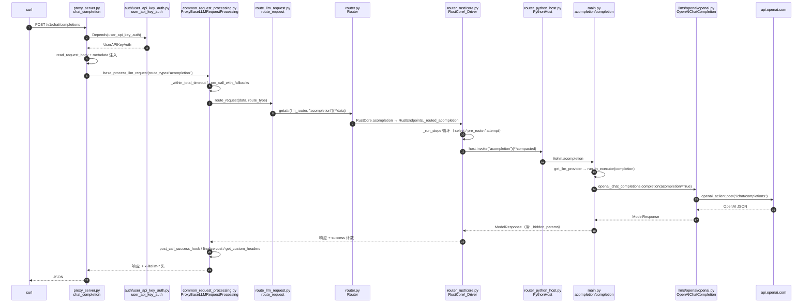

# 全路径追踪：从 curl 到 JSON 响应

> 所属层级：第二层（真实全路径） | 建议阅读顺序：6
> 本篇基准提交：`411b64dc7a`（工作区当前 HEAD）

沿上一篇的 curl 走完全程。只走主成功路径，每跳给出源码锚点（`文件 :: 类/函数 :: 偏移`，`+0` 是定义行）、进出数据与数据形态变化；偏移数值已用 codegraph 与定点 grep 回核到当前基线。分支、重试、错误传播留到第三层。

## 全路径时序图



## 逐跳拆解

### 跳 1：HTTP 进入，路由匹配

锚点：`litellm/proxy/proxy_server.py :: chat_completion() :: +0`

FastAPI 按装饰器上的路径匹配请求。这个函数同时挂在四条路径上：`/v1/chat/completions`、`/chat/completions`、`/engines/{model}/...`、`/openai/deployments/{model}/...`，四个路径共用一个函数体。

- 进：HTTP 报文（headers + body）
- 出：`Request` 对象、`fastapi_response` 对象，以及一个待执行的鉴权依赖

关键点：装饰器上的 `dependencies=[Depends(user_api_key_auth)]` 与签名里的 `user_api_key_dict: UserAPIKeyAuth = Depends(user_api_key_auth)`（`chat_completion() :: +4`）让鉴权在函数体第一行之前就跑完，函数体拿到的已经是鉴权结果。

### 跳 2：鉴权

锚点：`litellm/proxy/auth/user_api_key_auth.py :: user_api_key_auth() :: +0`

- 进：`Authorization: Bearer $LITELLM_MASTER_KEY`
- 出：`UserAPIKeyAuth` 对象（`api_key`、`user_id`、`team_id`、`org_id`、模型权限等）

master key 走最短路径：比对出这是根凭证后直接构造全权限的 `UserAPIKeyAuth`。普通 key 则要查缓存或数据库，再做预算、模型访问、限流前置检查。失败出口是抛 `ProxyException`，由 FastAPI 翻成 401/403/429，请求到此结束。鉴权细节在第三层 auth 篇展开。

### 跳 3：读 body，注入 metadata

锚点：`litellm/proxy/proxy_server.py :: chat_completion() :: +31`（`read_request_body` 调用）、`:: +32`（metadata 注入开始）

- 进：原始 HTTP body
- 出：`data: dict`（OpenAI 请求格式）+ 注入后的 `data["metadata"]`

读 body 的实现在 `litellm/proxy/common_utils/http_parsing_utils.py :: read_request_body() :: +0`，它按 content-type 分流（二进制、表单、JSON），JSON 分支用 `orjson` 解析并缓存到 request 上。

data 形态变化：

```text
{"model": "gpt-4o-mini", "messages": [...]}
→ metadata 注入后：
{"model": "gpt-4o-mini", "messages": [...],
 "metadata": {"user_api_key_user_id": "...", "user_api_key_team_id": "...",
              "user_api_key_org_id": "...", "user_api_key_org_alias": "..."}}
```

注入的字段逐一来自 `UserAPIKeyAuth`（`chat_completion() :: +38` 到 `+47`），只有对应的属性非 None 才写进去。

### 跳 4：构造处理对象，进入 base_process_llm_request

锚点：`litellm/proxy/proxy_server.py :: chat_completion() :: +49`（`ProxyBaseLLMRequestProcessing(data=data)`）、`:: +51`（`base_process_llm_request` 调用）
被调方：`litellm/proxy/common_request_processing.py :: ProxyBaseLLMRequestProcessing :: base_process_llm_request() :: +0`

`base_process_llm_request` 自己不干活，它把真正的工作包了两层再委托出去：

| 包裹层 | 锚点 | 作用 |
|---|---|---|
| 外层 SSE keepalive | `common_request_processing.py :: open_sse_before_first_byte() :: +0`（模块级函数，`+0` 行 1723） | 上游没回第一个字节前先给客户端发 SSE 心跳，免得时间到首 token 太久连接闲死。本场景非流式，这条路径不启用 |
| 中层 total_timeout | `ProxyBaseLLMRequestProcessing :: _within_total_timeout() :: +0` | 对带 `total_timeout`（body 字段或 `x-litellm-total-timeout` 头）的非流式请求挂一个总截止时间，超时抛 `ProxyException` 408 |
| 内层真骨架 | `ProxyBaseLLMRequestProcessing :: _process_llm_request() :: +0` | pre-call、路由、gather、post-call 全在这里 |

- 进：`data` dict、`route_type="acompletion"`、`llm_router`、`user_api_key_dict`、`general_settings`、`proxy_config` 等
- 出：最终响应对象（本场景是 `ModelResponse`）或 SSE 流

### 跳 5：pre-call 处理

锚点：`common_request_processing.py :: ProxyBaseLLMRequestProcessing :: _process_llm_request() :: +43`（`_pre_call_with_fallbacks` 调用，行 3350）
被调方：`common_request_processing.py :: ProxyBaseLLMRequestProcessing :: _pre_call_with_fallbacks() :: +0`，进而进入 `common_processing_pre_call_logic() :: +0`（行 2573）

这一步按固定顺序做四件事：

| 顺序 | 动作 | 代码锚点 |
|---|---|---|
| 1 | 注入 `litellm_call_id`（客户端带了 `x-litellm-call-id` 头则复用） | `common_request_processing.py :: resolve_litellm_call_id() :: +0`（行 388） |
| 2 | 跑各回调的 `async_pre_call_hook` | `proxy_logging_obj.pre_call_hook` |
| 3 | 把 key/team/用户信息、默认参数写进 data | `litellm/proxy/litellm_pre_call_utils.py :: add_litellm_data_to_request() :: +0`（行 2707） |
| 4 | 构造 `Logging` 对象放进 data | `common_processing_pre_call_logic()` 内 |

返回值是 `(self.data, logging_obj)`，`_process_llm_request` 用它替换自己的 `self.data`（`_process_llm_request() :: +44`，行 3350 的赋值）。

- 进：`data` dict
- 出：增强后的 `data` + `logging_obj`（回调管线引擎）

紧跟着非流式请求会设 `logging_obj.defer_async_logging = True`（`_process_llm_request() :: +64`，行 3371），让成功日志延后到响应发出之后再刷，并且立刻起一个 `during_call_hook` 的并行任务（`_process_llm_request() :: +67` 到 `+77`）。

### 跳 6：route_request 拿协程

锚点：`common_request_processing.py :: ProxyBaseLLMRequestProcessing :: _process_llm_request() :: +86`（`route_request` 调用，行 3393）、`:: +93`（`asyncio.create_task`，行 3400）
被调方：`litellm/proxy/route_llm_request.py :: route_request() :: +0`

- 进：`(data, route_type="acompletion", llm_router, user_model, user_api_key_dict)`
- 出：`llm_call`，一个尚未执行的协程

`route_request` 先调 `enforce_total_timeout_scope(data)`（`route_request() :: +10`，行 842，实现在 `litellm/litellm_core_utils/total_deadline.py :: enforce_total_timeout_scope() :: +0`，行 162）把超时作用域挂进当前上下文，再进 `_route_request_single_attempt() :: +0`（行 878）。后者做一轮 body 校验与 mock 参数门控后，用 getattr 派发：

```python
return getattr(llm_router, f"{route_type}")(**data)
```

（`_route_request_single_attempt() :: +34`，行 912 附近的动态派发点）

于是实际调用的是 `Router.acompletion(**data)`，返回值是一个 awaited 后才发力的协程。回到 `_process_llm_request`，它把协程包进 `asyncio.create_task(with_proxy_compaction_executor(llm_call, request))`，与 `during_call_hook` 一起 `asyncio.gather`（`_process_llm_request() :: +96`，行 3403）。真正的调度从这一刻开始。

### 跳 7：Router 门面把请求交给 Rust 核心

锚点：`litellm/router.py :: Router :: __init__() :: +0`（行 418）、`litellm/router_core.py :: make_core() :: +0`（行 51）、`litellm/router_rust/core.py :: RustCore :: build() :: +0`（行 1594）

`Router` 是纯门面：`__init__` 只做 `self._attach(make_core(build_router_config(router_arguments(*args, **kwargs)), python_host))`（`Router.__init__() :: +1`，行 419），成员读写都转发给 `_core`，并禁止子类化。`make_core` 无条件 `RustCore.build(config, host)`（`make_core() :: +2`，行 54）。旧的双核时代（`router_python_core.py`、`PythonCore`、`Route.ROUTER`）已被删除。

请求进来后的委托链：

| 调用方 | 被调用方 | 做什么 |
|---|---|---|
| `route_request` 的 getattr 派发 | `litellm/router_rust/core.py :: RustCore :: acompletion() :: +0`（行 2628） | 把 args/kwargs 打包成 request 映射 |
| `RustCore.acompletion` | `litellm/router_rust/invoke/endpoints.py :: RustEndpoints :: acompletion() :: +0`（行 2016） | 补 `stream` 默认值、记开始时间 |
| `RustEndpoints.acompletion` | `RustEndpoints :: _routed_acompletion() :: +0`（行 2030） | 拆 `priority`；无优先级时 `await self._core.drive(plan, rest)`（`+19`，行 2049） |
| `_routed_acompletion` | `litellm/router_rust/core.py :: RustCore :: _drive() :: +0`（行 2964，公开包装 `drive()` 在行 1394） | 构建一次 `RouterCall` |
| `_drive` | `litellm/router_rust/core.py :: RustCore :: _run_steps() :: +0`（行 3017） | 对 Rust 侧返回的步骤循环 |

- 进：`data`（`model="gpt-4o-mini"`、messages、metadata、litellm_params 等）
- 出：一个被选中的 deployment（含 `model_name` 与 `litellm_params`：model 字符串、api_key、api_base 等）

`_run_steps` 的循环体是一个 match（`_run_steps() :: +12` 到 `+35`，行 3029-3052）：每轮 `call.next(outcome)` 拿一步，按 `kind` 分派给 `attempt`、`sleep`、`allow_fallback`、`cache`、`select`、`pre_route`、`done`、`failed`。选部署的 `select` 步骤在宿主侧应答（`litellm/router_rust/core.py :: _answer_select() :: +0`，行 3483），走 `litellm/router_rust/steps/selection.py` 的 selector；选完后还有一轮 pre-call 检查 `litellm/router_rust/steps/selection.py :: routing_pre_call_checks() :: +0`（行 353）。单部署场景下选路几乎直通，但流程一样不少：查 group、过滤冷却部署、selector 选中、pre-call 检查放行。

### 跳 8：一次 attempt，经 PythonHost 回到 Python

锚点：`litellm/router_rust/core.py :: _Driver :: attempt() :: +0`（行 5221）、`litellm/router_rust/core.py :: _Driver :: _routed_attempt() :: +0`（行 5244）、`litellm/router_python_host.py :: PythonHost :: invoke() :: +0`（行 60 声明、行 107 实现）

`_run_steps` 遇到 `attempt` 步骤就调 `driver.attempt(step)`，后者进入 `_routed_attempt`。这一跳里依次发生：解析 pod、构造 `AttemptCall`、再挂一次 `enforce_total_timeout_scope(call.kwargs)`（`_routed_attempt() :: +14`，行 5258）、`compacted_attempt` 做参数压缩、`enter_deployment_slot` 占用该 deployment 的并发槽位、跑 `routing_pre_call_checks`，然后是真正的 provider 调用：

```python
pending: Final[object] = (
    ...
    else host.invoke(call.host_op)(**compacted)
)
awaited: Final = self._plan.kind == "generic" or inspect.isawaitable(pending)
answered: Final[object] = await pending if awaited else pending
```

（`_routed_attempt() :: +49` 到 `+53`，行 5286-5297）

架构要点：Rust core 从不直接 `import litellm`，所有外部触达都经过 `PythonHost`。`PythonHost.invoke(op)`（`router_python_host.py :: PythonHost :: invoke() :: +39`，行 107）就是 `getattr(litellm, op)`，对 `acompletion` 返回的就是 `litellm.acompletion`。执行层由 catalog 决定，chat_completions 是 PYTHON_ONLY，所以始终经 host 回 Python。

- 进：压缩后的调用参数（deployment 的 `litellm_params` 已展开成 api_key/api_base，model 仍是带前缀的字符串）
- 出：`litellm.acompletion` 返回的协程，await 后得到 `ModelResponse`

### 跳 9：main.acompletion 把同步 completion 丢进线程池

锚点：`litellm/main.py :: acompletion() :: +0`（行 652）

- 进：OpenAI 风格全参数（`model="openai/gpt-4o-mini"`、messages、metadata、litellm_params、`**kwargs`）
- 出：`ModelResponse`

`acompletion` 做几件准备工作后进入执行：解析 `fallbacks`（`+98`，行 749）、取事件循环（`+111`，行 762），然后 `get_llm_provider()` 解析 provider（`+249`，行 901）。有显式 `fallbacks` 时走 `async_completion_with_fallbacks`（`+262`，行 914）；本场景没有，走主路径：

```python
init_response: Final = await loop.run_in_executor(None, func_with_context)
```

（`litellm/main.py :: acompletion() :: +293`，行 945）

反直觉但重要：`acompletion` 把**同步**的 `completion()` 丢进线程池执行，这是当前实现里异步入口的真实路径。

### 跳 10：get_llm_provider + 同步 completion 分发

锚点：`litellm/litellm_core_utils/get_llm_provider_logic.py :: get_llm_provider() :: +0`（行 187）、`litellm/main.py :: completion() :: +0`（行 5564）

`get_llm_provider` 对 `"openai/gpt-4o-mini"` 的解析产物：

```text
model="gpt-4o-mini", custom_llm_provider="openai",
api_key=环境变量值, api_base="https://api.openai.com/v1"（默认）
```

`completion()` 内部按 `custom_llm_provider` 走一长串 if/elif 分发。对本例的 `openai`：

```python
response = openai_chat_completions.completion(
    model=model, messages=messages, ...
)
```

（`litellm/main.py :: completion() :: openai 分支 :: +330`，行 2894）

模块级单例：`litellm/main.py :: openai_chat_completions = OpenAIChatCompletion() :: +0`（行 358）。

执行器分工（容易混淆的点）：

| provider | 默认执行器 |
|---|---|
| `openai`（本例） | `OpenAIChatCompletion`，走官方 OpenAI SDK |
| 绝大多数其他 provider | `BaseLLMHTTPHandler`，走统一 httpx 执行器（`litellm/main.py :: base_llm_http_handler`，行 395） |
| `openai` + 环境变量 `EXPERIMENTAL_OPENAI_BASE_LLM_HTTP_HANDLER` | 强制切到 `BaseLLMHTTPHandler`（`litellm/main.py :: completion() :: use_base_llm_http_handler`，行 2853） |

### 跳 11：OpenAI SDK 发起上游请求

锚点：`litellm/llms/openai/openai.py :: OpenAIChatCompletion :: completion() :: +0`（行 716）、`:: acompletion() :: +0`（行 967）、`:: make_openai_chat_completion_request() :: +0`（行 550）

`completion` 在 `acompletion=True` 且非 stream 时委托给 `self.acompletion`（`completion() :: +89`，行 805），后者调 `make_openai_chat_completion_request`。真正的上游请求由官方 OpenAI SDK 客户端发起：

```python
raw_response = _raw_chat_response(
    await openai_aclient.post(
        "/chat/completions",
        body=body,
        cast_to=ChatCompletion,
        options=options,
        stream=bool(data.get("stream")),
        stream_cls=AsyncStream[ChatCompletionChunk],
    )
)
```

（`make_openai_chat_completion_request() :: +16`，行 565-566 附近的 `openai_aclient.post`）

用 SDK 客户端的裸 `post` 而不是 `chat.completions.create`，既走官方 SDK 的鉴权与序列化，也保留原始响应头。OpenAI 格式的请求几乎原样透传，`provider_config.transform_request` 只在非 openai 前缀时改写 model 字符串（`completion() :: +111`，行 826 附近）。

- 进：`data` dict + `logging_obj`
- 出：`ModelResponse`（choices/usage 齐全），上游原始 JSON 与响应头存进 `logging_obj.model_call_details`

对照参考：非 OpenAI provider 在这一跳的形态是 `BaseLLMHTTPHandler.completion()` + `ProviderConfig.transform_request()/transform_response()`，细节在第三层 provider 篇展开。

### 跳 12：响应原路返回，Rust 核心记账

锚点：`litellm/router_rust/core.py :: _Driver :: _routed_attempt() :: +56`（`check_response`，行 5300）、`:: +66`（`counters.succeeded`，行 5310）、`:: +88`（`_succeeded`，行 5332）

上游 `ModelResponse` 一路 `await` 回到 `_routed_attempt`：先 `check_response` 检查响应合法性，非流式时 `open_attempt_stream` 直接把响应包好，然后 `counters.succeeded` 给该 model group 记一次成功，`_succeeded` 组装 `served` 结果（含 `deferred` 标记与用量）。有 success 回调时还会跑 `repin_after_success`（会话重钉）。`_run_steps` 收到 `done` 步骤，`_drive` 收尾，控制权回到 `_process_llm_request`。

`_process_llm_request` 从响应的 `_hidden_params` 里提取：

```python
cache_key, api_base, response_cost = (
    hidden_params.get("cache_key", None) or "",
    hidden_params.get("api_base", None) or "",
    _response_cost_header_value(hidden_params),
)
```

（`_process_llm_request() :: +117`，行 3424-3428；`responses[1]` 取到响应本身在 `+113`，行 3419）

### 跳 13：post-call 成本、回调与响应头

锚点：`common_request_processing.py :: ProxyBaseLLMRequestProcessing :: _process_llm_request() :: +239`（`prepare_response_cost`，行 3655）、`:: +240`（`post_call_success_hook`，行 3656）、`:: +260`（`finalize_proxy_response_cost`，行 3666）、`:: +353`（`fastapi_response.headers.update`，行 3759）

顺序与语义：

1. `prepare_response_cost` 让 `Logging` 对象把响应成本准备好（`litellm/litellm_core_utils/litellm_logging.py :: Logging :: prepare_response_cost() :: +0`，行 2709）。
2. `proxy_logging_obj.post_call_success_hook` 跑各回调的 `async_post_call_success_hook`（guardrail、Langfuse 上报、Prometheus 计数等）。成功事件的分发在 `litellm/litellm_core_utils/litellm_logging.py :: Logging :: async_success_handler() :: +0`（行 4271）与 `_async_success_handler_body() :: +0`（行 4289）里。
3. 成本计算落在 `Logging.response_cost_calculator()`（行 2186）里，它调 `litellm/cost_calculator.py :: completion_cost() :: +0`（行 1797）：`usage.tokens × model_prices_and_context_window.json 里该 model 的单价` → `response_cost`，写进 `model_call_details`，并经 `_process_hidden_params_and_response_cost()`（行 3221）回填到响应的 `_hidden_params`。
4. `finalize_proxy_response_cost` 把账定稿（spend 累加）。本场景没配 DB，落库路径自动降级为仅内存计数；有 DB 时由后台写入器聚合后批量写 Postgres，第三层持久化篇展开。
5. 响应头组装：`fastapi_response.headers.update(...)`（`_process_llm_request() :: +353`，行 3759）里内联调用 `ProxyBaseLLMRequestProcessing :: get_custom_headers() :: +0`（行 2423），产出 `x-litellm-call-id`、`x-litellm-model-id`、`x-litellm-model-name` 等，成本类头由同文件 `cost_headers() :: +0`（行 2100）展开出 `x-litellm-response-cost` 等。
6. 客户端要的 model 名被还原（`_override_openai_response_model` 调用点在 `_process_llm_request() :: +346`，行 3752，函数定义在行 1835），保证返回的是 `gpt-4o-mini` 而不是内部标识。

回到 `chat_completion`：`result` 是 `BaseModel` 时经 `model_dump_with_preserved_fields(result, exclude_unset=True)`（`litellm/proxy/proxy_server.py :: chat_completion() :: +70`，行 13360-13361）转成 dict，由 FastAPI 序列化为 JSON。

客户端拿到 JSON。全程状态变化复述一遍：metadata 被注入、call id 生成、deployment 被选中并记数、成本被算出、spend 被累加、响应头携带审计字段。

## 数据形态演变表

| 跳 | 数据 | 形态 |
|---|---|---|
| 0 | 原始请求 | HTTP bytes |
| 2 | 鉴权产物 | `UserAPIKeyAuth` 对象 |
| 3 | 请求体 | `dict`（OpenAI 格式）+ `data["metadata"]` |
| 5 | 增强请求 | dict + `litellm_call_id` + `litellm_logging_obj` |
| 7 | 选中部署 | `Deployment` 映射（`model_name` + `litellm_params`） |
| 8 | host 调用参数 | 压缩后的 OpenAI 风格 kwargs（model 仍带 `openai/` 前缀） |
| 9 | 解析前入参 | `acompletion(model="openai/gpt-4o-mini", messages, ...)` |
| 10 | 解析产物 | `(model, provider, api_key, api_base)` 四元组 |
| 11a | 上游请求 | OpenAI JSON（`openai_aclient.post("/chat/completions")` 发送） |
| 11b | 上游响应 | OpenAI JSON + 原始响应头 |
| 11c | 翻译后 | `ModelResponse`（Pydantic） |
| 12 | 带元数据响应 | `ModelResponse` + `_hidden_params["response_cost"]` |
| 13 | 客户端响应 | JSON dict + `x-litellm-*` 头 |

## 未确认项

- 非流式响应把 `custom_headers` 挂上 `fastapi_response` 的那段返回构造只读到 `fastapi_response.headers.update(...)` 调用点（`+353`，行 3759），该调用点之后的返回语句与 JSONResponse 构造未逐行读完，末段未读取，不臆测。
- 示例响应体与 `x-litellm-response-cost` 的具体数值为示意，实测值随模型回复与价目表变动，属 `[待运行验证]`。
- SSE keepalive（`open_sse_before_first_byte`）在本非流式场景的实际行为（是否完全不启用）未逐行追完，属 `[推断]`：从 `base_process_llm_request` 的包裹顺序与非流式返回形态推断它只对流式响应生效。
