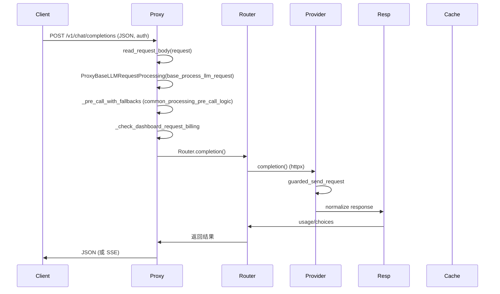

# 一次真实操作全路径走读

> **代码基准**：`main@e46fe2e2dc1bdd19f7953bd47dc3d770876ac74e（工作区干净）`；核实日期：2026-11-17。
> **范围**：一个 Non-streaming `POST /v1/chat/completions` 请求，从进入 proxy 到返回 `{"choices":[...],"usage":{...}}`。不包含 streaming、agentic 分支、batch/assistant。
> **前置**：严格追随 L1 骨架；生产视角在前，开发层记录锚点。未标注 `+N` 的偏移是 `+0`（函数签名行）。

## 0. 结论速览

一次标准调用都是 **9 步串行**，每一步都有明确的前置条件和失败标记。核心事实：
1. 入口是 `async def chat_completion`（`proxy_server.py 13580`），不是 `litellm.completion`。
2. 请求体先在后端被 `_REQUEST_FIELDS.validate_python` 确认，再交给 `Router`。
3. `Router.completion()` 是 hub：没有 Router 就走直链（`litellm.completion`）；有 Router 就走路由链。
4. 供应商 HTTP 调用由各 provider 子模块（如图 `openai/completion/handler.py`）完成，走 `litellm/llms/custom_httpx/http_handler.py` 发出的 `httpx`；输出经 `litellm.types.responses` 标准化。
5. 失败处理贯穿三层：前置（auth/rate）→ 后置（`handle_llm_api_exception`）。
6. **最长路径**：`pre_call → validation → router.store_request + auth_check → routing → provider → logging + cost → response`。

## 1. 参与者、前置条件与真实入口

| 角色 | 前置条件 | 入口 |
|---|---|---|
| 客户端（OpenAI SDK / curl / 代理） | HTTP 可达，有 `Authorization: Bearer <key>` | `POST /v1/chat/completions` |
| Proxy Server | 已启动；DB/Redis 可用；key 合法 | `proxy_server.chat_completion` |
| Router | `litellm.Router` 实例，`model_list` 已加载 | `litellm/router.py Router.completion` |
| Provider | HTTP endpoint 可达 | `CustomLLM.completion` |
| Logger/Callback | 日志回调注册（如 `SuccessCallback`） | `litellm.utils` callbacks |

## 2. 真实流程（9 步）

### 1. 读 body（`read_request_body`）

`ProxyBaseLLMRequestProcessing` 先读目标：`data: Final = await read_request_body(request=request)`，`litellm/proxy/proxy_server.py 13580`。
- 读入 data 后往 `metadata` 写 `user_api_key_user_id` / `team_id` / `org_id`/`agent_id` 元组。

### 2. 类型校验

`_REQUEST_FIELDS.validate_python(self.data)`（`TypeAdapter(Mapping[str, object], ConfigDict(strict=True))`，`common_request_processing.py 875`），把原始 JSON 转为 Mapping；失败的报错：400 — SchemaValidation 错误。

`[对照]` `litellm/proxy/proxy_server.py 13580` `data: Final = await read_request_body(request=request)` 先读 body。

### 3. 前置检查（`common_processing_pre_call_logic`）

这步完成：
- 日志 `logging_obj` 创建；`router` 检测（如果 `llm_router is None` 则请求直连供应商）。
- **auth**：`user_api_key_dict` — `check_valid_key`. 下一个是 **rate limit**。`ProxyRateLimitError` 出现时，由 `pre_call_rate_limit_exception` 处理：尝试 fallback 到最新 key（如果开启 per-model rate limit fallback）。
- 级别分发、`_hierarchical_router_settings`、fallbacks 解析。

### 4. 仪表 Billing

`_check_dashboard_request_billing(self, user_api_key_dict, llm_router)` — 非付费不处理。

### 5. 路由（`Router.completion()`）

**入口**：`litellm/router.py` `Router.completion()` — 运行时由 metaclass 分发到 `RustCore.completion`（`litellm/router_rust/core.py 2668`）；`RustCore` 调用 `_call_sync(plan_for("completion"), request_from_call("completion", args, kwargs))` 把计划交给 `host.invoke(op)` 执行（实现在 `litellm/router_rust/invoke/endpoints.py`）。

核心执行：
- 把 `model` 映射到 `model_list` group（非 `auto_router` 场景叫 `model_group`，`[推断]` 见下文 `03-请求路由与负载均衡` 层）。
- 如果 `model_list` 失效（如外部状态下沉），它尝试 _refresh_model_list_。

### 6. 供应商 HTTP 调用

`Router.completion` 调用 provider 的 `completion()`（如 `litellm/llms/openai/completion/handler.py 32` 起）；请求由 `litellm/llms/custom_httpx/http_handler.py` 的 `httpx` 发出。
- `CustomLLM` 层（`litellm/llms/custom_llm.py`）定义统一的 `completion`/`streaming`/`acompletion`/`astreaming` 接口，每个 provider 继承后实现自己的请求/鉴权。
- 请求用 `httpx.post(...)`, `httpx.AsyncClient.post(...)`，带 `Authorization: Bearer xxx` 与 standard headers。

### 7. 标准输出

供应商原样 `response` → `litellm.types.responses.OpenAIChatCompletionResponse`（或 `CustomStreamWrapper`）：
- 如果 `streaming`，分 chunk。
- 用 `litellm.utils` 做最终包装。

### 8. success handler + cost

`litellm/utils.py` 调用 summary：tokens、cost、total（调用 `litellm.cost_calculator`）。
- 调用 `SuccessCallback`（logging 不会 loss）。

### 9. 返回 Proxy

`ProxyBaseLLMRequestProcessing` 把 `logging_obj` 回执，返回 `final_response`。
- 如果是 streaming，SSE。
- 否则返回 JSON。

### 10. 返回给客户端

`FastAPI` 返回 200 JSON，错误 400/401/429/500。

## 3. 失败可见（生产视角）

| 失败点 | 结果 | 错误码 |
|---|---|---|
| auth 失败 | key not exist | 401 |
| rate limit | fallback 年到 _warn 中，如果用完则 | 429 |
| model 不存在 | 404 |
| 供应商错误 | 代理透传错误 | 500 |
| 超时 | total_timeout | 408 |
| body 非法 | 验证不通过 | 400 |
| 代理宕机 | 服务不可用 | 503 |

## 4. 开发层（链路与锚点）

| 步骤 | 文件 | 符号 |
|---|---|---|
| 入口端点 | `litellm/proxy/proxy_server.py` | `async def chat_completion` (13580) |
| 读 body | `litellm/proxy/proxy_server.py` | `read_request_body` |
| 请求处理 | `litellm/proxy/common_request_processing.py` | `ProxyBaseLLMRequestProcessing.base_process_llm_request` (3710), `_process_llm_request`, `_pre_call_with_fallbacks` (3350) |
| 类型校验 | `litellm/proxy/common_request_processing.py` | `_REQUEST_FIELDS` (TypeAdapter) |
| 4. 仪表 | `litellm/proxy/common_request_processing.py` | `_check_dashboard_request_billing` |
| 5. 路由 | `litellm/router.py` | `Router.completion()` |
| 6. 调供应商 | `litellm/llms/custom_llm.py` | `CustomLLM.guarded_send_request` |
| 7. 转换 | `litellm/types/` | `OpenAIChatCompletionResponse` |
| 8. 成本 | `litellm/utils.py` | `completion_chars_cost` |
| 10. 返回 | `litellm/proxy/proxy_server.py` | `open_sse_before_first_byte` |

## 5. 验证与后续

- 以上全路径可以**只看代码**验证：`grep` 定位 `proxy_server.py:13580` 入口 + `common_request_processing.py:3710` + `custom_llm.py` 统一接口。
- 后续查看 L3 链：路由层的fallback、节流具体分支。
- 如想验证，在 dev config 下启动一个 `litellm` 代理, 发一个 curl 到有 `mock` 的 provider。
