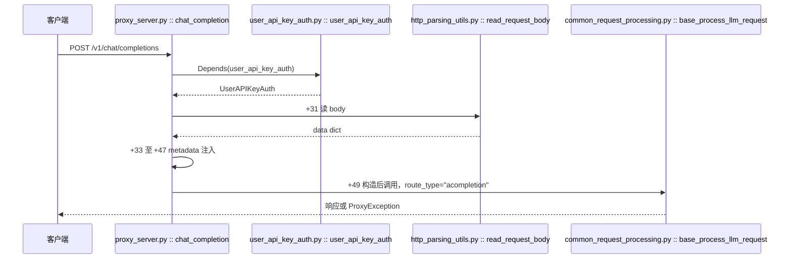

# 端点与请求解析

> 所属层级：第三层（主链路拆解） | 拆解对象：第二层场景的跳 1-3

## 本篇回答的问题

HTTP 报文到达 4000 端口之后、鉴权完成之后，body 是怎么变成带元数据的 `data` dict 的？中间有哪些防御性处理？

## 调用链

主链入口符号（spec 事实 8 实测于 `0608a41a07`）：



后续主链继续往 `common_request_processing.py :: ProxyBaseLLMRequestProcessing :: base_process_llm_request()`（`+0`，3175 起）走，进鉴权后的 pre-call 处理（第三层第 3 篇）。鉴权本身先于这一切，见下一篇。

## 端点函数解剖

```
litellm/proxy/proxy_server.py :: chat_completion() :: +0
```

签名只有四个参数：`request`、`fastapi_response`、可选的路径参数 `model`、鉴权产物 `user_api_key_dict`（`Depends(user_api_key_auth)`）。请求体不在签名里，因为 body 要在函数体内手动读（多个路由路径共享此函数，且 body 读取需要容错）。

函数体前半段做两件事。

**第一件事，读 body**（`proxy_server.py :: chat_completion() :: +31`）：

```python
data: Final = await read_request_body(request=request)
```

**第二件事，metadata 注入**（`proxy_server.py :: chat_completion() :: +33 至 +47`）：

```python
if not isinstance(data.get("metadata"), dict):
    # Covers both missing and JSON-string metadata (multipart /
    # extra_body); otherwise `data["metadata"][k] = v` below raises
    # TypeError on a string value and 500s the request.
    data["metadata"] = {}
if hasattr(user_api_key_dict, "user_id") and user_api_key_dict.user_id is not None:
    data["metadata"]["user_api_key_user_id"] = user_api_key_dict.user_id
...
```

注入键与来源一一对应：

| 注入键 | 来源字段 | 用途 |
|---|---|---|
| `user_api_key_user_id` | `UserAPIKeyAuth.user_id` | 记账归属到用户 |
| `user_api_key_team_id` | `UserAPIKeyAuth.team_id` | 记账归属到团队 |
| `user_api_key_org_id` | `UserAPIKeyAuth.org_id` | 记账归属到组织 |
| `user_api_key_org_alias` | `UserAPIKeyAuth.organization_alias` | 展示用 |
| `agent_id` | `UserAPIKeyAuth.agent_id` | agent 归因 |

防御点：metadata 缺失或不是 dict（比如 multipart 表单里是 JSON 字符串）时先归一为空 dict，否则后面的 `data["metadata"][k] = v` 会在字符串上抛 TypeError。这个防御有对应的内联注释，就在 `chat_completion() :: +33`。

metadata 注入完成后，`chat_completion() :: +49` 构造处理骨架并把请求交给下一跳：

```python
base_llm_response_processor: Final = ProxyBaseLLMRequestProcessing(data=data)
```

## read_request_body 的完整逻辑

```
litellm/proxy/common_utils/http_parsing_utils.py :: read_request_body() :: +0
```

分支树（全部路径与函数体的实测对应）：

```
read_request_body(request)
├─ request is None → {}                                   # +10 处
├─ is_otlp_trace_request → {}                             # OTLP 追踪上报走独立解析
├─ 请求对象上已有缓存的解析结果 → 直接复用                  # _safe_get_request_parsed_body
├─ content-type 是二进制（protobuf 等）→ _parse_binary_body
├─ content-type 是表单 → 读 form，metadata 若是 JSON 字符串则解析
└─ 否则（常规 JSON）
   ├─ body 为空 → {}
   ├─ orjson.loads 成功 → 经 _JSON_REQUEST_BODY（pydantic TypeAdapter）校验
   └─ orjson.JSONDecodeError → surrogate 修复后重试（处理非法 UTF-16 代理对）
```

关键常量与助手符号：

| 符号 | 定义行（`http_parsing_utils.py`） | 作用 |
|---|---|---|
| `_JSON_REQUEST_BODY` | `+0`（39） | `TypeAdapter(Mapping[str, object])`，顶层必须是对象 |
| `_DECODED_JSON` | `+0`（38） | `TypeAdapter(object)`，容忍任意顶层类型 |
| `_BINARY_CONTENT_TYPES` | `+0`（35） | 二进制 content-type 白名单 |
| `_normalize_media_type` | `+0`（104） | 规整 content-type 便于比对 |
| `_is_form_content_type` | `+0`（111） | 是否表单 |
| `_parse_binary_body` | `+0`（198） | 二进制体解析 |
| `_mark_body_received` | `+0`（212） | 计量请求体读取字节 |
| `is_otlp_trace_request` | `+0`（220） | OTLP 上报识别 |
| `_parse_form_metadata` | `+0`（226） | 表单里字符串 metadata 解析 |
| `_read_form_data` | `+0`（248） | 读表单数据 |
| `_safe_get_request_parsed_body` | `+0`（436） | 取缓存解析结果 |
| `safe_set_request_parsed_body` | `+0`（467） | 缓存解析结果 |
| `safe_get_request_headers` | `+0`（512） | 安全取请求头 |

设计意图解读：

| 处理 | 为什么需要 |
|---|---|
| 解析结果缓存到 request 对象 | 同一请求的 body 可能被读多次（端点、hook、guardrail），避免重复消费流 |
| orjson 而非标准 json | 热路径性能 |
| pydantic TypeAdapter 校验 | 在入口处把非 dict 的顶层 JSON（数组、字符串）挡下来 |
| surrogate 修复重试 | 客户端发非法编码时不至于直接 500；超过 `MAX_REQUEST_BODY_SIZE_TO_REPAIR_MB` 的巨体跳过修复、立即 400 |

`read_request_body` 的异常出口也是防御性的：`ValidationError` 时对 pass-through 端点、Lens 路由等放行返回 `{}`，否则抛 `ProxyException`（400）；`ClientDisconnect` 转 `HTTPException`（客户端断开码）。

## ProxyBaseLLMRequestProcessing 构造

```
litellm/proxy/common_request_processing.py :: ProxyBaseLLMRequestProcessing :: __init__() :: +0
```

构造器在 `common_request_processing.py` 1196 起（类体内部 `__init__`，偏移 `+0` 表示 def 行）：

```python
def __init__(self, data: dict, served_model: str | None = None):
    self.data = data
    self.served_model = served_model
    self._tags_before_guardrails: frozenset[str] | None = None
    self.route_type: str | None = None
```

这个类是所有 LLM 端点的共享处理骨架：chat completions、responses API、Anthropic messages、embeddings 等端点都用它，靠 `route_type`（如 `"acompletion"`、`"anthropic_messages"`）区分后续分发到哪个 SDK 方法。实例是每请求新建的，无共享可变状态。

## 错误传播从这里开始成形

`base_process_llm_request()`（`common_request_processing.py :: base_process_llm_request :: +0`，3175 起）把后续处理包进两重防线：`open_sse_before_first_byte`（keepalive）和 `_within_total_timeout`（总超时）。端点函数再在 try/except 里包它，异常分派表：

| 异常 | 端点层处理 | 源码锚点 |
|---|---|---|
| `ModifyResponseException` | 流式走 `_stream_chat_passthrough_block`，非流式经 `_passthrough_block_response` 构造 `finish_reason="content_filter"` 的假响应（guardrail 拦截，`proxy_server.py :: _passthrough_block_response` 13273 起） | `chat_completion() :: +74`（except 分支） |
| `RejectedRequestError` | 构造带 `finish_reason` 的 `ModelResponse` 返回（guardrail/缓存拒绝） | `chat_completion() :: +79` |
| 其他 `Exception` | 经 `handle_llm_api_exception()` 归一：先过 `post_call_failure_hook` 允许回调替换异常，再包成 OpenAI 兼容的 `ProxyException` 抛出（`common_request_processing.py :: ProxyBaseLLMRequestProcessing :: handle_llm_api_exception :: +0`，4659 起） | `chat_completion() :: +112` |

### 缺 role 的 400（spec 行为变化，事实 B/#51124）

旧实现会在消息缺 `role` 时自动补 `"user"`，新实现改抛 `MissingMessageRoleError`（`litellm/exceptions.py :: MissingMessageRoleError :: +0`；父链 `MalformedRequestFieldError` → `BadRequestError` → `openai.BadRequestError`），对外是 HTTP 400。校验入口在 `litellm/main.py :: completion :: +0`（5564 起）的请求整形段调 `validate_and_fix_openai_messages`（`litellm/utils.py :: validate_and_fix_openai_messages :: +0`），调用处签名带 `model` 与 `request_kwargs`：

```python
messages = validate_and_fix_openai_messages(
    messages=messages, model=model, request_kwargs=_REQUEST_KWARGS_ADAPTER.validate_python(kwargs)
)
```

函数实现在 `litellm/utils.py :: validate_and_fix_openai_messages :: +0`，签名带 `model` 与 `request_kwargs`；逐条消息的 role 修复/校验落在 `litellm/utils.py :: validate_chat_completion_user_messages :: +0`。同步 `completion()` 被 `litellm/main.py :: acompletion :: +0`（652 起）经 `run_in_executor` 丢进线程池执行（spec 事实 2），所以这条校验在代理主链上同样生效；代理侧的消息整形另有 `litellm/proxy/common_request_processing.py :: ProxyBaseLLMRequestProcessing :: common_processing_pre_call_logic :: +0` 等 pre-call 步骤，见第三层第 3 篇。

### token_counter 回 x-litellm-call-id（spec 行为变化，#51037）

`/utils/token_counter` 端点（`proxy_server.py :: token_counter :: +0`，16094 起）现在把计数结果与发起推理调用的 `litellm_call_id` 关联：签名带 `litellm_call_id: Annotated[str | None, Header(alias=LITELLM_CALL_ID_HEADER)]`（调用方可带 `x-litellm-call-id` 请求头进来），函数体在 16114 处把 `count_request_tokens(...)` 包进 `litellm/proxy/common_utils/token_count_log.py :: answered_with_litellm_call_id :: +0`（143 起）。该助手在成功应答与错误应答上都 `setdefault(LITELLM_CALL_ID_HEADER, litellm_call_id)`，把调用 id 写回响应头，这样计数的日志行能与那次推理调用的日志 join 起来。常量 `LITELLM_CALL_ID_HEADER = "x-litellm-call-id"` 定义在 `litellm/proxy/common_utils/openai_error_payload.py :: LITELLM_CALL_ID_HEADER :: +0`（19 起），错误载荷同样带这个头。

**计数口径更新（#51447 / #51334）**：token 计数不再只数消息正文，还计入对话中途的工具变化与 Anthropic server tool 历史。`litellm/litellm_core_utils/token_counter.py` 新增 `_tool_change_tokens`（1990 起，`count_function` 判据，工具结构变了会额外计 token）、`_is_text_block`（1874）、`_has_only_text_content`（1880）、`has_only_text_content`（1892，用于判定纯文本消息）——中途换工具或带 server tool 历史的消息，计数结果会随之变化。

### SSE keepalive 与 guardrail block（spec 事实 B/#51114）

`base_process_llm_request` 的返回语句（`+43` 处）调用 `open_sse_before_first_byte`（`common_request_processing.py :: open_sse_before_first_byte :: +0`，1719 起），把上游 `ttft` 静默期填上 `: ping` 注释帧。端点把 `on_passthrough_block` 回传进来：当 keepalive 已打开响应、之后 guardrail 拦截时，流式 block 经 `_late_block_or_failure`（`common_request_processing.py :: _late_block_or_failure :: +0`，1683 起）中继给 `on_passthrough_block`，把 block 的流透传给客户端，而不是把 block 当普通失败帧。`ttft_keepalive_interval`（`common_request_processing.py :: ttft_keepalive_interval :: +0`，1623 起）决定是否启用 keepalive，是否启用取决于 `litellm_settings.sse_keepalive_ping_interval_seconds`。

`ModifyResponseException` 定义在 `litellm/exceptions.py :: ModifyResponseException :: +0`（1357 起），`RejectedRequestError` 定义在同文件 700 起（`BadRequestError` 子类）。`ProxyException` 定义在 `litellm/proxy/_types.py :: ProxyException :: +0`（3946 起），是所有端点对外错误的一致形状（OpenAI 风格 error 对象 + code/message/param）。

## 与下一跳的交接

本篇结束时，`data` 已含 metadata，`ProxyBaseLLMRequestProcessing` 实例已持有它。下一步是 `base_process_llm_request` → 鉴权后的 pre-call 处理（继续第三层第 3 篇）。鉴权本身先于这一切，见下一篇。