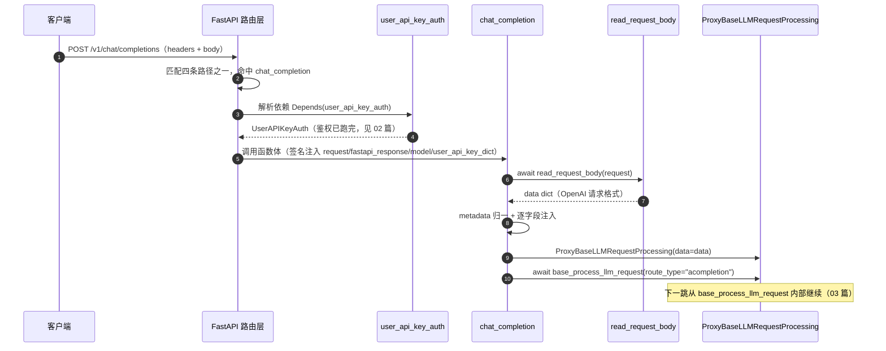

# 端点与请求解析：HTTP 报文如何变成带元数据的 data dict

> 所属层级：第三层（主链路逐跳拆解） | 拆解对象：第二层场景的跳 1、跳 3
> 本篇基准提交：`411b64dc7a`（工作区当前 HEAD）

一句话定位：这一跳把 `POST /v1/chat/completions` 的原始 HTTP 报文，经过 FastAPI 路由匹配、函数体外的鉴权依赖、body 解析、metadata 注入四道工序，变成一个干净的 `data` dict，并把它交给请求处理骨架。全程不碰模型、不发上游请求。

术语约定（首现已解释）：`Deployment`（一个可调用的模型实例，含 `model_name` 与 `litellm_params`）、`route_type`（同一处理骨架区分后续派发到哪个 SDK 方法的字符串，本场景是 `"acompletion"`）、`UserAPIKeyAuth`（鉴权产物对象，携带 key 身份与权限）、`metadata`（网关在请求体里注入的归属信息区）。

## 本跳在主链中的位置

主链 13 跳里，本篇覆盖跳 1（HTTP 进入、路由匹配）与跳 3（读 body、注入 metadata）。跳 2（鉴权）物理上发生在跳 1 与跳 3 之间，但它由 `Depends` 触发、独立成篇，见 02 篇。本跳的上游是 curl/TCP 报文，下游交给 `base_process_llm_request`（03 篇从它的内部继续拆）。



## 跳 1：HTTP 进入与路由匹配

锚点：`litellm/proxy/proxy_server.py :: chat_completion() :: +0`

FastAPI 按装饰器上的路径匹配请求。这个函数同时挂在四条路径上，四个路径共用一个函数体：

| 路径 | 说明 |
|---|---|
| `/v1/chat/completions` | 本场景走这条 |
| `/chat/completions` | 不带版本前缀的等价路径 |
| `/engines/{model:path}/chat/completions` | Azure 形态，模型在路径里 |
| `/openai/deployments/{model:path}/chat/completions` | Azure deployments 形态 |

进：HTTP 报文（headers + body）。出：`Request` 对象、`Response` 对象，以及一个已经解析好的鉴权依赖值。

签名只有四个参数（`chat_completion() :: +0` 到 `+4`）：`request: Request`、`fastapi_response: Response`、可选路径参数 `model: str | None`、鉴权产物 `user_api_key_dict: UserAPIKeyAuth = Depends(user_api_key_auth)`。请求体不在签名里，因为 body 要在函数体内手动读：多个路由路径共享此函数，且 body 解析需要容错（非 JSON、超大、非法编码都要各自处理，不能交给框架默认的 JSON 解析）。

**鉴权先于函数体**：装饰器上的 `dependencies=[Depends(user_api_key_auth)]` 与签名里对同一依赖的第二次声明，让 `user_api_key_auth` 在 `chat_completion` 函数体第一行之前就执行完毕。函数体拿到的 `user_api_key_dict` 已经是鉴权结果，不是鉴权协程。这就是主链把鉴权记为独立跳 2 的原因：它的时间点在跳 1 与跳 3 之间，但代码上由 FastAPI 依赖注入驱动。鉴权内部做什么，见 02 篇。

函数体第一件事是声明引用的 proxy 全局（`chat_completion() :: +5`，`general_settings`、`proxy_logging_obj`、`llm_router`、`user_temperature`、`user_request_timeout`、`user_max_tokens`、`user_api_base`）。这些是 proxy 启动时建好的进程级对象，后续 base_process_llm_request 要用它们。

## 跳 3：读 body，注入 metadata

### 3.1 读 body

锚点：`litellm/proxy/proxy_server.py :: chat_completion() :: +31`

```python
data: Final = await read_request_body(request=request)
```

被调方：`litellm/proxy/common_utils/http_parsing_utils.py :: read_request_body() :: +0`。

返回值是一个 `dict`（OpenAI 请求格式，本场景形如 `{"model": "gpt-4o-mini", "messages": [...]}`）。它的完整分支树（逐行核对到 `read_request_body()` 函数体）：

```text
read_request_body(request)
├─ request is None → 返回 {}                                    (+10)
├─ is_otlp_trace_request(request) → 返回 {}                     (+13，OTLP 追踪上报走独立解析)
├─ 已缓存的解析结果存在 → 直接复用                                (+17，_safe_get_request_parsed_body)
├─ content-type 取出 content_type                                (+21，safe_get_request_headers + get)
├─ _normalize_media_type(content_type) 在 _BINARY_CONTENT_TYPES
│    → await request.body()，_mark_body_received 计量，_parse_binary_body   (+25 到 +28)
├─ _is_form_content_type(content_type)
│    → 读表单；metadata 若是 JSON 字符串则 _parse_form_metadata 解析        (+29 到 +36)
└─ 否则（常规 JSON）
   ├─ await request.body()，_mark_body_received 计量             (+39 到 +40)
   ├─ body 为空 → parsed_body = {}                               (+43)
   └─ 否则
      ├─ orjson.loads + _JSON_REQUEST_BODY.validate_python 成功 → dict      (+46 至 +47)
      └─ orjson.JSONDecodeError
         ├─ 体积超过 MAX_REQUEST_BODY_SIZE_TO_REPAIR_MB → 立即抛 ProxyException 400   (+52 到 +60)
         └─ 否则：utf-8 解码 → 正则剔除非法代理对 → json.loads →
            _DECODED_JSON 校验 → 可编码性检查 → _JSON_REQUEST_BODY 校验      (+62 到 +75)
```

几个关键设计，都是为本跳的「多路径共享 + body 可能被读多次」服务的：

| 处理 | 为什么需要 | 锚点 |
|---|---|---|
| 解析结果缓存到 request 对象 | 同一请求的 body 会被端点、hook、guardrail 多次读取，缓存避免重复消费流 | `http_parsing_utils.py :: _safe_get_request_parsed_body() :: +0` |
| orjson 而非标准 json | 热路径解析性能 | `read_request_body() :: +46` |
| pydantic `TypeAdapter(Mapping[str, object])` 校验 | 在入口把非对象顶层 JSON（数组、字符串）挡下 | `http_parsing_utils.py :: _JSON_REQUEST_BODY :: +0` |
| surrogate 修复重试 | 客户端发非法 UTF-16 代理对时不至于直接 500 | `read_request_body() :: +62` 到 `+75` |
| 超大 malformed body 跳过修复 | 修复要跑两趟全量 `re.sub`，会阻塞事件循环，超阈值直接 400 | `read_request_body() :: +52` 到 `+60` |

关键常量与助手符号（同文件，`+0` 均指定义行）：

| 符号 | 作用 |
|---|---|
| `_JSON_REQUEST_BODY` | `TypeAdapter(Mapping[str, object])`，顶层必须是对象 |
| `_DECODED_JSON` | `TypeAdapter(object)`，容忍任意顶层类型，用于 surrogate 修复后的中间校验 |
| `_BINARY_CONTENT_TYPES` | 二进制 content-type 白名单（protobuf 等） |
| `_normalize_media_type()` | 规整 content-type 便于比对 |
| `_is_form_content_type()` | 判断是否表单 |
| `_parse_binary_body()` | 二进制体解析 |
| `_mark_body_received()` | 计量请求体读取字节 |
| `is_otlp_trace_request()` | OTLP 上报识别 |
| `_parse_form_metadata()` | 表单里字符串 metadata 解析 |
| `_read_form_data()` | 读表单数据 |
| `_safe_get_request_parsed_body()` | 取缓存解析结果 |
| `safe_set_request_parsed_body()` | 写缓存解析结果 |
| `safe_get_request_headers()` | 安全取请求头 |

`read_request_body` 的异常出口也是防御性的：`ValidationError` 时对 pass-through 端点等放行返回 `{}`，否则抛 `ProxyException`（400）；客户端断开转 `HTTPException`。这些出口在 `read_request_body()` 函数体尾部（本场景走不到，body 是合法 JSON）。

### 3.2 metadata 归一与注入

锚点：`litellm/proxy/proxy_server.py :: chat_completion() :: +32` 到 `+47`

整段包在 `if user_api_key_dict is not None:` 里（`+32`），所以鉴权依赖返回 `None` 时整个注入段被跳过。

第一步是归一（`+33` 到 `+37`）：

```python
if not isinstance(data.get("metadata"), dict):
    data["metadata"] = {}
```

这是必需要有的防御：metadata 缺失、或是 JSON 字符串（multipart 表单与 extra_body 场景下会出现字符串形态）时，如果直接执行后面的 `data["metadata"][k] = v`，会在字符串上抛 `TypeError`，把请求变成 500。归一成空 dict 后，字符串形态的原始 metadata 会被丢弃（表单场景已在 `read_request_body` 里解析过）。

第二步是逐字段注入（`+38` 到 `+47`），每个字段都是「属性存在且非 None 才写」，五个键与来源一一对应：

| 注入键 | 来源字段（`UserAPIKeyAuth`） | 用途 |
|---|---|---|
| `user_api_key_user_id` | `user_id` | 记账归属到用户 |
| `user_api_key_team_id` | `team_id` | 记账归属到团队 |
| `user_api_key_org_id` | `org_id` | 记账归属到组织 |
| `user_api_key_org_alias` | `organization_alias` | 展示用别名 |
| `agent_id` | `agent_id` | agent 归因 |

对 master key 请求，`UserAPIKeyAuth` 是凭空构造的全权限对象，`user_id` 等可能为 None，于是对应键不写入。本场景是 master key，所以 metadata 通常只剩空 dict 或少量字段。

### 3.3 构造处理骨架并交接

锚点：`litellm/proxy/proxy_server.py :: chat_completion() :: +49`

```python
base_llm_response_processor: Final = ProxyBaseLLMRequestProcessing(data=data)
```

被调方：`litellm/proxy/common_request_processing.py :: ProxyBaseLLMRequestProcessing :: __init__() :: +0`。

构造器把 `data` 存进 `self.data`，并把几个每请求状态位归零（`self.served_model = None`、`self.route_type = None`、`self._tags_before_guardrails = None`）。这个类是所有 LLM 端点共享的处理骨架：chat completions、responses API、Anthropic messages、embeddings 都用它，靠后续传入的 `route_type` 区分派发到哪个 SDK 方法。实例是每请求新建的，无共享可变状态。

紧接着 `chat_completion() :: +51` 把请求交给下一跳：

```python
result: Final = await base_llm_response_processor.base_process_llm_request(
    request=request, fastapi_response=fastapi_response, user_api_key_dict=user_api_key_dict,
    route_type="acompletion", proxy_logging_obj=proxy_logging_obj, llm_router=llm_router,
    general_settings=general_settings, proxy_config=proxy_config, select_data_generator=select_data_generator,
    model=model, user_model=user_model, user_temperature=user_temperature,
    user_request_timeout=user_request_timeout, user_max_tokens=user_max_tokens, user_api_base=user_api_base,
    version=version, on_passthrough_block=lambda block: _stream_chat_passthrough_block(block, user_api_key_dict, request),
)
```

参数怎么传：`data` 已经在构造器里存进 `self.data`，所以这里不再传；其余的请求上下文（`request`、`fastapi_response`、鉴权产物、各 `user_*` 默认参数、路由器、全局配置）全部按关键字传进去。`route_type="acompletion"` 是本场景的派发目标。`on_passthrough_block` 是一个回调，guardrail 拦截时用它把 block 以流的形式透传给客户端（本场景非流式且无 guardrail，走不到）。

返回值 `result` 怎么处理（`chat_completion() :: +70` 到 `+73`）：是 `BaseModel` 就经 `model_dump_with_preserved_fields(result, exclude_unset=True)` 转成 dict，由 FastAPI 序列化为 JSON；否则原样返回（SSE 流等形态）。

## 错误传播：本跳的三条 except 分支

端点函数把 `base_process_llm_request` 包进 try/except（`chat_completion() :: +50` 起 try，三个 except 分别在 `+74`、`+79`、`+112`）。本跳自己不抛业务异常，但下一跳抛出的异常会一路冒到这里被翻译：

| 异常 | 端点层处理 | 锚点 |
|---|---|---|
| `ModifyResponseException` | 流式走 `_stream_chat_passthrough_block`；非流式先 `_record_passthrough_block` 记账，再经 `_passthrough_block_response` 构造 `finish_reason="content_filter"` 的假响应 | `chat_completion() :: +74`；`proxy_server.py :: _passthrough_block_response() :: +0` |
| `RejectedRequestError` | 跑 `post_call_failure_hook` 留失败日志，再构造 `ModelResponse`（usage 全 0）返回；stream 为真时包成 `CustomStreamWrapper` 流式返回 | `chat_completion() :: +79` 到 `+133` |
| 其他 `Exception` | 交给 `handle_llm_api_exception` 归一：先过 `post_call_failure_hook` 允许回调替换异常，再包成 OpenAI 兼容的 `ProxyException` 抛出 | `chat_completion() :: +112`；`common_request_processing.py :: ProxyBaseLLMRequestProcessing :: handle_llm_api_exception() :: +0` |

本场景（成功路径）走不到任何 except 分支。

## 调用关系表（关键边）

| 调用方 | 被调用方 | 传什么 | 返回什么 |
|---|---|---|---|
| FastAPI 路由层 | `proxy_server.py :: chat_completion()` | HTTP 报文解析成的 4 个签名参数 | JSON dict 或 SSE 流 |
| FastAPI 依赖注入（先于函数体） | `user_api_key_auth.py :: user_api_key_auth()` | `request`、各 API key header | `UserAPIKeyAuth` |
| `chat_completion()` | `http_parsing_utils.py :: read_request_body()` | `request` | `data` dict |
| `read_request_body()` | `orjson.loads` / `_JSON_REQUEST_BODY.validate_python` | 原始 body bytes | 解析后的映射 |
| `chat_completion()` | `common_request_processing.py :: ProxyBaseLLMRequestProcessing` 构造器 | `data` | 处理骨架实例 |
| `chat_completion()` | `ProxyBaseLLMRequestProcessing :: base_process_llm_request()` | `route_type="acompletion"` + 请求上下文 | 响应对象 / SSE 流 / 抛 `ProxyException` |

## 状态变化复述

进入本跳前：只有 HTTP 报文。离开本跳时：`data` 是 dict 且已含 `metadata`（本场景多为空 dict），`ProxyBaseLLMRequestProcessing` 实例持有它，`route_type` 尚未设置（要到 `_process_llm_request` 里才设）。鉴权产物 `user_api_key_dict` 已经存在，但只被用来注入 metadata，真正的权限/预算消费在下一跳之后的 pre-call 阶段。

## 未确认项

- `chat_completion()` 装饰器四条路径的装饰器行号未逐一核对（本篇只锚函数定义行与函数体内偏移，装饰器块在 `+0` 之前，不影响偏移语义）。
- `handle_llm_api_exception` 内部逐行实现未读取，不臆测，本篇只引用它的职责与调用点（第三层收尾篇展开）。
- surrogate 修复里 `MAX_REQUEST_BODY_SIZE_TO_REPAIR_MB` 的具体阈值数值未读取，不臆测。

## 源码索引

| 符号 | 文件 :: 符号 | 绝对定义行 |
|---|---|---|
| 端点函数 | `litellm/proxy/proxy_server.py :: chat_completion` | 13290 |
| passthrough block 响应 | `litellm/proxy/proxy_server.py :: _passthrough_block_response` | 13205 |
| body 解析 | `litellm/proxy/common_utils/http_parsing_utils.py :: read_request_body` | 272 |
| 处理骨架类 | `litellm/proxy/common_request_processing.py :: ProxyBaseLLMRequestProcessing` | 2382 |
| 入口委托 | `litellm/proxy/common_request_processing.py :: base_process_llm_request` | 3180 |
| 异常归一 | `litellm/proxy/common_request_processing.py :: handle_llm_api_exception` | 4664 |
