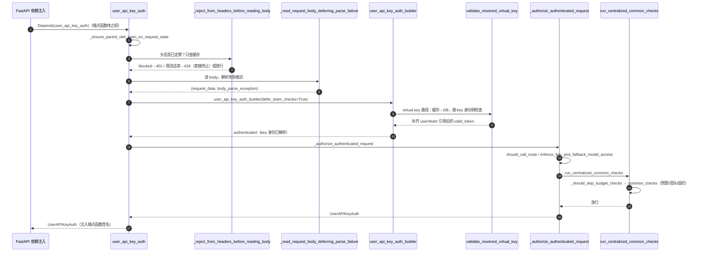

# 鉴权管线：API key 如何变成 UserAPIKeyAuth，以及预算与模型门禁

> 所属层级：第三层（主链路逐跳拆解） | 拆解对象：第二层场景的跳 2
> 本篇基准提交：`411b64dc7a`（工作区当前 HEAD）

一句话定位：`Authorization: Bearer <key>` 在 FastAPI 调用端点函数体之前被校验，经过「读 body 前先拒 → 读 body → 构建 key 身份 → 授权检查（模型门禁 + 预算 + 请求体安全）」四段，产出一个 `UserAPIKeyAuth` 对象，或者以 `ProxyException` 终止请求。

术语约定：`virtual key`（proxy 自己签发的 `sk-` 形态 key，对应 DB 里的 `LiteLLM_VerificationToken` 行）、`master key`（proxy 根凭证，等于管理员）、`model group`（router 里的模型组名，一个组可挂多个 deployment）、`end user`（调用方在请求体 `user` 字段里声明的最终用户）。

## 本跳在主链中的位置

主链 13 跳里，本篇覆盖跳 2。它的时间点夹在跳 1（路由匹配）与跳 3（读 body、注 metadata）之间，由 FastAPI 的 `Depends(user_api_key_auth)` 驱动，物理上先于 `chat_completion` 函数体。上一跳交给它的是原始 HTTP 报文；它交给下一跳的是一个 `UserAPIKeyAuth` 对象（供跳 3 注入 metadata）和一个已通过门禁的「放行许可」。鉴权失败则请求在此终止，不会进入跳 3。



## 入口编排

锚点：`litellm/proxy/auth/user_api_key_auth.py :: user_api_key_auth() :: +0`

签名（`+0` 到 `+8`）除了 `request`，还通过 `fastapi.Security` 声明了六个可选的凭证 header：`api_key`（标准 Authorization）、`azure_api_key_header`、`anthropic_api_key_header`、`google_ai_studio_api_key_header`、`azure_apim_header`、`custom_litellm_key_header`。这样多种云厂商形态的 key 都能从各自的 header 进来。

外层函数只做编排，逐步拆解：

| 步 | 动作 | 锚点 | 失败行为 |
|---|---|---|---|
| 1 | 建 server span 并挂到 `request.state`，保证坏 body 也有 trace | `+17` `_ensure_parent_otel_span_on_request_state` | 不失败 |
| 2 | 取路由字符串 `route = get_request_route(request)` | `+19` | 不失败 |
| 3 | **读 body 前先拒**：头信息已定罪就终止 | `+21` `_reject_from_headers_before_reading_body` | blocked 抛 401；限流击穿抛 429 |
| 4 | 读 body 但推迟解析失败 | `+24` `_read_request_body_deferring_parse_failure` | 返回 `(dict, ProxyException \| None)`，不立即抛 |
| 5 | 进入 `phase_span(f"auth {route}")` + `service_target(AUTH_OBJECTS_TARGET)` + `spend_counter_batch_scope(_spend_counter_store())` 复合 with 块 | `+32` 到 `+35` | 不失败 |
| 6 | 调 `user_api_key_auth_builder(..., defer_team_checks=True)` 得到 `authenticated` | `+37` 到 `+47` | 抛异常时：若 body 解析也失败则改抛 body 异常（`+48` 到 `+54`） |
| 7 | 用 `_GENERAL_SETTINGS_ADAPTER` 校验 `general_settings`，按 `access_group_rules` 决定是否 `model_copy()`；清空 `budget_reservation`；`agent_caller_from_headers`；`_seed_request_destinations` | `+59` 到 `+67` | 不失败 |
| 8 | body 解析成功才跑 `_authorize_authenticated_request`（授权段） | `+75` 到 `+83` | 抛 `ProxyException` 终止 |
| 9 | 退出 with 块后 `seed_request_identity`（身份播种到 baggage） | `+89` 到 `+92` | 不失败 |
| 10 | body 解析失败则 `_record_unparsable_body_failure` 后抛出 | `+95` 到 `+101` | 抛 body 异常 |
| 11 | `_resolve_request_principal` 投影 caller 身份（失败仅告警，不拒） | `+109` 到 `+112` | 不失败 |
| 12 | 返回 `user_api_key_auth_obj` | `+114` | — |

「推迟解析失败」是个刻意的编排：body JSON 坏了也要先试鉴权，这样错误响应里能带上调用者身份（比如 master key 用户拿到的是 400 而不是 401）。但授权段（第 8 步）不会为一个从未解析成功的 body 跑——没有 model 可供门禁，且预算预留会污染 spend 计数器。`_read_request_body_deferring_parse_failure`（`litellm/proxy/auth/user_api_key_auth.py :: _read_request_body_deferring_parse_failure() :: +0`）返回 `(dict, ProxyException | None)`，把解析失败以值的形式带回。

预算计数的作用域在这里建立：`spend_counter_batch_scope(_spend_counter_store())`（`+34`）把整段鉴权里的花费读写收进同一个 batch。`_spend_counter_store()`（`litellm/proxy/auth/user_api_key_auth.py :: _spend_counter_store() :: +0`）返回 proxy 的 spend counter store，旧的 `_spend_counter_redis_cache` 已删除。

## 第一段：读 body 前先拒

锚点：`litellm/proxy/auth/user_api_key_auth.py :: _reject_from_headers_before_reading_body() :: +0`（调用点在 `user_api_key_auth() :: +21`）

这段只回答一个问题：凭请求头里的 key，能不能不读 body 就定罪？

```text
_reject_from_headers_before_reading_body(request, api_key, custom_litellm_key_header, route)
├─ RouteChecks.is_llm_api_route(route) 为假 → 直接 return（非 LLM 路由不走预判）   (+8)
├─ 解析 bearer token：自定义 litellm key header 优先，其次标准 bearer            (+14 到 +25)
├─ bearer_token 为空 → return（无凭证，交给完整鉴权路径处理）                      (+26)
├─ hash_token(bearer_token)                                                      (+28)
├─ IdentityStore(..., check_cache_only=True).resolve(hashed_token)               (+30 到 +34)
│    └─ 任何异常（缓存 miss）→ return，走完整鉴权                                  (+35)
├─ cached_key.blocked is True
│    → _preflight_failure_request_data 拼失败请求资料
│    → handle_authentication_error 抛 ProxyException 401                          (+38 到 +55)
└─ 取 parallel_request_limiter hook，若不是 v3 handler → return                    (+56 到 +58)
   raise_if_over_limit_before_body(rate_limited) 抛 HTTPException
   → post_call_failure_hook 留日志 → 转 ProxyException 抛出                        (+66 到 +80)
```

判据是「只认已在缓存里的 key」：缓存 miss 什么都不改变，完整鉴权路径照跑。价值在于——对一个已被限流击穿的 key 的并发大 payload 重试，不再每个都把 body 缓冲进内存只为回一个 429。拒绝前用 `_preflight_failure_request_data`（反解模型，最多读 64KB body、1 秒超时）拼出失败请求资料，经 `post_call_failure_hook` 记下 call id、model 与 key 的失败日志，所以 SpendLogs 不会缺这批先头拒绝行的归属信息。

## 第二段：构建 key 身份（三种凭证分岔）

锚点：`litellm/proxy/auth/user_api_key_auth.py :: user_api_key_auth_builder() :: +0`

外层传入 `defer_team_checks=True`（`user_api_key_auth() :: +46`），含义是：团队相关校验从构建器内部推迟到授权段，让「key 身份」先解析出来，团队预算/模型门禁放到 model 确定之后。内部服务入口 `authorize_internal_virtual_key`（`litellm/proxy/auth/user_api_key_auth.py :: authorize_internal_virtual_key() :: +0`）同样传 `defer_team_checks=True`。

按凭证类型分三条路：

| 凭证 | 判定方式 | 路径 |
|---|---|---|
| master key | `secrets.compare_digest(api_key, master_key)` | 最短路径，全权限，跳过预算 |
| JWT | `JWTHandler.is_jwt(token)` / 配置了 jwt_auth | `handle_jwt.py` 解析签名后映射权限 |
| virtual key | 默认路径 | 缓存 → DB 查 `LiteLLM_VerificationToken` |

master key 用 `compare_digest` 而非 `==` 防时序攻击，直接拿到 proxy admin 身份。

virtual key 的命中顺序（构建器内 `get_key_object` 段）：先 `user_api_key_cache.async_get_cache(cache_key)`（内存 + Redis 的 `UserApiKeyCache`），再 `ExperimentalUIJWTToken.get_key_object_from_ui_hash_key()`（UI 会话哈希），都未命中才走 Prisma 查库。查到的行就是 `LiteLLM_VerificationToken`，字段直接铺进 `UserAPIKeyAuth`。

```text
litellm/types/proxy/auth/user_api_key_auth.py :: UserAPIKeyAuth :: +0
```

核心字段与鉴权中的用途：

| 字段 | 含义 | 用途 |
|---|---|---|
| `token` / `api_key` | key 本体（哈希形式） | 身份标识 |
| `user_id` / `team_id` / `organization_id` | 归属三级 | 预算与权限的挂载点 |
| `models` | 允许的模型列表 | 模型访问检查 |
| `max_budget` / `spend` | 预算上限 / 已花费 | 预算检查 |
| `tpm_limit` / `rpm_limit` | key 级限流上限 | 带出去给限流 hook |
| `user_tpm_limit` / `user_rpm_limit` | 用户级限流 | 带出去给限流 hook |
| `allowed_model_region` | 区域约束 | 部署过滤 |

### validate_resolved_virtual_key：key 身份侧检查

锚点：`litellm/proxy/auth/user_api_key_auth.py :: validate_resolved_virtual_key() :: +0`

这个函数的 docstring 自注释了官方检查顺序（1 token 能否调用该模型、1a 能否调用客户端声明的 fallback 模型、2 token 的 user 是否超预算、3 user 在团队内的花费、4 end user 预算、5 token 是否过期、6 token 花费、7 按模型花费、8 team 预算、9 team 对 organization 预算）。实际执行时，构建器里跑的是 key 身份侧的前半段：

```text
validate_resolved_virtual_key(...)
├─ valid_token 非空 → _update_key_budget_with_temp_budget_increase          (+23)
├─ valid_token.blocked is True → 抛 ProxyException 401                       (+42 到 +49)
├─ await _normalize_model_for_auth(request_data, valid_token, request, route) (+51)
├─ await _prefetch_referenced_auth_objects(valid_token, end_user_id=..., ...) (+52 到 +54)
└─ 取 user_obj（get_user_object），把 user 的 model_max_budget 回填进 valid_token  (+57 到 +90 起)
```

**模型归一**：`_normalize_model_for_auth`（`litellm/proxy/auth/user_api_key_auth.py :: _normalize_model_for_auth() :: +0`）在跑预算/模型门禁前把请求的 `model` 归一成鉴权应该针对的那个模型，依次做 Claude 别名归一、`model_group_alias` 解析（key/team/router 别名表）、Codex 原生路由解析。这一步让允许列表按「请求实际路由到的模型组」授权，而不是按客户端写的原始字符串。

**auth prefetch 与冷却预读**：`_prefetch_referenced_auth_objects`（`litellm/proxy/auth/user_api_key_auth.py :: _prefetch_referenced_auth_objects() :: +0`）一次把后续校验要读的 user/team/end-user 对象与花费计数器拉进缓存，并通过 `before_read=arm_routing_cooldowns` 把路由冷却预读挂进同一趟往返。`arm_routing_cooldowns`（`litellm/proxy/auth/user_api_key_auth.py :: arm_routing_cooldowns() :: +0`）仅在 auth prefetch 真正读 Redis 时武装，经 `RoutingContext(llm_router).arm_cooldown_prefetch()`（`litellm/router_api.py :: RoutingContext :: arm_cooldown_prefetch :: +0`）把路由层冷却预读进 native 往返；从内存命中或被拒的请求不提前读冷却。这与 04 篇的选路冷却共用同一份缓存。

## 第三段：授权检查（模型门禁 + 预算）

锚点：`litellm/proxy/auth/user_api_key_auth.py :: _authorize_authenticated_request() :: +0`（调用点在 `user_api_key_auth() :: +75`）

只有 body 解析成功才进这一段。顺序：

```text
_authorize_authenticated_request(...)
├─ RouteChecks.should_call_route(...)            # 禁用路由检查
├─ enforce_key_and_fallback_model_access(...)    # 模型门禁（含客户端声明的 fallback 模型）
└─ run_centralized_common_checks(...)            # 预算/团队/组织/请求体安全
```

**模型门禁**的核心在 `enforce_key_and_fallback_model_access`（`litellm/proxy/auth/user_api_key_auth.py :: enforce_key_and_fallback_model_access() :: +0`），逐条判定 key 能否调用请求的模型。支持通配（`*`、`anthropic/*` 这类 fnmatch 模式）与 model group 展开。请求体里客户端声明的 fallback 模型也一并校验，防止用「失败后回退」绕过门禁。

**集中公共检查**：`run_centralized_common_checks`（`litellm/proxy/auth/user_api_key_auth.py :: run_centralized_common_checks() :: +0`）是 JWT 与 key 两条路径共用的检查汇合点，检查项依次是（转写自 `auth_checks.py :: common_checks() :: +0` 的 docstring，该函数是它最终调用的实现）：团队是否 blocked、project 是否 blocked、团队/项目能否调用该模型、模型访问组授权、团队是否在预算内、project 预算、project 软预算告警、请求体传入的 user（end user）是否在预算内、是否强制 end user、全局 `litellm.max_budget`、guardrail 改动是否被允许、请求体是否安全、organization 级检查。

**预算豁免开关**：`_should_skip_budget_checks`（`litellm/proxy/auth/user_api_key_auth.py :: _should_skip_budget_checks() :: +0`，已改 async）决定是否跳过预算段。它内部经 `budget_served_model`（`litellm/proxy/auth/user_api_key_auth.py :: budget_served_model() :: +0`）换算「服务所用模型」，再调 `request_skips_budget_checks`（`litellm/proxy/auth/auth_checks.py :: request_skips_budget_checks() :: +0`）。`budget_served_model` 只对 `/chat/completions`、`/completions`、`/responses` 等 LLM 路由，且 body `model` 是字符串、请求已被 alias 解析时，才算出「服务所用模型」用于零成本豁免判定；否则原样返回请求模型。

**请求体凭证清洗**：`run_centralized_common_checks` 在推迟的模型体检查处调 `is_request_body_safe`（`litellm/proxy/auth/auth_utils.py :: is_request_body_safe() :: +0`），由三部分组成：

| 符号 | 作用 |
|---|---|
| `auth_utils.py :: _BANNED_REQUEST_BODY_PARAMS :: +0` | 请求体禁带参数表：`api_base`/`base_url` 重定向、AWS 身份选择器、Azure Entra 凭证、endpoint 重定向字段、可观测性凭证 |
| `auth_utils.py :: _reject_secret_references() :: +0` | 值以 `os.environ/` 或 `oidc/` 开头即拒，secret reference 只允许部署或管理员配置的凭证携带 |
| `auth_utils.py :: _check_banned_params() :: +0` | 统一执行点：禁带参数无管理员 opt-in（`allow_client_side_credentials` 全局或 `configurable_clientside_auth_params` 按部署）即抛 `ValueError`；旧版「调用方带了 api_key 就整表放行」的隐式旁路已删除 |

## 返回与失败出口

所有检查通过后，`_return_user_api_key_auth_obj`（`litellm/proxy/auth/user_api_key_auth.py :: _return_user_api_key_auth_obj() :: +0`）把 DB 行数据加上请求上下文（`request_route`、`parent_otel_span`、per-model 限流映射等）组装成 `UserAPIKeyAuth`，交给 FastAPI 注入端点函数签名。对 master key 请求，这个对象是凭空构造的全权限版本。

失败出口（抛 `ProxyException`，由 FastAPI 翻成 HTTP 状态码）：

| 检查失败 | 异常 | HTTP |
|---|---|---|
| key 无效/缺失/格式不对 | `ProxyException`/`HTTPException` | 401 |
| key blocked | `ProxyException`（auth_error） | 401 |
| 头信息预判到限流击穿 | `ProxyException` | 429 |
| 模型不在允许列表 | `ProxyException` | 403 |
| 预算超限 | `ProxyException`（预算类错误码） | 429 |
| 请求体带禁带参数 | `ValueError` → 包装为 400 | 400 |

异常到 HTTP 的翻译在 `litellm/proxy/auth/auth_exception_handler.py :: UserAPIKeyAuthExceptionHandler :: handle_authentication_error() :: +0`。构建器里 key 不存在时会给格式提示（`sk-` 前缀、JWT 形态），但代码强调错误类型不能依赖 message 文本判断。

## 与限流的分工（易混淆）

| 机制 | 在哪触发 | 状态存哪 |
|---|---|---|
| 预算检查（spend ≤ max_budget） | 鉴权阶段（`_should_skip_budget_checks` 之后） | `_spend_counter_store()`（Redis 或本 worker 内存）+ Postgres |
| TPM/RPM/并发限流 | pre-call hook 阶段（03 篇） | `parallel_request_limiter_v3` + Rust store |
| 部署级冷却 | Router 失败后（04 篇） | `RoutingContext` cooldown 缓存 |

鉴权只把限流上限带出来放进 `UserAPIKeyAuth`，不在这一步扣减。原因是限流需要「请求结束归还」的生命周期，与鉴权的「校验即结束」不同。

## 调用关系表（关键边）

| 调用方 | 被调用方 | 传什么 | 返回/异常 |
|---|---|---|---|
| FastAPI 依赖注入 | `user_api_key_auth()` | `request` + 六个凭证 header | `UserAPIKeyAuth` / 抛 `ProxyException` |
| `user_api_key_auth()` | `_reject_from_headers_before_reading_body()` | `request`、`api_key`、`custom_litellm_key_header`、`route` | 放行 / 抛 401、429 |
| `user_api_key_auth()` | `_read_request_body_deferring_parse_failure()` | `request` | `(dict, ProxyException \| None)` |
| `user_api_key_auth()` | `user_api_key_auth_builder()` | 凭证 header、`request_data`、`defer_team_checks=True` | `authenticated` |
| `user_api_key_auth_builder()` | `validate_resolved_virtual_key()` | 请求、token、end_user 参数 | 补齐引用的 `UserAPIKeyAuth` |
| `validate_resolved_virtual_key()` | `_normalize_model_for_auth()` / `_prefetch_referenced_auth_objects()` | request_data、valid_token | 归一后的 model / 预取的对象 |
| `user_api_key_auth()` | `_authorize_authenticated_request()` | key 身份 + request_data + route | 授权后的 `UserAPIKeyAuth` / 抛 `ProxyException` |
| `_authorize_authenticated_request()` | `run_centralized_common_checks()` | request_body、team/user/end_user 对象、route | `bool`（放行）/ 抛 `ProxyException` |
| `run_centralized_common_checks()` | `auth_checks.py :: common_checks()` | request_body、team/user/end_user 对象、settings、route | `bool` |

## 状态变化复述

进入本跳：只有 HTTP 头与未解析的 body。离开本跳：`UserAPIKeyAuth` 对象已构造（含 key 身份、归属、权限、限流上限），身份已播种到 request baggage，预算预留 `budget_reservation` 在返回前被清空（`user_api_key_auth() :: +63`），真正的预算扣减留给 post-call。请求的 `model` 已按 alias 归一（写回 `request_data`）。若头信息预判定罪或任一门禁失败，请求在此终止，不会进入跳 3。

## 未确认项

- `user_api_key_auth_builder()` 内 master key 与 JWT 两条分支的逐行实现未读取，不臆测，本篇只描述分岔判据与结论。
- `run_centralized_common_checks` 到 `auth_checks.py :: common_checks()` 之间的中间调用层未逐行读完，检查项清单转写自 `common_checks` 的 docstring，属 `[推断]`：两者检查项一致，但中间可能还有一层参数整形。
- `handle_authentication_error` 内部状态码映射未逐行读取，不臆测。

## 源码索引

| 符号 | 文件 :: 符号 | 绝对定义行 |
|---|---|---|
| 鉴权入口 | `litellm/proxy/auth/user_api_key_auth.py :: user_api_key_auth` | 4761 |
| 读 body 前先拒 | `litellm/proxy/auth/user_api_key_auth.py :: _reject_from_headers_before_reading_body` | 2317 |
| 推迟解析的 body 读取 | `litellm/proxy/auth/user_api_key_auth.py :: _read_request_body_deferring_parse_failure` | 2221 |
| spend 计数 store | `litellm/proxy/auth/user_api_key_auth.py :: _spend_counter_store` | 4675 |
| 身份构建器 | `litellm/proxy/auth/user_api_key_auth.py :: user_api_key_auth_builder` | 2494 |
| key 身份侧检查 | `litellm/proxy/auth/user_api_key_auth.py :: validate_resolved_virtual_key` | 3263 |
| 模型归一 | `litellm/proxy/auth/user_api_key_auth.py :: _normalize_model_for_auth` | 486 |
| auth prefetch | `litellm/proxy/auth/user_api_key_auth.py :: _prefetch_referenced_auth_objects` | 4696 |
| 冷却预读武装 | `litellm/proxy/auth/user_api_key_auth.py :: arm_routing_cooldowns` | 4713 |
| 服务所用模型 | `litellm/proxy/auth/user_api_key_auth.py :: budget_served_model` | 374 |
| 授权段 | `litellm/proxy/auth/user_api_key_auth.py :: _authorize_authenticated_request` | 4504 |
| 模型门禁 | `litellm/proxy/auth/user_api_key_auth.py :: enforce_key_and_fallback_model_access` | 5045 |
| 集中公共检查 | `litellm/proxy/auth/user_api_key_auth.py :: run_centralized_common_checks` | 3877 |
| 预算豁免开关 | `litellm/proxy/auth/user_api_key_auth.py :: _should_skip_budget_checks` | 4456 |
| 返回对象组装 | `litellm/proxy/auth/user_api_key_auth.py :: _return_user_api_key_auth_obj` | 4878 |
| 公共检查实现 | `litellm/proxy/auth/auth_checks.py :: common_checks` | 1152 |
| 预算豁免判定 | `litellm/proxy/auth/auth_checks.py :: request_skips_budget_checks` | 1123 |
| 请求体安全 | `litellm/proxy/auth/auth_utils.py :: is_request_body_safe` | 973 |
| 凭证对象类型 | `litellm/types/proxy/auth/user_api_key_auth.py :: UserAPIKeyAuth` | 132 |
