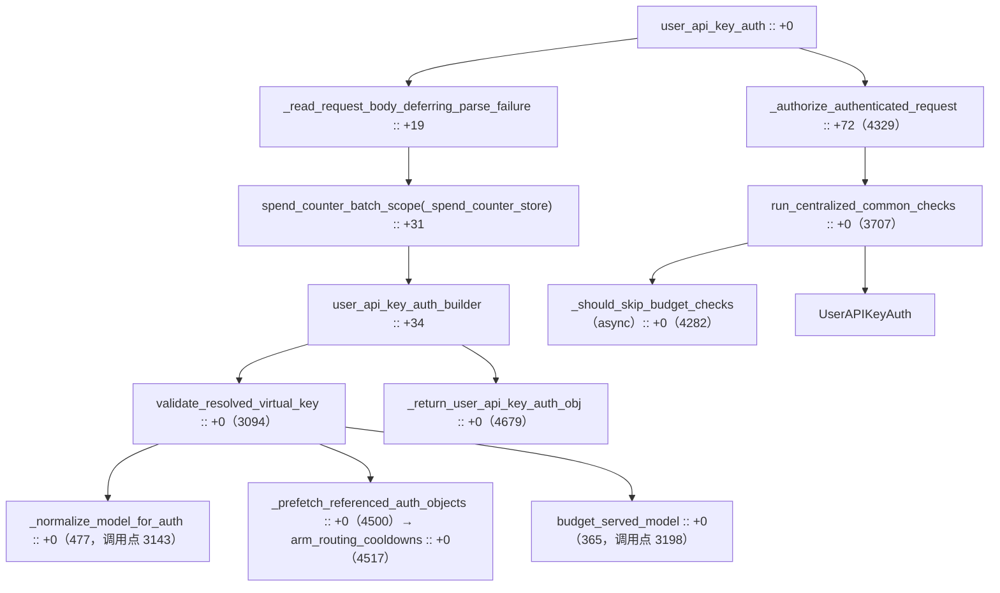

# 鉴权管线

> 所属层级：第三层（主链路拆解） | 拆解对象：第二层场景的跳 2

## 本篇回答的问题

`Authorization: Bearer sk-...` 是怎么变成一个 `UserAPIKeyAuth` 对象的？中间做了哪些校验，顺序是什么？限流为什么不在这一步？

## 入口与总体结构

```
litellm/proxy/auth/user_api_key_auth.py :: user_api_key_auth() :: +0
```

函数 docstring 一句话概括：校验用户传来的 API key 或 JWT，合法则返回 `UserAPIKeyAuth`。



外层函数只做编排（`user_api_key_auth() :: +0`，4565 起）：

```
user_api_key_auth(request, ...)
├─ _ensure_parent_otel_span_on_request_state(request)      # 先建 server span，坏 body 也能留 trace
├─ _read_request_body_deferring_parse_failure()            # 读 body 但推迟解析错误（+19）
├─ get_request_route()                                     # 路由识别
├─ phase_span("auth ...") 内：
│   ├─ user_api_key_auth_builder(...)                      # 真正的鉴权构建器（+34）
│   ├─ 失败时 _authorize_authenticated_request()           # 兜底：已认证身份复用（+72）
│   └─ 包 spend_counter_batch_scope(_spend_counter_store())（+31）
├─ seed_request_identity()                                 # 身份播种到 baggage，auth span 关闭后
└─ 若 body 解析失败：_record_unparsable_body_failure() 后再抛
```

「推迟解析失败」是个细节设计：body JSON 坏了也要先试鉴权，这样错误响应里能带上调用者身份（比如 master key 用户能拿到 400 而不是 401）。`_read_request_body_deferring_parse_failure`（`user_api_key_auth.py :: _read_request_body_deferring_parse_failure :: +0`，2212 起）返回 `(dict, ProxyException | None)`，把解析失败以值的形式带回，由外层在身份播种之后再抛出。

一个与旧版不同的编排点：`user_api_key_auth` 现在整个鉴权段包进 `phase_span(f"auth {route}")` + `spend_counter_batch_scope(_spend_counter_store())`（`user_api_key_auth() :: +31`）。`_spend_counter_store()`（`user_api_key_auth.py :: _spend_counter_store :: +0`，4479 起）返回 proxy 的 `spend_counter_store`（`proxy_server.py` 里由 `litellm/redis/stores/spend_counters` 构造），预算扣减和花费读取走这一层（spec 事实 B/#50170，`_spend_counter_redis_cache` 已删）。

## 构建器：三种凭证的分岔

```
litellm/proxy/auth/user_api_key_auth.py :: user_api_key_auth_builder() :: +0
```

按凭证类型分三条路：

| 凭证 | 判定方式 | 路径 |
|---|---|---|
| master key | `secrets.compare_digest(api_key, master_key)` | 最短路径，全权限 |
| JWT | `JWTHandler.is_jwt(token)` / 配置了 jwt_auth | `handle_jwt.py` 解析签名后映射权限 |
| virtual key（`sk-` 开头的代理签发 key） | 默认路径 | 缓存 → DB 查 `LiteLLM_VerificationToken` |

构建器开头先跑 `pre_db_read_auth_checks`（带 `defer_team_checks` 参数），再做自定义 header 的 key 解析（`get_api_key`、`get_api_key_from_custom_header`）。

**defer_team_checks（spec 事实 B，推迟模型校验）**：`user_api_key_auth_builder` 签名新增 `defer_team_checks: bool = False`（`+0`，2329 起），把团队相关校验从构建器内部推迟到鉴权后段。`user_api_key_auth` 外层传 `defer_team_checks=True`（`user_api_key_auth() :: +34` 调用处，参数在 +43），内部服务入口 `authorize_internal_virtual_key`（`user_api_key_auth.py :: authorize_internal_virtual_key :: +0`，5079 起）同样 `defer_team_checks=True`（调用点 5091）。推迟意味着鉴权主体（key 身份）先解析出来，团队预算/模型门禁放到模型确定之后。

master key 校验（`secrets.compare_digest` 在其中）用 `compare_digest` 而非 `==` 防时序攻击。master key 直接拿到 proxy admin 身份，跳过所有预算检查（`user_api_key_auth_builder() :: is_master_key_valid` 分支）。

## virtual key 路径

命中顺序（`user_api_key_auth_builder() :: get_key_object` 段）：

```
1. user_api_key_cache.async_get_cache(cache_key)     # 内存+Redis（UserApiKeyCache）
2. ExperimentalUIJWTToken.get_key_object_from_ui_hash_key()   # UI 会话哈希
3. 未命中 → Prisma 查库（get_key_object_from_db trace 段）
```

查到的行就是 `LiteLLM_VerificationToken`（schema 见 `schema.prisma`），字段直接铺进返回对象：

```
litellm/types/proxy/auth/user_api_key_auth.py :: UserAPIKeyAuth :: +0
```

核心字段速览：

| 字段 | 含义 | 鉴权中的用途 |
|---|---|---|
| `token` / `api_key` | key 本体（哈希形式） | 身份标识 |
| `user_id` / `team_id` / `organization_id` | 归属三级 | 预算与权限的挂载点 |
| `models` | 允许的模型列表 | 模型访问检查 |
| `max_budget` / `spend` | 预算上限 / 已花费 | 预算检查 |
| `tpm_limit` / `rpm_limit` | 限流上限 | 交给限流 hook 用 |
| `user_tpm_limit` / `user_rpm_limit` | 用户级限流 | 交给限流 hook 用 |
| `allowed_model_region` | 区域约束 | 部署过滤 |

key 不存在或格式不对时返回 401，并给格式提示（`sk-` 前缀检查、JWT 形态提示），见 `user_api_key_auth_builder() :: valid_token is None` 分支。注意代码注释强调错误提示不能依赖 message 文本判断类型。

## 模型归一化与路径参数模型访问（spec 事实 B/#51226）

鉴权在跑预算/模型门禁前，先把请求的 `model` 归一成鉴权应该针对的那个模型。`_normalize_model_for_auth`（`user_api_key_auth.py :: _normalize_model_for_auth :: +0`，477 起）依次做三件事：

```
_normalize_model_for_auth(request_data, valid_token, request, route)
├─ _normalize_claude_model()                    # Claude 别名
├─ _resolve_router_settings_model_group_alias() # model_group_alias（key/team/router 别名）
└─ _resolve_codex_native_chatgpt_model()        # Codex 原生路由
```

其中 `_resolve_router_settings_model_group_alias`（400 起）在 `MODEL_GROUP_ALIAS_RESOLVED_SCOPE_KEY` 没置位时把请求模型改写为解析后的 group alias，让允许列表按「请求实际路由到的模型组」授权。

预算豁免按「服务所用模型」判定（spec 事实 B/#51058）：`budget_served_model`（`user_api_key_auth.py :: budget_served_model :: +0`，365 起）只在命中 `_SERVED_MODEL_BUDGET_WAIVER_ROUTES`（341 起，`/chat/completions`、`/completions`、`/responses` 等）且 body `model` 是字符串、请求已被 alias 解析时，才经 `litellm/proxy/litellm_pre_call_utils.py :: request_served_model :: +0`（3804 起）算出「服务所用模型」；否则原样返回请求模型。它配合 `litellm/proxy/auth/auth_checks.py :: key_model_aliases_for_auth_check :: +0` / `litellm/proxy/auth/auth_checks.py :: team_model_aliases_for_auth_check :: +0`（5295 / 5299 起）读取 key/team 的别名表。

path 参数模型访问（#51226）：`litellm/proxy/auth/auth_utils.py :: get_model_from_request :: +0`（2762 起）新增先查 `_handler_selected_model`（`auth_utils.py :: _handler_selected_model :: +0`，2833 起）——对 Google `models/{model}:generateContent`、`/openai/deployments/{model}/images/generations` 等把模型放在路径里的 handler，从 `_HANDLER_MODEL_ROUTES` 正则表（2833 行前段）抽路径模型。抽出的 handler 模型优先返回；否则 `_extract_model_candidates_from_request`（`auth_utils.py :: _extract_model_candidates_from_request :: +0`，2641 起）在候选解析里把 `proxy_server.py :: user_model_view :: +0`（3194 起，返回全局配置的 `user_model`）作为覆盖项之一，最后兜底 `_model_from_route_path`（`auth_utils.py :: _model_from_route_path :: +0`，2857 起）从路径正则抽模型。

## 校验序列（virtual key 路径）

`validate_resolved_virtual_key()`（`user_api_key_auth.py :: validate_resolved_virtual_key :: +0`，3094 起）里有一段自注释，就是官方的检查顺序，转写如下：

| 序 | 检查 | 实现锚点 |
|---|---|---|
| 1 | token 能否调用该模型 | `enforce_key_and_fallback_model_access`（含客户端声明的 fallback 模型；4846 起，在 `_authorize_authenticated_request` 内调用） |
| 2 | token 的 user 是否超预算 | `_check_user_model_budget`（633 起） |
| 3 | user 在其团队内的花费是否超预算 | `validate_resolved_virtual_key` 的 team member 预算段（3203 起） |
| 4 | 请求里的 `user` 参数（end user）是否超预算 | `_check_end_user_model_budget`（699 起） |
| 5-7 | key/team/end-user 的按模型预算（`model_max_budget`） | `model_max_budget_limiter` 各 `is_*_within_model_budget` |
| 8 | token 花费是否超 team 预算 | `auth_checks.py` 系列 |
| 9 | team 花费是否超 organization 预算 | `auth_checks.py :: common_checks`（1137 起）内的 `organization_max_budget_check`（`auth_checks.py :: organization_max_budget_check :: +0`，7588 起） |

实际执行分两段。构建器内 `validate_resolved_virtual_key` 先跑 key 身份侧的检查：blocked 检查之后 `_normalize_model_for_auth`（调用点 3143），`_prefetch_referenced_auth_objects`（调用点 3144），再用 `budget_served_model` 算出零成本豁免的模型并经 `litellm/proxy/auth/auth_checks.py :: request_skips_budget_checks :: +0`（1123 起）得 `skip_budget_checks`（调用点 3196-3203）。模型访问与预算预留这一段统一收敛到 `_authorize_authenticated_request`（`user_api_key_auth.py :: _authorize_authenticated_request :: +0`，4329 起）：它先 `RouteChecks.should_call_route` 做禁用路由检查，再调 `enforce_key_and_fallback_model_access`（调用点 4382），最后进 `run_centralized_common_checks`（`user_api_key_auth.py :: run_centralized_common_checks :: +0`，3707 起，调用点 4432）。`_should_skip_budget_checks`（`user_api_key_auth.py :: _should_skip_budget_checks :: +0`，4282 起）已改 **async**，内部同样经 `budget_served_model`（调用点 4299）换算模型再调 `request_skips_budget_checks`，调用处在 `run_centralized_common_checks` 内（4031 行附近）。

模型访问检查的核心在 `litellm/proxy/auth/auth_checks.py :: _can_object_call_model :: +0`（4983 起），支持通配（`*`、`anthropic/*` 这类 fnmatch 模式）与 model group 展开。另一个含义是限流不在鉴权里做：TPM/RPM/并发的扣减由 pre-call hook `parallel_request_limiter_v3` 完成（见第三层第 3 篇），鉴权只把限流上限带出来放进 `UserAPIKeyAuth`。分工原因是限流需要「请求结束归还」的生命周期，与鉴权的「校验即结束」不同。

## auth prefetch 与冷却预读

`validate_resolved_virtual_key` 在解析出 token 后调用 `_prefetch_referenced_auth_objects`（`user_api_key_auth.py :: _prefetch_referenced_auth_objects :: +0`，4500 起，调用点 3144），一次 MGET 把后续校验要读的 user/team/end-user 对象与花费计数器拉进缓存，并通过 `before_read=arm_routing_cooldowns` 把路由冷却预读挂进同一趟往返。`arm_routing_cooldowns`（`user_api_key_auth.py :: arm_routing_cooldowns :: +0`，4517 起）仅在 auth prefetch 真正读 Redis 时武装：通过 `RoutingContext(llm_router).arm_cooldown_prefetch()`（`litellm/router_api.py :: RoutingContext :: arm_cooldown_prefetch :: +0`，类 1816 起、方法 1978 起）把路由层冷却预读进 native 往返，从内存命中或被拒的请求不提前读冷却。

## 请求体凭证清洗（spec 行为变化，#51254）

鉴权不止查 key，还清洗请求体里可能偷走管理员凭证或重定向出口的字段。入口是 `litellm/proxy/auth/auth_utils.py :: is_request_body_safe :: +0`（973 起），由 `run_centralized_common_checks` 在推迟的模型体检查处调用（`user_api_key_auth.py` 调用点 3753）。

三个组成部分：

| 符号 | 锚点 | 作用 |
|---|---|---|
| `_BANNED_REQUEST_BODY_PARAMS` | `auth_utils.py :: _BANNED_REQUEST_BODY_PARAMS :: +0`（498 起） | 请求体禁带参数表：`api_base`/`base_url` 重定向、AWS 身份选择器（`aws_profile_name`/`aws_session_name`/`aws_external_id` 等）、Azure Entra 凭证（`azure_ad_token` + `auth_utils.py :: _AZURE_ENTRA_CREDENTIAL_PARAMS :: +0`，392 起）、endpoint 重定向字段（`s3_endpoint_url`、`sagemaker_base_url`、`deployment_url`）、可观测性凭证（由 `_build_banned_observability_params` 派生）。Azure Entra 字段是 #51254 新增 |
| `_reject_secret_references` | `auth_utils.py :: _reject_secret_references :: +0`（598 起） | 值以 `os.environ/` 或 `oidc/` 开头即拒（`_SECRET_REFERENCE_PREFIXES`，592 起），检查范围是 `_SECRET_RESOLVING_PARAMS`（593 起）= 禁带参数 + `_ADMIN_CONFIG_FIELDS_TO_CLEAR_ON_BASE_OVERRIDE` + clientside credential keys。secret reference 只允许部署或管理员配置的凭证携带 |
| `_check_banned_params` | `auth_utils.py :: _check_banned_params :: +0`（770 起） | 统一执行点：禁带参数无管理员 opt-in（`allow_client_side_credentials` 全局或 `configurable_clientside_auth_params` 按部署）即抛 `ValueError`；旧版「调用方带了 api_key 就整表放行」的隐式旁路已删除 |

api_base 重定向时的管理员字段清洗在 `litellm/litellm_core_utils/clientside_credential_handler.py :: get_dynamic_litellm_params :: +0`（94 起）：调用方把 `api_base`/`base_url` 指向自己的主机时，`_ADMIN_CONFIG_FIELDS_TO_CLEAR_ON_BASE_OVERRIDE`（`clientside_credential_handler.py :: _ADMIN_CONFIG_FIELDS_TO_CLEAR_ON_BASE_OVERRIDE :: +0`，84 起）列出的管理员字段（organization、extra_body、region、token、vertex、aws 等）先整组弹出，再只在调用方重新提供时写回，防止调用方用「回显字段名」保留管理员值发往重定向后的上游。若部署的 `api_key` 是 `oidc/` secret reference，直接抛 `BadRequestError`（要求调用方随自定义 api_base 带自己的 key）。

## 限流与预算的边界（容易混淆）

| 机制 | 在哪触发 | 状态存哪 |
|---|---|---|
| 预算检查（spend ≤ max_budget） | 鉴权阶段（`_should_skip_budget_checks` 之后） | `_spend_counter_store()`（Redis 或本 worker 内存）+ Postgres |
| TPM/RPM/并发限流 | pre-call hook 阶段 | `parallel_request_limiter_v3` + Rust store |
| 部署级冷却 | Router 失败后 | `RoutingContext` cooldown 缓存 |

预算花费的读写走 `spend_counter_store`（`litellm/redis/stores/spend_counters`，spec 事实 14），旧的 `_spend_counter_redis_cache` 已删。

## 返回对象

```
litellm/proxy/auth/user_api_key_auth.py :: _return_user_api_key_auth_obj :: +0
```

所有检查通过后，DB 行数据加上请求上下文（`request_route`、`parent_otel_span`、per-model 限流映射等）组装成 `UserAPIKeyAuth`，交给 FastAPI 注入端点函数签名。对 master key 请求，这个对象是凭空构造的全权限版本。

## 失败出口

| 检查失败 | 异常 | HTTP |
|---|---|---|
| key 无效/缺失 | `ProxyException`/`HTTPException` | 401 |
| 模型不在允许列表 | `ProxyException` | 403 |
| 预算超限 | `ProxyException`（预算类错误码） | 429 |
| key 只能访问特定路由 | `ProxyException` | 403 |

异常到 HTTP 的翻译在 `litellm/proxy/auth/auth_exception_handler.py :: UserAPIKeyAuthExceptionHandler :: handle_authentication_error() :: +0`。