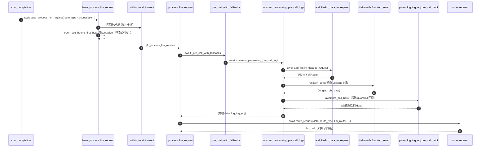

# Pre-call 处理与代理层路由决策

> 所属层级：第三层（主链路逐跳拆解） | 拆解对象：第二层场景的跳 4、跳 5
> 本篇基准提交：`411b64dc7a`（工作区当前 HEAD）

一句话定位：请求体变成 `data` dict 之后，先被 pre-call 阶段加工成「带 call id、带日志对象、带别名解析后的 model、带 guardrail 改写后 messages」的增强请求，再由代理层路由决策选出「该用哪个函数去调」，返回一个**尚未执行**的协程。本篇结束时不发任何上游请求。

术语约定：`pre-call`（调模型前的一串加工与回调）、`model group`（router 里的模型组名）、`Logging 对象`（`LiteLLMLoggingObj`，回调管线的引擎，记录一次调用的全部事件）、`router-only 设置`（只对 router 有意义、不能透传给 provider 的参数，如 `fallbacks`、`num_retries`）。

## 本跳在主链中的位置

主链 13 跳里，本篇覆盖跳 4（构造处理对象、进入 `base_process_llm_request`）与跳 5（pre-call 处理），并延伸到跳 6 的前半（`route_request` 拿协程）。上一跳交给它的是鉴权产物与带 metadata 的 `data`；它交给下一跳的是一个待执行的协程 `llm_call`（跳 6 后半把它包成 task，跳 7 起 Router 接手选部署）。



## 跳 4：base_process_llm_request 的三层包裹

锚点：`litellm/proxy/common_request_processing.py :: ProxyBaseLLMRequestProcessing :: base_process_llm_request() :: +0`

`base_process_llm_request` 自己不干核心活，它把 `_process_llm_request` 包了两层再委托出去（`+43` 到 `+74`）：

```python
return await open_sse_before_first_byte(
    self._within_total_timeout(
        request=request, route_type=route_type, is_streaming_request=is_streaming_request,
        processing=self._process_llm_request(request=request, ..., first_chunk_framing=sse_framing.first_chunk),
    ),
    ping_interval_seconds=ttft_keepalive_interval(self.data, llm_router),
    on_late_failure=_audit_late_failure,
    late_framing=ANTHROPIC_LATE_SSE_FRAMING if answers_as_anthropic else sse_framing.late,
    on_passthrough_block=on_passthrough_block,
)
```

| 包裹层 | 锚点 | 作用 | 本场景是否生效 |
|---|---|---|---|
| 外层 SSE keepalive | `open_sse_before_first_byte() :: +0` | 上游没回第一个字节前先给客户端发 SSE 心跳，免得首 token 太久连接闲死 | 否（非流式） |
| 中层 total_timeout | `_within_total_timeout() :: +0` | 对带 `total_timeout` 的非流式请求挂总截止时间，超时抛 `ProxyException` 408 | 否（本场景 body 无 `total_timeout`） |
| 内层真骨架 | `_process_llm_request() :: +0` | pre-call、路由、gather、post-call 全在这里 | 是 |

进入前先算 `answers_as_anthropic = route_type == "anthropic_messages"`（`+31`），本场景为假，所以 late framing 走 `sse_framing.late`。`on_late_failure` 是一个内部函数 `_audit_late_failure`（`+33` 到 `+41`）：一旦 keepalive 已经上线，异常没法再抛，它代为跑 `post_call_failure_hook` 留痕。

`ttft_keepalive_interval`（`litellm/proxy/common_request_processing.py :: ttft_keepalive_interval() :: +0`）决定是否启用 keepalive，取决于 `litellm_settings.sse_keepalive_ping_interval_seconds`；未配置时它是 None，keepalive 不启用。

### total_timeout 作用域（三处接力）

`total_timeout` 只约束「非流式、非后台」的请求。它由三处接力保证：

| 处 | 符号 | 作用 |
|---|---|---|
| 1 | `litellm/proxy/common_request_processing.py :: total_timeout_for() :: +0` | 优先读头 `x-litellm-total-timeout`，其次 body 字段 `total_timeout`；不能约束的请求，body 值抛 400、头值忽略放行 |
| 2 | `litellm/proxy/common_request_processing.py :: _within_total_timeout() :: +0` | 用 `total_deadline` 上下文包住整个处理协程，超时抛 `TotalTimeoutExpired` 映射成 408 |
| 3 | `litellm/litellm_core_utils/total_deadline.py :: enforce_total_timeout_scope() :: +0` | Router 侧再核一次：`total_timeout` 来自 body 却要流式/后台时抛 `TotalTimeoutNotApplicable`；来自头则放行并解除约束 |

第 3 处会在跳 6（`route_request`）与跳 8（Rust 的 `_routed_attempt`）各被调一次，本场景不触发。

## 跳 5：pre-call 处理

### 5.1 入口与限流兜底

锚点：`litellm/proxy/common_request_processing.py :: ProxyBaseLLMRequestProcessing :: _process_llm_request() :: +0` 调 `_pre_call_with_fallbacks() :: +0`（`_process_llm_request() :: +43`）

`_process_llm_request` 开头先取 `client_model`（`+26` 到 `+27`）并 `_debug_log_request_payload()`（`+28`）。`skip_pre_call_logic` 为假时（本场景），`+43` 处把真工作交给 `_pre_call_with_fallbacks`，拿到返回的 `(self.data, logging_obj)` 后设 `self.route_type`（`+41` 那条 skip 分支才设，本场景走 else 分支在 `+43` 到 `+65`）。

`_pre_call_with_fallbacks` 的职责是「把 pre-call 本身的异常也纳入回调（失败也要留痕）」。正常路径直接透传到 `common_processing_pre_call_logic`（`_pre_call_with_fallbacks() :: +43` 到 `+58`）。它的额外价值在 `except ProxyRateLimitError` 分支（`+59` 到 `+76`）：本 model 命中 per-model 限流、且配了 fallbacks、且请求没带 `disable_fallbacks`、且不是「硬」per-model 限额时，它对配置的备用模型组逐个重试 pre-call（`_resolve_fallback_models`）。本场景无 fallbacks，`configured_fallbacks` 为 None，`pristine` 也为 None，任何 `ProxyRateLimitError` 直接 `raise`。

### 5.2 common_processing_pre_call_logic 逐步拆解

锚点：`litellm/proxy/common_request_processing.py :: ProxyBaseLLMRequestProcessing :: common_processing_pre_call_logic() :: +0`（返回 `(self.data, logging_obj)`）

按源码顺序（偏移相对本函数 `+0`）：

| 步 | 偏移 | 动作 | 进/出状态 |
|---|---|---|---|
| 0 | `+113` 到 `+122` | `model` 不是字符串则抛 `ProxyException` 400 | 门禁 |
| 1 | `+124` | `add_litellm_data_to_request` 注入网关数据（见 5.3） | data 增加网关注入字段 |
| 2 | `+131` 到 `+167` | 记录请求元数据；算 queue time（`arrival_time` 到 `start_time` 的窗口，写入 metadata）；`expose_fallback_errors_to_caller` 关时弹出 `include_fallback_errors` | metadata 增 `queue_time_seconds` |
| 3 | `+168` 到 `+177` | `reject_url_valued_destination("model", model)`；`resolve_inference_model` 解析最终模型 | data["model"] 定形 |
| 4 | `+180` 到 `+187` | 应用全局默认：`user_temperature` / `user_request_timeout` / `user_max_tokens` / `user_api_base`（有值才覆盖） | data 增对应参数 |
| 5 | `+191` 到 `+194` | `global_then_key_alias_target` 别名解析 | model 可能被改写为别名目标 |
| 6 | `+196` 到 `+214` | 层级 router 设置更新（DB 覆盖 YAML，含 `model_group_alias`）；scheduled 路由读 `x-litellm-priority` 头 | data 合并 router 设置 |
| 7 | `+216` 到 `+223` | `resolve_litellm_call_id`（客户端带了 `x-litellm-call-id` 头则复用，否则生成 uuid）、`bind_telemetry_call_id`、`DDSpanTagger` | data["litellm_call_id"] 生成 |
| 8 | `+226` 到 `+237` | `stream_usage_tracking_updates` 自动流式 usage 追踪 | data 合并流式开关 |
| 9 | `+242` 到 `+250` | `function_setup` 构造 `Logging` 对象，写进 `data["litellm_logging_obj"]` | logging_obj 诞生 |
| 10 | `+262` 到 `+272` | `check_and_merge_model_level_guardrails` 合并 model 级 guardrail（`trust_client_model_info=False`，防伪造 model_info 绕过 guardrail） | data 合并 guardrail 配置 |
| 11 | `+278` 到 `+284` | `_arm_auto_router_compression`；快照 guardrail 前的 tags；`RoutingContext(llm_router).arm_read_prefetch` 预读 | 路由预读武装 |
| 12 | `+285` 到 `+290` | `proxy_logging_obj.pre_call_hook` 执行全部 pre-call 回调（限流、guardrail 在这里跑） | **限流真正发生在此** |
| 13 | `+291` 到 `+314` | `_enforce_guardrail_added_tag_budgets`；guardrail 之后的 message 刷新（PII 掩码可能改写 messages）、`logging_obj.update_messages`、served model 解析 | messages 可能被改写 |

返回值是 `(self.data, logging_obj)`（`+325` 到 `+326`），`_process_llm_request` 用它替换自己的 `self.data`。

`resolve_litellm_call_id` 的实现极简（`litellm/proxy/common_request_processing.py :: resolve_litellm_call_id() :: +0`）：客户端 call id 非空且长度不超过 `MAX_LITELLM_CALL_ID_LENGTH` 就复用，否则生成 `uuid4`。

**步骤 12 是限流的落点**：`PROXY_HOOKS` 注册的限流器实现了 `async_pre_call_hook`，在 Redis 上扣 TPM/RPM/并发计数，超出即抛 `ProxyRateLimitError`（对外 429）。它带 `rate_limited_by: descriptor_key` 头标识是哪个 per-key 限流描述符拒的。这个 429 与 Router 内部的 deployment 冷却（04 篇）是两条独立失败路径：前者是 per-key 请求配额，后者是 deployment 层连续失败。

### 5.3 add_litellm_data_to_request 的防伪造设计

锚点：`litellm/proxy/litellm_pre_call_utils.py :: add_litellm_data_to_request() :: +0`

函数体开头的三段防御（逐行核对）：

```python
# +29 到 +41：清掉客户端伪造的内部控制键，再由 proxy 自己注入
for _internal_key in _UNTRUSTED_ROOT_CONTROL_FIELDS:
    if _allow_client_mock_response and _internal_key in _CLIENT_MOCK_CONTROL_FIELDS:
        continue
    data.pop(_internal_key, None)
_reject_url_valued_destinations(data)
# +47 到 +51：metadata 归一（metadata 与 litellm_metadata 两个字段都处理）
# +54 到 +58：剔除客户端伪造的身份注入键
for _mk in list(_user_metadata.keys()):
    if _mk.startswith("user_api_key_"):
        del _user_metadata[_mk]
```

两点值得强调：客户端 metadata 里以 `user_api_key_` 开头的键一律删除——这些键是网关的身份注入区，客户端不得自己写（跳 3 注入的那些键，这里会被客户端伪造的同名键先清掉再由网关注入，顺序上这发生在跳 3 之后，所以网关注入的值是最终值）。`_reject_url_valued_destinations` 拒掉把 OTel destination 写成 URL 型的尝试。

紧随其后的 header 处理（`+54` 到 `+88`）：按 `general_settings.forward_llm_provider_auth_headers` 决定是否把客户端的 `x-api-key`/`Authorization` 转给上游（`+84` 到 `+88`，命中就把 `x-api-key` 写成 `data["api_key"]`）；`clean_headers` 按 `litellm_key_header_name` 与 `forward_llm_provider_auth_headers` 清洗；MCP 凭证头被 `_mcp_credential_headers` 剔除后再进日志用的 `_logging_safe_headers`。

`+92` 到 `+112` 组装 `proxy_server_request`（url、method、`_logging_safe_headers`、body 占位、credential_fields、`arrival_time`）。`arrival_time` 优先取 `request.state.litellm_received_at`（鉴权入口盖的章），所以 queue time 窗口包含整个鉴权阶段；只有没走过 `user_api_key_auth` 的调用方才退回 `time.time()`。

## 跳 6 前半：route_request 拿协程

锚点：`litellm/proxy/common_request_processing.py :: _process_llm_request() :: +86`（`route_request` 调用，行 3393）

```python
llm_call: Final = await route_request(
    data=self.data, route_type=route_type, llm_router=llm_router,
    user_model=user_model, user_api_key_dict=user_api_key_dict,
)
```

被调方：`litellm/proxy/route_llm_request.py :: route_request() :: +0`。

进：`(data, route_type="acompletion", llm_router, user_model, user_api_key_dict)`。出：`llm_call`，一个**尚未执行的协程**——`route_request` 只负责「选函数」，执行在跳 6 后半的 `asyncio.create_task` 之后。

`route_request` 只做三件事（`+10` 到 `+44`）：

| 步 | 偏移 | 动作 |
|---|---|---|
| 1 | `+10` | `enforce_total_timeout_scope(data)` 把超时作用域再核一次（见跳 4 第三处） |
| 2 | `+11` | `_merge_router_settings_override(data)` 允许客户端按请求覆盖 router 设置，受 mock 参数门禁约束 |
| 3 | `+13` 到 `+21` | 进 `_route_request_single_attempt`；捕到 `ProxyModelNotFoundError` 且可读穿时，做一次 registry read-through 后重试一轮（`+35` 到 `+44`） |

### _route_request_single_attempt 的决策树

锚点：`litellm/proxy/route_llm_request.py :: _route_request_single_attempt() :: +0`（偏移相对本函数 `+0`）

前置三步：`raise_if_required_body_param_missing`（`+8`）、`add_shared_session_to_data`（`+10`）、`raise_if_mock_testing_params_disallowed`（`+12`，mock 类参数默认禁止，需 `dangerously_allow_mock_testing_request_params` 放行）。再算 `team_id` 与 `router_model_names`（`+23` 到 `+24`）。

主决策树（按源码顺序，先匹配先返回）：

```text
data 里有 api_key 或 api_base？
├─ 是 → llm_router 存在则 getattr(llm_router, route_type)(**data)，否则 litellm 直调   (+32 到 +36)
├─ route_type=acompletion 且 model 含逗号（批量）→ abatch_completion[_fastest_response]  (+38 到 +50)
├─ data 里有 user_config（自带 router 配置）→ _route_user_config_request            (+52 到 +53)
└─ llm_router 存在？
   ├─ _raise_if_model_fully_blocked 先挡被禁模型                                     (+56)
   ├─ evals 路由 → litellm 直调（可先补 deployment 凭证）                              (+58 到 +91)
   ├─ container / interactions / managed agents 路由 → getattr(llm_router, ...)      (+92 到 +121)
   ├─ 无 model 的团队 vector store 文件调用授权 → litellm 直调                        (+122 到 +138)
   ├─ 无 model 的 skill/video/aingest 路由 → litellm 直调                            (+139 到 +159)
   ├─ data 里没 model → 抛 ProxyMissingRequiredParamError                            (+161 到 +165)
   ├─ team_model 命中（team_id 非空且 registry 解析到）→ 改写 data["model"] 后 router 调用 (+166 到 +186)
   ├─ proxy admin 无 team 命中 team_public，或 model 被 registry 认可 → router 调用      (+188 到 +193)
   └─ model 不在 router_model_names（组集合）里：
      ├─ pass_through_all_models → litellm 直调                                       (+196 到 +199)
      ├─ 有 default_deployment 或通配 patterns → router 调用                          (+200 到 +204)
      ├─ model 在 deployment_names 里 → router 调用（specific_deployment=True）       (+205 到 +207)
      └─ 其余 → 抛 ProxyModelNotFoundError
```

对本场景：`model="gpt-4o-mini"` 在 `model_list` 里，所以它在 `router_model_names`（`registry().names(kind="group_set")`）里，上面那个「不在组集合」的分支整个跳过，直接走到**组集合命中**的 getattr 派发：

```python
return getattr(llm_router, f"{route_type}")(**data)
```

于是实际调用的是 `Router.acompletion(**data)`，返回值是一个 awaited 后才发力的协程。getattr 派发是运行时边界：静态分析到此为止，真正被调的是 Router 上的同名端点方法。

## 跳 6 后半：把协程包成 task（交接下一跳）

锚点：`litellm/proxy/common_request_processing.py :: _process_llm_request() :: +93`（`asyncio.create_task`，行 3400）

```python
llm_call_task: Final = asyncio.create_task(with_proxy_compaction_executor(llm_call, request))
tasks.append(llm_call_task)
llm_responses: Final = asyncio.gather(*tasks)   # 与 during_call_hook 并行
```

`during_call_hook` 的并行任务在 `+70` 到 `+77` 就已 `create_task`（moderation check 尽早起跑，给输入掩码/校验一个 head start）。真正的调度从 `create_task` 这一刻开始。`asyncio.gather` 在 `+96` 到 `+97`，`responses[1]` 取到 LLM 响应（`+112`，行 3419）。Router 内部如何选部署，见 04 篇。

## 失败传播

| 阶段 | 失败 | 传播路径 |
|---|---|---|
| total_timeout | body 带 `total_timeout` 却要流式/后台 | `enforce_total_timeout_scope` 抛 `TotalTimeoutNotApplicable` |
| pre-call 业务失败 | 限流 429、guardrail 拦截 | 抛 `ProxyRateLimitError`/`ModifyResponseException`；前者在有 fallbacks 时被 `_pre_call_with_fallbacks` 兜住重试，否则冒到端点 |
| pre-call 自身崩溃 | 回调抛异常 | `_pre_call_with_fallbacks` 保证回调收到 failure 事件后才向上抛 |
| 路由失败 | model 不在任何组/通配/deployment_names | 抛 `ProxyModelNotFoundError`（404 语义的 `HTTPException` 子类）；可读穿时 registry read-through 重试一轮 |
| 缺必填参数 | body 没 model | 抛 `ProxyMissingRequiredParamError` |

这些异常最终都在端点层的 `except Exception`（01 篇）被 `handle_llm_api_exception` 归一成 OpenAI 兼容的 `ProxyException`。

## 状态变化复述

进入跳 4：`data` 只含客户端字段 + 网关注入的 metadata，`ProxyBaseLLMRequestProcessing` 已持有它。离开跳 5：`data` 增加了 `litellm_call_id`、`litellm_logging_obj`、`proxy_server_request`、别名解析后的 `model`、guardrail 改写后的 `messages`、可能的默认参数；`logging_obj` 已诞生。离开跳 6 前半：多了一个待执行协程 `llm_call`，data 本身不再变化（router-only 设置在派发时被剥离，见下表）。

| 阶段 | data 里新增/变化的键 |
|---|---|
| 跳 4 前 | `metadata`（含网关注入） |
| 跳 5 后 | `litellm_call_id`、`litellm_logging_obj`、`proxy_server_request`、别名解析后的 `model`、guardrail 改写后的 `messages` |
| 跳 6 后 | 无变化（只是选出协程），router-only 设置已被 `direct_litellm_kwargs` 剥离出透传集合 |

## 调用关系表（关键边）

| 调用方 | 被调用方 | 传什么 | 返回什么 |
|---|---|---|---|
| `chat_completion()` | `base_process_llm_request()` | `route_type` + 请求上下文 | 响应 / SSE 流 |
| `base_process_llm_request()` | `_within_total_timeout()` | `processing=_process_llm_request(...)` | 包了截止时间的协程 |
| `base_process_llm_request()` | `open_sse_before_first_byte()` | 上述结果 + ping 间隔 + 回调 | 最终响应 |
| `_process_llm_request()` | `_pre_call_with_fallbacks()` | request、settings、router、model | `(data, logging_obj)` |
| `_pre_call_with_fallbacks()` | `common_processing_pre_call_logic()` | request、general_settings、key、router、model、route_type | `(data, logging_obj)` |
| `common_processing_pre_call_logic()` | `add_litellm_data_to_request()` | data、request、settings、key、config | 增强后的 data |
| `common_processing_pre_call_logic()` | `litellm.utils.function_setup()` | route_type、Rules、start_time、**data | `(logging_obj, data)` |
| `common_processing_pre_call_logic()` | `proxy_logging_obj.pre_call_hook()` | key、data、call_type | 回调处理后的 data |
| `_process_llm_request()` | `route_request()` | data、route_type、llm_router、user_model、key | 未执行协程 `llm_call` |
| `route_request()` | `_route_request_single_attempt()` | data + router-only 设置集合 | getattr 派发的协程 |
| `_route_request_single_attempt()` | `getattr(llm_router, "acompletion")(**data)` | **data | `Router.acompletion` 协程（跳 7 起） |

## 未确认项

- `total_timeout_for`、`_within_total_timeout`、`function_setup`、`stream_usage_tracking_updates`、`resolve_inference_model`、`hierarchical_router_settings_updates` 的函数体内部未逐行读取，不臆测；本篇只引用它们的调用点、职责与进出状态。
- `with_proxy_compaction_executor` 的压缩逻辑未读取，不臆测（属第四层）。
- `_route_request_single_attempt` 决策树在「组集合命中」之后的 `else` 尾段（`specific_deployment=True` 之后的分支）未逐行读完，末段标注未读取，不臆测。

## 源码索引

| 符号 | 文件 :: 符号 | 绝对定义行 |
|---|---|---|
| 入口委托 | `litellm/proxy/common_request_processing.py :: base_process_llm_request` | 3180 |
| 总截止时间包裹 | `litellm/proxy/common_request_processing.py :: _within_total_timeout` | 3285 |
| 超时取值 | `litellm/proxy/common_request_processing.py :: total_timeout_for` | 3257 |
| SSE keepalive | `litellm/proxy/common_request_processing.py :: open_sse_before_first_byte` | 1723 |
| keepalive 间隔 | `litellm/proxy/common_request_processing.py :: ttft_keepalive_interval` | 1627 |
| 真骨架 | `litellm/proxy/common_request_processing.py :: _process_llm_request` | 3307 |
| pre-call 兜底 | `litellm/proxy/common_request_processing.py :: _pre_call_with_fallbacks` | 2900 |
| pre-call 主体 | `litellm/proxy/common_request_processing.py :: common_processing_pre_call_logic` | 2573 |
| call id 解析 | `litellm/proxy/common_request_processing.py :: resolve_litellm_call_id` | 388 |
| 异常归一 | `litellm/proxy/common_request_processing.py :: handle_llm_api_exception` | 4664 |
| 网关数据注入 | `litellm/proxy/litellm_pre_call_utils.py :: add_litellm_data_to_request` | 2707 |
| 路由入口 | `litellm/proxy/route_llm_request.py :: route_request` | 832 |
| 单轮路由决策 | `litellm/proxy/route_llm_request.py :: _route_request_single_attempt` | 878 |
| 超时作用域 | `litellm/litellm_core_utils/total_deadline.py :: enforce_total_timeout_scope` | 162 |
