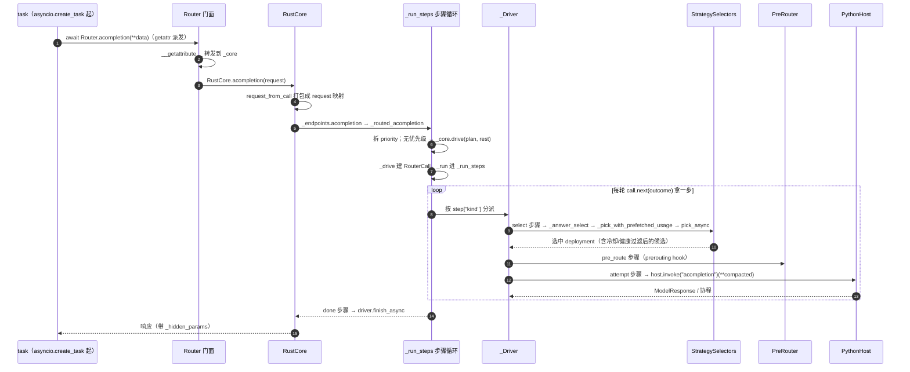

# Router 选部署：健康过滤、冷却、负载均衡、重试与回退

> 所属层级：第三层（主链路逐跳拆解） | 拆解对象：第二层场景的跳 6 后半、跳 7
> 本篇基准提交：`411b64dc7a`（工作区当前 HEAD）

一句话定位：`Router.acompletion(**data)` 拿到请求后，把选路、重试、回退、冷却、用量全部交给进程内的 Rust 核心，自己只做门面转发；Rust 核心以「步骤循环」的方式驱动，每一步要么在宿主（Python）侧应答（选部署、pre-route、发上游请求），要么自己推进（重试退避、回退授权），直到产出 `done`（成功响应）或 `failed`（异常）。

术语约定：`deployment`（一个可调用的模型实例，含 `model_name` 与 `litellm_params`）、`model group`（一组同义 deployment 的名字，客户端请求里写的 `model` 是组名）、`step`（Rust 核心产出的一步指令，宿主逐个应答）、`host`（`PythonHost`，Rust 核心触达 Python 世界的唯一出口）、`cooldown`（部署失败太多次后在时间窗内被整体跳过）。

## 本跳在主链中的位置

主链 13 跳里，本篇覆盖跳 6 后半（协程被包成 task 并真正开始执行）与跳 7（Router 门面把请求交给 Rust 核心，核心选出 deployment）。上一跳交给它的是一个未执行协程 `llm_call`；本篇结束时，Rust 核心已选出 deployment 并发起第一次 attempt，交由跳 8 经 `PythonHost` 回到 Python 的 `litellm.acompletion`。本场景单部署、成功，整个循环只穿一次 `attempt`。



## 跳 6 后半：协程从 create_task 到真正执行

锚点：`litellm/proxy/common_request_processing.py :: _process_llm_request() :: +93`

跳 5 结束时 `llm_call` 只是一个协程。`+93` 处 `asyncio.create_task(with_proxy_compaction_executor(llm_call, request))` 把它包成 task，`+96` 到 `+97` 与 `during_call_hook` 一起 `asyncio.gather`。控制权交回事件循环后，task 才开始跑，于是 `Router.acompletion(**data)` 此刻才被真正调用。`with_proxy_compaction_executor` 是一层参数压缩包装（内部实现未读取，不臆测，属第四层）。

## 跳 7 前半：Router 是纯门面

锚点：`litellm/router.py :: Router :: __init__() :: +0`（行 418）

`Router` 不持有任何路由逻辑。构造函数只有一行：

```python
self._attach(make_core(build_router_config(router_arguments(*args, **kwargs)), python_host))
```

委托链：

| 调用方 | 被调用方 | 作用 |
|---|---|---|
| `Router.__init__()` | `router_arguments(*args, **kwargs)` | 把位置/关键字参数规整成构造参数 |
| `Router.__init__()` | `build_router_config(...)` | 构造 `RouterConfig` |
| `Router.__init__()` | `make_core(config, host)` | 建出核心 |
| `Router.__init__()` | `self._attach(core)` | 把核心挂到 `self.__dict__["_core"]`，并记一个 `weakref` 反向指针 |

`_attach`（`litellm/router.py :: Router :: _attach() :: +0`）先把构造期间暂存在 `_pending` 里的成员写回核心，再把核心记为 `_core`。成员读写全部转发：`__getattribute__`（`+441`）在 `object.__getattribute__` 失败后转发到 `_core`；`__setattr__`（`+463`）在 `_core` 尚未就绪时先暂存到 `_pending`，就绪后 `setattr(core, name, value)`。`__init_subclass__`（`+411` 到 `+416`）直接 `raise TypeError` 禁掉子类化，扩展只能走 `register_plugin` / `apply` / `observe`。

`make_core`（`litellm/router_core.py :: make_core() :: +0`）无条件返回 `RustCore.build(config, host)`，注释写明「核心是 Rust 核心，按 router 的配置一次性建好」。旧的双核时代（`router_python_core.py`、`PythonCore`、`Route.ROUTER`）已删除。

`RustCore.build`（`litellm/router_rust/core.py :: RustCore :: build() :: +0`）做两件事：先 `unsupported_arguments(config)` 检查有无 Rust 核心不服务的参数，有则抛 `RustBridgeDeclined`；再 `RustEndpoints.prepare_host(config, host)` 准备宿主接线，最后 `cls(config, host, Resolved.of(config, host.dynamic()))` 构造实例。

## 跳 7 中段：从端点到步骤循环

锚点：`litellm/router_rust/core.py :: RustCore :: acompletion() :: +0`（行 2628）

```python
async def acompletion(self, *args, **kwargs):
    return await self._endpoints.acompletion(request_from_call("acompletion", args, kwargs))
```

`request_from_call` 把 args/kwargs 打包成一个 request 映射。端点层：`litellm/router_rust/invoke/endpoints.py :: RustEndpoints :: acompletion() :: +0` 补 `stream` 默认值、记开始时间，再进 `_routed_acompletion() :: +0`（行 2030）：

```python
plan: Final = PLANS["acompletion"]
priority, rest = self._split_priority(model, kwargs)
...
if priority is None:
    return await self._core.drive(plan, rest)
return await self._schedule(model, priority, lambda: self._core.drive(plan, rest), rest)
```

本场景无 `priority`，走 `self._core.drive(plan, rest)`。`drive()` 的内部实现是 `_drive()`（`litellm/router_rust/core.py :: RustCore :: _drive() :: +0`，行 2964）：进入 `request_parent_otel_span` 与 `owning_picks`（least-busy 用它归还从未启动的 pick）作用域，`_start` 建 `RouterCall` 与 prepared 请求，`arm_compaction_state` 预置压缩状态，在 `picks_reserve` 与 `_usage_read_scope` 作用域里调 `_run`。

`_run()`（`+29` 到 `+44`）建 `_Driver` 实例并调 `_run_steps(driver, call)`；任何 `BaseException` 都先 `driver.close_route_phase()` 再上抛。

`_run_steps()`（`+53` 到 `+88`，行 3017）是整个选路的引擎——一个 `while True` 循环，每轮 `call.next(outcome)` 从 Rust 侧拿一步，按 `step["kind"]` 分派（偏移相对本函数 `+0`）：

| step kind | 宿主方法 | 偏移 | 含义 |
|---|---|---|---|
| `attempt` | `_Driver.attempt` | `+13` 到 `+14` | 对选中的 deployment 发起 provider 调用 |
| `sleep` | `_host.sleep` | `+15` 到 `+20` | 重试退避；退避会超出 total deadline 时先抛错 |
| `allow_fallback` | `_Driver.allow_fallback` | `+21` 到 `+22` | 回退目标授权/预算检查 |
| `refuse_fallbacks` | `_Driver.refuse_fallbacks` | `+23` 到 `+24` | 本模型组失败，拒更多回退 |
| `cache` | `_answer_cache` | `+25` 到 `+26` | 响应缓存读 |
| `select` | `_Driver.select` | `+27` 到 `+28` | 请求宿主跑有状态策略选部署 |
| `pre_route` | `_Driver.pre_route` | `+29` 到 `+30` | 宿主 pre-routing hook |
| `done` / `failed` | `driver.close_route_phase()` 后返回 | `+31` 到 `+33` | 结束 |
| 其他 | `raise RuntimeError` | `+34` 到 `+35` | bridge 返回了未知步骤 |

注意循环体开头（`+5` 到 `+11`）每次都 `driver.take_events(step.get("events"))` 收事件，且 `step["kind"] != "done"` 时 `await_all(driver.outcomes.take_pending())` 等待挂起的 outcome——这是 `run_async_fallback` 之类「先盖章再记成功」的时序保证。

本场景（单部署、成功）的步骤序列是：`select`（选部署）→ 可能一轮 `pre_route` → `attempt`（发上游请求，跳 8）→ `done`。重试与回退的 `sleep` / `allow_fallback` / `refuse_fallbacks` 一步都不触发。

## 跳 7 后段：select 步骤怎么选出 deployment

锚点：`litellm/router_rust/core.py :: _Driver :: select() :: +0`（行 5386）

```python
async def select(self, step):
    request: Final = self._request
    messages, input = self._plan.pick_input(request)
    if step.get("stage") == "callback_filters":
        answer, error = await self._core._answer_callback_filters(step, request, messages)
        if isinstance(error, Exception):
            _ = self._pick_raised(error, logged=True)
        return answer
    try:
        return await self._core._answer_select(step, request, messages, input)
    except Exception as error:
        return self._pick_raised(error, logged=True)
```

两个分支：`stage == "callback_filters"` 是回调级过滤（tag filter 等），其余进 `_answer_select`。选路失败（策略抛错、tag filter 抛错、pre-routing hook 抛错）统一走 `_pick_raised`，把错误作为这次 try 的失败交回 Rust 调用循环，由它像普通 attempt 失败一样重试与回退。

`_answer_select()`（`litellm/router_rust/core.py :: RustCore :: _answer_select() :: +0`，行 3483）按 `step["stage"]` 分派到具体宿主应答：`pre_call`（`_pre_call_facts`）、`routing_plugins`（`candidate_models`）、`tags`、`text_only`、`route_incapable`、`media_refusing`、`embedding_batch`、`override_check`、`provider_request`，最后落到策略选路主路径（`+32` 到 `+66`）：`_strategy_inputs` 取出 `(strategy, selector, model, candidates)`，`pinned`（加密内容亲和钉死）时直接取 `candidates[0]`，否则经 `_pick_with_prefetched_usage` 调 `pick_async`，把策略计时后返回 `_pick_answer(step, candidates, picked)`。

`_pick_with_prefetched_usage()`（`litellm/router_rust/core.py :: _pick_with_prefetched_usage() :: +0`，行 3960）把冷却读取顺带取回的用量计数（`PrefetchedUsage`）scoped 进 `pick_async` 再取——这样 usage-based-routing 类策略不用再发一次 Redis 读。`pick_async()`（`litellm/router_rust/steps/selection.py :: pick_async() :: +0`）按策略名 match 到对应 selector 的 `async_get_available_deployments` / `get_available_deployments`。

**健康过滤与冷却过滤在 Rust 侧**：候选列表到达宿主 selector 之前，Rust 核心已经按健康状态与冷却状态过滤过。判定逻辑在 crate 里，宿主只看到过滤后的候选：

| 文件 | 符号 | 作用 |
|---|---|---|
| `litellm/rust/crates/router-core/src/health.rs` | 健康过滤 | 剔除健康检查判为不健康的 deployment |
| `litellm/rust/crates/router-core/src/precall.rs` | `filter() :: +0`（行 86） | pre-call 阶段的候选过滤 |
| `litellm/rust/crates/router-core/src/select.rs` | `simple_shuffle() :: +0`（行 130） | 默认策略的加权随机（Rust 原生，无宿主 selector） |
| `litellm/rust/crates/router-core/src/access.rs` | 区域/访问约束 | `allowed_model_region` 等过滤 |

**冷却与用量的持久化接线**在 `RustCore.__init__`（`litellm/router_rust/core.py :: RustCore :: __init__() :: +0`）里接好两条：`self._usage = host.router_usage(redis)`（每分钟 tpm/rpm 计数）与 `self._cooldowns = CooldownCache(store=RouterCooldownStore(...))`（冷却表）。协议定义在：

| 符号 | 文件 :: 符号 | 关键方法 |
|---|---|---|
| 冷却表 | `litellm/redis/stores/router_cooldowns/handle.py :: RouterCooldownsHandle :: +0` | `has_redis` / `put` / `async_put` / `increment_allowed_fails` / `active` |
| 用量计数 | `litellm/redis/stores/router_usage/handle.py :: RouterUsageHandle :: +0` | `has_redis` / `attach` / `increment` / `increment_deployment` |
| 冷却缓存 | `litellm/router_utils/cooldown_cache.py :: CooldownCache :: +0` | `add_deployment_to_cooldown` / `async_get_active_cooldowns` / `get_active_cooldowns` / `get_min_cooldown` |

具体实现类：`litellm/redis/stores/router_cooldowns/__init__.py :: RouterCooldownStore :: +0`（行 40）与 `litellm/redis/stores/router_usage/__init__.py :: RouterUsageStore :: +0`（行 85）。多 worker 共享时走 Redis，Redis 不可用时 DualCache 降级到进程内内存。

**有状态 LB selector**：`litellm/router_rust/steps/selection.py :: StrategySelectors :: +0`（行 99）持有一个路由器默认 selector、每个 routing group 的 selector 与懒建的 per-request override selector。`build_selector()`（`litellm/router_rust/steps/selection.py :: build_selector() :: +0`，行 68）按策略名建出对应 logger：

| 策略名 | selector |
|---|---|
| `simple-shuffle`（默认） | 无宿主 selector，Rust 原生加权随机 |
| `least-busy` | `LeastBusyLoggingHandler`（进程内 reservation 计数） |
| `usage-based-routing` | `LowestTPMLoggingHandler` |
| `usage-based-routing-v2` | `LowestTPMLoggingHandler_v2` |
| `latency-based-routing` | `LowestLatencyLoggingHandler` |
| `cost-based-routing` | `LowestCostLoggingHandler` |

本场景未配策略，默认 `simple-shuffle`，所以 `select` 步骤在宿主侧几乎直通：候选已被 Rust 过滤到只剩健康且未冷却的单个 deployment，`pick_async` 走简单随机直接返回它。

## pre_route 步骤（prerouting hook）

锚点：`litellm/router_rust/core.py :: _Driver :: pre_route() :: +0`（行 5407）

`pre_route` 调 `_core._pre_route(step, request, *pick_input, call_type=self._plan.handler)`，异常同样走 `_pick_raised`。宿主侧实现是 `litellm/router_rust/steps/prerouting.py :: PreRouter :: pre_route() :: +0`（行 784）：它是 `_async_get_available_deployment` 的起点，跑 prerouting hook、记录 hook 的 pick、把 tier 的 `litellm_params` 钉进请求。开头有个短路（`+4` 到 `+5`）：非 `pass_through` 且当前策略不是异步 pick 时直接返回 None，不跑 hook。同文件还有两个辅助：`as_output_cap() :: +0`（行 633，把客户端传来的输出上限强制成 int，拒绝 bool 与负数）与 `stamped_client_ceiling() :: +0`（从请求 metadata 读调用方盖章的输出上限）。

## 重试与回退：Rust 核心 + 宿主策略解析

重试与回退的循环调度都在 `litellm/rust/crates/router-core`（`retry.rs`、`fallback.rs`、`outcome.rs`），Python 侧只提供策略解析与错误分类：

| 符号 | 作用 |
|---|---|
| `litellm/router_rust/core.py :: _Driver :: _retry_policy_raises() :: +0` | 找出 `model_group_retry_policy` 查询在首次失败时会抛异常的 group，随文档给 crate，让那次 hop 以查询错误结束 |
| `litellm/router_rust/core.py :: _Driver :: _group_policy_fields() :: +0` | 把请求的 `model_group_retry_policy` 传给 crate |
| `litellm/router_rust/core.py :: _Driver :: allow_fallback() :: +0` | 回退目标在宿主做授权/预算/限流预检（`_is_fallback_target_authorized`、`_is_fallback_target_within_budget`） |
| `litellm/router_rust/core.py :: _Driver :: refuse_fallbacks() :: +0` | 决定本模型组失败后是否拒绝更多回退 |
| `litellm/types/router.py :: RetryPolicy :: +0` | 重试策略类型 |
| `litellm/router_rust/surface/retries.py :: resolved_retry_policy() :: +0` | 把请求里 `retry_policy` 的值规整成 `RetryPolicy` |

重试次数取值优先级：请求参数 > deployment 配置 > 全局配置 > 默认。每次重试重新走一遍步骤循环，冷却会把坏 deployment 在选路时自动排除。重试用尽后交给回退层，三类回退按序尝试：

| 类型 | 触发条件 | 行为 |
|---|---|---|
| 普通回退 | 任何重试耗尽 | 换配置的备用 model group 重跑 |
| context window 回退 | `ContextWindowOverflowError` | 换更大窗口的 group |
| content policy 回退 | 内容审查拒绝 | 换审查更宽松的 group |

`ROUTER_MAX_FALLBACKS`（`litellm/constants.py`）限制回退深度防环。

## 执行层由 catalog 决定

锚点：`litellm/rust_bridge/catalog.py :: RouteRule :: +0`（行 108）

`RouteRule` 是 `(route, rollout, providers, models, targets, features)` 的冻结数据类，`matches(context)` 按 route + provider/model/target/feature 逐一匹配，`unconstrained()` 判断是否无条件规则。chat completions 的规则（`litellm/rust_bridge/catalog.py :: RULES :: +0`，行 192 到 193）是两条 `PYTHON_ONLY`：

```python
RouteRule(Route.CHAT_COMPLETIONS, Rollout.PYTHON_ONLY, features=CHAT_PYTHON_FEATURES),
RouteRule(Route.CHAT_COMPLETIONS, Rollout.PYTHON_ONLY),
```

`Rollout` 枚举在 `litellm/rust_bridge/configuration.py :: Rollout :: +0`（行 31），取值含 `PYTHON_ONLY` 与 `RUST_REQUIRED`。查找函数（`litellm/rust_bridge/catalog.py` 行 210）在无规则命中时**默认回落 `PYTHON_ONLY`**。所以 chat completions 始终经宿主回 Python 执行——这正是跳 8 由 `PythonHost` 回跳 `litellm.acompletion` 的原因。对照：`MESSAGES` 路由对 `anthropic` provider 是 `RUST_REQUIRED`（行 198）。

## attempt 边界与 host 回跳

锚点：`litellm/router_rust/core.py :: _Driver :: attempt() :: +0`（行 5221）、`_routed_attempt() :: +0`（行 5244）

`_run_steps` 遇到 `attempt` 步骤就调 `driver.attempt(step)`，后者进 `_routed_attempt`。这一跳里依次发生：解析 pod、构造 `AttemptCall`、再挂一次 `enforce_total_timeout_scope(call.kwargs)`、`compacted_attempt` 做参数压缩、`enter_deployment_slot` 占用该 deployment 的并发槽位（`max_parallel_requests` 闸门）、跑 `routing_pre_call_checks`，然后是 provider 调用：

```python
pending: Final[object] = (
    ...
    else host.invoke(call.host_op)(**compacted)
)
awaited: Final = self._plan.kind == "generic" or inspect.isawaitable(pending)
answered: Final[object] = await pending if awaited else pending
```

（`_routed_attempt() :: +49` 到 `+53`）

`routing_pre_call_checks`（`litellm/router_rust/steps/selection.py :: routing_pre_call_checks() :: +0`，行 353）对每个 `CustomLogger` 回调跑 `async_pre_call_check(dict(deployment), None)`；usage-based-routing-v2 在这里数 rpm。某个 check 抛错就让这次 attempt 失败，按普通失败记录冷却。

`host.invoke` 的实现（`litellm/router_python_host.py :: PythonHost :: invoke() :: +107`）就是 `getattr(litellm, op, None)`（带 `.` 的 op 走 `_dotted`），查不到抛 `AttributeError`，非 callable 抛 `TypeError`。对 `"acompletion"` 返回的就是 `litellm.acompletion`。架构要点：Rust core 从不直接 `import litellm`，所有外部触达都经过 `PythonHost`。attempt 内部的响应校验、成功计数、冷却记录属跳 8 与跳 12，见 05 篇。

## 失败传播回 Proxy

重试与回退都耗尽后，`_run_steps` 返回 `failed` 步骤，`_drive` 收到 `step["kind"] == "failed"` 就 `raise driver.failed(step)`（`_drive() :: +24` 到 `+25`）抛出 Rust 核心边界。Router 在抛出前已完成：冷却记录、retry/fallback 计数写入 metadata、failure 回调触发（由日志管线驱动）。异常冒回 `_process_llm_request` 的 try，最终在端点层被 `handle_llm_api_exception` 归一（01 篇）。本场景成功，循环只穿一次 `attempt` 后收到 `done`，`driver.finish_async(step)` 组装响应返回。

## 状态与并发

| 状态 | 位置 | 并发语义 |
|---|---|---|
| registry（deployments） | Rust 核心（crate registry） | 读多写少 |
| 冷却表 | `redis/stores/router_cooldowns :: RouterCooldownsHandle` | 多 worker 共享，DualCache 内存降级 |
| TPM/RPM 用量 | `redis/stores/router_usage :: RouterUsageHandle` | 原子 increment |
| 进行中请求计数（least-busy） | `StrategySelectors.reservations`（进程内） | 进程内，`owning_picks` 保证未启动的 pick 被归还 |
| 有状态 selector 记录 | `router_strategy/*` logger | 进程内回调 |

## 调用关系表（关键边）

| 调用方 | 被调用方 | 传什么 | 返回什么 |
|---|---|---|---|
| `getattr` 派发（跳 6） | `litellm/router.py :: Router :: acompletion()`（转发 `_core`） | **data | 响应 / 抛异常 |
| `RustCore.acompletion()` | `RustEndpoints.acompletion()` | request 映射 | 响应 |
| `RustEndpoints.acompletion()` | `RustEndpoints._routed_acompletion()` | model + kwargs | 响应 |
| `_routed_acompletion()` | `RustCore.drive()` → `_drive()` | plan + rest | 响应 |
| `_drive()` | `_run()` → `_run_steps()` | plan、call、prepared | `(driver, step)` |
| `_run_steps()` | `_Driver.select()` | step | 选中 deployment |
| `_Driver.select()` | `RustCore._answer_select()` | step、request、messages、input | picked deployment |
| `_answer_select()` | `_pick_with_prefetched_usage()` → `pick_async()` | strategy、selector、model、candidates | picked deployment |
| `_run_steps()` | `_Driver.pre_route()` → `PreRouter.pre_route()` | step + pick_input | pre-routed 模型名 |
| `_run_steps()` | `_Driver.attempt()` → `host.invoke(op)(**compacted)` | 压缩后参数 | `litellm.acompletion` 协程（跳 8） |
| `_run_steps()` | `_host.sleep()` | 退避秒数 | 重试退避 |
| `_run_steps()` | `_Driver.allow_fallback()` / `refuse_fallbacks()` | target / step | 回退授权结果 |

## 未确认项

- `RustCore.__init__` 里 `self._usage` / `self._cooldowns` 两条接线的具体构造表达式未逐行读取，本篇按旧文与 store 协议符号描述，属 `[推断]`：接线对象为 `host.router_usage(redis)` 与 `CooldownCache(store=RouterCooldownStore(...))`。
- `with_proxy_compaction_executor`、`compacted_attempt`、`enter_deployment_slot` 的函数体未读取，不臆测（属第四层）。
- `litellm/rust/crates/router-core` 内 `health.rs`、`retry.rs`、`fallback.rs`、`outcome.rs` 的逐函数实现未读取，只确认了 `precall.rs :: filter`、`select.rs :: simple_shuffle` 两个符号与其职责，其余按 crate 文件名与职责描述。
- `_routed_attempt` 内 pod 解析、`AttemptCall` 构造、`check_response`、`counters.succeeded`、`_succeeded` 的具体偏移未逐行核对（属跳 8/跳 12，05 篇范围），本篇只引用 `+49` 到 `+53` 的 host 回跳段（已核对）。

## 源码索引

| 符号 | 文件 :: 符号 | 绝对定义行 |
|---|---|---|
| 协程起跑 | `litellm/proxy/common_request_processing.py :: _process_llm_request` | 3307 |
| Router 构造 | `litellm/router.py :: Router :: __init__` | 418 |
| 核心挂载 | `litellm/router.py :: Router :: _attach` | 427 |
| 核心工厂 | `litellm/router_core.py :: make_core` | 51 |
| Rust 核心构造 | `litellm/router_rust/core.py :: RustCore :: build` | 1594 |
| 端点派发 | `litellm/router_rust/core.py :: RustCore :: acompletion` | 2628 |
| 端点实现 | `litellm/router_rust/invoke/endpoints.py :: _routed_acompletion` | 2030 |
| 驱动入口 | `litellm/router_rust/core.py :: RustCore :: _drive` | 2964 |
| 步骤循环 | `litellm/router_rust/core.py :: RustCore :: _run_steps` | 3017 |
| 选部署应答 | `litellm/router_rust/core.py :: RustCore :: _answer_select` | 3483 |
| 带预读用量的 pick | `litellm/router_rust/core.py :: _pick_with_prefetched_usage` | 3960 |
| select 步骤 | `litellm/router_rust/core.py :: _Driver :: select` | 5386 |
| pre_route 步骤 | `litellm/router_rust/core.py :: _Driver :: pre_route` | 5407 |
| attempt 步骤 | `litellm/router_rust/core.py :: _Driver :: attempt` | 5221 |
| provider 调用 | `litellm/router_rust/core.py :: _Driver :: _routed_attempt` | 5244 |
| pre-call 检查 | `litellm/router_rust/steps/selection.py :: routing_pre_call_checks` | 353 |
| 异步 pick 分派 | `litellm/router_rust/steps/selection.py :: pick_async` | 264 |
| 有状态 selector | `litellm/router_rust/steps/selection.py :: StrategySelectors` | 99 |
| selector 构建 | `litellm/router_rust/steps/selection.py :: build_selector` | 68 |
| prerouting hook | `litellm/router_rust/steps/prerouting.py :: PreRouter :: pre_route` | 784 |
| 输出上限规整 | `litellm/router_rust/steps/prerouting.py :: as_output_cap` | 633 |
| 宿主回跳 | `litellm/router_python_host.py :: PythonHost :: invoke` | 107 |
| 路由规则 | `litellm/rust_bridge/catalog.py :: RouteRule` | 108 |
| 规则表 | `litellm/rust_bridge/catalog.py :: RULES` | 192 |
| rollout 枚举 | `litellm/rust_bridge/configuration.py :: Rollout` | 31 |
| 冷却表协议 | `litellm/redis/stores/router_cooldowns/handle.py :: RouterCooldownsHandle` | 11 |
| 用量计数协议 | `litellm/redis/stores/router_usage/handle.py :: RouterUsageHandle` | 19 |
| 冷却实现 | `litellm/redis/stores/router_cooldowns/__init__.py :: RouterCooldownStore` | 40 |
| 用量实现 | `litellm/redis/stores/router_usage/__init__.py :: RouterUsageStore` | 85 |
| 冷却缓存 | `litellm/router_utils/cooldown_cache.py :: CooldownCache` | 17 |
| Rust 候选过滤 | `litellm/rust/crates/router-core/src/precall.rs :: filter` | 86 |
| Rust 默认选路 | `litellm/rust/crates/router-core/src/select.rs :: simple_shuffle` | 130 |
