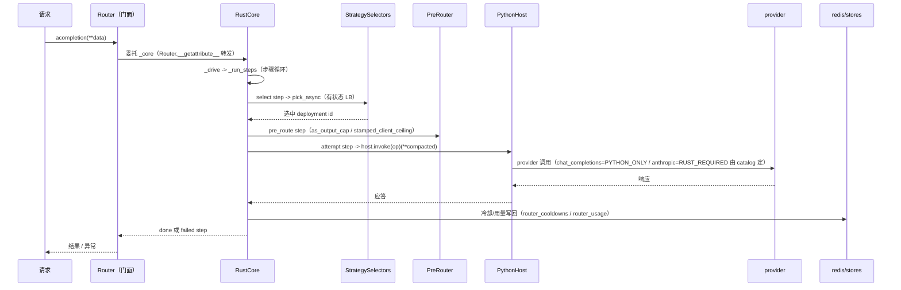

# Router 选部署：健康过滤、冷却、负载均衡、重试与回退

> 所属层级：第三层 | 拆解对象：第二层场景的跳 6-7

## 本篇回答的问题

`llm_router.acompletion(**data)` 内部，怎么从 N 个 deployment 里选出 1 个？失败后重试和回退按什么顺序发生？冷却是什么？

旧文写的是 `router_python_core.py :: PythonCore` 的双核实现，该文件已删除（#50178 整文件删除），Rust 核心接管。本篇按现行架构重写：Router 是纯门面，选路、重试、fallback、冷却、用量全部由 Rust 核心（`litellm/rust/crates/router-core`）在进程内持有，Python 侧只保留有状态 LB 与 pre-routing 两个宿主 step 和 provider 执行回跳。

## 门面、核心与宿主的分工

```
litellm/router.py :: Router.__init__ :: +0          # 门面：仅 self._attach(make_core(build_router_config(...), python_host))
litellm/router_core.py :: make_core :: +0           # 无条件 RustCore.build（全文件 55 行）
litellm/router_rust/core.py :: RustCore :: +0       # pyo3 句柄：选路/重试/fallback/冷却/用量
litellm/router_rust/steps/selection.py :: StrategySelectors :: +0   # 宿主有状态 LB step
litellm/router_rust/steps/prerouting.py :: as_output_cap :: +0      # 宿主 pre-routing step
litellm/router_python_host.py :: PythonHost :: invoke :: +107       # provider 调用回 litellm 执行
```

`Router` 的 docstring（`router.py` 开头模块注释）写明设计意图：Router 不持有路由逻辑，构造时把配置交给 `make_core` 建出核心，把所有成员方法委托出去。`Router.__init__`（`router.py :: Router.__init__ :: +0`，418 行）只有一行：

```python
self._attach(make_core(build_router_config(router_arguments(*args, **kwargs)), python_host))
```

`Router` 被 `metaclass=_RouterType` 禁掉子类化（`router.py :: Router.__init_subclass__ :: +0`），扩展走 `register_plugin` / `apply` / `observe`。类成员读写经 `__getattribute__` / `__setattr__` 转发到 `_core`（`router.py :: Router.__getattribute__ :: +0`）。端点名清单在 `router_rust/invoke/endpoints.py :: endpoint_names :: +0`（686 行）。

`make_core`（`router_core.py :: make_core :: +0`，51 行）无条件返回 `RustCore.build(config, host)`。Rust 核心 `RustCore`（`router_rust/core.py :: RustCore :: +0`，1394 行）的 `__init__`（`router_rust/core.py :: RustCore.__init__ :: +0`，1405 行）里接好两条持久化接线：

```
self._usage: RouterUsage = host.router_usage(redis)                          # redis/stores/router_usage
self._cooldowns: CooldownCache = CooldownCache(store=RouterCooldownStore(...))  # redis/stores/router_cooldowns
```

## acompletion 的驱动循环

`RustCore.acompletion`（`router_rust/core.py :: RustCore.acompletion :: +0`，实现行 grep 确认为 2547）把请求交给 `_endpoints.acompletion`，通用路由（embedding、image、rerank 等）进 `_drive`。`_drive`（`router_rust/core.py :: RustCore._drive :: +0`，2880 行）建 `_Driver` 并调用 `_run`，`_run`（`router_rust/core.py :: RustCore._run :: +0`）里进入 `_run_steps` 的步骤循环：

```
_drive() ── _run() ── _run_steps()   # 对 call 的步骤逐个应答，直到 done / failed
```

`_run_steps`（`router_rust/core.py :: RustCore._run_steps :: +0`，2930 行）的 `match step["kind"]` 分派：

| 步骤 kind | 宿主方法 | 含义 |
|---|---|---|
| `select` | `_Driver.select`（`router_rust/core.py :: _Driver.select :: +0`） | 请求宿主跑有状态策略选部署 |
| `pre_route` | `_Driver.pre_route`（`router_rust/core.py :: _Driver.pre_route :: +0`） | 宿主 pre-routing step |
| `attempt` | `_Driver.attempt`（`router_rust/core.py :: _Driver.attempt :: +0`） | 对选中的部署执行 provider 调用 |
| `allow_fallback` | `_Driver.allow_fallback`（`router_rust/core.py :: _Driver.allow_fallback :: +0`） | fallback 目标授权/预算检查 |
| `refuse_fallbacks` | `_Driver.refuse_fallbacks` | 本模型组失败，拒更多 fallback |
| `sleep` | 宿主 `_host.sleep` | 重试退避 |
| `done` / `failed` | — | 结束，收尾 |

重试、fallback、cooldown、选路的循环调度逻辑都在 `litellm/rust/crates/router-core`（`select.rs`、`retry.rs`、`fallback.rs`、`precall.rs`、`prerouting.rs`），Python 侧只通过上面的 step 应答宿主。

## 选部署：宿主有状态 step + Rust 侧过滤

Rust 核心在进程内持有健康检查与冷却过滤链（对应旧文 `filter_team_based_models`、`_async_filter_health_check_unhealthy_deployments`、`async_get_cooldown_deployments` 那套；这些概念现在在 crate 的 `health.rs` / `select.rs` / `precall.rs` 里，PythonCore 侧的实现已删除）。宿主只负责两类 Rust 不会原生实现的有状态部分：

1. **有状态 LB step（`StrategySelectors`）**。`StrategySelectors`（`router_rust/steps/selection.py :: StrategySelectors :: +0`，97 行）构造一个路由器的默认 selector、每个 routing group 的 selector 与懒建的 per-request override selector。`build_selector`（`router_rust/steps/selection.py :: build_selector :: +0`，67 行）按策略名建出对应的 `router_strategy` logger：

| 策略名 | selector 类型（build_selector 分派） |
|---|---|
| `simple-shuffle`（默认） | 无宿主 selector（Rust 原生加权随机，`router_strategy/simple_shuffle.py :: simple_shuffle :: +0` 供同步路径用） |
| `least-busy` | `LeastBusyLoggingHandler`（进程内 reservation 计数） |
| `usage-based-routing` | `LowestTPMLoggingHandler` |
| `usage-based-routing-v2` | `LowestTPMLoggingHandler_v2` |
| `latency-based-routing` | `LowestLatencyLoggingHandler` |
| `cost-based-routing` | `LowestCostLoggingHandler` |

Rust 侧发出 `select` step 时，`_Driver.select` 调 `pick_async`（`router_rust/steps/selection.py :: pick_async :: +0`，261 行）按策略分派到对应 logger 的 `get_available_deployments`。选路前 Rust 已把冷却读到的用量计数放进 `PrefetchedUsage`，`_pick_with_prefetched_usage`（`router_rust/core.py :: _pick_with_prefetched_usage :: +0`，3940 行）把它 scoped 进 `pick_async` 再取。

2. **pre-routing step（`PreRouter`）**。`router_rust/steps/prerouting.py :: as_output_cap :: +0`（627 行）把客户端传来的输出上限强制成 int（int/float/数字字符串，拒绝 bool 与负数），`stamped_client_ceiling`（`router_rust/steps/prerouting.py :: stamped_client_ceiling :: +0`，639 行）从请求 metadata 里读出调用方盖章的输出上限。这两个函数旧文里在已删除的 `router_python_core.py`，现迁到 prerouting step。

## 冷却机制

冷却 = 部署失败太多次后，在时间窗口内被整体跳过。Rust 核心进程内决定冷却判定（`litellm/rust/crates/router-core/precall.rs` / `outcome.rs`），持久化接 `litellm/redis/stores/` 的 store 家族：

```
litellm/redis/stores/router_cooldowns/handle.py :: RouterCooldownsHandle :: +0    # 冷却表（has_redis/put/active/...）
litellm/redis/stores/router_usage/handle.py :: RouterUsageHandle :: +0            # 每分钟 tpm/rpm 计数（increment/get_many）
```

接线在 `RustCore.__init__`（`router_rust/core.py :: RustCore.__init__ :: +0`，1405 行起）：`self._cooldowns = CooldownCache(store=RouterCooldownStore(redis.router_cooldowns()), ...)`、`self._usage = host.router_usage(redis)`。`RouterCooldownStore` 继承 `RouterCooldownsHandle`，`RouterUsageStore` 继承 `RouterUsageHandle`。冷却缓存读写经 `router_utils/cooldown_cache.py :: CooldownCache`。

失败的单次尝试在 `_Driver.attempt` 的异常路径（`router_rust/core.py :: _Driver._routed_attempt :: +0`，5238 行 `except Exception` 分支）分类并交给 Rust 调用循环记录冷却与 allowed-fails 计数。是否进冷却由 `allowed_fails`（允许连续失败次数，`router_rust/core.py :: RustCore :: _crate_count` 附近把计数发给 crate）与 `cooldown_time`（秒）控制，可按 deployment 或全局配置。

单次尝试伪代码（`_Driver._routed_attempt` 5238 至 5333）：

```
step = await self._resolve_pods(step)                  # 解析到具体 pod
deployment = step.get("deployment")
call = self._call(step)                                # 构造 AttemptCall
with enter_deployment_slot(port, plan, deployment, kwargs):   # max_parallel_requests 闸门
    await routing_pre_call_checks(callbacks, deployment)      # TPM/RPM 预检（selection.py :: routing_pre_call_checks）
    pending = host.invoke(call.host_op)(**compacted)          # provider 调用（跳 8）
    answered = await pending
    self._endpoints.counters.succeeded(plan, call)            # 成功计数
（异常路径）释放 attempt -> 把 failed step 交给 Rust 调用循环记录冷却
```

`routing_pre_call_checks`（`router_rust/steps/selection.py :: routing_pre_call_checks :: +0`，350 行）对每个 `CustomLogger` 回调跑 `async_pre_call_check`，usage-based-routing-v2 在这里数 rpm；检查抛错就让这次 attempt 失败并按普通失败记录冷却。

429 与冷却的关系：proxy 的限流器在响应头写 `rate_limited_by: descriptor_key`（`proxy/hooks/parallel_request_limiter_v3.py`，3350 行，#51228），标识这次 429 是被哪个 per-key 限流描述符拒掉的。限流计数的写回接 Rust store（#50170，`litellm/redis/stores/rate_limits`），路由侧的冷却独立于限流：429 是触发 provider 调用失败的输入之一，冷却看的是 deployment 层面连续失败次数，两者在 Rust 核心内交汇。

## 重试层

重试调度在 Rust 核心（`litellm/rust/crates/router-core/retry.rs`），Python 侧只提供策略解析与错误分类。现行符号：

- `RetryPolicy` 类型：`litellm/types/router.py :: RetryPolicy :: +0`（176 行）
- `resolved_retry_policy`：`router_rust/surface/retries.py :: resolved_retry_policy :: +0`（24 行），把请求里 `retry_policy` 的值规整成 `RetryPolicy`
- `model_group_retry_policy`：按 model group 覆盖的 per-group 策略表
- `_retry_policy_raises`：`router_rust/core.py :: _Driver._retry_policy_raises :: +0`（2853 行），找出 `model_group_retry_policy` 查询在首次失败时会抛异常的 group，随文档给 crate，让那次 hop 以查询错误结束
- `_group_policy_fields`：`router_rust/core.py :: _Driver._group_policy_fields :: +0`（2859 行），把请求的 `model_group_retry_policy` 传给 crate（`resolved.document`）

重试次数取请求参数 > deployment 配置 > 全局配置 > 默认（`router_rust/core.py :: RustCore` 构造段，`num_retries` 字段 656 行附近）。每次重试重新走 `_drive` 步骤循环，冷却会把坏部署在选路时自动排除。重试用尽后交给 fallback 层。

## Fallback 层

fallback 调度在 Rust 核心（`litellm/rust/crates/router-core/fallback.rs`）。三类回退按序尝试（配置于 YAML 的 `router_settings.fallbacks` 等）：

| 类型 | 触发条件 | 行为 |
|---|---|---|
| 普通回退 | 任何重试耗尽 | 换配置的备用 model group 重跑 |
| context window 回退 | `ContextWindowOverflowError` | 换更大窗口的 group |
| content policy 回退 | 内容审查拒绝 | 换审查更宽松的 group |

回退目标在宿主做授权/预算/限流预检：`_Driver.allow_fallback`（`router_rust/core.py :: _Driver.allow_fallback :: +0`，5417 行）跑 `_is_fallback_target_authorized` 与 `_is_fallback_target_within_budget`（对应 `fallback_access_check` / `fallback_budget_check` / `fallback_rate_limit_check` 参数）。`_Driver.refuse_fallbacks` 决定本模型组失败后是否拒绝更多 fallback。`ROUTER_MAX_FALLBACKS`（`litellm/constants.py`）限制回退深度防环。

本场景（单部署、成功）一次尝试即返回，整个驱动循环只穿一次 `attempt` step。

## 执行层由 catalog 决定

`PythonHost.invoke`（`router_python_host.py :: PythonHost :: invoke :: +107`，实现 107 行；66/68 行是 overload stub）在调用时从 `litellm` 包查 `op` 名（`acompletion`、`get_model_info` 等）并返回那个函数。`_Driver._routed_attempt` 在 `host.invoke(call.host_op)(**compacted)` 处（`router_rust/core.py :: _Driver._routed_attempt`，5287 行）回跳 litellm 执行 provider 调用，这是跳 8 的边界。

执行层由 rollout catalog 决定：`chat_completions` 走 PYTHON_ONLY 执行；anthropic messages 走 RUST_REQUIRED（#51119）。`litellm/messages/dispatch.py :: _rust_only_refusal :: +0`（189 行）在 RUST_REQUIRED 且带 Rust 不支持的参数时抛 `UnsupportedParamsError`（`router_rust/core.py` 不会收到它，dispatch 在回跳前就拦下）。两路由走同一个 Router。

## 状态与并发

| 状态 | 位置 | 并发语义 |
|---|---|---|
| registry（deployments） | `RustCore`（crate registry） | 读多写少 |
| 冷却表 | `redis/stores/router_cooldowns :: RouterCooldownsHandle` | 多 worker 共享，DualCache 内存降级 |
| TPM/RPM 用量 | `redis/stores/router_usage :: RouterUsageHandle` | 原子 INCRBY |
| 进行中请求计数（least-busy） | `StrategySelectors.reservations`（InMemoryCache） | 进程内 |
| 有状态 selector 记录 | `router_strategy/*` logger | 进程回调 |

## 失败传播到 Proxy

重试与回退都耗尽后，`_run_steps` 返回 `failed` step，`_drive` 把它 `raise driver.failed(step)` 抛出 `RustCore` 边界。Router 在抛出前已完成：冷却记录、retry/fallback 计数写入 metadata、failure 回调触发（由日志管线驱动）。`_process_llm_request` 的 try/except 把最后一个异常交给 Proxy 异常处理（第三层第 8 篇收尾）。

下一篇进入 SDK 世界：`litellm.acompletion` 内部。

