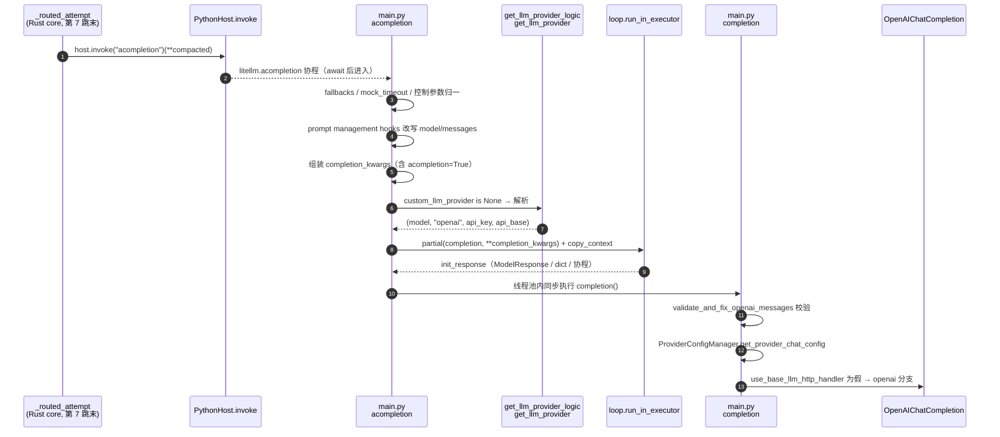

# SDK 层：main.acompletion 的 provider 解析、参数准备与分发

> 所属层级：第三层（主链路逐跳拆解） | 拆解对象：第二层场景的跳 8、跳 9、跳 10 前半
> 本篇基准提交：`411b64dc7a`（工作区当前 HEAD）

一句话定位：`litellm/main.py :: acompletion()` 是 Rust 核心经 `PythonHost` 回跳进 Python 后的第一个 SDK 层函数，它把 router 压缩后的调用参数整理成 `completion()` 能吃的形式、解析出 provider，再把同步的 `completion()` 丢进线程池执行，是「Rust 选路」与「provider 执行器」之间的搬运与分发站。

术语约定：`provider`（一个上游服务商的接入实现，如 `openai`、`anthropic`）、`custom_llm_provider`（litellm 内部标记当前请求走哪个 provider 的字符串）、`provider 四元组`（`(model, custom_llm_provider, dynamic_api_key, api_base)`，model 字符串解析的产物）、`执行器`（真正发上游请求的对象，OpenAI 走 `OpenAIChatCompletion`，其余走 `BaseLLMHTTPHandler`）。

## 本跳在主链中的位置

主链 13 跳里，04 篇讲到第 7 跳结束时 Rust 核心经 `_routed_attempt()` 里的 `host.invoke(call.host_op)(**compacted)` 回跳 Python（`litellm/router_rust/core.py :: _Driver :: _routed_attempt() :: +49`，行 5293）。这一跳交给本篇的是 `litellm.acompletion`（因为 `PythonHost.invoke` 就是 `getattr(litellm, op)`）。本篇覆盖第 8 跳（`acompletion` 内部准备）、第 9 跳（`run_in_executor` 把同步 `completion` 丢进线程池）与第 10 跳前半（`get_llm_provider` 解析 + `completion()` 的 provider 分发决策），第 10 跳后半（执行器内部真正发请求）交给 06 篇。



## 第 8 跳：acompletion 的准备工作

锚点：`litellm/main.py :: acompletion() :: +0`（定义行 652）

`acompletion` 被 `@tracer.wrap()` 与 `@client` 两个装饰器包裹（`+0` 之前的 650-651 行），签名到 `) -> ModelResponse | CustomStreamWrapper`（`+53`，行 705），带约 45 个显式参数（OpenAI 全集加 litellm 扩展如 `thinking`、`web_search_options`、`reasoning_effort`、`service_tier`）加尾部 `**kwargs`（`+52`，行 704）。进来的 `**kwargs` 里已经带着 router 展开后的 `api_key`、`api_base`、`metadata`、`litellm_params` 与 `litellm_logging_obj`。

按执行顺序，`acompletion` 函数体内（偏移相对 `+0`）做这些事：

| 序 | 动作 | 锚点 | 进出与分支 |
|---|---|---|---|
| 1 | 取 `fallbacks`：`kwargs.get("fallbacks") or litellm.model_fallbacks` | `+98`（行 749） | 命中则后面改走回退路径 |
| 2 | 取 `mock_timeout`，为 `True` 时 `await _handle_mock_timeout_async(...)` | `+99` 到 `+109`（行 750-760） | 本场景无 mock，跳过 |
| 3 | 取事件循环 `asyncio.get_event_loop()` | `+111`（行 762） | 供第 9 跳用 |
| 4 | `custom_llm_provider = kwargs.get(...)`，再 `_resolve_control_options(kwargs, model)` 归一控制参数 | `+112` 到 `+113`（行 763-764） | 归一结果写回 kwargs |
| 5 | prompt management hooks：`AnthropicCacheControlHook.maybe_seed_default_injection_points` 种注入点；命中 prompt 管理时 `await litellm_logging_obj.async_get_chat_completion_prompt(...)` 改写 model/messages | `+127`（行 778）到 `+189`（行 839） | 本场景无 prompt 管理，hook 只种默认注入点，messages 不变 |
| 6 | 组装 `completion_kwargs`：显式参数逐个搬进去，并写 `"acompletion": True` | `+199` 到 `+246`（行 851-898） | 产物是给 `completion()` 的纯关键字字典 |
| 7 | `custom_llm_provider is None` 时调 `get_llm_provider(...)` 解析 provider | `+248` 到 `+259`（行 899-911） | 见下节 |
| 8 | 有 `fallbacks` 走 `async_completion_with_fallbacks(...)` 并 return | `+261` 到 `+269`（行 913-921） | 本场景无 fallbacks，不走 |
| 9 | mock delay：命中 `should_run_mock_completion` 则 `await asyncio.sleep(mock_delay)` | `+273` 到 `+282`（行 925-934） | 本场景跳过 |
| 10 | 真正执行（第 9 跳） | `+284` 起（行 936 起） | 见下节 |

第 7 步的解析调用原文（`+248` 起，行 899-911）：

```python
if custom_llm_provider is None:
    request_kwargs: Final = cast("Mapping[str, object]", kwargs)
    _, custom_llm_provider, _, _ = get_llm_provider(
        model=model,
        custom_llm_provider=custom_llm_provider,
        api_base=cast("str | None", request_kwargs.get("api_base")) or base_url,
        litellm_params=_supplemental_provider_params(
            _REQUEST_KWARGS_ADAPTER.validate_python({**kwargs, "extra_headers": extra_headers}), model
        ).params,
    )
```

注意这里只取第二个返回值 `custom_llm_provider`，model 字符串的剥前缀结果被丢弃（`_`），因为 router 展开后的 `model` 已经是带 `openai/` 前缀的完整名字，`completion()` 会再解析一次。

### get_llm_provider 怎么解析 "openai/gpt-4o-mini"

锚点：`litellm/litellm_core_utils/get_llm_provider_logic.py :: get_llm_provider() :: +0`（定义行 187）

它是个薄包装：调 `_get_llm_provider(...)`（同文件 `+13`，行 200）拿四元组，再对 model 跑 `resolve_model_latest_alias(resolved_model, provider)`（`get_llm_provider() :: +10`，行 197）归一别名后返回。签名与返回：

```python
def get_llm_provider(
    model: str,
    custom_llm_provider: str | None = None,
    api_base: str | None = None,
    api_key: str | None = None,
    litellm_params: GenericLiteLLMParams | None = None,
) -> tuple[str, str, str | None, str | None]:
```

`_get_llm_provider` 内部对带 `/` 前缀的名字先 split 出 provider（`_get_llm_provider() :: +50` 附近的 `model.split("/", 1)[0]` 分支，行 239 起可见 azure/cohere/anthropic-text 等特判）。对本场景 `"openai/gpt-4o-mini"` 产出：

```text
model="gpt-4o-mini", custom_llm_provider="openai",
dynamic_api_key=从环境变量/参数解析, api_base=默认 https://api.openai.com/v1
```

错误传播：解析不出 provider 时 `_get_llm_provider` 抛 `BadRequestError`（model 不带可识别前缀且无法从 api_base/env 推断），该异常沿 `acompletion` 上抛，最终由 `_process_llm_request` 的 try 捕获并归一为 400 段响应。

## 第 9 跳：把同步 completion 丢进线程池

锚点：`litellm/main.py :: acompletion() :: +284` 到 `+301`（行 936-953）

```python
try:
    kwargs.pop("acompletion", None)
    func: Final = partial(completion, **completion_kwargs, **kwargs)
    ctx: Final = contextvars.copy_context()
    func_with_context: Final = partial(ctx.run, func)
    init_response: Final = await loop.run_in_executor(None, func_with_context)
    if isinstance(init_response, dict) or isinstance(init_response, ModelResponse):  ## CACHING SCENARIO
        if isinstance(init_response, dict):
            response = _model_response_from_cached_dict(init_response)
        response = init_response
    elif asyncio.iscoroutine(init_response):
        response = await _resolve_dispatched_chat_response(init_response)
    else:
        response = init_response
```

逐点讲清：

- `partial(completion, **completion_kwargs, **kwargs)` 把第 8 跳组装的 `completion_kwargs` 与剩余 kwargs 合成一次 `completion()` 调用，并先 `kwargs.pop("acompletion", None)` 防止这个内部标志漏进 `completion` 的形参。
- `contextvars.copy_context()` + `partial(ctx.run, func)` 是关键：`run_in_executor` 把活丢到线程池线程，trace/logging 依赖的 contextvars（`litellm_call_id`、otel span 等）不会自动跨线程，必须显式带过去。
- `loop.run_in_executor(None, func_with_context)` 用默认 `ThreadPoolExecutor`，返回值 `init_response` 有三种形态，分支处理见上表。本场景 `completion()` 同步返回 `ModelResponse`，走第一个分支原样赋给 `response`。
- 反直觉但重要：异步入口 `acompletion` 的主路径是**把同步的 `completion()` 丢进线程池**，不是各 provider 各写一份异步分发。这样全 provider 的分发逻辑只存在一份（`completion()`），OpenAI 之外的 provider 由执行器自己的 `acompletion`/异步路径覆盖。
- `init_response` 若是协程（部分 provider 内部已异步），交给 `_resolve_dispatched_chat_response`（`litellm/main.py :: _resolve_dispatched_chat_response() :: +0`，定义行 1018）await，该函数只是 `return await pending`（`+3`，行 1021）。

### 执行后的 agentic loop 收敛点

锚点：`litellm/main.py :: acompletion() :: +320` 到 `+347`（行 972-999）

拿到 `ModelResponse` 后，`acompletion` 还会跑一层 provider 无关的 agentic loop：`bill_first_round_on_failure(maybe_run_chat_completion_agentic_loop(response=..., model=..., messages=..., ...))`。函数体注释写明原因（行 964-971）：chat 路由在此之前的每个 provider 各自分叉（OpenAI 走 `openai.py` 的 SDK，其余走共享 httpx handler），这里才是所有分叉重新汇聚的唯一位置，所以循环在这里跑一次即可覆盖全部 provider。本场景 `maybe_run_chat_completion_agentic_loop` 判定无需多轮，原样返回响应。

## 第 10 跳前半：completion 的校验与 provider 分发

锚点：`litellm/main.py :: completion() :: +0`（定义行 5564）

`completion()` 同步执行，进来后先做校验，再按 provider 选执行器。

### 参数与消息校验

| 校验 | 锚点 | 行为 |
|---|---|---|
| `model is None` | `+101`（行 5665-5666） | 抛 `ValueError("model param not passed in.")` |
| 消息校验 | `+104` 到 `+106`（行 5668-5670） | `validate_and_fix_openai_messages(messages=messages, model=model, request_kwargs=_REQUEST_KWARGS_ADAPTER.validate_python(kwargs))` |
| tools 校验 | `+107`（行 5671） | `validate_and_fix_openai_tools(tools=tools)` |
| tool_choice 校验 | `+109` 到 `+118`（行 5673-5682） | `validate_chat_completion_tool_choice(...)`，按 `drop_params` 决定是否丢弃不支持的值 |
| optional params 校验 | `+120`（行 5684） | `validate_openai_optional_params(stop=stop)` |
| thinking 参数 | `+121`（行 5685） | `validate_and_fix_thinking_param(thinking=thinking)` |

消息校验的行为变化（相对更早版本）：`validate_and_fix_openai_messages`（`litellm/utils.py :: validate_and_fix_openai_messages() :: +0`）现在只在消息带 assistant 专属字段（`tool_calls`/`function_call`/`reasoning_content`/`refusal` 等）时才把缺 role 补成 `"assistant"`；普通消息缺 role 不再自动补，改抛 `MissingMessageRoleError`（`litellm/exceptions.py :: MissingMessageRoleError :: +0`），继承 `MalformedRequestFieldError` 再到 `BadRequestError`，HTTP 400，错误 body 里 `param="messages[{idx}].role"`。校验在 `completion()` 入口做，不在 `acompletion` 本层，所以经 router 回跳的请求同样过这道门。

### provider 解析与执行器选择

锚点：`litellm/main.py :: completion() :: use_base_llm_http_handler :: +285`（行 2853）

```python
use_base_llm_http_handler: Final = get_secret_bool("EXPERIMENTAL_OPENAI_BASE_LLM_HTTP_HANDLER")
```

这个布尔决定 openai provider 走哪条执行器。紧接着的 `## COMPLETION CALL` 段（`+307`，行 2871 起）：

```python
try:
    if use_base_llm_http_handler:
        response = base_llm_http_handler.completion(   # 行 2874
            model=model, messages=messages, api_base=api_base,
            custom_llm_provider=custom_llm_provider, model_response=model_response,
            logging_obj=logging, optional_params=optional_params, ...
            provider_config=provider_config,
        )
    else:
        response = openai_chat_completions.completion(  # 行 2894
            model=model, messages=messages, headers=outbound_headers,
            model_response=model_response, api_key=api_key, api_base=api_base,
            acompletion=acompletion, logging_obj=logging, optional_params=optional_params, ...
        )
```

`provider_config` 在更早处解析（`completion() :: +475`，行 6038-6044）：

```python
provider_config: BaseConfig | None = None
if custom_llm_provider is not None and custom_llm_provider in [provider.value for provider in LlmProviders]:
    provider_config = ProviderConfigManager.get_provider_chat_config(
        model=model, provider=LlmProviders(custom_llm_provider), base_model=base_model,
    )
```

拿到后立刻用它做一次 developer role 到 system role 的翻译（`completion() :: +482`，行 6046-6055，`provider_config.translate_developer_role_to_system_role(...)`），再继续往下。`ProviderConfigManager`（`litellm/utils.py :: ProviderConfigManager :: +0`）按 provider 查表返回具体 Config 类，是 06 篇要展开的翻译接口来源。

执行器分工（本跳的分发结论）：

| provider | 默认执行器 | 模块级单例 |
|---|---|---|
| `openai`（本场景，开关为假） | `OpenAIChatCompletion`，走官方 OpenAI SDK | `litellm/main.py :: openai_chat_completions :: +0`（行 358） |
| `openai` + `EXPERIMENTAL_OPENAI_BASE_LLM_HTTP_HANDLER` 为真 | `BaseLLMHTTPHandler` | `litellm/main.py :: base_llm_http_handler :: +0`（行 395） |
| 绝大多数其他 provider | `BaseLLMHTTPHandler`，统一 httpx 执行器 | `litellm/main.py :: base_llm_http_handler :: +0`（行 395） |

本场景 `use_base_llm_http_handler` 为假，走 `openai_chat_completions.completion(...)`，第 10 跳后半进入 06 篇。

## 调用关系表（关键边）

| 调用方与符号 | 关系 | 被调用方与符号 | 触发与输入 | 返回与后续处理 | 错误、状态与副作用 |
|---|---|---|---|---|---|
| `_routed_attempt() :: +49` | await | `PythonHost.invoke("acompletion")(**compacted)` | 压缩后的调用参数 | 返回 `litellm.acompletion` 协程 | op 查不到抛 `AttributeError` |
| `acompletion() :: +112` | 同步取值 | `kwargs.get("custom_llm_provider")` | 请求 kwargs | 多为 `None`，触发解析 | 无 |
| `acompletion() :: +248` | 条件调用 | `get_llm_provider() :: +0` | `model="openai/gpt-4o-mini"` + api_base + litellm_params | 四元组，只取 provider | 解析失败抛 `BadRequestError` |
| `acompletion() :: +288` | 线程池执行 | `loop.run_in_executor(None, func_with_context)` | `partial(completion, **completion_kwargs)` | `ModelResponse`/dict/协程 | 线程内异常上抛到 try |
| `acompletion() :: +295` | 条件 await | `_resolve_dispatched_chat_response() :: +0` | `init_response` 是协程时 | await 后的响应 | 协程异常原样上抛 |
| `completion() :: +105` | 校验 | `validate_and_fix_openai_messages()` | messages + model + request_kwargs | 清洗后的 messages | 缺 role 抛 `MissingMessageRoleError` 400 |
| `completion() :: +474` | 查表 | `ProviderConfigManager.get_provider_chat_config()` | model + provider + base_model | 具体 Config 实例 | 未知 provider 回退注册表 |
| `completion() :: +331` | 分发 | `openai_chat_completions.completion()` | 全量 OpenAI 参数 + provider_config | `ModelResponse` | 交给执行器异常映射 |

## 未确认项

- `AnthropicCacheControlHook.maybe_seed_default_injection_points`、`async_get_chat_completion_prompt`、`maybe_run_chat_completion_agentic_loop`、`bill_first_round_on_failure` 的函数体未逐行读取，本篇只引用其调用点与函数名（`litellm/main.py` 行 778、819、974、973），内部实现未读取，不臆测。
- `_get_llm_provider` 内部各 provider 特判（azure、cohere、anthropic-text 等）只读到 `+50` 附近的 `model.split` 分支段（行 239-249），完整分支树未逐行读，本场景（`openai/` 前缀）路径已确认。
- `validate_and_fix_openai_messages`、`validate_chat_completion_user_messages`、`MissingMessageRoleError` 的具体行号未在本基线重新用 offset 核到，按旧文与符号名引用，属 `[推断]`。
- `EXPERIMENTAL_OPENAI_BASE_LLM_HTTP_HANDLER` 开关的实际运行取值属 `[待运行验证]`，本场景按未设置（返回 `None`，即 falsy）处理，走 OpenAI SDK 路径。

## 源码索引

| 符号 | 文件 :: 符号 | 绝对定义行 |
|---|---|---|
| 异步入口 | `litellm/main.py :: acompletion` | 652 |
| 同步分发器 | `litellm/main.py :: completion` | 5564 |
| 协程透传 | `litellm/main.py :: _resolve_dispatched_chat_response` | 1018 |
| OpenAI 执行器单例 | `litellm/main.py :: openai_chat_completions` | 358 |
| httpx 执行器单例 | `litellm/main.py :: base_llm_http_handler` | 395 |
| 控制参数归一 | `litellm/main.py :: _resolve_control_options` | 407 |
| 补充 provider 参数 | `litellm/main.py :: _supplemental_provider_params` | 458 |
| 请求参数适配器 | `litellm/main.py :: _REQUEST_KWARGS_ADAPTER` | 4371 |
| openai 执行器开关 | `litellm/main.py :: use_base_llm_http_handler` | 2853 |
| provider 配置解析点 | `litellm/main.py :: completion`（provider_config 段） | 6038 |
| provider 派发点 | `litellm/main.py :: completion`（COMPLETION CALL 段） | 2871 |
| provider 解析 | `litellm/litellm_core_utils/get_llm_provider_logic.py :: get_llm_provider` | 187 |
| provider 解析实现 | `litellm/litellm_core_utils/get_llm_provider_logic.py :: _get_llm_provider` | 200 |
| 宿主回跳 | `litellm/router_python_host.py :: PythonHost :: invoke` | 107 |
| attempt 末段 | `litellm/router_rust/core.py :: _Driver :: _routed_attempt` | 5244 |
