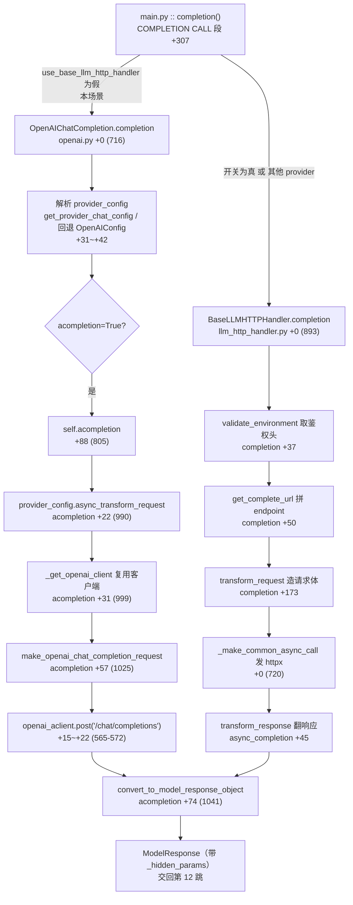

# Provider 翻译层：HTTP handler 与 provider Config 的请求/响应变换

> 所属层级：第三层（主链路逐跳拆解） | 拆解对象：第二层场景的跳 10 后半、跳 11
> 本篇基准提交：`411b64dc7a`（工作区当前 HEAD）

一句话定位：05 篇末尾 `completion()` 按 provider 选定执行器后，真正「把统一 OpenAI 格式翻成各 provider 私有请求、再把私有响应翻回 `ModelResponse`」的活由执行器加 provider Config 这对搭档完成。本篇讲清这两条执行器路径（OpenAI 官方 SDK、统一 httpx handler）各自怎么调 Config 的 `transform_request`/`transform_response`，以及错误怎么被翻译层吃掉或上抛。

术语约定：`执行器`（真正持有 HTTP 客户端、发上游请求的对象）、`provider Config`（每个 provider 一个类，集中该 provider 的请求/响应/URL/鉴权翻译逻辑，基类是 `BaseConfig`）、`透传`（OpenAI 格式的 provider，请求体几乎原样转发，只清洗参数）、`不可处理实体错误`（`UnprocessableEntityError`，422，provider 拒绝了某个不支持的参数）。

## 本跳在主链中的位置

主链 13 跳里，05 篇结束在 `completion()` 的 COMPLETION CALL 段（`litellm/main.py :: completion() :: +307`，行 2871）选定执行器。本篇覆盖第 10 跳后半（执行器拿到控制权、做参数清洗与 URL/鉴权准备）与第 11 跳（发上游请求、把原始响应翻成 `ModelResponse`）。第 12 跳（响应原路返回、Rust 核心记账）交给 07 篇。本场景是 openai provider，走 OpenAI SDK 路径（`OpenAIChatCompletion`）；httpx handler 路径在本篇作为对照展开，供非 OpenAI provider 参考。



## 执行器二分与唯一路由真相

| 执行器 | 文件 :: 符号 | 服务对象 | 进入口 |
|---|---|---|---|
| `OpenAIChatCompletion` | `litellm/llms/openai/openai.py :: OpenAIChatCompletion`（类定义行 415） | `openai` provider（默认） | `completion()` 同步入口行 716、`acompletion()` 异步入口行 967 |
| `BaseLLMHTTPHandler` | `litellm/llms/custom_httpx/llm_http_handler.py :: BaseLLMHTTPHandler`（类定义行 719） | 绝大多数其他 provider；openai 仅当实验开关开 | `completion()` 行 893、`async_completion()` 行 820 |

易错事实：openai provider **默认走官方 SDK**（`OpenAIChatCompletion`），不是 httpx handler。`BaseLLMHTTPHandler` 接管 openai 仅当环境开关 `EXPERIMENTAL_OPENAI_BASE_LLM_HTTP_HANDLER` 为真（`litellm/main.py :: completion() :: use_base_llm_http_handler :: +285`，行 2853 `get_secret_bool(...)`）。判定点是 `completion()` 的 COMPLETION CALL 段 `if use_base_llm_http_handler:` 分支（行 2873）。本场景开关为假，走 SDK 路径。

两条路径共享同一套 `ProviderConfig` 翻译接口。这是「API 分片感知」架构的落点：翻译逻辑集中到每个 provider 一个 Config 类，执行器只负责调度与发 HTTP。

## provider Config 接口

锚点：`litellm/llms/base_llm/chat/transformation.py :: BaseConfig :: +0`（定义行 91，ABC）

每个 provider 在 `<provider>/<模态>/transformation.py` 定义一个 Config 子类（如 `OpenAIGPTConfig`、`AnthropicConfig`）。基类关键方法与默认行为：

| 方法 | 基类锚点 | 职责 | 默认行为 |
|---|---|---|---|
| `should_retry_llm_api_inside_llm_translation_on_http_error()` | `BaseConfig :: +127`（行 218） | HTTP 错误是否在翻译层内重试 | 返回布尔 |
| `transform_request_on_unprocessable_entity_error()` | `BaseConfig :: +137`（行 228） | 422 时重造请求体 | drop_params 场景用 |
| `get_supported_openai_params()` | `BaseConfig :: +153`（行 244） | 声明该 provider 支持哪些 OpenAI 参数 | 子类覆写，供 `map_openai_params` 与 drop_params 用 |
| `map_openai_params()` | `BaseConfig :: +203`（行 294） | OpenAI 参数名映射到 provider 私有名 | 子类覆写 |
| `validate_environment()` | `BaseConfig :: +213`（行 304） | 检查凭证齐全，返回带 key 的头 | 子类覆写，缺凭证抛错 |
| `sign_request()` | `BaseConfig :: +234`（行 325） | AWS 等请求签名 | 部分 provider 实现 |
| `get_complete_url()` | `BaseConfig :: +259`（行 350） | 拼 endpoint URL | 子类覆写 |
| `transform_request()` | `BaseConfig :: +280`（行 371） | OpenAI 格式转 provider 请求体 | 子类覆写 |
| `transform_response()` | `BaseConfig :: +312`（行 403） | provider 响应转 `ModelResponse` | 子类覆写 |

OpenAI 这边的实现在 `litellm/llms/openai/chat/gpt_transformation.py :: OpenAIGPTConfig :: +0`（行 200），关键方法定义行：`get_supported_openai_params` 262、`map_openai_params` 338、`transform_request` 680、`transform_response` 866、`get_complete_url` 922、`validate_environment` 950。因为 OpenAI 格式就是 litellm 的内部统一格式，`transform_request` 对 openai 前缀的模型近乎透传，主要工作是参数清洗（去掉 provider 不认的键）。

## 路径 A：OpenAI SDK（本场景）

锚点：`litellm/llms/openai/openai.py :: OpenAIChatCompletion :: completion() :: +0`（行 716）

`main.completion()` 调进来时带 `acompletion=True`（05 篇第 9 跳 `completion_kwargs` 里写死的标志）。同步 `completion` 先做准备工作再转发：

| 序 | 动作 | 锚点 | 分支与结果 |
|---|---|---|---|
| 1 | 拷贝 `inference_params`，pop 出 `stream_options` 与 `stream` | `+27` 到 `+30`（行 744-746） | stream 单独带，不进请求体清洗 |
| 2 | 解析 `provider_config`：`ProviderConfigManager.get_provider_chat_config(model, provider)`，`ValueError` 时回退 `None`，再统一回退 `OpenAIConfig()` | `+31` 到 `+42`（行 747-759） | JSON 配置的 provider 不在 `LlmProviders` 枚举里，走回退 |
| 3 | 判定 `fake_stream`：`provider_config.should_fake_stream(...)` | `+45` 到 `+48`（行 761-764） | provider 不支持真流式时用假流式 |
| 4 | headers 透传进 `inference_params["extra_headers"]`；model/messages 缺失抛 422；timeout 类型校验抛 422 | `+50` 到 `+59`（行 766-775） | 前置参数门控 |
| 5 | 非 openai 前缀时给 `model_response.model` 加 `custom_llm_provider/` 前缀 | `+61` 到 `+62`（行 777-778） | 本场景是 openai，不加 |
| 6 | 进入 `for _ in range(2)` 重试循环（换行交替消息失败时重试） | `+64`（行 780） | 最多两轮 |
| 7 | `acompletion is True` 且 `stream=True and not fake_stream` 走 `self.async_streaming` | `+67` 到 `+86`（行 783-803） | 流式分支，07 篇展开 |
| 8 | `acompletion is True` 否则走 `self.acompletion` | `+88` 到 `+107`（行 805-824） | **本场景入口** |
| 9 | 同步非流式走 `provider_config.transform_request(...)` 后进同步 SDK 调用 | `+110`（行 826）起 | 对照路径 |

### acompletion：异步非流式主路径

锚点：`litellm/llms/openai/openai.py :: OpenAIChatCompletion :: acompletion() :: +0`（行 967）

| 序 | 动作 | 锚点 | 进出 |
|---|---|---|---|
| 1 | `provider_config.async_transform_request(...)` 造请求体 `data` | `+22` 到 `+28`（行 990-996） | OpenAI 格式近乎透传，主要清洗参数 |
| 2 | `self._get_openai_client(is_async=True, ...)` 取 `AsyncOpenAI` 客户端 | `+31` 到 `+42`（行 999-1010） | 客户端由 kwargs 复用，内部走缓存 |
| 3 | `logging_obj.pre_call(...)` 记调用前状态 | `+45` 到 `+55`（行 1013-1023） | 写 `model_call_details` |
| 4 | `await self.make_openai_chat_completion_request(...)` 发上游 | `+57` 到 `+62`（行 1025-1030） | 返回 `(headers, response)` |
| 5 | `provider_config.transform_parsed_response_dict(model_dump_provider_response(response))` | `+63` 到 `+65`（行 1031-1033） | provider 私有响应字典规整 |
| 6 | `logging_obj.post_call(...)` 记响应 | `+66` 到 `+71`（行 1034-1039） | 写 `model_call_details` |
| 7 | 把原始响应头存进 `model_call_details["response_headers"]` | `+72`（行 1040） | 供成本/审计读取 |
| 8 | `convert_to_model_response_object(...)` 翻成 `ModelResponse` | `+73` 到 `+78`（行 1041-1046） | `hidden_params={"headers": headers}` |
| 9 | `_call_agentic_completion_hooks_openai(...)` | `+101` 到 `+109`（行 1068-1077） | agentic hook，命中则替换响应 |
| 10 | `fake_stream` 为真走 `self.mock_streaming` | `+114`（行 1082）起 | 本场景非流式，不走 |

### 上游请求怎么发

锚点：`litellm/llms/openai/openai.py :: make_openai_chat_completion_request() :: +0`（行 550）

```python
body, options = _request_without_sdk_transform(data, timeout)          # +14，行 564
raw_response = _raw_chat_response(
    await openai_aclient.post(                                          # +16~+23，行 566-572
        "/chat/completions",
        body=body,
        cast_to=ChatCompletion,
        options=options,
        stream=bool(data.get("stream")),
        stream_cls=AsyncStream[ChatCompletionChunk],
    )
)
# 中间略去：取 raw_response.headers 存 headers，再 parse() 出 ChatCompletion
if hasattr(raw_response, "headers"):
    headers = dict(raw_response.headers)                                # +27~+29，行 577-579
response: Final = raw_response.parse()                                  # +31，行 581
```

两个关键点：

- 用 SDK 客户端的裸 `post` 而不是 `chat.completions.create` 语法糖，既复用官方 SDK 的鉴权与序列化，又通过 `cast_to=ChatCompletion` 拿回强类型解析结果，同时保留 `raw_response.headers` 原始响应头（`_raw_chat_response` 定义行 393）。
- `_request_without_sdk_transform`（定义行 400）绕过 SDK 自己的参数改写，保证 litellm 造出的请求体按原样发出去。

错误传播（同函数）：

| 异常 | 锚点 | 处理 |
|---|---|---|
| `openai.APITimeoutError` | `+37` 到 `+41`（行 588-592） | 把耗时拼进 message 后原样 `raise e` |
| `openai.BadRequestError` 且是输出 token 超限 | `+42` 到 `+50`（行 593-601） | `build_output_token_limit_response(...)` 造一个超限响应返回，不当错误抛 |
| 其他 `openai.BadRequestError` | `+43`（行 594-595） | `raise` 上抛 |
| 其他一切 `Exception` | `+51` 到 `+52`（行 602-603） | 原样 `raise e` |

`acompletion` 外层再兜一层（`+80` 到 `+99`，行 1047-1067）：`openai.UnprocessableEntityError` 时若开了 `drop_params` 就 `drop_params_from_unprocessable_entity_error(...)` 删掉不认的参数、靠 `for _ in range(2)` 循环重试；否则上抛。其余异常统一包成 `OpenAIError`（带上 status_code、body、error_headers）再抛，供上层异常映射归一。

## 路径 B：统一 httpx handler（非 OpenAI provider 对照）

锚点：`litellm/llms/custom_httpx/llm_http_handler.py :: BaseLLMHTTPHandler :: completion() :: +0`（行 893）

它是同步/异步统一入口（`acompletion` 标志区分）。核心顺序：

```text
completion()（893 行）
  1. provider_config = ProviderConfigManager.get_provider_chat_config(...)   # +24 附近
  2. fake_stream 判定 provider_config.should_fake_stream(...)                # +30 附近
  3. request_headers = provider_config.validate_environment(...)             # +37 附近
  4. api_base = provider_config.get_complete_url(...)                        # +50 附近
  5. sign_and_log 闭包:
        data = transformed + transform_extra_body(...)
        signed = provider_config.sign_request(...)（AWS 走 run_aws_signing）
        logging_obj.pre_call(...)
        → (data, signed_headers, signed_json_body)
  6. 变换请求体:
        acompletion 且 uses_async_transform_request → await async_transform_request
        否则 → provider_config.transform_request(...)
  7. 分支:
        acompletion → dispatch_async → acompletion_stream_function / async_completion
        stream      → make_sync_call → CustomStreamWrapper
        sync        → _make_common_sync_call → transform_response
```

上表里第 1 到第 4 步的具体偏移以 `completion()` 函数体为准，本篇只核到入口与分支结构；逐行偏移在第四层 httpx handler 篇展开。

### 异步非流式：async_completion 与 _make_common_async_call

锚点：`litellm/llms/custom_httpx/llm_http_handler.py :: BaseLLMHTTPHandler :: async_completion() :: +0`（行 820）

`async_completion` 是异步非流式路径：`_make_common_async_call(...)`（`+0`，行 720）发请求，回程调 `provider_config.transform_response`（`+45` 附近）翻成 `ModelResponse`，再跑 agentic hook，最后返回。

`_make_common_async_call`（行 720）与同步版 `_make_common_sync_call`（行 770）是真正的 HTTP 发送与错误处理：`async_httpx_client.post(url=api_base, ...)`（`+19` 附近），在 `httpx.HTTPStatusError` 时查 `provider_config.should_retry_llm_api_inside_llm_translation_on_http_error`（`+29` 附近），命中且是 422 就 `transform_request_on_unprocessable_entity_error` 重造请求体重试，最多 `max_retry_on_unprocessable_entity_error` 次；其余异常交 `_handle_error` 做异常映射。`completion()`（行 893）与 `async_completion()`（行 820）的类内偏移全部相对 `BaseLLMHTTPHandler :: +0`（行 719）。

## 一个具体对照：Anthropic 的翻译

OpenAI 路径几乎透传，看非透传 provider 才能看出 Config 的分量。Anthropic 的请求变换：

```text
OpenAI 入参:  messages=[{"role":"system","content":"..."},{"role":"user","content":"hi"}], max_tokens=100
Anthropic 请求体:
{
  "system": "...",                    <- system 从 messages 里抽出，单独字段
  "messages": [{"role":"user","content":"hi"}],
  "max_tokens": 100,                  <- Anthropic 必填，litellm 会兜底默认值
  "model": "claude-sonnet-4-5"
}
头: x-api-key + anthropic-version
URL: https://api.anthropic.com/v1/messages
```

这套变换的实现在 `litellm/llms/anthropic/chat/transformation.py :: AnthropicConfig :: transform_request :: +0`，函数级拆解在第四层 provider 篇。

## 响应回程的统一形态

| 路径 | 响应入口 | 转换器 | 产物 |
|---|---|---|---|
| OpenAI SDK（本场景） | SDK `ChatCompletion`（`raw_response.parse()`） | `convert_to_model_response_object` | `ModelResponse`，`_hidden_params` 带 headers |
| httpx handler | httpx `Response` | `provider_config.transform_response` | `ModelResponse`，provider 元数据写进 `_hidden_params` |

两条路径转换后统一是 `ModelResponse`（Pydantic，OpenAI schema）。`_hidden_params` 是响应对象的私有属性区（`litellm/types/utils.py :: ModelResponse :: __init__ :: +47`，行 2456-2457 处 `if hidden_params: self._hidden_params = hidden_params`），贯穿全链路携带网关内部数据（api_base、model_id、response_headers、response_cost、cache_key），模型序列化响应时被 exclude，客户端看不到。这正是 07 篇 `_process_llm_request` 收尾段提取 `response_cost`、08 篇成本定案的数据源。

## 流式分支预览

`stream=True` 时（07 篇展开）：

- OpenAI SDK 路径：`OpenAIChatCompletion.completion` 走 `self.async_streaming`（`+68`，行 785），SDK 返回事件流，`OpenAIChatCompletionResponseIterator`（`litellm/llms/openai/openai.py :: OpenAIChatCompletionResponseIterator :: +0`，行 371）逐 chunk 转换。
- httpx 路径：handler 返回 provider 流迭代器，外面包一层 `CustomStreamWrapper`（`litellm/litellm_core_utils/streaming_handler.py :: CustomStreamWrapper :: +0`，行 457）统一做 usage 聚合、时间统计与 guardrail。

## 调用关系表（关键边）

| 调用方与符号 | 关系 | 被调用方与符号 | 触发与输入 | 返回与后续处理 | 错误、状态与副作用 |
|---|---|---|---|---|---|
| `main.completion() :: +331` | 同步调用 | `OpenAIChatCompletion.completion() :: +0` | model/messages/optional_params/logging_obj/acompletion=True | 转 `self.acompletion` | 前置门控抛 `OpenAIError` 422 |
| `OpenAIChatCompletion.completion() :: +33` | 查表 | `ProviderConfigManager.get_provider_chat_config()` | model + provider | 具体 Config，失败回退 `OpenAIConfig` | `ValueError` 被吞，回退 |
| `OpenAIChatCompletion.completion() :: +32` | 同步转发 | `OpenAIChatCompletion.acompletion() :: +0` | messages + provider_config + headers | 异步非流式响应 | 进异常映射 |
| `OpenAIChatCompletion.acompletion() :: +22` | await | `provider_config.async_transform_request()` | model/messages/optional_params/litellm_params/headers | 请求体 `data` | 参数不合法抛错 |
| `OpenAIChatCompletion.acompletion() :: +31` | 取客户端 | `_get_openai_client(is_async=True)` | api_key/api_base/timeout/client | `AsyncOpenAI` | 凭证缺失抛错 |
| `OpenAIChatCompletion.acompletion() :: +57` | await | `make_openai_chat_completion_request() :: +0` | openai_aclient + data + timeout | `(headers, ChatCompletion)` | 超时/4xx/5xx 分类处理 |
| `make_openai_chat_completion_request() :: +16` | await | `openai_aclient.post("/chat/completions")` | body + options + stream | 裸响应，取 headers 后 `parse()` | `APITimeoutError` 拼耗时上抛 |
| `OpenAIChatCompletion.acompletion() :: +73` | 转换 | `convert_to_model_response_object()` | stringified_response + model_response + headers | `ModelResponse` | 响应非法抛 `OpenAIError` 500 |
| `BaseLLMHTTPHandler.completion() :: +37` | 取鉴权 | `provider_config.validate_environment()` | api_key/api_base | 带 key 的头 | 缺凭证抛 `AuthenticationError` |
| `BaseLLMHTTPHandler.async_completion() :: +0` | await | `_make_common_async_call() :: +0` | api_base + data + signed_headers | provider 响应 | `HTTPStatusError` 触发翻译层内重试 |
| `BaseLLMHTTPHandler.async_completion() :: +45` | 转换 | `provider_config.transform_response()` | provider 响应 | `ModelResponse` | 映射失败抛对应异常 |

## 未确认项

- `BaseLLMHTTPHandler.completion()`（行 893）与 `async_completion()`（行 820）函数体内各步骤（`get_provider_chat_config`、`validate_environment`、`get_complete_url`、`transform_request`、`dispatch_async`）的类内偏移未逐行核到，本篇只核到入口行与 `_make_common_async_call`/`_make_common_sync_call` 的定义行，中间偏移按调用顺序描述，属 `[推断]`。
- `_request_without_sdk_transform`（openai.py 行 400）、`_get_openai_client`（行 430）内部实现未逐行读取，只确认签名与调用点，不臆测其缓存与 workload identity 细节。
- `convert_to_model_response_object` 的内部字段映射未逐行读取（属第四层）。
- `OpenAIGPTConfig.transform_request` 对 openai 前缀「近乎透传」是按其作为 litellm 内部统一格式的角色判断（`[推断]`），函数体未逐行比对每个字段。
- Anthropic 请求体示例为示意结构，具体字段以 `AnthropicConfig.transform_request` 当前实现为准，属 `[待运行验证]`。

## 源码索引

| 符号 | 文件 :: 符号 | 绝对定义行 |
|---|---|---|
| OpenAI 执行器 | `litellm/llms/openai/openai.py :: OpenAIChatCompletion` | 415 |
| 同步入口 | `litellm/llms/openai/openai.py :: OpenAIChatCompletion :: completion` | 716 |
| 异步入口 | `litellm/llms/openai/openai.py :: OpenAIChatCompletion :: acompletion` | 967 |
| 上游请求 | `litellm/llms/openai/openai.py :: make_openai_chat_completion_request` | 550 |
| 同步上游请求 | `litellm/llms/openai/openai.py :: make_sync_openai_chat_completion_request` | 606 |
| 裸响应包装 | `litellm/llms/openai/openai.py :: _raw_chat_response` | 393 |
| 去 SDK 改写 | `litellm/llms/openai/openai.py :: _request_without_sdk_transform` | 400 |
| 客户端获取 | `litellm/llms/openai/openai.py :: _get_openai_client` | 430 |
| SDK 流迭代器 | `litellm/llms/openai/openai.py :: OpenAIChatCompletionResponseIterator` | 371 |
| httpx 执行器 | `litellm/llms/custom_httpx/llm_http_handler.py :: BaseLLMHTTPHandler` | 719 |
| httpx 异步非流式 | `litellm/llms/custom_httpx/llm_http_handler.py :: async_completion` | 820 |
| httpx 同步入口 | `litellm/llms/custom_httpx/llm_http_handler.py :: completion` | 893 |
| 异步 HTTP 发送 | `litellm/llms/custom_httpx/llm_http_handler.py :: _make_common_async_call` | 720 |
| 同步 HTTP 发送 | `litellm/llms/custom_httpx/llm_http_handler.py :: _make_common_sync_call` | 770 |
| Config 基类 | `litellm/llms/base_llm/chat/transformation.py :: BaseConfig` | 91 |
| OpenAI Config | `litellm/llms/openai/chat/gpt_transformation.py :: OpenAIGPTConfig` | 见方法行 |
| 流包装器 | `litellm/litellm_core_utils/streaming_handler.py :: CustomStreamWrapper` | 457 |
| 响应类型 | `litellm/types/utils.py :: ModelResponse` | 2405 |
