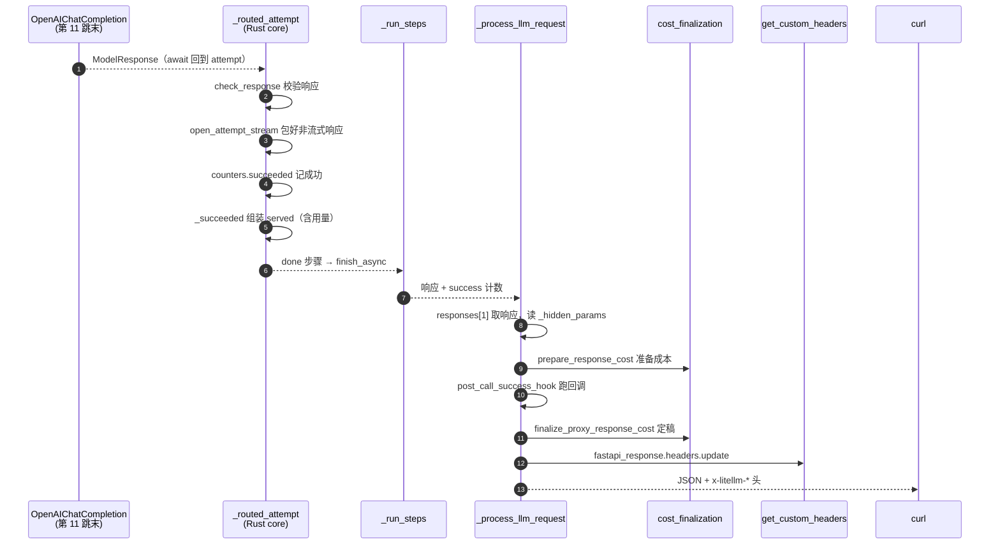

# 响应回传、流式切片与 usage 统计

> 所属层级：第三层（主链路逐跳拆解） | 拆解对象：第二层场景的跳 12（含流式分支机制）
> 本篇基准提交：`411b64dc7a`（工作区当前 HEAD）

一句话定位：第 11 跳执行器产出 `ModelResponse` 后，这一跳负责把它原路交回调用方——Rust 核心先对响应记账，Proxy 收尾段从响应的 `_hidden_params` 提取审计字段并组装 `x-litellm-*` 响应头；本场景非流式直接返回 JSON，若请求声明了 `stream=True` 则改走 SSE 生成器路径，由 `CustomStreamWrapper` 统一切片并聚合 usage。

术语约定：`_hidden_params`（响应对象的私有属性区，贯穿全链路携带网关内部数据，序列化时被 exclude，客户端看不到）、`SSE`（Server-Sent Events，流式响应的 `text/event-stream` 帧格式）、`CSW`（`CustomStreamWrapper`，所有 provider 流的统一包装器）、`usage`（token 用量，含 prompt/completion 计数，是成本计算的输入）、`TTFT`（time-to-first-token，首 token 延迟）。

## 本跳在主链中的位置

主链 13 跳里，06 篇结束在执行器把上游响应翻成 `ModelResponse` 并沿 `await` 链返回。本篇覆盖第 12 跳：Rust 核心 `_routed_attempt` 对响应做合法性检查与成功计数（第 12 跳前半，属 Router 侧），以及 Proxy `_process_llm_request` 收尾段对响应的处理与回传（第 12 跳后半，本篇重点）。成本计算与落库属第 13 跳，见 08 篇。本场景非流式，但本篇把流式与 usage 机制一并讲清，因为它们共享同一条响应回传主干。



## 第 12 跳前半：Rust 核心对响应记账

锚点：`litellm/router_rust/core.py :: _Driver :: _routed_attempt() :: +0`（定义行 5244）

上游 `ModelResponse` 一路 `await` 回到 `_routed_attempt`，host 回跳段（`+42` 到 `+53`，行 5286-5297）拿到 `answered` 之后，依次发生：

| 序 | 动作 | 锚点 | 语义 |
|---|---|---|---|
| 1 | 把 `logs_failure`/`in_call` 复位为 `False` | `+54` 到 `+55`（行 5298-5299） | 上游已应答，此后的失败不再算这次 attempt 的账 |
| 2 | `self._core._endpoints.check_response(self._plan, answered, call)` | `+56`（行 5300） | 校验响应合法性，非法则抛错走失败分支 |
| 3 | `self._stream_attempt(step, call.kwargs, slot)` 取流尝试对象 | `+57`（行 5301） | 非流式时它只包一层，不读 chunk |
| 4 | `response = await open_attempt_stream(stream, answered)` | `+61`（行 5305） | 非流式直接把响应包好；流式在这里开始消费首 chunk |
| 5 | `self._core._endpoints.counters.succeeded(self._plan, call)` | `+66`（行 5310） | 给该 model group 记一次成功（注释提醒：计数器被换成普通 dict 会让 attempt 失败） |
| 6 | `served = self._succeeded(call, response, call.host_op, stream)` | `+88`（行 5332） | 组装 `served` 结果，含 `deferred` 标记与用量 |
| 7 | 成功回调时 `await self._core.repin_after_success(stream.logged(), response)` | `+90` 到 `+91`（行 5334-5335） | 会话重钉（把这次成功的部署钉给后续同会话请求） |
| 8 | `return served` | `+95`（行 5339） | 交回步骤循环 |

错误传播（同函数）：`asyncio.CancelledError`（`+67` 到 `+73`，行 5311-5317）先释放并发槽位再上抛；`TotalTimeoutNotApplicable`（`+74` 到 `+75`，行 5318-5319）直接上抛；其余 `Exception`（`+76` 到 `+87`，行 5320-5331）走 `self._failed(...)` 分类后交回 Rust 调用循环，像普通 attempt 失败一样触发重试与冷却。

`_run_steps`（`litellm/router_rust/core.py :: RustCore :: _run_steps() :: +0`，行 3017）收到 `done` 步骤后结束循环，`_drive` 收尾，控制权回到 `_process_llm_request`。本场景单部署、成功，循环只穿一次 `attempt`。

## 第 12 跳后半：Proxy 收尾段处理响应

锚点：`litellm/proxy/common_request_processing.py :: ProxyBaseLLMRequestProcessing :: _process_llm_request() :: +0`（定义行 3307）

gather 返回后（`+105` 到 `+110`，行 3411-3419，`responses = await llm_responses` 然后 `response = responses[1]` 取到响应本身），进入收尾段。先把审计字段从 `_hidden_params` 挖出来（`+116` 到 `+127`，行 3423-3434）：

```python
hidden_params = get_hidden_params_dict(response)
model_id: Final = self._get_model_id_from_response(hidden_params, self.data)
cache_key, api_base, response_cost = (
    hidden_params.get("cache_key", None) or "",
    hidden_params.get("api_base", None) or "",
    _response_cost_header_value(hidden_params),
)
fastest_response_batch_completion, additional_headers = (
    hidden_params.get("fastest_response_batch_completion", None),
    hidden_params.get("additional_headers", {}) or {},
)
```

接着更新请求状态（`+132` 到 `+137`，行 3439-3444，`proxy_logging_obj.update_request_status(status="success")` 起一个后台 task，不阻塞响应）。然后按是否流式分叉。

### 非流式（本场景）

判断入口是 `+138` 到 `+140`（行 3445-3447）：

```python
if self._is_streaming_request(data=self.data, is_streaming_request=is_streaming_request)
   or self._is_streaming_response(response):
```

本场景两个条件都为假，跳过整个流式块（行 3448-3621），直接落到非流式收尾（`+230` 到 `+369`，行 3537 起）。按顺序：

| 序 | 动作 | 锚点 | 语义 |
|---|---|---|---|
| 1 | `prepare_response_cost(logging_obj, response, datetime.now(timezone.utc))` | `+352`（行 3658） | 让 `Logging` 对象把响应成本准备好，结果存 `logging_obj.prepared_cost` |
| 2 | `await proxy_logging_obj.post_call_success_hook(...)` | `+353` 到 `+357`（行 3659-3663） | 跑各回调的 `async_post_call_success_hook`，可能替换 response |
| 3 | `record_served_output_texts(...)` | `+358`（行 3664） | 记录实际输出文本供审计 |
| 4 | `await finalize_proxy_response_cost(...)` | `+359` 到 `+368`（行 3666-3674） | 把账定稿（含 guardrail 信息成本），spend 累加 |
| 5 | 异常兜底（`except (Exception, asyncio.CancelledError)`） | `+369` 到 `+387`（行 3675-3693） | 若已 `prepared_cost` 则在 shield 内补 finalize，客户端断开时补 499 failure hook，再 `raise` |
| 6 | `finally` 里 `_flush_deferred_async_logging(...)` | `+388` 到 `+392`（行 3694-3698） | 刷出 pre-call 时设了 `defer_async_logging=True` 的成功日志 |
| 7 | 组装成本类响应头数值 | `+419` 到 `+441`（行 3725-3747） | 从 `hidden_params` 与 `logging_obj.finalized_cost` 算 `response_cost_for_headers` |
| 8 | 还原客户端要的 model 名 | `+445` 到 `+451`（行 3751-3757） | `_override_openai_response_model(...)`，保证返回 `gpt-4o-mini` 而非内部标识 |
| 9 | `fastapi_response.headers.update(...)` | `+452`（行 3759） | 内联调 `get_custom_headers(...)` 产出 `x-litellm-*` 头 |

`prepare_response_cost` 与 `finalize_proxy_response_cost` 的实现在 `litellm/proxy/spend_tracking/cost_finalization.py`：前者（`prepare_response_cost() :: +0`，行 14）只是 `logging_obj.prepare_response_cost(response, now)` 的薄包装，异常吞掉返回 `None`（成本准备失败绝不阻止已完成的响应返回）；后者（`finalize_proxy_response_cost() :: +0`，行 101）取 `proxy_logging_obj.internal_usage_cache.dual_cache.redis_cache` 作 SharedCounter，进 `finalize_response_cost`，在 `logging_obj.cost_finalization_lock` 下把 prepared cost 起一个后台 task 定稿并 `record_finalized_cost`。成本算式的细节在 08 篇。

响应头组装在 `litellm/proxy/common_request_processing.py :: ProxyBaseLLMRequestProcessing :: get_custom_headers() :: +0`（行 2423），核心键值：

| 头 | 值来源 |
|---|---|
| `x-litellm-call-id` | `logging_obj.litellm_call_id` |
| `x-litellm-model-id` | 命中部署的唯一 id（`model_id`，取自 `_hidden_params`） |
| `x-litellm-model-name` | 客户端请求的 model 组名 |
| `x-litellm-response-cost` | `logging_obj.finalized_cost.amount`，未定稿则 `response_cost_for_headers` |
| `x-litellm-api-base` / `x-litellm-cache-key` | `_hidden_params` 的 `api_base` / `cache_key` |

回到 `chat_completion`：`result` 是 `BaseModel` 时经 `model_dump_with_preserved_fields(result, exclude_unset=True)`（`litellm/proxy/proxy_server.py :: chat_completion() :: +70`）转成 dict，由 FastAPI 序列化为 JSON。客户端拿到响应。全程状态变化：metadata 已注入、call id 已生成、deployment 已选中并记数、成本已算出、spend 已累加、响应头携带审计字段。

### 流式（机制说明）

若上面两个条件命中，走行 3448-3621 的流式块：

| 步 | 动作 | 锚点 |
|---|---|---|
| 1 | `proxy_logging_obj.post_call_response_headers_hook(...)` 取流式成功回调头 | `+143` 到 `+149`（行 3450-3455） |
| 2 | `self._stream_response_headers(...)` 组装流式响应头 | `+150` 到 `+156`（行 3456-3462） |
| 3 | 定义 `refresh_stream_headers()` 内嵌函数，首个 chunk 确定部署后刷新响应头 | `+157` 到 `+170`（行 3464-3476） |
| 4 | 保存客户端原始 model 名供下游生成器用 | `+176` 到 `+177`（行 3482-3483） |
| 5 | 后置 guardrail 激活时 `self._arm_deferred_stream_dispatch(...)` | `+178` 到 `+185`（行 3485-3491） |
| 6 | 按 route_type 分支：passthrough 直通二进制流；anthropic_messages 用 `async_sse_data_generator` + keepalive ping；其余用 `select_data_generator` | `+187` 到 `+361`（行 3493-3611） |
| 7 | `return await create_response(generator=..., media_type="text/event-stream", headers=custom_headers, refresh_headers=refresh_stream_headers, ...)` | `+306` 到 `+314`（行 3613-3621） |

`create_response`（`litellm/proxy/common_request_processing.py :: create_response() :: +0`，行 1483）把生成器包成上游关闭自同步的 SSE `StreamingResponse`，内部经 `_UpstreamClosingStreamingResponse`（同文件 `+0`，行 1187）。SSE keepalive 由 `open_sse_before_first_byte`（`+0`，行 1723）在首字节前发 `: ping` 注释，防上游 TTFT 过长导致空闲断连；一旦 ping 已发出而后续又发生 guardrail 拦截，走 `_late_block_or_failure`（`+0`，行 1687）把拦截流以 SSE 帧中继给客户端，而不是断开连接。客户端中途断开时走 `_dispatch_disconnect_billing_event`（`+0`，行 593）：先检查是否已有自然 end-of-stream 事件（有则跳过），否则用已收到的 chunks 组装出部分响应按已收部分计费，保证断开也记账。

### CustomStreamWrapper：流的统一包装器

锚点：`litellm/litellm_core_utils/streaming_handler.py :: CustomStreamWrapper :: +0`（类定义行 457，类内偏移以此为准）

所有 provider 的流（OpenAI SDK 流、httpx 流、Anthropic 流）都被它包一层：

| 职责 | 实现锚点（相对类 `+0`） |
|---|---|
| chunk 格式统一成 OpenAI `ModelResponseStream` | `chunk_creator() :: +0`（行 1867） |
| 断流保护、finish_reason 传播 | `finish_reason_handler() :: +0`（行 2261） |
| usage-only chunk 收集（不回传客户端） | `_record_usage_only_chunk() :: +0`（行 2310） |
| 流末尾聚合成完整流式响应 | `_finalize_completed_stream() :: +0`（行 2722） |
| `include_usage` 门控 | `check_send_stream_usage() :: +0`（行 715） |
| usage 跨 chunk 累加 | `calculate_total_usage()`（模块级，行 3126） |
| 显式免费费率盖 `litellm_bill` 章 | `_stamp_usage_cost()`（模块级，行 115） |
| 首 chunk 的 proxy 自身开销（后续 chunk 继承） | `Logging.set_first_chunk_overhead() :: +0`（`litellm_logging.py` 行 1035） |

关键语义：网关内部总是聚合完整 usage 用于记账，`stream_options.include_usage` 只控制客户端看得到什么。provider 回传的 usage-only chunk（如 OpenRouter 的 post-finish chunk）被 `_record_usage_only_chunk` 收进内部供成本层读取，但绝不回传给调用方。流末尾 `_finalize_completed_stream` 组装出完整流式响应后调 `_stamp_usage_cost`，它在 `bill == 0` 且完整响应的 `usage.cost == 0` 时也照样盖章，配合 `Logging.is_usage_explicitly_free()`（`litellm_logging.py` 行 2478）把显式免费费率也落账，避免 cost=0 的免费调用被当成「没算钱」漏掉。

### usage 的三种来源

| 场景 | usage 从哪来 |
|---|---|
| 非流式（本场景） | provider 响应原文的 usage 字段，`convert_to_model_response_object`/`transform_response` 直填进 `ModelResponse`，不是事后统计 |
| 流式 | `CustomStreamWrapper` 聚合各 chunk；provider 不回 usage 时按 tokenizer 估算（`litellm/litellm_core_utils/token_counter.py`） |
| 缓存命中 | 不重新计费，`response_cost_calculator` 对 `cache_hit=True` 直接返回 `0.0` |

流式与非流式的记账时序差异：非流式是响应回来先 `prepare_response_cost` 再回调（第 13 跳）；流式是 SSE 全部 chunk 发完（或客户端断开）后 `_finalize_completed_stream` 聚合出最终 usage，`dispatch_success_handlers` 才触发 success 事件，此时 `_async_success_handler_body` 的流式分支里 `response_cost_calculator` 照常算钱（`litellm_logging.py :: _async_success_handler_body() :: +1142`，行 4413），再走 08 篇的落库。

## 调用关系表（关键边）

| 调用方与符号 | 关系 | 被调用方与符号 | 触发与输入 | 返回与后续处理 | 错误、状态与副作用 |
|---|---|---|---|---|---|
| `_routed_attempt() :: +56` | 同步校验 | `_endpoints.check_response(plan, answered, call)` | 上游响应 | 合法则继续 | 非法抛错走失败分支 |
| `_routed_attempt() :: +61` | await | `open_attempt_stream(stream, answered)` | 流尝试对象 + 响应 | 非流式包好响应 | 流式在此消费首 chunk |
| `_routed_attempt() :: +66` | 记账 | `_endpoints.counters.succeeded(plan, call)` | plan + call | model group 成功计数 +1 | 计数器类型错会让 attempt 失败 |
| `_routed_attempt() :: +88` | 组装 | `self._succeeded(call, response, host_op, stream)` | call + response + stream | `served`（含 deferred/用量） | 交回步骤循环 |
| `_run_steps() :: +0` | 收尾 | `driver.finish_async(step)` | `done` 步骤 | 响应返回 `_process_llm_request` | `failed` 步骤则 `raise driver.failed(step)` |
| `_process_llm_request() :: +109` | 取响应 | `responses[1]` | gather 结果 | response 对象 | 无 |
| `_process_llm_request() :: +116` | 读元数据 | `get_hidden_params_dict(response)` | response | cache_key/api_base/response_cost | 无 |
| `_process_llm_request() :: +352` | 准备成本 | `prepare_response_cost() :: +0` | logging_obj + response + now | `PreparedCost` 或 None | 异常吞掉，不阻响应 |
| `_process_llm_request() :: +353` | 跑回调 | `proxy_logging_obj.post_call_success_hook()` | data + auth + response | 可能替换的 response | 单回调崩溃不影响主响应 |
| `_process_llm_request() :: +359` | 定稿 | `finalize_proxy_response_cost() :: +0` | logging_obj + response + guardrail_cost | `FinalizedCost` | 失败回落回调路径计费 |
| `_process_llm_request() :: +452` | 组头 | `get_custom_headers() :: +0` | call_id/model_id/cache_key/response_cost | `x-litellm-*` 头 | 无 |
| `_process_llm_request() :: +306` | 流式回传 | `create_response() :: +0` | generator + SSE 头 + refresh_headers | SSE `StreamingResponse` | 客户端断开走断开计费 |
| `_finalize_completed_stream() :: +0` | 触发 | `Logging.dispatch_success_handlers() :: +0` | 聚合后的完整流式响应 | 流式 success 事件 | 触发 `_async_success_handler_body` 流式分支算钱 |

## 未确认项

- `_endpoints.check_response`、`counters.succeeded`、`_succeeded`、`open_attempt_stream` 的函数体未逐行读取（定义在 `litellm/router_rust/invoke/endpoints.py` 与 core.py，属第四层），本篇只引用其调用点与语义。
- `_stream_attempt` 对非流式响应「只包一层、不读 chunk」是按其命名与 `open_attempt_stream` 用法推断（`+57`、`+61`，行 5301、5305），函数体未逐行读，属 `[推断]`。
- `_process_llm_request` 非流式收尾段 `+452`（行 3759）`fastapi_response.headers.update(...)` 之后的返回语句与 JSONResponse 构造未逐行读完，末段未读取，不臆测。
- `get_custom_headers`（行 2423）内部每个头的精确拼装未逐行读，上表按调用点传入的实参（行 3760-3769）与头名约定描述，属 `[推断]`。
- `create_response`、`_UpstreamClosingStreamingResponse`、`open_sse_before_first_byte`、`_dispatch_disconnect_billing_event` 的内部实现未逐行读取，只确认定义行与职责。
- `CustomStreamWrapper` 各方法的逐行算法（chunk_creator 的字段映射、calculate_total_usage 的累加规则）属第四层，本篇只定位符号与职责。
- 响应头与成本的具体数值随模型回复与价目表变动，属 `[待运行验证]`。

## 源码索引

| 符号 | 文件 :: 符号 | 绝对定义行 |
|---|---|---|
| attempt 末段 | `litellm/router_rust/core.py :: _Driver :: _routed_attempt` | 5244 |
| 步骤循环 | `litellm/router_rust/core.py :: RustCore :: _run_steps` | 3017 |
| Proxy 收尾 | `litellm/proxy/common_request_processing.py :: _process_llm_request` | 3307 |
| 成本准备包装 | `litellm/proxy/spend_tracking/cost_finalization.py :: prepare_response_cost` | 14 |
| 成本定稿包装 | `litellm/proxy/spend_tracking/cost_finalization.py :: finalize_proxy_response_cost` | 101 |
| 成本准备实现 | `litellm/litellm_core_utils/litellm_logging.py :: Logging :: prepare_response_cost` | 2709 |
| 定稿记录 | `litellm/litellm_core_utils/litellm_logging.py :: Logging :: record_finalized_cost` | 2768 |
| 显式免费判定 | `litellm/litellm_core_utils/litellm_logging.py :: Logging :: is_usage_explicitly_free` | 2478 |
| 首 chunk 开销 | `litellm/litellm_core_utils/litellm_logging.py :: Logging :: set_first_chunk_overhead` | 1035 |
| 异步成功处理 | `litellm/litellm_core_utils/litellm_logging.py :: _async_success_handler_body` | 4289 |
| 响应头组装 | `litellm/proxy/common_request_processing.py :: get_custom_headers` | 2423 |
| SSE 响应工厂 | `litellm/proxy/common_request_processing.py :: create_response` | 1483 |
| 上游关闭流 | `litellm/proxy/common_request_processing.py :: _UpstreamClosingStreamingResponse` | 1187 |
| SSE keepalive | `litellm/proxy/common_request_processing.py :: open_sse_before_first_byte` | 1723 |
| 拦截流中继 | `litellm/proxy/common_request_processing.py :: _late_block_or_failure` | 1687 |
| 断开计费 | `litellm/proxy/common_request_processing.py :: _dispatch_disconnect_billing_event` | 593 |
| 延迟流分发 | `litellm/proxy/common_request_processing.py :: _arm_deferred_stream_dispatch` | 见调用点 3486 |
| 流包装器 | `litellm/litellm_core_utils/streaming_handler.py :: CustomStreamWrapper` | 457 |
| chunk 统一 | `litellm/litellm_core_utils/streaming_handler.py :: chunk_creator` | 1867 |
| finish_reason | `litellm/litellm_core_utils/streaming_handler.py :: finish_reason_handler` | 2261 |
| usage-only 收集 | `litellm/litellm_core_utils/streaming_handler.py :: _record_usage_only_chunk` | 2310 |
| 流末聚合 | `litellm/litellm_core_utils/streaming_handler.py :: _finalize_completed_stream` | 2722 |
| include_usage 门控 | `litellm/litellm_core_utils/streaming_handler.py :: check_send_stream_usage` | 715 |
| usage 累加 | `litellm/litellm_core_utils/streaming_handler.py :: calculate_total_usage` | 3126 |
| 免费费率盖章 | `litellm/litellm_core_utils/streaming_handler.py :: _stamp_usage_cost` | 115 |
| 响应类型 | `litellm/types/utils.py :: ModelResponse` | 2405 |
