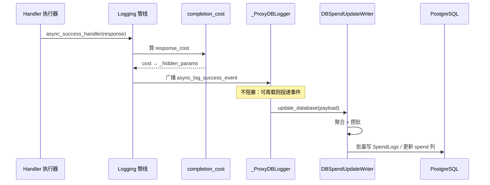

# 成本计算、日志回调与持久化

> 所属层级：第三层（主链路拆解） | 拆解对象：第二层场景的跳 12

## 本篇回答的问题

`response_cost` 是怎么算出来的？回调为什么不会拖慢响应？spend 最终写到哪、怎么批量写？

## 日志管线：事件的总驱动器

```
litellm/litellm_core_utils/litellm_logging.py :: Logging :: +0
```

`Logging` 对象（类定义 731 行，类内偏移以此为准）在 pre-call 阶段创建（第三层第 3 篇的步骤 6），每个请求一个。它在固定时机把事件广播给全部注册回调（`CustomLogger` 实现）：

| 事件 | 方法 | 典型消费者 |
|---|---|---|
| 调用成功（同步） | `success_handler :: +0` | Prometheus 等 |
| 调用成功（异步） | `async_success_handler :: +0` | Langfuse、成本记账、告警 |
| 调用失败 | `failure_handler` 族 | 告警、错误统计 |
| 响应头阶段 | `post_call_response_headers_hook` | Proxy 响应头 |

执行器成功后调 `update_response_metadata` 把响应塞进 `model_call_details`，再由 `async_success_handler` 广播。回调管理器并行调用各回调，单个回调崩溃不影响其他回调与主响应（`litellm/litellm_core_utils/logging_callback_manager.py :: LoggingCallbackManager :: +0`）。

`Logging` 另外挂了一批小方法，供流式与重试路径驱动记账状态：

| 方法 | 职责 |
|---|---|
| `is_usage_explicitly_free() :: +0` | 判定本调用是否为「显式免费费率」（#51093），cost=0 的免费调用也要落账 |
| `set_first_chunk_overhead() :: +0` | 记录 proxy 处理流式首 chunk 的自身开销（#49920），后续 chunk 都继承这段延迟 |
| `_model_call_details_with_request_messages() :: +0` | 给只按请求路由、永不落日志的回调，把被 `turn_off_message_logging` 脱敏掉的 messages 放回 payload（#50276） |
| `_carry_parked_success() :: +0` | 路由器丢弃某个「成功日志已暂存」的计费响应（如 guardrail 拒绝后的回退）时，把这笔账由最终尝试接续（#50735） |

## 成本计算

```
litellm/cost_calculator.py :: completion_cost() :: +0
```

文件路径是 `litellm/cost_calculator.py`（不是 `litellm_core_utils/` 下），`completion_cost()`（+0）与 `cost_per_token()`（+0）的签名未变。输入：响应对象（含 usage）+ completion call 参数。流程：

```
1. 取模型单价：model_prices_and_context_window.json（启动时加载进 litellm.model_cost）
   ├─ 精确 model 名命中
   ├─ 前缀/通配定价（provider 通配条目）
   └─ litellm_params 里的 per-call 定价覆盖
2. usage.tokens × 单价（input/completion 分开算）
3. 折扣与预算策略叠加（cost_discount、budget duration 等）
4. 返回 float，写入 response._hidden_params["response_cost"]
```

调用点在日志管线内部（`litellm_logging.py :: async_success_handler() :: +0` 的响应处理段，`litellm.completion_cost(...)` 调用），也就是说成本是「成功事件的一部分」，而不是独立步骤。流式末尾 `async_success_handler` 的流式分支里，`completion_cost` 算出成本后写 `model_call_details["response_cost"]`，并把失败尝试、续传 partial 的成本合并进来。

## Proxy 侧记账回调

```
litellm/proxy/hooks/proxy_track_cost_callback.py :: _ProxyDBLogger :: async_log_success_event() :: +0
```

这是 Gateway 注册的成本专用回调（`_ProxyDBLogger` 类定义 405 行）。两条通道：

```
async_log_success_event(kwargs, response_obj, ...)
├─ 事件可离载（is_offloadable_success）→ 构造 SpendEvent → publish 给后台消费者
│   （消费失败或构造失败 → 降级走直接通道）
└─ 直接通道：_PROXY_track_cost_callback()
    ├─ 计算并校验 completed_cost
    ├─ 释放/失效预算预留（budget reservation，鉴权时可能预占）
    └─ _spend_writer().update_database(...)      # 进入持久化
```

「预算预留」机制：鉴权阶段如果配了预留（防止并发请求同时超预算），成功后在这里按实际成本结算预留。失败路径对称（`async_post_call_failure_hook() :: +0`）同样释放预留。

## 持久化：批量与聚合

```
litellm/proxy/db/db_spend_update_writer.py :: DBSpendUpdateWriter :: +0
litellm/proxy/db/db_spend_update_writer.py :: DBSpendUpdateWriter :: update_database() :: +0
```

`DBSpendUpdateWriter` 类定义 711 行，`update_database()` 定义 742 行。为什么需要专门的写入器：每次 LLM 调用都要更新 5 个维度的花费（key、user、team、org、end-user），逐次写库会把 Postgres 打爆。写入器做三件事：

| 机制 | 做法 |
|---|---|
| 聚合 | 相同 key 的增量在时间窗内合并成一次 UPDATE |
| 批量 | 攒批后一次性提交（flush 周期由配置控制） |
| 账本模式 | `use_ledger` 时写按时间窗聚合的账本行（`accounting_window_keys`），明细另存 |

写两张表（schema 见 `schema.prisma`）：

| 表 | 内容 | 写入方式 |
|---|---|---|
| `LiteLLM_SpendLogs` | 每次调用的明细行（request id、model、tokens、cost、metadata） | 批量 INSERT |
| `LiteLLM_VerificationToken` 等 | key/user/team 的 `spend` 累计列 | 聚合 UPDATE |

没有 Postgres 时（本场景）整条链路自动降级：`ProxyUpdateSpend.disable_spend_updates()` 判断后跳过 DB 写，只保留内存/Redis 计数。

### 免费 responses 的守卫

`update_database`（`+31` 附近，`billable_cost` 算出后）对免费 response 不写创建行（#51110）：当 `disable_responses_id_security` 开启、调用类型是 `aget_responses`/`acancel_responses`、状态为 success 且 `billable_cost` 为 0 时，直接 `return True`——这条轮询守卫本身已由别的轮询写过了创建行，这里只放行，把 key/team/user 计数器留给同一条免费记账，不再重复落库。

### owner 限定读的空 key 补齐

预算 owner 的「读 spend」按 api_key 集合限定（#51127）。`litellm/proxy/spend_tracking/spend_log_api_key_scope.py :: _narrowing_keys() :: +0`（该文件为上一基线后新增）：当读到的 key 列表可帮助收窄时，若列表里不含空串 `""` 就补一个，保证「无 key 归属」的空 key 行也能被 owner 读出来；key 过多或为空时返回 `None` 表示无法收窄（`spend_log_api_keys_for_user`、`spend_log_api_keys_for_teams` 据此取 SQL 参数）。

## Redis 在记账里的角色

`litellm/redis/` 是新增的顶级包，Rust 后端 store 家族已接入限流/冷却/用量/auth cache（见第 11 篇与第 12 篇）。记账侧仍用这几个键：

| 数据 | 键形态 | 用途 |
|---|---|---|
| spend 增量队列 | 写入器自管理 | 跨 flush 周期缓冲 |
| key/team 预算缓存 | `user_api_key_cache`（DualCache） | 鉴权时快速读 spend |
| 全局花费缓存 | `GLOBAL_PROXY_SPEND_CACHE_KEY` | 全局预算检查 |
| 时间窗账本键 | `accounting_window_keys()` | 账本模式聚合 |

限流计数已切到 `litellm/redis/stores/rate_limits :: RateLimitStore`、spend 计数到 `litellm/redis/stores/spend_counters :: SpendCounterStore`、auth cache 到 `litellm/redis/stores/auth_cache :: AuthCacheStore`、配置到 `litellm/redis/store_settings.py :: RedisStoreSettings`。

## OTel v2 目的地的 metadata keys

OTel v2 的 destination metadata keys 全部在 `litellm/integrations/otel/`，不在 `litellm_logging.py`。`litellm/integrations/otel/model/baggage.py :: parse_destination_metadata_keys() :: +0` 解析 `baggage_metadata_keys`（最多 `MAX_DESTINATION_METADATA_KEYS` 个，常量 79 行，上限 20 键），`litellm/integrations/otel/model/destination.py :: OtelDestination`（+0）的 `metadata_keys` 字段（64 行）按目的地导出 `requester_metadata.<key>` 路径为 span 上的 `litellm.metadata.<key>`。`litellm_logging.py` 只新增第 8 篇表格里那 4 个小方法，目的地元数据在 OTel 包里解析。

## 端到端时序（成功请求）



## 失败请求的对称路径

调用失败时 `failure_handler` 广播，`_ProxyDBLogger` 对应的失败处理（`litellm/proxy/hooks/proxy_track_cost_callback.py :: _ProxyDBLogger :: async_post_call_failure_hook() :: +0`）同样释放预算预留，按部分 usage 记账（流式中断场景）或记 0。

第三层到此完整覆盖了第二层场景的每一跳。第四层开始函数级精读。