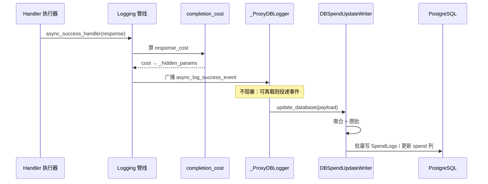

# 成本计算、日志回调与持久化

> 所属层级：第三层（主链路拆解） | 拆解对象：第二层场景的跳 12

## 本篇回答的问题

`response_cost` 是怎么算出来的？回调为什么不会拖慢响应？spend 最终写到哪、怎么批量写？

## 日志管线：事件的总驱动器

```
litellm/litellm_core_utils/litellm_logging.py :: Logging :: +669
```

`Logging` 对象在 pre-call 阶段创建（第三层第 3 篇的步骤 6），每个请求一个。它在固定时机把事件广播给全部注册回调（`CustomLogger` 实现）：

| 事件 | 方法 | 典型消费者 |
|---|---|---|
| 调用成功（同步） | `success_handler :: +3595` | Prometheus 等 |
| 调用成功（异步） | `async_success_handler :: +4109` | Langfuse、成本记账、告警 |
| 调用失败 | `failure_handler` 族 | 告警、错误统计 |
| 响应头阶段 | `post_call_response_headers_hook` | Proxy 响应头 |

执行器成功后调 `update_response_metadata` 把响应塞进 `model_call_details`，再由 `async_success_handler` 广播。回调管理器并行调用各回调，单个回调崩溃不影响其他回调与主响应（`litellm_core_utils/logging_callback_manager.py :: LoggingCallbackManager :: +0`）。

## 成本计算

```
litellm/cost_calculator.py :: completion_cost() :: +0
```

输入：响应对象（含 usage）+ completion call 参数。流程：

```
1. 取模型单价：model_prices_and_context_window.json（启动时加载进 litellm.model_cost）
   ├─ 精确 model 名命中
   ├─ 前缀/通配定价（provider 通配条目）
   └─ litellm_params 里的 per-call 定价覆盖
2. usage.tokens × 单价（input/completion 分开算）
3. 折扣与预算策略叠加（cost_discount、budget duration 等）
4. 返回 float，写入 response._hidden_params["response_cost"]
```

调用点在日志管线内部（`litellm_logging.py :: response 处理段，completion_cost 调用`），也就是说成本是「成功事件的一部分」，而不是独立步骤。

## Proxy 侧记账回调

```
litellm/proxy/hooks/proxy_track_cost_callback.py :: _ProxyDBLogger :: async_log_success_event() :: +0
```

这是 Gateway 注册的成本专用回调。两条通道：

```
async_log_success_event(kwargs, response_obj, ...)
├─ 事件可离载（is_offloadable_success）→ 构造 SpendEvent → publish 给后台消费者
│   （消费失败或构造失败 → 降级走直接通道）
└─ 直接通道：_PROXY_track_cost_callback() :: +764
    ├─ 计算并校验 completed_cost
    ├─ 释放/失效预算预留（budget reservation，鉴权时可能预占）
    └─ _spend_writer().update_database(...)      # 进入持久化
```

「预算预留」机制：鉴权阶段如果配了预留（防止并发请求同时超预算），成功后在这里按实际成本结算预留。

## 持久化：批量与聚合

```
litellm/proxy/db/db_spend_update_writer.py :: DBSpendUpdateWriter :: +656
litellm/proxy/db/db_spend_update_writer.py :: DBSpendUpdateWriter :: update_database() :: +0
```

为什么需要专门的写入器：每次 LLM 调用都要更新 5 个维度的花费（key、user、team、org、end-user），逐次写库会把 Postgres 打爆。写入器做三件事：

| 机制 | 做法 |
|---|---|
| 聚合 | 相同 key 的增量在时间窗内合并成一次 UPDATE |
| 批量 | 攒批后一次性提交（flush 周期由配置控制） |
| 账本模式 | `use_ledger` 时写按时间窗聚合的账本行（`accounting_window_keys`），明细另存 |

写两张表（schema 见 `schema.prisma`）：

| 表 | 内容 | 写入方式 |
|---|---|---|
| `LiteLLM_SpendLogs` | 每次调用的明细行（request id、model、tokens、cost、metadata） | 批量 INSERT |
| `LiteLLM_VerificationToken` 等 | key/user/team 的 `spend` 累计列 | 聚合 UPDATE |

没有 Postgres 时（本场景）整条链路自动降级：`ProxyUpdateSpend.disable_spend_updates()` 判断后跳过 DB 写，只保留内存/Redis 计数。

## Redis 在记账里的角色

| 数据 | 键形态 | 用途 |
|---|---|---|
| spend 增量队列 | 写入器自管理 | 跨 flush 周期缓冲 |
| key/team 预算缓存 | `user_api_key_cache`（DualCache） | 鉴权时快速读 spend |
| 全局花费缓存 | `GLOBAL_PROXY_SPEND_CACHE_KEY` | 全局预算检查 |
| 时间窗账本键 | `accounting_window_keys()` | 账本模式聚合 |

## 端到端时序（成功请求）



## 失败请求的对称路径

调用失败时 `failure_handler` 广播，`_ProxyDBLogger` 对应的失败处理（`proxy_track_cost_callback.py :: _ProxyDBLogger :: async_post_call_failure_hook() :: +0`）同样释放预算预留，按部分 usage 记账（流式中断场景）或记 0。

第三层到此完整覆盖了第二层场景的每一跳。第四层开始函数级精读。
