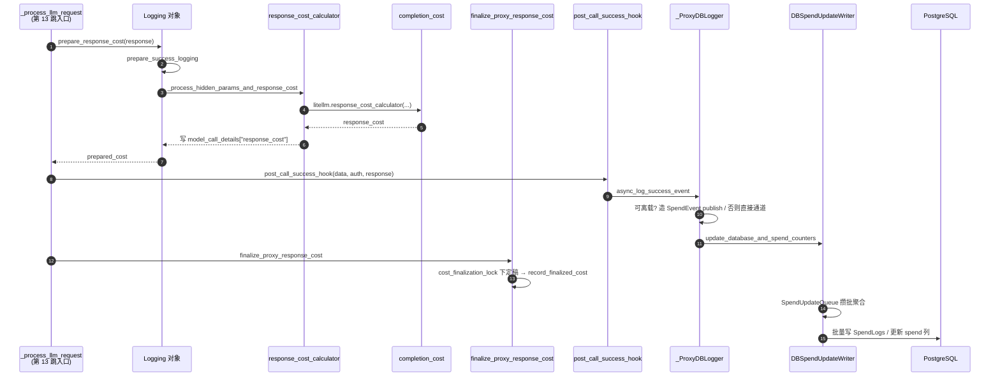
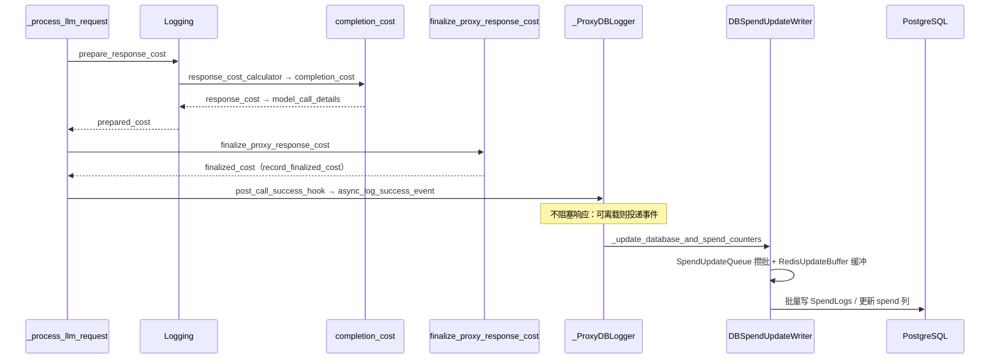

# 成本计算、日志回调管线与持久化

> 所属层级：第三层（主链路逐跳拆解） | 拆解对象：第二层场景的跳 13
> 本篇基准提交：`411b64dc7a`（工作区当前 HEAD）

一句话定位：第 12 跳把响应交回客户端后，这一跳在后台把账算清并落库——`Logging` 对象按响应算出 `response_cost`，`finalize_proxy_response_cost` 把账定稿，成功事件沿回调管线广播给注册的 `CustomLogger`，其中 `_ProxyDBLogger` 把花费交给 `DBSpendUpdateWriter` 聚合批量写 Postgres；没配 DB 时这条链自动降级为仅内存/Redis 计数。

术语约定：`Logging`（每个请求一个的回调管线引擎，pre-call 阶段创建）、`CustomLogger`（一个回调实现，如 Langfuse、Prometheus、`_ProxyDBLogger`）、`response_cost`（本次调用按 token 单价算出的花费）、`spend`（累计花费，落在 key/user/team/org/end-user 五个维度）、`预算预留`（鉴权阶段为防并发超预算先占一笔，成功后按实际成本结算）、`账本模式`（按时间窗聚合写一行账本、明细另存的写入策略）。

## 本跳在主链中的位置

主链 13 跳里，07 篇结束在响应头已组装、响应已交回客户端。本篇覆盖第 13 跳：07 篇提到的 `prepare_response_cost`（`_process_llm_request() :: +352`，行 3658）内部怎么算出成本、`post_call_success_hook`（`+353`，行 3659）怎么沿回调管线广播、`finalize_proxy_response_cost`（`+359`，行 3666）怎么定稿、以及 `_ProxyDBLogger` 到 `DBSpendUpdateWriter` 怎么把 spend 落到 Postgres。整条链是**响应发出之后的异步收尾**，不阻塞客户端拿到 JSON。



## 成本是怎么算出来的

### 非流式（本场景）的成本链

07 篇讲到 `_process_llm_request` 收尾段第一步是 `prepare_response_cost(logging_obj, response, now)`（`+352`，行 3658）。它只是个薄包装（`litellm/proxy/spend_tracking/cost_finalization.py :: prepare_response_cost() :: +0`，行 14），真正干活的是 `Logging.prepare_response_cost`：

锚点：`litellm/litellm_core_utils/litellm_logging.py :: Logging :: prepare_response_cost() :: +0`（行 2709）

| 序 | 动作 | 锚点 | 语义 |
|---|---|---|---|
| 1 | 已有 `prepared_cost` 直接返回（幂等） | `+1` 到 `+2`（行 2710-2711） | 防重复准备 |
| 2 | 读 `cache_hit` 与 `deferred_success_result` | `+3` 到 `+5`（行 2712-2714） | 路由器暂存的「成功日志已盖章」结果优先 |
| 3 | 观察响应里 usage 是否已知，写 `_accounting_usage_observed` | `+6` 到 `+16`（行 2717-2724） | KNOWN/UNKNOWN，供部分用量记账 |
| 4 | `self.prepare_success_logging(..., build_logging_payload=True, publish_logging_payload=False)` | `+17` 到 `+25`（行 2725-2733） | 造标准日志 payload，但不对外发布 |
| 5 | 取 `model_call_details["response_cost"]` 作 `raw_cost` | `+26` 到 `+28`（行 2734-2737） | payload 或成本缺失就返回 None |
| 6 | 组 `PreparedCost(raw_cost, payload, usage, price_known)` 存进 `self.prepared_cost` | `+42` 到 `+53`（行 2751-2762） | 07 篇 finalize 读的就是它 |

第 4 步 `prepare_success_logging`（行 3433）内部调 `_process_hidden_params_and_response_cost`（`Logging :: _process_hidden_params_and_response_cost() :: +0`，行 3221），成本就是在那里算出并写进 `model_call_details["response_cost"]` 的：

锚点：`litellm/litellm_core_utils/litellm_logging.py :: _process_hidden_params_and_response_cost() :: +40`（行 3261）

```python
if self.finalized_cost is not None:                       # +22，行 3243 已定稿直接用
    self.model_call_details["response_cost"] = self.finalized_cost.amount
elif self.model_call_details.get("cache_hit") is True:     # +24，行 3245 缓存命中记 0
    self.model_call_details["response_cost"] = 0.0
elif "response_cost" in hidden_params:                     # +27，行 3248 响应自带成本
    self.model_call_details["response_cost"] = subscript(hidden_params, "response_cost")
elif (existing_cost := self.model_call_details.get("response_cost")) is not None and (...):
    pass                                                   # +32，行 3253 透传 handler 已算过则保留
else:
    self.model_call_details["response_cost"] = self.response_cost_calculator(result=logging_result)
```

`response_cost_calculator`（`Logging :: response_cost_calculator() :: +0`，行 2186）是 litellm 内部统一的成本入口，缓存命中返回 `0.0`（`+16` 到 `+17`，行 2204-2205），流对象返回 `None`，非推理调用返回 `0.0`；否则组装一大包 kwargs 调 `litellm.response_cost_calculator(**kwargs)`（`+141`，行 2327）。

`litellm.response_cost_calculator` 是 `litellm/cost_calculator.py :: response_cost_calculator() :: +0`（行 2505），它再调 `litellm/cost_calculator.py :: completion_cost() :: +0`（行 1797）——后者按 `model_prices_and_context_window.json`（启动时加载进 `litellm.model_cost`）里该 model 的单价，把 `usage.tokens × 单价`（input/completion 分开）算成 `response_cost`。错误传播：成本计算抛错时 `response_cost_calculator` 记一段 `response_cost_failure_debug_information` 进 `model_call_details` 并返回 `None`（`+158` 到 `+167`，行 2344-2355），绝不让算账失败阻断响应。

> 归属澄清：旧文档写「成本计算落在 `async_success_handler` 里」，本基线非流式路径不是这样。非流式的成本在 `prepare_response_cost` → `prepare_success_logging` → `_process_hidden_params_and_response_cost` 这条同步链里就算好了（行 3261）。`async_success_handler` 的成本计算只发生在**流式**分支（`_async_success_handler_body() :: +1142`，行 4413，对聚合出的完整流式响应调 `response_cost_calculator`）。

### 流式的成本链（机制说明）

流式响应在 07 篇的 `_finalize_completed_stream` 聚合出完整 usage 后触发 success 事件，`_async_success_handler_body`（行 4289）的流式分支（`+1142`，行 4413）才调 `response_cost_calculator`：

```python
self.model_call_details["response_cost"] = self.response_cost_calculator(
    result=complete_streaming_response if provider_transcription is None else provider_transcription
)
```

缓存命中记 `0.0`（行 4408），`NotFoundError`（价目表查不到该 model）与其它异常都把 `response_cost` 记 `None` 并打日志，不阻断后续回调。算完后 `_add_failed_attempts_spend(self._add_continued_partial_spend(...))`（`+1158`，行 4429）把失败尝试与续传 partial 的成本合并进来。

## finalize：把账定稿

锚点：`litellm/proxy/spend_tracking/cost_finalization.py :: finalize_proxy_response_cost() :: +0`（行 101）

`_process_llm_request` 在 post-call hook 之后调它（`+359`，行 3666），传入 guardrail 信息成本。链路：

| 层 | 符号 | 作用 |
|---|---|---|
| 包装 | `finalize_proxy_response_cost() :: +0`（行 101） | 取 `proxy_logging_obj.internal_usage_cache.dual_cache.redis_cache` 作 SharedCounter，转 `finalize_response_cost` |
| 编排 | `finalize_response_cost() :: +22`（行 22） | 异常吞掉返回 None（定稿失败绝不反悔已发出的响应）， billing 回落回调路径 |
| 实现 | `_finalize_response_cost() :: +40`（行 40） | 在 `logging_obj.cost_finalization_lock` 下：已定稿直接返回；否则 `prepare_response_cost` 取 prepared，把 guardrail 成本并进 amount 与 breakdown，起后台 task 定稿并 `asyncio.shield` 等它 |
| 收尾 | `_finish_finalization() :: +77`（行 77） | 先做 search free tier 分配（`allocate_search_free_tier`），再 `finalize_cost(amount, breakdown, discount)`，最后 `logging_obj.record_finalized_cost(finalized)` |

`record_finalized_cost`（`Logging :: record_finalized_cost() :: +0`，行 2768）把定稿金额写回 `self.finalized_cost` 与 `model_call_details["response_cost"]`。07 篇的响应头组装（行 3767）优先读 `logging_obj.finalized_cost.amount`，所以定稿越早，`x-litellm-response-cost` 头越准。本场景没配 DB，定稿照做（内存里的账），落库那一步降级，见下文。

## 日志回调管线：成功事件怎么广播

锚点：`litellm/litellm_core_utils/litellm_logging.py :: Logging :: +0`（类定义行 743，类内偏移以此为准）

`Logging` 对象在 pre-call 阶段创建（第三层第 3 篇），每个请求一个。它在固定时机把事件广播给全部注册回调：

| 事件 | 方法 | 典型消费者 |
|---|---|---|
| 调用成功（同步） | `success_handler() :: +0`（行 3753） | Prometheus 等同步回调 |
| 调用成功（异步） | `async_success_handler() :: +0`（行 4271） | Langfuse、成本记账、告警 |
| 调用失败 | `failure_handler` 族 | 告警、错误统计 |
| 响应头阶段 | `post_call_response_headers_hook` | Proxy 流式响应头 |

Proxy 侧的 `post_call_success_hook`（07 篇 `+353`，行 3659）遍历各回调的 `async_post_call_success_hook`；成功事件本身的分发在 `async_success_handler` → `_async_success_handler_body`（行 4289）。回调管理器并行调用各回调，单个回调崩溃不影响其他回调与主响应（`litellm/litellm_core_utils/logging_callback_manager.py :: LoggingCallbackManager :: +0`，行 27）。

`Logging` 另挂了一批小方法，供流式与重试路径驱动记账状态：

| 方法 | 定义行 | 职责 |
|---|---|---|
| `is_usage_explicitly_free() :: +0` | 2478 | 判定本调用是否为「显式免费费率」，cost=0 的免费调用也要落账 |
| `set_first_chunk_overhead() :: +0` | 1035 | 记录 proxy 处理流式首 chunk 的自身开销，后续 chunk 都继承这段延迟 |
| `_model_call_details_with_request_messages() :: +0` | 5197 | 给只按请求路由、永不落日志的回调，把被脱敏掉的 messages 放回 payload |
| `_carry_parked_success() :: +0` | 2879 | 路由器丢弃某个「成功日志已暂存」的计费响应（如 guardrail 拒绝后的回退）时，把这笔账由最终尝试接续 |

## Proxy 侧记账回调：_ProxyDBLogger

锚点：`litellm/proxy/hooks/proxy_track_cost_callback.py :: _ProxyDBLogger :: +0`（类定义行 405）

这是 Gateway 注册的成本专用回调。成功事件入口 `async_log_success_event() :: +0`（行 425）分两条通道：

```python
async def async_log_success_event(self, kwargs, response_obj, start_time, end_time) -> None:
    if self.spend_event_producer is None or not is_offloadable_success(response_obj, kwargs):
        await self._PROXY_track_cost_callback(dict(kwargs), response_obj, start_time, end_time)  # 直接通道
        return
    event: Final = build_spend_event(kwargs, response_obj, start_time, end_time, store_bodies=...)
    if isinstance(event, SpendEventBuildError):                # 造不出来 → 降级直接通道
        await self._PROXY_track_cost_callback(dict(kwargs), response_obj, start_time, end_time)
        return
    await self.spend_event_producer.publish(event)             # 离载通道：投递给后台消费者
```

（`async_log_success_event() :: +2` 到 `+18`，行 428-442）

离载通道（`spend_event_producer.publish`）把成本事件序列化后交给后台消费者，消费端 `run_spend_event() :: +0`（行 444）解码后跑同一条 `_PROXY_track_cost_callback` 管线——所以两条通道最终汇到同一处，消费失败或造事件失败都降级回直接通道，不丢账。

直接通道 `_PROXY_track_cost_callback() :: +0`（行 780）按顺序做：取 `increment_spend_counters`/`proxy_logging_obj`/`update_cache`，批处理记账取 `_batch_accounting_for(...)`，然后计算并校验 `completed_cost`、结算/失效预算预留、最后交给写入器。预算预留结算与计数器更新被包在 `_update_database_and_spend_counters() :: +0`（行 1319）里：先按预留自身的读结果对账（`_reconcile_budget_reservation_before_db_update`），再用 `spend_counter_batch_scope` 把 DB 写与计数器更新放进同一批，使 post-call 计数器一次 MGET 读回、一次 pipeline 写回。

失败路径对称：`async_post_call_failure_hook() :: +0`（行 453）按 `_ProxyDBLogger` 的开关决定是否记失败账，同样先释放预算预留（`_release_budget_reservation`），预留释放失败再失效其计数器。

## 持久化：批量与聚合

锚点：`litellm/proxy/db/db_spend_update_writer.py :: DBSpendUpdateWriter :: +0`（类定义行 748）

类 docstring 写明它负责两件事：把 spend 增量写到内存事务列表或 Redis，再从那里读出批量提交到 DB。构造时挂了一批队列（`SpendUpdateQueue`、`DailySpendUpdateQueue`、`RedisUpdateBuffer` 等，行 766-777），按维度（key/user/team/org/end-user/tag/window）各一条。

写入入口 `update_database() :: +0`（行 780）：

| 步 | 动作 | 锚点 | 语义 |
|---|---|---|---|
| 1 | 从 `proxy_server` 取 `prisma_client`、`disable_spend_logs`、`accounting_window_keys` 等 | `+21` 到 `+26`（行 801-807） | 运行期依赖延迟导入 |
| 2 | 批处理/视频轮询守卫：成本行已被另一轮写过则 `return True` | `+46` 到 `+72`（行 827、853） | 调用方据返回值决定是否动 key/team/user 计数器 |
| 3 | 算 `keep_spend_logs` | `+105`（行 886） | `disable_spend_logs` 为假且非特殊表才写明细 |
| 4 | 写明细行 + 更新各维度 spend 列 | `+115` 到 `+168`（行 893-948） | 明细 INSERT + 聚合 UPDATE |
| 5 | `disable_spend_logs=True` 时跳过明细但**仍更新** key/user/team 表 | `+135`（行 916） | 日志关了账照记 |

为什么需要专门写入器：每次 LLM 调用都要更新五个维度的花费，逐次写库会把 Postgres 打爆。写入器靠两条队列分摊：`SpendUpdateQueue`（`litellm/proxy/db/db_transaction_queue/spend_update_queue.py :: SpendUpdateQueue :: +0`，行 18，基类 `BaseUpdateQueue`）攒增量事务、`RedisUpdateBuffer`（同目录 `redis_update_buffer.py :: RedisUpdateBuffer :: +0`，行 166）在配了 Redis 时把增量缓冲到 Redis 跨 flush 周期共享，提交时再聚合批量写。

写两张表（schema 见 `schema.prisma`）：

| 表 | 内容 | 写入方式 |
|---|---|---|
| `LiteLLM_SpendLogs` | 每次调用的明细行（request id、model、tokens、cost、metadata） | 批量 INSERT |
| `LiteLLM_VerificationToken` 等 | key/user/team/org/end-user 的 `spend` 累计列 | 聚合 UPDATE |

### 没 DB 时的降级

降级开关是 `litellm/proxy/utils.py :: ProxyUpdateSpend :: disable_spend_updates() :: +0`（行 8862）：读 `general_settings["disable_spend_updates"]`，为真就跳过 spend 落库。这与「没配 DB」是两件事——本场景没配 DB 时 `prisma_client` 为 `None`，`update_database` 内部对明细写入的 `_insert_spend_log_to_db` 分支（`+216` 到 `+218`，行 997-998）在 `disable_spend_logs` 为假时仍会尝试带 `prisma_client=None` 调用，由底层判空跳过；计数器侧则只保留内存/Redis 计数。`[推断]` 标注：`prisma_client is None` 时的精确分支未逐行读完（属第四层持久化篇），这里只确认降级不抛错、账在内存里仍推进。

### 免费 responses 的守卫

`update_database` 对免费 response 不重复写创建行：当 `disable_responses_id_security` 开启、调用类型是 `aget_responses`/`acancel_responses`、状态为 success 且 `billable_cost` 为 0 时直接放行返回，把 key/team/user 计数器留给同一条免费记账，不再重复落库（`_is_settle_once_cost_row` 参与判定，行 199 与 983）。本场景非 responses 调用，不触发。

### owner 限定读的空 key 补齐

预算 owner 的「读 spend」按 api_key 集合限定。`litellm/proxy/spend_tracking/spend_log_api_key_scope.py :: _narrowing_keys() :: +0`（行 47）：当读到的 key 列表可帮助收窄时，若列表里不含空串 `""` 就补一个，保证「无 key 归属」的空 key 行也能被 owner 读出来；key 过多或为空时返回 `None` 表示无法收窄。这是读侧（查询 spend 日志）的逻辑，不在本场景写路径上，列出供持久化篇交叉引用。

## Redis 在记账里的角色

`litellm/redis/` 是顶级包，Rust 后端 store 家族已接入限流/冷却/用量/auth cache（见第 11、12 篇）。记账侧用到的键：

| 数据 | 键形态 | 用途 |
|---|---|---|
| spend 增量缓冲 | `RedisUpdateBuffer`（写入器自管理） | 跨 flush 周期缓冲增量事务 |
| key/team 预算缓存 | `user_api_key_cache`（DualCache） | 鉴权时快速读 spend |
| 全局花费缓存 | `GLOBAL_PROXY_SPEND_CACHE_KEY` | 全局预算检查 |
| 时间窗账本键 | `accounting_window_keys()` | 账本模式聚合 |
| 计数器批作用域 | `spend_counter_store`（`litellm/redis/stores/spend_counters`） | post-call 计数器一次 MGET/pipeline |

## OTel v2 目的地的 metadata keys

OTel v2 的 destination metadata keys 全部在 `litellm/integrations/otel/`，不在 `litellm_logging.py`。`litellm/integrations/otel/model/baggage.py :: parse_destination_metadata_keys() :: +0`（行 106）解析 `baggage_metadata_keys`，上限 `MAX_DESTINATION_METADATA_KEYS`（行 79，20 键，超出报错，行 101-102）。`litellm/integrations/otel/model/destination.py :: OtelDestination :: +0`（行 17）的 `metadata_keys` 字段按目的地导出 `requester_metadata.<key>` 路径为 span 上的 `litellm.metadata.<key>`。`litellm_logging.py` 只挂上面表格里那 4 个小方法，目的地元数据在 OTel 包里解析。

## 端到端时序（本场景成功请求）



本场景没配 DB，最后一步降级为内存/Redis 计数；有 DB 时由后台写入器按 flush 周期聚合批量写。

## 失败请求的对称路径

调用失败时 `failure_handler` 族广播，`_ProxyDBLogger.async_post_call_failure_hook()`（行 453）同样先释放预算预留，按部分 usage 记账（流式中断场景）或记 0；`_update_database_and_spend_counters` 对失败账走同一写入器，只是金额来自部分用量或 0。

第三层到此完整覆盖了第二层场景的每一跳。第四层开始函数级精读。

## 调用关系表（关键边）

| 调用方与符号 | 关系 | 被调用方与符号 | 触发与输入 | 返回与后续处理 | 错误、状态与副作用 |
|---|---|---|---|---|---|
| `_process_llm_request() :: +352` | 同步调用 | `prepare_response_cost() :: +0` | logging_obj + response + now | `PreparedCost` 或 None | 异常吞掉，不阻响应 |
| `prepare_response_cost() :: +15` | 委托 | `Logging.prepare_response_cost() :: +0` | response + now | prepared_cost 存 `self.prepared_cost` | 幂等，重复调返回同一份 |
| `Logging.prepare_response_cost() :: +16` | 调用 | `Logging.prepare_success_logging() :: +0` | result + 起止时间 + build_payload=True | standard payload | 不对外发布 |
| `Logging.prepare_success_logging()` 内 | 调用 | `_process_hidden_params_and_response_cost() :: +0` | logging_result + hidden_params | 写 `model_call_details["response_cost"]` | 已定稿/缓存命中/自带成本则跳过算式 |
| `_process_hidden_params_and_response_cost() :: +40` | 算账 | `Logging.response_cost_calculator() :: +0` | logging_result | cost float 或 None | 算错记 debug info 返回 None |
| `Logging.response_cost_calculator() :: +140` | 算账 | `litellm.response_cost_calculator() :: +0` | response_object + model + usage + 单价来源 | cost float | 委托 `completion_cost()` |
| `_process_llm_request() :: +359` | await | `finalize_proxy_response_cost() :: +0` | logging_obj + response + guardrail_cost | `FinalizedCost` | 定稿失败回落回调路径 |
| `finalize_proxy_response_cost() :: +4` | await | `finalize_response_cost() :: +22` | logging_obj + response + counter + now | 定稿结果 | 异常吞掉返回 None |
| `_finalize_response_cost() :: +56` | 定稿 | `_finish_finalization() :: +77` | amount + breakdown + discount | `record_finalized_cost` | 在 cost_finalization_lock 下 |
| `_process_llm_request() :: +353` | await | `proxy_logging_obj.post_call_success_hook()` | data + auth + response | 可能替换的 response | 单回调崩溃不影响主响应 |
| `post_call_success_hook` | 广播 | `_ProxyDBLogger.async_log_success_event() :: +0` | kwargs + response_obj + 起止时间 | 触发记账 | 走离载或直接通道 |
| `_ProxyDBLogger.async_log_success_event() :: +2` | 直接通道 | `_PROXY_track_cost_callback() :: +0` | kwargs + response_obj | 进入持久化 | 不可离载/造事件失败时走此路 |
| `_PROXY_track_cost_callback()` 内 | await | `_update_database_and_spend_counters() :: +0` | 完整计费字段 + spend_writer | DB 写 + 计数器更新 | 预留先对账再写 |
| `_update_database_and_spend_counters()` | await | `DBSpendUpdateWriter.update_database() :: +0` | token/user/team/org + response_cost | True/False（是否还需计费） | 批处理守卫返回 False 跳过计数器 |
| `DBSpendUpdateWriter.update_database()` | 攒批 | `SpendUpdateQueue` / `RedisUpdateBuffer` | 增量事务 | 缓冲待提交 | 配 Redis 时跨 worker 共享 |

## 未确认项

- `litellm/cost_calculator.py :: response_cost_calculator() :: +0`（行 2505）内部到 `completion_cost()`（行 2616 处调用）的逐行实现未读完，只确认调用关系与签名。
- `prepare_success_logging`（行 3433）函数体较长，本篇只确认它调 `_process_hidden_params_and_response_cost` 并产出 `(payload, ..., response)`，内部字段映射未逐行读。
- `_PROXY_track_cost_callback`（行 780）函数体只读到入口的依赖导入与批处理记账段（行 793-800），`completed_cost` 校验与预留结算的逐行偏移未核到，属第四层。
- `DBSpendUpdateWriter.update_database`（行 780）函数体很长，本篇只核到入口依赖导入（行 801-807）、两处 `return True` 守卫（行 827、853）、`keep_spend_logs` 计算（行 886）与 `_insert_spend_log_to_db` 分支（行 997-998），中间批量提交逻辑未逐行读。
- `prisma_client is None`（无 DB）时 `update_database` 的精确降级分支未逐行读完，本篇按「降级不抛错、账在内存推进」描述，属 `[推断]`。
- `SpendUpdateQueue`、`RedisUpdateBuffer`、`BaseUpdateQueue` 的攒批与 flush 周期实现未逐行读取，只确认定义行与职责。
- 各表字段与 `schema.prisma` 的逐字段对应未核对，表名以代码引用为准。
- 响应成本与 spend 的具体数值随模型回复与价目表变动，属 `[待运行验证]`。

## 源码索引

| 符号 | 文件 :: 符号 | 绝对定义行 |
|---|---|---|
| Proxy 收尾 | `litellm/proxy/common_request_processing.py :: _process_llm_request` | 3307 |
| 成本准备包装 | `litellm/proxy/spend_tracking/cost_finalization.py :: prepare_response_cost` | 14 |
| 成本定稿编排 | `litellm/proxy/spend_tracking/cost_finalization.py :: finalize_response_cost` | 22 |
| 成本定稿实现 | `litellm/proxy/spend_tracking/cost_finalization.py :: _finalize_response_cost` | 40 |
| 定稿收尾 | `litellm/proxy/spend_tracking/cost_finalization.py :: _finish_finalization` | 77 |
| 成本定稿包装 | `litellm/proxy/spend_tracking/cost_finalization.py :: finalize_proxy_response_cost` | 101 |
| 回调管线引擎 | `litellm/litellm_core_utils/litellm_logging.py :: Logging` | 743 |
| 首 chunk 开销 | `litellm/litellm_core_utils/litellm_logging.py :: Logging :: set_first_chunk_overhead` | 1035 |
| 显式免费判定 | `litellm/litellm_core_utils/litellm_logging.py :: Logging :: is_usage_explicitly_free` | 2478 |
| 统一成本入口 | `litellm/litellm_core_utils/litellm_logging.py :: Logging :: response_cost_calculator` | 2186 |
| 隐藏参数与成本 | `litellm/litellm_core_utils/litellm_logging.py :: _process_hidden_params_and_response_cost` | 3221 |
| 成本准备实现 | `litellm/litellm_core_utils/litellm_logging.py :: Logging :: prepare_response_cost` | 2709 |
| 定稿记录 | `litellm/litellm_core_utils/litellm_logging.py :: Logging :: record_finalized_cost` | 2768 |
| 暂存成功接续 | `litellm/litellm_core_utils/litellm_logging.py :: Logging :: _carry_parked_success` | 2879 |
| 成功日志准备 | `litellm/litellm_core_utils/litellm_logging.py :: Logging :: prepare_success_logging` | 3433 |
| 同步成功处理 | `litellm/litellm_core_utils/litellm_logging.py :: Logging :: success_handler` | 3753 |
| 异步成功处理 | `litellm/litellm_core_utils/litellm_logging.py :: Logging :: async_success_handler` | 4271 |
| 异步成功实现 | `litellm/litellm_core_utils/litellm_logging.py :: _async_success_handler_body` | 4289 |
| 请求 messages 还原 | `litellm/litellm_core_utils/litellm_logging.py :: _model_call_details_with_request_messages` | 5197 |
| 回调管理器 | `litellm/litellm_core_utils/logging_callback_manager.py :: LoggingCallbackManager` | 27 |
| 成本算式 | `litellm/cost_calculator.py :: completion_cost` | 1797 |
| 成本计算器 | `litellm/cost_calculator.py :: response_cost_calculator` | 2505 |
| 单价计算 | `litellm/cost_calculator.py :: cost_per_token` | 464 |
| 记账回调 | `litellm/proxy/hooks/proxy_track_cost_callback.py :: _ProxyDBLogger` | 405 |
| 成功事件入口 | `litellm/proxy/hooks/proxy_track_cost_callback.py :: async_log_success_event` | 425 |
| 失败钩子 | `litellm/proxy/hooks/proxy_track_cost_callback.py :: async_post_call_failure_hook` | 453 |
| 直接记账通道 | `litellm/proxy/hooks/proxy_track_cost_callback.py :: _PROXY_track_cost_callback` | 780 |
| DB 写与计数器 | `litellm/proxy/hooks/proxy_track_cost_callback.py :: _update_database_and_spend_counters` | 1319 |
| 批量写与计数器 | `litellm/proxy/hooks/proxy_track_cost_callback.py :: _update_database_and_spend_counters_in_batch` | 1384 |
| spend 写入器 | `litellm/proxy/db/db_spend_update_writer.py :: DBSpendUpdateWriter` | 748 |
| 写入入口 | `litellm/proxy/db/db_spend_update_writer.py :: update_database` | 780 |
| 增量队列 | `litellm/proxy/db/db_transaction_queue/spend_update_queue.py :: SpendUpdateQueue` | 18 |
| 日队列 | `litellm/proxy/db/db_transaction_queue/daily_spend_update_queue.py :: DailySpendUpdateQueue` | 16 |
| Redis 缓冲 | `litellm/proxy/db/db_transaction_queue/redis_update_buffer.py :: RedisUpdateBuffer` | 166 |
| 降级开关 | `litellm/proxy/utils.py :: ProxyUpdateSpend :: disable_spend_updates` | 8862 |
| owner 读收窄 | `litellm/proxy/spend_tracking/spend_log_api_key_scope.py :: _narrowing_keys` | 47 |
| OTel 键解析 | `litellm/integrations/otel/model/baggage.py :: parse_destination_metadata_keys` | 106 |
| OTel 键上限 | `litellm/integrations/otel/model/baggage.py :: MAX_DESTINATION_METADATA_KEYS` | 79 |
| OTel 目的地 | `litellm/integrations/otel/model/destination.py :: OtelDestination` | 17 |
