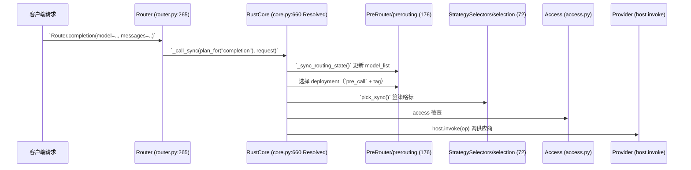

# 请求路由与负载均衡逐环节拆解

> **代码基准**：`main@e46fe2e2dc1bdd19f7953bd47dc3d770876ac74e（工作区干净）`；核实日期：2026-11-17。
> **范围**：`litellm.Router` 到 `RustCore` 的完整路由链——从 `model` 映射到 deployment、选策略、fallback、重试、消费到具体供应商调用。
> **前置**：L1/L2 已确认调用入口；本层只拆路由层，不拆鉴权/速率（见 U04）。
> **读写纪律**：全部只读，不启动不修改任何代码。

## 0. 结论速览

Router 把「我要调哪个模型」变成「我调哪个 deployment」，再决定「怎么调」。核心事实（已逐行核查）：
1. 入口 `litellm/router.py Router.completion()` → `RustCore.completion`（`router_rust/core.py 2668`）→ `_call_sync(plan_for("completion"), <request>)`。
2. 模型列表硬性要求：`model_list` 中每行必须有 `model_name`；`parse_groups`（`router_rust/steps/selection.py 411`）完成 `model_name → model_group` 解析。模型不在列表内走不到 `select`：`proxy/route_llm_request.py 1153` 抛 `ProxyModelNotFoundError`（HTTPException，400 状态码 + `_AVAILABLE_MODELS_HINT`），页面附带 _AvailableModelsHint；以及代理层有 `litellm/proxy/_types.py 4036` 的 `"No healthy deployment available"` / `"No deployments available"`。
3. 由 `Resolved`（`core.py 660`）统筹全部路由参数，构造函数开始：`num_retries` 默认 **2**，`max_fallbacks` 默认 `dynamic.router_max_fallbacks`，`timeout` 默认 `dynamic.request_timeout`，`retry_after` 默认 **0**。
4. 消费路由三步走：`prerouting`（`prerouting.py`，176）→ `selection.py`（`pick_sync` 322）→ 供应商调用（`host.invoke(op)`）。
5. 失败缝两条：`num_retries` 重试同 deployment；`fallbacks` / `context_window_fallbacks` / `content_policy_fallbacks` 按厨师链降级；`refuse_fallbacks`（`core.py 5504`）负责拒绝链。
6. 所有路由状态走 `DualCache`/`CooldownCache`（`core.py 1168-1172`），不存 DB。
7. 生产可见表现：404（无 deployment）、500（所有 chain 失败）、429（per-model rate limit）、沙特化（fallback 降级）。

## 1. Router 持有 model_list（构造）

`Router` 类在 `litellm/router.py 265`，由 metaclass 把 endpoint 挂到 `RustCore.completion`（`core.py 2668`）。`from_config()` 拿到 `RouterConfig`。

**`Resolved.of()`**（`core.py 710-940`）计算全部参数，关键变量：

| 变量 | 代码 | 默认 |
|---|---|---|
| `num_retries` | `core.py 938` `_lenient_int(given_num_retries, 2)` | 2 |
| `max_fallbacks` | `core.py 939` `_lenient_int(given_max_fallbacks, router_max_fallbacks)` | `router_max_fallbacks` |
| `allowed_fails` | `core.py 940` `_lenient_int(given_allowed_fails, dynamic.allowed_fails)` | `dynamic.allowed_fails` |
| `timeout` | `core.py 941` `_lenient_float(given_timeout, None)` | `dynamic.request_timeout` |
| `retry_after` | `core.py 942` `_lenient_float(given_retry_after or 0, 0.0)` | 0 |
| `routing_strategy` | `core.py 943` `normalize_strategy(strategy) or "simple-shuffle"` | simple-shuffle |
| `fallbacks` | `core.py 697` `configured` 列表 | 空 |
| `cooldown_time` | `core.py 944` `_DEFAULT_COOLDOWN_SECONDS` | 60 |

**禁止清空的字段**（`core.py 628` `_KEPT_AS_GIVEN`）：`num_retries, max_fallbacks, allowed_fails, retry_after, timeout, disable_cooldowns, enable_tag_filtering, tag_filtering_match_any, tag_routing_prefix, routing_strategy_args, fallbacks, context_window_fallbacks, content_policy_fallbacks`。这些值由 `Resolved.read()` 原样返回。

模型列表解析（`core.py 894` `static_document` + `selection.py 411` `parse_groups`）：`model_group_alias`、`model_list` 的 `model_name` 必须读。

## 2. 路由链（prerouting → selection → access → 供给）

### 2.1 PreRouting（`router_rust/steps/prerouting.py`）

由 `PreRoutingStrategies`（176）管理。核心：
- `_participates_in_adaptive_routing`（176）标记该请求是否参与自适应路由。
- `_routing_definition_fingerprint`（142）给 deployment 定指纹；`_unregister`（158）退注册。
- `_stamp_or_clear_metadata_key`（580）打 metadata 标签。
- `PreRouter` 类（771）是完整入口。

**`access.py`**（`router_rust/steps/access.py`）有一个 `Access` 类（31-37）负责品牌/团队的准入控制，在路由层拒绝。

### 2.2 Selection（`router_rust/steps/selection.py`）

- `normalize_strategy`（65）把策略名标准化（如 `"simple-shuffle"`）。
- `build_selector`（72）构建 `StrategySelectors`。
- `pick_sync`（322）同步选 deployment。
- `pick_sync` 之后 `picked_id`（386）取 deployment id。
- `parse_groups`（411）/ `group_documents`（452）/ `group_settings`（455）/ `member_map`（460）完成 group 映射。
- `routing_pre_call_checks_sync`（379）在选完调 pre_call。

策略注册表在 `litellm/router_strategy/` 下：`adaptive_router/`, `auto_router/`, `complexity_router/`, `quality_router/`, `switchyard_router/`, `lar1_routing/`, `tag_based_routing/`, `least_busy/`, `lowest_cost/`, `lowest_latency/`, `lowest_tpm_rpm_v2/` 等。

### 2.3 Access
见 2.1：准入拒绝后向前排返回。

## 3. 消费（deployment → 供应商）

`host.invoke(op)` 把选好的 deployment 交给 `CustomLLM`（`litellm/llms/custom_llm.py`）的 `completion`/`acompletion`，发 httpx 请求到供应商。
- 同一个 `num_retries` 决定 **同 deployment 重调几回**（由 `attempt_failure`（`core.py 549`）分发 `retry_after`）。
- `retry_after`（`core.py 534` `retry_after_seconds`）若返回秒数，就睡到下一次。

## 4. fallback 和重试机制（核心生产）

**route 的 hop 机**：`Router.completion` 由 `_call_sync` 吞掉，`_run` 里用 `while True` 重复 `call.next(outcome)`，按 `step.kind` 分发（`core.py 3030-3070`）：
- `attempt` → `driver.attempt_sync(step)`（发供应商网路）；
- `sleep` → `self._host.sleep_sync(_sleep_seconds(step))`（冷却到下一次重调，从 `retry_after_seconds` 读 `retry-after` header）；
- `allow_fallback` → **降级换** deployment（`_fallbacks` 列表）；
- `refuse_fallbacks` → 拒绝那条 chain；
- `cache` / `select` / `pre_route` 是本机检查；
- `done`/`failed` 收掉。

**retry（同供应商重调）**：`num_retries` 决定。`attempt_failure`（`core.py 549`）把 error 分类（`failure_kind` 525，返回 `"APIError"`/`"Declined"`/`"GuardrailIntervention"`）。
- `_raised_before_provider`（`core.py 501`）决定 error 是否在供应商前抛出（如 `UnsupportedParamsError`，不算失败的重复）。
- `retry_after_seconds`（`core.py 534`）从 response headers 读 `retry-after`，冷却到下一次重调。
- `retry_policy`（`core.py 2944` `_retry_policy_raises`，`_set_retry_policies` 2286）按组决定第一次失败是否直抛，而不是再跳重调。

**fallback（降级换 deployment）**：
- `fallbacks` 列表（如 `{"*": ["model_gpt_4o", "model_other"]}`）。
- `content_policy_fallbacks` 专为内容合规（`_fallbacks_failed` 中 `content_policy_fallbacks` 与 `walked` 链一起发往最后一级）。
- `context_window_fallbacks` 专召回（`Resolved.of` 参数 `context_window_fallbacks`，上溯 `dynamic.context_window_fallbacks`）。
- `refuse_fallbacks`（`core.py 5504`）检查拒绝的 chain：chain 被拒绝时 `_level_errors[level+1]` 存 error。
- `rejected_fallback_target` 决定哪些 chain 被拒（如被 `discarded`）。
- **通行的 path**：`_walked_fallbacks` 记录每条被走到的列表的 chain，最后 `_fallbacks_failed`（`core.py 4761`）把 error 链丢给最后一级。

**fallback 的 3 条独立缝**：
1. `fallbacks` — 通用降级（普通调错/timeout）。
2. `context_window_fallbacks` — 上下文窗口超限。
3. `content_policy_fallbacks` — 内容合规违规。

## 5. 速率、限流、预算

路由有半段持缰者：
- **per-model rate limit**（`RouterSettings.rate_limit`）— `litellm/proxy/common_request_processing.py` 的 `ProxyRateLimitError` 决定回退还是拒绝。
- **budget_manager**（`litellm/budget_manager.py`）— 预算耗尽后拒绝。
- `split_priority`（`core.py 1194`）修正 team 优先级。
- `cooldowns` / `session_pins` / `health_checks` 在 `core.py 1168-1209` 持住。
- **Slot** — `litellm/router_rust/core.py` `DualCache`（1168）是两者的缓存。

## 6. 生产可见表现

| 表现 | 根因 | 定位 |
|---|---|---|
| 404 No deployment found | model_list 缺/破损 | `core.py Resolved.of` |
| 500 all deployments failed | 所有 deployment 都 bad | 看 error log |
| 无 response | Timeout + retry 完成 | `timeout` 不配 |
| 供应商级重复调用 (retries) | retry 次数 > 0 | `num_retries` |
| 降模/降级 | fallback 链 | `fallbacks` 列表 |
| ratelimit (429) | rate limit 阈值 | `per_model_rate_limit` |
| 无资源/名额 | budget 耗尽 | `budget_manager` |

## 7. 修改联动（`update_settings`/`model_list`）

路由设置可以热改——`Router.update_settings()` 调用 `Resolved.of()` 重新计算，`_sync_routing_state()` 把 `model_list` 写入 `DualCache`。`core.py 476` `_DELETABLE_ATTRIBUTES` 列出可以从 Router 上删除的属性（`model_group_alias`, `num_retries`, `scheduler`）。

## 8. 未决与推断

以下未在本次阅读链走完，保持 `[推断]`/`[待运行验证]`：

1. `middleware`（`litellm/proxy/middleware/`）是否为每次请求打 swagger 头。
2. `litellm/router_api.py` 里 `RoutingContext` 的定义层级。
3. `litellm/router_strategy/adaptive_router/` 里 `AdaptiveRouting` 的具体实现。
4. `litellm.scheduler.py Scheduler` 是管理模型列表中的一项。
