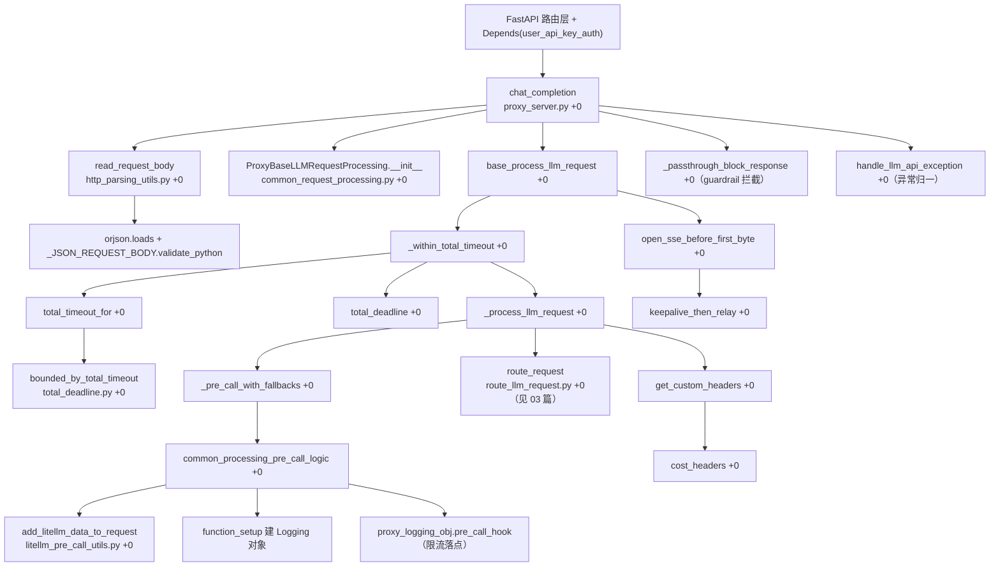

# 函数级解析（一）：Proxy 端点与请求处理骨架

> 所属层级：第四层（函数级解析） | 覆盖主链：第 1-4 跳涉及的函数
> 本篇基准提交：`411b64dc7a`（工作区当前 HEAD）
> 引用规范：`文件 :: 符号 :: +偏移`，`+0` = 定义行，`+N` = 函数体内第 N 行

本篇逐个展开主链跳 1-4 里出现的函数：端点函数 `chat_completion`、body 解析 `read_request_body`、处理骨架类 `ProxyBaseLLMRequestProcessing`（构造器、`base_process_llm_request`、`total_timeout_for`、`_within_total_timeout`、`_process_llm_request`、`_pre_call_with_fallbacks`、`common_processing_pre_call_logic`）、响应头组装 `get_custom_headers` 与 `cost_headers`、SSE 保活 `open_sse_before_first_byte`、passthrough 响应 `_passthrough_block_response`。第三层《端点与请求解析》《Pre-call 处理》讲的是「每一跳发生了什么」，本篇讲「每个函数内部具体怎么实现」，逐函数组织而非逐跳。

术语首现已解释：`route_type`（同一处理骨架区分后续派发到哪个 SDK 方法的字符串，本场景是 `"acompletion"`）、`Logging 对象`（`LiteLLMLoggingObj`，回调管线的引擎）、`total_timeout`（对非流式请求挂的总截止时间）、`SSE`（Server-Sent Events，流式响应的传输格式）。

本场景：AI Gateway 收 `POST /v1/chat/completions`，路由到 OpenAI `gpt-4o-mini`，非流式、单 deployment、无 DB（master key）。

## 本篇覆盖函数与主链跳的对应

| 主链跳 | 本篇展开的函数 |
|---|---|
| 跳 1 路由匹配 | `chat_completion` |
| 跳 3 读 body、注 metadata | `read_request_body` |
| 跳 4 进入处理骨架 | `ProxyBaseLLMRequestProcessing.__init__`、`base_process_llm_request`、`total_timeout_for`、`_within_total_timeout`、`open_sse_before_first_byte` |
| 跳 4 内 pre-call | `_process_llm_request`、`_pre_call_with_fallbacks`、`common_processing_pre_call_logic` |
| 跳 4 内 收尾 | `get_custom_headers`、`cost_headers`、`_passthrough_block_response` |

---

### `chat_completion`（`litellm/proxy/proxy_server.py`）

- 职责：`/v1/chat/completions` 等 4 个路径的统一端点，读 body、注入身份、委托处理骨架、异常转 HTTP。
- 签名/参数：`async def chat_completion(request: Request, fastapi_response: Response, model: str | None = None, user_api_key_dict: UserAPIKeyAuth = Depends(user_api_key_auth))`（`chat_completion :: +0` 到 `+4`）。请求体不在签名里，由函数体手动读——4 个路径共用此函数，且 body 解析需要容错。
- 返回：`ModelResponse` 经 `model_dump_with_preserved_fields` 转出的 JSON dict，或 `StreamingResponse`，或抛 `ProxyException`。
- 算法（贴 `chat_completion :: +31` 到 `+58`）：

```python
# +31
data: Final = await read_request_body(request=request)
if user_api_key_dict is not None:                      # +32
    if not isinstance(data.get("metadata"), dict):     # +33
        data["metadata"] = {}                          # +37
    if hasattr(user_api_key_dict, "user_id") and user_api_key_dict.user_id is not None:
        data["metadata"]["user_api_key_user_id"] = user_api_key_dict.user_id   # +38
    ... team_id / org_id / organization_alias / agent_id 同型注入（+39 到 +47）
base_llm_response_processor: Final = ProxyBaseLLMRequestProcessing(data=data)   # +49
```

  1. `+5` 到 `+6`：`global` 声明引用 proxy 启动时建好的进程级对象（`general_settings`、`proxy_logging_obj`、`llm_router`、`user_temperature`、`user_request_timeout`、`user_max_tokens`、`user_api_base`）。
  2. `+31`：读 body（见 `read_request_body` 一节）。
  3. `+32` 到 `+47`：整段包在 `if user_api_key_dict is not None:` 里。`+33` 到 `+37` 先把 metadata 归一成 dict——metadata 缺失或为 JSON 字符串（multipart/extra_body 场景）时，直接执行 `data["metadata"][k] = v` 会在字符串上抛 `TypeError` 变 500。`+38` 到 `+47` 逐字段注入，每个键都是「属性存在且非 None 才写」：`user_api_key_user_id`、`user_api_key_team_id`、`user_api_key_org_id`、`user_api_key_org_alias`、`agent_id`。本场景是 master key，`UserAPIKeyAuth` 是凭空构造的全权限对象，这些字段多为 None，metadata 通常只剩空 dict。
  4. `+49`：构造处理骨架实例（见 `__init__` 一节）。
  5. `+51` 到 `+70`：`await base_llm_response_processor.base_process_llm_request(...)`，`route_type="acompletion"`，其余请求上下文按关键字传；`on_passthrough_block=lambda block: _stream_chat_passthrough_block(block, user_api_key_dict, request)` 是 guardrail 拦截时的流式透传回调（本场景非流式无 guardrail，走不到）。
  6. `+70` 到 `+73`：返回分支——`isinstance(result, BaseModel)` 就 `model_dump_with_preserved_fields(result, exclude_unset=True)` 转 dict 交给 FastAPI 序列化，否则原样返回（SSE 流等形态）。
- 错误/分支：`base_process_llm_request` 包在 try 里（`+50` 起），三个 except。`ModifyResponseException`（`+74`）：流式走 `_stream_chat_passthrough_block`，非流式先 `_record_passthrough_block` 留痕再经 `_passthrough_block_response` 构造 `finish_reason="content_filter"` 的假响应。`RejectedRequestError`（`+79` 到 `+133`）：跑 `post_call_failure_hook` 留失败日志，再返回 usage 全 0 的 `ModelResponse`，stream 为真时包 `CustomStreamWrapper`。其他 `Exception`（`+112`）：交给 `handle_llm_api_exception`（`litellm/proxy/common_request_processing.py :: ProxyBaseLLMRequestProcessing :: handle_llm_api_exception :: +0`，绝对行 4664）归一成 OpenAI 兼容 `ProxyException`。本场景成功路径走不到任何 except。
- 调用关系：调用方 = FastAPI 路由层（装饰器四条路径：`/v1/chat/completions`、`/chat/completions`、`/engines/{model:path}/chat/completions`、`/openai/deployments/{model:path}/chat/completions`）与 `Depends(user_api_key_auth)`（先于函数体）。被调用方 = `read_request_body`、`ProxyBaseLLMRequestProcessing` 构造器、`base_process_llm_request`、`_passthrough_block_response`、`handle_llm_api_exception`。

---

### `read_request_body`（`litellm/proxy/common_utils/http_parsing_utils.py`）

- 职责：容错读 body 并解析为 dict；解析失败尽量返回 `{}` 而不是把请求打成 500。
- 签名/参数：`async def read_request_body(request: Request | None) -> dict`（`read_request_body :: +0`）。
- 返回：`dict`（OpenAI 请求格式，本场景形如 `{"model": "gpt-4o-mini", "messages": [...]}`）；`request is None` 或空 body 返回 `{}`。
- 算法（贴 `read_request_body :: +10` 到 `+46`）：

```python
if request is None:                                   # +10
    return {}
if is_otlp_trace_request(request):                    # +13
    return {}
_cached_request_body = _safe_get_request_parsed_body(request=request)   # +17
if _cached_request_body is not None:
    return _cached_request_body
content_type = safe_get_request_headers(request=request).get("content-type", "")   # +21
if _normalize_media_type(content_type) in _BINARY_CONTENT_TYPES:        # +25
    binary_body = await request.body(); _mark_body_received(len(binary_body))
    parsed_body = _parse_binary_body(binary_body)
elif _is_form_content_type(content_type):                               # +29
    form_body = dict(await _read_form_data(request))
    raw_metadata = form_body.get("metadata")
    parsed_body = ({**form_body, "metadata": _parse_form_metadata(raw_metadata)}
                   if isinstance(raw_metadata, str) else form_body)
else:                                                                    # +39
    body = await request.body(); _mark_body_received(len(body))
    if not body:
        parsed_body = {}                                                 # +43
    else:
        parsed_body = dict(_JSON_REQUEST_BODY.validate_python(orjson.loads(body)))   # +46
```

  常规 JSON 分支（`+39` 起）解析成功即返回。`orjson.JSONDecodeError` 时（`+47` 起）：先按 `MAX_REQUEST_BODY_SIZE_TO_REPAIR_MB` 判断体积，超阈值直接抛 `ProxyException` 400（`+52` 到 `+60`）——surrogate 修复要跑两趟全量 `re.sub`，会阻塞事件循环；未超阈值则走修复重试（`+62` 到 `+75`）：utf-8 解码、正则剔除非法代理对、`json.loads`、`_DECODED_JSON` 校验、可编码性检查（`json.dumps(...).encode("utf-8")`）、`_JSON_REQUEST_BODY` 校验。
- 错误/分支：解析结果缓存在 request 对象（`_safe_get_request_parsed_body` / `safe_set_request_parsed_body`），因为同一 body 会被端点、hook、guardrail 多次读取，缓存避免重复消费流。函数尾部的 `ValidationError` 出口对 pass-through 端点放行返回 `{}`，否则抛 `ProxyException` 400；客户端断开转 `HTTPException`（本场景 body 是合法 JSON，走不到）。
- 调用关系：调用方 = `chat_completion`、`_read_request_body_deferring_parse_failure`（02 篇）及众多端点。被调用方 = `orjson.loads`、`_JSON_REQUEST_BODY.validate_python`、`_safe_get_request_parsed_body`、`safe_get_request_headers`、`_normalize_media_type`、`_is_form_content_type`、`_parse_binary_body`、`_mark_body_received`、`is_otlp_trace_request`。相关常量：`_JSON_REQUEST_BODY`（`TypeAdapter(Mapping[str, object])`，顶层必须是对象）、`_DECODED_JSON`（`TypeAdapter(object)`）、`_BINARY_CONTENT_TYPES`。

---

### `ProxyBaseLLMRequestProcessing.__init__`（`litellm/proxy/common_request_processing.py`）

- 职责：每请求实例的构造器，持有请求数据与处理状态位。类 `ProxyBaseLLMRequestProcessing` 定义在 `ProxyBaseLLMRequestProcessing :: +0`（绝对行 2382），是 chat completions、responses API、Anthropic messages、embeddings 共用的处理骨架，靠后续传入的 `route_type` 区分派发目标。
- 签名/参数：`def __init__(self, data: dict, served_model: str | None = None)`（`ProxyBaseLLMRequestProcessing :: __init__ :: +0`，绝对行 2383）。`data` 是 OpenAI 风格请求体；`served_model` 是通配模型解析后的实际模型，本场景为 None。
- 返回：None（初始化实例）。
- 算法（贴 `__init__ :: +1` 到 `+4`）：

```python
self.data = data                                   # +1
self.served_model = served_model                   # +2
self._tags_before_guardrails: frozenset[str] | None = None   # +3
self.route_type: str | None = None                 # +4
```

  四个状态位全部归零/直存：`self.data` 存请求体；`self.served_model`；`self._tags_before_guardrails` 是 guardrail 改写 tags 前的快照（用于预算校验一致性）；`self.route_type` 初次为 None，要到 `_process_llm_request` 里才设。
- 错误/分支：无。实例每请求新建，无共享可变状态。
- 调用关系：调用方 = `chat_completion`（`+49`）等所有 LLM 端点。被调用方 = 无（纯赋值）。紧随的成员：`litellm_call_id` property（`+8`，绝对行 2390，回读 data 里的 call id）、`_merge_passthrough_streaming_headers` 静态方法（`+12`，绝对行 2394，合并 upstream 流式头并剔除 `transfer-encoding`/`set-cookie` 等 Hop-by-Hop 头，proxy 头优先）。

---

### `base_process_llm_request`（`litellm/proxy/common_request_processing.py`）

- 职责：处理骨架的外壳，自己不干核心活，把 `_process_llm_request` 包两层（总截止时间 + SSE keepalive）再委托出去。
- 签名/参数：`async def base_process_llm_request(self, request: Request, fastapi_response: Response, user_api_key_dict: UserAPIKeyAuth, route_type: ProxyRouteType, proxy_logging_obj: ProxyLogging, general_settings: dict[str, object], proxy_config: ProxyConfig, select_data_generator: Callable[..., object] | None = None, llm_router: Router | None = None, model: str | None = None, user_model: str | None = None, user_temperature: float | None = None, user_request_timeout: float | None = None, user_max_tokens: int | None = None, user_api_base: str | None = None, version: str | None = None, is_streaming_request: bool | None = False, contents: list[object] | None = None, skip_pre_call_logic: bool = False, sse_framing: SseFraming = OPENAI_SSE_FRAMING, on_passthrough_block: Callable[[ModifyResponseException], Awaitable[Response]] | None = None) -> object`（`base_process_llm_request :: +0`）。`data` 不在参数里——已在构造器存进 `self.data`。
- 返回：委托处理的结果（响应对象或 SSE 流）。
- 算法（贴 `base_process_llm_request :: +31` 到 `+75`）：

```python
answers_as_anthropic: Final = route_type == "anthropic_messages"      # +31
async def _audit_late_failure(exc: Exception) -> HTTPException | None: # +33
    return await proxy_logging_obj.post_call_failure_hook(
        user_api_key_dict=user_api_key_dict,
        original_exception=with_answered_status(exc) if answers_as_anthropic else exc,
        request_data=self.data, dispatched_call_type=self.route_type,
    )
return await open_sse_before_first_byte(                              # +43
    self._within_total_timeout(
        request=request, route_type=route_type, is_streaming_request=is_streaming_request,
        processing=self._process_llm_request(..., first_chunk_framing=sse_framing.first_chunk),
    ),
    ping_interval_seconds=ttft_keepalive_interval(self.data, llm_router),
    on_late_failure=_audit_late_failure,
    late_framing=ANTHROPIC_LATE_SSE_FRAMING if answers_as_anthropic else sse_framing.late,
    on_passthrough_block=on_passthrough_block,
)
```

  三层包裹由内到外：最内 `_process_llm_request`（真骨架）→ 中层 `_within_total_timeout`（总截止时间）→ 外层 `open_sse_before_first_byte`（SSE keepalive）。`+31` 的 `answers_as_anthropic` 决定迟到失败的错误帧格式。`+33` 的内嵌 `_audit_late_failure` 补一个语义：一旦 keepalive 已上线，异常没法再抛，调用方自己的 `except` 不会执行 `post_call_failure_hook`，由它代跑留痕。
- 错误/分支：本函数不抛业务异常，异常从内层冒出经 keepalive 包装决定形态（见 `open_sse_before_first_byte`）。
- 调用关系：调用方 = `chat_completion`（`+51`）及 responses/messages/embeddings 端点。被调用方 = `ttft_keepalive_interval`（`+0`，绝对行 1627，未配置 `sse_keepalive_ping_interval_seconds` 时返回 None 即不启用 keepalive）、`open_sse_before_first_byte`、`_within_total_timeout`、`_process_llm_request`。

---

### `total_timeout_for`（`litellm/proxy/common_request_processing.py`）

- 职责：解析「能约束本次请求的 `total_timeout`」；不可约束的请求，body 值抛 400、头值忽略放行。
- 签名/参数：`def total_timeout_for(self, request: Request, route_type: ProxyRouteType, is_streaming_request: bool | None) -> TotalTimeout | None`（`total_timeout_for :: +0`）。
- 返回：`TotalTimeout`（含 `.seconds` 与 `.from_body`）或 `None`（未配置或不可约束）。
- 算法（贴 `total_timeout_for :: +5` 到 `+27`）：

```python
body: Final = _REQUEST_FIELDS.validate_python(self.data)     # +5
header: Final = request.headers.get(TOTAL_TIMEOUT_HEADER)    # +6
self.data.pop(TOTAL_TIMEOUT_FIELD, None)                     # +7
bounded: Final = (
    route_type in _TOTAL_TIMEOUT_ROUTE_TYPES                 # {"acompletion","aresponses","anthropic_messages"}
    and is_streaming_request is not True
    and bounded_by_total_timeout(body)                       # +10
)
if header is not None and not bounded:                       # +14
    return None                       # 头值在不可夹时静默忽略
parsed: Final = total_timeout_from_request(header, body)     # +17
if parsed is None: return None
if isinstance(parsed, InvalidTotalTimeout):                  # +20
    raise _total_timeout_refused(parsed.message)             # 400
if not bounded:                                              # +22
    raise _total_timeout_refused("...applies only to non-streaming, non-background ...")  # 400
return parsed                                                # +27
```

  `bounded_by_total_timeout`（`litellm/litellm_core_utils/total_deadline.py :: bounded_by_total_timeout :: +0`）判定「非流式且非后台」才可夹。`+7` 的 `self.data.pop(TOTAL_TIMEOUT_FIELD, None)` 把 body 里的 `total_timeout` 剥离，避免它作为未知参数漏给 SDK。
- 错误/分支：body 值用在不可夹的请求上抛 `_total_timeout_refused`（400）；头值在不可夹时返回 None 放行（不抛）。
- 调用关系：调用方 = `_within_total_timeout`（`+7`）、response_api 端点。被调用方 = `total_timeout_from_request`、`bounded_by_total_timeout`、`_REQUEST_FIELDS.validate_python`、`_total_timeout_refused`。

---

### `_within_total_timeout`（`litellm/proxy/common_request_processing.py`）

- 职责：用 `total_deadline` 上下文包住整个处理协程，超时把 `TotalTimeoutExpired` 映射成 408。
- 签名/参数：`async def _within_total_timeout(self, request: Request, route_type: ProxyRouteType, is_streaming_request: bool | None, processing: Coroutine[object, object, _ProcessedT]) -> _ProcessedT`（`_within_total_timeout :: +0`）。`processing` 是已构造但未 await 的 `_process_llm_request` 协程。
- 返回：内层处理协程的结果。
- 算法（贴 `_within_total_timeout :: +7` 到 `+19`）：

```python
try:
    total_timeout: Final = self.total_timeout_for(request, route_type, is_streaming_request)   # +7
except ProxyException:
    processing.close(); raise                                        # +9 到 +10
if total_timeout is None:
    return await processing                                          # +12
try:
    async with total_deadline(total_timeout.seconds, from_body=total_timeout.from_body):  # +14
        return await processing
except TotalTimeoutExpired as expired:                               # +16
    raise ProxyException(message=str(expired), type="timeout", param=TOTAL_TIMEOUT_FIELD, code=408) from expired
except TotalTimeoutNotApplicable as refused:                         # +18
    raise _total_timeout_refused(str(refused)) from refused          # 400
```

  关键点：`total_timeout` 为 None（未配置或不可夹）时直接 `return await processing`，不做任何包裹——本场景 body 无 `total_timeout`，走这条快速路径。`+9` 到 `+10` 在取值抛错时先 `processing.close()` 关掉未启动的协程再抛，避免「coroutine never awaited」警告。
- 错误/分支：`TotalTimeoutExpired` 转 408；`TotalTimeoutNotApplicable`（如 body total_timeout 传给只夹非流式的 scope）转 400。
- 调用关系：调用方 = `base_process_llm_request`（`+44`）。被调用方 = `total_timeout_for`、`total_deadline`（`litellm/litellm_core_utils/total_deadline.py :: total_deadline :: +0`）、`_total_timeout_refused`。

---

### `open_sse_before_first_byte`（`litellm/proxy/common_request_processing.py`）

- 职责：上游首字节前的 SSE 保活包装；上游在一个 ping 间隔内答完就走快速路径，否则先发心跳。
- 签名/参数：`async def open_sse_before_first_byte(produce_response, ping_interval_seconds, media_type=..., on_late_failure, late_framing, on_passthrough_block)`（`open_sse_before_first_byte :: +0`）。`produce_response` 是内层协程；`ping_interval_seconds` 为 None 则不包装。
- 返回：响应对象，或已开始发送的 SSE 流。
- 算法：`+9` 起 `coerce_keepalive_interval` 把间隔规整为 None 即原样 await 内层（本场景非流式且未配 keepalive，走这条）；否则用 `asyncio.wait((produce_task,), timeout=interval)` 竞速——上游在一个 interval 内答完走快速路径（字节等价于未包装）；否则 `keepalive_then_relay`（`keepalive_then_relay :: +0`，绝对行 1762）生成器上线，循环 `yield SSE_COMMENT_PING_BYTES` + wait，直到 upstream 出结果或异常。
- 错误/分支：`finally`（`+49`）里若 produce 未 done 则 cancel，已 done 则 `_aclose_late_response` 关掉没被消费的流。一旦首 ping 上线，失败只能以 SSE 错误帧（`late_framing.failure(...)`）发出，HTTP 状态码已无法修改，`on_late_failure` 负责审计。
- 调用关系：调用方 = `base_process_llm_request`（`+43`）及 passthrough/rag 端点。被调用方 = `coerce_keepalive_interval`、`keepalive_then_relay`、`on_late_failure`（即 `_audit_late_failure`）。

---

### `_process_llm_request`（`litellm/proxy/common_request_processing.py`）

- 职责：主链路真骨架，pre-call → 并行路由与 moderation → 执行 → 收尾 → 响应头，全在这里。
- 签名/参数：`async def _process_llm_request(self, request, fastapi_response, user_api_key_dict, route_type: ProxyRouteType, proxy_logging_obj, general_settings, proxy_config, select_data_generator=None, llm_router=None, model=None, user_model=None, user_temperature=None, user_request_timeout=None, user_max_tokens=None, user_api_base=None, version=None, is_streaming_request=False, contents=None, skip_pre_call_logic=False, first_chunk_framing=OPENAI_FIRST_CHUNK_FRAMING) -> object`（`_process_llm_request :: +0`）。
- 返回：响应对象或 `StreamingResponse`。
- 算法（三段）：

  段一 pre-call（贴 `_process_llm_request :: +26` 到 `+30`）：

```python
client_model: Final = get_client_requested_model(request) or self.data.get("model")   # +26
requested_model_from_client: Final[str | None] = client_model if isinstance(client_model, str) else None  # +27
self._debug_log_request_payload()                                    # +28
if skip_pre_call_logic:                                              # +30
    logging_obj = ... # 从 data 取现成的 litellm_logging_obj，没有就 ValueError
```

    `skip_pre_call_logic=True` 时从 data 取现成 logging 对象（避免静默丢日志）；否则 `+43` 到 `+59` 走 `self.data, logging_obj = await self._pre_call_with_fallbacks(...)`，`+60` 发 `phase_event("litellm.request.pre_call_completed")`。

  段二 执行（贴 `_process_llm_request :: +86` 到 `+97`）：

```python
llm_call: Final = await route_request(                  # +86（绝对行 3393）
    data=self.data, route_type=route_type, llm_router=llm_router,
    user_model=user_model, user_api_key_dict=user_api_key_dict,
)
llm_call_task: Final = asyncio.create_task(with_proxy_compaction_executor(llm_call, request))   # +93
tasks.append(llm_call_task)
llm_responses: Final = asyncio.gather(*tasks)          # +96，与 during_call_hook 并行
```

    `+69` 到 `+77` 已把 `during_call_hook`（moderation）作为独立 task 先行发射，与 LLM 调用并行。`route_request` 返回的是未执行协程，`+93` 的 `create_task` 才真正开始调度。`+102` 到 `+104`：`cancel_on_disconnect` 配置时用 `_await_llm_call_cancelling_on_disconnect` 等待，否则直接 `await llm_responses`；`+105` 到 `+108` 捕 `asyncio.CancelledError`，若 `_total_timeout_expired()` 真则 `_cost_a_call_answered_past_its_total_timeout` 补计超时后已产生的成本；`+110` 的 `finally` 里 `_cancel_pending_gather_tasks(tasks)` 清理未完成 task。`+112` 取 `response = responses[1]`。

  段三 收尾（`+117` 起）：从 `_hidden_params` 取 `cache_key`/`api_base`/`response_cost`/`fastest_response_batch_completion`/`additional_headers`；`data["deployment"]` 记录命中部署；流式判断分支组 SSE 响应头、延迟 guardrail、keepalive 包装；非流式走 `post_call_success_hook`（可改写响应）→ `prepare_response_cost` → `get_custom_headers` 更新 `fastapi_response.headers` → `_override_openai_response_model`（`_process_llm_request :: +445`，绝对行 3752）还原客户端 model → `post_call_response_headers_hook`。
- 错误/分支：外层 `except (Exception, asyncio.CancelledError)` 在 `logging_obj.prepared_cost` 已备时用 `anyio.CancelScope(shield=True)` 强制落成本（`finalize_proxy_response_cost`）后 re-raise；`finally` 里 `_flush_deferred_async_logging` 与孤儿流 closure 清理。
- 调用关系：调用方 = `base_process_llm_request`（经 `_within_total_timeout`）。被调用方 = `get_client_requested_model`、`_debug_log_request_payload`、`_pre_call_with_fallbacks`、`route_request`、`with_proxy_compaction_executor`、`asyncio.create_task`/`asyncio.gather`、`get_custom_headers`、`_override_openai_response_model`、`_cancel_pending_gather_tasks`。

---

### `_pre_call_with_fallbacks`（`litellm/proxy/common_request_processing.py`）

- 职责：包一层异常处理的 pre-call——任何 pre-call 异常也触发回调留痕，并支持 per-model 限流回退。
- 签名/参数：`async def _pre_call_with_fallbacks(self, request, general_settings: dict, proxy_logging_obj, user_api_key_dict, version, proxy_config, user_model, user_temperature, user_request_timeout, user_max_tokens, user_api_base, model, route_type: str, llm_router) -> tuple[dict, LiteLLMLoggingObj]`（`_pre_call_with_fallbacks :: +0`）。注意它没有 `select_data_generator`/`contents`，比 `_process_llm_request` 少两个参数。
- 返回：`(data, logging_obj)` 二元组。
- 算法（贴 `_pre_call_with_fallbacks :: +29` 到 `+58`）：

```python
def is_hard_per_model_limit(exc: ProxyRateLimitError) -> bool:      # +29
    return (exc.descriptor_key in PER_MODEL_RATE_LIMIT_DESCRIPTOR_KEYS
            and per_model_rate_limits_disable_fallbacks(general_settings_view))
configured_fallbacks: Final = (self._configured_fallbacks(llm_router=llm_router,   # +36
    user_api_key_dict=user_api_key_dict) if llm_router is not None else None)
pristine: Final = independent_snapshot(self.data) if configured_fallbacks else None   # +40
try:
    return await self.common_processing_pre_call_logic(...)         # +43
except ProxyRateLimitError as original_exc:                        # +59
    ...
```

  正常路径 `+43` 直接透传到 `common_processing_pre_call_logic`。`+59` 起的 `except ProxyRateLimitError` 是它存在的理由：本 model 命中 per-model 限流、且配了 fallbacks、且请求没带 `disable_fallbacks`、且不是「硬」per-model 限额时，对配置的备用模型组逐个重试 pre-call（`_resolve_fallback_models`），重试成功就用 `with_rate_limit_fallback` 给 data 盖章返回。`_configured_fallbacks`（`_configured_fallbacks :: +0`，绝对行 3061）优先取 key 级 `router_settings.fallbacks`，否则取 `llm_router.settings().fallbacks`。
- 错误/分支：本场景无 fallbacks，`configured_fallbacks` 为 None，`pristine` 也为 None，任何 `ProxyRateLimitError` 在 `+63` 到 `+68` 直接 `raise`；`+94` 到 `+97` 的 `except BaseException` 把 `self.data` 还原为限流时的快照再抛。
- 调用关系：调用方 = `_process_llm_request`（`+43`）。被调用方 = `common_processing_pre_call_logic`、`_configured_fallbacks`、`_resolve_fallback_models`、`independent_snapshot`、`_team_member_within_fallback_model_budget`、`endpoint_unsupported_by_model`、`with_rate_limit_fallback`。

---

### `common_processing_pre_call_logic`（`litellm/proxy/common_request_processing.py`）

- 职责：鉴权后的全部请求加工——注入、配置合并、Logging 对象构建、hook 执行。
- 签名/参数：`async def common_processing_pre_call_logic(self, request, general_settings, proxy_logging_obj, user_api_key_dict, version, proxy_config, user_model, user_temperature, user_request_timeout, user_max_tokens, user_api_base, model, route_type, llm_router, rate_limited_model=None, ...)`（`common_processing_pre_call_logic :: +0`）。
- 返回：`(self.data, logging_obj)`，函数尾部 `return self.data, logging_obj`；调用方按 `self.data, logging_obj = await self._pre_call_with_fallbacks(...)` 解包。
- 算法（13 步，偏移相对本函数 `+0`，绝对行 2573）：

| 偏移 | 动作 |
|---|---|
| `+113` 到 `+122` | `start_time = datetime.now()`；`model` 不是字符串则抛 `ProxyException` 400 |
| `+124` | `await add_litellm_data_to_request(...)`（`litellm/proxy/litellm_pre_call_utils.py :: add_litellm_data_to_request :: +0`）注入网关数据 |
| `+131` 到 `+167` | 记请求元数据；算 queue time（`arrival_time` 到 `start_time` 窗口写入 metadata）；未开 `expose_fallback_errors_to_caller` 时剥 `include_fallback_errors` |
| `+168` 到 `+177` | `reject_url_valued_destination("model", model)`；`resolve_inference_model` 解析最终模型 |
| `+180` 到 `+187` | 应用全局默认 `user_temperature`/`user_request_timeout`/`user_max_tokens`/`user_api_base`（有值才覆盖） |
| `+191` 到 `+194` | `global_then_key_alias_target(...)` 别名解析（`litellm/proxy/litellm_pre_call_utils.py :: global_then_key_alias_target :: +0`） |
| `+196` 到 `+214` | `hierarchical_router_settings_updates`（`hierarchical_router_settings_updates :: +0`，绝对行 969，DB 覆盖 YAML 含 `model_group_alias`）；scheduled 路由读 `x-litellm-priority` 头 |
| `+216` 到 `+223` | `resolve_litellm_call_id`（`resolve_litellm_call_id :: +0`，绝对行 388，客户端带 `x-litellm-call-id` 头且不超长则复用否则生成 uuid4）、`bind_telemetry_call_id`、`DDSpanTagger` |
| `+226` 到 `+237` | `stream_usage_tracking_updates`（`stream_usage_tracking_updates :: +0`，绝对行 675）自动流式 usage 追踪 |
| `+242` 到 `+250` | `function_setup(...)` 建 Logging 对象并写回 `self.data["litellm_logging_obj"]`（后续所有层从 kwargs 拿它） |
| `+262` 到 `+272` | `check_and_merge_model_level_guardrails`（`trust_client_model_info=False`，防伪造 model_info 绕过 guardrail） |
| `+278` 到 `+284` | `_arm_auto_router_compression`；快照 `_tags_before_guardrails`；`RoutingContext(llm_router).arm_read_prefetch` 预读；`pre_call_hook(...)` 执行全部 pre-call 回调——**限流真正发生在此** |
| `+291` 到 `+314` | `_enforce_guardrail_added_tag_budgets`（`_enforce_guardrail_added_tag_budgets :: +0`，绝对行 1045）；guardrail 之后的 message 刷新（PII 掩码可能改写 messages）、`logging_obj.update_messages`、served model 解析 |

  两个易错点：`function_setup` 返回的 logging_obj 会同时写回 `self.data["litellm_logging_obj"]`；guardrail（如 Presidio）可能改写 `messages`，所以 messages 刷新在 `pre_call_hook` 之后，保证日志与实际发送内容一致。
- 错误/分支：`model` 非字符串 400；限流在 `pre_call_hook` 内抛 `ProxyRateLimitError`，由上层 `_pre_call_with_fallbacks` 决定是否回退。
- 调用关系：调用方 = `_pre_call_with_fallbacks`（`+43`）及 responses/mcp 端点。被调用方 = `add_litellm_data_to_request`、`resolve_inference_model`、`global_then_key_alias_target`、`hierarchical_router_settings_updates`、`resolve_litellm_call_id`、`stream_usage_tracking_updates`、`function_setup`、`check_and_merge_model_level_guardrails`、`proxy_logging_obj.pre_call_hook`、`_enforce_guardrail_added_tag_budgets`。

---

### `get_custom_headers`（`litellm/proxy/common_request_processing.py`）

- 职责：组装 `x-litellm-*` 响应头。
- 签名/参数：`@staticmethod def get_custom_headers(user_api_key_dict, call_id, model_id, cache_key, api_base, version, response_cost=None, model_region="", ..., request_data=None, timeout=None, litellm_logging_obj=None, read_timing_from_logging_obj=False, **kwargs)`（`get_custom_headers :: +0`，绝对行 2423，全关键字参数）。
- 返回：`dict[str, str]`。
- 算法：值解析链为「显式参数 → `hidden_params` → `request_data` → logging_obj 计时（`read_timing_from_logging_obj` 控制）」。`+46` 起的字典字面量逐项组装：`+47` `x-litellm-call-id`（`resolved_call_id`，优先级 call_id → `hidden_params.litellm_call_id` → `request_data.litellm_call_id`）；`+48` 到 `+55` `x-litellm-model-id`/`-model-name`/`-cache-key`/`-model-api-base`（去 query 防泄露）`/-version`/`-model-region`；`+56` `**cost_headers(response_cost, litellm_logging_obj)`；`+58` 到 `+61` `x-litellm-key-tpm-limit`/`-rpm-limit`/`-max-budget`/`-spend`（`updated_spend` = 当前 spend + 本次 response_cost）；`+62` 到 `+64` `x-litellm-response-duration-ms`/`-overhead-duration-ms`/`-callback-duration-ms`；`+65` 起 `LITELLM_DETAILED_TIMING` 为真时补 `x-litellm-timing-*`；`+78` `x-litellm-timeout`；`+79` `**kwargs` 兜底；`+81` 起 `request_data` 存在时追加限流余量、rate-limit-fallback、logging-caching 头。
- 错误/分支：空值统一剔除（`exclude_values = {"", None, "None"}`），且最终只保留能编码为 latin-1 的头（防非 ASCII 头崩 FastAPI）。
- 调用关系：调用方 = `_process_llm_request`（`+453`，绝对行 3760）、若干管理端点。被调用方 = `cost_headers`、`get_remaining_tokens_and_requests_from_request_data`、`rate_limit_fallback_headers`、`get_logging_caching_headers`、`_encodes_as_latin1`。

---

### `cost_headers`（`litellm/proxy/common_request_processing.py`）

- 职责：组装 `x-litellm-response-cost-*` 一组成本头。
- 签名/参数：`def cost_headers(response_cost: float | str | None, litellm_logging_obj=None) -> Mapping[str, str | None]`（`cost_headers :: +0`，绝对行 2100）。
- 返回：`Mapping[str, str | None]`。
- 算法：`+4` 起——`response_cost == 0` 且 logging 对象已备 `prepared_cost` 且 `price_known` 为假（即显式免费费率、无已知单价）时返回 `{}`，不写零成本头；否则 `_get_cost_breakdown_from_logging_obj` 拆成本明细后展开。明细键（`+14` 起）：`x-litellm-response-cost`、`-original`、`-discount-amount`、`-margin-amount`、`-margin-percent`、`-input`、`-output`、`-cache-read`、`-cache-creation`、`-reasoning`、`-tool-usage`。
- 错误/分支：logging 对象为 None 时只回 `x-litellm-response-cost` 单键。
- 调用关系：调用方 = `get_custom_headers`（`+56`）。被调用方 = `_get_cost_breakdown_from_logging_obj`、`_classifier_cost_from_request_data`（`_classifier_cost_from_request_data :: +0`，绝对行 2128）。

---

### `_passthrough_block_response`（`litellm/proxy/proxy_server.py`）

- 职责：guardrail 拦截（非流式）时，把 block 转成 `finish_reason="content_filter"` 的假响应返回给客户端。
- 签名/参数：`async def _passthrough_block_response(...)`（`_passthrough_block_response :: +0`，绝对行 13205）。
- 返回：带 `content_filter` finish reason 的响应对象。
- 算法：先 `_record_passthrough_block` 记账留痕，再按 OpenAI 响应形状组装一个 choices 里带 `finish_reason="content_filter"` 的 `ModelResponse`。
- 错误/分支：流式场景不走它，改走 `_stream_chat_passthrough_block` 以 SSE 单片透传。
- 调用关系：调用方 = `chat_completion` 的 `ModifyResponseException` except（`+74`）。被调用方 = `_record_passthrough_block`、`ModelResponse` 构造。

---

## 函数调用关系图



## 源码索引

| 符号 | 文件 :: 符号 | 绝对定义行 |
|---|---|---|
| 端点函数 | `litellm/proxy/proxy_server.py :: chat_completion` | 13290 |
| passthrough block 响应 | `litellm/proxy/proxy_server.py :: _passthrough_block_response` | 13205 |
| body 解析 | `litellm/proxy/common_utils/http_parsing_utils.py :: read_request_body` | 272 |
| 处理骨架类 | `litellm/proxy/common_request_processing.py :: ProxyBaseLLMRequestProcessing` | 2382 |
| 处理骨架构造器 | `litellm/proxy/common_request_processing.py :: ProxyBaseLLMRequestProcessing.__init__` | 2383 |
| 入口委托 | `litellm/proxy/common_request_processing.py :: ProxyBaseLLMRequestProcessing.base_process_llm_request` | 3180 |
| 超时取值 | `litellm/proxy/common_request_processing.py :: ProxyBaseLLMRequestProcessing.total_timeout_for` | 3257 |
| 总截止时间包裹 | `litellm/proxy/common_request_processing.py :: ProxyBaseLLMRequestProcessing._within_total_timeout` | 3285 |
| 真骨架 | `litellm/proxy/common_request_processing.py :: ProxyBaseLLMRequestProcessing._process_llm_request` | 3307 |
| pre-call 兜底 | `litellm/proxy/common_request_processing.py :: ProxyBaseLLMRequestProcessing._pre_call_with_fallbacks` | 2900 |
| 配置回退取值 | `litellm/proxy/common_request_processing.py :: ProxyBaseLLMRequestProcessing._configured_fallbacks` | 3061 |
| pre-call 主体 | `litellm/proxy/common_request_processing.py :: ProxyBaseLLMRequestProcessing.common_processing_pre_call_logic` | 2573 |
| 响应头组装 | `litellm/proxy/common_request_processing.py :: ProxyBaseLLMRequestProcessing.get_custom_headers` | 2423 |
| 成本头 | `litellm/proxy/common_request_processing.py :: cost_headers` | 2100 |
| SSE keepalive | `litellm/proxy/common_request_processing.py :: open_sse_before_first_byte` | 1723 |
| keepalive 生成器 | `litellm/proxy/common_request_processing.py :: keepalive_then_relay` | 1762 |
| keepalive 间隔 | `litellm/proxy/common_request_processing.py :: ttft_keepalive_interval` | 1627 |
| call id 解析 | `litellm/proxy/common_request_processing.py :: resolve_litellm_call_id` | 388 |
| 层级 router 设置 | `litellm/proxy/common_request_processing.py :: hierarchical_router_settings_updates` | 969 |
| 流式 usage 追踪 | `litellm/proxy/common_request_processing.py :: stream_usage_tracking_updates` | 675 |
| guardrail tag 预算 | `litellm/proxy/common_request_processing.py :: _enforce_guardrail_added_tag_budgets` | 1045 |
| 异常归一 | `litellm/proxy/common_request_processing.py :: ProxyBaseLLMRequestProcessing.handle_llm_api_exception` | 4664 |
| 超时判定 | `litellm/litellm_core_utils/total_deadline.py :: bounded_by_total_timeout` | 94 |
| 取超时 | `litellm/litellm_core_utils/total_deadline.py :: total_timeout_from_request` | 83 |

## 未确认项

- `handle_llm_api_exception` 内部逐行实现未读取，不臆测，本篇只引用职责与调用点。
- `function_setup`、`resolve_inference_model`、`with_proxy_compaction_executor`、`_override_openai_response_model`、`_get_cost_breakdown_from_logging_obj` 的函数体未逐行读取，本篇只引用调用点、职责与进出状态。
- surrogate 修复里 `MAX_REQUEST_BODY_SIZE_TO_REPAIR_MB` 的具体阈值数值未读取，不臆测。
- `chat_completion` 装饰器四条路径的装饰器行号未逐一核对（装饰器块在 `+0` 之前，不影响偏移语义）。
- `_process_llm_request` 段三收尾的流式分支（`+139` 起）与异常分支（`+3639` 起）未逐行核对偏移，本篇只描述职责与调用点。