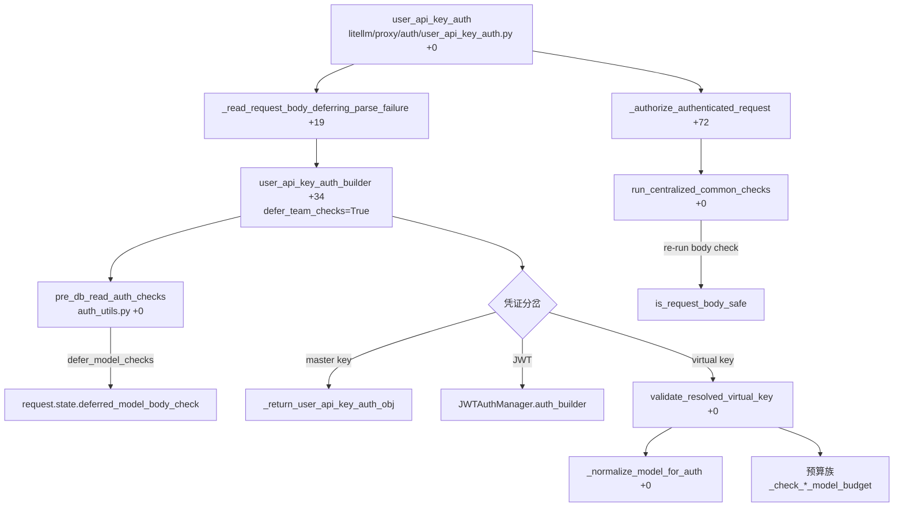
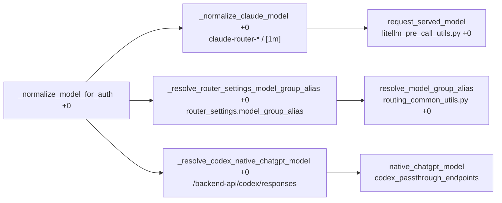

# 函数级解析：鉴权模块

> 所属层级：第四层（源码补齐） | 覆盖：`proxy/auth/user_api_key_auth.py`、`auth_checks.py`、`auth_utils.py` 关键函数

主链路 pre-call 的鉴权执行者（第三层第 2 篇步骤）。入口 `user_api_key_auth` 编排 body 读取与鉴权构建，`user_api_key_auth_builder` 做三类凭证分岔，`validate_resolved_virtual_key` 做已解析虚拟 key 的授权检查链。预算检查已拆成「按服务所用模型」判断（#51058），并引入 `budget_served_model` / `_normalize_model_for_auth` 等新符号。`defer_team_checks` 路径把模型 body 校验推迟到 `run_centralized_common_checks`（#51226）。



## 1. `user_api_key_auth()`

```
litellm/proxy/auth/user_api_key_auth.py :: user_api_key_auth() :: +0
```

| 项 | 内容 |
|---|---|
| 职责 | FastAPI 依赖入口：编排 body 读取与鉴权构建 |
| 参数 | `request: Request`、`api_key`（FastAPI Security 注入的 Bearer 头）、各厂商凭证头（`azure_api_key_header`、`anthropic_api_key_header`、`google_ai_studio_api_key_header`、`azure_apim_header`、`custom_litellm_key_header`） |
| 返回 | `UserAPIKeyAuth` |
| 前置 | 全局 `master_key` 已加载（可为 None，即未设 master key） |
| 后置 | 抛出即代表请求被拒 |

核心算法（按行序，偏移相对 `+0` 定义行 4565）：

1. `+17`：`_ensure_parent_otel_span_on_request_state(request)`——在 body 读取前创建 OTEL SERVER span 并存到 `request.state`，保证解析异常路径也有 span 可关
2. `+19`：`_read_request_body_deferring_parse_failure(request)` 返回 `(request_data, body_parse_exception)` 二元组——解析错误先记下不抛
3. `+34`：`user_api_key_auth_builder(...)` 执行构建，此处 `defer_team_checks=True`（`+43`），把模型 body 校验推迟给公共检查；成功时若 body 解析有遗留异常，此刻抛出（保证鉴权失败优先于 400 的语义）
4. `+60`：`user_api_key_auth_obj.budget_reservation = None`，随后 `+62` `_seed_request_destinations` 锚定 OTLP 目标
5. `+71`：body 解析成功时 `_authorize_authenticated_request(...)` 走统一授权门（禁用路由、模型访问、预算、guardrail、org、vector-store），失败用 `UserAPIKeyAuthExceptionHandler` 兜底；`+86` `seed_request_identity` 把身份投到请求上下文
6. `+92`：body 解析失败且无身份 → `_record_unparsable_body_failure` 后抛出；`+106` 投影 `request.state.principal`

## 2. `user_api_key_auth_builder()`

```
litellm/proxy/auth/user_api_key_auth.py :: user_api_key_auth_builder() :: +0
```

| 项 | 内容 |
|---|---|
| 职责 | 三类凭证的分岔与核心构建（master key / JWT / virtual key） |
| 参数 | `request`、`api_key`、各厂商凭证头、`request_data`、`defer_team_checks: bool = False` |
| 返回 | `UserAPIKeyAuth` |
| 前置 | 无（自行从 proxy_server 导入全局状态） |
| 后置 | token 有效时未写回缓存写时更新（缓存策略在缓存层） |

核心算法（按行序，偏移相对 `+0` 定义行 2329）：

1. `+11`：从 `proxy_server` 模块导入全部全局单例（延迟导入避免循环依赖）
2. `+29`：`start_time` 优先取 `request.state.litellm_received_at`（入口尽早盖戳，注释说明：body 解析窗口不计入预处理时长）
3. DB 读前检查 `+39`：`pre_db_read_auth_checks(...)`（trace 名 `litellm.proxy.auth.pre_db_read_auth_checks`），`defer_team_checks` 透传；`+48` 起按 `pass_through_endpoints` / 自定义头解析出最终 `api_key`
4. 自定义鉴权 `+74`：`enterprise_custom_auth`（企业）或 `user_custom_auth`（社区）分支，返回 `_custom_auth_token_for_this_request` 的结果；配置 `enable_post_custom_auth_checks` 时追加 `_run_post_custom_auth_checks`
5. 公开路由 `+121`：命中 `LiteLLMRoutes.public_routes` 或用户配置的 additional public routes 时，直接返回 `INTERNAL_USER_VIEW_ONLY` 空对象
6. OAuth2 / JWT 分支 `+154` 附近：`enable_oauth2_auth` 走 `Oauth2Handler.check_oauth2_token`；`enable_jwt_auth` 且 token 形似 JWT 时先尝试 `_resolve_jwt_to_virtual_key` 映射（命中返回映射的 virtual key），否则走 `JWTAuthManager.auth_builder` 做 RBAC/scope/custom_validate
7. 无 master key / 空 key `+408` 附近：`master_key is None` 时返回 INTERNAL_USER 空对象；`api_key` 为 None/空串时抛 401
8. virtual key 路径 `+513` 起：先查缓存（`IdentityStore(...).resolve(hashed_token=...)`，`check_cache_only=True`）→ 尝试 UI 登录 blob 解密（`ExperimentalUIJWTToken`）→ 仍未命中则 Prisma 查库；`valid_token is None`（`+690` 附近）时给格式提示（`sk-` 前缀、JWT 形态 hint，`+692` 的 `_masked_key` 脱敏）
9. master key 校验 `+624`：`secrets.compare_digest(api_key, master_key)` 命中 → `_return_user_api_key_auth_obj` 构造全权限对象（用 `LITELLM_PROXY_MASTER_KEY_ALIAS` 替真实 key，避免进日志/指标）；非 master key 且路由在 `master_key_only_routes`（`+670`）→ 拒绝；配了 master key 但 `prisma_client is None`（`+680`）→ 明确报错（防误配后全员放行）
10. `+736`：`return await validate_resolved_virtual_key(...)` 进入授权检查链

错误处理：全部异常进入统一 `except`，转 `UserAPIKeyAuthExceptionHandler.handle_authentication_error`（`auth_exception_handler.py :: +0`）决定 HTTP 映射。

## 3. `validate_resolved_virtual_key()`

```
litellm/proxy/auth/user_api_key_auth.py :: validate_resolved_virtual_key() :: +0
```

| 项 | 内容 |
|---|---|
| 职责 | 已解析 token 的授权检查链（模型访问 + 预算 + 公共检查） |
| 参数 | `request`、`request_data`、`valid_token: UserAPIKeyAuth \| None`、`api_key`、`route`、`start_time`、`parent_otel_span`、`end_user_id`、`end_user_params`、`_end_user_object` |
| 返回 | 校验增强后的 `UserAPIKeyAuth` |
| 前置 | `valid_token` 非 None（master key/JWT 路径不经过此函数） |
| 后置 | 抛出即拒绝 |

检查序列（函数头 `noqa: C901` 注释自述「保持既有共享授权检查顺序」，实现体顺序）：

1. `+22`：`_update_key_budget_with_temp_budget_increase(valid_token)`——临时预算加成
2. `+42`：`valid_token.blocked is True` → 抛 401
3. `+49`：`_normalize_model_for_auth(request_data, valid_token, request, route)`——先改写模型再查模型访问（claude router / router_settings alias / Codex native）；`+50` `_prefetch_referenced_auth_objects` 预热缓存
4. `+63` 附近：`user_id` 存在时 `get_user_object` 取 user 行，`user_model_max_budget` 回填
5. `+102`：`skip_budget_checks = request_skips_budget_checks(route, model=await budget_served_model(...), ...)`——预算豁免按「服务所用模型」判断
6. `+110` 附近：team member 预算（`valid_token.team_member_spend` 非空时）——先查缓存 `team_membership_auth_cache_key`，未命中查 `LiteLLM_TeamMembership` 回填缓存，`get_current_spend` 读跨 pod 计数器
7. `+179`：token 过期检查（`valid_token.expires < now` → 删缓存 + 抛 401）
8. `+200` 起预算族（`if not skip_budget_checks`）：`virtual_key_max_budget_alert_check`（`+201`）→ LLM 路由上的 `virtual_key_max_budget_check`（`+212`）→ `virtual_key_soft_budget_check`（`+219`）→ key 按模型预算（`+227` 附近，`model_max_budget` 逐模型 `_check_key_model_budget_with_fallback`）→ `_check_user_model_budget`（`+272`）
9. `+279` 附近：team 公共检查（`get_team_object` / UI_TEAM_ID 特判），`+371` 组装 `valid_token_dict`（`budget_throttle_pct` 手工透传），`+397` `_return_user_api_key_auth_obj(...)` 返回

## 4. `_return_user_api_key_auth_obj()`

```
litellm/proxy/auth/user_api_key_auth.py :: _return_user_api_key_auth_obj() :: +0
```

| 项 | 内容 |
|---|---|
| 职责 | 最终组装返回对象（DB 行 + 请求上下文） |
| 参数 | `user_obj`、`api_key`、`parent_otel_span`、`valid_token_dict`、`route`、`start_time` 等 |
| 返回 | `UserAPIKeyAuth` |
| 核心算法 | 字段铺开：`valid_token_dict` → Pydantic 字段；附加 `request_route`、`parent_otel_span`、per-model 限流映射；master key 路径传的是合成全权限 token |
| 错误处理 | 关联对象缺失（user/team 被删）→ 对应 HTTP 异常 |

## 5. `run_centralized_common_checks()`

```
litellm/proxy/auth/user_api_key_auth.py :: run_centralized_common_checks() :: +0
```

| 项 | 内容 |
|---|---|
| 职责 | 在 `user_api_key_auth` 包装边界跑一次 `common_checks`，是模型访问/预算/guardrail/org/vector-store 的唯一不变点 |
| 参数 | `user_api_key_auth_obj`、`request`、`request_data`、`route`、`force_virtual_key_checks`、`sub_call` |
| 返回 | None |
| 前置 | 已通过 `user_api_key_auth_builder` 任一路径 |
| 后置 | 模型 body 校验、预算检查、预算预留都在此完成 |

核心算法：

1. `+44`：`deferred_model_body_check` 为真时，补跑 `is_request_body_safe`（模型 body 校验在 `pre_db_read_auth_checks` 被 `defer_team_checks=True` 推迟到这里，见 #51226）
2. `+64` 起：公开路由 / 无 auth pass-through / no-auth dev mode / custom auth 未配置 `custom_auth_run_common_checks` 时跳过
3. `+102` 起：`asyncio.gather` 并行拉取 team / user / project / end-user / global-spend（`_safe_fetch` 每路隔离异常，`return_exceptions=True`）
4. `+256` 起：`_inherit_org_identity`、PROXY_ADMIN 特判、`_end_user_model_max_budget`、`_load_team_member_default_model_budget`、tag 合并、`bind_admission_counter_keys`
5. `+365`：`await _should_skip_budget_checks(...)`（async，见 §7）决定预算是否跳过
6. `+366`：`await common_checks(...)`；随后（`+380` 起）`_check_team_model_budget`、`_check_team_member_model_budget_with_fallback`、`_check_end_user_model_budget`、`virtual_key_max_budget_check`（sub_call）
7. `+451`：`_reserve_budget_after_common_checks(...)` 预留预算（`budget_reservation` 落到 `request.state`）；`finally` 释放 spend counter batch

## 6. `_normalize_model_for_auth()` 与模型改写族

```
litellm/proxy/auth/user_api_key_auth.py :: _normalize_model_for_auth() :: +0
```

| 项 | 内容 |
|---|---|
| 职责 | 在授权检查前把请求模型改写为「服务所用模型」 |
| 参数 | `request_data`（原地改写）、`valid_token`、`request`、`route` |
| 返回 | None（副作用：改写 `request_data["model"]`） |



按行序（偏移相对 `+0` 定义行 477）：

1. `+6`：`_normalize_claude_model`——Claude Code 路由上的 `claude-router-*` / `[1m]` 模型按 key/team/全局 alias 改写
2. `+7`：`_resolve_router_settings_model_group_alias`（`+0` 定义行 400）——把请求模型按 `router_settings.model_group_alias` 改写后让 allowlist 授权到目标 model group；写 `request.scope[MODEL_GROUP_ALIAS_RESOLVED_SCOPE_KEY]` 防重复，`CLIENT_REQUESTED_MODEL_SCOPE_KEY` 记原始模型
3. `+8`：`_resolve_codex_native_chatgpt_model`（`+0` 定义行 446）——Codex 原生 `/backend-api/codex/responses` 路由把 body 模型改写为实际服务的 `chatgpt-*` 模型

配套的零成本预算豁免判断在 `budget_served_model`（`+0` 定义行 365）：

1. `+12`：非字符串 model、非 LLM 路由、`MODEL_GROUP_ALIAS_RESOLVED_SCOPE_KEY` 未置位、query 带 `model` 或配置了 `completion_model` / CLI `--model`、无 key/team/global alias 时直接返回请求模型
2. `+32`：走 `proxy_config.get_hierarchical_router_settings` 取 `model_group_alias`，`request_served_model(model, valid_token, group_alias, llm_router)`（`litellm_pre_call_utils.py :: +0`）返回服务所用模型（#51058）

## 7. 预算检查族与豁免

```
litellm/proxy/auth/user_api_key_auth.py :: _should_skip_budget_checks() :: +0
```

`_should_skip_budget_checks` 已从同步改 **async**（定义行 4282，`+8` 处 `return request_skips_budget_checks(...)`，其中 `model=(model if sub_call else await budget_served_model(...))`）。唯一调用点在 `run_centralized_common_checks`（`+365`，`await _should_skip_budget_checks(...)`）——同步版本调用会漏 `await`，已统一为 async。

同构的预算检查函数（本文件 `+604` 至 `+726` 区间）：

| 函数 | 检查对象 |
|---|---|
| `_read_user_model_max_budget :: +0` | 读 user 级按模型预算 |
| `_check_user_model_budget :: +0` | user 预算 |
| `_check_team_model_budget :: +0` | team 预算 |
| `_check_end_user_model_budget :: +0` | end user 预算 |
| `_is_within_every_model_budget :: +0` | 每模型全局预算 |
| `_check_key_model_budget_with_fallback :: +0` | key 按模型预算（含 fallback 目标） |

共同模式：`spend + 本次预估 > max_budget` 则抛预算异常；预估 token 来自请求的 tokenizer 计数。限流器按 `_KeyModelBudgetLimiter` / `_UserModelBudgetLimiter` / `_TeamModelBudgetLimiter` / `_EndUserModelBudgetLimiter` / `_EveryModelBudgetLimiter`（`+500` 起 Protocol）逐个调用。

## 8. `_spend_counter_store()`、`arm_routing_cooldowns()` 与 prefetch

```
litellm/proxy/auth/user_api_key_auth.py :: _spend_counter_store() :: +0
```

`_spend_counter_store`（定义行 4479）从 `proxy_server.spend_counter_store` 取跨 pod 的 spend counter 句柄（`litellm/redis/stores/spend_counters`）。`user_api_key_auth` 在 `+31` 用 `spend_counter_batch_scope(_spend_counter_store())` 包裹整个鉴权阶段，让预算预留/校验的计数器读写落在同一 batch。

> 旧 `_spend_counter_redis_cache` 符号已删（见 UPDATE-SPEC「已消失符号表」），统一走 `_spend_counter_store()`。

```
litellm/proxy/auth/user_api_key_auth.py :: arm_routing_cooldowns() :: +0
```

`arm_routing_cooldowns`（定义行 4517）声明路由冷却读会用到 prefetch 的原生往返：`RoutingContext(llm_router).arm_cooldown_prefetch()`（`+6`）。`user_api_key_auth_builder` 在 `+455` 用 `prefetch_identity_keys(..., before_read=arm_routing_cooldowns)` 把冷却读并进 auth 的 MGET 往返；`_prefetch_referenced_auth_objects`（`+12` 处 `before_read=arm_routing_cooldowns`）同理。

## 9. 模型访问检查

```
litellm/proxy/auth/auth_utils.py :: get_model_from_request() :: +0
```

`get_model_from_request`（`auth_utils.py :: +0`，定义行 2762）解析请求目标模型，供模型访问与预算检查用。流程：

1. `+24`：`request_dispatched_to_pass_through_endpoint` 时返回 None（转发 body 的模型不是 LiteLLM 管理模型）
2. `+29`：`_handler_selected_model(route, request_data, path_params)`（定义行 2833，#51226）——先查 handler 层已解析的模型（Google generateContent 路由的 path 模型、Azure images 路由的 `model`），存在即返回
3. `+33` 起：`_extract_model_candidates_from_request` 从 body / header / query 提候选，`_model_from_route_path` 兜底
4. `+45` 起：Bedrock / Azure / NVIDIA NIM 路由专用解析覆盖

```
litellm/proxy/auth/auth_checks.py :: _can_object_call_model() :: +0
```

`_can_object_call_model`（`auth_checks.py :: +0`，定义行 4983）判断某身份对象（key/team/user）能否调用某模型。三层匹配：精确名 → `fnmatch` 通配（`*`、`anthropic/*`）→ model group 展开（alias、通配配置）。`models=["*"]` 全放行；空列表按 `general_settings` 语义处理。上层 `enforce_key_and_fallback_model_access`（`user_api_key_auth.py :: +0`，定义行 4846）把 key/team/user/end-user 各自的结论 AND 起来。

## 10. 请求体凭证清洗

```
litellm/proxy/auth/auth_utils.py :: _BANNED_REQUEST_BODY_PARAMS
litellm/proxy/auth/auth_utils.py :: _reject_secret_references() :: +0
```

`_BANNED_REQUEST_BODY_PARAMS`（`auth_utils.py :: +0`，定义行 498）是运行期请求体里禁止客户端携带的凭证/端点字段元组：`api_base`、`base_url`、AWS identity 选择器（`aws_web_identity_token`、`aws_profile_name`、`aws_external_id` 等）、`vertex_*` 系列、`azure_ad_token` 与 `_AZURE_ENTRA_CREDENTIAL_PARAMS`（`tenant_id`、`client_id`、`client_secret`、`azure_username`、`azure_password`、`azure_scope`，#51254）、Bedrock/S3/SageMaker 端点覆盖、`rust`、`fireworks_forward_user_id`、GitHub Copilot 会话字段、可观测性回调节点，以及 `CustomPricingLiteLLMParams` 全字段。

`_reject_secret_references`（定义行 598）检查 `_SECRET_RESOLVING_PARAMS`（含 `_BANNED_REQUEST_BODY_PARAMS`）里的字符串值是否以 `_SECRET_REFERENCE_PREFIXES`（`os.environ/`、`oidc/`）开头，是则抛 `ValueError`——secret 引用只允许部署/凭证管理者配置。入口 `pre_db_read_auth_checks` 里 `is_request_body_safe`（`auth_utils.py :: +0`，定义行 973）统一执行这两层清洗。

## 11. `pre_db_read_auth_checks()`

```
litellm/proxy/auth/auth_utils.py :: pre_db_read_auth_checks() :: +0
```

| 项 | 内容 |
|---|---|
| 职责 | DB 读前的初筛：请求大小、body 安全、IP 白名单、路由白名单 |
| 参数 | `request`、`request_data`、`route`、`defer_team_checks: bool = False` |
| 返回 | None（通过）；HTTPException（拒绝） |

核心算法（偏移相对 `+0` 定义行 1234）：

1. `+22`：`check_if_request_size_is_safe`——超 `max_request_size_mb` 拒绝
2. `+25`：`defer_model_checks = defer_team_checks and llm_router is not None and bool(llm_router.registry().index("team_model"))`；`+28` 写 `request.state.deferred_model_body_check`；`+29` `is_request_body_safe(..., defer_model_checks=defer_model_checks, defer_s3_buckets=checks_team_s3_buckets_in_handler(request))`
3. `+40`：`_check_valid_ip`——`allowed_ips` 白名单（`use_x_forwarded_for` 决定是否信任 X-Forwarded-For）
4. `+53`：`RouteChecks.is_allowed_on_proxy`——`allowed_routes` 白名单

`defer_team_checks=True`（由 `user_api_key_auth_builder` 的 JWT/virtual-key 路径传下来，最终来自 `user_api_key_auth` 调用处 `+43`）把模型 body 校验推迟：`pre_db_read_auth_checks` 只做 size/IP/route，模型 body 校验（含 `_handler_selected_model` 路径参数模型检查）留到 `run_centralized_common_checks` 的 `deferred_model_body_check` 分支补跑。

## 12. 异常翻译

```
litellm/proxy/auth/auth_exception_handler.py :: UserAPIKeyAuthExceptionHandler :: handle_authentication_error() :: +0
```

| 异常类型 | HTTP |
|---|---|
| `HTTPException`（鉴权抛出） | 原状态码 |
| `ProxyException` | 原状态码 |
| `Exception` | 500，脱敏后返回 |

所有响应体保持 OpenAI error schema（`error.message/code/type`）。