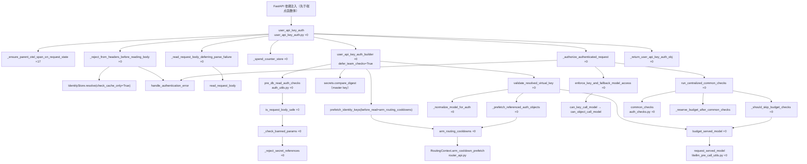
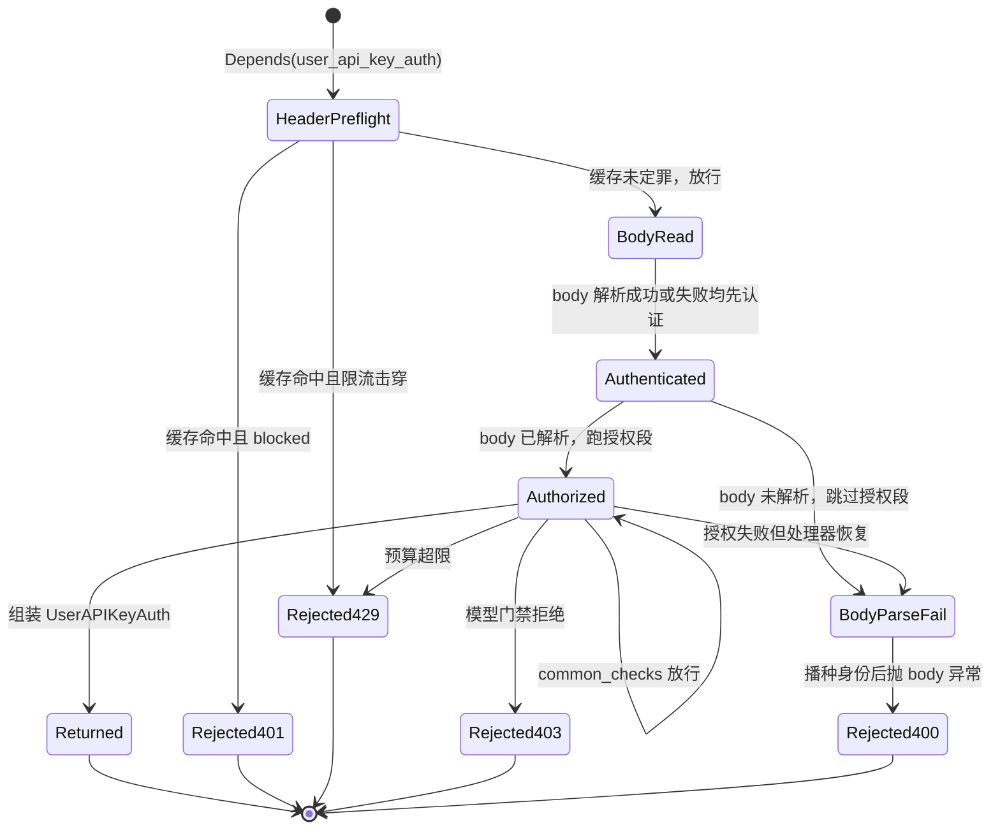

# 函数级解析（二）：鉴权函数

> 所属层级：第四层（函数级解析） | 覆盖主链：第 2 跳（鉴权）涉及的函数
> 本篇基准提交：`411b64dc7a`（工作区当前 HEAD）
> 引用规范：`文件 :: 符号 :: +偏移`，`+0` = 定义行，`+N` = 函数体内第 N 行

本篇逐个展开主链跳 2（鉴权）里出现的函数。第三层《鉴权管线》讲的是「`Authorization: Bearer <key>` 如何一步步变成 `UserAPIKeyAuth`」，本篇讲「每个函数内部具体怎么实现」。鉴权编排为「读 body 前先拒 → 推迟解析地读 body → 构建器（master/JWT/virtual 三岔）→ `_authorize_authenticated_request` → `run_centralized_common_checks`」，下面按函数逐个拆。

术语首现已解释：`virtual key`（proxy 自己签发的 `sk-` 形态 key，对应 DB 里的 `LiteLLM_VerificationToken` 行）、`master key`（proxy 根凭证，等于管理员）、`model group`（router 里的模型组名）、`end user`（调用方在请求体 `user` 字段里声明的最终用户）、`defer_team_checks`（把团队相关校验从构建器推迟到授权段的开关）。

本场景：master key 请求，非流式、单 deployment、无 DB。master key 走构建器最短路径，跳过预算与 DB。

## 本篇覆盖函数与鉴权五段的对应

| 鉴权段 | 本篇展开的函数 |
|---|---|
| 编排入口 | `user_api_key_auth` |
| 读 body 前先拒 | `_reject_from_headers_before_reading_body` |
| 推迟解析地读 body | `_read_request_body_deferring_parse_failure` |
| 预算计数作用域 | `_spend_counter_store` |
| 构建 key 身份（三岔） | `user_api_key_auth_builder`、`pre_db_read_auth_checks`、`validate_resolved_virtual_key`、`_normalize_model_for_auth`、`budget_served_model`、`_prefetch_referenced_auth_objects`、`arm_routing_cooldowns` |
| 授权检查 | `_authorize_authenticated_request`、`enforce_key_and_fallback_model_access`、`run_centralized_common_checks`、`_should_skip_budget_checks` |
| 请求体安全 | `is_request_body_safe`、`_BANNED_REQUEST_BODY_PARAMS`、`_reject_secret_references`、`_check_banned_params` |
| 模型门禁 | `get_model_from_request`、`_handler_selected_model`、`common_checks` |
| 返回与失败出口 | `_return_user_api_key_auth_obj`、`handle_authentication_error` |

---

### `user_api_key_auth`（`litellm/proxy/auth/user_api_key_auth.py`）

- 职责：FastAPI 依赖入口，只做编排——按固定次序调用下面各段函数，产出一个 `UserAPIKeyAuth` 或以 `ProxyException` 终止请求。
- 签名/参数：`async def user_api_key_auth(request: Request, api_key: str = fastapi.Security(api_key_header), azure_api_key_header: str = fastapi.Security(azure_api_key_header), anthropic_api_key_header: str | None = fastapi.Security(anthropic_api_key_header), google_ai_studio_api_key_header: str | None = fastapi.Security(google_ai_studio_api_key_header), azure_apim_header: str | None = fastapi.Security(azure_apim_header), custom_litellm_key_header: str | None = fastapi.Security(custom_litellm_key_header)) -> UserAPIKeyAuth`（`user_api_key_auth :: +0`）。除 `request` 外，通过 `fastapi.Security` 声明六个可选凭证 header，多种云厂商形态的 key 都能从各自 header 进来。`@tracer.wrap()` 装饰（`+(-1)`，绝对行 4760）。
- 返回：`UserAPIKeyAuth`；抛出即代表请求被拒。
- 算法（贴 `user_api_key_auth :: +17` 到 `+76`）：

```python
_ensure_parent_otel_span_on_request_state(request)                       # +17
route: Final[str] = get_request_route(request=request)                   # +19
await _reject_from_headers_before_reading_body(                          # +20
    request=request, api_key=api_key, custom_litellm_key_header=custom_litellm_key_header, route=route)
request_data, body_parse_exception = await _read_request_body_deferring_parse_failure(request=request)  # +23
phase_event("litellm.request.body_parsed")                               # +24
with (phase_span(f"auth {route}"), service_target(AUTH_OBJECTS_TARGET),  # +31
      spend_counter_batch_scope(_spend_counter_store())):                # +33
    try:
        authenticated: Final = await user_api_key_auth_builder(..., defer_team_checks=True)   # +37
    except Exception:                                                    # +48
        if body_parse_exception is not None: raise body_parse_exception
        raise
    settings: Final = _GENERAL_SETTINGS_ADAPTER.validate_python(general_settings)   # +59
    user_api_key_auth_obj: Final = (authenticated.model_copy()           # +60
        if settings.get("access_group_rules") else authenticated)
    user_api_key_auth_obj.budget_reservation = None                      # +63
    user_api_key_auth_obj.agent_caller = agent_caller_from_headers(...)  # +64
    _seed_request_destinations(user_api_key_auth_obj, request)           # +67
    if body_parse_exception is None:                                     # +74
        recovered_auth_obj: Final = await _authorize_authenticated_request(...)   # +75
        if recovered_auth_obj is not None: return recovered_auth_obj     # +82
```

  1. `+17`：建 server span 并挂到 `request.state`，保证坏 body 也有 trace（`_read_request_body` 对非法 JSON 抛 `ProxyException`，没有 span 会让 trace 断掉）。
  2. `+19` 到 `+21`：取路由字符串，跑「读 body 前先拒」（见下节）。
  3. `+23`：推迟解析地读 body，解析失败以值带回，不立即抛。
  4. `+31` 到 `+33`：进 `phase_span` + `service_target(AUTH_OBJECTS_TARGET)` + `spend_counter_batch_scope` 复合 with 块，把整段鉴权的缓存读与花费计数收进同一批。
  5. `+37` 到 `+47`：调构建器，`defer_team_checks=True` 把团队校验推迟到授权段。构建器抛异常时，若 body 解析也失败则改抛 body 异常（`+48` 到 `+54`）——鉴权失败优先于 400 的语义。
  6. `+59` 到 `+67`：按 `access_group_rules` 决定是否 `model_copy()`；清空 `budget_reservation`；`agent_caller_from_headers`；`_seed_request_destinations`。
  7. `+74` 到 `+83`：**只有 body 解析成功才跑授权段** `_authorize_authenticated_request`。一个从未解析成功的 body 没有模型可供门禁，且预算预留会污染只在端点 post-call 释放的 spend 计数器。
  8. `+89` 到 `+92`：退出 with 块后 `seed_request_identity`（身份播种到 baggage，放在 span 关闭后以保证 post-auth span 继承 team/key/user）。
  9. `+96` 到 `+101`：body 解析失败则 `_record_unparsable_body_failure` 后抛出。
  10. `+110` 到 `+113`：`_resolve_request_principal` 投影 caller 身份（失败仅告警，不拒）。
  11. `+114`：返回 `user_api_key_auth_obj`。
- 错误/分支：任一函数抛 `ProxyException`/`HTTPException` 即终止请求；投影身份失败不拒（防御性）。
- 调用关系：调用方 = FastAPI 依赖注入（先于 `chat_completion` 函数体）。被调用方 = `_ensure_parent_otel_span_on_request_state`、`get_request_route`、`_reject_from_headers_before_reading_body`、`_read_request_body_deferring_parse_failure`、`_spend_counter_store`、`user_api_key_auth_builder`、`_authorize_authenticated_request`、`seed_request_identity`、`_record_unparsable_body_failure`、`_resolve_request_principal`。

---

### `_reject_from_headers_before_reading_body`（`litellm/proxy/auth/user_api_key_auth.py`）

- 职责：只凭请求头里的 key，判断能否不读 body 就定罪——已 blocked 的 key 或已击穿限流的 key 直接拒，省掉为大 payload 缓冲 body。
- 签名/参数：`async def _reject_from_headers_before_reading_body(request: Request, api_key: str | None, custom_litellm_key_header: str | None, route: str) -> None`（`_reject_from_headers_before_reading_body :: +0`）。
- 返回：None（放行，交完整鉴权路径）；或抛 `ProxyException`（401 blocked / 429 限流击穿）。
- 算法（贴 `_reject_from_headers_before_reading_body :: +8` 到 `+80`）：

```python
if not RouteChecks.is_llm_api_route(route=route): return        # +8，非 LLM 路由不走预判
configured_header = proxy_server.general_settings_view().get("litellm_key_header_name")   # +16
bearer_token: Final = (get_api_key_from_custom_header(...)      # +17 到 +25，自定义头优先
    if ... else _get_bearer_token_or_received_api_key(custom_litellm_key_header)
    if ... else get_bearer_token(api_key=api_key) if ... else "")
if not bearer_token: return                                     # +26，无凭证交完整路径
hashed_token: Final = hash_token(bearer_token)                  # +28
try:
    cached_key = IdentityStore.key_from_principal(              # +30 到 +34
        await IdentityStore(prisma_client, user_api_key_cache, check_cache_only=True).resolve(hashed_token=hashed_token))
except Exception: return                                        # +35，缓存 miss 走完整鉴权
if cached_key.blocked is True:                                  # +38
    request_data = dict(await _preflight_failure_request_data(request, route, cached_key))
    await UserAPIKeyAuthExceptionHandler.handle_authentication_error(e=ProxyException(...401...), ...)   # +40 到 +55
limiter = proxy_logging_obj.get_proxy_hook("parallel_request_limiter")   # +56
if not isinstance(limiter, PROXY_MaxParallelRequestsHandler_v3): return   # +57 到 +58
await limiter.raise_if_over_limit_before_body(rate_limited)     # +67
# HTTPException → post_call_failure_hook 留日志 → 转 ProxyException 抛出（+68 到 +80）
```

  判据是「只认已在缓存里的 key」：`check_cache_only=True`，缓存 miss 什么都不改变。价值在于对已被限流击穿 key 的并发大 payload 重试，不再每个都把 body 缓冲进内存只为回一个 429。拒绝前用 `_preflight_failure_request_data`（反解模型，最多读 64KB body、1 秒超时，常量 `PREFLIGHT_FAILURE_JSON_BODY_MAX_BYTES :: +0`，绝对行 2243）拼失败请求资料，经 `post_call_failure_hook` 记下 call id、model 与 key 的失败日志。
- 错误/分支：blocked 抛 401；限流击穿抛 429；其余一律放行。
- 调用关系：调用方 = `user_api_key_auth`（`+20`）。被调用方 = `RouteChecks.is_llm_api_route`、`get_bearer_token`、`hash_token`、`IdentityStore.resolve`、`_preflight_failure_request_data`、`UserAPIKeyAuthExceptionHandler.handle_authentication_error`、`limiter.raise_if_over_limit_before_body`。

---

### `_read_request_body_deferring_parse_failure`（`litellm/proxy/auth/user_api_key_auth.py`）

- 职责：读 body 但把解析失败以值带回，让鉴权先跑完（错误响应里能带调用者身份），授权段再决定是否为一个从未解析成功的 body 跑。
- 签名/参数：`async def _read_request_body_deferring_parse_failure(request: Request) -> tuple[dict, ProxyException | None]`（`_read_request_body_deferring_parse_failure :: +0`）。
- 返回：`(request_data: dict, body_parse_exception: ProxyException | None)`。
- 算法（贴 `_read_request_body_deferring_parse_failure :: +10` 到 `+20`）：

```python
if is_opaque_pass_through_request(                       # +10
        route=get_request_route(request=request),
        content_type=safe_get_request_headers(request=request).get("content-type", "")):
    safe_set_request_parsed_body(request=request, parsed_body={})   # +14
    return {}, None
try:
    parsed_body: Final = await read_request_body(request=request)   # +17
except ProxyException as parse_exception:                            # +18
    return {}, parse_exception
return populate_request_with_path_params(request_data=parsed_body, request=request), None   # +20
```

  三条出口：不透明 pass-through 请求直接缓存空 body 返回 `({}, None)`；`read_request_body` 抛 `ProxyException` 时返回 `({}, parse_exception)`；正常路径经 `populate_request_with_path_params` 把路径参数并进 request_data。
- 错误/分支：解析失败不抛，以 `ProxyException | None` 形式带回，交给 `user_api_key_auth` 在身份播种后再抛。
- 调用关系：调用方 = `user_api_key_auth`（`+23`）等 6 处。被调用方 = `is_opaque_pass_through_request`、`get_request_route`、`safe_get_request_headers`、`safe_set_request_parsed_body`、`read_request_body`、`populate_request_with_path_params`。

---

### `_spend_counter_store`（`litellm/proxy/auth/user_api_key_auth.py`）

- 职责：返回 proxy 的跨 pod spend counter 句柄，供预算校验与预留读写。
- 签名/参数：`def _spend_counter_store() -> SpendCounterStore`（`_spend_counter_store :: +0`）。
- 返回：`SpendCounterStore`（`litellm/proxy/proxy_server.py :: spend_counter_store` 进程级单例）。
- 算法（贴 `_spend_counter_store :: +1` 到 `+2`）：

```python
from litellm.proxy.proxy_server import spend_counter_store   # +1，延迟导入避免循环依赖
return spend_counter_store                                   # +2
```

  `user_api_key_auth` 在 `+33` 用 `spend_counter_batch_scope(_spend_counter_store())` 包裹整段鉴权，让预算预留/校验的计数器读写落在同一 batch，一次往返。旧的 `_spend_counter_redis_cache` 符号已删除，统一走本函数。
- 调用关系：调用方 = `user_api_key_auth`（`+33`）。被调用方 = 无（返回既有单例）。

---

### `user_api_key_auth_builder`（`litellm/proxy/auth/user_api_key_auth.py`）

- 职责：三类凭证（master key / JWT / virtual key）的分岔与核心构建，产出「已认证」的 `UserAPIKeyAuth`（团队校验推迟）。
- 签名/参数：`async def user_api_key_auth_builder(request, api_key, azure_api_key_header, anthropic_api_key_header, google_ai_studio_api_key_header, azure_apim_header, request_data, custom_litellm_key_header, defer_team_checks: bool = False) -> UserAPIKeyAuth`（`user_api_key_auth_builder :: +0`）。
- 返回：`UserAPIKeyAuth`（已认证，团队校验未跑）。
- 算法（三岔，偏移相对 `+0`）：

```text
user_api_key_auth_builder
├─ +40  pre_db_read_auth_checks(...)（DB 读前初筛，defer_team_checks 透传）
├─ +74  enterprise_custom_auth 分支 / +94 user_custom_auth 分支（自定义鉴权，返回 _custom_auth_token_for_this_request）
├─ +122 命中 LiteLLMRoutes.public_routes / additional public routes → 返回 INTERNAL_USER_VIEW_ONLY 空对象
├─ +149 enable_oauth2_auth → Oauth2Handler.check_oauth2_token
├─ +154 enable_jwt_auth 且 token 形似 JWT：
│        +189 _resolve_jwt_to_virtual_key（命中返回映射的 virtual key）
│        +239 否则 JWTAuthManager.auth_builder 做 RBAC/scope/custom_validate
├─ +412 master_key is None → 返回 INTERNAL_USER 空对象（未设 master key）
├─ +465 prefetch_identity_keys(..., before_read=arm_routing_cooldowns)（身份预取，并挂冷却预读）
├─ +628 secrets.compare_digest(api_key, master_key) 命中 master key
│        +644 _return_user_api_key_auth_obj（用 LITELLM_PROXY_MASTER_KEY_ALIAS 替真实 key，防进日志/指标）
├─ +674 路由在 master_key_only_routes → 拒绝；+685 配了 master key 但 prisma_client is None → 明确报错
├─ +696 未命中给格式提示（_masked_key 脱敏 f"{api_key[:4]}****{api_key[-4:]}"）
└─ +740 return await validate_resolved_virtual_key(...)   （virtual key 路径进入授权检查链）
```

  master key 用 `secrets.compare_digest`（`+628`）而非 `==`，防时序攻击。virtual key 的命中顺序（构建器内 `get_key_object` 段）：先 `user_api_key_cache.async_get_cache`（内存 + Redis 的 `UserApiKeyCache`），再 `ExperimentalUIJWTToken.get_key_object_from_ui_hash_key()`（UI 会话哈希），都未命中才走 Prisma 查库，查到的 `LiteLLM_VerificationToken` 行字段直接铺进 `UserAPIKeyAuth`。
- 错误/分支：全部异常进入统一 `except`，转 `UserAPIKeyAuthExceptionHandler.handle_authentication_error` 决定 HTTP 映射。
- 调用关系：调用方 = `user_api_key_auth`（`+37`）、`authorize_internal_virtual_key`（`authorize_internal_virtual_key :: +0`，绝对行 5280）。被调用方 = `pre_db_read_auth_checks`、`enterprise_custom_auth`/`user_custom_auth`、`Oauth2Handler.check_oauth2_token`、`jwt_handler.is_jwt`、`_resolve_jwt_to_virtual_key`、`JWTAuthManager.auth_builder`、`prefetch_identity_keys`、`secrets.compare_digest`、`_return_user_api_key_auth_obj`、`validate_resolved_virtual_key`。

---

### `pre_db_read_auth_checks`（`litellm/proxy/auth/auth_utils.py`）

- 职责：DB 读前的初筛——请求大小、body 安全、IP 白名单、路由白名单，把明显违规的请求在查库前挡下。
- 签名/参数：`async def pre_db_read_auth_checks(request, request_data, route, general_settings, prisma_client, user_api_key_cache, defer_team_checks: bool = False, ...)`（`pre_db_read_auth_checks :: +0`）。
- 返回：None（通过）；抛 `HTTPException`（拒绝）。
- 算法（四步）：`check_if_request_size_is_safe` 超 `max_request_size_mb` 拒绝；`is_request_body_safe(..., defer_model_checks=defer_team_checks and llm_router is not None and bool(llm_router.registry().index("team_model")), ...)` 做 body 安全检查；`_check_valid_ip` 按 `allowed_ips` 白名单（`use_x_forwarded_for` 决定是否信任 X-Forwarded-For）；`RouteChecks.is_allowed_on_proxy` 按 `allowed_routes` 白名单。
- 错误/分支：`defer_team_checks=True`（来自 `user_api_key_auth` 调用处 `+37`）把模型 body 校验推迟——本函数只做 size/IP/route，模型 body 校验（含 `_handler_selected_model` 路径参数模型检查）留到 `run_centralized_common_checks` 的 `deferred_model_body_check` 分支补跑。
- 调用关系：调用方 = `user_api_key_auth_builder`（`+40`）。被调用方 = `check_if_request_size_is_safe`、`is_request_body_safe`、`_check_valid_ip`、`RouteChecks.is_allowed_on_proxy`。

---

### `validate_resolved_virtual_key`（`litellm/proxy/auth/user_api_key_auth.py`）

- 职责：已解析 token 的 key 身份侧检查链（模型归一 + auth prefetch + user 预算回填 + 过期/花费检查）。函数头 `noqa: C901` 自述「保持既有共享授权检查顺序」。
- 签名/参数：`async def validate_resolved_virtual_key(request, request_data: dict, valid_token: UserAPIKeyAuth | None, api_key, route, start_time, parent_otel_span, end_user_id, end_user_params, _end_user_object, ...)`（`validate_resolved_virtual_key :: +0`）。
- 返回：校验增强后的 `UserAPIKeyAuth`；抛出即拒绝。
- 算法（偏移相对 `+0`）：

| 偏移 | 动作 |
|---|---|
| `+22` 到 `+23` | `valid_token` 非空则 `_update_key_budget_with_temp_budget_increase` 应用临时预算加成 |
| `+42` 到 `+49` | `valid_token.blocked is True` 抛 `ProxyException` 401 |
| `+49` | `await _normalize_model_for_auth(...)` 模型归一（见下节） |
| `+50` | `await _prefetch_referenced_auth_objects(...)` 预热后续要读的对象（见下节） |
| `+55` 到 `+77` | `user_id` 存在时 `get_user_object` 取 user 行，把 `user.model_max_budget` 回填 `valid_token.user_model_max_budget` |
| `+84` 到 `+94` | user 被 SCIM 停用则抛 401 |
| `+102` | `skip_budget_checks = request_skips_budget_checks(route, model=await budget_served_model(...), ...)`——预算豁免按「服务所用模型」判断 |
| `+111` 到 `+169` | team member 预算（`team_member_spend` 非空时）：先查缓存 `team_membership_auth_cache_key`，未命中查 `LiteLLM_TeamMembership` 回填，`get_current_spend` 读跨 pod 计数器，超预算抛 `BudgetExceededError` |
| `+181` 到 `+186` | token 过期检查（`valid_token.expires < now` → 删缓存 + 抛 401） |
| `+200` 起 | 预算族（`if not skip_budget_checks`）：`virtual_key_max_budget_alert_check` → `virtual_key_max_budget_check` → `virtual_key_soft_budget_check` → key 按模型预算（`_check_key_model_budget_with_fallback`，`_check_key_model_budget_with_fallback :: +0`，绝对行 1155）→ `_check_user_model_budget`（`_check_user_model_budget :: +0`，绝对行 642） |
| 尾段 | `get_team_object` / UI_TEAM_ID 特判 → 组装 `valid_token_dict` → `_return_user_api_key_auth_obj(...)` 返回 |

- 错误/分支：blocked/过期/超预算/模型不可用各自抛对应 `ProxyException`（401/429）。
- 调用关系：调用方 = `user_api_key_auth_builder`（`+740`）。被调用方 = `_update_key_budget_with_temp_budget_increase`、`_normalize_model_for_auth`、`_prefetch_referenced_auth_objects`、`get_user_object`、`request_skips_budget_checks`、`budget_served_model`、`_check_key_model_budget_with_fallback`、`_check_user_model_budget`、`get_team_object`、`_return_user_api_key_auth_obj`。

---

### `_normalize_model_for_auth`（`litellm/proxy/auth/user_api_key_auth.py`）

- 职责：在跑预算/模型门禁前，把请求的 `model` 归一成鉴权应该针对的那个模型，让允许列表按「请求实际路由到的模型组」授权，而不是按客户端写的原始字符串。
- 签名/参数：`async def _normalize_model_for_auth(request_data: dict, valid_token: UserAPIKeyAuth, request: Request | None, route: str) -> None`（`_normalize_model_for_auth :: +0`）。副作用：原地改写 `request_data["model"]`。
- 返回：None。
- 算法（贴 `_normalize_model_for_auth :: +6` 到 `+8`）：

```python
await _normalize_claude_model(request_data, valid_token, request, route)                       # +6
await _resolve_router_settings_model_group_alias(request_data, valid_token, request, route)    # +7
_resolve_codex_native_chatgpt_model(request_data, valid_token, request, route)                 # +8
```

  三步依次：`_normalize_claude_model`（`_normalize_claude_model :: +0`，绝对行 311，Claude Code 路由上的 `claude-router-*` / `[1m]` 模型按 key/team/全局 alias 改写）；`_resolve_router_settings_model_group_alias`（`_resolve_router_settings_model_group_alias :: +0`，绝对行 409，按 `router_settings.model_group_alias` 改写，写 `request.scope[MODEL_GROUP_ALIAS_RESOLVED_SCOPE_KEY]` 防重复、`CLIENT_REQUESTED_MODEL_SCOPE_KEY` 记原始模型）；`_resolve_codex_native_chatgpt_model`（`_resolve_codex_native_chatgpt_model :: +0`，绝对行 455，Codex 原生 `/backend-api/codex/responses` 路由把 body 模型改写为实际服务的 `chatgpt-*` 模型）。
- 调用关系：调用方 = `validate_resolved_virtual_key`（`+49`）、`_authorize_authenticated_request`（`+16` 到 `+18`）、`enforce_key_and_fallback_model_access`（`+13` 到 `+15`）。被调用方 = 上面三个归一函数。

---

### `budget_served_model`（`litellm/proxy/auth/user_api_key_auth.py`）

- 职责：算出「零成本预算豁免判定所针对的模型」——只有客户端自己的 HTTP 请求打到 chat/completions/responses/messages 路由、body `model` 是字符串且已被 alias 解析时，才算出服务所用模型；否则原样返回请求模型。
- 签名/参数：`async def budget_served_model(model: str | Sequence[str] | None, request_data: Mapping[str, object], request: Request | None, llm_router: litellm.Router | None, valid_token: UserAPIKeyAuth) -> str | Sequence[str] | None`（`budget_served_model :: +0`）。
- 返回：服务所用模型名，或原样返回 `model`。
- 算法（贴 `budget_served_model :: +13` 到 `+32`）：

```python
if request is None or llm_router is None or not isinstance(model, str): return model   # +13
if get_request_route_template(request) not in _SERVED_MODEL_BUDGET_WAIVER_ROUTES: return model   # +15
if request.scope.get(MODEL_GROUP_ALIAS_RESOLVED_SCOPE_KEY) is not True or request_data.get("model") != model:
    return model                                                        # +17 到 +18
if "model" in safe_get_request_query_params(request=request) or _inference_model_overridden(): return model   # +19
if not (key_model_aliases_for_auth_check(valid_token) or team_model_aliases_for_auth_check(valid_token)
        or model in litellm.model_alias_map): return model              # +21 到 +23
settings = await proxy_config.get_hierarchical_router_settings(...)     # +27
group_alias = settings.get("model_group_alias") if isinstance(settings, Mapping) else None   # +31
return request_served_model(model, valid_token, group_alias, llm_router)   # +32
```

  `_SERVED_MODEL_BUDGET_WAIVER_ROUTES`（`_SERVED_MODEL_BUDGET_WAIVER_ROUTES :: +0`，绝对行 350）限定只对 chat/completions/responses/messages 路由豁免。最终落到 `request_served_model`（`litellm/proxy/litellm_pre_call_utils.py :: request_served_model :: +0`）。
- 调用关系：调用方 = `_should_skip_budget_checks`（`+18`）、`validate_resolved_virtual_key`（`+102`）。被调用方 = `get_request_route_template`、`_inference_model_overridden`、`key_model_aliases_for_auth_check`、`team_model_aliases_for_auth_check`、`proxy_config.get_hierarchical_router_settings`、`request_served_model`。

---

### `_prefetch_referenced_auth_objects` 与 `arm_routing_cooldowns`（`litellm/proxy/auth/user_api_key_auth.py`）

- 职责：一次把后续校验要读的 user/team/end-user 对象与花费计数器拉进缓存（冷启动时一趟 DB 往返），并把路由冷却预读挂进同一趟往返。
- 签名/参数：`async def _prefetch_referenced_auth_objects(valid_token: UserAPIKeyAuth, end_user_id: str | None, user_api_key_cache: UserApiKeyCache, prisma_client: PrismaClient | None) -> None`（`_prefetch_referenced_auth_objects :: +0`）；`def arm_routing_cooldowns() -> None`（`arm_routing_cooldowns :: +0`）。
- 返回：均 None。
- 算法（贴 `_prefetch_referenced_auth_objects :: +7` 到 `+13`）：

```python
bind_admission_counter_keys(valid_token, end_user_id=end_user_id or None)          # +7
bind_committed_admission_counters(valid_token, end_user_id=end_user_id or None)    # +8
await prefetch_auth_objects(refs=AuthObjectRefs.from_token(valid_token),           # +9
    user_api_key_cache=user_api_key_cache, prisma_client=prisma_client,
    before_read=arm_routing_cooldowns)                                             # +13
```

```python
# arm_routing_cooldowns +5 到 +7
from litellm.proxy.proxy_server import llm_router
if llm_router is not None:
    RoutingContext(llm_router).arm_cooldown_prefetch()      # +7
```

  `before_read=arm_routing_cooldowns` 让冷却读并进 auth prefetch 的原生 MGET 往返。`arm_routing_cooldowns` **仅在 auth prefetch 真正读 Redis 时武装**——从内存命中或被拒的请求不提前读冷却。`RoutingContext.arm_cooldown_prefetch`（`litellm/router_api.py :: RoutingContext :: arm_cooldown_prefetch :: +0`）把路由层冷却预读进 native 往返，与 04 篇的选路冷却共用同一份缓存。
- 调用关系：调用方 = `validate_resolved_virtual_key`（`+50`）；`arm_routing_cooldowns` 被 `prefetch_identity_keys`（构建器 `+465`）与 `_prefetch_referenced_auth_objects`（`+13`）作为 `before_read` 回调。被调用方 = `bind_admission_counter_keys`、`bind_committed_admission_counters`、`prefetch_auth_objects`、`RoutingContext.arm_cooldown_prefetch`。

---

### `_authorize_authenticated_request`（`litellm/proxy/auth/user_api_key_auth.py`）

- 职责：对一个已认证（body 已解析）的请求做授权——禁用路由检查、模型门禁、集中公共检查、end user 回退解析。
- 签名/参数：`async def _authorize_authenticated_request(user_api_key_auth_obj: UserAPIKeyAuth, request: Request, request_data: dict, route: str, api_key: str, *, force_virtual_key_checks: bool = False) -> UserAPIKeyAuth | None`（`_authorize_authenticated_request :: +0`）。
- 返回：检查失败但请求仍可继续时，返回异常处理器恢复的 auth 对象；否则返回 None。
- 算法（贴 `_authorize_authenticated_request :: +15` 到 `+131`）：

```python
RouteChecks.should_call_route(route=route, valid_token=..., request=request)   # +15，禁用路由检查
await _normalize_claude_model(...)                        # +16
await _resolve_router_settings_model_group_alias(...)     # +17
_resolve_codex_native_chatgpt_model(...)                  # +18
try:
    ... customer_hierarchy / access_group grants ...      # +44 到 +72
    key_check_required = getattr(request.state, "requires_key_model_check", False) or force_virtual_key_checks   # +66
    if key_check_required or grants:                      # +69
        await enforce_key_and_fallback_model_access(...)  # +75，模型门禁
    ... admit_managed_actor / managed_agent_policy ...    # +84 到 +110
    await run_centralized_common_checks(                  # +124，集中公共检查
        user_api_key_auth_obj=..., request=..., request_data=authorized_data, route=route, force_virtual_key_checks=...)
except Exception as e:                                    # +131
    return await UserAPIKeyAuthExceptionHandler.handle_authentication_error(e=e, ...)
if user_api_key_auth_obj.end_user_id is None: ... resolve_and_validate_end_user_id ...   # +148 起，end user 回退
return None                                               # +168
```

  关键约束写在注释里：「Single authorization point. Builder paths MUST NOT call common_checks」——构建器各路径一律不得调 `common_checks`，授权只在这里做一次。授权失败经同一个异常处理器包装，保证 `ProxyException` 语义与重构前一致。
- 错误/分支：任何检查抛错都被 `+131` 的 except 捕获交异常处理器；处理器可能返回「可继续」的 auth 对象（此时本函数把它返回给 `user_api_key_auth`）或抛出终止。
- 调用关系：调用方 = `user_api_key_auth`（`+75`）。被调用方 = `RouteChecks.should_call_route`、`_normalize_claude_model`/`_resolve_router_settings_model_group_alias`/`_resolve_codex_native_chatgpt_model`、`resolve_customer_hierarchy`、`access_group_ids_for_identity`、`enforce_key_and_fallback_model_access`、`admit_managed_actor`、`prepare_agent_invocation`、`run_centralized_common_checks`、`resolve_and_validate_end_user_id`、`UserAPIKeyAuthExceptionHandler.handle_authentication_error`。

---

### `enforce_key_and_fallback_model_access`（`litellm/proxy/auth/user_api_key_auth.py`）

- 职责：key 级模型 allowlist 与客户端声明的 fallback 模型门禁。docstring 明确：它**不**在 `common_checks` 里——`common_checks` 只管 team/user/project 的模型访问。
- 签名/参数：`async def enforce_key_and_fallback_model_access(*, valid_token: UserAPIKeyAuth, request_data: dict, route: str, request: Request | None, llm_model_list: list | None, llm_router: litellm.Router | None) -> None`（`enforce_key_and_fallback_model_access :: +0`，全关键字参数）。
- 返回：None（通过）；抛 `ProxyException`（403 模型不可用）。
- 算法（贴 `enforce_key_and_fallback_model_access :: +13` 到 `+34`）：

```python
await _normalize_claude_model(...)                        # +13
await _resolve_router_settings_model_group_alias(...)     # +14
_resolve_codex_native_chatgpt_model(...)                  # +15
config: Final = valid_token.config                        # +16
if config != {}:                                          # +18
    model_list = config.get("model_list", [])
elif isinstance(valid_token.models, list) and "all-team-models" in valid_token.models:
    pass                                                  # +22 到 +23，全放行
else:
    model = _get_model_from_request_context(request_data=request_data, route=route,   # +25 到 +31
        request=request, llm_router=llm_router, team_id=valid_token.team_id)
    if model is not None:
        await can_key_call_model(...)                     # +34，逐条判定 key 能否调用该模型
```

  `can_key_call_model`（`litellm/proxy/auth/auth_checks.py`）底层走 `can_object_call_model`：三层匹配——精确名 → `fnmatch` 通配（`*`、`anthropic/*`）→ model group 展开（alias、通配配置）。请求体里客户端声明的 fallback 模型一并校验，防用「失败后回退」绕过门禁。
- 调用关系：调用方 = `_authorize_authenticated_request`（`+75`）及 responses 端点、`litellm/llms/anthropic/messages/caller_model_checks.py`。被调用方 = 三个归一函数、`_get_model_from_request_context`、`can_key_call_model`。

---

### `run_centralized_common_checks`（`litellm/proxy/auth/user_api_key_auth.py`）

- 职责：在 `user_api_key_auth` 包装边界跑一次 `common_checks`，是模型访问/预算/guardrail/org/vector-store 的唯一收口点。docstring 自述「Run `common_checks` once at the `user_api_key_auth` wrapper」。
- 签名/参数：`async def run_centralized_common_checks(user_api_key_auth_obj, request, request_data: dict, route: str, force_virtual_key_checks: bool = False, sub_call: bool = False)`（`run_centralized_common_checks :: +0`）。
- 返回：None。
- 算法（偏移相对 `+0`）：

| 偏移 | 动作 |
|---|---|
| `+44` 到 `+46` | `deferred_model_body_check` 为真时补跑 `is_request_body_safe`（模型 body 校验在 `pre_db_read_auth_checks` 被 `defer_team_checks=True` 推迟到这里） |
| `+60` 到 `+63` | 公开路由跳过 |
| `+72` 到 `+75` | 无 auth pass-through 跳过 |
| `+83` 到 `+84` | no-auth dev mode（`is_no_auth_dev_mode`）跳过 |
| `+87` 到 `+91` | custom auth 未配 `custom_auth_run_common_checks` 跳过 |
| `+117` 到 `+209` | `asyncio.gather(*fetch_coros, return_exceptions=True)` 并行拉取 team/user/project/end_user/global-spend；`_safe_fetch` 每路隔离异常，无需的路用 `_noop_none` 占位保持元组位置 |
| `+256` | `_inherit_org_identity` |
| `+312` | `_end_user_model_max_budget` |
| `+328` | `skip_budget_checks = await _should_skip_budget_checks(...)` |
| `+369` | `await common_checks(...)`（模型访问/团队/项目/请求体安全/org 的实现体） |
| `+394` 到 `+437` | `_check_team_model_budget`、`_check_team_member_model_budget_with_fallback`、`_check_end_user_model_budget`、`virtual_key_max_budget_check`（sub_call） |
| `+455` | `_reserve_budget_after_common_checks(...)` 预留预算（`budget_reservation` 落到 `request.state`） |
| `+474` | `finally` 释放 spend counter batch |

- 错误/分支：`_safe_fetch` 让单路读取失败不拖垮整体；预算类检查抛 `ProxyException`（429）。
- 调用关系：调用方 = `_authorize_authenticated_request`（`+124`）及 responses/mcp/auto-router 端点。被调用方 = `is_request_body_safe`、`is_no_auth_dev_mode`、`_safe_fetch`/`_noop_none`、`_inherit_org_identity`、`_end_user_model_max_budget`、`_should_skip_budget_checks`、`common_checks`、`_check_team_model_budget`、`_check_team_member_model_budget_with_fallback`、`_check_end_user_model_budget`、`virtual_key_max_budget_check`、`_reserve_budget_after_common_checks`。

---

### `_should_skip_budget_checks`（`litellm/proxy/auth/user_api_key_auth.py`）

- 职责：决定是否跳过预算段（按「服务所用模型」判零成本豁免）。
- 签名/参数：`async def _should_skip_budget_checks(request_data: dict, route: str, request: Request | None, llm_router: litellm.Router | None, valid_token: UserAPIKeyAuth, sub_call: bool = False) -> bool`（`_should_skip_budget_checks :: +0`）。已从同步改为 **async**。
- 返回：`bool`。
- 算法（贴 `_should_skip_budget_checks :: +8` 到 `+18`）：

```python
model: Final = _get_model_from_request_context(          # +8
    request_data=request_data, route=route, request=request, llm_router=llm_router, team_id=valid_token.team_id)
return request_skips_budget_checks(                      # +15
    route=route,
    model=(model if sub_call else await budget_served_model(model, request_data, request, llm_router, valid_token)),
    llm_router=llm_router, request_body=request_data,
    http_method=RouteChecks.get_request_method(request),
)
```

  `sub_call=True` 时直接用当前 model，否则先经 `budget_served_model` 换算成服务所用模型。唯一调用点在 `run_centralized_common_checks`（`+328`，`await`）；`_authorize_authenticated_request` 不直接调它。同步版本调用会漏 `await`，已统一为 async。底层 `request_skips_budget_checks`（`litellm/proxy/auth/auth_checks.py :: request_skips_budget_checks :: +0`，绝对行 1137）、`route_skips_budget_checks`（`route_skips_budget_checks :: +0`，绝对行 1123）。
- 调用关系：调用方 = `run_centralized_common_checks`（`+328`）。被调用方 = `_get_model_from_request_context`、`budget_served_model`、`request_skips_budget_checks`、`RouteChecks.get_request_method`。

---

### 请求体安全：`is_request_body_safe` 族（`litellm/proxy/auth/auth_utils.py`）

- `is_request_body_safe(...)`（`is_request_body_safe :: +0`，绝对行 973）：请求体安全总入口，由 `pre_db_read_auth_checks`（defer 模式）与 `run_centralized_common_checks`（补跑模式）调用，内部统一执行下面两层清洗。
- `_BANNED_REQUEST_BODY_PARAMS`（`_BANNED_REQUEST_BODY_PARAMS :: +0`，绝对行 498）：运行期请求体里禁止客户端携带的凭证/端点字段元组——`api_base`、`base_url` 重定向、AWS 身份选择器、Azure Entra 凭证、Bedrock/S3/SageMaker 端点覆盖、可观测性凭证等。
- `_reject_secret_references(body)`（`_reject_secret_references :: +0`，绝对行 598）：值以 `_SECRET_REFERENCE_PREFIXES`（`_SECRET_REFERENCE_PREFIXES :: +0`，绝对行 592，`os.environ/`、`oidc/`）开头的即拒，secret reference 只允许部署或管理员配置的凭证携带。
- `_check_banned_params(...)`（`_check_banned_params :: +0`，绝对行 770）：统一执行点，禁带参数无管理员 opt-in 即抛 `ValueError`；旧版「调用方带了 `api_key` 就整表放行」的隐式旁路已删除。
- 调用关系：调用方 = `is_request_body_safe` → `_check_banned_params` → `_reject_secret_references`。

---

### 模型解析：`get_model_from_request` 与 `_handler_selected_model`（`litellm/proxy/auth/auth_utils.py`）

- `get_model_from_request(...)`（`get_model_from_request :: +0`，绝对行 2762）：解析请求目标模型，供模型访问与预算检查用。`request_dispatched_to_pass_through_endpoint` 时返回 None（转发 body 的模型不是 LiteLLM 管理模型）；先 `_handler_selected_model` 查 handler 层已解析的模型（Google generateContent 路由的 path 模型、Azure images 路由的 `model`），存在即返回；否则 `_extract_model_candidates_from_request` 从 body/header/query 提候选，`_model_from_route_path` 兜底；Bedrock/Azure/NVIDIA NIM 路由有专用解析覆盖。
- `_handler_selected_model(...)`（`_handler_selected_model :: +0`，绝对行 2833）：优先查 handler 层已解析的模型，避免重复从 body 提取。
- `common_checks(...)`（`litellm/proxy/auth/auth_checks.py :: common_checks :: +0`，绝对行 1152）：`run_centralized_common_checks` 最终调用的实现体，检查项依次为团队是否 blocked、project 是否 blocked、团队/项目能否调用该模型、模型访问组授权、团队/项目预算、end user 预算、是否强制 end user、全局 `litellm.max_budget`、guardrail 改动是否被允许、请求体是否安全、organization 级检查。

---

### `_return_user_api_key_auth_obj`（`litellm/proxy/auth/user_api_key_auth.py`）

- 职责：最终组装返回对象——把 DB 行数据加上请求上下文拼成 `UserAPIKeyAuth`，交给 FastAPI 注入端点函数签名。
- 签名/参数：`async def _return_user_api_key_auth_obj(user_obj, api_key, parent_otel_span, valid_token_dict, route, start_time, ...)`（`_return_user_api_key_auth_obj :: +0`）。
- 返回：`UserAPIKeyAuth`。
- 算法：把 `valid_token_dict` 的字段铺开到 Pydantic 模型，再附加 `request_route`、`parent_otel_span`、per-model 限流映射、`budget_throttle_pct` 等请求上下文。master key 路径传进来的是合成全权限 token（`api_key=LITELLM_PROXY_MASTER_KEY_ALIAS`，见构建器 `+644`/`+647`）。
- 错误/分支：关联对象缺失（user/team 被删）→ 对应 HTTP 异常。
- 调用关系：调用方 = `user_api_key_auth_builder`（master key 路径 `+644`、virtual key 路径经 `validate_resolved_virtual_key` 尾段）。被调用方 = `UserAPIKeyAuth.model_validate`（铺字段）。

---

### `handle_authentication_error`（`litellm/proxy/auth/auth_exception_handler.py`）

- 职责：鉴权异常到 HTTP 状态码的统一翻译出口，被构建器、`_authorize_authenticated_request`、`_reject_from_headers_before_reading_body` 共用。
- 签名：`UserAPIKeyAuthExceptionHandler.handle_authentication_error(e, request, request_data, route, parent_otel_span, api_key, resolved_identity, dispatched_call_type, ...)`（`UserAPIKeyAuthExceptionHandler :: handle_authentication_error :: +0`）。
- 返回：处理后的 auth 对象（可继续）或抛出 `ProxyException`。
- 映射：

| 异常类型 | HTTP |
|---|---|
| `HTTPException`（鉴权抛出） | 原状态码 |
| `ProxyException` | 原状态码 |
| `Exception` | 500，脱敏后返回 |

  构建器里 key 不存在时会给格式提示（`sk-` 前缀、JWT 形态），但代码强调错误类型不能依赖 message 文本判断。
- 调用关系：调用方 = `user_api_key_auth_builder`（统一 except）、`_authorize_authenticated_request`（`+131`）、`_reject_from_headers_before_reading_body`（`+40`）。

---

## 函数调用关系图



## 鉴权主状态流



## 源码索引

| 符号 | 文件 :: 符号 | 绝对定义行 |
|---|---|---|
| 鉴权入口 | `litellm/proxy/auth/user_api_key_auth.py :: user_api_key_auth` | 4761 |
| 读 body 前先拒 | `litellm/proxy/auth/user_api_key_auth.py :: _reject_from_headers_before_reading_body` | 2317 |
| 预判失败请求资料上限 | `litellm/proxy/auth/user_api_key_auth.py :: PREFLIGHT_FAILURE_JSON_BODY_MAX_BYTES` | 2243 |
| 推迟解析的 body 读取 | `litellm/proxy/auth/user_api_key_auth.py :: _read_request_body_deferring_parse_failure` | 2221 |
| 不可解析 body 记录 | `litellm/proxy/auth/user_api_key_auth.py :: _record_unparsable_body_failure` | 2399 |
| spend 计数 store | `litellm/proxy/auth/user_api_key_auth.py :: _spend_counter_store` | 4675 |
| 身份构建器 | `litellm/proxy/auth/user_api_key_auth.py :: user_api_key_auth_builder` | 2494 |
| 自定义鉴权 token | `litellm/proxy/auth/user_api_key_auth.py :: _custom_auth_token_for_this_request` | 2490 |
| key 身份侧检查 | `litellm/proxy/auth/user_api_key_auth.py :: validate_resolved_virtual_key` | 3263 |
| key 按模型预算 | `litellm/proxy/auth/user_api_key_auth.py :: _check_key_model_budget_with_fallback` | 1155 |
| user 预算 | `litellm/proxy/auth/user_api_key_auth.py :: _check_user_model_budget` | 642 |
| 模型归一 | `litellm/proxy/auth/user_api_key_auth.py :: _normalize_model_for_auth` | 486 |
| Claude 模型归一 | `litellm/proxy/auth/user_api_key_auth.py :: _normalize_claude_model` | 311 |
| router 别名归一 | `litellm/proxy/auth/user_api_key_auth.py :: _resolve_router_settings_model_group_alias` | 409 |
| Codex 模型归一 | `litellm/proxy/auth/user_api_key_auth.py :: _resolve_codex_native_chatgpt_model` | 455 |
| 零成本豁免路由表 | `litellm/proxy/auth/user_api_key_auth.py :: _SERVED_MODEL_BUDGET_WAIVER_ROUTES` | 350 |
| 服务所用模型 | `litellm/proxy/auth/user_api_key_auth.py :: budget_served_model` | 374 |
| auth prefetch | `litellm/proxy/auth/user_api_key_auth.py :: _prefetch_referenced_auth_objects` | 4696 |
| 冷却预读武装 | `litellm/proxy/auth/user_api_key_auth.py :: arm_routing_cooldowns` | 4713 |
| 服务所用模型(注入侧) | `litellm/proxy/litellm_pre_call_utils.py :: request_served_model` | 3846 |
| 授权段 | `litellm/proxy/auth/user_api_key_auth.py :: _authorize_authenticated_request` | 4504 |
| 模型门禁 | `litellm/proxy/auth/user_api_key_auth.py :: enforce_key_and_fallback_model_access` | 5045 |
| 集中公共检查 | `litellm/proxy/auth/user_api_key_auth.py :: run_centralized_common_checks` | 3877 |
| 预算豁免开关 | `litellm/proxy/auth/user_api_key_auth.py :: _should_skip_budget_checks` | 4456 |
| 返回对象组装 | `litellm/proxy/auth/user_api_key_auth.py :: _return_user_api_key_auth_obj` | 4878 |
| 临时预算加成 | `litellm/proxy/auth/user_api_key_auth.py :: _update_key_budget_with_temp_budget_increase` | 4972 |
| 服务内部 virtual key | `litellm/proxy/auth/user_api_key_auth.py :: authorize_internal_virtual_key` | 5280 |
| DB 读前初筛 | `litellm/proxy/auth/auth_utils.py :: pre_db_read_auth_checks` | 1234 |
| 请求体安全 | `litellm/proxy/auth/auth_utils.py :: is_request_body_safe` | 973 |
| 禁带参数表 | `litellm/proxy/auth/auth_utils.py :: _BANNED_REQUEST_BODY_PARAMS` | 498 |
| secret 前缀表 | `litellm/proxy/auth/auth_utils.py :: _SECRET_REFERENCE_PREFIXES` | 592 |
| secret 引用拒绝 | `litellm/proxy/auth/auth_utils.py :: _reject_secret_references` | 598 |
| 禁带参数执行 | `litellm/proxy/auth/auth_utils.py :: _check_banned_params` | 770 |
| 请求模型解析 | `litellm/proxy/auth/auth_utils.py :: get_model_from_request` | 2762 |
| handler 模型解析 | `litellm/proxy/auth/auth_utils.py :: _handler_selected_model` | 2833 |
| 公共检查实现 | `litellm/proxy/auth/auth_checks.py :: common_checks` | 1152 |
| 预算豁免判定 | `litellm/proxy/auth/auth_checks.py :: request_skips_budget_checks` | 1137 |
| 路由预算豁免 | `litellm/proxy/auth/auth_checks.py :: route_skips_budget_checks` | 1123 |
| 凭证对象类型 | `litellm/types/proxy/auth/user_api_key_auth.py :: UserAPIKeyAuth` | 132 |

## 未确认项

- `user_api_key_auth_builder` 内 JWT 分支（`_resolve_jwt_to_virtual_key`、`JWTAuthManager.auth_builder`）与 OAuth2 分支的逐行实现未读取，本篇只描述分岔判据（`+154`/`+189`/`+239`）与结论。
- `run_centralized_common_checks` 到 `common_checks` 之间的中间调用层未逐行读完，检查项清单转写自 `common_checks` docstring，属 `[推断]`：两者检查项一致，但中间可能还有一层参数整形。
- `handle_authentication_error` 内部状态码映射逐行未读取，本篇只给三类异常的映射结果。
- `common_checks`、`can_object_call_model`、`can_key_call_model`、`prefetch_auth_objects`、`resolve_and_validate_end_user_id` 的函数体未逐行读取，本篇只引用职责与调用点。
- 预算族各检查函数（`virtual_key_max_budget_check` 等）在 `validate_resolved_virtual_key` 内的具体偏移未逐行核对，本篇只给区间（`+200` 起）。