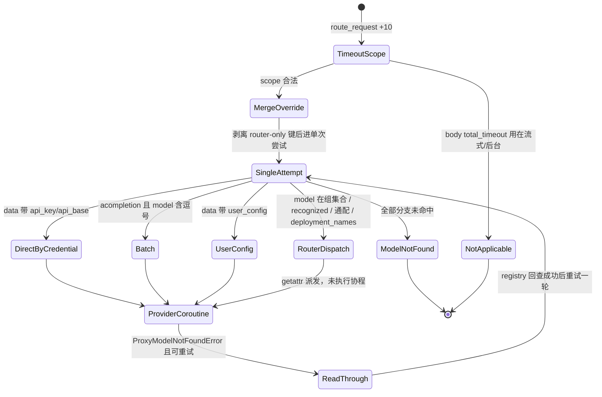

# 函数级解析（三）：代理层路由与 pre-call 注入

> 所属层级：第四层（函数级解析） | 覆盖主链：第 4-6 跳（pre-call 加工与代理层路由决策）涉及的函数
> 本篇基准提交：`411b64dc7a`（工作区当前 HEAD）
> 引用规范：`文件 :: 符号 :: +偏移`，`+0` = 定义行，`+N` = 函数体内第 N 行

本篇逐个展开主链跳 5（pre-call 加工）与跳 6 前半（代理层路由决策）里出现的函数。第三层《Pre-call 处理与代理层路由决策》讲的是「每一跳发生了什么、决策树长什么样」，本篇讲「每个函数内部具体怎么实现」：`route_request` 的稳定入口、`_route_request_single_attempt` 的完整决策树、参数门禁三件套、router 设置覆盖合并，以及 `litellm/proxy/litellm_pre_call_utils.py` 里的网关数据注入与 served-model 别名族。

术语首现已解释：`model group`（router 里的模型组名，一个组可挂多个 deployment）、`router-only 设置`（只对 router 有意义、不能透传给 provider 的参数，如 `fallbacks`、`num_retries`）、`read-through`（模型不在 registry 时回查一次 proxy 全局 router 再重试）、`served model`（请求经全部别名改写后真正发送到的 model group 名）。

本场景：`model="gpt-4o-mini"` 在 `model_list` 里，所以在 `router_model_names`（组集合）里，决策树直接走到组集合命中的 `getattr` 派发，返回未执行的 `Router.acompletion(**data)` 协程。

## 本篇覆盖函数与主链跳的对应

| 主链跳 | 本篇展开的函数 |
|---|---|
| 跳 5 pre-call 注入 | `add_litellm_data_to_request`、served-model 别名族、`without_credential_headers`、`resolve_tenant_otel_destinations`、`get_tenant_logging_metadata`、`add_headers_to_llm_call_by_model_group` |
| 跳 6 前半 路由入口 | `route_request`、`enforce_total_timeout_scope`、`_merge_router_settings_override` |
| 跳 6 前半 路由决策 | `_route_request_single_attempt`、`raise_if_required_body_param_missing`、`_find_missing_required_body_param`、`raise_if_mock_testing_params_disallowed`、`add_shared_session_to_data`、`_route_user_config_request` |

---

### `route_request`（`litellm/proxy/route_llm_request.py`）

- 职责：代理层路由的稳定入口——超时作用域校验 + 合并 per-request 设置 + 单次尝试 + 模型未找到时的 read-through 重试。它只负责「选函数」，不执行任何 LLM 调用。
- 签名/参数：`async def route_request(data: dict, llm_router: LitellmRouter | None, user_model: str | None, route_type: RouteType, user_api_key_dict: UserAPIKeyAuth | None = None)`（`route_request :: +0`）。
- 返回：**未 await 的调用协程**（`llm_router.acompletion(**data)` 等），由调用方 `_process_llm_request` 包成 task 执行。
- 算法（贴 `route_request :: +10` 到 `+37`）：

```python
enforce_total_timeout_scope(data)                     # +10
router_only_settings_from_override: Final = _merge_router_settings_override(data)   # +11
try:
    return await _route_request_single_attempt(       # +13
        data=data, llm_router=llm_router, user_model=user_model, route_type=route_type,
        router_only_settings_from_override=router_only_settings_from_override,
        user_api_key_dict=user_api_key_dict,
    )
except (ProxyModelNotFoundError, ProxyMissingParamWithoutLoadedModelError) as e:   # +21
    requested_model: Final = data.get("model", "")
    if ((isinstance(e, ProxyModelNotFoundError) and not e.retryable_with_model_read_through)
            or not isinstance(requested_model, str) or not requested_model):
        raise                                         # +25 到 +26，不可重试或没有 model 名
    from litellm.proxy.common_utils.registry_read_through import model_registry_read_through
    if not await model_registry_read_through.attempt(requested_model):   # +34，read-through 失败
        raise
    return await _route_request_single_attempt(       # +36，用 proxy_server.llm_router 重试一次
        data=data, llm_router=proxy_server.llm_router, ..., route_type=route_type,
        router_only_settings_from_override=router_only_settings_from_override,
        user_api_key_dict=user_api_key_dict,
    )
```

  三个动作：`+10` `enforce_total_timeout_scope(data)`（`litellm/litellm_core_utils/total_deadline.py :: enforce_total_timeout_scope :: +0`）把「body `total_timeout` 用在流式/后台请求」判为不适用；`+11` `_merge_router_settings_override` 剥走客户端 per-request router 设置并返回被覆盖的键集合；`+13` 进单次尝试。`+21` 起的 except 只在「错误可 read-through 重试、有 model 名、read-through 成功」三条件齐备时，用刷新后的 `proxy_server.llm_router` 重试一轮。
- 错误/分支：`ProxyModelNotFoundError`/`ProxyMissingParamWithoutLoadedModelError` 可重试时重试一次，否则上抛到端点层 `handle_llm_api_exception` 归一。
- 调用关系：调用方 = `_process_llm_request`（`_process_llm_request :: +86`）及众多端点。被调用方 = `enforce_total_timeout_scope`、`_merge_router_settings_override`、`_route_request_single_attempt`、`model_registry_read_through.attempt`。

---

### `_route_request_single_attempt`（`litellm/proxy/route_llm_request.py`）

- 职责：完整路由决策树，先匹配先返回，产出未执行的 provider 协程。
- 签名/参数：`async def _route_request_single_attempt(data, llm_router, user_model, route_type, router_only_settings_from_override: frozenset[str], user_api_key_dict) -> Coroutine`（`_route_request_single_attempt :: +0`，头带 `# noqa: ANN202`——返回未 await 协程，推断联合类型只为让 `route_request` 的调用方可类型化）。
- 返回：未执行的协程（`getattr(llm_router, route_type)(**data)` / `getattr(litellm, route_type)(**direct_litellm_kwargs())` / `abatch_completion(...)` 等）。
- 前置三步（贴 `_route_request_single_attempt :: +8` 到 `+14`）：

```python
raise_if_required_body_param_missing(route_type=route_type, data=data, llm_router=llm_router)   # +8
await add_shared_session_to_data(data)                 # +10
raise_if_mock_testing_params_disallowed(data, allowed=mock_testing_params_allowed())   # +12
def direct_litellm_kwargs() -> Mapping[str, object]:   # +14（内嵌函数）
    ... # JSON_OBJECT_ADAPTER 校验后剔除 router_only_settings_from_override 键，包成只读视图
team_id = ...                                          # +23
router_model_names: Final = llm_router.registry().names(kind="group_set") if llm_router is not None else []   # +24
is_proxy_admin_without_team: Final = team_id is None and is_proxy_admin_request(data)   # +25
```

  决策树（按源码顺序，先匹配先返回，偏移相对 `+0`）：

```text
data 里有 api_key 或 api_base？                      +32 到 +36（+34 router / +36 litellm 直连）
├─ route_type=acompletion 且 model 含逗号（批量）    +38 到 +50
│    fastest_response → abatch_completion_fastest_response（+47）
│    否则拆模型列表 → abatch_completion(models=...)（+50）
├─ data 里有 user_config（自带 router 配置）          +52 到 +53 → _route_user_config_request
└─ llm_router 存在？                                   +55
   ├─ Google GenAI 特判（generationConfig → config）  +28（前置）
   ├─ evals / container / interactions / managed agents 路由 → 部分 litellm 直连、部分 router
   ├─ 无 model 的团队 vector store 文件 / skill / video / aingest 路由 → litellm 直连
   ├─ data 里没 model → 抛 ProxyMissingRequiredParamError
   ├─ team_model 命中（team_id 非空且 registry 解析到）→ 改写 data["model"] 后 router 调用  +186 到 +188
   ├─ proxy admin 无 team 命中 team_public，或 model 被 registry 认可 → router 调用          +192 到 +194
   └─ model 不在 router_model_names（组集合）里：      +196
      ├─ pass_through_all_models → litellm 直连        +200
      ├─ 有 default_deployment 或通配 patterns → router 调用   +205
      ├─ model 在 deployment_names 里 → router 调用（specific_deployment=True）+207 到 +208
      ├─ 容器/video/a2a 等特例路由                     +217 到 +264
      └─ 其余 → 抛 ProxyModelNotFoundError             +271
```

  组集合命中的派发（贴 `_route_request_single_attempt :: +192` 到 `+194`）：

```python
elif (
    is_proxy_admin_without_team
    and data["model"] not in router_model_names
    and data["model"] in llm_router.registry().names(kind="team_public")
) or (data["model"] is not None and llm_router.registry().resolve(data["model"], kind="recognized")):
    return getattr(llm_router, f"{route_type}")(**data)      # +194
```

  对本场景：`model="gpt-4o-mini"` 在组集合里，上面「不在组集合」的整个 `elif`（`+196`）跳过，直接走到组集合命中的 `getattr(llm_router, f"{route_type}")(**data)`。`getattr` 派发是运行时边界：静态分析到此为止，真正被调的是 `Router.acompletion`。
- 错误/分支：模型不在任何组/通配/deployment_names → `ProxyModelNotFoundError`（`+271`，404 语义的 `HTTPException` 子类，带 `retryable_with_model_read_through`）。
- 调用关系：调用方 = `route_request`（`+13`、`+36`）。被调用方 = `raise_if_required_body_param_missing`、`add_shared_session_to_data`、`raise_if_mock_testing_params_disallowed`、`direct_litellm_kwargs`（内嵌）、`_route_user_config_request`、`llm_router.registry()`、`llm_router.settings()`、`getattr(llm_router|litellm, route_type)`。

---

### `raise_if_required_body_param_missing`（`litellm/proxy/route_llm_request.py`）

- 职责：route_type 对应的必需参数缺失时提前 400，别等到 provider 报错。
- 签名/参数：`def raise_if_required_body_param_missing(route_type: str, data, llm_router)`（`raise_if_required_body_param_missing :: +0`）。
- 返回：None（放行）；抛带明确 param 名的 `ProxyException`（400）。
- 算法：`missing_param = _find_missing_required_body_param(route_type, data, llm_router)`；为 None 放行；否则按 `model_deployments_loaded` 选错误类——已加载部署时抛 `ProxyMissingRequiredParamError`，否则抛 `ProxyMissingParamWithoutLoadedModelError`（可触发 read-through 重试）。
- 调用关系：调用方 = `_route_request_single_attempt`（`+8`）。被调用方 = `_find_missing_required_body_param`。

---

### `_find_missing_required_body_param`（`litellm/proxy/route_llm_request.py`）

- 职责：按四张表逐级判断缺哪个必需参数。
- 签名/参数：`def _find_missing_required_body_param(route_type: str, data: Mapping[str, object], llm_router: LitellmRouter | None) -> MissingBodyParam | None`（`_find_missing_required_body_param :: +0`）。
- 返回：`MissingBodyParam`（含 `name` 与 `model_deployments_loaded`）或 `None`。
- 算法（贴 `_find_missing_required_body_param :: +6` 到 `+38`）：

```python
one_of_params = REQUIRED_ONE_OF_BODY_PARAMS_BY_ROUTE.get(route_type)          # +6
if one_of_params is not None and all(data.get(param) is None for param in one_of_params):
    return MissingBodyParam(name=one_of_params[0], model_deployments_loaded=True)   # +7 到 +8
missing_merge_base_param = next((param for param in REQUIRED_BODY_PARAMS_BY_ROUTE.get(route_type, ())
    if data.get(param) is None), None)                                         # +9 到 +12
if missing_merge_base_param is not None:
    return MissingBodyParam(name=missing_merge_base_param, model_deployments_loaded=True)   # +13 到 +14
alternatives = BODY_PARAM_ALTERNATIVES_BY_ROUTE.get(route_type, {})           # +15
missing_present_params = tuple(param for param in REQUIRED_PRESENT_BODY_PARAMS_BY_ROUTE.get(route_type, ())
    if param not in data and not any(alt in data for alt in alternatives.get(param, ())))   # +16 到 +20
if not missing_present_params: return None                                    # +21 到 +22
candidate_litellm_params = _candidate_deployment_litellm_params(data, llm_router)   # +23
router_default_litellm_params = _router_default_litellm_params(...)           # +24 到 +26
missing_param = next((param for param in missing_present_params
    if router_default_litellm_params.get(param) is None and (...)), None)      # +27 到 +37
```

  四张表：`REQUIRED_ONE_OF_BODY_PARAMS_BY_ROUTE`（one-of，如 `acreate_interaction` 的 model/agent）、`REQUIRED_BODY_PARAMS_BY_ROUTE`（`REQUIRED_BODY_PARAMS_BY_ROUTE :: +0`，绝对行 242，必需，如 acompletion 的 messages）、`REQUIRED_PRESENT_BODY_PARAMS_BY_ROUTE`（键须存在）、`BODY_PARAM_ALTERNATIVES_BY_ROUTE`（`BODY_PARAM_ALTERNATIVES_BY_ROUTE :: +0`，绝对行 282，替代键，如 `avector_store_search` 的 query 可用 query_image 替代、`acreate_interaction` 的 input 可用 continuation_token 替代）。后两段还考虑「deployment 默认参数能补上就不算缺」。
- 调用关系：调用方 = `raise_if_required_body_param_missing`。被调用方 = 四张表、`_candidate_deployment_litellm_params`、`_router_default_litellm_params`。

---

### `raise_if_mock_testing_params_disallowed`（`litellm/proxy/route_llm_request.py`）

- 职责：门禁 mock 参数——客户端传 `mock_testing_*` / `mock_timeout` / `mock_delay` 时默认拒绝，保证「请求要合成失败却返回成功」这种假绿不会出现。
- 签名/参数：`def raise_if_mock_testing_params_disallowed(data: Mapping[str, object], *, allowed: bool) -> None`（`raise_if_mock_testing_params_disallowed :: +0`）。
- 返回：None（放行）；抛 `MockTestingParamsDisabledError`（`MockTestingParamsDisabledError :: +0`，绝对行 485，400，消息指引管理员开 `MOCK_TESTING_CONFIG_KEY`）。
- 算法：`allowed` 为真（`mock_testing_params_allowed()` 读到 `general_settings.dangerously_allow_mock_testing_request_params`）即放行；否则 `present = tuple(name for name in GATED_MOCK_PARAM_NAMES if name in data)`，非空则抛。
- 调用关系：调用方 = `_route_request_single_attempt`（`+12`）。被调用方 = `GATED_MOCK_PARAM_NAMES`（`GATED_MOCK_PARAM_NAMES :: +0`，绝对行 40，含 `mock_testing_fallbacks`/`mock_testing_context_fallbacks`/`mock_testing_content_policy_fallbacks`/`mock_testing_rate_limit_error`/`mock_timeout`/`mock_delay`）。该清单与 `litellm/types/router.py :: MockRouterTestingParams` 由测试 `test_gated_mock_params_cover_mock_router_testing_params` 锁同步。

---

### `add_shared_session_to_data`（`litellm/proxy/route_llm_request.py`）

- 职责：把共享 aiohttp 会话注入 data，连接复用防冷启动。
- 签名/参数：`async def add_shared_session_to_data(data: dict) -> None`（`add_shared_session_to_data :: +0`）。
- 返回：None（原地写 `data["aiohttp_session"]`）。
- 算法：取 proxy 进程级共享 aiohttp 会话写入 data，供 litellm 直连分支复用连接池。
- 调用关系：调用方 = `_route_request_single_attempt`（`+10`）。

---

### `_merge_router_settings_override`（`litellm/proxy/route_llm_request.py`）

- 职责：从 data 剥离客户端覆盖的 per-request router 设置，把覆盖值合并回 data，并返回「被覆盖且属于 router-only」的键集合。
- 签名/参数：`def _merge_router_settings_override(data: dict) -> frozenset[str]`（`_merge_router_settings_override :: +0`，参数行标注 `# mutable-ok: route_request mutates the shared request body in place`）。
- 返回：`frozenset[str]`——被覆盖且属于 `_ROUTER_ONLY_SETTINGS` 的键名集合。
- 算法（贴 `_merge_router_settings_override :: +3` 到 `+34`）：

```python
data.pop("enable_tag_filtering", None)                 # +3
drop_params = litellm.drop_params is True or normalize_drop_params(data.get("drop_params")) is True   # +4
adapter = _JSON_OBJECT_OR_DROPPED_ADAPTER if drop_params else _OPTIONAL_JSON_OBJECT_ADAPTER   # +5 到 +6
router_settings_override = adapter.validate_python(data.pop("router_settings_override", None))   # +9 到 +10
# ValidationError → 抛 400 ProxyException("router_settings_override must be a JSON object.")   # +14 到 +16
if "user_config" in data and data["user_config"] is None: data.pop("user_config")   # +19 到 +20
user_config = adapter.validate_python(data.get("user_config"))   # +21
router_settings_from_override = {key: router_settings_override[key]     # +24 到 +30
    for key in _PER_REQUEST_ROUTER_SETTINGS
    if router_settings_override.get(key) is not None
    and (user_config is None or key not in user_config)}
data.update(router_settings_from_override)             # +33
return _ROUTER_ONLY_SETTINGS.intersection(router_settings_from_override)   # +34
```

  只有 `_PER_REQUEST_ROUTER_SETTINGS`（`_PER_REQUEST_ROUTER_SETTINGS :: +0`，绝对行 59：`fallbacks`/`context_window_fallbacks`/`content_policy_fallbacks`/`num_retries`/`timeout`/`model_group_retry_policy`/`routing_strategy`/`enable_tag_filtering`）里的键、且 data/user_config 未自带时，才从 override 合并。`_ROUTER_ONLY_SETTINGS`（`_ROUTER_ONLY_SETTINGS :: +0`，绝对行 69）是其子集（`fallbacks`/`context_window_fallbacks`/`content_policy_fallbacks`/`model_group_retry_policy`）——这些键绝不能透传给 SDK。
- 错误/分支：`router_settings_override` 不是 JSON 对象 → 400；`drop_params` 为真时用容错 adapter 丢弃非法字段而非报错。
- 调用关系：调用方 = `route_request`（`+11`）。被调用方 = `_PER_REQUEST_ROUTER_SETTINGS`、`_ROUTER_ONLY_SETTINGS`、`normalize_drop_params`、`_JSON_OBJECT_OR_DROPPED_ADAPTER`/`_OPTIONAL_JSON_OBJECT_ADAPTER`。

---

### `_route_user_config_request`（`litellm/proxy/route_llm_request.py`）

- 职责：请求自带 router 配置（`user_config`）时，用它构造一个临时 cached router 再派发，不污染 proxy 全局 router。
- 签名/参数：`async def _route_user_config_request(data: dict, route_type: str)`（`_route_user_config_request :: +0`）。
- 返回：临时 router 上的调用协程。
- 算法：从 `data["user_config"]` 构造 `Router` 实例（复用 `router_arguments`），缓存复用，再 `getattr(cached_router, route_type)(**{**data, "litellm_logging_obj": logging_obj})`。
- 调用关系：调用方 = `_route_request_single_attempt`（`+53`）。被调用方 = `Router` 构造、`router_arguments`（`litellm/router.py :: router_arguments :: +0`）。

---

### 路由错误类型：`ProxyModelNotFoundError` 与 `ProxyMissingParamWithoutLoadedModelError`（`litellm/proxy/route_llm_request.py`）

- `ProxyModelNotFoundError`（`ProxyModelNotFoundError :: +0`，绝对行 234）：`HTTPException` 子类，`__init__` 内抛 400 `HTTPException`，带 `retryable_with_model_read_through` 标志决定 `route_request` 是否 read-through 重试。模型不在任何组/通配/deployment_names 时由 `_route_request_single_attempt`（`+271`）抛出。
- `ProxyMissingParamWithoutLoadedModelError`（`ProxyMissingParamWithoutLoadedModelError :: +0`，绝对行 314）：`ProxyMissingRequiredParamError` 子类，缺参且模型未加载 → 触发 read-through 重试。
- 调用关系：两者都被 `route_request` 的 except（`+21`）捕获分类。

---

### 模块级常量与类型（`litellm/proxy/route_llm_request.py`）

| 名 | 位置 | 作用 |
|---|---|---|
| `GATED_MOCK_PARAM_NAMES` | `GATED_MOCK_PARAM_NAMES :: +0`（40 行） | mock 参数门禁清单 |
| `_PER_REQUEST_ROUTER_SETTINGS` | `_PER_REQUEST_ROUTER_SETTINGS :: +0`（59 行） | 允许 per-request 覆盖的 router 设置 |
| `_ROUTER_ONLY_SETTINGS` | `_ROUTER_ONLY_SETTINGS :: +0`（69 行） | 绝不透传给 SDK 的键（上者子集） |
| `ProxyModelNotFoundError` | `ProxyModelNotFoundError :: +0`（234 行） | 400 语义路由错误，带 `retryable_with_model_read_through` |
| `REQUIRED_BODY_PARAMS_BY_ROUTE` | `REQUIRED_BODY_PARAMS_BY_ROUTE :: +0`（242 行） | 必需参数表 |
| `BODY_PARAM_ALTERNATIVES_BY_ROUTE` | `BODY_PARAM_ALTERNATIVES_BY_ROUTE :: +0`（282 行） | 必需参数的替代键表 |
| `ProxyMissingParamWithoutLoadedModelError` | `ProxyMissingParamWithoutLoadedModelError :: +0`（314 行） | 缺参且模型未加载 → read-through 重试 |
| `MockTestingParamsDisabledError` | `MockTestingParamsDisabledError :: +0`（485 行） | mock 参数被门禁拒绝的 400 |
| `add_shared_session_to_data` | `add_shared_session_to_data :: +0`（551 行） | 共享 aiohttp 会话注入 |

两文件均为纯函数风格：`data` 是显式的共享可变 dict（代码用 `# mutable-ok: request body is the proxy-wide mutable dict contract` 自我标注），除它之外没有全局可变状态。

---

### `add_litellm_data_to_request`（`litellm/proxy/litellm_pre_call_utils.py`）

- 职责：把网关掌握的一切注入请求——身份、头、call id、oauth、缓存控制，并剥离客户端伪造的内部键。防伪造是它的核心设计。
- 签名/参数：`async def add_litellm_data_to_request(data: dict, request: Request, user_api_key_dict: UserAPIKeyAuth, proxy_config, general_settings, version, ...)`（`add_litellm_data_to_request :: +0`）。
- 返回：增强后的 `data`（原位改 + 回绑）。
- 算法（前半，贴 `add_litellm_data_to_request :: +29` 到 `+52`）：

```python
_allow_client_mock_response = _key_or_team_allows_client_mock_response(user_api_key_dict)   # +29
for _internal_key in _UNTRUSTED_ROOT_CONTROL_FIELDS:      # +31
    if _allow_client_mock_response and _internal_key in _CLIENT_MOCK_CONTROL_FIELDS: continue
    data.pop(_internal_key, None)
_reject_url_valued_destinations(data)                     # +35
_raw_metadata_by_field = {_metadata_field: _DECODED_JSON.validate_python(data.pop(_metadata_field))   # +36 到 +39
    for _metadata_field in ("metadata", "litellm_metadata") if data.get(_metadata_field) is not None}
data.update(_normalized_metadata_by_field)                # +45，metadata 归一后写回
_user_metadata = data.get("metadata")                     # +48
if isinstance(_user_metadata, dict):
    for _mk in list(_user_metadata.keys()):               # +50
        if _mk.startswith("user_api_key_"): del _user_metadata[_mk]   # +51 到 +52
```

  三段防御：`+31` 到 `+34` 清掉客户端伪造的内部控制键（`_UNTRUSTED_ROOT_CONTROL_FIELDS`，mock/redaction 控制字段按 key/team 权限例外）；`+35` 拒掉把 OTel destination 写成 URL 型的尝试；`+50` 到 `+52` 删除客户端 metadata 里以 `user_api_key_` 开头的键——这些键是网关身份注入区，客户端不得自己写（跳 3 注入的值是最终值）。`+36` 到 `+45` 把 `metadata` 与 `litellm_metadata` 两个字段都归一（JSON 字符串也解析）。
- 算法（后半，按源码顺序）：

| 偏移/符号 | 动作 |
|---|---|
| `+54` | `_raw_headers = RedactedDict(safe_get_request_headers(request))` |
| `+61` | `_headers = clean_headers(...)`（`clean_headers :: +0`，绝对行 1567，按 `litellm_key_header_name` 与 `forward_llm_provider_auth_headers` 清洗） |
| `+76` | `_logging_safe_headers = redact_credential_headers(...)`（脱敏，进日志） |
| `+85` | `forward_llm_auth` 且头带 `x-api-key` → `data["api_key"] = _headers["x-api-key"]`（覆盖部署 key） |
| `+104` 到 `+111` | `arrival_time` 优先取 `request.state.litellm_received_at`（鉴权入口盖的章，故 queue time 窗口含整个鉴权阶段，只走过 `user_api_key_auth` 的调用方才退回 `time.time()`）；组装 `data["proxy_server_request"]`（url、method、`_logging_safe_headers`、credential_fields、`arrival_time`） |
| `+115` 到 `+117` | `_metadata_variable_name = get_metadata_variable_name(...)` 定位 metadata 变量名 |
| `+128` | `add_litellm_metadata_from_request_headers(...)` |
| 尾段各步骤 | `add_otel_trace_id_to_request`（父 span 透传）、`data["secret_fields"] = SecretFields(raw_headers=...)`（供 SecretManager 类回调，不进日志）、`query_dict.get("api-version")` → `data["api_version"]`（动态 Azure api version）、`add_provider_specific_headers_to_request`（OAuth token 交换后的 provider 专有头）、Cache-Control 头 `s-maxage` → `data["ttl"]`、`add_headers_to_llm_call_by_model_group`（`add_headers_to_llm_call_by_model_group :: +0`，绝对行 1889，按 model_group 转发头）、`get_user_from_headers` → `data["user"]`、二次剥 `user_api_key_*`（JSON 字符串 metadata 此时已变 dict，`+49` 的 isinstance 守卫才拦得住）、`_strip_client_pricing_overrides`、`strip_client_guardrail_information`、`_strip_client_callback_credentials`、`refresh_proxy_server_request_body_snapshot`（清洗后才填 body 快照，保证审计/记账看到干净 metadata）、`litellm_metadata` 合并进 metadata、`add_user_api_key_auth_to_request_metadata`、`litellm_api_version = version`、`global_max_parallel_requests`、`add_key_level_controls`、`add_team_and_project_level_controls`、`inherited_tags`（tag 策略合并，防伪造） |

- 错误/分支：无显式抛错；所有清洗都是「能剥就剥、能归一就归一」，保证 data 可直接交给 Router/SDK。
- 调用关系：调用方 = `common_processing_pre_call_logic`（`common_processing_pre_call_logic :: +124`）。被调用方 = `_reject_url_valued_destinations`（`_reject_url_valued_destinations :: +0`，绝对行 571）、`clean_headers`、`redact_credential_headers`、`safe_get_request_headers`、`get_metadata_variable_name`、`LiteLLMProxyRequestSetup.add_litellm_metadata_from_request_headers`、`add_otel_trace_id_to_request`、`add_headers_to_llm_call_by_model_group`、`refresh_proxy_server_request_body_snapshot`、`add_user_api_key_auth_to_request_metadata`、`add_key_level_controls`、`add_team_and_project_level_controls`。

---

### served-model 别名族（`litellm/proxy/litellm_pre_call_utils.py`）

这一族供 auth 层按「服务所用模型」核对预算，也供 pre-call 把 model 归一到真正发送的 model group。均为纯函数，按别名改写顺序组合：

| 函数 | 定义 | 作用 |
|---|---|---|
| `team_alias_target(model, user_api_key_dict, llm_router)` | `team_alias_target :: +0`（3740 行） | 查 `user_api_key_dict.team_model_aliases`，返回团队别名改写后的目标；含陈旧别名告警与 `LITELLM_ENABLE_TEAM_STALE_ALIAS_BYPASS` 旁路 |
| `key_alias_target(model, user_api_key_dict)` | `key_alias_target :: +0`（3819 行） | key 级别名改写，未命中返回原 model |
| `caller_alias_target(model, user_api_key_dict, llm_router)` | `caller_alias_target :: +0`（3828 行） | 团队别名后再 key 别名——`add_litellm_data_to_request` 之后请求体留下的 model |
| `global_then_key_alias_target(model, user_api_key_dict)` | `global_then_key_alias_target :: +0`（3834 行） | 全局 `model_alias_map` 后再 key 别名——`common_processing_pre_call_logic` 之后留下的 model |
| `pre_call_served_model(model, user_api_key_dict, model_group_alias)` | `pre_call_served_model :: +0`（3840 行） | `global_then_key_alias_target` 后再 `resolve_model_group_alias`——pre-call 发送所到的 model group |
| `request_served_model(model, user_api_key_dict, model_group_alias, llm_router)` | `request_served_model :: +0`（3846 行） | `caller_alias_target` 后再 `pre_call_served_model`——body 命名 model 经全部别名改写后真正发送到的 model group |

- 调用关系：调用方 = `common_processing_pre_call_logic`（`global_then_key_alias_target`，`+194`）、`budget_served_model`（`request_served_model`，`budget_served_model :: +32`）、pre-call 的 served model 解析。被调用方 = `resolve_model_group_alias`、`litellm.model_alias_map`、各 `*_model_aliases`。

---

### 其他 pre-call 读取/注入（`litellm/proxy/litellm_pre_call_utils.py`）

| 符号 | 定义 | 作用 |
|---|---|---|
| `_claude_code_subagent_tier_session(normalized_headers)` | `_claude_code_subagent_tier_session :: +0`（240 行） | 读 `x-claude-code-session-id` + `x-claude-code-agent-id`，两者都匹配 `_SESSION_ID_VALUE_RE` 时合成 `"{session}:{agent}"` 作为 subagent tier 会话标识 |
| `resolve_tenant_otel_destinations(uak, request_headers)` | `resolve_tenant_otel_destinations :: +0`（1440 行） | OTel V2 目的地下发：key 级动态 logging 设置 > team 级，返回该请求应导出到的 OTLP 目的地元组；`failure`-only 条目跳过（dest 在 auth 期解析，尚不知结局）；`x-litellm-disable-callbacks` 禁用的 backend 不产生目的地 |
| `clean_headers(headers, ...)` | `clean_headers :: +0`（1567 行） | 按 `litellm_key_header_name` 与 `forward_llm_provider_auth_headers` 清洗头 |
| `without_credential_headers(headers)` | `without_credential_headers :: +0`（1683 行） | 按 `_is_credential_header` 过滤，返回去掉凭证头的头映射（把请求头转发给上游/回调又不泄露凭证） |
| `LiteLLMProxyRequestSetup.get_tenant_logging_metadata(uak)` | `LiteLLMProxyRequestSetup :: get_tenant_logging_metadata :: +0`（1694 行） | 提取 `user_api_key_metadata` / `user_api_key_team_metadata`（`strip_callback_config` 去掉回调配置，防凭证泄漏），供租户日志元数据 |
| `add_headers_to_llm_call_by_model_group(data, headers, user_api_key_dict)` | `add_headers_to_llm_call_by_model_group :: +0`（1889 行） | 按 model_group 转发配置的头到 LLM 调用 |
| `_reject_url_valued_destinations(data)` | `_reject_url_valued_destinations :: +0`（571 行） | 拒掉把 OTel destination 写成 URL 型的尝试 |

---

### `enforce_total_timeout_scope`（`litellm/litellm_core_utils/total_deadline.py`）

- 职责：Router 侧再核一次 `total_timeout` 的作用域——body 来的 `total_timeout` 用在流式/后台请求上判不适用，header 来的则放行并解除约束。
- 签名/参数：`def enforce_total_timeout_scope(call: Mapping[str, object])`（`enforce_total_timeout_scope :: +0`）。
- 返回：None（放行）；或抛 `TotalTimeoutNotApplicable`。
- 算法：结合 `bounded_by_total_timeout`（`bounded_by_total_timeout :: +0`，绝对行 94，只允许「非流式且非后台」被夹）与 `total_timeout_from_request`（`total_timeout_from_request :: +0`，绝对行 83，header 优先于 body）判断；body 来源且不可夹则抛 `TotalTimeoutNotApplicable`（由 `_within_total_timeout` 转 400），header 来源则 `deadline.release()` 停止夹住。`route_request` 在 `+10` 调它，`_routed_attempt`（Rust 侧，见 04 篇）也会再调一次。
- 调用关系：调用方 = `route_request`（`+10`）、`_routed_attempt`。被调用方 = `bounded_by_total_timeout`、`total_timeout_from_request`、active deadline 句柄。

---

## 函数调用关系图

```mermaid
flowchart TD
    PRL["ProxyBaseLLMRequestProcessing._process_llm_request<br/>common_request_processing.py +86"] --> RR["route_request<br/>route_llm_request.py +0"]
    RR --> ETS["enforce_total_timeout_scope<br/>total_deadline.py +0"]
    ETS --> BTT["bounded_by_total_timeout +0"]
    ETS --> TTF["total_timeout_from_request +0"]
    RR --> MRS["_merge_router_settings_override +0"]
    MRS --> PRS["_PER_REQUEST_ROUTER_SETTINGS"]
    MRS --> ROS["_ROUTER_ONLY_SETTINGS"]
    RR --> RSA["_route_request_single_attempt +0"]
    RSA --> RPM["raise_if_required_body_param_missing +0"]
    RPM --> FMP["_find_missing_required_body_param +0"]
    FMP --> ALT["BODY_PARAM_ALTERNATIVES_BY_ROUTE"]
    RSA --> ASS["add_shared_session_to_data +0"]
    RSA --> MCK["raise_if_mock_testing_params_disallowed +0"]
    MCK --> GMP["GATED_MOCK_PARAM_NAMES"]
    RSA --> UCR["_route_user_config_request +0"]
    UCR --> RARG["router_arguments<br/>router.py +0"]
    RSA --> REG["llm_router.registry()"]
    RSA --> DISP["getattr(llm_router, route_type)(**data)<br/>组集合命中 +194"]
    RSA --> DLK["getattr(litellm, route_type)(**direct_litellm_kwargs())"]
    RSA --> PMNF["raise ProxyModelNotFoundError +271"]

    CPCL["common_processing_pre_call_logic<br/>common_request_processing.py +124"] --> ADL["add_litellm_data_to_request<br/>litellm_pre_call_utils.py +0"]
    ADL --> RUD["_reject_url_valued_destinations +0"]
    ADL --> CH["clean_headers +0"]
    ADL --> RCH["redact_credential_headers → _logging_safe_headers"]
    ADL --> PSR["data[proxy_server_request]（arrival_time 注入）"]
    ADL --> AML["add_headers_to_llm_call_by_model_group +0"]
    ADL --> RSBS["refresh_proxy_server_request_body_snapshot"]
    CPCL --> GTA["global_then_key_alias_target +0"]
    CPCL --> RSLV["resolve_inference_model"]
    BSM["budget_served_model（02 篇）"] --> RSM["request_served_model +0"]
    RSM --> PCSM["pre_call_served_model +0"]
    PCSM --> GTA
```



## 路由决策主状态流



## 源码索引

| 符号 | 文件 :: 符号 | 绝对定义行 |
|---|---|---|
| 路由入口 | `litellm/proxy/route_llm_request.py :: route_request` | 832 |
| 单轮路由决策 | `litellm/proxy/route_llm_request.py :: _route_request_single_attempt` | 878 |
| 临时 router 派发 | `litellm/proxy/route_llm_request.py :: _route_user_config_request` | 101 |
| 共享会话注入 | `litellm/proxy/route_llm_request.py :: add_shared_session_to_data` | 551 |
| router 设置覆盖合并 | `litellm/proxy/route_llm_request.py :: _merge_router_settings_override` | 795 |
| 必需参数门禁 | `litellm/proxy/route_llm_request.py :: raise_if_required_body_param_missing` | 443 |
| 缺参判定 | `litellm/proxy/route_llm_request.py :: _find_missing_required_body_param` | 324 |
| mock 参数门禁 | `litellm/proxy/route_llm_request.py :: raise_if_mock_testing_params_disallowed` | 499 |
| mock 参数清单 | `litellm/proxy/route_llm_request.py :: GATED_MOCK_PARAM_NAMES` | 40 |
| per-request 设置表 | `litellm/proxy/route_llm_request.py :: _PER_REQUEST_ROUTER_SETTINGS` | 59 |
| router-only 设置表 | `litellm/proxy/route_llm_request.py :: _ROUTER_ONLY_SETTINGS` | 69 |
| 路由错误 | `litellm/proxy/route_llm_request.py :: ProxyModelNotFoundError` | 234 |
| 必需参数表 | `litellm/proxy/route_llm_request.py :: REQUIRED_BODY_PARAMS_BY_ROUTE` | 242 |
| 替代键表 | `litellm/proxy/route_llm_request.py :: BODY_PARAM_ALTERNATIVES_BY_ROUTE` | 282 |
| 缺参未加载模型错误 | `litellm/proxy/route_llm_request.py :: ProxyMissingParamWithoutLoadedModelError` | 314 |
| mock 拒绝错误 | `litellm/proxy/route_llm_request.py :: MockTestingParamsDisabledError` | 485 |
| 超时作用域 | `litellm/litellm_core_utils/total_deadline.py :: enforce_total_timeout_scope` | 162 |
| 可夹判定 | `litellm/litellm_core_utils/total_deadline.py :: bounded_by_total_timeout` | 94 |
| 取超时 | `litellm/litellm_core_utils/total_deadline.py :: total_timeout_from_request` | 83 |
| 网关数据注入 | `litellm/proxy/litellm_pre_call_utils.py :: add_litellm_data_to_request` | 2707 |
| URL 目的地拒绝 | `litellm/proxy/litellm_pre_call_utils.py :: _reject_url_valued_destinations` | 571 |
| 头清洗 | `litellm/proxy/litellm_pre_call_utils.py :: clean_headers` | 1567 |
| 去凭证头 | `litellm/proxy/litellm_pre_call_utils.py :: without_credential_headers` | 1683 |
| OTel 目的地 | `litellm/proxy/litellm_pre_call_utils.py :: resolve_tenant_otel_destinations` | 1440 |
| 租户日志元数据 | `litellm/proxy/litellm_pre_call_utils.py :: LiteLLMProxyRequestSetup.get_tenant_logging_metadata` | 1694 |
| 按 model_group 转发头 | `litellm/proxy/litellm_pre_call_utils.py :: add_headers_to_llm_call_by_model_group` | 1889 |
| Claude subagent 会话 | `litellm/proxy/litellm_pre_call_utils.py :: _claude_code_subagent_tier_session` | 240 |
| 团队别名目标 | `litellm/proxy/litellm_pre_call_utils.py :: team_alias_target` | 3740 |
| key 别名目标 | `litellm/proxy/litellm_pre_call_utils.py :: key_alias_target` | 3819 |
| caller 别名目标 | `litellm/proxy/litellm_pre_call_utils.py :: caller_alias_target` | 3828 |
| 全局加 key 别名目标 | `litellm/proxy/litellm_pre_call_utils.py :: global_then_key_alias_target` | 3834 |
| pre-call 服务模型 | `litellm/proxy/litellm_pre_call_utils.py :: pre_call_served_model` | 3840 |
| 请求服务模型 | `litellm/proxy/litellm_pre_call_utils.py :: request_served_model` | 3846 |
| 构造参数快照 | `litellm/router.py :: router_arguments` | 214 |

## 未确认项

- `_route_request_single_attempt` 决策树的容器/video/a2a 特例分支（`+217` 到 `+264`）与 `_route_user_config_request` 内部逐行未读完，本篇只描述职责与派发目标。
- `add_litellm_data_to_request` 尾段（otel trace id、secret_fields、provider 专有头、tag 策略合并等）的具体偏移未逐行核对，本篇按源码顺序描述职责并引用其定义行，未逐行读其实现体。
- `_find_missing_required_body_param` 尾段（`+38` 之后）与 `raise_if_required_body_param_missing` 的错误类选择分支未逐行读完，本篇只描述判定表与选错逻辑。
- `enforce_total_timeout_scope` 内部逐行实现未读取，本篇引用其职责与两个底层符号（`bounded_by_total_timeout`、`total_timeout_from_request`，均已核定义行）。
- `resolve_tenant_otel_destinations`、`get_tenant_logging_metadata`、`add_headers_to_llm_call_by_model_group` 的函数体未逐行读取，本篇只引用职责与定义行。