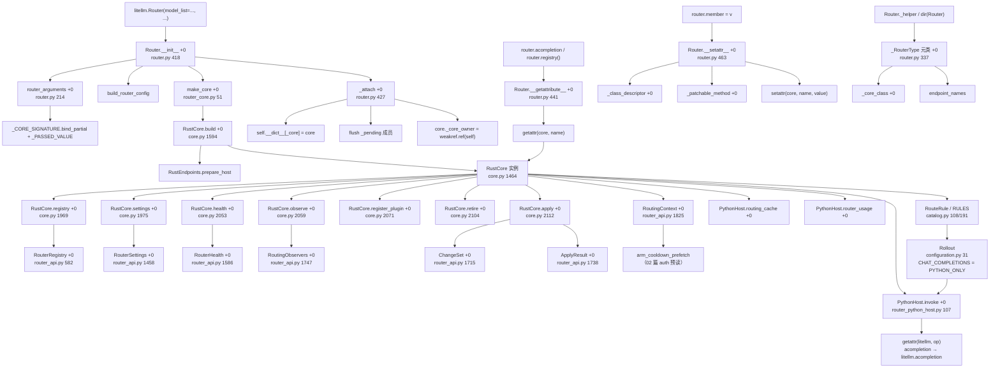

# 函数级解析（四）：Router 门面、视图面与核心工厂

> 所属层级：第四层（函数级解析） | 覆盖主链：第 7 跳（Router 门面把请求交给 Rust 核心）涉及的函数
> 本篇基准提交：`411b64dc7a`（工作区当前 HEAD）
> 引用规范：`文件 :: 符号 :: +偏移`，`+0` = 定义行，`+N` = 函数体内第 N 行

本篇逐个展开主链跳 7 里出现的函数：`Router` 门面如何把成员读写转发给进程内的 Rust 核心（`__init__`、`_attach`、`__getattribute__`、`__setattr__`、`__delattr__`、`_RouterType` 元类）、构造参数如何被快照（`router_arguments`）、核心如何被建出（`make_core`）、核心向门面暴露的视图与变更类型（`litellm/router_api.py` 的 `RouterRegistry`/`RouterSettings`/`RouterHealth`/`ChangeSet`/`ApplyResult`/`RoutingObservers`/`RoutingContext`）、核心回 litellm 包的唯一通道（`PythonHost.invoke`）、以及决定执行层的路由规则（`RouteRule`/`RULES`/`Rollout`）。

术语首现已解释：`门面`（facade，只转发不实现，真实逻辑在别处）、`Rust 核心`（进程内做选路/重试/回退/冷却/用量的决策体 `RustCore`）、`host`（`PythonHost`，Rust 核心触达 Python 世界的唯一出口）、`视图面`（`litellm/router_api.py` 里那些不是端点方法、而是设置与观察视图的类型）、`rollout`（决定某个路由由 Python 还是 Rust 执行的开关）。

第三层《Router 选部署》讲的是「跳 7 里步骤循环怎么驱动」，本篇只讲「门面与核心怎么接起来」；Rust 核心内部（`build` → 端点 → steps → `_Driver`）见 [13-rust-router-core.md](13-rust-router-core.md)。

## 本篇覆盖函数与门面分层的对应

| 分层 | 本篇展开的函数/类型 |
|---|---|
| 门面构造与转发 | `Router.__init__`、`Router.from_config`、`Router._attach`、`Router.__getattribute__`、`Router.__setattr__`、`Router.__delattr__`、`Router.__init_subclass__`、`_RouterType` |
| 构造参数 | `router_arguments`、`_class_descriptor`、`_patchable_method` |
| 核心工厂 | `make_core`、`RouterCore`（Protocol） |
| 视图与变更面 | `RouterRegistry`、`RouterSettings`、`RouterHealth`、`ChangeSet`、`ApplyResult`、`RoutingObservers`、`RoutingContext` |
| 核心入口（门面委托目标） | `RustCore.registry`、`settings`、`health`、`observe`、`register_plugin`、`retire`、`apply` |
| 宿主边界 | `PythonHost.invoke`、`PythonHost.dynamic`、`routing_cache`、`router_usage` |
| 执行层选择 | `RouteRule`、`RULES`、`Rollout` |

---

## 门面与核心的三层结构

```text
┌──────────────────────────── 门面层 ────────────────────────────┐
│ litellm/router.py :: Router（410 起，metaclass=_RouterType）      │
│   __init__ +1: _attach(make_core(build_router_config(            │
│                   router_arguments(*args, **kwargs)), host))     │
│   _attach +9: self.__dict__["_core"] = core（成员全部转发 _core）│
│   __getattribute__ +23: 读不到 → getattr(core, name)             │
│   __setattr__ +45: 写到 _core（patchable 方法镜像回门面）        │
│   __init_subclass__ +1: 抛 TypeError（禁子类化）                 │
└──────────────────────────────┬──────────────────────────────────┘
                               │ make_core()（router_core.py 51）
                               ▼
┌──────────────────────────── 核心层（Rust） ──────────────────────┐
│ litellm/router_rust/core.py :: RustCore（1464 起）                │
│   build +0（1594）→ 进程内决策体（选路/重试/回退/冷却/用量）     │
│   registry/settings/health/observe/register_plugin/retire/apply │
│   _drive +0 → _run_steps +0 → _Driver（attempt/select/pre_route）│
└──────────────────────────────┬──────────────────────────────────┘
                               │ PythonHost.invoke（router_python_host.py 107）
                               ▼
┌──────────────────────────── 执行层（litellm 包） ─────────────────┐
│ litellm.<op>（acompletion / aembedding / ...）按 provider 发请求  │
│ 执行层由 litellm/rust_bridge/catalog.py 决定（PYTHON_ONLY 等）   │
└──────────────────────────────────────────────────────────────────┘
```

---

### `Router.__init__`（`litellm/router.py`）

- 职责：零逻辑门面的构造器，唯一动作是建出核心并挂上。
- 签名/参数：`def __init__(self, *args: object, **kwargs: object) -> None`（`Router :: __init__ :: +0`，绝对行 418；`*args/**kwargs` 带 `# kwargs-ok` 标注）。真实形参签名由 `Router.__init__.__signature__` 替换成 `_router_init`（`_router_init :: +0`，绝对行 57）的形参，供 IDE 与 `router_arguments` 绑定用。
- 返回：一个已挂好核心的 Router 实例。
- 算法（贴 `Router :: __init__ :: +1`）：

```python
self._attach(make_core(build_router_config(router_arguments(*args, **kwargs)), python_host))   # +1
```

  四步委托链：`router_arguments` 规整构造参数 → `build_router_config` 构造 `RouterConfig` → `make_core` 建出核心 → `_attach` 把核心挂到 `self.__dict__["_core"]`。`python_host`（`litellm/router_python_host.py :: python_host :: +0`，绝对行 199）是模块级单例，也是 `_router_init` 的 `_host` 默认值。
- 错误/分支：`make_core` 里 `RustCore.build` 对核心不服务的参数抛 `RustBridgeDeclined`。
- 调用关系：调用方 = `litellm.Router(...)`（proxy 启动、各处构造）。被调用方 = `router_arguments`、`build_router_config`、`make_core`、`self._attach`。

---

### `Router.from_config`（`litellm/router.py`）

- 职责：从现成 `RouterConfig` 构造 Router 的等价入口，跳过参数规整。
- 签名/参数：`@classmethod def from_config(cls, config: RouterConfig, host: PythonHost = python_host) -> "Router"`（`Router :: from_config :: +0`，绝对行 421）。
- 返回：已挂核心的 Router 实例。
- 算法（贴 `from_config :: +1` 到 `+3`）：

```python
router: Final = cls.__new__(cls)        # +1，绕过 __init__
router._attach(make_core(config, host)) # +2
return router                           # +3
```

- 调用关系：调用方 = 需要直接用 `RouterConfig` 的路径。被调用方 = `make_core`、`self._attach`。

---

### `Router._attach`（`litellm/router.py`）

- 职责：把核心挂到门面，并 flush 构造期间暂存的成员、记录反向指针。
- 签名/参数：`def _attach(self, core: RouterCore) -> None`（`Router :: _attach :: +0`，绝对行 427）。
- 返回：None。
- 算法（贴 `Router :: _attach :: +1` 到 `+5`）：

```python
pending: Final = self.__dict__.pop("_pending", {})   # +1
self.__dict__["_core"] = core                         # +2
core.__dict__["_core_owner"] = weakref.ref(self)      # +3（# rebind-ok：门面把自己记到所拥有的核心上）
for name, value in pending.items():                   # +4
    setattr(core, name, value)
```

  `+1` 取出构造期暂存在 `_pending` 里的成员（见 `__setattr__`）；`+2` 把核心记为 `_core`；`+3` 在核心上记一个 `weakref` 反向指针（核心可回指门面而不造成强引用环）；`+4` 到 `+5` 把暂存成员写回核心。
- 调用关系：调用方 = `Router.__init__`（`+1`）、`Router.from_config`（`+2`）。被调用方 = `setattr`（flush 暂存成员）。

---

### `Router.__getattribute__`（`litellm/router.py`）

- 职责：成员读取转发——自身找不到就转发到核心；核心也没有时把错误重新抛成「Router 没有该属性」。
- 签名/参数：`def __getattribute__(self, name: str) -> object`（`Router :: __getattribute__ :: +0`，绝对行 441）。
- 返回：属性值。
- 算法（贴 `Router :: __getattribute__ :: +1` 到 `+20`）：

```python
try:
    return object.__getattribute__(self, name)      # +1，先找自身
except AttributeError:
    pass
facade: Final = object.__getattribute__(self, "__dict__")   # +5
core: Final = facade.get("_core")                            # +6
if core is None:                                             # +7
    pending: Final = facade.get("_pending", {})
    if name in pending: return pending[name]                 # +9 到 +10
    raise AttributeError(name)
try:
    return getattr(core, name)                               # +13
except AttributeError as error:                              # +14
    if error.obj is not core or error.name != name: raise
    raise AttributeError(f"'{type(self).__name__}' object has no attribute '{name}'", ...) from None   # +17 到 +20
```

  关键点：`+13` 转发到核心是门面的全部秘密——`Router.acompletion`、`Router.registry()`、`Router.settings()` 全靠这一行落到 `RustCore` 上。`+17` 到 `+20` 把核心抛的 `AttributeError` 改写成以 Router 为主语的错误，保持报错语义与普通对象一致。
- 调用关系：调用方 = 任何 `router.<member>` 读取（Python 解释器隐式调）。被调用方 = `object.__getattribute__`、`getattr(core, name)`。

---

### `Router.__setattr__`（`litellm/router.py`）

- 职责：成员写入转发——核心未就绪时暂存，就绪后写到核心；可补丁方法同时镜像回门面。
- 签名/参数：`def __setattr__(self, name: str, value: object) -> None`（`Router :: __setattr__ :: +0`，绝对行 463）。
- 返回：None。
- 算法（贴 `Router :: __setattr__ :: +1` 到 `+12`）：

```python
if _class_descriptor(type(self), name):        # +1，类描述符（property/描述符）走 object
    object.__setattr__(self, name, value); return
if "_core" not in self.__dict__:               # +3，核心未挂
    self.__dict__.setdefault("_pending", {})[name] = value   # +4
    return
core: Final = self._core                       # +7
mirrored: Final = name in self.__dict__ or _patchable_method(core, name)   # +8
setattr(core, name, value)                     # +9
if mirrored: self.__dict__[name] = value       # +10 到 +11，镜像回门面
```

  `_patchable_method`（`_patchable_method :: +0`，绝对行 401）判定某名字是否是核心的「可补丁方法」——是则镜像回门面，这样 `mock.patch.object(router, name)` 才找得到，且嵌套补丁按序还原。`_class_descriptor`（`_class_descriptor :: +0`，绝对行 232）判断名字是否被某个基类的 `__set__` 描述符占据。
- 调用关系：调用方 = 任何 `router.<member> = v` 写入。被调用方 = `_class_descriptor`、`_patchable_method`、`setattr(core, name, value)`。

---

### `Router.__delattr__`（`litellm/router.py`）

- 职责：从核心删除同名成员，并还原被补丁前的原始成员。
- 签名/参数：`def __delattr__(self, name: str) -> None`（`Router :: __delattr__ :: +0`，绝对行 476）。
- 返回：None。
- 算法：类描述符走 `object.__delattr__`；否则 `delattr(core, name)`，并从 `_replaced_core_members`（`_replaced_core_members` 定义处，绝对行 328，记录被补丁成员的原始值）还原。
- 调用关系：调用方 = `del router.<member>`（测试补丁收尾）。被调用方 = `_class_descriptor`、`delattr(core, name)`。

---

### `Router.__init_subclass__`（`litellm/router.py`）

- 职责：禁止子类化——扩展只能走 `register_plugin` / `apply` / `observe` 三条入口。
- 签名/参数：`def __init_subclass__(cls, **kwargs: object) -> None`（`Router :: __init_subclass__ :: +0`，绝对行 411）。
- 返回：无——一律 `raise TypeError`，并提示改用 `register_plugin()`（自定义路由）/ `apply()`（设置）/ `observe()`（结果观察）。
- 调用关系：调用方 = 任何 `class X(Router)` 尝试（Python 隐式调）。

---

### `_RouterType` 元类（`litellm/router.py`）

- 职责：让**类级**访问（`Router._helper`）、`dir()` 和类级打补丁同样落到核心类，所以 `Mock(spec=Router)` 能看到核心成员与端点。
- 定义：`class _RouterType(type)`（`_RouterType :: +0`，绝对行 337），`Router` 以 `metaclass=_RouterType` 声明（绝对行 410）。
- 关键方法（偏移相对 `+0`）：

| 偏移/行 | 方法 | 行为 |
|---|---|---|
| `+0`（337） | `class _RouterType(type)` | 元类本体 |
| 355 | `__setattr__(cls, name, value)` | 类级写：名字在核心或端点集合里就 `setattr(core, name, value)`，并把原成员备份进 `_replaced_core_members`；否则 `super().__setattr__` |
| 363 | `__delattr__(cls, name)` | 类级删：从核心删并还原被补丁前的原成员 |
| 375 | `__dir__(cls)` | 返回 `type.__dir__(cls)` ∪ `dir(_core_class())` ∪ `endpoint_names()` |
| 386 | `_endpoint_function(name)` | 把端点名包成一个转发到核心的函数 |
| 332 | `_core_class()` | 返回 `RustCore`（延迟导入避免循环依赖） |

  `_core_class`（`_core_class :: +0`，绝对行 332）是元类与门面共享的核心类获取器。`endpoint_names()`（`litellm/router_rust/invoke/endpoints.py :: endpoint_names :: +0`）给出所有可服务端点名集合。
- 调用关系：调用方 = 类级属性访问、`dir(Router)`、类级 `mock.patch`。被调用方 = `_core_class`、`_endpoint_function`、`endpoint_names`。

---

### `router_arguments`（`litellm/router.py`）

- 职责：把构造参数按名快照成 `MappingProxyType`（位置参数绑定到形参），供 `route_request` 的 read-through 复用。
- 签名/参数：`def router_arguments(*args: object, **kwargs: object) -> Mapping[str, object]`（`router_arguments :: +0`，绝对行 214；`**kwargs` 带 `# kwargs-ok`）。
- 返回：`Mapping[str, object]`（构造参数名 → 值，不含 `self`）。
- 算法（贴 `router_arguments :: +6` 到 `+15`）：

```python
try:
    bound: Final = _CORE_SIGNATURE.bind_partial(None, *args, **kwargs).arguments   # +6
except TypeError as error:
    raise TypeError(f"Router.__init__() {error}") from None                        # +7 到 +8
return MappingProxyType(                                                          # +10
    {name: value
     for name, value in zip(bound, map(_PASSED_VALUE.validate_python, bound.values()))
     if name != "self"})                                                          # +11 到 +15
```

  `_CORE_SIGNATURE`（`_CORE_SIGNATURE :: +0`，绝对行 210）是 `_router_init` 的签名；`_PASSED_VALUE`（`_PASSED_VALUE :: +0`，绝对行 211）是 `TypeAdapter(object)`，逐值校验。`bind_partial(None, ...)` 用 None 占住 `self`，再把位置/关键字参数绑到形参名。`MappingProxyType` 保证快照只读。
- 错误/分支：参数与 `_router_init` 形参不匹配 → 包成 `TypeError("Router.__init__() ...")`。
- 调用关系：调用方 = `Router.__init__`（`+1`）、`_route_user_config_request`、`route_request` 的 read-through、proxy_server。被调用方 = `_CORE_SIGNATURE.bind_partial`、`_PASSED_VALUE.validate_python`。

---

### `make_core`（`litellm/router_core.py`）

- 职责：核心工厂——无条件返回 Rust 核心，按 router 的配置一次性建好。
- 签名/参数：`def make_core(config: RouterConfig, host: "PythonHost") -> RouterCore`（`make_core :: +0`，绝对行 51）。
- 返回：`RouterCore`（实际是 `RustCore` 实例）。
- 算法（贴 `make_core :: +2` 到 `+4`）：

```python
from litellm.router_rust.core import RustCore        # +2，延迟导入
return RustCore.build(config, host)                  # +4
```

  无条件委托给 `RustCore.build`（`litellm/router_rust/core.py :: RustCore :: build :: +0`，绝对行 1594）。注释写明「核心是 Rust 核心，按 router 的配置一次性建好」。旧的双核时代（`router_python_core.py`、`PythonCore`、`Route.ROUTER`）已删除——`make_core` 不再有任何 Python/Rust 选择分支。`build` 内部先 `unsupported_arguments(config)` 检查有无核心不服务的参数（有则抛 `RustBridgeDeclined`），再 `RustEndpoints.prepare_host(config, host)` 准备宿主接线，最后 `cls(config, host, Resolved.of(config, host.dynamic()))` 构造实例。
- 调用关系：调用方 = `Router.__init__`（`+1`）、`Router.from_config`（`+2`）。被调用方 = `RustCore.build`。

---

### `RouterCore`（Protocol）（`litellm/router_core.py`）

- 职责：核心接口的类型化描述（`runtime_checkable`），门面只依赖这个协议，不依赖 `RustCore` 具体类。
- 定义：`class RouterCore(Protocol)`（`RouterCore :: +0`，绝对行 27）。
- 方法签名（`+0` 起逐条）：`call`、`registry() -> RouterRegistry`（`+3`）、`settings() -> RouterSettings`（`+5`）、`health() -> RouterHealth`（`+7`）、`select`、`apply(changes) -> ApplyResult`（`+15`）、`observe() -> RoutingObservers`（`+17`）、`register_plugin(plugin)`（`+19`）、`retire()`（`+21`）。
- 调用关系：实现者 = `RustCore`（`litellm/router_rust/core.py :: RustCore :: +0`，绝对行 1464）。消费者 = `Router` 门面的类型标注、`_attach` 的 `core: RouterCore` 参数。

---

## 视图与变更面（`litellm/router_api.py`）

`litellm/router_api.py` **不定义 `Router` 类，也不定义端点方法**（全库无 `class Router(`）。它定义核心向门面暴露的视图与变更类型；真正执行推理的端点由核心的 `RustEndpoints` 服务。这些类型由 `RustCore` 的入口方法返回：

| 符号 | 位置 | 职责 |
|---|---|---|
| `RouterRegistry` | `RouterRegistry :: +0`（582 行） | 部署注册表视图（`registry()` 返回），读自核心句柄；查组集合、deployment_names、通配 patterns、team_model/team_public |
| `RouterSettings` | `RouterSettings :: +0`（1458 行） | 设置视图（`settings()` 返回）；读 `fallbacks`、`router_general_settings.pass_through_all_models`、`default_deployment` 等 |
| `RouterHealth` | `RouterHealth :: +0`（1586 行） | 健康视图（`health()` 返回）；`__getattribute__` 对非 `_HEALTH_SERVED` 成员抛 `RustCoreUnsupported`（`RustCoreUnsupported :: +0`，core.py 516 行） |
| `ChangeSet` | `ChangeSet :: +0`（1715 行） | 变更集：`assign` / `settings` / `upsert` / `delete` / `redis_cache` / `refresh_model_info` |
| `ApplyResult` | `ApplyResult :: +0`（1738 行） | `apply()` 的结果：`version` / `upserted` / `deleted` |
| `RoutingObservers` | `RoutingObservers :: +0`（1747 行） | `observe()` 的结果：Slack alerting logger 等观察器集合 |
| `RoutingContext` | `RoutingContext :: +0`（1825 行） | 路由插件/策略的运行上下文（读 `registry()` / `settings()` / `health()` / `select()`）；`arm_cooldown_prefetch` 供 auth 层预读冷却（见 02 篇） |

对应的 `RustCore` 入口（`litellm/router_rust/core.py`）：`registry`（`RustCore :: registry :: +0`，1969 行）、`settings`（`RustCore :: settings :: +0`，1975 行）、`health`（`RustCore :: health :: +0`，2053 行）、`observe`（`RustCore :: observe :: +0`，2059 行）、`register_plugin`（`RustCore :: register_plugin :: +0`，2071 行）、`retire`（`RustCore :: retire :: +0`，2104 行）、`apply`（`RustCore :: apply :: +0`，2112 行）。

- `register_plugin(plugin)`：让一个 `CustomRoutingStrategyBase` 从今起替核心选部署；`pre_route` 步骤会先问这个自定义策略。
- `apply(changes: ChangeSet) -> ApplyResult`：应用变更集——先 `_assign_host_settings`，再 `_apply_settings`，再 upsert/delete，最后挂 redis cache；`changes.refresh_model_info` 抛 `TypeError`（要 `aapply`），未知 assign 名抛 `ValueError`，核心不支持的设置抛 `RustCoreUnsupported`。
- `observe(logging_obj, *, request_scoped=False) -> RoutingObservers`：返回路由观察器；`request_scoped` 时走 `_serve_through_request_logging`，核心自身不注册 outcome callbacks，改由 `OptionalChecks.outcome_callbacks` 读请求原本会跑的回调。

`Router` 门面 docstring 自述：`Router holds no routing logic...the endpoint methods (acompletion, aembedding, aresponses, aanthropic_messages, ...) and the entry points (registry, settings, health, select, apply, observe, register_plugin, retire)` 全都被委托给核心。

---

### `PythonHost.invoke`（`litellm/router_python_host.py`）

- 职责：Rust 核心与 litellm 包的**唯一边界**——核心从不再直接 `import litellm`，所有外部触达（推理调用、sleep、回调清单、进程缓存、用量存储）都经 host。
- 定义：`class PythonHost`（`PythonHost :: +0`，绝对行 60）。`invoke` 有大量 `@overload` 存根（66 到 106 行）为每个 op 标注返回类型，实现体在：
- 签名/参数：`def invoke(self, op: str) -> Endpoint`（`PythonHost :: invoke :: +0`，绝对行 107）。
- 返回：一个可调用端点（对 `"acompletion"` 返回 `litellm.acompletion`）。
- 算法（贴 `PythonHost :: invoke :: +1` 起）：

```python
def invoke(self, op: str) -> Endpoint:        # +0（实现体）
    fn = getattr(litellm, op, None)            # 带点号的 op 走 _dotted
    if fn is None:
        raise AttributeError(...)              # 查不到
    if not callable(fn):
        raise TypeError(...)                   # 不可调用
    return fn
```

  对 `"acompletion"` 返回 `litellm.acompletion`，这正是跳 8 由 host 回跳 `litellm.acompletion` 的机制。架构要点：`invoke` 在**调用期**才解析 `litellm.<op>`，核心全程不持有 litellm 的引用。
- 其他 host 成员：

| 成员 | 位置 | 作用 |
|---|---|---|
| `dynamic()` | `PythonHost :: dynamic :: +0`（123 行） | 进程级 `RouterDynamicConfig`，每次访问实时读 |
| `routing_cache(config)` | `PythonHost :: routing_cache :: +0`（147 行） | 构建 `DualCache`（内存 + 可选 Redis），供冷却/失败计数/用量读写；由 `redis_cache_for` 按 `redis_*` 参数解析 Redis |
| `router_usage(redis)` | `PythonHost :: router_usage :: +0`（155 行） | 部署 tpm/rpm 的 `RouterUsageStore`（`litellm/redis/stores/router_usage/__init__.py :: RouterUsageStore :: +0`，85 行） |
| `sleep` / `sleep_sync` | 同文件 | 重试退避的 `asyncio.sleep` / `time.sleep` |
| `callbacks` / `callback_list` / `set_callback_list` | 同文件 | 进程回调清单（成功/失败/输入回调） |
| `global_cache` / `set_global_cache` | 同文件 | litellm 进程级 `Cache` |

  `python_host: Final = PythonHost()`（`python_host :: +0`，绝对行 199）是 `litellm/router.py` 用的单例，也是 `_router_init` 的 `_host` 默认值。
- 调用关系：调用方 = `_run_steps` 的 `attempt` 步骤（`_routed_attempt` 里 `host.invoke(call.host_op)(**compacted)`，见 04 篇 deep-dive 与 13 篇）、核心的 sleep/缓存/用量读取。被调用方 = `getattr(litellm, op)`、`_dotted`。

---

### 执行层选择：`RouteRule`、`RULES`、`Rollout`（`litellm/rust_bridge/`）

- 职责：决定某个路由由 Python 还是 Rust 执行。chat completions 始终经宿主回 Python 执行。
- `RouteRule`（`RouteRule :: +0`，绝对行 108）：`(route, rollout, providers, models, targets, features)` 的冻结数据类，`matches(context)` 按 route + provider/model/target/feature 逐一匹配，`unconstrained()` 判断是否无条件规则。
- `RULES`（`RULES :: +0`，绝对行 191）：规则表。chat completions 的两条规则（192 到 193 行）都是 `PYTHON_ONLY`：

```python
RULES: Final[Rules] = (
    RouteRule(Route.CHAT_COMPLETIONS, Rollout.PYTHON_ONLY, features=CHAT_PYTHON_FEATURES),   # 192
    RouteRule(Route.CHAT_COMPLETIONS, Rollout.PYTHON_ONLY),                                  # 193
)
```

- `Rollout`（`litellm/rust_bridge/configuration.py :: Rollout :: +0`，绝对行 31）：枚举，`PYTHON_ONLY = auto()`（32 行）、`RUST_REQUIRED = auto()`（35 行）。查找函数在无规则命中时**默认回落 `PYTHON_ONLY`**，所以 chat completions 始终经宿主回 Python 执行——这正是跳 8 由 `PythonHost` 回跳 `litellm.acompletion` 的原因。对照：`MESSAGES` 路由对 `anthropic` provider 是 `RUST_REQUIRED`。
- 调用关系：消费者 = Rust 桥的路由判定；`PythonHost.invoke` 是 `PYTHON_ONLY` 的落地通道。

---

## 函数调用关系图



## 源码索引

| 符号 | 文件 :: 符号 | 绝对定义行 |
|---|---|---|
| 构造形参源 | `litellm/router.py :: _router_init` | 57 |
| 构造参数快照 | `litellm/router.py :: router_arguments` | 214 |
| 核心签名常量 | `litellm/router.py :: _CORE_SIGNATURE` | 210 |
| 传参校验器 | `litellm/router.py :: _PASSED_VALUE` | 211 |
| 类描述符判定 | `litellm/router.py :: _class_descriptor` | 232 |
| 被补丁成员备份 | `_replaced_core_members`（`litellm/router.py` 模块级全局） | 328 |
| 核心类获取器 | `litellm/router.py :: _core_class` | 332 |
| 门面元类 | `litellm/router.py :: _RouterType` | 337 |
| 端点函数包装 | `litellm/router.py :: _endpoint_function` | 386 |
| 可补丁方法判定 | `litellm/router.py :: _patchable_method` | 401 |
| 门面类 | `litellm/router.py :: Router` | 410 |
| 禁子类化 | `litellm/router.py :: Router.__init_subclass__` | 411 |
| 门面构造器 | `litellm/router.py :: Router.__init__` | 418 |
| 配置构造入口 | `litellm/router.py :: Router.from_config` | 421 |
| 核心挂载 | `litellm/router.py :: Router._attach` | 427 |
| 核心属性 | `litellm/router.py :: Router._core` | 435 |
| 读转发 | `litellm/router.py :: Router.__getattribute__` | 441 |
| 写转发 | `litellm/router.py :: Router.__setattr__` | 463 |
| 删转发 | `litellm/router.py :: Router.__delattr__` | 476 |
| 核心工厂 | `litellm/router_core.py :: make_core` | 51 |
| 核心接口 | `litellm/router_core.py :: RouterCore` | 27 |
| 核心类 | `litellm/router_rust/core.py :: RustCore` | 1464 |
| 核心构造 | `litellm/router_rust/core.py :: RustCore.build` | 1594 |
| 不支持错误 | `litellm/router_rust/core.py :: RustCoreUnsupported` | 516 |
| 注册表入口 | `litellm/router_rust/core.py :: RustCore.registry` | 1969 |
| 设置入口 | `litellm/router_rust/core.py :: RustCore.settings` | 1975 |
| 健康入口 | `litellm/router_rust/core.py :: RustCore.health` | 2053 |
| 观察入口 | `litellm/router_rust/core.py :: RustCore.observe` | 2059 |
| 插件入口 | `litellm/router_rust/core.py :: RustCore.register_plugin` | 2071 |
| 退役入口 | `litellm/router_rust/core.py :: RustCore.retire` | 2104 |
| 应用变更入口 | `litellm/router_rust/core.py :: RustCore.apply` | 2112 |
| 注册表视图 | `litellm/router_api.py :: RouterRegistry` | 582 |
| 设置视图 | `litellm/router_api.py :: RouterSettings` | 1458 |
| 健康视图 | `litellm/router_api.py :: RouterHealth` | 1586 |
| 变更集 | `litellm/router_api.py :: ChangeSet` | 1715 |
| 应用结果 | `litellm/router_api.py :: ApplyResult` | 1738 |
| 观察器 | `litellm/router_api.py :: RoutingObservers` | 1747 |
| 路由上下文 | `litellm/router_api.py :: RoutingContext` | 1825 |
| 宿主类 | `litellm/router_python_host.py :: PythonHost` | 60 |
| 宿主回跳 | `litellm/router_python_host.py :: PythonHost.invoke` | 107 |
| 动态配置 | `litellm/router_python_host.py :: PythonHost.dynamic` | 123 |
| 路由缓存 | `litellm/router_python_host.py :: PythonHost.routing_cache` | 147 |
| 用量存储 | `litellm/router_python_host.py :: PythonHost.router_usage` | 155 |
| 宿主单例 | `litellm/router_python_host.py :: python_host` | 199 |
| 路由规则 | `litellm/rust_bridge/catalog.py :: RouteRule` | 108 |
| 规则表 | `litellm/rust_bridge/catalog.py :: RULES` | 191 |
| rollout 枚举 | `litellm/rust_bridge/configuration.py :: Rollout` | 31 |
| 冷却缓存 | `litellm/router_utils/cooldown_cache.py :: CooldownCache` | 17 |
| 冷却表协议 | `litellm/redis/stores/router_cooldowns/handle.py :: RouterCooldownsHandle` | 11 |
| 冷却实现 | `litellm/redis/stores/router_cooldowns/__init__.py :: RouterCooldownStore` | 40 |
| 用量协议 | `litellm/redis/stores/router_usage/handle.py :: RouterUsageHandle` | 19 |
| 用量实现 | `litellm/redis/stores/router_usage/__init__.py :: RouterUsageStore` | 85 |

## 跨篇导航

- [13-rust-router-core.md](13-rust-router-core.md)：Rust 核心内部专题（`make_core` → `RustCore.build` → 端点 → steps → `_Driver` → `PythonHost.invoke`）
- [03-routing-functions.md](03-routing-functions.md)：代理层路由决策（`route_request` 如何 `getattr` 派发到 `Router.acompletion`）
- [05-acompletion-functions.md](05-acompletion-functions.md)：`litellm.acompletion` 经线程池的执行路径（跳 8）

## 未确认项

- `_RouterType` 元类的 `__setattr__`（355 行）、`__delattr__`（363 行）、`__dir__`（375 行）、`_endpoint_function`（386 行）逐行实现未完整读取，本篇按职责与行号描述，未逐行展开其备份/还原细节。
- `RustCore.registry`/`settings`/`health`/`observe`/`register_plugin`/`retire`/`apply` 的函数体逐行未读取，本篇引用职责与定义行；其内部 `_assign_host_settings`/`_apply_settings`/`_serve_through_request_logging` 未逐行核对。
- `RouterRegistry`/`RouterSettings`/`RouterHealth`/`ChangeSet`/`ApplyResult`/`RoutingObservers`/`RoutingContext` 各视图类的方法体未逐行读取，本篇只描述视图职责与返回它的核心入口。
- `RustCore.build` 内 `unsupported_arguments`/`prepare_host`/`Resolved.of` 的具体实现未逐行读取，本篇按调用序描述。
- `RouteRule.matches`/`unconstrained` 与 catalog 查找函数的实现未逐行读取，本篇只引用 `RULES` 里 chat completions 两条 `PYTHON_ONLY` 规则与默认回落行为。