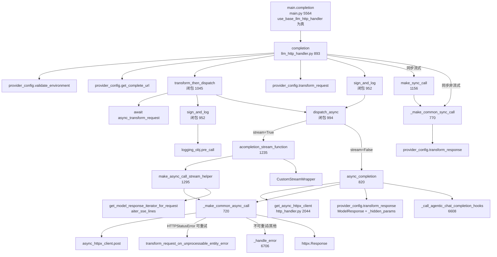

# 函数级解析（六）：BaseLLMHTTPHandler 关键方法

> 所属层级：第四层（函数级解析） | 覆盖主链：第 10 跳后半与第 11 跳里 `BaseLLMHTTPHandler` 这条统一 httpx 执行路径涉及的函数
> 本篇基准提交：`411b64dc7a`（工作区当前 HEAD）
> 引用规范：`文件 :: 符号 :: +偏移`，`+0` = 定义行，`+N` = 函数体内第 N 行

本篇逐个展开 `litellm/llms/custom_httpx/llm_http_handler.py :: BaseLLMHTTPHandler`（类定义行 719）的关键方法：统一入口 `completion`、异步非流式 `async_completion`、真正的 HTTP 发送与错误自愈 `_make_common_async_call` / `_make_common_sync_call`、签名与 pre-call 日志的 `sign_and_log`、异步分发闭包 `dispatch_async`、异步变换闭包 `transform_then_dispatch`、流式发送 `acompletion_stream_function` / `make_async_call_stream_helper` / `make_sync_call`、异常映射 `_handle_error`、以及客户端复用的 `get_async_httpx_client` / `get_httpx_client`。

术语首现已解释：`执行器`（真正持有 HTTP 客户端、发上游请求的对象）、`provider Config`（每个 provider 一个类，集中该 provider 的请求/响应/URL/鉴权翻译逻辑，基类 `BaseConfig`）、`httpx`（Python 的 HTTP 客户端库，handler 用它发请求）、`fake_stream`（provider 不支持真流式时，先拿整包响应再模拟成流）、`422 自愈`（上游拒绝某参数时删掉该参数重发一次）。

易错事实（先判定主场景归属）：本 traced 场景是 openai provider、非流式、单 deployment。openai **默认走官方 SDK**（`litellm/llms/openai/openai.py :: OpenAIChatCompletion`），`BaseLLMHTTPHandler` 仅当 `EXPERIMENTAL_OPENAI_BASE_LLM_HTTP_HANDLER`（`litellm/main.py :: completion() :: use_base_llm_http_handler :: +285`，绝对行 2853，`get_secret_bool(...)`）为真才接管 openai。所以本场景的实际执行路径是 SDK 那条；本篇展开的 handler 方法是**绝大多数其他 provider**走的统一路径，也是 openai 在开关打开时的备选路径。handler 模块级单例是 `litellm/main.py :: base_llm_http_handler :: +0`（绝对行 395）。

第三层《Provider 翻译层》讲的是「跳 10 后半与跳 11 每一跳发生了什么」，本篇只讲「handler 里每个方法内部具体怎么实现」；provider Config 的变换函数见 [07-provider-transform-functions.md](07-provider-transform-functions.md)。

## 本篇覆盖方法与执行路径的对应

| 路径分支 | 本篇展开的方法 |
|---|---|
| 统一入口（同步/异步分叉） | `BaseLLMHTTPHandler.completion` |
| 异步非流式 | `async_completion`、`_make_common_async_call`、`_call_agentic_chat_completion_hooks` |
| 同步非流式 | `_make_common_sync_call` |
| 请求签名与 pre-call 日志 | `sign_and_log`（`completion` 内闭包） |
| 异步分发 | `dispatch_async`（闭包）、`transform_then_dispatch`（闭包） |
| 流式 | `acompletion_stream_function`、`make_async_call_stream_helper`、`make_sync_call` |
| 错误映射 | `_handle_error` |
| 客户端复用 | `get_async_httpx_client`、`get_httpx_client` |

---

### `BaseLLMHTTPHandler.completion`（`litellm/llms/custom_httpx/llm_http_handler.py`）

- 职责：同步/异步统一执行器入口。把「解析 provider Config → 取鉴权头 → 拼 URL → 签名 → 变换请求体 → 按同步/异步/流式分派」串成一条 provider 无关的链路。
- 签名/参数：`def completion(self, model: str, messages: list[AllMessageValues], api_base: str | None, custom_llm_provider: str, model_response: ModelResponse, encoding: "Tokenizer | None", logging_obj: LiteLLMLoggingObj, optional_params: dict, timeout: float | httpx.Timeout, litellm_params: dict, acompletion: bool, stream: bool | None = False, fake_stream: bool = False, api_key: str | None = None, headers: dict[str, object] | None = None, client: HTTPHandler | AsyncHTTPHandler | None = None, provider_config: BaseConfig | None = None, shared_session: Optional["ClientSession"] = None)`（`litellm/llms/custom_httpx/llm_http_handler.py :: BaseLLMHTTPHandler :: completion :: +0`，绝对行 893）。
- 返回：非流式 `ModelResponse`；流式 `CustomStreamWrapper`；`acompletion=True` 时返回协程（`transform_then_dispatch()` 或 `dispatch_async(...)`），供 `acompletion` 层 await。
- 算法（偏移相对 `+0`）：

| 序 | 动作 | 锚点 | 进出与分支 |
|---|---|---|---|
| 1 | `json_mode = optional_params.pop("json_mode", False)`；`extra_body = optional_params.pop("extra_body", None)` | `+22`、`+23`（行 914-915） | 这两个键单独带，不进通用参数映射 |
| 2 | `provider_config = provider_config or ProviderConfigManager.get_provider_chat_config(model=model, provider=LlmProviders(custom_llm_provider))`；None 抛 `ValueError` | `+24` 到 `+28`（行 917-921） | 调用方未传时内部补解析 |
| 3 | `fake_stream` 三路取值：显式实参 / `optional_params.pop("fake_stream")` / `provider_config.should_fake_stream(...)` | `+30` 到 `+34`（行 923-927） | provider 不支持真流式时用假流式 |
| 4 | `request_headers = provider_config.validate_environment(api_key, headers, model, messages, optional_params, api_base, litellm_params)` | `+37` 到 `+48`（行 930-941） | 缺凭证在 Config 里抛 `AuthenticationError` |
| 5 | `api_base = provider_config.get_complete_url(api_base, api_key, model, optional_params, stream=False if fake_stream else stream, litellm_params)` | `+50` 到 `+57`（行 943-950） | 拼 endpoint；fake_stream 时按非流式拼 |
| 6 | 定义闭包 `sign_and_log` | `+59`（行 952） | 见下节 |
| 7 | 定义闭包 `dispatch_async` | `+101`（行 994） | 见下节 |
| 8 | `acompletion is True and provider_config.uses_async_transform_request` → 返回 `transform_then_dispatch()` 协程 | `+150` 到 `+170`（行 1043-1063） | 异步变换型 provider（如 bedrock）走此支 |
| 9 | `data, signed_headers, signed_json_body = sign_and_log(provider_config.transform_request(...))` | `+172` 到 `+180`（行 1065-1073） | 同步变换：先 `transform_request` 造请求体再签名 |
| 10 | `acompletion is True` → `return dispatch_async(data, signed_headers, signed_json_body)` | `+182` 到 `+183`（行 1075-1076） | 异步非流/流式都由它再分 |
| 11 | `stream is True` → `_add_stream_param_to_request_body` 补 body；`has_custom_stream_wrapper` 且非 fake_stream 走 provider 自定义同步流包装，否则 `make_sync_call(...)` 拿流迭代器包 `CustomStreamWrapper` | `+185` 到 `+229`（行 1078-1122） | 同步流式 |
| 12 | 非流式同步：`_make_common_sync_call(...)` 发请求，`provider_config.transform_response(...)` 转换后返回 | `+231` 到 `+261`（行 1124-1154） | 同步非流式 |

  注意参数名的翻译（`map_openai_params`）不发生在 handler 里：chat 的 OpenAI 参数校验与映射在 `main.completion()` 内经 `get_optional_params()` 完成后才传入。
- 错误/分支：`provider_config` 解析不到抛 `ValueError`；发送与响应阶段的异常统一进 `_handle_error`（见下）。
- 调用关系：调用方 = `litellm/main.py :: completion`（COMPLETION CALL 段，`use_base_llm_http_handler` 为真时）。被调用方 = `ProviderConfigManager.get_provider_chat_config`、`provider_config.validate_environment`、`provider_config.get_complete_url`、`provider_config.transform_request` / `async_transform_request`、`sign_and_log`、`dispatch_async`、`_make_common_sync_call`、`make_sync_call`、`acompletion_stream_function`、`provider_config.transform_response`、`_add_stream_param_to_request_body`。

### 闭包 `sign_and_log`（`completion` 内）

- 职责：把变换后的请求体合并 `extra_body`、做 provider 签名（AWS 等）、写 pre-call 日志，产出可直接发送的三元组。
- 签名/参数：`def sign_and_log(transformed: dict[str, object]) -> tuple[dict[str, object], dict[str, object], bytes | None]`（`litellm/llms/custom_httpx/llm_http_handler.py :: BaseLLMHTTPHandler :: completion :: sign_and_log :: +0`，绝对行 952，`# mutable-ok` 标注因异步分支需要 dict）。
- 返回：`(data, signed_headers, signed_json_body)`。
- 算法（贴 `sign_and_log :: +3` 到 `+41`，行 955-992）：

```python
            data: Final = (
                {**transformed, **provider_config.transform_extra_body(
                    extra_body=extra_body, request=transformed, model=model, litellm_params=litellm_params)}
                if extra_body is not None else transformed
            )
            signed: Final = cast("tuple[dict[str, object], bytes | None]", provider_config.sign_request(
                headers=request_headers,
                optional_params={**optional_params, **_aws_signing_overrides(optional_params, litellm_params)},
                request_data=data, api_base=api_base, api_key=api_key,
                stream=stream, fake_stream=fake_stream, model=model,
            ))
            logging_obj.pre_call(input=messages, api_key=api_key, additional_args={
                "complete_input_dict": data, "api_base": api_base, "headers": signed[0]})
            if litellm_params.get("_websearch_interception_converted_stream", False):
                logging_obj.model_call_details["websearch_interception_converted_stream"] = True
            return data, signed[0], signed[1]
```

  分步：`+3` 到 `+10` 有 `extra_body` 时并进请求体，否则原样用 `transformed`；`+11` 到 `+27` 调 `provider_config.sign_request(...)` 做签名（AWS provider 另经 `_aws_signing_overrides` 补签名覆盖参数），返回 `(签名后 headers, 预签名 body 字节)`；`+28` 到 `+36` 写 `logging_obj.pre_call`，把完整输入 dict、api_base、签名后 headers 记进 `model_call_details`；`+37` 到 `+39` 记 websearch 拦截转流的标记；`+40` 返回三元组。
- 错误/分支：`sign_request` 抛错沿调用栈上抛，交 `_handle_error` 或上层异常映射。
- 调用关系：调用方 = `completion :: +172`（同步变换支）、`transform_then_dispatch :: +14`（异步变换支）。被调用方 = `provider_config.transform_extra_body`、`provider_config.sign_request`、`_aws_signing_overrides`、`logging_obj.pre_call`。

### 闭包 `dispatch_async`（`completion` 内）

- 职责：异步侧二次分派，按 `stream` 决定走异步流式还是异步非流式。
- 签名/参数：`def dispatch_async(data: dict[str, object], signed_headers: dict[str, object], signed_json_body: bytes | None) -> Coroutine[object, object, ModelResponse | CustomStreamWrapper]`（`completion :: dispatch_async :: +0`，绝对行 994）。
- 返回：协程，await 后是 `ModelResponse` 或 `CustomStreamWrapper`。
- 算法（贴 `dispatch_async :: +5` 到 `+47`，行 999-1041）：

```python
            async_client: Final = client if isinstance(client, AsyncHTTPHandler) else None
            if stream is True:
                return self.acompletion_stream_function(
                    model=model, messages=messages, api_base=api_base, headers=signed_headers,
                    custom_llm_provider=custom_llm_provider, provider_config=provider_config, timeout=timeout,
                    logging_obj=logging_obj,
                    data=self._add_stream_param_to_request_body(data=data, provider_config=provider_config, fake_stream=fake_stream),
                    fake_stream=fake_stream, client=async_client, litellm_params=litellm_params,
                    json_mode=json_mode, optional_params=optional_params, signed_json_body=signed_json_body,
                )
            return self.async_completion(
                custom_llm_provider=custom_llm_provider, provider_config=provider_config, api_base=api_base,
                headers=signed_headers, data=data, timeout=timeout, model=model, model_response=model_response,
                logging_obj=logging_obj, api_key=api_key, messages=messages, optional_params=optional_params,
                litellm_params=litellm_params, encoding=encoding, client=async_client, json_mode=json_mode,
                signed_json_body=signed_json_body, shared_session=shared_session,
            )
```

  `+5` 只在传入的 `client` 确实是 `AsyncHTTPHandler` 时复用，否则传 `None` 让下游自建。`stream=True` 走 `acompletion_stream_function`（data 先经 `_add_stream_param_to_request_body` 补 `stream` 键）；否则走 `async_completion`。
- 调用关系：调用方 = `completion :: +183`、`transform_then_dispatch :: +19`。被调用方 = `self.acompletion_stream_function`、`self.async_completion`、`self._add_stream_param_to_request_body`。

### 闭包 `transform_then_dispatch`（`completion` 内）

- 职责：异步变换型 provider 的三步串接——异步变换请求体、（可能异步的）签名、异步分派。
- 签名/参数：`async def transform_then_dispatch() -> ModelResponse | CustomStreamWrapper`（`completion :: transform_then_dispatch :: +0`，绝对行 1045），无显式参数，闭包捕获 `completion` 的局部变量。
- 返回：`ModelResponse | CustomStreamWrapper`。
- 算法（贴 `transform_then_dispatch :: +2` 到 `+17`，行 1046-1061）：

```python
                transformed: Final = cast("dict[str, object]", await provider_config.async_transform_request(
                    model=model, messages=messages, optional_params=optional_params,
                    litellm_params=litellm_params, headers=request_headers,
                ))
                signed_request: Final = await (
                    run_aws_signing(sign_and_log, transformed)
                    if isinstance(provider_config, SignsRequestsWithAWS)
                    else asyncio.to_thread(sign_and_log, transformed)
                )
                return await dispatch_async(*signed_request)
```

  分步：`+2` 到 `+9` `await provider_config.async_transform_request(...)` 造请求体（`uses_async_transform_request` 为真的 provider 才进这条支）；`+10` 到 `+15` 签名——实现了 `SignsRequestsWithAWS` 的 provider 走 `run_aws_signing`，其余用 `asyncio.to_thread(sign_and_log, transformed)` 把同步签名丢线程，避免阻塞事件循环；`+16` 把签名三元组展开喂给 `dispatch_async`。
- 调用关系：调用方 = `completion :: +170`（返回它的协程）。被调用方 = `provider_config.async_transform_request`、`run_aws_signing` / `asyncio.to_thread`、`sign_and_log`、`dispatch_async`。

---

### `async_completion`（`litellm/llms/custom_httpx/llm_http_handler.py`）

- 职责：异步非流式执行。取（或建）异步 httpx 客户端、发请求、翻响应、跑 agentic hook。
- 签名/参数：`async def async_completion(self, custom_llm_provider: str, provider_config: BaseConfig, api_base: str, headers: dict, data: dict, timeout: float | httpx.Timeout, model: str, model_response: ModelResponse, logging_obj: LiteLLMLoggingObj, messages: list, optional_params: dict, litellm_params: dict, encoding: "Tokenizer | None", api_key: str | None = None, client: AsyncHTTPHandler | None = None, json_mode: bool = False, signed_json_body: bytes | None = None, shared_session: Optional["ClientSession"] = None)`（`litellm/llms/custom_httpx/llm_http_handler.py :: BaseLLMHTTPHandler :: async_completion :: +0`，绝对行 820）。
- 返回：`ModelResponse`。
- 算法（贴 `async_completion :: +21` 到 `+71`，行 841-891）：

```python
        if client is None:
            async_httpx_client = get_async_httpx_client(
                llm_provider=litellm.LlmProviders(custom_llm_provider),
                params={"ssl_verify": litellm_params.get("ssl_verify", None)},
                shared_session=shared_session,
            )
        else:
            async_httpx_client = client

        response: Final = await self._make_common_async_call(
            async_httpx_client=async_httpx_client, provider_config=provider_config, api_base=api_base,
            headers=headers, data=data, timeout=timeout, litellm_params=litellm_params,
            stream=False, logging_obj=logging_obj, signed_json_body=signed_json_body,
        )
        initial_response: Final = provider_config.transform_response(
            model=model, raw_response=response, model_response=model_response, logging_obj=logging_obj,
            api_key=api_key, request_data=data, messages=messages, optional_params=optional_params,
            litellm_params=litellm_params, encoding=encoding, json_mode=json_mode,
        )
        final_response: Final = await self._call_agentic_chat_completion_hooks(
            response=initial_response, model=model, messages=messages, optional_params=optional_params,
            logging_obj=logging_obj, stream=False, custom_llm_provider=custom_llm_provider, kwargs=litellm_params,
        )
        return final_response if final_response is not None else initial_response
```

  分步：`+21` 到 `+32` 客户端缺省时按 provider 取连接池级复用客户端（`ssl_verify`、`shared_session` 透传）；`+33` 到 `+44` `await self._make_common_async_call(stream=False, ...)` 发送；`+45` 到 `+57` `provider_config.transform_response(...)` 把 httpx 响应翻成 `ModelResponse`（`_hidden_params` 在此填充）；`+58` 到 `+70` 跑 agentic chat completion hooks，命中可替换响应；`+71` hook 无结果则回落 initial_response。
- 错误/分支：发送与响应异常在 `_make_common_async_call` 内处理；hook 异常由 hook 自身吞并（单个回调崩溃不影响主响应）。
- 调用关系：调用方 = `dispatch_async :: +28`。被调用方 = `get_async_httpx_client`、`self._make_common_async_call`、`provider_config.transform_response`、`self._call_agentic_chat_completion_hooks`（`litellm/llms/custom_httpx/llm_http_handler.py :: +0`，绝对行 6608，函数体未逐行读取）。

---

### `_make_common_async_call` 与 `_make_common_sync_call`（`litellm/llms/custom_httpx/llm_http_handler.py`）

- 职责：真正的「发一次 HTTP」细节：URL、头、body、422 自愈重试、异常映射，流式与非流式共用。
- 签名/参数（异步版）：`async def _make_common_async_call(self, async_httpx_client: AsyncHTTPHandler, provider_config: BaseConfig, api_base: str, headers: dict, data: dict, timeout: float | httpx.Timeout, litellm_params: dict, logging_obj: LiteLLMLoggingObj, stream: bool = False, signed_json_body: bytes | None = None) -> httpx.Response`（`litellm/llms/custom_httpx/llm_http_handler.py :: BaseLLMHTTPHandler :: _make_common_async_call :: +0`，绝对行 720）。同步版 `_make_common_sync_call`（`+0`，绝对行 770）参数同形，只是客户端是 `HTTPHandler` 且为同步方法。
- 返回：httpx `Response`。
- 算法（两函数结构相同，贴异步版 `+14` 到 `+48`，行 734-768）：

```python
        max_retry_on_unprocessable_entity_error: Final = provider_config.max_retry_on_unprocessable_entity_error
        response: httpx.Response | None = None
        for i in range(max(max_retry_on_unprocessable_entity_error, 1)):
            try:
                response = await async_httpx_client.post(
                    url=api_base, headers=headers,
                    data=(signed_json_body if signed_json_body is not None else json.dumps(data)),
                    timeout=timeout, stream=stream, logging_obj=logging_obj,
                )
            except httpx.HTTPStatusError as e:
                hit_max_retry = i + 1 == max_retry_on_unprocessable_entity_error
                should_retry = provider_config.should_retry_llm_api_inside_llm_translation_on_http_error(
                    e=e, litellm_params=litellm_params)
                if should_retry and not hit_max_retry:
                    data = provider_config.transform_request_on_unprocessable_entity_error(e=e, request_data=data)
                    continue
                else:
                    raise self._handle_error(e=e, provider_config=provider_config)
            except Exception as e:
                raise self._handle_error(e=e, provider_config=provider_config)
            break
        if response is None:
            raise provider_config.get_error_class(
                error_message="No response from the API", status_code=422, headers={})
        return response
```

  分步：`+14` 从 Config 取 422 自愈重试上限；`+17` 到 `+41` 循环发送——body 优先用预签名的 `signed_json_body`，否则 `json.dumps(data)`；`+27` 到 `+37` 命中 `httpx.HTTPStatusError` 且 Config 判定可重试、未达上限时，用 `transform_request_on_unprocessable_entity_error` 重造请求体后 `continue` 重发；达上限或不可重试则 `raise self._handle_error(...)`；`+38` 到 `+40` 其他异常也交 `_handle_error`；`+42` 成功即 `break`；`+43` 到 `+48` 循环跑完仍无响应时抛 Config 的错误类（422，不重试）。
- 错误/分支：见上；所有异常经 `_handle_error` 归一为 litellm 异常类型。
- 调用关系：调用方 = `async_completion :: +33`、`make_async_call_stream_helper :: +34`（异步版）；同步非流式收尾段（`completion :: +237`）与 `make_sync_call`（同步版）。被调用方 = `async_httpx_client.post` / `sync_httpx_client.post`、`provider_config.should_retry_llm_api_inside_llm_translation_on_http_error`、`provider_config.transform_request_on_unprocessable_entity_error`、`self._handle_error`、`provider_config.get_error_class`。

---

### `acompletion_stream_function`（`litellm/llms/custom_httpx/llm_http_handler.py`）

- 职责：异步流式分支入口。provider 有自定义异步流包装时用它，否则自己拿流迭代器包 `CustomStreamWrapper`。
- 签名/参数：`async def acompletion_stream_function(self, model: str, messages: list, api_base: str, custom_llm_provider: str, headers: dict, provider_config: BaseConfig, timeout: float | httpx.Timeout, logging_obj: LiteLLMLoggingObj, data: dict, litellm_params: dict, optional_params: dict, fake_stream: bool = False, client: AsyncHTTPHandler | None = None, json_mode: bool | None = None, signed_json_body: bytes | None = None)`（`litellm/llms/custom_httpx/llm_http_handler.py :: BaseLLMHTTPHandler :: acompletion_stream_function :: +0`，绝对行 1235）。
- 返回：provider 自定义异步流包装，或 `CustomStreamWrapper`。
- 算法（贴 `acompletion_stream_function :: +18` 到 `+58`，行 1253-1293）：

```python
        if provider_config.has_custom_stream_wrapper is True and not fake_stream:
            return await provider_config.get_async_custom_stream_wrapper(
                model=model, custom_llm_provider=custom_llm_provider, logging_obj=logging_obj,
                api_base=api_base, headers=headers, data=data, messages=messages, client=client,
                json_mode=json_mode, signed_json_body=signed_json_body, litellm_params=litellm_params, timeout=timeout,
            )
        completion_stream, _response_headers = await self.make_async_call_stream_helper(
            model=model, custom_llm_provider=custom_llm_provider, provider_config=provider_config,
            api_base=api_base, headers=headers, data=data, messages=messages, logging_obj=logging_obj,
            timeout=timeout, fake_stream=fake_stream, client=client, litellm_params=litellm_params,
            optional_params=optional_params, json_mode=json_mode, signed_json_body=signed_json_body,
        )
        streamwrapper: Final = CustomStreamWrapper(
            completion_stream=completion_stream, model=model, custom_llm_provider=custom_llm_provider,
            logging_obj=logging_obj, _response_headers=_response_headers,
        )
        return streamwrapper
```

- 错误/分支：无显式 try；发送异常在 `make_async_call_stream_helper` → `_make_common_async_call` 内映射。
- 调用关系：调用方 = `dispatch_async :: +6`。被调用方 = `provider_config.get_async_custom_stream_wrapper`、`self.make_async_call_stream_helper`、`CustomStreamWrapper`。

### `make_async_call_stream_helper`（`litellm/llms/custom_httpx/llm_http_handler.py`）

- 职责：发异步流式（或 fake_stream）请求，把响应体转成 provider 的流迭代器，写 post_call 日志。
- 签名/参数：`async def make_async_call_stream_helper(self, model, custom_llm_provider, provider_config, api_base, headers, data, messages, logging_obj, timeout, litellm_params, optional_params, fake_stream=False, client=None, json_mode=None, signed_json_body=None) -> tuple[object, httpx.Headers]`（`litellm/llms/custom_httpx/llm_http_handler.py :: BaseLLMHTTPHandler :: make_async_call_stream_helper :: +0`，绝对行 1295）。
- 返回：`tuple[流迭代器, httpx.Headers]`。
- 算法（贴 `make_async_call_stream_helper :: +23` 到 `+80`，行 1318-1375）：

```python
        if client is None:
            async_httpx_client = get_async_httpx_client(
                llm_provider=litellm.LlmProviders(custom_llm_provider),
                params={"ssl_verify": litellm_params.get("ssl_verify", None)})
        else:
            async_httpx_client = client
        stream = True
        if fake_stream is True:
            stream = False
        response: Final = await self._make_common_async_call(
            async_httpx_client=async_httpx_client, provider_config=provider_config, api_base=api_base,
            headers=headers, data=data, signed_json_body=signed_json_body, timeout=timeout,
            litellm_params=litellm_params, stream=stream, logging_obj=logging_obj,
        )
        if fake_stream is True:
            model_response: Final[ModelResponse] = provider_config.transform_response(...)
            completion_stream: object = MockResponseIterator(model_response=model_response, json_mode=json_mode)
        else:
            completion_stream = provider_config.get_model_response_iterator_for_request(
                streaming_response=aiter_sse_lines(response.aiter_text()), sync_stream=False,
                json_mode=json_mode, optional_params=_OPTIONAL_PARAMS.validate_python(optional_params),
                logging_obj=logging_obj,
            )
            if isinstance(completion_stream, BaseModelResponseIterator):
                completion_stream.http_response = response
        logging_obj.post_call(input=messages, api_key="", original_response="first stream response received",
                              additional_args={"complete_input_dict": data})
        return completion_stream, response.headers
```

  分步：`+23` 到 `+28` 客户端复用；`+29` 到 `+32` `fake_stream` 时把 `stream` 改成 `False`（拿整包响应再模拟流）；`+33` 到 `+43` 发送；`+45` 到 `+58` fake_stream 分支先 `transform_response` 得整包 `ModelResponse` 再包 `MockResponseIterator`；`+59` 到 `+69` 真流式分支用 `aiter_sse_lines(response.aiter_text())` 喂 `provider_config.get_model_response_iterator_for_request`，产物若是 `BaseModelResponseIterator` 就把原始 `http_response` 挂上去供错误处理读状态码；`+70` 到 `+75` 写 post_call 日志（original_response 用占位字符串，此时流还没消费完）；`+77` 返回迭代器与响应头。
- 错误/分支：发送异常在 `_make_common_async_call` 内映射；连接中断在流迭代器消费时转 `litellm.APIConnectionError`（迭代器内部实现，本篇未逐行读）。
- 调用关系：调用方 = `acompletion_stream_function :: +34`。被调用方 = `get_async_httpx_client`、`self._make_common_async_call`、`provider_config.transform_response`、`MockResponseIterator`、`provider_config.get_model_response_iterator_for_request`、`aiter_sse_lines`、`logging_obj.post_call`。

### `make_sync_call`（`litellm/llms/custom_httpx/llm_http_handler.py`）

- 职责：同步流式的发送，返回原始字节流迭代器与响应头，供 `completion` 的同步流式分支包 `CustomStreamWrapper`。
- 签名/参数：`def make_sync_call(self, provider_config: BaseConfig, api_base: str, headers: dict, data: dict, signed_json_body: bytes | None, original_data: dict, model: str, messages: list, logging_obj: LiteLLMLoggingObj, timeout: float | httpx.Timeout, fake_stream: bool, client: HTTPHandler | None, litellm_params: dict, json_mode: bool, optional_params: dict)`（`litellm/llms/custom_httpx/llm_http_handler.py :: BaseLLMHTTPHandler :: make_sync_call :: +0`，绝对行 1156）。
- 返回：`tuple[迭代器, headers]`。
- 算法：与 `make_async_call_stream_helper` 同构的同步版——客户端复用、fake_stream 时 `stream=False`、`self._make_common_sync_call(...)` 发送、fake_stream 包 `MockResponseIterator` 否则 `provider_config.get_model_response_iterator_for_request(streaming_response=..., sync_stream=True, ...)`、写 post_call、返回 `(completion_stream, response.headers)`。函数体内偏移本篇未逐行核到（属第四层流式细节），上面按其与异步版的对称关系描述，`[推断]`。
- 调用关系：调用方 = `completion :: +206`。被调用方 = `get_httpx_client`、`self._make_common_sync_call`、`provider_config.get_model_response_iterator_for_request`、`MockResponseIterator`、`logging_obj.post_call`。

---

### `_handle_error`（`litellm/llms/custom_httpx/llm_http_handler.py`）

- 职责：把上游 HTTP/传输异常归一成 litellm 异常类型，是 handler 所有异常出口的统一映射器。
- 签名/参数：`def _handle_error(self, e: Exception, provider_config: BaseConfig)`（`litellm/llms/custom_httpx/llm_http_handler.py :: BaseLLMHTTPHandler :: _handle_error :: +0`，绝对行 6706）。
- 返回：不返回（抛出归一后的 litellm 异常）。
- 算法：函数体本篇未逐行读取（属第四层错误映射细节），只确认它是 `_make_common_async_call` / `_make_common_sync_call` 里两处 `except` 的唯一出口，并按 `provider_config` 提供的 provider 身份选择异常类。**未读取，不臆测**其分支顺序与状态码映射表。
- 调用关系：调用方 = `_make_common_async_call :: +37`、`_make_common_async_call :: +39`、`_make_common_sync_call` 同位置。被调用方 = litellm 异常构造（具体符号未核到，属 `[源码未确认]`）。公开别名 `handle_error`（`+0`，绝对行 6771）供外部调用。

---

### 客户端复用：`get_async_httpx_client` 与 `get_httpx_client`（`litellm/llms/custom_httpx/http_handler.py`）

- 职责：按 provider 维护连接池级客户端单例，避免每次调用新建连接池。
- 签名/参数：
  - `get_async_httpx_client(...)`（`litellm/llms/custom_httpx/http_handler.py :: get_async_httpx_client :: +0`，绝对行 2044），入参含 `llm_provider`、`params`（如 `ssl_verify`）、可选 `shared_session`。
  - `get_httpx_client(...)`（`litellm/llms/custom_httpx/http_handler.py :: get_httpx_client :: +0`，绝对行 2098），同步版。
- 返回：`AsyncHTTPHandler` / `HTTPHandler` 实例。
- 算法：按 provider 维度缓存客户端；`client` 参数允许调用方注入自己的实例（Router 场景按 deployment 复用）。函数体内缓存键与锁的实现本篇未逐行读取（属第四层连接管理细节），**未读取，不臆测**。
- 错误/分支：无凭证时不在这一层报错（鉴权头由 Config 的 `validate_environment` 决定）。
- 调用关系：调用方 = `async_completion :: +24`、`make_async_call_stream_helper :: +23`、同步侧对应位置。被调用方 = `AsyncHTTPHandler` / `HTTPHandler` 构造。

---

## 调用关系表（关键边）

| 调用方与符号 | 关系 | 被调用方与符号 | 触发与输入 | 返回与后续处理 | 错误、状态与副作用 |
|---|---|---|---|---|---|
| `main.completion`（COMPLETION CALL 段） | 同步调用 | `BaseLLMHTTPHandler.completion :: +0` | 全量参数 + provider_config + acompletion 标志 | 协程/`ModelResponse`/`CustomStreamWrapper` | Config 解析不到抛 `ValueError` |
| `completion :: +37` | 取鉴权 | `provider_config.validate_environment()` | api_key/api_base/messages/optional_params | 带 key 的头 | 缺凭证抛 `AuthenticationError` |
| `completion :: +50` | 拼 URL | `provider_config.get_complete_url()` | api_base/model/stream/litellm_params | 完整 endpoint | provider 未实现时回退默认 |
| `completion :: +172` | 同步变换+签名 | `sign_and_log :: +0` | `provider_config.transform_request(...)` 产物 | `(data, signed_headers, signed_json_body)` | 签名失败上抛 |
| `completion :: +170` | 返回协程 | `transform_then_dispatch :: +0` | 闭包捕获局部变量 | await 后的响应 | 异步变换失败上抛 |
| `transform_then_dispatch :: +10` | 签名（可异步） | `run_aws_signing` / `asyncio.to_thread(sign_and_log)` | transformed 请求体 | 签名三元组 | AWS 签名失败上抛 |
| `completion :: +183` | 异步分派 | `dispatch_async :: +0` | data + 签名头 + body | 协程 | 下游发送异常交 `_handle_error` |
| `dispatch_async :: +6` | 流式分派 | `acompletion_stream_function :: +0` | data（补 stream 键）+ 签名头 | `CustomStreamWrapper` | 发送异常在 helper 内映射 |
| `dispatch_async :: +28` | 非流式分派 | `async_completion :: +0` | data + 签名头 + provider_config | `ModelResponse` | 发送异常在 helper 内映射 |
| `async_completion :: +24` | 取客户端 | `get_async_httpx_client :: +0` | provider + ssl_verify + shared_session | `AsyncHTTPHandler` | 无 |
| `async_completion :: +33` | 发送 | `_make_common_async_call :: +0` | api_base + headers + data + stream=False | httpx `Response` | 422 自愈重试或 `_handle_error` |
| `async_completion :: +45` | 转换 | `provider_config.transform_response()` | raw_response + model_response + data | `ModelResponse`（填 `_hidden_params`） | 映射失败抛对应异常 |
| `_make_common_async_call :: +21` | HTTP POST | `async_httpx_client.post(url=api_base, ...)` | url/headers/data/timeout/stream | httpx `Response` | `HTTPStatusError` 走自愈分支 |
| `_make_common_async_call :: +35` | 自愈重造 | `provider_config.transform_request_on_unprocessable_entity_error()` | 原始 data + 异常 | 删掉不认参数的 data | 达上限则 `_handle_error` |
| `_make_common_async_call :: +37` | 异常映射 | `_handle_error :: +0` | 原始异常 + provider_config | 抛 litellm 异常 | 唯一异常出口 |
| `acompletion_stream_function :: +34` | 取流 | `make_async_call_stream_helper :: +0` | data + 签名头 + provider_config | `(流迭代器, headers)` | 包 `CustomStreamWrapper` |
| `make_async_call_stream_helper :: +61` | 建 provider 迭代器 | `provider_config.get_model_response_iterator_for_request()` | `aiter_sse_lines(response.aiter_text())` | `BaseModelResponseIterator` | 挂 `http_response` 供错误读取 |
| `completion :: +206` | 同步流式发送 | `make_sync_call :: +0` | data + 签名头 + optional_params | `(迭代器, headers)` | 包 `CustomStreamWrapper` |

## 未确认项

- `litellm/llms/custom_httpx/llm_http_handler.py` 的 `_handle_error`（行 6706）与公开别名 `handle_error`（行 6771）的函数体未逐行读取，只确认它是两处 `except` 的唯一出口并按 provider 选异常类；分支顺序与状态码映射表**未读取，不臆测**。
- `litellm/llms/custom_httpx/llm_http_handler.py :: _call_agentic_chat_completion_hooks`（行 6608）函数体未逐行读取，只确认 `async_completion` 调它跑 agentic hook 且可能替换响应。
- `litellm/llms/custom_httpx/llm_http_handler.py :: make_sync_call`（行 1156）函数体内偏移未逐行核到，按其与 `make_async_call_stream_helper` 的对称关系描述，属 `[推断]`。
- `litellm/llms/custom_httpx/http_handler.py :: get_async_httpx_client`（行 2044）、`litellm/llms/custom_httpx/http_handler.py :: get_httpx_client`（行 2098）的缓存键与锁实现未逐行读取，只确认按 provider 复用客户端。
- `ProviderConfigManager.get_provider_chat_config`、`BaseConfig` 各方法（`validate_environment`/`get_complete_url`/`sign_request`/`transform_request`/`transform_response`）的内部实现见 [07-provider-transform-functions.md](07-provider-transform-functions.md)，本篇只引用调用点。
- `_OPTIONAL_PARAMS`、`aiter_sse_lines`、`MockResponseIterator`、`BaseModelResponseIterator`、`run_aws_signing`、`SignsRequestsWithAWS`、`_aws_signing_overrides` 只确认符号名与调用点，定义行未全部核到，属 `[源码未确认]`。
- `EXPERIMENTAL_OPENAI_BASE_LLM_HTTP_HANDLER` 的运行期取值属 `[待运行验证]`，本场景按未设置（falsy）处理，走 OpenAI SDK 路径。

## 源码索引

| 符号 | 文件 :: 符号 | 绝对定义行 |
|---|---|---|
| httpx 执行器类 | `litellm/llms/custom_httpx/llm_http_handler.py :: BaseLLMHTTPHandler` | 719 |
| 异步 HTTP 发送 | `litellm/llms/custom_httpx/llm_http_handler.py :: BaseLLMHTTPHandler :: _make_common_async_call` | 720 |
| 同步 HTTP 发送 | `litellm/llms/custom_httpx/llm_http_handler.py :: BaseLLMHTTPHandler :: _make_common_sync_call` | 770 |
| 异步非流式 | `litellm/llms/custom_httpx/llm_http_handler.py :: BaseLLMHTTPHandler :: async_completion` | 820 |
| 统一入口 | `litellm/llms/custom_httpx/llm_http_handler.py :: BaseLLMHTTPHandler :: completion` | 893 |
| 签名与 pre-call 日志闭包 | `litellm/llms/custom_httpx/llm_http_handler.py :: BaseLLMHTTPHandler :: completion :: sign_and_log` | 952 |
| 异步分发闭包 | `litellm/llms/custom_httpx/llm_http_handler.py :: BaseLLMHTTPHandler :: completion :: dispatch_async` | 994 |
| 异步变换闭包 | `litellm/llms/custom_httpx/llm_http_handler.py :: BaseLLMHTTPHandler :: completion :: transform_then_dispatch` | 1045 |
| 同步流式发送 | `litellm/llms/custom_httpx/llm_http_handler.py :: BaseLLMHTTPHandler :: make_sync_call` | 1156 |
| 异步流式入口 | `litellm/llms/custom_httpx/llm_http_handler.py :: BaseLLMHTTPHandler :: acompletion_stream_function` | 1235 |
| 异步流式 helper | `litellm/llms/custom_httpx/llm_http_handler.py :: BaseLLMHTTPHandler :: make_async_call_stream_helper` | 1295 |
| 补 stream 键 | `litellm/llms/custom_httpx/llm_http_handler.py :: BaseLLMHTTPHandler :: _add_stream_param_to_request_body` | 1377 |
| agentic chat hooks | `litellm/llms/custom_httpx/llm_http_handler.py :: BaseLLMHTTPHandler :: _call_agentic_chat_completion_hooks` | 6608 |
| 错误映射 | `litellm/llms/custom_httpx/llm_http_handler.py :: BaseLLMHTTPHandler :: _handle_error` | 6706 |
| 错误映射公开别名 | `litellm/llms/custom_httpx/llm_http_handler.py :: BaseLLMHTTPHandler :: handle_error` | 6771 |
| 异步客户端工厂 | `litellm/llms/custom_httpx/http_handler.py :: get_async_httpx_client` | 2044 |
| 同步客户端工厂 | `litellm/llms/custom_httpx/http_handler.py :: get_httpx_client` | 2098 |
| handler 单例 | `litellm/main.py :: base_llm_http_handler` | 395 |
| openai 接管开关 | `litellm/main.py :: completion`（`use_base_llm_http_handler` 段） | 2853 |

## 本篇方法调用关系图


