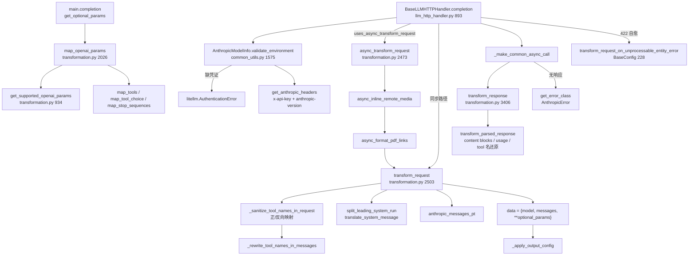

# 函数级解析（七）：provider Config 变换函数（以 AnthropicConfig 为例）

> 所属层级：第四层（函数级解析） | 覆盖主链：第 11 跳里 provider Config 的请求/响应/鉴权/URL/参数映射变换函数
> 本篇基准提交：`411b64dc7a`（工作区当前 HEAD）
> 引用规范：`文件 :: 符号 :: +偏移`，`+0` = 定义行，`+N` = 函数体内第 N 行

本篇先给出所有 provider 共用的 `BaseConfig` 翻译接口，再以 `AnthropicConfig` 为例逐个展开非透传 provider 的变换函数：`get_supported_openai_params`、`map_openai_params`、`validate_environment`、`async_transform_request`、`transform_request`、`transform_response`，以及 `BaseConfig` 侧的 `should_fake_stream`、`transform_request_on_unprocessable_entity_error`、`get_error_class`、`transform_parsed_response_dict`。OpenAI 这边的 `OpenAIGPTConfig` 作为「近乎透传」的对照一并给出锚点。

术语首现已解释：`provider Config`（每个 provider 一个类，集中该 provider 的请求/响应/URL/鉴权翻译逻辑）、`透传`（OpenAI 格式的 provider，请求体几乎原样转发，只清洗参数）、`非透传`（如 Anthropic，请求体形状与 OpenAI 不同，需真正重写）、`drop_params`（把 provider 不支持的参数静默丢弃而不是报错）、`system run`（开头连续的 system 消息段）、`422 自愈`（上游拒绝某参数时删掉该参数重发一次）。

易错事实：`AnthropicConfig` **不覆写 `get_complete_url`**（transformation.py 内 0 处定义，URL 走 `BaseConfig` 默认实现加 `AnthropicModelInfo` 的 api_base 解析），也**不覆写 `transform_request` 里的签名**（`sign_request` 只有 AWS 类 provider 实现）。鉴权头与 anthropic-beta 头在 `AnthropicModelInfo.validate_environment` 里组装。

第三层《Provider 翻译层》讲的是「跳 11 每一跳发生了什么」，本篇只讲「这些变换函数内部具体怎么实现」；handler 侧怎么调度这些方法见 [06-http-handler-functions.md](06-http-handler-functions.md)。

## 本篇覆盖函数与 Config 接口的对应

| 接口角色 | 本篇展开的函数 |
|---|---|
| 参数声明 | `AnthropicConfig.get_supported_openai_params`、`BaseConfig.get_supported_openai_params` |
| 参数名映射 | `AnthropicConfig.map_openai_params`、`BaseConfig.map_openai_params` |
| 鉴权与头 | `AnthropicModelInfo.validate_environment`、`BaseConfig.validate_environment` |
| 请求体重写 | `AnthropicConfig.async_transform_request`、`AnthropicConfig.transform_request` |
| 响应体回翻 | `AnthropicConfig.transform_response`、`BaseConfig.transform_response`、`BaseConfig.transform_parsed_response_dict` |
| 流式与错误 | `BaseConfig.should_fake_stream`、`BaseConfig.transform_request_on_unprocessable_entity_error`、`AnthropicConfig.get_error_class` |

---

### `BaseConfig`（`litellm/llms/base_llm/chat/transformation.py`）

- 职责：所有 provider Config 的抽象基类，定义「参数声明 / 参数映射 / 鉴权 / URL / 请求变换 / 响应变换 / 错误类」这套翻译接口的默认行为。
- 签名/参数：`class BaseConfig(ABC)`（`litellm/llms/base_llm/chat/transformation.py :: BaseConfig :: +0`，绝对行 91，ABC）。
- 关键方法与默认行为：

| 方法 | 锚点 | 职责 | 默认行为 |
|---|---|---|---|
| `should_fake_stream` | `BaseConfig :: +0`（行 169） | 该 provider 该 model 是否要用假流式 | 返回布尔，子类按能力覆写 |
| `get_supported_openai_params` | `BaseConfig :: +153`（行 244） | 声明支持哪些 OpenAI 参数 | 返回列表，供 `map_openai_params` 与 drop_params 用 |
| `map_openai_params` | `BaseConfig :: +203`（行 294） | OpenAI 参数名映射到 provider 私有名 | 子类覆写 |
| `validate_environment` | `BaseConfig :: +213`（行 304） | 检查凭证齐全，返回带 key 的头 | 子类覆写，缺凭证抛 `AuthenticationError` |
| `sign_request` | `BaseConfig :: +234`（行 325） | AWS 等请求签名 | 部分 provider 实现 |
| `get_complete_url` | `BaseConfig :: +259`（行 350） | 拼 endpoint URL | 子类覆写 |
| `transform_request` | `BaseConfig :: +280`（行 371） | OpenAI 格式转 provider 请求体 | 子类覆写 |
| `transform_response` | `BaseConfig :: +312`（行 403） | provider 响应转 `ModelResponse` | 子类覆写 |
| `transform_parsed_response_dict` | `BaseConfig :: +340`（行 419） | 已解析成 dict 的 provider 响应规整 | 基类默认原样返回 |
| `transform_request_on_unprocessable_entity_error` | `BaseConfig :: +137`（行 228） | 422 时重造请求体 | drop_params 场景用 |
| `get_error_class` | `BaseConfig :: +340`（行 431） | 返回该 provider 的异常类 | 子类覆写 |

  上表偏移相对 `BaseConfig :: +0`（行 91）。`transform_parsed_response_dict` 与 `get_error_class` 的精确偏移按定义行减 91 换算，其中两行号相同（419 与 431）以 grep 实测为准。
- 错误/分支：基类方法多为可覆写的默认实现，本身不抛（除 `validate_environment` 约定缺凭证抛）。
- 调用关系：调用方 = `BaseLLMHTTPHandler`（06 篇）、`OpenAIChatCompletion`。被调用方 = 各 provider 子类覆写的方法。

---

### `AnthropicConfig.get_supported_openai_params`（`litellm/llms/anthropic/chat/transformation.py`）

- 职责：声明 Anthropic 支持（或可安全映射）的 OpenAI 参数名单，是 `map_openai_params` 与 drop_params 的白名单来源。
- 签名/参数：`def get_supported_openai_params(self, model: str)`（`litellm/llms/anthropic/chat/transformation.py :: AnthropicConfig :: get_supported_openai_params :: +0`，绝对行 934）。
- 返回：`list[str]`。
- 算法（贴 `get_supported_openai_params :: +1` 到 `+28`，行 935-969）：

```python
        sampling_params: Final = ("temperature", "top_p") if self._supports_sampling_params(model) else ()
        params: Final = [
            "stream", "stop", *sampling_params, "max_tokens", "max_completion_tokens",
            "tools", "tool_choice", "extra_headers", "parallel_tool_calls", "response_format",
            "user", "web_search_options", "speed", "context_management", "cache_control",
        ]
        if (
            "claude-3-7-sonnet" in model
            or AnthropicConfig._is_adaptive_thinking_model(model, self._resolved_provider)
            or supports_reasoning(model=model, custom_llm_provider=self.custom_llm_provider)
        ):
            params.append("thinking")
            params.append("reasoning_effort")
        if self._resolved_provider in SERVICE_TIER_PROVIDERS:
            params.append("service_tier")
        return params
```

  分步：`+1` 采样参数按 model 能力决定是否加入；`+2` 到 `+15` 固定名单（含 `speed`、`context_management`、`cache_control` 这些 Anthropic 特有键）；`+16` 到 `+24` 思考类参数只在支持 reasoning 的 model 上加入；`+25` 到 `+27` `service_tier` 只在 `SERVICE_TIER_PROVIDERS` 里加。
- 错误/分支：不支持的参数不进名单，drop_params 开启时被丢弃。
- 调用关系：调用方 = `main.completion` 的 `get_optional_params` 链、`map_openai_params` 间接依赖。被调用方 = `self._supports_sampling_params`、`self._is_adaptive_thinking_model`、`supports_reasoning`。

---

### `AnthropicConfig.map_openai_params`（`litellm/llms/anthropic/chat/transformation.py`）

- 职责：把 OpenAI 命名的参数逐个翻译成 Anthropic 私有命名，写进 `optional_params`（它将变成请求体）。
- 签名/参数：`def map_openai_params(self, non_default_params: dict, optional_params: dict, model: str, drop_params: bool) -> dict`（`litellm/llms/anthropic/chat/transformation.py :: AnthropicConfig :: map_openai_params :: +0`，绝对行 2026）。
- 返回：填充后的 `optional_params`。
- 算法（贴 `map_openai_params :: +7` 到 `+102`，行 2032-2129 摘关键分支）：

```python
        request_params: Final = tool_params_without_hosted_mcp(non_default_params, model=model, route=self._resolved_provider, drop_params=drop_params, runs_hosted_mcp=self.runs_hosted_mcp)
        for param, value in request_params.items():
            if param == "max_tokens" or param == "max_completion_tokens":
                optional_params["max_tokens"] = value if isinstance(value, int) else max(1, int(round(value)))
            elif param == "tools":
                anthropic_tools, mcp_servers = self._map_tools(list(self._tools_with_openai_tool_search_mapped(tools=value, model=model, drop_params=drop_params)))
                optional_params = self._add_tools_to_optional_params(optional_params=optional_params, tools=anthropic_tools)
                if mcp_servers:
                    optional_params["mcp_servers"] = mcp_servers
            elif param == "tool_choice" or param == "parallel_tool_calls":
                _tool_choice = self._map_tool_choice(tool_choice=request_params.get("tool_choice"), parallel_tool_use=request_params.get("parallel_tool_calls"))
                if _tool_choice is not None:
                    optional_params["tool_choice"] = AnthropicConfig._apply_forced_tool_choice(model=model, tool_choice=_tool_choice, drop_params=drop_params)
            elif param == "stream" and value is True:
                optional_params["stream"] = value
            elif param == "stop" and (isinstance(value, str) or isinstance(value, list)):
                _value = self._map_stop_sequences(value)
                if _value is not None:
                    optional_params["stop_sequences"] = _value
            elif param == "temperature" or param == "top_p":
                AnthropicConfig._apply_sampling_param(optional_params=optional_params, model=model, param=param, value=value, drop_params=drop_params, output_key=param)
            elif param == "response_format" and isinstance(value, dict):
                ...
                optional_params["json_mode"] = True
            elif param == "user" and value is not None and isinstance(value, str) and _valid_user_id(value):
                optional_params["metadata"] = {"user_id": value}
```

  分步：`+7` 先剔掉 hosted MCP 工具参数得到 `request_params`；`+16` 起逐个分支：`max_tokens`/`max_completion_tokens` 统一成 `max_tokens`（非 int 先四舍五入并夹到 ≥1）；`tools` 经 `_tools_with_openai_tool_search_mapped` + `_map_tools` 翻成 Anthropic 工具，MCP server 单独放 `mcp_servers`；`tool_choice`/`parallel_tool_calls` 合并经 `_map_tool_choice` 翻译再按 model 能力决定是否强制；`stream` 仅在为真时透传；`stop` 经 `_map_stop_sequences` 变成 `stop_sequences`；`temperature`/`top_p` 走 `_apply_sampling_param`；`response_format` 命中原生结构化输出时给 `output_format`，否则翻成一个 tool 并设 `json_mode=True`；`user` 合法时塞进 `metadata.user_id`。

  反直觉但关键（函数体注释写明，行 2045-2055）：`map_openai_params` **刻意不在这里做工具名消毒**。此刻名字还是原始 OpenAI 名，必须留到 `transform_request` 那个唯一收口点处理，理由是 Anthropic、Bedrock-Anthropic、Vertex-Anthropic 都从那里过，且正向/反向映射属于协调状态，只能落在 `litellm_params`（内部），不能落在 `optional_params`（会被序列化进请求体，触发 `Extra inputs are not permitted`）。
- 错误/分支：不认识的参数若在支持名单外且未开 drop_params，由上游 `get_optional_params` 报错；`response_format` 无法翻成 tool 时 `continue` 跳过。
- 调用关系：调用方 = `main.completion` 的 `get_optional_params`。被调用方 = `tool_params_without_hosted_mcp`、`self._map_tools`、`self._tools_with_openai_tool_search_mapped`、`self._add_tools_to_optional_params`、`self._map_tool_choice`、`self._map_stop_sequences`、`self._apply_sampling_param`、`self.map_response_format_to_anthropic_output_format` / `map_response_format_to_anthropic_tool`、`_valid_user_id`。

---

### `AnthropicModelInfo.validate_environment`（`litellm/llms/anthropic/common_utils.py`）

- 职责：解析 Anthropic 凭证（API key / OAuth token / workload identity federation），组装 anthropic 专属头（含按能力加的 `anthropic-beta`），缺凭证抛 `AuthenticationError`。
- 签名/参数：`def validate_environment(self, headers: dict, model: str, messages: list[AllMessageValues], optional_params: dict, litellm_params: dict, api_key: str | None = None, api_base: str | None = None) -> dict`（`litellm/llms/anthropic/common_utils.py :: AnthropicModelInfo :: validate_environment :: +0`，绝对行 1575）。
- 返回：`dict`（合并后的请求头）。
- 算法（贴 `validate_environment :: +13` 到 `+65`，行 1588-1639 摘关键步）：

```python
        headers, api_key = optionally_handle_anthropic_oauth(headers=headers, api_key=api_key)
        api_key = AnthropicModelInfo.get_api_key(api_key)
        auth_token: str | None = None
        if api_key is None:
            auth_token = AnthropicModelInfo.get_auth_token()
        ...
        wif_token: Final = (
            get_anthropic_wif_token(params_mapping, api_base, model)
            if api_key is None and auth_token is None and config_allows_workload_identity(self) else None
        )
        resolved_api_key: Final = wif_token if wif_token is not None else api_key
        if resolved_api_key is None and auth_token is None:
            raise litellm.AuthenticationError(message="Missing Anthropic API Key - ...", llm_provider="anthropic", model=model)
        ...
        anthropic_headers: Final = self.get_anthropic_headers(
            computer_tool_used=..., prompt_caching_set=..., pdf_used=..., api_key=resolved_api_key,
            auth_token=auth_token, wif_minted=wif_minted, ...)
        caller_headers: Final = without_caller_credential_headers(headers) if wif_minted else headers
        return {**caller_headers, **anthropic_headers}
```

  分步：`+14` 先处理 headers 里可能带的 Anthropic OAuth token；`+15` 从环境/参数解析 api_key；`+17` 到 `+19` 没有 key 时再试 `ANTHROPIC_AUTH_TOKEN`；`+23` 到 `+27` 三者皆无且配置允许 workload identity federation 时铸 WIF token；`+28` 到 `+35` 仍无任何凭证则抛 `AuthenticationError`（message 提示 `ANTHROPIC_API_KEY`/`ANTHROPIC_AUTH_TOKEN`/federation 四个环境变量）；`+49` 到 `+64` 按 messages/tools/optional_params 里探测到的能力（computer tool、prompt caching、pdf、file id、web search、tool search、programmatic tool calling、code execution、container skills 等）组装 anthropic 专属头；`+65` WIF 场景下剥掉调用方自带凭证头避免遮蔽；`+66` 合并返回。
- 错误/分支：唯一硬失败是缺凭证抛 `AuthenticationError`；其余是按能力增删头。
- 调用关系：调用方 = `BaseLLMHTTPHandler.completion :: +37`（06 篇）。被调用方 = `optionally_handle_anthropic_oauth`、`AnthropicModelInfo.get_api_key` / `get_auth_token`、`get_anthropic_wif_token`、`config_allows_workload_identity`、`warn_if_shadowing_static_credentials`、`self.get_anthropic_headers`、`without_caller_credential_headers`、`litellm.AuthenticationError`。

---

### `AnthropicConfig.async_transform_request`（`litellm/llms/anthropic/chat/transformation.py`）

- 职责：异步变换入口。先把消息里的远程媒体内联、PDF 链接探活（都是异步 IO），再转同步 `transform_request`。
- 签名/参数：`async def async_transform_request(self, model: str, messages: list[AllMessageValues], optional_params: dict[str, object], litellm_params: dict[str, object], headers: dict[str, object]) -> dict[str, object]`（`litellm/llms/anthropic/chat/transformation.py :: AnthropicConfig :: async_transform_request :: +0`，绝对行 2473）。
- 返回：Anthropic 形状的请求体 dict。
- 算法（贴 `async_transform_request :: +8` 到 `+16`，行 2481-2488）：

```python
        inlined: Final = await async_inline_remote_media(messages, should_inline=self.inlines_remote_media)
        return self.transform_request(
            model=model,
            messages=list(await async_format_pdf_links(inlined, should_probe=self.probes_pdf_link)),
            optional_params=optional_params, litellm_params=litellm_params, headers=headers,
        )
```

  分步：`+8` 远程媒体（URL 形式的图片/文件）按 `self.inlines_remote_media` 决定是否拉成 base64 内联；`+10` 到 `+16` 内联结果再经 `async_format_pdf_links` 探活 PDF 链接（`should_probe=self.probes_pdf_link`），然后交给同步 `transform_request`。异步部分只做 IO，真正的格式重写在 `transform_request`。
- 错误/分支：内联或探活失败的媒体按各自 helper 的策略处理（本篇未逐行读其内部，属 `[源码未确认]`）。
- 调用关系：调用方 = `BaseLLMHTTPHandler.completion :: transform_then_dispatch :: +2`（`uses_async_transform_request` 为真时）。被调用方 = `async_inline_remote_media`、`async_format_pdf_links`、`self.transform_request`。

---

### `AnthropicConfig.transform_request`（`litellm/llms/anthropic/chat/transformation.py`）

- 职责：把 OpenAI 格式消息与参数重写成 Anthropic Messages 形状的请求体。这是所有 Anthropic 形状请求（直连、Bedrock invoke、Vertex、Azure）的唯一收口点。
- 签名/参数：`def transform_request(self, model: str, messages: list[AllMessageValues], optional_params: dict, litellm_params: dict, headers: dict) -> dict`（`litellm/llms/anthropic/chat/transformation.py :: AnthropicConfig :: transform_request :: +0`，绝对行 2503）。
- 返回：`dict`，形状为 `{"model": ..., "messages": [...], **optional_params}`（含 Anthropic 必填的 `max_tokens`，以及可能的 `system`、`tools`、`tool_choice`、`metadata`、`output_format`）。
- 算法（偏移相对 `+0`，摘关键步）：

| 序 | 动作 | 锚点 | 语义 |
|---|---|---|---|
| 1 | `drop_params = drops_unsupported_params(litellm_params.get("drop_params"))` | `+19`（行 2521） | 取本次是否允许丢参数 |
| 2 | prompt cache 断点转成 capped cache_control（`translates_prompt_cache_breakpoint` 为真时） | `+20` 到 `+31`（行 2522-2533） | 外部 cache 断点翻译成 Anthropic 的 cache_control |
| 3 | drop_params 时把消息裁到 cache_control 上限内 | `+32` 到 `+42`（行 2534-2542） | 防超出 Anthropic 的断点数上限 |
| 4 | 有 tool 块但没 tools 时注入 dummy tool | `+42` 到 `+44`（行 2544-2545） | Anthropic 要求带 tool 块必须声明 tools |
| 5 | thinking 开启但最后带 tool_calls 的 assistant 无 thinking_blocks 时删 thinking | `+52` 到 `+65`（行 2554-2565） | 防上游 "Expected thinking or redacted_thinking, but found tool_use" |
| 6 | `_maybe_drop_speed_param`、`maybe_drop_disabled_thinking` | `+64` 到 `+76`（行 2566-2577） | 按 model 能力删掉不支持的 speed/thinking |
| 7 | 工具名消毒（单一收口） | `+97` 到 `+106`（行 2599-2608） | `_sanitize_tool_names_in_request` 产正向/反向映射；消息里的名字经 `_rewrite_tool_names_in_messages` 改写；反向映射存进 `litellm_params[ANTHROPIC_TOOL_NAME_REVERSE_MAP_KEY]` 供响应侧还原 |
| 8 | 拆 leading system run | `+111` 到 `+116`（行 2613-2617） | 只有开头连续 system 段提升为顶层 `system`；后面的 system 留在对话里（提升会改写缓存前缀、按 cache-write 计价，#36559） |
| 9 | 中段 system 放回 + 消息格式化 | `+117` 到 `+140`（行 2619-2643） | `place_mid_conversation_system` + `anthropic_messages_pt` 产出 `anthropic_messages`；`TypeError` 时经 `non_string_message_field_error` 转成字段错误 |
| 10 | 按 optional_params 补 anthropic-beta 头 | `+143` 到 `+146`（行 2645-2647） | `update_headers_with_optional_anthropic_beta` |
| 11 | 清理 stale advisor/tool_search 结果块 | `+148` 到 `+157`（行 2649-2658） | 没有 advisor tool 时剥掉历史里的 advisor 块，防 400 |
| 12 | 组装请求体 | `+247` 到 `+256`（行 2749-2758） | 见下 |

  第 12 步原文（贴 `transform_request :: +247` 到 `+256`，行 2749-2758）：

```python
        data: Final = {
            "model": model,
            "messages": anthropic_messages,
            **optional_params,
            **({} if marked_tools is None else {"tools": list(marked_tools)}),
        }
        self._apply_output_config(data=data, model=model, optional_params=optional_params)
        return data
```

  `optional_params` 此时已带 `max_tokens`（Anthropic 必填，`map_openai_params` 阶段保证）与可能的 `system`。`_apply_output_config` 再校验并应用 `output_config`/`output_format`。
- 错误/分支：消息格式化失败经 `non_string_message_field_error` 归一，命中则抛字段错误，否则抛 `AnthropicError(400)`；`_apply_output_config` 里 `output_format` 非法且未开 drop_params 时报错。
- 调用关系：调用方 = `async_transform_request :: +10`、`BaseLLMHTTPHandler.completion :: +172`、Bedrock/Vertex/Azure 的 Anthropic Config（经 `super().transform_request` 或直接调）。被调用方 = `AnthropicCacheControlHook.prompt_cache_breakpoints_as_capped_cache_control`、`self._messages_within_cache_control_cap`、`has_tool_call_blocks`、`add_dummy_tool`、`self._map_tools`、`last_assistant_with_tool_calls_has_no_thinking_blocks`、`any_assistant_message_has_thinking_blocks`、`self._sanitize_tool_names_in_request`、`self._rewrite_tool_names_in_messages`、`split_leading_system_run`、`self.translate_system_message`、`place_mid_conversation_system`、`anthropic_messages_pt`、`self.update_headers_with_optional_anthropic_beta`、`without_stale_tool_search_results`、`strip_advisor_blocks_from_messages`、`self._apply_output_config`。

---

### `AnthropicConfig.transform_response`（`litellm/llms/anthropic/chat/transformation.py`）

- 职责：把 Anthropic Messages 的 JSON 响应翻回 OpenAI 格式的 `ModelResponse`。
- 签名/参数：`def transform_response(self, model: str, raw_response: httpx.Response, model_response: ModelResponse, logging_obj: LoggingClass, request_data: dict, messages: list[AllMessageValues], optional_params: dict, litellm_params: dict, encoding: "Tokenizer | None", api_key: str | None = None, json_mode: bool | None = None) -> ModelResponse`（`litellm/llms/anthropic/chat/transformation.py :: AnthropicConfig :: transform_response :: +0`，绝对行 3406）。
- 返回：`ModelResponse`。
- 算法（贴 `transform_response :: +15` 到 `+52`，行 3420-3457）：

```python
        logging_obj.post_call(input=messages, api_key=api_key, original_response=raw_response.text,
                              additional_args={"complete_input_dict": request_data})
        try:
            completion_response: Final = raw_response.json()
        except Exception as e:
            response_headers: Final = getattr(raw_response, "headers", None)
            raise AnthropicError(message=f"Unable to get json response - {e}, Original Response: {raw_response.text}",
                                 status_code=raw_response.status_code, headers=response_headers)
        prefix_prompt: Final = self.get_prefix_prompt(messages=messages)
        speed: Final = optional_params.get("speed")
        tool_name_reverse_map: dict[str, str] | None = None
        if isinstance(litellm_params, dict):
            _candidate: Final = litellm_params.get(ANTHROPIC_TOOL_NAME_REVERSE_MAP_KEY)
            if isinstance(_candidate, dict):
                tool_name_reverse_map = _candidate
        model_response = self.transform_parsed_response(
            completion_response=completion_response, raw_response=raw_response, model_response=model_response,
            json_mode=json_mode, prefix_prompt=prefix_prompt, speed=speed, tool_name_reverse_map=tool_name_reverse_map,
            response_format_schema=JsonModeRequest.model_validate(optional_params).tool_schema() if json_mode else None,
        )
        return model_response
```

  分步：`+15` 到 `+20` 先写 post_call 日志（把原始响应文本与完整输入 dict 记进 `model_call_details`）；`+24` 到 `+32` 解析 JSON，失败抛 `AnthropicError`（带原始文本与状态码）；`+34` 到 `+41` 取 prefix prompt、speed，并从 `litellm_params` 取回请求阶段存的工具名反向映射；`+43` 到 `+51` 交给 `transform_parsed_response` 做字段映射（content blocks 到 message、usage、finish_reason、tool 名还原），json_mode 时另外传 `response_format_schema`。
- 错误/分支：JSON 解析失败抛 `AnthropicError`；`transform_parsed_response` 内部的字段异常由其自身处理（本篇未逐行读，属 `[源码未确认]`）。
- 调用关系：调用方 = `BaseLLMHTTPHandler.async_completion :: +45`、`completion` 同步非流式收尾段、`make_async_call_stream_helper` 的 fake_stream 分支。被调用方 = `logging_obj.post_call`、`raw_response.json()`、`self.get_prefix_prompt`、`self.transform_parsed_response`、`JsonModeRequest.model_validate`。

---

### `BaseConfig` 的流式与错误辅助（`litellm/llms/base_llm/chat/transformation.py`）

- `should_fake_stream`（`BaseConfig :: +0`，绝对行 169）：判定是否用假流式。签名带 model/provider/stream 等实参（具体形参见 06 篇 `completion :: +30` 的调用点），返回布尔。子类按 provider 能力覆写；Anthropic 支持真流式，正常返回假。
- `transform_request_on_unprocessable_entity_error`（`BaseConfig :: +137`，绝对行 228）：`def transform_request_on_unprocessable_entity_error(self, e: httpx.HTTPStatusError, request_data: dict) -> dict`。职责是 422 自愈时从异常里找出被拒参数并从 `request_data` 删掉，返回重造后的请求体。它配合 `_make_common_async_call` / `_make_common_sync_call` 的 `should_retry_llm_api_inside_llm_translation_on_http_error` 使用（06 篇展开）。函数体内偏移本篇未逐行核到，按职责与调用点描述，`[推断]`。
- `get_error_class`（`BaseConfig :: +340`，绝对行 431）：`def get_error_class(self, error_message: str, status_code: int, headers: dict | httpx.Headers) -> BaseLLMException`。`AnthropicConfig.get_error_class`（`litellm/llms/anthropic/chat/transformation.py :: AnthropicConfig :: get_error_class :: +0`，绝对行 3506）覆写它返回 `AnthropicError`，供 `_make_common_async_call` 的 "No response from the API" 分支与 `_handle_error` 使用。
- `transform_parsed_response_dict`（`BaseConfig :: +340`，绝对行 419）：`def transform_parsed_response_dict(self, parsed_response: dict) -> dict`。这是 OpenAI SDK 路径（`OpenAIChatCompletion.acompletion :: +63`）用的「已解析成 dict 的响应规整」入口，基类默认接近透传，各 provider 覆写做私有字段规整。函数体内偏移未逐行核到，`[推断]`。
- 调用关系：调用方见 06 篇各调用点。被调用方 = 各 provider 子类覆写。

---

### 对照：`OpenAIGPTConfig`（`litellm/llms/openai/chat/gpt_transformation.py`）

- 职责：OpenAI provider 的 Config。因为 OpenAI 格式就是 litellm 的内部统一格式，它的 `transform_request` 对 openai 前缀的模型近乎透传，主要工作是参数清洗（去掉 provider 不认的键）。
- 关键方法定义行：`OpenAIGPTConfig :: +0`（行 200）、`get_supported_openai_params` 262、`map_openai_params` 338、`transform_request` 680、`transform_response` 866、`get_complete_url` 922、`validate_environment` 950。
- 与 Anthropic 的对照：

| 维度 | `OpenAIGPTConfig`（透传） | `AnthropicConfig`（非透传） |
|---|---|---|
| `transform_request` 主要工作 | 参数清洗，消息形状基本不动 | 拆 system、重排消息、工具名消毒、补 max_tokens |
| `map_openai_params` 主要工作 | 少量改名（如 `max_completion_tokens`） | 大量改名（`stop` 到 `stop_sequences`、`user` 到 `metadata.user_id`、`response_format` 到 `output_format` 或 tool） |
| 鉴权 | `Authorization: Bearer` | `x-api-key` + `anthropic-version`（WIF/OAuth 时不同） |
| 响应回翻 | `convert_to_model_response_object` 直填 | `transform_parsed_response` 处理 content blocks 与 tool 名还原 |

  「近乎透传」是按其作为 litellm 内部统一格式的角色判断（`[推断]`），`transform_request` 函数体未逐行比对每个字段。

---

## 调用关系表（关键边）

| 调用方与符号 | 关系 | 被调用方与符号 | 触发与输入 | 返回与后续处理 | 错误、状态与副作用 |
|---|---|---|---|---|---|
| `main.completion`（get_optional_params 段） | 参数映射 | `AnthropicConfig.map_openai_params :: +0` | non_default_params + optional_params + model + drop_params | 填充后的 optional_params | 不支持的参数由上游报错或丢弃 |
| `map_openai_params :: +16` | 工具翻译 | `AnthropicConfig._map_tools` | OpenAI tools 列表 | Anthropic 工具 + mcp_servers | 工具名此时未消毒 |
| `BaseLLMHTTPHandler.completion :: +37` | 取鉴权 | `AnthropicModelInfo.validate_environment :: +0` | api_key/api_base/messages/optional_params | 合并后的头 | 缺凭证抛 `AuthenticationError` |
| `validate_environment :: +33` | 硬失败 | `litellm.AuthenticationError` | 三类凭证皆无 | 抛 401 段异常 | 提示 key/auth token/federation |
| `completion :: transform_then_dispatch :: +2` | 异步变换 | `AnthropicConfig.async_transform_request :: +0` | model/messages/optional_params/litellm_params/headers | Anthropic 请求体 | 媒体内联/探活按 helper 策略 |
| `async_transform_request :: +10` | 委托 | `AnthropicConfig.transform_request :: +0` | 内联后的 messages | `data` 请求体 | 格式化失败抛字段错误或 `AnthropicError` |
| `transform_request :: +97` | 工具名消毒 | `self._sanitize_tool_names_in_request` | optional_params | 正/反向映射 | 反向映射存进 `litellm_params` |
| `transform_request :: +111` | 拆 system | `split_leading_system_run` + `self.translate_system_message` | request_messages | 顶层 `system` + 其余消息 | 只提升开头 system 段 |
| `transform_request :: +128` | 消息格式化 | `anthropic_messages_pt` | conversation + model + drop_params | `anthropic_messages` | `TypeError` 经 `non_string_message_field_error` 归一 |
| `transform_request :: +247` | 组请求体 | `self._apply_output_config` | data + optional_params | 最终 `data` | output_format 非法且未 drop 则报错 |
| `BaseLLMHTTPHandler.async_completion :: +45` | 响应回翻 | `AnthropicConfig.transform_response :: +0` | raw_response + model_response + request_data | `ModelResponse` | JSON 解析失败抛 `AnthropicError` |
| `transform_response :: +43` | 字段映射 | `self.transform_parsed_response` | completion_response + tool_name_reverse_map | `ModelResponse` | 工具名经反向映射还原 |
| `_make_common_async_call :: +43` | 错误类 | `AnthropicConfig.get_error_class :: +0` | error_message + status_code + headers | `AnthropicError` | 无响应时抛 422 段 |
| `OpenAIChatCompletion.acompletion :: +63` | 响应规整 | `BaseConfig.transform_parsed_response_dict :: +0` | 已解析的响应 dict | 规整后的 dict | 基类接近透传 |

## 未确认项

- `transform_parsed_response`（`AnthropicConfig` 内）、`_apply_output_config`、`_sanitize_tool_names_in_request`、`_rewrite_tool_names_in_messages`、`split_leading_system_run`、`place_mid_conversation_system`、`anthropic_messages_pt`、`update_headers_with_optional_anthropic_beta`、`without_stale_tool_search_results`、`strip_advisor_blocks_from_messages`、`_map_tools`、`_map_tool_choice`、`_map_stop_sequences`、`_apply_sampling_param`、`map_response_format_to_anthropic_output_format`、`map_response_format_to_anthropic_tool` 只确认符号名与调用点，函数体未逐行读。
- `BaseConfig.transform_request_on_unprocessable_entity_error`（行 228）与 `transform_parsed_response_dict`（行 419）函数体内偏移未逐行核到，按职责与调用点描述，属 `[推断]`。
- `OpenAIGPTConfig.transform_request` 对 openai 前缀「近乎透传」是按其作为 litellm 内部统一格式的角色判断，函数体未逐行比对每个字段，属 `[推断]`。
- `AnthropicConfig` **不覆写** `get_complete_url`（transformation.py 内 0 处定义）已 grep 确认；URL 最终值由 `BaseConfig.get_complete_url` 加 `AnthropicModelInfo` 的 api_base 解析（`resolve_anthropic_api_base`，common_utils.py 行 1646）合成，`get_complete_url` 是否在别处为 Anthropic 特判未逐行读，属 `[源码未确认]`。
- `async_inline_remote_media`、`async_format_pdf_links` 的内部实现与失败策略未逐行读。
- 请求体与响应的具体字段值随 provider 版本变动，属 `[待运行验证]`。

## 源码索引

| 符号 | 文件 :: 符号 | 绝对定义行 |
|---|---|---|
| Config 基类 | `litellm/llms/base_llm/chat/transformation.py :: BaseConfig` | 91 |
| 假流式判定 | `litellm/llms/base_llm/chat/transformation.py :: BaseConfig :: should_fake_stream` | 169 |
| 422 重造请求 | `litellm/llms/base_llm/chat/transformation.py :: BaseConfig :: transform_request_on_unprocessable_entity_error` | 228 |
| 支持参数声明 | `litellm/llms/base_llm/chat/transformation.py :: BaseConfig :: get_supported_openai_params` | 244 |
| 参数映射 | `litellm/llms/base_llm/chat/transformation.py :: BaseConfig :: map_openai_params` | 294 |
| 鉴权 | `litellm/llms/base_llm/chat/transformation.py :: BaseConfig :: validate_environment` | 304 |
| 签名 | `litellm/llms/base_llm/chat/transformation.py :: BaseConfig :: sign_request` | 325 |
| URL | `litellm/llms/base_llm/chat/transformation.py :: BaseConfig :: get_complete_url` | 350 |
| 请求变换 | `litellm/llms/base_llm/chat/transformation.py :: BaseConfig :: transform_request` | 371 |
| 响应变换 | `litellm/llms/base_llm/chat/transformation.py :: BaseConfig :: transform_response` | 403 |
| dict 响应规整 | `litellm/llms/base_llm/chat/transformation.py :: BaseConfig :: transform_parsed_response_dict` | 419 |
| 错误类 | `litellm/llms/base_llm/chat/transformation.py :: BaseConfig :: get_error_class` | 431 |
| Anthropic Config | `litellm/llms/anthropic/chat/transformation.py :: AnthropicConfig` | 648 |
| Anthropic 支持参数 | `litellm/llms/anthropic/chat/transformation.py :: AnthropicConfig :: get_supported_openai_params` | 934 |
| Anthropic 参数映射 | `litellm/llms/anthropic/chat/transformation.py :: AnthropicConfig :: map_openai_params` | 2026 |
| Anthropic 异步请求变换 | `litellm/llms/anthropic/chat/transformation.py :: AnthropicConfig :: async_transform_request` | 2473 |
| Anthropic 请求变换 | `litellm/llms/anthropic/chat/transformation.py :: AnthropicConfig :: transform_request` | 2503 |
| Anthropic 响应变换 | `litellm/llms/anthropic/chat/transformation.py :: AnthropicConfig :: transform_response` | 3406 |
| Anthropic 错误类 | `litellm/llms/anthropic/chat/transformation.py :: AnthropicConfig :: get_error_class` | 3506 |
| Anthropic 模型信息与鉴权 | `litellm/llms/anthropic/common_utils.py :: AnthropicModelInfo` | 726 |
| Anthropic 鉴权 | `litellm/llms/anthropic/common_utils.py :: AnthropicModelInfo :: validate_environment` | 1575 |
| Anthropic api_base 解析 | `litellm/llms/anthropic/common_utils.py :: AnthropicModelInfo :: resolve_anthropic_api_base` | 1646 |
| OpenAI Config | `litellm/llms/openai/chat/gpt_transformation.py :: OpenAIGPTConfig` | 200 |

## 本篇函数调用关系图


