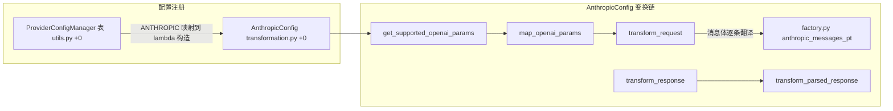

# 函数级解析：Provider 变换函数（以 AnthropicConfig 为例）

> 所属层级：第四层（源码补齐） | 覆盖：`litellm/llms/anthropic/chat/transformation.py :: AnthropicConfig`

选 Anthropic 做例子的原因：它是「翻译最重」的典型（system 抽离、thinking 块、prompt cache、tool 循环、工具名清洗），吃透它就掌握了所有非透传 provider 的变换模式。OpenAI 那类透传 provider 的 Config 只覆盖能力矩阵与少量特判。

## 0. 类定义

```
litellm/llms/anthropic/chat/transformation.py :: AnthropicConfig :: +0
```

实测于 `0608a41a07`（2026-11-12）：`AnthropicConfig` 类定义行在 `transformation.py:648`（旧文档无行号，重建全部偏移）。继承 `AnthropicModelInfo, BaseConfig`（`BaseConfig` 定义在 `litellm/llms/base_llm/chat/transformation.py :: BaseConfig :: +0`，实测 91 行；`AnthropicModelInfo` 在 `litellm/llms/anthropic/common_utils.py :: AnthropicModelInfo :: +0`，实测 726 行）。类体 `+0` 至 `+16` 是 7 个默认参数字段（`max_tokens`、`stop_sequences`、`temperature`、`top_p`、`top_k`、`metadata`、`system`），随后 `__init__` 把非 None 入参写回类属性。无实例状态，其余方法是纯变换。

## 1. `get_supported_openai_params()`

```
litellm/llms/anthropic/chat/transformation.py :: AnthropicConfig :: get_supported_openai_params() :: +0
```

实测 934 行起（旧文档未给行号，全篇重建）。返回 `list[str]`，声明该 provider 接受哪些 OpenAI 参数（能力矩阵）。

| 项 | 内容 |
|---|---|
| 职责 | 声明 Anthropic 接受的 OpenAI 参数（能力矩阵） |
| 返回 | `list[str]` |
| 核心算法 | `+1`：`sampling_params` 按 `_supports_sampling_params(model)` 决定是否含 `temperature`/`top_p`；`+2` 至 `+17`：基础列表（`stream`、`stop`、`max_tokens`、`max_completion_tokens`、`tools`、`tool_choice`、`extra_headers`、`parallel_tool_calls`、`response_format`、`user`、`web_search_options`、`speed`、`context_management`、`cache_control` 等）；`+20` 起：当模型名含 `claude-3-7-sonnet` 或 `_is_adaptive_thinking_model()` 为真或 `supports_reasoning()` 为真时追加 `thinking` 与 `reasoning_effort`；`+31`：provider 在 `SERVICE_TIER_PROVIDERS` 内时追加 `service_tier` |

消费方：`litellm/utils.py :: get_optional_params()`（实测 5517 行起）拿它决定「传了不支持的参数怎么办」。

## 2. `map_openai_params()`

```
litellm/llms/anthropic/chat/transformation.py :: AnthropicConfig :: map_openai_params() :: +0
```

实测 2026 行起。OpenAI 参数名/值 → Anthropic 参数名/值。

| 项 | 内容 |
|---|---|
| 职责 | OpenAI 参数名/值 → Anthropic 参数名/值（纯翻译，不洗工具名，见下） |
| 返回 | 改写的 `optional_params` dict |
| 核心算法 | `+7` 起：先 `tool_params_without_hosted_mcp` 剥离 hosted MCP 工具；`+32` 起逐参数映射：`max_tokens`/`max_completion_tokens` 统一写 `max_tokens` 且取整；`tools` 经 `_map_tools` 转 Anthropic 工具并把 `mcp_servers` 单独塞 `optional_params["mcp_servers"]`；`tool_choice`/`parallel_tool_calls` 合并映射；`stop` → `stop_sequences`（`_map_stop_sequences`）；`response_format` → 原生 `output_format` 或 JSON-mode tool（含 `output_format`/`json_mode=True` 标记）；`user` → `metadata={"user_id"}`；`thinking`/`reasoning_effort` → Anthropic thinking 配置（adaptive 降级、dict 形态归一）；`web_search_options`、`context_management`、`speed`、`service_tier`、`cache_control` 各有专支 |
| 关键约束 | `+21` 至 `+29` 注释写明：工具名**故意不在此清洗**，保留原始 OpenAI 名，到 `transform_request` 统一洗（那是 Bedrock/Vertex/Azure 共用的唯一咽喉点） |

## 3. `transform_request()`

```
litellm/llms/anthropic/chat/transformation.py :: AnthropicConfig :: transform_request() :: +0
```

实测 2503 行起。OpenAI 消息格式 → Anthropic `/v1/messages` 请求体。

| 项 | 内容 |
|---|---|
| 职责 | OpenAI 消息格式 → Anthropic `/v1/messages` 请求体 |
| 参数 | `model`、`messages`、`optional_params`、`litellm_params`、`headers` |
| 返回 | Anthropic 请求体 dict（调用方再经 `validate_environment` 组装认证头；URL 早已在 `main.completion()` 解析好，见 §6） |
| 前置 | `map_openai_params` 已跑完（`optional_params` 已是 Anthropic 形） |
| 后置 | 无副作用（但会改 `optional_params` 与 `litellm_params[ANTHROPIC_TOOL_NAME_REVERSE_MAP_KEY]`） |

核心算法（偏移相对 `+0`，均为真实代码顺序）：

1. `+18`：prompt cache 断点翻译——`translates_prompt_cache_breakpoint(model)` 时经 `AnthropicCacheControlHook.prompt_cache_breakpoints_as_capped_cache_control` 处理 cache_control；`drop_params` 时再过 `_messages_within_cache_control_cap`
2. `+41`：`if "tools" not in optional_params and has_tool_call_blocks(capped_messages):` 注入 dummy tool（`_map_tools(add_dummy_tool(...))`）
3. `+51` 至 `+61`：thinking 一致性清理——`thinking` 开启但最后一个含 tool_calls 的 assistant 消息没有 thinking_blocks 且全对话无任何 thinking 块时，仅当 `litellm.modify_params` 时丢弃 thinking 并打警告
4. `+96` 起：工具名清洗咽喉点——`_sanitize_tool_names_in_request` 生成前向/反向映射，`_rewrite_tool_names_in_messages` 改写消息，反向映射落 `litellm_params[ANTHROPIC_TOOL_NAME_REVERSE_MAP_KEY]`
5. `+110`：`split_leading_system_run(request_messages)`——只把**开头连续**的 system 消息提升为顶层 `system` 字段；中段 system 消息保持原位（注释：提升会改写缓存前缀并按 cache-write 重计价）
6. `+114`：`optional_params["system"] = anthropic_system_message_list`
7. `+116`：中段 system 经 `place_mid_conversation_system` 处理（按模型是否支持 mid-conversation system 分支）
8. `+129`：`anthropic_messages_pt(...)`（`litellm/litellm_core_utils/prompt_templates/factory.py :: anthropic_messages_pt :: +0`，实测 3015 行起）做消息体逐条翻译（role/content/tool_use/tool_result 九种块）
9. `+142`：`update_headers_with_optional_anthropic_beta` 按工具能力补 `anthropic-beta` 头
10. `+151`：`strip_advisor_blocks_from_messages` 清理非 Anthropic advisor 块（含 `without_stale_tool_search_results`）
11. `+185` 起：`get_config` 兜底 max_tokens 等默认；metadata 只留 `user_id`；剥内部参数；`top_k` 门控；拼 `data = {"model", "messages", **optional_params}` 后 `_apply_output_config` 应用 output_config

## 4. `transform_response()`

```
litellm/llms/anthropic/chat/transformation.py :: AnthropicConfig :: transform_response() :: +0
```

实测 3406 行起。Anthropic 响应 JSON → `ModelResponse`（OpenAI 形）。

| 项 | 内容 |
|---|---|
| 职责 | Anthropic 响应 JSON → `ModelResponse`（OpenAI 形） |
| 参数 | `model`、`raw_response`（httpx 响应）、`model_response`、`logging_obj`、`request_data`、`messages`、`optional_params`、`litellm_params`、`encoding`、`api_key`、`json_mode` |
| 返回 | `ModelResponse` |
| 后置 | usage（含 cache 读写 token）、finish_reason 映射（`map_finish_reason`，`litellm/litellm_core_utils/core_helpers.py :: map_finish_reason :: +0`）进结果 |

核心算法：`+14` 起 `logging_obj.post_call` 记日志；`+24` 起解析 JSON 并抛 `AnthropicError`；`+33` 起从 `litellm_params[ANTHROPIC_TOOL_NAME_REVERSE_MAP_KEY]` 取工具名反向映射；`+41` 起委托给 `transform_parsed_response(...)`（实测 `+0` 在 3262 行），传入 `tool_name_reverse_map`（处理 Anthropic 工具名长度截断的反向还原）与 json mode 的 schema。JSON mode 特殊处理：Anthropic 把 schema 响应当 tool call 返回，`_convert_tool_response_to_message()`（静态方法，实测 `+0` 在 3460 行）把它转回普通 message（参数 `response_format_schema` 支持 schema 切分答案）。

`transform_parsed_response` 内部：`+11` 起拆 `extract_response_content` 的九元组；反向映射工具名；`+33` 起 `split_response_format_answer` 处理 json mode；`+55` 起 `map_finish_reason(completion_response["stop_reason"])`；`+65` 起 `calculate_usage(...)`（实测 `+0` 在 3042 行）聚合 usage 写 `model_response.usage`；`+77` 起写 `created`/`model`/`hidden_params`。

## 5. `validate_environment()`

```
litellm/llms/anthropic/common_utils.py :: AnthropicModelInfo :: validate_environment() :: +0（AnthropicConfig 经继承获得）
```

实测 1575 行起（`AnthropicModelInfo` 继承自 `BaseLLMModelInfo`）。凭证检查 + 组装认证头。

| 项 | 内容 |
|---|---|
| 职责 | 凭证检查 + 组装认证头 |
| 返回 | `dict`（合并调用方头与 Anthropic 头；缺凭证时抛 `litellm.AuthenticationError`） |
| 核心算法 | `+17` 起 key 来源链：显式 `api_key` → `AnthropicModelInfo.get_api_key()`（读 env `ANTHROPIC_API_KEY`）→ 可选 OAuth token 交换（`optionally_handle_anthropic_oauth`）→ `ANTHROPIC_AUTH_TOKEN` → workload identity 联邦（WIF）token；`+24` 起检测消息里是否带 prompt cache/computer tool/mcp/pdf/web search/tool search 等，`+63` 起 `get_anthropic_headers` 据这些能力拼 `anthropic-version` 与对应 `anthropic-beta` 头 |

## 6. URL 的真实来源

`AnthropicConfig` **不覆写** `get_complete_url`（grep `transformation.py` 与 `common_utils.py` 均 0 处定义，符合 spec 事实 4）。它用的是 `BaseConfig` 默认实现（`litellm/llms/base_llm/chat/transformation.py :: BaseConfig :: get_complete_url() :: +0`，实测 350 行起：api_base 为空抛 ValueError，否则原样返回）。URL 在更早的 `main.completion()` anthropic 分支解析完毕（`litellm/main.py :: completion()`，实测 5564 行起；具体分支函数 `litellm/main.py :: _complete_anthropic`，实测 3087 行起）：

- `+17`：默认 `https://api.anthropic.com/v1/messages`
- env `ANTHROPIC_API_BASE` / `ANTHROPIC_BASE_URL` 可覆盖
- `+31`：`ensure_api_route(api_base, "v1/messages")` 自动补后缀；`LITELLM_ANTHROPIC_DISABLE_URL_SUFFIX` 可关掉补后缀
- `+37`：`anthropic_chat_completions.completion(...)` 带 `api_base` 走 HTTP

流式响应由 `litellm/llms/anthropic/chat/handler.py` 的迭代器族解析 SSE 事件（`content_block_delta` 等），再由 `CustomStreamWrapper` 统一包装（见 10-streaming-functions）。

## 7. BaseConfig 的公共契约

所有 Config 的方法集由基类约定（`litellm/llms/base_llm/chat/transformation.py :: BaseConfig :: +0`，实测 91 行起）：

| 方法 | 必须实现？ | 语义 |
|---|---|---|
| `get_supported_openai_params` | 是 | 能力矩阵 |
| `map_openai_params` | 是 | 参数翻译 |
| `transform_request` | 是（`@abstractmethod`） | 请求翻译 |
| `transform_response` | 是（`@abstractmethod`） | 响应翻译 |
| `get_complete_url` | 否（默认原样返回 api_base） | URL 拼装 |
| `validate_environment` | 否（默认不查） | 凭证与头 |
| `transform_request_on_unprocessable_entity_error` | 可选 | 4xx 自愈（默认原样抛出） |
| `async_transform_request` | 可选 | 异步翻译开关（默认转发到同步 `transform_request`，需要取 token 的 provider 置 True） |

新增一个 provider = 实现这组方法 + 在 `ProviderConfigManager` 表里注册（`litellm/utils.py :: ProviderConfigManager :: _build_provider_config_map() :: +0`，实测 9729 行起；`LlmProviders.ANTHROPIC: (lambda: litellm.AnthropicConfig(), False)`）。

