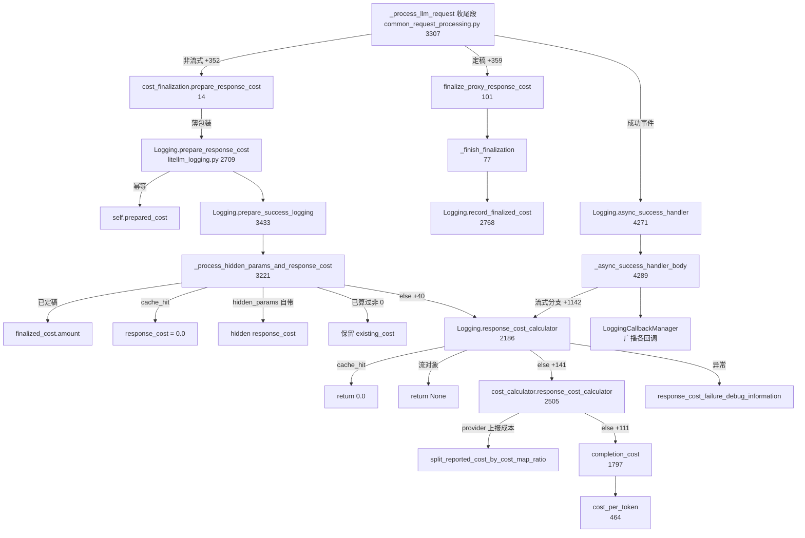

# 函数级解析（八）：litellm_logging 与 cost_calculator 关键函数

> 所属层级：第四层（函数级解析） | 覆盖主链：第 13 跳里成本计算与日志回调管线涉及的函数
> 本篇基准提交：`411b64dc7a`（工作区当前 HEAD）
> 引用规范：`文件 :: 符号 :: +偏移`，`+0` = 定义行，`+N` = 函数体内第 N 行

本篇逐个展开第 13 跳成本链上的函数：`Logging` 对象（回调管线引擎）的 `response_cost_calculator`、`prepare_response_cost`、`_process_hidden_params_and_response_cost`、`record_finalized_cost`、`is_usage_explicitly_free`、`prepare_success_logging`、`success_handler`、`async_success_handler` 与 `_async_success_handler_body`，以及 `cost_calculator.py` 侧的 `response_cost_calculator`、`completion_cost`、`cost_per_token`。

术语首现已解释：`Logging`（每个请求一个的回调管线引擎，pre-call 阶段由 `function_setup` 创建）、`response_cost`（本次调用按 token 单价算出的花费）、`model_call_details`（`Logging` 对象上累积本次调用全部细节的字典，成本、usage、hidden_params 都写在这里）、`prepared_cost`（响应阶段算好但尚未定稿的成本）、`finalized_cost`（定稿后的成本，含 guardrail 信息成本）、`价目表`（`model_prices_and_context_window.json` 启动时加载进 `litellm.model_cost`）、`显式免费费率`（价目表里明确标为免费的费率，cost=0 也要落账）。

关键归属澄清（与旧文不同）：**非流式**成本不在 `async_success_handler` 里算。本 traced 场景（非流式）的成本在 `prepare_response_cost` → `prepare_success_logging` → `_process_hidden_params_and_response_cost`（行 3261）这条**同步链**里就算好了；`async_success_handler` 的 `response_cost_calculator` 只在**流式**分支（`_async_success_handler_body :: +1142`，行 4413）触发。第三层《成本、日志与持久化》讲的是「第 13 跳每一跳发生了什么」，本篇只讲「这些函数内部具体怎么实现」；花费落库见 [09-persistence-cache-functions.md](09-persistence-cache-functions.md)。

## 本篇覆盖函数与成本链的对应

| 成本链环节 | 本篇展开的函数 |
|---|---|
| 统一成本入口（Logging 侧） | `Logging.response_cost_calculator` |
| 响应阶段成本准备 | `Logging.prepare_response_cost` |
| 隐藏参数与成本归一 | `Logging._process_hidden_params_and_response_cost` |
| 定稿写回 | `Logging.record_finalized_cost` |
| 显式免费判定 | `Logging.is_usage_explicitly_free` |
| 成功日志 payload | `Logging.prepare_success_logging` |
| 成功事件分发 | `Logging.success_handler`、`Logging.async_success_handler`、`_async_success_handler_body` |
| 顶层算式 | `cost_calculator.response_cost_calculator`、`cost_calculator.completion_cost`、`cost_calculator.cost_per_token` |

---

### `Logging`（`litellm/litellm_core_utils/litellm_logging.py`）

- 职责：每个请求一个的回调管线引擎。按固定时机把事件广播给全部注册回调，并在 `model_call_details` 里累积本次调用的全部细节（成本、usage、hidden_params、standard payload）。
- 签名/参数：`class Logging(LiteLLMLoggingBaseClass)`（`litellm/litellm_core_utils/litellm_logging.py :: Logging :: +0`，绝对行 743，类内偏移以此为准）。
- 关键字段：`model_call_details`（dict，成本与 usage 的落地处）、`prepared_cost`（`PreparedCost | None`）、`finalized_cost`（`FinalizedCost | None`）、`cost_finalization_lock`（定稿互斥锁）、`combined_usage_object`（聚合 usage）。
- 创建时机：pre-call 阶段由 `litellm/utils.py :: function_setup :: +0`（绝对行 1288）构建并挂到 kwargs 的 `litellm_logging_obj` 上，随 `completion_kwargs` 一路带到执行器与 Proxy 收尾段。
- 错误/分支：成本计算失败绝不抛出——`response_cost_calculator` 把错误信息写进 `model_call_details["response_cost_failure_debug_information"]` 并返回 `None`。
- 调用关系：调用方 = `function_setup`（创建）、Proxy 收尾段与执行器（驱动）。被调用方 = 各回调（`CustomLogger` 实现）、`cost_calculator` 模块。

---

### `Logging.response_cost_calculator`（`litellm/litellm_core_utils/litellm_logging.py`）

- 职责：`Logging` 内部统一的成本入口。做缓存命中/流对象/非推理调用的短路判定，再组装一大包 kwargs 调顶层 `litellm.response_cost_calculator`。响应头与日志回调共用它，保证口径一致。
- 签名/参数：`def response_cost_calculator(self, result: object, cache_hit: bool | None = None, litellm_model_name: str | None = None, router_model_id: str | None = None, ignore_stamped_cost: bool = False) -> float | None`（`litellm/litellm_core_utils/litellm_logging.py :: Logging :: response_cost_calculator :: +0`，绝对行 2186）。
- 返回：`float | None`。`None` 表示「算不出来」（价目表查不到、内部异常），不是 0。
- 算法（偏移相对 `+0`）：

| 序 | 动作 | 锚点 | 语义 |
|---|---|---|---|
| 1 | 清掉上一次的 `response_cost_failure_debug_information` | `+15`（行 2200） | 防止上一轮失败信息残留 |
| 2 | 解析 `resolved_cache_hit`（实参优先，否则读 `model_call_details`） | `+17`（行 2202） | 缓存命中在下一步短路 |
| 3 | `resolved_cache_hit is True` → `return 0.0` | `+18` 到 `+20`（行 2204-2205） | 缓存命中不计费 |
| 4 | `result` 是 `OpenAIStream`/`OpenAIAsyncStream` → `return None` | `+21` 到 `+23`（行 2207-2208） | 流对象此刻没有 usage，交流末聚合 |
| 5 | `is_unbilled_non_inference_call(...)` → `return 0.0` | `+24` 到 `+28`（行 2210-2213） | 非推理调用（如 file 检索）不计费 |
| 6 | 归一 `priced_result`（Responses 事件取内层 response） | `+29` 到 `+39`（行 2215-2224） | 统一成可读 `_hidden_params` 的对象 |
| 7 | 响应自带 `hidden_params["response_cost"]` 且未忽略盖章成本 → 直接用它 | `+41` 到 `+57`（行 2226-2244） | 透传 handler 已算过则复用；顺带从 hidden_params 补 `router_model_id` |
| 8 | batch 未定稿或仅为轮询 → `return 0.0` | `+61` 到 `+63`（行 2246-2249） | batch 成本只在定稿时算 |
| 9 | `router_model_id` 兜底从 `litellm_params` 取 | `+69`（行 2255） | Responses 流对象不带 hidden model_id |
| 10 | 组装 `response_cost_calculator_kwargs` | `+90` 到 `+123`（行 2275-2308） | 含 model、cache_hit、provider、base_model、call_type、optional_params、custom_pricing、prompt、router_model_id、pricing_provider、data_residency、vertex_location、region_name 等 |
| 11 | kwargs 构造异常 → 记 debug info 返回 `None` | `+124` 到 `+131`（行 2309-2316） | 不阻断响应 |
| 12 | provider 上报成本可用且非 custom_pricing 时优先用，否则调 `litellm.response_cost_calculator(**kwargs)` | `+133` 到 `+143`（行 2318-2328） | provider 上报成本需有限、非负、无自定义价、无 base_model |
| 13 | 加上 `additional_response_cost`（如工具成本） | `+145` 到 `+151`（行 2330-2336） | 正的附加成本才累加 |
| 14 | 记零成本诊断并返回 | `+152` 到 `+158`（行 2337-2343） | `_record_zero_cost_diagnostic` + `_recorded_response_cost` |
| 15 | 计算异常 → 记 `response_cost_failure_debug_information` | `+159` 到 `+179`（行 2344-2364） | 尾部 `return None` |

  第 12 步原文（贴 `response_cost_calculator :: +133` 到 `+143`，行 2318-2328）：

```python
        try:
            reported_cost: Final = self._provider_reported_cost
            response_cost: Final = (
                reported_cost
                if isinstance(reported_cost, float)
                and math.isfinite(reported_cost)
                and reported_cost >= 0
                and not custom_pricing
                and base_model is None
                else litellm.response_cost_calculator(**response_cost_calculator_kwargs)
            )
```

- 错误/分支：见第 11、15 步；两类异常都只记诊断信息并返回 `None`，绝不抛出、绝不阻断响应。
- 调用关系：调用方 = `Logging._process_hidden_params_and_response_cost :: +41`（行 3261，非流式）、`_async_success_handler_body :: +1142`（行 4413，流式）。被调用方 = `litellm.response_cost_calculator`（`litellm/cost_calculator.py :: +0`，行 2505）、`self.custom_pricing_for`、`self._prompt_for_cost_calculation`、`get_base_model_from_metadata`、`resolve_vertex_location_for_cost`、`_resolve_mantle_region_for_cost`、`self._record_zero_cost_diagnostic`、`self._recorded_response_cost`。

---

### `Logging.prepare_response_cost`（`litellm/litellm_core_utils/litellm_logging.py`）

- 职责：响应阶段把成本准备好（算出并连同 payload、usage 一起存进 `self.prepared_cost`），供 finalize 阶段取用。这是**非流式**成本的实际触发点。
- 签名/参数：`def prepare_response_cost(self, response: object, now: datetime.datetime) -> PreparedCost | None`（`litellm/litellm_core_utils/litellm_logging.py :: Logging :: prepare_response_cost :: +0`，绝对行 2709）。
- 返回：`PreparedCost | None`。`None` 表示 payload 或成本缺失（算不出钱）。
- 算法（贴 `prepare_response_cost :: +1` 到 `+58`，行 2710-2766）：

```python
        if self.prepared_cost is not None:
            return self.prepared_cost                                   # +1 到 +2，幂等
        recorded_cache_hit: Final[object] = self.model_call_details.get("cache_hit")
        deferred: Final = self.deferred_success_result
        observed_response: Final = _LITELLM_PARAMS.validate_python(
            _extract_response_obj_and_hidden_params(deferred[0] if deferred else response, None)[0])
        self.model_call_details["_accounting_usage_observed"] = (
            UsageObservation.KNOWN
            if (self.model_call_details.get("combined_usage_object")
                or StandardLoggingPayloadSetup.get_usage_as_dict(observed_response))
            else UsageObservation.UNKNOWN)                              # +7 到 +17
        prepared: Final = self.prepare_success_logging(
            result=deferred[0] if deferred is not None else response,
            start_time=deferred[1] if deferred is not None else self.start_time,
            end_time=deferred[2] if deferred is not None else now.replace(tzinfo=None),
            cache_hit=recorded_cache_hit if isinstance(recorded_cache_hit, bool) else None,
            standard_logging_object=None, build_logging_payload=True, publish_logging_payload=False)  # +17 到 +25
        payload: Final = prepared[3]
        raw_cost: Final[object] = self.model_call_details.get("response_cost")
        if payload is None or not isinstance(raw_cost, (int, float)):
            return None                                                 # +26 到 +29
        ...
        usage: Final = StandardLoggingPayloadSetup.get_usage_from_response_obj(...).model_copy(deep=True)
        self.prepared_cost = PreparedCost(
            raw_cost,
            {**payload, "response": None, "messages": None,
             "model_map_information": copy.deepcopy(payload["model_map_information"]),
             "cost_breakdown": copy.deepcopy(payload["cost_breakdown"])},
            usage, price_known=self._response_price_is_known(prepared[2], raw_cost, payload))  # +42 到 +53
        self.record_partial_usage_for_failure(
            usage, raw_cost, observation=self.model_call_details["_accounting_usage_observed"])  # +54 到 +56
        return self.prepared_cost                                       # +57
```

  分步：`+1` 已有 `prepared_cost` 直接返回（幂等，防重复准备）；`+3` 到 `+6` 读 `cache_hit` 与 `deferred_success_result`（路由器暂存的「成功日志已盖章」结果优先）；`+7` 到 `+17` 观察响应里 usage 是否已知，写 `_accounting_usage_observed`（KNOWN/UNKNOWN，供部分用量记账）；`+17` 到 `+25` 调 `prepare_success_logging(..., build_logging_payload=True, publish_logging_payload=False)` 造标准日志 payload 但**不对外发布**——成本就是在这一次调用里经 `_process_hidden_params_and_response_cost` 算出并写进 `model_call_details["response_cost"]` 的；`+26` 到 `+29` payload 或成本缺失就返回 `None`；`+30` 到 `+41` 归一 usage（优先 `combined_usage_object`，其次响应自带 usage）；`+42` 到 `+53` 组 `PreparedCost(raw_cost, payload(响应与消息置 None 以省内存), usage, price_known)` 存进 `self.prepared_cost`；`+54` 到 `+56` 把 usage 与成本暂存到失败记账字段（中断流场景用它计费）。
- 错误/分支：payload 为 `None` 或 `raw_cost` 不是数值 → 返回 `None`；本函数自身不抛（顶层包装 `prepare_response_cost` 还会再吞一层）。
- 调用关系：调用方 = `litellm/proxy/spend_tracking/cost_finalization.py :: prepare_response_cost :: +15`（薄包装，绝对行 14）、`_finalize_response_cost`。被调用方 = `self.prepare_success_logging`、`_extract_response_obj_and_hidden_params`、`StandardLoggingPayloadSetup.get_usage_as_dict` / `get_usage_from_response_obj`、`self.record_partial_usage_for_failure`、`self._response_price_is_known`。

---

### `Logging._process_hidden_params_and_response_cost`（`litellm/litellm_core_utils/litellm_logging.py`）

- 职责：解析响应的 hidden params、按优先级算出 `response_cost` 写进 `model_call_details`，并按需产出标准日志 payload。**非流式成本就是在它的 `else` 分支算出来的。**
- 签名/参数：`def _process_hidden_params_and_response_cost(self, logging_result, start_time, end_time, build_logging_payload: bool = True, publish_logging_payload: bool = True) -> StandardLoggingPayload | None`（`litellm/litellm_core_utils/litellm_logging.py :: Logging :: _process_hidden_params_and_response_cost :: +0`，绝对行 3221）。
- 返回：`StandardLoggingPayload | None`。`publish_logging_payload=False` 时只返回 payload 不发布。
- 算法（贴 `+11` 到 `+55`，行 3231-3275）：

```python
        hidden_params: Final = getattr(logging_result, HIDDEN_PARAMS_ATTR, {})
        if hidden_params:
            if self.model_call_details.get("litellm_params") is not None:
                ... self.model_call_details["litellm_params"]["metadata"]["hidden_params"] = getattr(
                    logging_result, "_hidden_params", {})

        if self.finalized_cost is not None:                        # +22，行 3243 已定稿直接用
            self.model_call_details["response_cost"] = self.finalized_cost.amount
        elif self.model_call_details.get("cache_hit") is True:     # +24，行 3245 缓存命中记 0
            self.model_call_details["response_cost"] = 0.0
            self._add_failed_attempts_spend(get_usage_object(completion_response=logging_result))
        elif "response_cost" in hidden_params:                     # +27，行 3248 响应自带成本
            hidden_response_cost: Final = subscript(hidden_params, "response_cost")
            self.model_call_details["response_cost"] = hidden_response_cost
            self._record_zero_cost_diagnostic(logging_result, hidden_response_cost)
            self._add_failed_attempts_spend(get_usage_object(completion_response=logging_result))
        elif (existing_cost := self.model_call_details.get("response_cost")) is not None and (
            existing_cost != 0 or self.call_type == CallTypes.pass_through.value
        ):                                                          # +32，行 3253 透传 handler 已算过则保留
            # Do not preserve 0 from failure_handler on intermediate router retries.
            pass
        else:
            self.model_call_details["response_cost"] = self.response_cost_calculator(result=logging_result)  # +40，行 3261
            self._add_failed_attempts_spend(get_usage_object(completion_response=logging_result))

        if not build_logging_payload:
            return None
        standard_logging_payload: Final = self._build_standard_logging_payload(
            logging_result, start_time, end_time, isolate_call_details=not publish_logging_payload)
        if not publish_logging_payload:
            return standard_logging_payload
        self.model_call_details["standard_logging_object"] = standard_logging_payload
        if standard_logging_payload is not None:
            emit_standard_logging_payload(standard_logging_payload)
        return standard_logging_payload
```

  五级优先级：已定稿成本 > 缓存命中（0） > 响应自带 `hidden_params["response_cost"]` > 已算过且非 0（或 pass_through）的保留 > 调 `self.response_cost_calculator` 现算。反直觉点：已算过但为 0 的成本**不保留**（除 pass_through），因为 router 中间重试的 `failure_handler` 会写 0，不能让它顶掉最终成功尝试的真实成本。每次写入后都 `_add_failed_attempts_spend` 把失败尝试的成本并进本次账。
- 错误/分支：成本算不出时 `response_cost` 为 `None`，payload 照常构建；`build_logging_payload=False` 提前返回。
- 调用关系：调用方 = `Logging.prepare_success_logging :: +0`（绝对行 3433，函数体较长，本篇只确认它调本函数并产出 `(payload, ..., response)`）。被调用方 = `self._surface_response_headers_from_result`、`require_attributes`、`self.response_cost_calculator`、`self._add_failed_attempts_spend`、`self._record_zero_cost_diagnostic`、`self._build_standard_logging_payload`、`emit_standard_logging_payload`、`get_usage_object`。

---

### `Logging.record_finalized_cost`（`litellm/litellm_core_utils/litellm_logging.py`）

- 职责：把定稿成本写回 `Logging` 对象，供响应头与后续回调读取。
- 签名/参数：`def record_finalized_cost(self, finalized: FinalizedCost) -> None`（`litellm/litellm_core_utils/litellm_logging.py :: Logging :: record_finalized_cost :: +0`，绝对行 2768）。
- 返回：`None`。
- 算法（贴全文）：`self.finalized_cost = finalized`（`+1`，行 2769）；`self.model_call_details["response_cost"] = finalized.amount`（`+2`，行 2770）。
- 错误/分支：无。
- 调用关系：调用方 = `litellm/proxy/spend_tracking/cost_finalization.py :: _finish_finalization :: +0`（绝对行 77）。被调用方 = 无（纯赋值）。Proxy 收尾段组装 `x-litellm-response-cost` 头时优先读 `logging_obj.finalized_cost.amount`，所以定稿越早该头越准。

---

### `Logging.is_usage_explicitly_free`（`litellm/litellm_core_utils/litellm_logging.py`）

- 职责：判定本次调用是否为「显式免费费率」（价目表或自定义价里明确标为免费）。cost=0 的免费调用也要落账，否则会被当成「没算钱」漏掉。
- 签名/参数：`def is_usage_explicitly_free(self, result: object) -> bool`（`litellm/litellm_core_utils/litellm_logging.py :: Logging :: is_usage_explicitly_free :: +0`，绝对行 2478）。
- 返回：`bool`。
- 算法（贴 `+1` 到 `+26`，行 2479-2503）：

```python
        usage: Final = get_usage_object(completion_response=result)
        if usage is None or self.model_call_details.get("response_cost_failure_debug_information") is not None:
            return False
        custom_pricing: Final = self.custom_pricing_for(result)
        if custom_pricing and self.custom_model_info is not None:
            return is_explicitly_free_usage(usage, self.custom_model_info)
        if custom_pricing and self.custom_cost_per_token is not None:
            return is_explicitly_free_usage(usage, self.custom_cost_per_token)
        custom_llm_provider: Final = self.model_call_details.get("custom_llm_provider")
        pricing: Final = pricing_entry_for_cost_calc(
            model=self.model, completion_response=result,
            custom_llm_provider=self.get_router_pricing_provider() or custom_llm_provider,
            custom_pricing=custom_pricing,
            base_model=get_base_model_from_metadata(model_call_details=self.model_call_details),
            router_model_id=self.get_router_model_id(),
            region_name=_resolve_mantle_region_for_cost(...), litellm_logging_obj=self)
        if pricing is None:
            return False
        return is_explicitly_free_usage(usage, pricing[1])
```

  分步：`+1` 到 `+3` 没有 usage 或上一轮成本计算失败过则直接判否（不把算不出来的当成免费）；`+4` 到 `+8` 自定义价场景用 `custom_model_info` 或 `custom_cost_per_token` 判定；`+9` 到 `+25` 常规场景按 router pricing provider 解析价目表条目，再交 `is_explicitly_free_usage` 对照 usage 判定。
- 错误/分支：价目表查不到（`pricing is None`）判否，不误判为免费。
- 调用关系：调用方 = 流末聚合 `_stamp_usage_cost`（`litellm/litellm_core_utils/streaming_handler.py :: +0`，行 115）路径。被调用方 = `get_usage_object`、`self.custom_pricing_for`、`is_explicitly_free_usage`、`pricing_entry_for_cost_calc`、`get_base_model_from_metadata`、`self.get_router_pricing_provider` / `get_router_model_id`、`_resolve_mantle_region_for_cost`。

---

### `Logging.prepare_success_logging`（`litellm/litellm_core_utils/litellm_logging.py`）

- 职责：为一次成功调用构建标准日志 payload，并顺带经 `_process_hidden_params_and_response_cost` 算出成本。是「成本计算」与「payload 构建」的合流点。
- 签名/参数：`def prepare_success_logging(self, result, start_time, end_time, cache_hit=None, standard_logging_object=None, build_logging_payload=True, publish_logging_payload=True)`（`litellm/litellm_core_utils/litellm_logging.py :: Logging :: prepare_success_logging :: +0`，绝对行 3433）。
- 返回：含标准日志 payload 与响应对象的元组（`prepare_response_cost` 取其 `[3]` 作 payload、`[2]` 作响应对象）。
- 算法：函数体较长，本篇只核到它调 `_process_hidden_params_and_response_cost`（`+0`，行 3221）并产出 payload；内部字段映射未逐行读。**未读取，不臆测**其中间步骤。
- 错误/分支：`publish_logging_payload=False` 时只构建不发布（`prepare_response_cost` 就是这么用的）。
- 调用关系：调用方 = `Logging.prepare_response_cost :: +17`、成功事件路径。被调用方 = `self._process_hidden_params_and_response_cost`、`self._build_standard_logging_payload`。

---

### `Logging.success_handler` / `async_success_handler` / `_async_success_handler_body`（`litellm/litellm_core_utils/litellm_logging.py`）

- 职责：成功事件向全部注册回调的分发。同步版给 Prometheus 等同步回调，异步版给 Langfuse、成本记账、告警等。
- 签名/参数：
  - `success_handler(self, result, start_time, end_time, cache_hit=False, ...)`（`litellm/litellm_core_utils/litellm_logging.py :: Logging :: success_handler :: +0`，绝对行 3753）。
  - `async_success_handler(self, result, start_time, end_time, cache_hit=False, ...)`（`litellm/litellm_core_utils/litellm_logging.py :: Logging :: async_success_handler :: +0`，绝对行 4271）。
  - `_async_success_handler_body(self, ...)`（`litellm/litellm_core_utils/litellm_logging.py :: _async_success_handler_body :: +0`，绝对行 4289，模块级函数）。
- 返回：`None`（同步版）/ 协程（异步版）。
- 算法：
  - `async_success_handler` 是薄入口，转 `_async_success_handler_body`。
  - `_async_success_handler_body` 的**流式分支**（`+1142` 到 `+1152`，行 4413-4423）才调成本计算：

```python
            self.model_call_details["response_cost"] = self.response_cost_calculator(
                result=complete_streaming_response if provider_transcription is None else provider_transcription
            )
```

    缓存命中记 `0.0`（行 4408），`NotFoundError`（价目表查不到该 model）与其它异常都把 `response_cost` 记 `None` 并打日志，不阻断后续回调。算完后 `_add_failed_attempts_spend(self._add_continued_partial_spend(...))`（`+1158`，行 4429）把失败尝试与续传 partial 的成本合并进来。
  - 非流式分支不再算成本（`prepare_response_cost` 已算好），只做回调分发。
- 错误/分支：回调管理器并行调用各回调，单个回调崩溃不影响其他回调与主响应（`litellm/litellm_core_utils/logging_callback_manager.py :: LoggingCallbackManager :: +0`，绝对行 27）。
- 调用关系：调用方 = 执行器与 Proxy 收尾段（`dispatch_success_handlers`）。被调用方 = `self.response_cost_calculator`（仅流式分支）、`self._add_failed_attempts_spend`、`self._add_continued_partial_spend`、`LoggingCallbackManager`。

---

### `cost_calculator.response_cost_calculator`（`litellm/cost_calculator.py`）

- 职责：顶层成本计算器。先看响应是否自带 provider 上报成本（经 `_hidden_params`），有则按价目表比例拆成 input/output 存 breakdown 并直接返回；没有则转 `completion_cost`。
- 签名/参数：`def response_cost_calculator(response_object: ..., model: str, custom_llm_provider: str | None, call_type: Literal[...], optional_params: dict, cache_hit: bool | None = None, base_model: str | None = None, custom_pricing: bool | None = None, prompt: str = "", standard_built_in_tools_params=None, litellm_model_name=None, router_model_id=None, litellm_logging_obj=None, pricing_provider=None, service_tier=None, data_residency=None, vertex_location=None, region_name=None, custom_cost_per_token=None, custom_cost_per_second=None, requested_model_info_override=None) -> float`（`litellm/cost_calculator.py :: response_cost_calculator :: +0`，绝对行 2505）。
- 返回：`float`（成本；算不出时由内部异常路径处理）。
- 算法（贴 `+69` 到 `+112`，行 2574-2624 摘关键步）：

```python
    try:
        response_cost: float = 0.0
        if cache_hit is not None and cache_hit is True:
            response_cost = 0.0
        else:
            if isinstance(response_object, BaseModel):
                if hasattr(response_object, HIDDEN_PARAMS_ATTR):
                    hidden_params: Final = cast(dict[str, object] | BaseModel, getattr(response_object, HIDDEN_PARAMS_ATTR))
                    provider_response_cost: Final = get_response_cost_from_hidden_params(hidden_params)
                    if provider_response_cost is not None and not custom_pricing:
                        if _breakdown_total(litellm_logging_obj) != provider_response_cost:
                            header_priced_model: Final = select_model_name_for_cost_calc(...)
                            header_input_cost, header_output_cost = split_reported_cost_by_cost_map_ratio(
                                reported_total=provider_response_cost, model=header_priced_model or model,
                                custom_llm_provider=pricing_provider or custom_llm_provider,
                                usage=get_usage_object(response_object), call_type=call_type,
                                service_tier=service_tier, data_residency=data_residency)
                            _store_cost_breakdown_in_logging_obj(litellm_logging_obj=litellm_logging_obj,
                                prompt_tokens_cost_usd_dollar=header_input_cost,
                                completion_tokens_cost_usd_dollar=header_output_cost,
                                cost_for_built_in_tools_cost_usd_dollar=0.0,
                                total_cost_usd_dollar=provider_response_cost, original_cost=provider_response_cost)
                        return provider_response_cost
            response_cost = completion_cost(
                completion_response=response_object, model=model, call_type=call_type,
                custom_llm_provider=custom_llm_provider, optional_params=optional_params,
                custom_pricing=custom_pricing, base_model=base_model, custom_cost_per_token=custom_cost_per_token, ...)
```

  分步：`+70` 到 `+73` 缓存命中记 0；`+74` 到 `+110` 响应自带 provider 上报成本且未开自定义价时，按价目表比例把上报总额拆成 input/output 成本存进 `logging_obj` 的 breakdown，然后直接返回上报值（不再走本地算式）；`+111` 到 `+120` 否则调 `completion_cost`。函数体后半段（`+120` 之后）还有 built-in tools 成本、附加成本的累加与异常包装，本篇未逐行读完。
- 错误/分支：内部 `try` 包住全程；异常向上传播由调用方（`Logging.response_cost_calculator`）接住记诊断。
- 调用关系：调用方 = `Logging.response_cost_calculator :: +141`（行 2327）。被调用方 = `get_response_cost_from_hidden_params`、`select_model_name_for_cost_calc`、`split_reported_cost_by_cost_map_ratio`、`_store_cost_breakdown_in_logging_obj`、`_breakdown_total`、`get_usage_object`、`completion_cost`。

---

### `cost_calculator.completion_cost`（`litellm/cost_calculator.py`）

- 职责：按价目表把 usage 折算成美元成本。`response_cost_calculator` 的主力，也可直接调用（传 `model` + `messages`/`prompt` 无需响应对象）。
- 签名/参数：`def completion_cost(completion_response: object | None = None, model: str | None = None, prompt="", messages: list = [], completion="", total_time: float | None = 0.0, call_type=None, custom_llm_provider: str | None = None, region_name=None, size=None, quality=None, n: int | None = None, custom_cost_per_token=None, custom_cost_per_second=None, requested_model_info_override=None, optional_params: dict | None = None, custom_pricing: bool | None = None, base_model: str | None = None, standard_built_in_tools_params=None, litellm_model_name=None, router_model_id=None, litellm_logging_obj=None, pricing_provider=None, service_tier=None, data_residency=None, vertex_location=None) -> float`（`litellm/cost_calculator.py :: completion_cost :: +0`，绝对行 1797）。
- 返回：`float`（USD 成本）。docstring 明确：解析不出任何候选 model 的价目时**抛异常**（提示用 `litellm.register_model` 注册或加进 `model_prices_and_context_window.json`）。
- 算法（偏移相对 `+0`，摘关键步）：

| 序 | 动作 | 锚点 | 语义 |
|---|---|---|---|
| 1 | `call_type = infer_call_type(call_type, completion_response) or "completion"` | `+46`（行 1843） | 补齐调用类型 |
| 2 | `DecisionsResponse` 无 usage 直接抛 `ValueError` | `+47` 到 `+48`（行 1844-1845） | provider 未报 usage 无法计费 |
| 3 | `pricing_provider` 覆盖 `custom_llm_provider`（仅供价目表查询） | `+49` 到 `+50`（行 1846-1847） | 路由 provider 与计价 provider 分离 |
| 4 | websocket realtime 按 service tier 拆分逐段递归求和 | `+52` 到 `+88`（行 1849-1884） | 每 tier 单独算再相加 |
| 5 | 初始化 token/字符/缓存/audio 计数器 | `+89` 到 `+96`（行 1886-1893） | 后续按 call_type 填 |
| 6 | 取响应 usage 对象，自定义价时剥掉 provider 自报成本 | `+97` 到 `+100`（行 1894-1897） | 避免双重计费 |
| 7 | 归一 `service_tier`（请求的与响应实际服务的） | `+103` 到 `+109`（行 1900-1906） | OpenAI service tier 差价 |

  第 5 步之后，函数按 `call_type` 分派到 `cost_per_token`（token 类）、per-second（replicate/sagemaker）、per-image、per-character（TTS）等算式，最终汇总成 `response_cost` 返回。中段各 call_type 分支本篇未逐行读完（属第四层算式细节），**未读取，不臆测**每个分支的精确偏移。
- 错误/分支：无候选 model 价目 → 抛异常（由 `Logging.response_cost_calculator` 接住记 `response_cost_failure_debug_information`）；`DecisionsResponse` 缺 usage → `ValueError`。
- 调用关系：调用方 = `cost_calculator.response_cost_calculator :: +111`。被调用方 = `infer_call_type`、`get_usage_object`、`_without_provider_stated_cost`、`_normalize_service_tier`、`_resolve_billable_service_tier`、`_served_service_tier`、`cost_per_token`（`+0`，行 464）、各 per-second/per-image 算式。

---

### `cost_calculator.cost_per_token`（`litellm/cost_calculator.py`）

- 职责：按 token 单价算钱的底层算式。把 prompt/completion token 数乘以价目表里该 model 的输入/输出单价（含缓存读写、audio、service tier 差价等修正）。
- 签名/参数：`def cost_per_token(...)`（`litellm/cost_calculator.py :: cost_per_token :: +0`，绝对行 464）。
- 返回：`tuple[float, float]`（`(prompt_tokens_cost_usd_dollar, completion_tokens_cost_usd_dollar)`）。
- 算法：函数体本篇未逐行读取（属第四层算式细节），只确认它是 `completion_cost` token 类分支的落点，单价来源是 `litellm.model_cost`（启动时由 `litellm/litellm_core_utils/get_model_cost_map.py` 加载、`litellm/litellm_core_utils/model_cost_table.py` 持有）。**未读取，不臆测**其修正项的精确计算顺序。
- 错误/分支：单价缺失时由 `completion_cost` 层处理（抛异常或回落默认）。
- 调用关系：调用方 = `completion_cost` token 类分支。被调用方 = 价目表读取助手（具体符号未核到，属 `[源码未确认]`）。

---

## 调用关系表（关键边）

| 调用方与符号 | 关系 | 被调用方与符号 | 触发与输入 | 返回与后续处理 | 错误、状态与副作用 |
|---|---|---|---|---|---|
| `litellm/proxy/spend_tracking/cost_finalization.py :: prepare_response_cost :: +15` | 委托 | `Logging.prepare_response_cost :: +0` | response + now | `PreparedCost` 存 `self.prepared_cost` | 异常吞掉，不阻响应 |
| `Logging.prepare_response_cost :: +17` | 构建 payload + 算成本 | `Logging.prepare_success_logging :: +0` | result + 起止时间 + build_payload=True | payload + `model_call_details["response_cost"]` | 不对外发布 |
| `prepare_success_logging` 内 | 算账 | `_process_hidden_params_and_response_cost :: +0` | logging_result + 起止时间 | 写 `response_cost` + payload | 五级优先级短路 |
| `_process_hidden_params_and_response_cost :: +40` | 现算 | `Logging.response_cost_calculator :: +0` | logging_result | cost float 或 `None` | 算错记 debug info 返回 None |
| `Logging.response_cost_calculator :: +141` | 顶层算式 | `cost_calculator.response_cost_calculator :: +0` | response_object + model + usage + 单价来源 | cost float | provider 上报成本优先 |
| `cost_calculator.response_cost_calculator :: +111` | 折算 | `cost_calculator.completion_cost :: +0` | completion_response + model + call_type | cost float | 无候选价目抛异常 |
| `completion_cost` token 分支 | 单价 | `cost_calculator.cost_per_token :: +0` | prompt/completion tokens + model | `(input_cost, output_cost)` | 未逐行读 |
| `_process_llm_request :: +359` | 定稿 | `finalize_proxy_response_cost :: +0` | logging_obj + response + guardrail_cost | `FinalizedCost` | 失败回落回调路径 |
| `litellm/proxy/spend_tracking/cost_finalization.py :: _finish_finalization :: +0` | 写回 | `Logging.record_finalized_cost :: +0` | FinalizedCost | 写 `self.finalized_cost` 与 `response_cost` | 供响应头读取 |
| `_async_success_handler_body :: +1142` | 流式算账 | `Logging.response_cost_calculator :: +0` | 聚合后的完整流式响应 | cost float 或 None | 仅流式分支触发 |
| `Logging.async_success_handler :: +0` | 分发 | `_async_success_handler_body :: +0` + `LoggingCallbackManager` | result + 起止时间 | 广播给各回调 | 单回调崩溃不影响主响应 |
| 流末 `_stamp_usage_cost` | 免费判定 | `Logging.is_usage_explicitly_free :: +0` | result + usage | bool | 显式免费也落账 |

## 未确认项

- `Logging.prepare_success_logging`（行 3433）函数体较长，本篇只确认它调 `_process_hidden_params_and_response_cost` 并产出 `(payload, ..., response)`，内部字段映射未逐行读。
- `_async_success_handler_body`（行 4289）非流式分支的逐行实现未读；流式分支只核到行 4408、4413-4423、4429 三处。
- `Logging.success_handler`（行 3753）函数体未逐行读，只确认它是同步成功事件入口。
- `cost_calculator.response_cost_calculator` 的 `+120` 之后（built-in tools 成本累加与异常包装）未逐行读。
- `cost_calculator.completion_cost` 的中段各 call_type 分支（per-second/per-image/per-character）未逐行读；`cost_per_token`（行 464）函数体**未读取，不臆测**。
- `PreparedCost`、`FinalizedCost`、`UsageObservation`、`_extract_response_obj_and_hidden_params`、`StandardLoggingPayloadSetup`、`emit_standard_logging_payload`、`get_standard_logging_object_payload`、`is_explicitly_free_usage`、`pricing_entry_for_cost_calc`、`select_model_name_for_cost_calc`、`split_reported_cost_by_cost_map_ratio`、`get_response_cost_from_hidden_params`、`_provider_reported_cost` 只确认符号名与调用点，定义行未全部核到，属 `[源码未确认]`。
- 各模型单价与本次调用成本的具体数值随价目表与模型回复变动，属 `[待运行验证]`。

## 源码索引

| 符号 | 文件 :: 符号 | 绝对定义行 |
|---|---|---|
| 回调管线引擎 | `litellm/litellm_core_utils/litellm_logging.py :: Logging` | 743 |
| 统一成本入口 | `litellm/litellm_core_utils/litellm_logging.py :: Logging :: response_cost_calculator` | 2186 |
| 显式免费判定 | `litellm/litellm_core_utils/litellm_logging.py :: Logging :: is_usage_explicitly_free` | 2478 |
| 成本准备实现 | `litellm/litellm_core_utils/litellm_logging.py :: Logging :: prepare_response_cost` | 2709 |
| 定稿记录 | `litellm/litellm_core_utils/litellm_logging.py :: Logging :: record_finalized_cost` | 2768 |
| 失败部分用量暂存 | `litellm/litellm_core_utils/litellm_logging.py :: Logging :: record_partial_usage_for_failure` | 2772 |
| 隐藏参数与成本 | `litellm/litellm_core_utils/litellm_logging.py :: Logging :: _process_hidden_params_and_response_cost` | 3221 |
| 标准日志 payload 构建 | `litellm/litellm_core_utils/litellm_logging.py :: Logging :: _build_standard_logging_payload` | 3290 |
| 成功日志准备 | `litellm/litellm_core_utils/litellm_logging.py :: Logging :: prepare_success_logging` | 3433 |
| 同步成功处理 | `litellm/litellm_core_utils/litellm_logging.py :: Logging :: success_handler` | 3753 |
| 异步成功处理 | `litellm/litellm_core_utils/litellm_logging.py :: Logging :: async_success_handler` | 4271 |
| 异步成功实现 | `litellm/litellm_core_utils/litellm_logging.py :: _async_success_handler_body` | 4289 |
| Logging 对象构建 | `litellm/utils.py :: function_setup` | 1288 |
| 回调管理器 | `litellm/litellm_core_utils/logging_callback_manager.py :: LoggingCallbackManager` | 27 |
| 免费费率盖章 | `litellm/litellm_core_utils/streaming_handler.py :: _stamp_usage_cost` | 115 |
| 单价算式 | `litellm/cost_calculator.py :: cost_per_token` | 464 |
| 成本算式 | `litellm/cost_calculator.py :: completion_cost` | 1797 |
| 顶层成本计算器 | `litellm/cost_calculator.py :: response_cost_calculator` | 2505 |

## 本篇函数调用关系图


