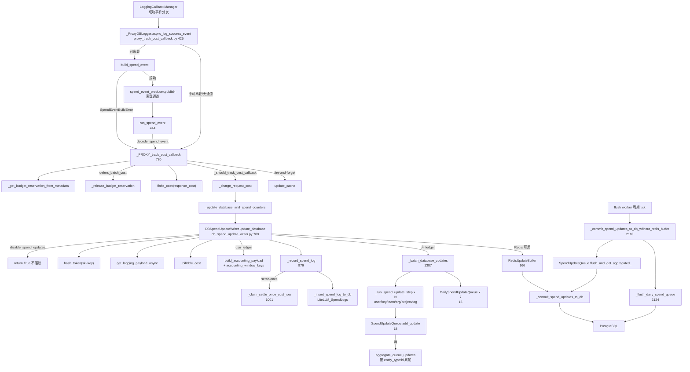
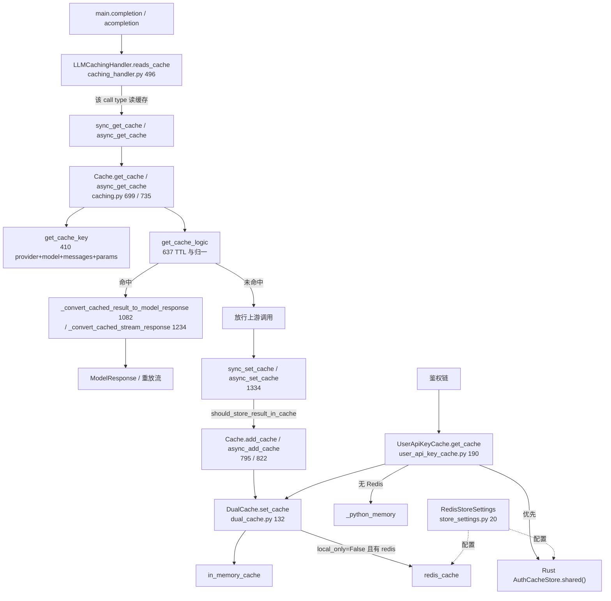

# 函数级解析（九）：花费写入器、花费队列与缓存层关键函数

> 所属层级：第四层（函数级解析） | 覆盖主链：第 13 跳里花费落库与缓存涉及的关键函数
> 本篇基准提交：`411b64dc7a`（工作区当前 HEAD）
> 引用规范：`文件 :: 符号 :: +偏移`，`+0` = 定义行，`+N` = 函数体内第 N 行

本篇逐个展开第 13 跳末尾「花费怎么落库、缓存怎么用」的函数：`_ProxyDBLogger` 的离载/直接双通道（`async_log_success_event`、`run_spend_event`）与它的成本回调主体（`_PROXY_track_cost_callback`）、`DBSpendUpdateWriter` 的账本/明细双写（`update_database`、`_record_spend_log`、`_claim_settle_once_cost_row`）与聚合批量写（`_batch_database_updates`、`_commit_spend_updates_to_db_without_redis_buffer`）、花费增量队列（`SpendUpdateQueue`、`DailySpendUpdateQueue`、`RedisUpdateBuffer`）、以及缓存三层（`Cache`、`DualCache`、`LLMCachingHandler`、`UserApiKeyCache`）与它们的 Redis 后端配置（`RedisStoreSettings`）。

术语首现已解释：`花费写入器`（`DBSpendUpdateWriter`，spend 落库的唯一出口）、`账本模式`（`use_spend_logs_ledger`，默认真：按时间窗聚合写一行账本、明细另存）、`明细行`（`LiteLLM_SpendLogs` 里一次请求一行）、`累计列`（key/user/team/org/end-user 各维度的 spend 累加）、`预算预留`（鉴权阶段为防并发超预算先占一笔，成功后按实际成本结算）、`settle-once`（batch/video 轮询型成本只在第一次轮询落账，后续轮询不重复计费）、`离载`（把花费事件序列化后交给 sidecar/独立任务处理，不占主事件循环）、`LLM 响应缓存`（把完整响应或流分片按请求参数哈希键存起来，命中时直接回放）。

第三层《成本、日志与持久化》讲的是「第 13 跳每一跳发生了什么」，本篇只讲「这些函数内部具体怎么实现」；成本怎么算出来见 [08-logging-cost-functions.md](08-logging-cost-functions.md)。

## 本篇覆盖函数与持久化/缓存层的对应

| 环节 | 本篇展开的函数 |
|---|---|
| 成功事件双通道 | `_ProxyDBLogger.async_log_success_event`、`_ProxyDBLogger.run_spend_event` |
| 成本回调主体 | `_ProxyDBLogger._PROXY_track_cost_callback` |
| 花费写入器构造 | `DBSpendUpdateWriter.__init__` |
| 账本/明细双写 | `DBSpendUpdateWriter.update_database`、`DBSpendUpdateWriter._record_spend_log`、`_claim_settle_once_cost_row` |
| 聚合批量写 | `DBSpendUpdateWriter._batch_database_updates`、`_commit_spend_updates_to_db_without_redis_buffer` |
| 花费增量队列 | `SpendUpdateQueue`、`DailySpendUpdateQueue`、`RedisUpdateBuffer` |
| LLM 响应缓存 | `Cache`、`LLMCachingHandler` |
| 网关状态缓存 | `DualCache`、`UserApiKeyCache` |
| Redis 后端配置 | `RedisStoreSettings` |

---

### `_ProxyDBLogger.async_log_success_event`（`litellm/proxy/hooks/proxy_track_cost_callback.py`）

- 职责：成功事件的入口，决定走「离载」（序列化后交 sidecar/独立任务）还是「直接」（在本进程跑成本管线）。
- 签名/参数：`async def async_log_success_event(self, kwargs: ObjectMapping, response_obj: object, start_time: datetime, end_time: datetime) -> None`（`litellm/proxy/hooks/proxy_track_cost_callback.py :: _ProxyDBLogger :: async_log_success_event :: +0`，绝对行 425）。
- 返回：`None`。
- 算法（贴 `async_log_success_event :: +2` 到 `+18`，行 428-442）：

```python
        if self.spend_event_producer is None or not is_offloadable_success(response_obj, kwargs):
            await self._PROXY_track_cost_callback(dict(kwargs), response_obj, start_time, end_time)
            return
        event: Final = build_spend_event(
            kwargs, response_obj, start_time, end_time,
            store_bodies=should_store_prompts_for_call(kwargs),
        )
        if isinstance(event, SpendEventBuildError):
            verbose_proxy_logger.warning("collector: tracking cost in-process, event not buildable: %s", event.reason)
            await self._PROXY_track_cost_callback(dict(kwargs), response_obj, start_time, end_time)
            return
        await self.spend_event_producer.publish(event)
```

  分步：`+2` 到 `+4` 没配离载通道（`spend_event_producer is None`）或本次成功不可离载时直接跑本进程成本管线；`+6` 到 `+11` 可离载时先造 `SpendEvent`（是否存 prompt body 由 `should_store_prompts_for_call` 决定）；`+12` 到 `+16` 造不出来（`SpendEventBuildError`）就回落直接通道；`+17` 到 `+18` 造得出来就 `publish` 给离载通道。非流式本 traced 场景成本已在 `prepare_response_cost` 算好，这里主要是把账落库。
- 错误/分支：离载造事件失败回落直接通道，不丢账。
- 调用关系：调用方 = 回调管理器（成功事件分发）。被调用方 = `is_offloadable_success`、`build_spend_event`、`should_store_prompts_for_call`、`self.spend_event_producer.publish`、`self._PROXY_track_cost_callback`。

### `_ProxyDBLogger.run_spend_event`（`litellm/proxy/hooks/proxy_track_cost_callback.py`）

- 职责：离载侧的消费入口。把序列化的一行花费事件解码后，跑**未改动的**成本管线（sidecar 消费者与进程内回落共用）。
- 签名/参数：`async def run_spend_event(self, line: bytes) -> None`（`litellm/proxy/hooks/proxy_track_cost_callback.py :: _ProxyDBLogger :: run_spend_event :: +0`，绝对行 444）。
- 返回：`None`。
- 算法（贴 `run_spend_event :: +1` 到 `+8`，行 446-451）：

```python
        event: Final = decode_spend_event(line)
        if isinstance(event, SpendEventDecodeError):
            verbose_proxy_logger.error("collector: discarding undecodable spend event: %s", event.reason)
            return
        args: Final = spend_event_callback_args(event)
        await self._PROXY_track_cost_callback(args.kwargs, args.response_obj, args.start_time, args.end_time)
```

  `+1` 到 `+4` 解码失败记错误并丢弃（不重试、不崩溃）；`+6` 到 `+8` 还原成 kwargs/response_obj/起止时间后交 `_PROXY_track_cost_callback`。
- 错误/分支：解码失败只记 error，事件丢弃。
- 调用关系：调用方 = 离载通道消费者（sidecar 或进程内消费任务）。被调用方 = `decode_spend_event`、`spend_event_callback_args`、`self._PROXY_track_cost_callback`。

---

### `_ProxyDBLogger._PROXY_track_cost_callback`（`litellm/proxy/hooks/proxy_track_cost_callback.py`）

- 职责：成本回调的主体。从 metadata 取出 key/user/team/org/end-user 身份与预算预留，取响应成本，判定是否需要记账，然后写库并更新各维度花费计数器。
- 签名/参数：`async def _PROXY_track_cost_callback(self, kwargs, completion_response: litellm.ModelResponse | object | None, start_time=None, end_time=None)`（`litellm/proxy/hooks/proxy_track_cost_callback.py :: _ProxyDBLogger :: _PROXY_track_cost_callback :: +0`，绝对行 780）。
- 返回：`None`。
- 算法（偏移相对 `+0`，摘关键步）：

| 序 | 动作 | 锚点 | 语义 |
|---|---|---|---|
| 1 | 取 `increment_spend_counters`、`proxy_logging_obj`、`update_cache` | `+7` 到 `+11`（行 787-791） | 从 proxy_server 取运行期单例 |
| 2 | 取 `accounting`（batch 会计上下文，从 `litellm_call_id` 关联） | `+13` 到 `+17`（行 793-797） | batch 场景才有 |
| 3 | 取 parent OTel span、litellm_params、end_user_id、metadata | `+25` 到 `+28`（行 805-808） | 身份信息来源 |
| 4 | metadata 只有 key 没有 user_id 时按需补齐身份 | `+31` 到 `+36`（行 811-816） | 只有直连 MCP REST 调用才需要，避免每请求查缓存/DB |
| 5 | 取 `budget_reservation`；batch 会计开始写标记 | `+37` 到 `+39`（行 817-819） | 预算预留来自 metadata |
| 6 | `defers_batch_cost(...)` 为真 → 释放预算预留并返回 | `+40` 到 `+43`（行 820-823） | batch 成本未定稿时先不记账 |
| 7 | 从 metadata 取 user/team/org/project/key_alias/end_user_max_budget | `+44` 到 `+53`（行 824-833） | 五维度身份 |
| 8 | 取 `standard_logging_object` 里的 `response_cost`，经 `finite_cost` 归一 | `+54` 到 `+58`（行 834-838） | 成本来自第 8 篇那条同步链算好的值 |
| 9 | `apply_search_free_tier` 命中时调整成本（免费层） | `+59` 到 `+73`（行 839-853） | 需未定稿、非 None 才处理 |
| 10 | 取 request tags 与可计费的 model access groups | `+74` 到 `+82`（行 854-862） | tag 计费与模型访问组计费 |
| 11 | `response_cost` 非 None 时进记账段 | `+84`（行 864） | 见下 |

  第 11 步原文（贴 `_PROXY_track_cost_callback :: +105` 到 `+131`，行 885-911 摘关键）：

```python
                if _should_track_cost_callback(user_api_key=..., user_id=..., team_id=..., end_user_id=..., call_type=..., agent_id=...):
                    charged_cost: Final = await _charge_request_cost(
                        partial(_update_database_and_spend_counters,
                            proxy_logging_obj=proxy_logging_obj, increment_spend_counters=increment_spend_counters,
                            user_api_key=user_api_key, user_id=user_id, end_user_id=end_user_id,
                            team_id=team_id, org_id=org_id, completion_response=completion_response,
                            start_time=start_time, end_time=end_time, request_tags=tags,
                            model_access_groups=model_access_groups, project_id=project_id),
                        kwargs=kwargs, response_cost=response_cost, budget_reservation=budget_reservation)
                    if charged_cost is None:
                        return
                    asyncio.create_task(update_cache(token=user_api_key, user_id=user_id, end_user_id=end_user_id,
                        response_cost=charged_cost, team_id=team_id, parent_otel_span=parent_otel_span, tags=tags))
                    await proxy_logging_obj.slack_alerting_instance.customer_spend_alert(...)
                elif budget_reservation is not None:
                    await _release_budget_reservation(budget_reservation=budget_reservation)
```

  分步：`_should_track_cost_callback` 判定本次是否真的要记账（无 key/无身份的免记账）；`_charge_request_cost` 负责「预算预留结算 + 写库 + 更新计数器」这一整套，它内部调 `_update_database_and_spend_counters`，最终落到 `DBSpendUpdateWriter.update_database`；返回 `None` 表示预留结算后无需再记账；`update_cache` 是 fire-and-forget 的后台任务，刷新缓存里的对象字段与软预算告警。`_update_database_and_spend_counters` 与 `_charge_request_cost` 函数体本篇未逐行读，只确认它把 `response_cost` 与预算预留交给 `DBSpendUpdateWriter.update_database`。
- 错误/分支：整个函数包在 `try` 里（`+19` 起），异常被记日志不抛；未记账分支释放预算预留避免泄漏。
- 调用关系：调用方 = `async_log_success_event :: +3`、`run_spend_event :: +8`。被调用方 = `_get_budget_reservation_from_metadata`、`defers_batch_cost`、`_release_budget_reservation`、`finite_cost`、`apply_search_free_tier`、`debitable_model_access_groups`、`_should_track_cost_callback`、`_charge_request_cost`、`_update_database_and_spend_counters`、`update_cache`。

---

### `DBSpendUpdateWriter.__init__`（`litellm/proxy/db/db_spend_update_writer.py`）

- 职责：花费写入器的构造。依赖注入 Redis 句柄与会计时钟，初始化全部队列与节奏控制器。
- 签名/参数：`def __init__(self, redis_cache: RedisCache | None = None, accounting_clock: Callable[[], float] = time.monotonic, session_spend_totals: SessionSpendTotals | None = None)`（`litellm/proxy/db/db_spend_update_writer.py :: DBSpendUpdateWriter :: __init__ :: +0`，绝对行 756；类 `+0` 在行 748）。
- 返回：实例。
- 算法（贴 `__init__ :: +6` 到 `+23`，行 762-778）：

```python
        self.redis_cache = redis_cache
        self.session_spend_totals: Final = session_spend_totals
        self.accounting_storage_checks = Cadence(accounting_clock)
        self.accounting_delay_alerts = Cadence(accounting_clock)
        self.redis_update_buffer = RedisUpdateBuffer(redis_cache=self.redis_cache)
        self.pod_lock_manager = PodLockManager()
        self.spend_update_queue = SpendUpdateQueue()
        self.tool_discovery_queue = ToolDiscoveryQueue()
        self.daily_spend_update_queue = DailySpendUpdateQueue()
        self.daily_team_spend_update_queue = DailySpendUpdateQueue()
        self.daily_end_user_spend_update_queue = DailySpendUpdateQueue()
        self.daily_agent_spend_update_queue = DailySpendUpdateQueue()
        self.daily_customer_member_spend_update_queue = DailySpendUpdateQueue()
        self.daily_org_spend_update_queue = DailySpendUpdateQueue()
        self.daily_tag_spend_update_queue = DailySpendUpdateQueue()
        self.window_spend_update_queue = WindowSpendUpdateQueue()
        self.interrupted_tag_commits: set[asyncio.Task[None]] = set()
```

  一个通用 spend 队列、一个 tool discovery 队列、按维度各一（user/team/end-user/agent/customer-member/org/tag）共 7 个日队列、一个时间窗队列；两个 `Cadence` 节奏控制器分别管存储检查与延迟告警；`RedisUpdateBuffer` 包住 Redis 缓冲；`PodLockManager` 管多 pod 互斥。
- 错误/分支：无（纯初始化）。
- 调用关系：调用方 = `ProxyLogging`（启动时创建一次，经 `_proxy_spend_writer` 取用，`litellm/proxy/hooks/proxy_track_cost_callback.py :: +0`，绝对行 268）。被调用方 = `Cadence`、`RedisUpdateBuffer`、`PodLockManager`、`SpendUpdateQueue`、`ToolDiscoveryQueue`、`DailySpendUpdateQueue`、`WindowSpendUpdateQueue`。

---

### `DBSpendUpdateWriter.update_database`（`litellm/proxy/db/db_spend_update_writer.py`）

- 职责：记录一次请求的 spend，返回「成本是否仍需入账」。账本模式下同时构造账本 payload 与明细行。
- 签名/参数：`async def update_database(self, token: str | None, user_id: str | None, end_user_id: str | None, team_id: str | None, org_id: str | None, kwargs: dict | None, completion_response: object, start_time: datetime, end_time: datetime, response_cost: float | None, project_id: str | None = None) -> bool`（`litellm/proxy/db/db_spend_update_writer.py :: DBSpendUpdateWriter :: update_database :: +0`，绝对行 780）。
- 返回：`bool`。`False` 仅当 batch/video 轮询的成本行已被另一次轮询写入（docstring 自述 LIT-7048，防重复计费）；其余一律 `True`，**包括异常路径**。
- 算法（偏移相对 `+0`）：

| 序 | 动作 | 锚点 | 进出与分支 |
|---|---|---|---|
| 1 | 从 proxy_server 取 `accounting_window_keys`、`disable_spend_logs`、`general_settings`、`litellm_proxy_budget_name`、`prisma_client` | `+21` 到 `+27`（行 801-807） | 运行期单例 |
| 2 | `use_ledger = general_settings.get("use_spend_logs_ledger", True) is not False`；`_SPEND_METADATA_ADAPTER.validate_python(kwargs or {})` 归一 request_fields | `+33` 到 `+37`（行 813-817） | 账本模式开关；把开关写回 kwargs 供花费计数器读 |
| 3 | `ProxyUpdateSpend.disable_spend_updates() is True` → `return True` | `+46` 到 `+47`（行 826-827） | 无 DB 场景直接跳过，不落任何账 |
| 4 | `sk-` key 哈希化（`hash_token`） | `+48` 到 `+50`（行 828-830） | 杜绝明文 key 进 DB/日志 |
| 5 | `get_logging_payload_async(...)` 组装 `SpendLogsPayload` | `+58` 到 `+65`（行 839-845） | 明细行的基础字段 |
| 6 | `_billable_cost(response_cost, payload)` 折算计费成本 | `+66`（行 846） | 计费成本与已记账成本折算 |
| 7 | `disable_responses_id_security` 守卫：`call_type ∈ {aget_responses, acancel_responses}` 且 `status == "success"` 且 `not billable_cost` → `return True` | `+67` 到 `+73`（行 847-853） | #51110：free responses 读/取消不落账 |
| 8 | `payload["spend"] = billable_cost or 0.0`；时间戳转 ISO；补 `organization_id`/`team_id` | `+74` 到 `+80`（行 854-860） | |
| 9 | `use_ledger` 时构造 `accounting_payload` | `+82` 到 `+105`（行 862-885） | `accounting_delivery_id`（settle-once 行不给，防重复结算）+ `build_accounting_payload(entities=..., windows=await accounting_window_keys(hashed_token, team_id), ...)` |
| 10 | `keep_spend_logs = disable_spend_logs is False and not (failure 且 disable_error_logs)` | `+106` 到 `+110`（行 886-890） | 决定是否写明细行 |
| 11 | `await self._record_spend_log(...)` 返回假 → `return False` | `+111` 到 `+117`（行 891-897） | settle-once 行已被别的轮询写过 |
| 12 | `_enqueue_autorouter_turn_transaction`、`_record_session_spend`、`_enqueue_tool_usage_transaction` | `+121` 到 `+133`（行 901-913） | 路由日聚合、会话花费、工具用量 |
| 13 | 非 ledger 分支 spawn `_batch_database_updates` 后台任务（聚合批量写累计列）；ledger 分支 `_record_request_error_safely` | `+139` 到 `+159`（行 919-939） | 明细已入账本，累计走 worker 批量 |
| 14 | `_enqueue_tool_registry_upsert`；`return True` | `+160` 到 `+168`（行 940-948） | |
| 15 | `except Exception` → `spend_log_error(...)` 后 `return True` | `+169` 到 `+181`（行 949-961） | 失败也返回 True：不让一次落库失败阻断调用链或造成重复计费 |

  第 13 步是「账本 vs 累计列」的分水岭：账本模式下明细行里已带完整 accounting payload，累计列交给后台 worker 按 `spend_update_queue`/各日队列聚合批量写；非账本模式当场 spawn `_batch_database_updates`。
- 错误/分支：见第 7、11、15 步；`update_database` 绝不抛出，失败记 `spend_log_error` 后返回 `True`。
- 调用关系：调用方 = `_PROXY_track_cost_callback` 里的 `_update_database_and_spend_counters`。被调用方 = `ProxyUpdateSpend.disable_spend_updates`、`hash_token`、`get_logging_payload_async`、`_billable_cost`、`build_accounting_payload`、`accounting_window_keys`、`debitable_model_access_groups`、`self._record_spend_log`、`self._enqueue_autorouter_turn_transaction`、`self._record_session_spend`、`self._enqueue_tool_usage_transaction`、`self._batch_database_updates`、`self._record_request_error_safely`、`self._enqueue_tool_registry_upsert`。

### `DBSpendUpdateWriter._record_spend_log`（`litellm/proxy/db/db_spend_update_writer.py`）

- 职责：把明细行写进 `LiteLLM_SpendLogs`，账本模式写 accounting-only 版本，`disable_spend_logs` 时只留账本不留明细。
- 签名/参数：`async def _record_spend_log(self, payload: SpendLogsPayload, prisma_client: "PrismaClient | None", disable_spend_logs: bool, llm_router: "Router | None" = None) -> bool`（`litellm/proxy/db/db_spend_update_writer.py :: DBSpendUpdateWriter :: _record_spend_log :: +0`，绝对行 976）。
- 返回：`bool`（`False` = settle-once 行已被别的轮询占用）。
- 算法（贴 `_record_spend_log :: +7` 到 `+23`，行 983-999）：

```python
        if prisma_client is not None and _is_settle_once_cost_row(payload):
            return await self._claim_settle_once_cost_row(
                payload=payload, prisma_client=prisma_client, disable_spend_logs=disable_spend_logs)
        if "accounting_payload" in payload:
            from litellm.proxy.utils import accounting_only_spend_log
            await self._insert_spend_log_to_db(
                payload=accounting_only_spend_log(payload) if disable_spend_logs
                else {**payload, "accounting_log_disabled": False},
                prisma_client=prisma_client, llm_router=llm_router)
        elif disable_spend_logs is False:
            await self._insert_spend_log_to_db(payload=payload, prisma_client=prisma_client, llm_router=llm_router)
        return True
```

  分步：`+7` 到 `+11` settle-once 行（batch/video 轮询）走 `_claim_settle_once_cost_row` 抢占式写一次；`+12` 到 `+21` 账本模式写 accounting-only 明细（`disable_spend_logs` 时只留账本字段，否则标记 `accounting_log_disabled=False`）；`+22` 到 `+23` 非账本且允许明细时原样写。`disable_spend_logs=True` 且非账本时不写明细但累计列照旧（`update_database` 的 else 分支日志明说这一点）。
- 错误/分支：settle-once 抢占失败返回 `False`，调用方据此返回 `False` 让上层不动 key/team/user 计数器。
- 调用关系：调用方 = `update_database :: +111`。被调用方 = `_is_settle_once_cost_row`、`self._claim_settle_once_cost_row`、`accounting_only_spend_log`、`self._insert_spend_log_to_db`。

### `DBSpendUpdateWriter._claim_settle_once_cost_row`（`litellm/proxy/db/db_spend_update_writer.py`）

- 职责：settle-once 行的抢占式写入。一个 batch/video 的多次轮询共享同一行，谁的 insert 先落库谁就拥有它，后续轮询得知自己没抢到就不重复计费。
- 签名/参数：`async def _claim_settle_once_cost_row(self, payload: SpendLogsPayload, prisma_client: "PrismaClient", disable_spend_logs: bool) -> bool`（`litellm/proxy/db/db_spend_update_writer.py :: DBSpendUpdateWriter :: _claim_settle_once_cost_row :: +0`，绝对行 1001）。
- 返回：`bool`（抢到并写入 = `True`，别人已写 = `False`）。
- 算法：docstring 写明「先落库的 insert 拥有该行」（行 1004-1006）。本篇只核到它被 `_record_spend_log :: +8` 调用、返回布尔决定是否重复计费；内部 insert 与唯一约束处理未逐行读。**未读取，不臆测**其幂等键的精确构造。
- 调用关系：调用方 = `_record_spend_log :: +8`。被调用方 = `self._insert_spend_log_to_db`（具体幂等键构造未读，属 `[源码未确认]`）。

---

### `DBSpendUpdateWriter._batch_database_updates`（`litellm/proxy/db/db_spend_update_writer.py`）

- 职责：跑完一次请求涉及的所有 spend-update helper，每个都经 `_run_spend_update_step` 包裹，保证一个失败不跳过兄弟写入。
- 签名/参数：`async def _batch_database_updates(self, *, response_cost: float | None, user_id: str | None, hashed_token: str | None, team_id: str | None, org_id: str | None, end_user_id: str | None, prisma_client: PrismaClient | None, litellm_proxy_budget_name: str | None, payload: SpendLogsPayload, request_model_access_groups: Sequence[str] = (), project_id: str | None = None, customer_hierarchy: CustomerHierarchyIds | None = None)`（`litellm/proxy/db/db_spend_update_writer.py :: DBSpendUpdateWriter :: _batch_database_updates :: +0`，绝对行 1387）。
- 返回：`None`。
- 算法（贴 `_batch_database_updates :: +21` 到 `+69`，行 1408-1456 摘关键）：

```python
        payload_copy: Final = copy.deepcopy(payload)   # +21，隔离每日花费 helper 的 payload
        await self._run_spend_update_step("_update_user_db",
            self._update_user_db(response_cost=response_cost, user_id=user_id, prisma_client=prisma_client,
                litellm_proxy_budget_name=litellm_proxy_budget_name, end_user_id=end_user_id), payload=payload_copy)
        await self._run_spend_update_step("_update_key_db",
            self._update_key_db(response_cost=response_cost, hashed_token=hashed_token, prisma_client=prisma_client),
            payload=payload_copy)
        await self._run_spend_update_step("_update_team_db", self._update_team_db(...), payload=payload_copy)
        await self._run_spend_update_step("_update_org_db", self._update_org_db(...), payload=payload_copy)
        await self._run_spend_update_step("_update_project_db", self._update_project_db(...), payload=payload_copy)
        await self._run_spend_update_step("_update_customer_hierarchy_db", ..., payload=payload_copy)
        await self._run_spend_update_step("_update_tag_db", self._update_tag_db(...), payload=payload_copy)
        await self._update_model_access_group_db(...)
        await self._run_spend_update_step("add_spend_log_transaction_to_daily_customer_member_transaction", ...)
```

  分步：`+21` 深拷贝 payload，隔离每日花费 helper 的 payload 与 spend-log 队列条目及调用方；`+23` 到 `+66` 逐维度调用 `_update_user_db`/`_update_key_db`/`_update_team_db`/`_update_org_db`/`_update_project_db`/`_update_customer_hierarchy_db`/`_update_tag_db`，每个都经 `_run_spend_update_step` 包裹（`+0`，绝对行 1518）——一步抛错只记该步失败，兄弟步骤照跑；`+67` 到 `+73` 模型访问组计费与日 customer-member 聚合。函数体后半段（`+69` 之后）继续 daily 各维度入队，本篇未逐行读完。
- 错误/分支：单步失败经 `_run_spend_update_step` 记日志并继续；`deepcopy` 保证并发下不串改调用方 payload。
- 调用关系：调用方 = `update_database :: +141`（非 ledger 分支 spawn 的后台任务）。被调用方 = `self._run_spend_update_step`、`self._update_user_db`/`_update_key_db`/`_update_team_db`/`_update_org_db`/`_update_project_db`/`_update_customer_hierarchy_db`/`_update_tag_db`、`self._update_model_access_group_db`、`self.add_spend_log_transaction_to_daily_customer_member_transaction`。

### `DBSpendUpdateWriter._commit_spend_updates_to_db_without_redis_buffer`（`litellm/proxy/db/db_spend_update_writer.py`）

- 职责：把内存队列里的累计 `UPDATE` 聚合后提交数据库（无 Redis 缓冲的常规流）。docstring 明确警告：这个流在生产 1K RPS+ 会死锁，高吞吐要用 `_commit_spend_updates_to_db_with_redis`。
- 签名/参数：`async def _commit_spend_updates_to_db_without_redis_buffer(self, prisma_client: PrismaClient, n_retry_times: int, proxy_logging_obj: ProxyLogging)`（`litellm/proxy/db/db_spend_update_writer.py :: DBSpendUpdateWriter :: _commit_spend_updates_to_db_without_redis_buffer :: +0`，绝对行 2169）。
- 返回：`None`。
- 算法（贴 `_commit_spend_updates_to_db_without_redis_buffer :: +16` 到 `+30`，行 2185-2199）：

```python
        db_spend_update_transactions: Final = (
            await self.spend_update_queue.flush_and_get_aggregated_db_spend_update_transactions()
        )
        await self._commit_spend_updates_to_db(
            prisma_client=prisma_client, n_retry_times=n_retry_times, proxy_logging_obj=proxy_logging_obj,
            db_spend_update_transactions=db_spend_update_transactions)
        await self._flush_daily_spend_queue(
            queue=self.daily_spend_update_queue, entity_type="user", commit=DBSpendUpdateWriter.update_daily_user_spend, ...)
```

  分步：`+16` 到 `+19` 冲刷并聚合通用 spend 队列（按 entity type 聚成 `DBSpendUpdateTransactions`）；`+20` 到 `+25` 一次性提交；`+26` 起 `_flush_daily_spend_queue`（`+0`，绝对行 2124）逐维度冲刷日队列（user/team/end_user/org/tag 等）。
- 错误/分支：冲刷失败由 `_flush_daily_spend_queue` 把行重新入队等下一个 tick 重试（失败分支记 "failed to commit daily ... re-queued" 日志）。
- 调用关系：调用方 = 后台 flush worker（周期性 tick）。被调用方 = `self.spend_update_queue.flush_and_get_aggregated_db_spend_update_transactions`、`self._commit_spend_updates_to_db`、`self._flush_daily_spend_queue`。

---

### `SpendUpdateQueue`（`litellm/proxy/db/db_transaction_queue/spend_update_queue.py`）

- 职责：内存缓冲，攒 spend 增量，flush 时按 entity type 聚合后交给数据库提交。
- 签名/参数：`class SpendUpdateQueue(BaseUpdateQueue)`（`litellm/proxy/db/db_transaction_queue/spend_update_queue.py :: SpendUpdateQueue :: +0`，绝对行 18）。内部 `self.update_queue: asyncio.Queue[SpendUpdateQueueItem] = asyncio.Queue(maxsize=LITELLM_ASYNCIO_QUEUE_MAXSIZE)`（`__init__ :: +1`，行 25）。
- 关键方法：

| 方法 | 锚点 | 职责 |
|---|---|---|
| `flush_and_get_aggregated_db_spend_update_transactions` | `SpendUpdateQueue :: +9`（行 27） | 冲刷全部更新并按 entity type 聚合返回 `DBSpendUpdateTransactions` |
| `add_update` | `SpendUpdateQueue :: +23`（行 41） | 入队一条更新；队列满时先聚合再放 |
| `aggregate_queue_updates` | `SpendUpdateQueue :: +36`（行 54） | 把队列里全部条目按 entity type+id 合并成更少条目 |
| `_get_aggregated_spend_update_queue_item` | `SpendUpdateQueue :: +44`（行 62） | 真正的合并：`key = f"{entity_type}:{entity_id}"`，同名累加 `response_cost` |
| `get_aggregated_db_spend_update_transactions` | `SpendUpdateQueue :: +113`（行 131） | 按 entity type 归类成给数据库提交用的结构 |

  聚合算法（贴 `_get_aggregated_spend_update_queue_item :: +89` 到 `+109`，行 115-127）：遍历更新，按 `entity_type:entity_id` 建 map，首见 `update.copy()`（不改动调用方的 dict），再见则 `current_cost + update_cost` 累加 `response_cost`。这样同一 user/key/team 的多次增量在 flush 前就压成一条，减少数据库写入次数。
- 错误/分支：队列满（`qsize() >= MAX_SIZE_IN_MEMORY_QUEUE`）时先聚合缩减，再放新条目。
- 调用关系：调用方 = `DBSpendUpdateWriter`（`__init__` 创建、各 `_update_*_db`/`add_spend_log_transaction_*` 入队、flush worker 冲刷）。被调用方 = `self.update_queue`、`_emit_new_item_added_to_queue_event`。

### `DailySpendUpdateQueue`（`litellm/proxy/db/db_transaction_queue/daily_spend_update_queue.py`）

- 职责：按日聚合的 spend 队列（key/user/team/org/end-user/agent/customer-member/tag 各一实例），flush 时聚合成日表更新。
- 签名/参数：`class DailySpendUpdateQueue(BaseUpdateQueue)`（`litellm/proxy/db/db_transaction_queue/daily_spend_update_queue.py :: DailySpendUpdateQueue :: +0`，绝对行 16），`__init__ :: +0`（行 56）。
- 关键方法：`track_interrupted_commit(self, settle: Coroutine[object, object, None]) -> None`（`DailySpendUpdateQueue :: +47`，行 63）——记录被打断的提交任务，供下次启动时结算；`get_aggregated_daily_spend_update_transactions`（`DailySpendUpdateQueue :: +96`，行 112）——聚合本次要提交的日表更新。
- 算法：与 `SpendUpdateQueue` 同构（都是 `BaseUpdateQueue` 子类），差异在聚合目标（日表而非累计列）。被打断提交的结算靠 `track_interrupted_commit` 登记、`DBSpendUpdateWriter` 侧的 `_settle_interrupted_commits`（`+0`，绝对行 568）在重启后补结。
- 调用关系：调用方 = `DBSpendUpdateWriter.__init__`（创建 7 个实例）、`_flush_daily_spend_queue`（冲刷）。被调用方 = `BaseUpdateQueue` 基类设施。

### `RedisUpdateBuffer`（`litellm/proxy/db/db_transaction_queue/redis_update_buffer.py`）

- 职责：把 spend 更新缓冲到 Redis 而不是内存，供多 pod 部署下集中聚合，避免 `_commit_spend_updates_to_db_without_redis_buffer` docstring 警告的死锁。
- 签名/参数：`class RedisUpdateBuffer`（`litellm/proxy/db/db_transaction_queue/redis_update_buffer.py :: RedisUpdateBuffer :: +0`，绝对行 166），`__init__ :: +0`（行 173，注入 `redis_cache`）。
- 关键方法：`should_commit_spend_updates_to_redis() -> bool`（`RedisUpdateBuffer :: +14`，行 180）——静态判定当前是否走 Redis 缓冲；`_combine_list_of_transactions`（`+907`，行 1073）——合并从 Redis 取回的批量事务。
- 算法：高吞吐时把增量写进 Redis（跨 pod 共享），flush 由单一 pod 抢锁后统一取回、合并、提交数据库。`should_commit_spend_updates_to_redis` 的判定条件（Redis 可用且配置开启）本篇未逐行读全，属 `[源码未确认]`。
- 调用关系：调用方 = `DBSpendUpdateWriter.__init__`、各提交路径按 `should_commit_spend_updates_to_redis()` 分流。被调用方 = `self.redis_cache`。

---

### `Cache`（`litellm/caching/caching.py`）

- 职责：SDK 层 LLM 响应缓存。单一后端（内存/Redis/S3/GCS/Azure 等，由 `type` 选），提供 KV 语义的 `get`/`set`/批量 get。
- 签名/参数：`class Cache`（`litellm/caching/caching.py :: Cache :: +0`，绝对行 128）。
- 关键方法与锚点：

| 方法 | 锚点 | 职责 |
|---|---|---|
| `get_cache_key` | `litellm/caching/caching.py :: Cache :: get_cache_key :: +0`（行 410） | 由 provider、model、messages、参数归一哈希出缓存键，可加 namespace 前缀（`_add_namespace_to_cache_key`），支持语义缓存与 preset key |
| `get_cache_logic` | `Cache :: get_cache_logic :: +0`（行 637） | 同步/异步取缓存共用的归一与 TTL 判定 |
| `get_cache` | `Cache :: get_cache :: +0`（行 699） | 同步取缓存入口 |
| `async_get_cache` | `Cache :: async_get_cache :: +0`（行 735） | 异步取缓存入口 |
| `add_cache` | `Cache :: add_cache :: +0`（行 795） | 同步写缓存 |
| `async_add_cache` | `Cache :: async_add_cache :: +0`（行 822） | 异步写缓存 |

  `get_cache` 流程：`should_use_cache` 守卫 → `response_cache_phase("get")` → 取 `cache_key`（`kwargs["cache_key"]` 或 `get_cache_key`）→ 按请求 `cache` 参数里的 `s-max-age`/`s-maxage` 解 max_age → 透传给 `dynamic_cache_object` 或 `self.cache` 的后端 `get_cache` → `_update_metadata_from_cache_lookup_kwargs` 回写元数据 → `get_cache_logic` 判定是否过期。全程 try/except，任何异常都返回 `None`（绝不阻塞调用）。函数体内偏移本篇未逐行核到，按其与 `async_get_cache` 的对称关系与调用点描述，`[推断]`。
- 错误/分支：任何异常都吞掉返回 `None`，缓存故障不影响主调用。
- 调用关系：调用方 = `LLMCachingHandler`。被调用方 = `get_cache_logic`、`get_cache_key`、`_add_namespace_to_cache_key`、各后端 `BaseCache` 实现。

### `LLMCachingHandler`（`litellm/caching/caching_handler.py`）

- 职责：LLM 调用与缓存的编排。调用前查缓存、调用后写缓存、流式缓存的分片累积。
- 签名/参数：`class LLMCachingHandler`（`litellm/caching/caching_handler.py :: LLMCachingHandler :: +0`，绝对行 374）。
- 关键方法与锚点：

| 方法 | 锚点 | 职责 |
|---|---|---|
| `reads_cache` | `litellm/caching/caching_handler.py :: LLMCachingHandler :: reads_cache :: +0`（行 496） | 判该 call type 是否读缓存 |
| `sync_get_cache` | `LLMCachingHandler :: sync_get_cache :: +0`（行 568） | 查缓存，命中转 `sync_get_cache` 的转换链 |
| `_convert_cached_result_to_model_response` | `LLMCachingHandler :: _convert_cached_result_to_model_response :: +0`（行 1082） | 缓存 dict → `ModelResponse` |
| `_convert_cached_stream_response` | `LLMCachingHandler :: _convert_cached_stream_response :: +0`（行 1234） | 流式命中转重放流 |
| `sync_set_cache` | `LLMCachingHandler :: sync_set_cache :: +0`（行 1334） | 响应回来后按 `should_store_result_in_cache` 决定写库并算 TTL |

  核心算法：`reads_cache` 判定是否读 → `sync_get_cache` 查，命中经 `_convert_cached_result_to_model_response` 或 `_convert_cached_stream_response`（流式命中转重放流）→ 未命中放行调用，响应回来后 `sync_set_cache` 按 `should_store_result_in_cache` 决定写库并算 TTL；`control-cache` 语义按请求的 `cache` 参数开关。各方法函数体内偏移本篇未逐行核到，属 `[推断]`。
- 调用关系：调用方 = `main.completion` / `main.acompletion` 的缓存前后钩子。被调用方 = `Cache.get_cache` / `async_get_cache` / `add_cache` / `async_add_cache`、`_convert_cached_result_to_model_response`、`_convert_cached_stream_response`、`should_store_result_in_cache`。

---

### `DualCache`（`litellm/caching/dual_cache.py`）

- 职责：内存 + Redis 两级读写。读先内存、未命中穿 Redis 回填；写默认双层，`local_only=True` 只写本进程。
- 签名/参数：`class DualCache`（`litellm/caching/dual_cache.py :: DualCache :: +0`，绝对行 60）。
- 关键方法与锚点：

| 方法 | 锚点 | 职责 |
|---|---|---|
| `set_cache` | `litellm/caching/dual_cache.py :: DualCache :: set_cache :: +0`（行 132） | 先写 `in_memory_cache`（`ttl` 缺省取 `default_in_memory_ttl`），`redis_cache` 存在且 `local_only is False` 时再写 Redis |
| `batch_get_cache` | `DualCache :: batch_get_cache :: +0`（行 200） | 批量读，先内存后 Redis 补齐 |
| `async_set_cache` | `DualCache :: async_set_cache :: +0`（行 454） | 异步双层写，`local_only` 语义同 `set_cache` |

  `set_cache`（贴 `set_cache` 语义描述）：先写内存（`ttl` 缺省时取 `default_in_memory_ttl`），`redis_cache` 存在且 `local_only is False` 才写 Redis。多 worker 部署下，限流计数、冷却表、key 缓存都靠 Redis 层保持一致。函数体内偏移本篇未逐行核到，属 `[推断]`。
- 错误/分支：无 Redis 时退回纯内存（单 worker 正确，多 worker 退化）。
- 调用关系：调用方 = `UserApiKeyCache`（Proxy 特化子类）、各处状态缓存。被调用方 = `self.in_memory_cache`、`self.redis_cache`。

### `UserApiKeyCache`（`litellm/proxy/common_utils/user_api_key_cache.py`）

- 职责：`DualCache` 的 Proxy 特化子类。缓存 `LiteLLM_VerificationToken`、team membership、end-user 行，供鉴权链读路径使用。
- 签名/参数：`class UserApiKeyCache`（`litellm/proxy/common_utils/user_api_key_cache.py :: UserApiKeyCache :: +0`，绝对行 50）。
- 关键方法与锚点：

| 方法 | 锚点 | 职责 |
|---|---|---|
| `get_cache` | `litellm/proxy/common_utils/user_api_key_cache.py :: UserApiKeyCache :: get_cache :: +0`（行 190） | 读缓存；优先走 Rust 侧 `AuthCacheStore`（`shared()`），无 Redis 时退回 `_python_memory` |
| `set_cache` | `UserApiKeyCache :: set_cache :: +0`（行 293） | 写缓存，DB 回读后回填；管理 API 改 key 触发失效 |

  并发语义：多 worker 下 Redis 层共享，保证改 key 在 TTL 窗口内立即对全部 worker 生效。函数体内偏移本篇未逐行核到，属 `[推断]`。
- 调用关系：调用方 = 鉴权链（第四层第 2 篇详述）。被调用方 = `DualCache.get_cache` / `set_cache`、Rust `AuthCacheStore.shared()`、`_python_memory`。

---

### `RedisStoreSettings`（`litellm/redis/store_settings.py`）

- 职责：从 `RedisCache` 建连时捕获一次的连接配置（redis_kwargs、namespace、default_ttl、breaker），供 `litellm/redis/` 下各 Rust store 复用。
- 签名/参数：`class RedisStoreSettings`（`litellm/redis/store_settings.py :: RedisStoreSettings :: +0`，绝对行 20）；同文件 `RedisBreakerSettings`（`+0`，行 13）与 `breaker_settings()`（`+0`，行 29）。
- 关联 store（均在 `litellm/redis/stores/` 下）：`RateLimitStore`（限流/冷却计数）、`SpendCounterStore`（用量 spend counter，key/team/user/end-user/org/tag 等维度）、`AuthCacheStore`（`UserApiKeyCache` 的 key 认证缓存）、`RouterUsageStore` / `RouterCooldownsStore`（路由用量与冷却表）。
- 语义：限流（v3）、冷却与用量、auth cache 已通过上述 store 接入；无 Redis 时各 store 退回 Python 内存（单 worker 正确，多 worker 退化）。
- 调用关系：调用方 = 各 store 的 `connect`。被调用方 = `RedisCache`、`RedisBreakerSettings`。

---

## 调用关系表（关键边）

| 调用方与符号 | 关系 | 被调用方与符号 | 触发与输入 | 返回与后续处理 | 错误、状态与副作用 |
|---|---|---|---|---|---|
| 回调管理器 | 成功事件 | `_ProxyDBLogger.async_log_success_event :: +0` | kwargs + response_obj + 起止时间 | 走离载或直接通道 | 造事件失败回落直接 |
| `async_log_success_event :: +17` | 离载发布 | `self.spend_event_producer.publish` | `SpendEvent` | 交 sidecar/独立任务 | 发布失败沿回调上抛 |
| `async_log_success_event :: +3` | 直接通道 | `_PROXY_track_cost_callback :: +0` | kwargs + response_obj + 起止时间 | 写库 + 更新计数器 | 内部 try 吞异常 |
| `run_spend_event :: +8` | 还原事件 | `_PROXY_track_cost_callback :: +0` | 解码后的 kwargs/response_obj | 写库 + 更新计数器 | 解码失败丢弃 |
| `_PROXY_track_cost_callback :: +105` | 记账 | `_charge_request_cost(partial(_update_database_and_spend_counters, ...))` | response_cost + budget_reservation | `charged_cost` | 预留结算后无需记账返回 None |
| `_PROXY_track_cost_callback :: +121` | fire-and-forget | `asyncio.create_task(update_cache(...))` | charged_cost + 身份 | 刷新缓存字段与软预算告警 | 不阻塞主流程 |
| `_update_database_and_spend_counters` | 落库 | `DBSpendUpdateWriter.update_database :: +0` | token/user/team/org/end_user + response_cost + kwargs | `bool`（成本是否仍需入账） | 异常也返回 True |
| `update_database :: +46` | 降级 | `ProxyUpdateSpend.disable_spend_updates()` | 无 | 无 DB 则跳过 | 返回 True 不落账 |
| `update_database :: +48` | 脱敏 | `hash_token(token=token)` | `sk-` 前缀的 token | 哈希后的 token | 明文 key 不进 DB |
| `update_database :: +66` | 折算 | `_billable_cost :: +0` | response_cost + payload | 计费成本 | #51110 守卫依赖它判 free |
| `update_database :: +82` | 账本 | `build_accounting_payload` + `accounting_window_keys` | payload + entities + windows | `accounting_payload` | settle-once 行不给 delivery_id |
| `update_database :: +111` | 写明细 | `DBSpendUpdateWriter._record_spend_log :: +0` | payload + prisma_client + disable_spend_logs | `bool` | settle-once 被占返回 False |
| `_record_spend_log :: +7` | 抢占 | `DBSpendUpdateWriter._claim_settle_once_cost_row :: +0` | settle-once payload | 抢到 True / 别人已写 False | 防重复计费 |
| `_record_spend_log :: +15` | 写 DB | `self._insert_spend_log_to_db` | accounting-only 或完整 payload | 明细行 | disable_spend_logs 时只留账本 |
| `update_database :: +141` | 后台聚合 | `spawn_logging_task(self._batch_database_updates(...))` | billable_cost + 身份 + payload | 各维度累计列更新 | 单步失败不跳过兄弟 |
| `_batch_database_updates :: +23` | 单步包裹 | `self._run_spend_update_step("_update_user_db", ...)` | response_cost + user_id | user spend 累加 | 失败记该步日志 |
| flush worker | 冲刷聚合 | `_commit_spend_updates_to_db_without_redis_buffer :: +0` | prisma_client + n_retry_times | 一次性提交 | 高吞吐改走 Redis 缓冲 |
| `_commit_spend_updates_to_db_without_redis_buffer :: +16` | 聚合 | `SpendUpdateQueue.flush_and_get_aggregated_db_spend_update_transactions :: +9` | 队列内全部更新 | `DBSpendUpdateTransactions` | 按 entity type 聚合 |
| `SpendUpdateQueue.add_update :: +23` | 满时聚合 | `SpendUpdateQueue.aggregate_queue_updates :: +36` | 溢出触发 | 合并同名 entity | 减少写入次数 |
| `SpendUpdateQueue :: +44` | 同名累加 | `_get_aggregated_spend_update_queue_item` | 更新列表 | 按 `entity_type:entity_id` 累加 `response_cost` | 不改调用方 dict |
| `LLMCachingHandler.sync_get_cache :: +0` | 命中转换 | `Cache.get_cache :: +0` / `_convert_cached_stream_response :: +0` | cache_key + TTL 参数 | `ModelResponse` 或重放流 | 缓存故障返回 None 不阻塞 |
| `UserApiKeyCache.get_cache :: +0` | 读 key 缓存 | `DualCache` + Rust `AuthCacheStore.shared()` | key hash | `LiteLLM_VerificationToken` | 无 Redis 退回 `_python_memory` |

## 未确认项

- `_update_database_and_spend_counters`、`_charge_request_cost`、`_should_track_cost_callback`、`_release_budget_reservation`、`_get_budget_reservation_from_metadata`、`defers_batch_cost`、`apply_search_free_tier`、`debitable_model_access_groups`、`build_spend_event`、`decode_spend_event`、`is_offloadable_success`、`should_store_prompts_for_call` 只确认符号名与调用点，函数体未逐行读。
- `DBSpendUpdateWriter._claim_settle_once_cost_row`（行 1001）的幂等键构造未逐行读；`_batch_database_updates` 的 `+69` 之后（daily 各维度入队）未读完；`_commit_spend_updates_to_db_without_redis_buffer` 的 `+30` 之后（各日队列冲刷明细）未读完。
- `RedisUpdateBuffer.should_commit_spend_updates_to_redis`（行 180）的判定条件未逐行读全。
- `Cache.get_cache`（行 699）、`LLMCachingHandler` 各方法、`DualCache.set_cache`（行 132）、`UserApiKeyCache.get_cache`（行 190）/`set_cache`（行 293）函数体内偏移未逐行核到，按对称关系与调用点描述，属 `[推断]`。
- `RedisStoreSettings` 的字段清单（redis_kwargs、namespace、default_ttl、breaker）按 docstring 描述引用，字段级未逐行核。
- 实际落库的 SQL、Prisma 表名与批量大小随配置与版本变动，属 `[待运行验证]`。

## 源码索引

| 符号 | 文件 :: 符号 | 绝对定义行 |
|---|---|---|
| Proxy 花费日志回调类 | `litellm/proxy/hooks/proxy_track_cost_callback.py :: _ProxyDBLogger` | 405 |
| 离载/直接双通道 | `litellm/proxy/hooks/proxy_track_cost_callback.py :: _ProxyDBLogger :: async_log_success_event` | 425 |
| 离载消费入口 | `litellm/proxy/hooks/proxy_track_cost_callback.py :: _ProxyDBLogger :: run_spend_event` | 444 |
| 成本回调主体 | `litellm/proxy/hooks/proxy_track_cost_callback.py :: _ProxyDBLogger :: _PROXY_track_cost_callback` | 780 |
| 花费写入器取用 | `litellm/proxy/hooks/proxy_track_cost_callback.py :: _proxy_spend_writer` | 268 |
| 花费写入器 | `litellm/proxy/db/db_spend_update_writer.py :: DBSpendUpdateWriter` | 748 |
| 写入器构造 | `litellm/proxy/db/db_spend_update_writer.py :: DBSpendUpdateWriter :: __init__` | 756 |
| 记录一次 spend | `litellm/proxy/db/db_spend_update_writer.py :: DBSpendUpdateWriter :: update_database` | 780 |
| 写明细行 | `litellm/proxy/db/db_spend_update_writer.py :: DBSpendUpdateWriter :: _record_spend_log` | 976 |
| settle-once 抢占 | `litellm/proxy/db/db_spend_update_writer.py :: DBSpendUpdateWriter :: _claim_settle_once_cost_row` | 1001 |
| 聚合批量写 | `litellm/proxy/db/db_spend_update_writer.py :: DBSpendUpdateWriter :: _batch_database_updates` | 1387 |
| 单步包裹 | `litellm/proxy/db/db_spend_update_writer.py :: DBSpendUpdateWriter :: _run_spend_update_step` | 1518 |
| 日队列冲刷 | `litellm/proxy/db/db_spend_update_writer.py :: DBSpendUpdateWriter :: _flush_daily_spend_queue` | 2124 |
| 无 Redis 缓冲提交 | `litellm/proxy/db/db_spend_update_writer.py :: DBSpendUpdateWriter :: _commit_spend_updates_to_db_without_redis_buffer` | 2169 |
| 折算计费成本 | `litellm/proxy/db/db_spend_update_writer.py :: _billable_cost` | 733 |
| settle-once 判定 | `litellm/proxy/db/db_spend_update_writer.py :: _is_settle_once_cost_row` | 199 |
| spend 增量队列 | `litellm/proxy/db/db_transaction_queue/spend_update_queue.py :: SpendUpdateQueue` | 18 |
| 日 spend 队列 | `litellm/proxy/db/db_transaction_queue/daily_spend_update_queue.py :: DailySpendUpdateQueue` | 16 |
| Redis 缓冲 | `litellm/proxy/db/db_transaction_queue/redis_update_buffer.py :: RedisUpdateBuffer` | 166 |
| LLM 响应缓存 | `litellm/caching/caching.py :: Cache` | 128 |
| 缓存键 | `litellm/caching/caching.py :: Cache :: get_cache_key` | 410 |
| 缓存归一与 TTL | `litellm/caching/caching.py :: Cache :: get_cache_logic` | 637 |
| 同步取缓存 | `litellm/caching/caching.py :: Cache :: get_cache` | 699 |
| 异步取缓存 | `litellm/caching/caching.py :: Cache :: async_get_cache` | 735 |
| 同步写缓存 | `litellm/caching/caching.py :: Cache :: add_cache` | 795 |
| 缓存编排 | `litellm/caching/caching_handler.py :: LLMCachingHandler` | 374 |
| 是否读缓存 | `litellm/caching/caching_handler.py :: LLMCachingHandler :: reads_cache` | 496 |
| 缓存结果转换 | `litellm/caching/caching_handler.py :: LLMCachingHandler :: _convert_cached_result_to_model_response` | 1082 |
| 流式缓存转换 | `litellm/caching/caching_handler.py :: LLMCachingHandler :: _convert_cached_stream_response` | 1234 |
| 同步写缓存编排 | `litellm/caching/caching_handler.py :: LLMCachingHandler :: sync_set_cache` | 1334 |
| 两级缓存 | `litellm/caching/dual_cache.py :: DualCache` | 60 |
| 两级写 | `litellm/caching/dual_cache.py :: DualCache :: set_cache` | 132 |
| 两级批量读 | `litellm/caching/dual_cache.py :: DualCache :: batch_get_cache` | 200 |
| 异步两级写 | `litellm/caching/dual_cache.py :: DualCache :: async_set_cache` | 454 |
| Proxy key 缓存 | `litellm/proxy/common_utils/user_api_key_cache.py :: UserApiKeyCache` | 50 |
| key 缓存读 | `litellm/proxy/common_utils/user_api_key_cache.py :: UserApiKeyCache :: get_cache` | 190 |
| key 缓存写 | `litellm/proxy/common_utils/user_api_key_cache.py :: UserApiKeyCache :: set_cache` | 293 |
| Redis store 配置 | `litellm/redis/store_settings.py :: RedisStoreSettings` | 20 |
| spend 更新降级开关 | `litellm/proxy/utils.py :: ProxyUpdateSpend :: disable_spend_updates` | 8862 |
| token 哈希 | `litellm/proxy/utils.py :: hash_token` | 5929 |

## 本篇数据流图




