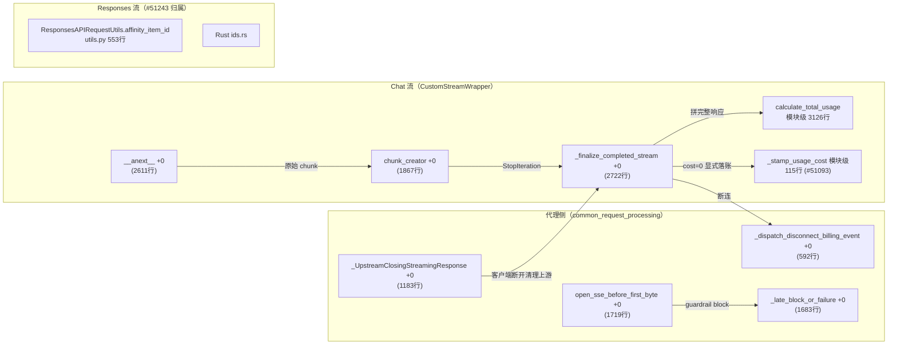

# 函数级解析：流式响应（CustomStreamWrapper）

> 所属层级：第四层（源码补齐） | 覆盖：`litellm/litellm_core_utils/streaming_handler.py :: CustomStreamWrapper`

补齐第三层第 7 篇承诺的函数级拆解。`CustomStreamWrapper` 是所有 provider 流的统一包装器。实测于 `0608a41a07`（2026-11-12）：类定义在 `streaming_handler.py:457`（旧文档标 `+0` 无行号，重建全部偏移，旧偏移一律作废）。

## 1. `__init__()`

```
litellm/litellm_core_utils/streaming_handler.py :: CustomStreamWrapper :: __init__() :: +0
```

实测 468 行起。持有原始流与全部统计状态。

| 项 | 内容 |
|---|---|
| 职责 | 持有原始流与全部统计状态 |
| 关键状态 | `completion_stream`（provider 原始迭代器）、`make_call`（断流重拉句柄）、`count_prompt_tokens`、`logging_obj` 引用、`chunks`（累计分片）、`_hidden_params`、`received_finish_reason`、`intermittent_finish_reason`、`stream_options`、`sent_stream_usage` |
| 核心算法 | `+78`：`self.stream_options = stream_options or getattr(logging_obj, "stream_options", None)`；`+80`：`send_stream_usage` 由 `self.check_send_stream_usage(self.stream_options)` 决定 |

## 2. `check_send_stream_usage()`

```
litellm/litellm_core_utils/streaming_handler.py :: CustomStreamWrapper :: check_send_stream_usage() :: +0
```

实测 715 行起。返回值决定是否向**客户端**回传 usage chunk。

| 项 | 内容 |
|---|---|
| 返回 | `stream_options is not None and stream_options.get("include_usage", False) is True`（`+0` 唯一一行） |
| 语义 | 只控制**客户端**看得到 usage；网关内部聚合（`self.chunks` 累积、`_record_usage_only_chunk` 保留 provider usage-only chunk）不受它影响 |

## 3. `chunk_creator()`

```
litellm/litellm_core_utils/streaming_handler.py :: CustomStreamWrapper :: chunk_creator() :: +0
```

实测 1867 行起（旧文档未给行号）。单个 provider 原始 chunk → OpenAI `ModelResponseStream`。

| 项 | 内容 |
|---|---|
| 职责 | 单个 provider 原始 chunk → OpenAI `ModelResponseStream` |
| 参数 | `chunk: Any`（provider 私有形态） |
| 返回 | 标准化 chunk（或 None 表示跳过） |
| 核心算法 | `+1` 起记录 native Bedrock guardrail、Ollama 响应 id；`+18` 起 `model_response_creator` 造空响应；`+31` 起 `_dispatch_provider_chunk` 按 provider 分派解析器（OpenAI delta、Anthropic 事件、Bedrock 结构等），归一 role/content/tool_call/usage 字段；tool calling 分支处理 `original_chunk.choices[0].delta.tool_calls`；usage chunk 触发 `_record_and_strip_usage_chunk` 相关聚合 |

## 4. `finish_reason_handler()`

```
litellm/litellm_core_utils/streaming_handler.py :: CustomStreamWrapper :: finish_reason_handler() :: +0
```

实测 2261 行起。归一流结束原因，处理 provider 间 finish_reason 语义差。

| 项 | 内容 |
|---|---|
| 职责 | 归一流结束原因（stop/length/tool_calls/content_filter），处理 provider 间 finish_reason 语义差 |
| 时机 | 在 `_finalize_completed_stream` 的「最后一个普通 chunk」分支调用 |
| 核心算法 | `+1` 起 `model_response_creator` 造响应，`+14` 取 `received_finish_reason or intermittent_finish_reason or "stop"`，经 `_normalize_tool_call_finish_reason` 归一来原因，`_apply_finish_choice_fields` 补多 choice 字段，`_close_open_think_block` 关未闭合 thinking 块 |

## 5. `__anext__()`

```
litellm/litellm_core_utils/streaming_handler.py :: CustomStreamWrapper :: __anext__() :: +0
```

实测 2611 行起。异步迭代主循环。

| 项 | 内容 |
|---|---|
| 职责 | 异步迭代主循环：取原始 chunk → `chunk_creator` → 产出标准 chunk |
| 前置 | `__aiter__ :: +0`（实测 595 行）已置位 |
| 错误处理 | 见下方要点 |

核心算法（相对偏移）：

1. `+1`：`self._closed` 已关 → `StopAsyncIteration`
2. `+5`：`custom_llm_provider == "cached_response"` → 置 `cache_hit=True`（缓存命中的流重放）
3. `+12`：`_check_max_streaming_duration()`（`litellm.Timeout` 守卫，实测 578 行）
4. `+14`：`completion_stream is None` → `await self.fetch_stream()`（延迟拉流）
5. `+17` 起：逐 chunk 循环——`"None"`/None 跳过，gemini 空 parts 特判；`processed_chunk is None` → 继续取下一个原始 chunk；usage 已有 → `_record_and_strip_usage_chunk`（剥离后仅日志用）
6. `+90` 起：`except (StopAsyncIteration, StopIteration)` 分支——`_should_fail_on_clean_eof` 时抛 EOF 错误，否则 `return await self._finalize_completed_stream(...)`

两个错误处理要点（源码注释自述）：litellm.Timeout 必须在 try 块**内部**抛（`+7` 处 `_check_max_streaming_duration` 在 try 内），才会走 `except Exception -> _handle_stream_fallback_error` 恢复消费者 correlation context；上游中断时包装错误并触发断流计费路径。

## 6. `_finalize_completed_stream()`

```
litellm/litellm_core_utils/streaming_handler.py :: CustomStreamWrapper :: _finalize_completed_stream() :: +0
```

实测 2722 行起。流自然结束的收尾。

| 项 | 内容 |
|---|---|
| 职责 | 流自然结束的收尾：聚合并触发计费 |
| 核心算法 | `+2`：`sent_last_chunk` 已真 → `_async_build_complete_streaming_response()` 用累计 chunks 拼完整响应；`+3`：`_new_usage_chunk()` 造最终 usage chunk；`+5` 附近：`_propagate_usage_cost_to_hidden_params` 把 provider 上报成本写进 `_hidden_params`；`+14` 起：`_stamp_served_service_tier` 与 `_stamp_usage_cost` 把 cost=0 显式落账（#51093）；`+20` 起：`async_cache_streaming_response` 写流缓存 |
| 后置 | `dispatch_success_handlers` 派发成功事件（优先 async handler）；`await self.aclose()` 后 `StopAsyncIteration` |

成本落账的两个细节（模块级函数，`+0` 分别在 115 与 137 行）：
- `_stamp_usage_cost`（`streaming_handler.py:115`）：读完整响应 `hidden_params["response_cost"]`，当 `bill <= 0` 但 `usage.cost` 未设且 `bill == 0 and complete_usage.cost == 0` 时也允许把 `cost=0` 盖到 usage chunk——这就是 #51093 的「显式免费 cost=0 落账」
- 配套 `litellm/litellm_core_utils/litellm_logging.py :: is_usage_explicitly_free()`（实测 2465 行起）判断该响应是否为显式免费（走 `custom_pricing`/模型表查 `is_explicitly_free_usage`），供成本计算分支复用

成功事件在此刻发给日志管线，这是「流式请求记账延迟到流结束」的实现位置。

## 7. 断流计费

```
litellm/proxy/common_request_processing.py :: _bill_partial_streamed_spend_on_disconnect() :: +0
litellm/proxy/common_request_processing.py :: _dispatch_disconnect_billing_event() :: +0
```

实测 `_bill_partial_streamed_spend_on_disconnect` 在 513 行，`_dispatch_disconnect_billing_event` 在 592 行（旧文档只写后者、且位置偏移已变）。

| 项 | 内容 |
|---|---|
| 职责 | 客户端中途断开时，按已收到的部分记账 |
| 核心算法 | `_bill_partial_streamed_spend_on_disconnect`（`+0`，513 行）`+26` 检查 `has_dispatched_final_stream_success` 防止与自然结束重复分发；`+30` 起对 Responses API 用 `partial_responses_incomplete_event_on_disconnect`，对 chat 用 `stream_chunk_builder` 拼 partial_response；`+63` 起 `_dispatch_disconnect_billing_event`（592 行）`await logging_obj.dispatch_success_handlers(...)` 派发 success 事件 |
| 返回 | `True` 表示本次成功事件已拥有 `max_parallel_requests` 槽位释放权，调用方可跳过显式释放 |

## 8. `_UpstreamClosingStreamingResponse` 与 SSE keepalive 后 guardrail block

```
litellm/proxy/common_request_processing.py :: _UpstreamClosingStreamingResponse :: +0
litellm/proxy/common_request_processing.py :: open_sse_before_first_byte :: +0
litellm/proxy/common_request_processing.py :: _late_block_or_failure :: +0
```

实测三者都在 `litellm/proxy/common_request_processing.py`（旧文档误标在 streaming_handler.py，偏移全变）：

| 项 | 内容 |
|---|---|
| `_UpstreamClosingStreamingResponse`（1183 行） | `StreamingResponse` 子类，`__call__` 在 `finally` 里用 `anyio.CancelScope(shield=True)` 强制 `aclose` 掉 `body_iterator` 与 `upstream_generator`，杜绝客户端断连后上游 LLM 连接悬空到 GC |
| `open_sse_before_first_byte`（1719 行，#51114） | 在 `produce_response`（上游首 token 前的整段 ttft）期间按 `ping_interval_seconds` 写 SSE `: ping` keepalive，防 ALB/nginx 60s 空闲超时断连 |
| `_late_block_or_failure`（1683 行） | keepalive 已打开响应后，若上游抛 `ModifyResponseException` 且路由传了 `on_passthrough_block`，把 guardrail block 流式中继给客户端（`+3` 调 `await on_passthrough_block(exc)`），否则原样返回失败异常 |

guardrail block 的三处接线点：`litellm/proxy/proxy_server.py` 的 `chat_completion`（13358 行附近，`_stream_chat_passthrough_block`）与 `text_completion` 路由，以及 `litellm/proxy/anthropic_endpoints/endpoints.py:205`（`_stream_passthrough_block`）。

## 9. `calculate_total_usage()` 与部分计费

```
litellm/litellm_core_utils/streaming_handler.py :: calculate_total_usage() :: +0
litellm/litellm_core_utils/streaming_handler.py :: CustomStreamWrapper :: _record_partial_usage_for_failure() :: +0
```

实测 `calculate_total_usage` 是**模块级函数**，3126 行起（旧文档未给行号）；`_record_partial_usage_for_failure` 在 2854 行起。

| 项 | 内容 |
|---|---|
| `calculate_total_usage`（3126 行） | 取 chunks 里最新的 usage chunk 覆盖 prompt/completion/total，缓存 creation/details 字段，`cost` 从最新 usage chunk 带出 |
| `_record_partial_usage_for_failure`（2854 行） | 断流时从已见 chunks 拼 `partial_response()`，算出 partial cost 存 `logging_obj.model_call_details["response_cost"]`，让失败日志记真实部分花费而非 0；有前序轮次则 `record_failure_after_earlier_rounds` |

## 10. 同步迭代

```
litellm/litellm_core_utils/streaming_handler.py :: CustomStreamWrapper :: __iter__() :: +0
litellm/litellm_core_utils/streaming_handler.py :: CustomStreamWrapper :: __next__() :: +0
litellm/litellm_core_utils/streaming_handler.py :: CustomStreamWrapper :: fetch_stream() :: +0
litellm/litellm_core_utils/streaming_handler.py :: CustomStreamWrapper :: fetch_sync_stream() :: +0
```

实测 `__iter__` 592 行、`__next__` 2399 行、`fetch_stream` 2600 行、`fetch_sync_stream` 2589 行（旧文档偏移 `+136`/`+1916`/`+2114` 全部作废）。同步对（`__iter__`/`__next__`）与异步版结构对称，服务同步 `completion(stream=True)` 调用方；`fetch_stream`（2600 行）是「惰性拉流」的共享句柄，`__anext__` 与 `make_call` 断流重拉都走它，`fetch_sync_stream`（2589 行）是同步拉流分支。聚合与计费路径共用。

## 11. reasoning item id 归属澄清（#51243）

reasoning item id 的稳定化**不在** `CustomStreamWrapper`。它在 `litellm/responses/`（`streaming_iterator.py`、`utils.py :: ResponsesAPIRequestUtils.affinity_*`，实测 `utils.py:178` 类、`affinity_model_id` 545 行、`affinity_item_id` 553 行）与 Rust `litellm/rust/crates/inference-responses/src/ids.rs`（`encitem_` 前缀生成）实现。`CustomStreamWrapper` 只做 OpenAI chat 流的归一，两者职责不同。

