# 函数级解析（十）：流包装器 `CustomStreamWrapper` 关键方法

> 所属层级：第四层（函数级解析） | 覆盖：`litellm/litellm_core_utils/streaming_handler.py`、断流计费与 SSE keepalive 侧的 `litellm/proxy/common_request_processing.py`
> 本篇基准提交：`411b64dc7a`（工作区当前 HEAD）
> 引用规范：`文件 :: 符号 :: +偏移`，`+0` = 定义行，`+N` = 函数体内第 N 行

本篇逐个展开响应流式这条链里的关键函数：`CustomStreamWrapper` 的构造与统计状态（`__init__`）、是否向客户端回传 usage（`check_send_stream_usage`）、单个 provider 原始 chunk 的归一（`chunk_creator`，内部经 `_dispatch_provider_chunk` 分派）、结束原因归一（`finish_reason_handler`）、异步迭代主循环（`__anext__`）、流自然结束的收尾（`_finalize_completed_stream`）、用量聚合（模块级 `calculate_total_usage`）、部分计费（`_record_partial_usage_for_failure`），以及代理侧断流计费与 SSE keepalive 的三个函数（`_bill_partial_streamed_spend_on_disconnect`、`_dispatch_disconnect_billing_event`、`open_sse_before_first_byte`、`_late_block_or_failure`、`_UpstreamClosingStreamingResponse`）。

术语首现已解释：`流包装器`（`CustomStreamWrapper`，把各家 provider 的原始流统一成 OpenAI `ModelResponseStream` 的迭代器）、`usage chunk`（只带 token 用量、没有正文的数据块，provider 常在流末尾单独发一个）、`finish_reason`（流结束原因：stop/length/tool_calls/content_filter）、`断流计费`（客户端中途断开时按已收到的分片记账）、`SSE keepalive`（上游首 token 未到前先写注释行，防止网关/负载均衡器按空闲超时断连）。

第三层《响应流式与用量聚合》讲的是「流式请求的每一跳发生了什么」，本篇只讲「这些函数内部具体怎么实现」；第三层结论本篇不重复逐跳叙事。

## 本篇覆盖函数

| 环节 | 本篇展开的函数 |
|---|---|
| 构造与状态 | `CustomStreamWrapper.__init__` |
| 客户端 usage 回传开关 | `CustomStreamWrapper.check_send_stream_usage` |
| 单 chunk 归一 | `CustomStreamWrapper.chunk_creator`、`CustomStreamWrapper._dispatch_provider_chunk` |
| 结束原因归一 | `CustomStreamWrapper.finish_reason_handler` |
| 异步迭代主循环 | `CustomStreamWrapper.__anext__` |
| 流结束收尾 | `CustomStreamWrapper._finalize_completed_stream` |
| 用量聚合 | `calculate_total_usage`（模块级） |
| 部分计费 | `CustomStreamWrapper._record_partial_usage_for_failure` |
| 断流计费 | `_bill_partial_streamed_spend_on_disconnect`、`_dispatch_disconnect_billing_event` |
| SSE keepalive 与清理 | `open_sse_before_first_byte`、`_late_block_or_failure`、`_UpstreamClosingStreamingResponse` |

---

### `CustomStreamWrapper.__init__`（`litellm/litellm_core_utils/streaming_handler.py`）

- 职责：持有 provider 原始流与全部统计状态，从 `logging_obj` 的 `litellm_params` 里取运行期配置，决定是否向客户端回传 usage。
- 签名/参数：`def __init__(self, completion_stream, model, logging_obj: LiteLLMLoggingObject, custom_llm_provider: str | None = None, stream_options=None, make_call: Callable | None = None, _response_headers: dict | httpx.Headers | None = None, count_prompt_tokens: Callable[[], int] | None = None, is_mock: bool = False)`（`litellm/litellm_core_utils/streaming_handler.py :: CustomStreamWrapper :: __init__ :: +0`，绝对行 468）。
- 返回：实例（无显式返回值）。
- 算法（贴 `__init__ :: +12` 到 `+18`，行 480-486，以及 `+78` 到 `+81`，行 545-548）：

```python
        self.model = model
        self.make_call = make_call
        self.count_prompt_tokens = count_prompt_tokens
        self.custom_llm_provider = custom_llm_provider
        ...
        self.logging_obj: LiteLLMLoggingObject = logging_obj
        self.completion_stream = completion_stream
        ...
        self.stream_options = stream_options or getattr(logging_obj, "stream_options", None)
        self.messages = getattr(logging_obj, "messages", None)
        self.sent_stream_usage = False
        self.send_stream_usage = True if self.check_send_stream_usage(self.stream_options) else False
```

  分步：`+12` 到 `+18` 存原始流、`make_call`（断流重拉句柄）、prompt token 计数器、provider 名与 logging_obj 引用；`+27` 到 `+30`（行 495-498）把 `litellm_params` 经 `GenericLiteLLMParams.model_validate` 归一，取出 `merge_reasoning_content_in_choices` 等 reasoning 相关开关；`+37` 到 `+44`（行 505-512）初始化 finish_reason 状态（`received_finish_reason`/`intermittent_finish_reason`/`received_any_finish_reason`）；`+62` 到 `+64`（行 530-533）建 `_hidden_params`（`model_id`、`api_base`），后续作为 `x-litellm-model-id` 响应头；`+78` 到 `+81` 决定 `stream_options` 与 `send_stream_usage`；`+87`（行 555）建 `self.chunks: list[ModelResponseStream]` 累计分片，供用量聚合与部分计费复用；`+103` 到 `+107`（行 571-577）快照 `_base_hidden_params`（含 `response_cost: None`），注释自述该快照假定 `_hidden_params` 在 init 后不再变化。
- 错误/分支：无异常分支（纯初始化）；`stream_options` 缺省时回落到 `logging_obj.stream_options`。
- 调用关系：调用方 = 各 provider 的 `get_async_custom_stream_wrapper` / `get_sync_custom_stream_wrapper` 与 `litellm/__init__.py` 的流式装配。被调用方 = `GenericLiteLLMParams.model_validate`、`get_api_base`、`process_response_headers`、`OllamaResponseIdNormalizer`、`Rules`、`self.check_send_stream_usage`、`self.check_is_function_call`。

---

### `CustomStreamWrapper.check_send_stream_usage`（`litellm/litellm_core_utils/streaming_handler.py`）

- 职责：判断是否向**客户端**回传 usage chunk。只管客户端可见性，不影响网关内部聚合。
- 签名/参数：`def check_send_stream_usage(self, stream_options: dict | None)`（`litellm/litellm_core_utils/streaming_handler.py :: CustomStreamWrapper :: check_send_stream_usage :: +0`，绝对行 715）。
- 返回：`bool`。
- 算法（贴 `check_send_stream_usage :: +1`，行 716，全函数仅此一行）：

```python
        return stream_options is not None and stream_options.get("include_usage", False) is True
```

  只有请求显式带 `stream_options={"include_usage": true}` 才返回真。`__init__ :: +81` 用它的结果置 `self.send_stream_usage`；`_finalize_completed_stream` 里 `sent_stream_usage is False and send_stream_usage is True` 才把最终 usage chunk 作为独立一块返回给客户端。网关内部的 `self.chunks` 累积与 `_record_usage_only_chunk`（`+0`，绝对行 2310）保留 provider usage chunk 的逻辑不受这个开关影响。
- 错误/分支：`stream_options` 为 None 或无 `include_usage` 键都返回假。
- 调用关系：调用方 = `__init__ :: +81`、`__init__ :: +82`（`caller_requested_stream_usage` 判定）。被调用方 = 无（纯判定）。

---

### `CustomStreamWrapper.chunk_creator`（`litellm/litellm_core_utils/streaming_handler.py`）

- 职责：把单个 provider 原始 chunk 归一成 OpenAI `ModelResponseStream`；顺带记录 native Bedrock guardrail、Ollama 响应 id、provider 响应模型名等元数据。
- 签名/参数：`def chunk_creator(self, chunk: object)`（`litellm/litellm_core_utils/streaming_handler.py :: CustomStreamWrapper :: chunk_creator :: +0`，绝对行 1867）。
- 返回：归一后的 `ModelResponseStream`，或 `None` 表示该 chunk 跳过。
- 算法（贴 `chunk_creator :: +1` 到 `+18`，行 1868-1884）：

```python
        if isinstance(chunk, ModelResponseStream) and chunk.provider_specific_fields:
            self.logging_obj.record_native_bedrock_guardrail(chunk.provider_specific_fields)
        if self.custom_llm_provider != "cached_response" and isinstance(
            chunk, (ChatCompletionChunk, ModelResponseStream)
        ):
            self._ollama_response_ids.observe(chunk)
        if has_attributes(chunk, _IdentifiedChunkLike, "id"):
            self.response_id = chunk.id
        ...
        provider_response_model: Final = _provider_response_model(chunk)
        if provider_response_model is not None:
            self._provider_response_model = provider_response_model
```

  分步：`+1` 到 `+2` native Bedrock guardrail 字段记进 logging_obj；`+3` 到 `+6` 非缓存命中时让 `OllamaResponseIdNormalizer` 观察响应 id；`+7` 到 `+8` 记 `response_id`；`+11` 到 `+16` 记 provider 上报的响应模型名与上游 provider；`+18` 到 `+27`（行 1884-1893）`_prebuilt_plain_delta` 预建纯文本 delta、`model_response_creator` 造空响应骨架；`+31` 到 `+38`（行 1897-1904）`_dispatch_provider_chunk`（`+0`，绝对行 1535）按 provider 分派解析器（OpenAI delta、Anthropic 事件、Bedrock 结构等），返回 `_ProviderChunkEarlyReturn` 时经 `_without_token_ids_under_post_call_rules` 提前返回；`+42` 到 `+44`（行 1907-1909）用 `_served_openrouter_model() or self.model` 补 model 名，取 `original_chunk` 进函数/工具调用分支；`+57` 到 `+78`（行 1923-1941 起）处理 `delta.function_call` / `delta.tool_calls`，把空 arguments 补成空串、mistral 缺 role 补 `assistant`。usage chunk 的剥离在调用侧（`__anext__`）经 `_record_and_strip_usage_chunk` 完成，不在本函数内。
- 错误/分支：`_dispatch_provider_chunk` 返回早退标记时直接返回其值；解析异常由 `__anext__` 的 except 链兜底。
- 调用关系：调用方 = `__anext__`（异步）、`__next__`（同步）、`__anext__` 非 aiohttp 分支。被调用方 = `_dispatch_provider_chunk`、`model_response_creator`、`_prebuilt_plain_delta`、`_provider_hidden_params`、`_provider_response_model`、`_provider_upstream_provider`、`record_native_bedrock_guardrail`、`_ollama_response_ids.observe`、`_without_token_ids_under_post_call_rules`。

---

### `CustomStreamWrapper._dispatch_provider_chunk`（`litellm/litellm_core_utils/streaming_handler.py`）

- 职责：chunk_creator 的分派内核。按 provider 选解析器，把 provider 私有形态填进 `model_response` 与 `completion_obj`，归一 role/content/tool_call/usage 字段。
- 签名/参数：`def _dispatch_provider_chunk(self, *, chunk, model_response, completion_obj)`（`litellm/litellm_core_utils/streaming_handler.py :: CustomStreamWrapper :: _dispatch_provider_chunk :: +0`，绝对行 1535）。
- 返回：`_ProviderChunkParsed`（含 `response_obj`）或 `_ProviderChunkEarlyReturn`（携带可直接返回的值）。
- 算法：按 `self.custom_llm_provider` 分支到各 provider 解析器；本篇未逐行读完其全部分支，只核到它被 `chunk_creator :: +31` 调用、返回值决定是否提前返回。**未读取，不臆测**各 provider 分支内部的字段映射细节（属 `[源码未确认]`）。
- 错误/分支：解析失败沿异常上抛，由 `__anext__` 的 except 链处理。
- 调用关系：调用方 = `chunk_creator :: +31`。被调用方 = 各 provider 的 chunk 解析逻辑（未逐行核）。

---

### `CustomStreamWrapper.finish_reason_handler`（`litellm/litellm_core_utils/streaming_handler.py`）

- 职责：归一流结束原因，补齐最后一个普通 chunk 的 choice 字段（service_tier、多 choice、未闭合 thinking 块）。
- 签名/参数：`def finish_reason_handler(self)`（`litellm/litellm_core_utils/streaming_handler.py :: CustomStreamWrapper :: finish_reason_handler :: +0`，绝对行 2261）。
- 返回：带 `finish_reason` 的 `ModelResponseStream`。
- 算法（贴 `finish_reason_handler :: +1` 到 `+22`，行 2262-2282）：

```python
        model_response: Final = self.model_response_creator(
            hidden_params=None if self.received_model_id is None else {"received_model_id": self.received_model_id}
        )
        served_tier: Final = next(
            (
                tier
                for chunk in reversed(self.chunks)
                if isinstance(tier := getattr(chunk, "service_tier", None), str) and tier
            ),
            None,
        )
        if served_tier is not None:
            setattr(model_response, "service_tier", served_tier)  # noqa: B010  # pydantic extra, not a declared field
        _finish_reason: Final = self.received_finish_reason or self.intermittent_finish_reason
        model_response.choices[0].finish_reason = self._normalize_tool_call_finish_reason(
            _finish_reason if _finish_reason is not None else "stop"
        )
        self._apply_finish_choice_fields(model_response.choices[0])
        close_tag: Final = self._close_open_think_block()
        if close_tag is not None:
            model_response.choices[0].delta.content = close_tag
        return model_response
```

  分步：`+1` 到 `+4` 造响应骨架（带上 `received_model_id`）；`+5` 到 `+15` 从后往前扫 `self.chunks` 取最近的 `service_tier` 并回填；`+17` 到 `+19` 取 `received_finish_reason or intermittent_finish_reason`，经 `_normalize_tool_call_finish_reason`（`+0`，绝对行 2187）归一，两者都空则回落 `"stop"`；`+20` 补多 choice 字段（`_apply_finish_choice_fields`，`+0`，绝对行 2202）；`+21` 到 `+24` `_close_open_think_block`（`+0`，绝对行 1529）关未闭合 thinking 块，若有闭合标签就把它作为最后一块 content。
- 错误/分支：无 finish reason 时回落 `stop`；无 service_tier 不回填。
- 调用关系：调用方 = `_finalize_completed_stream` 的「最后一个普通 chunk」分支（`+77`，行 2798）。被调用方 = `model_response_creator`、`_normalize_tool_call_finish_reason`、`_apply_finish_choice_fields`、`_close_open_think_block`。

---

### `CustomStreamWrapper.__anext__`（`litellm/litellm_core_utils/streaming_handler.py`）

- 职责：异步迭代主循环。取原始 chunk，经 `chunk_creator` 归一，处理 usage chunk 剥离，产出标准 chunk 给消费者。
- 签名/参数：`async def __anext__(self) -> "ModelResponseStream"`（`litellm/litellm_core_utils/streaming_handler.py :: CustomStreamWrapper :: __anext__ :: +0`，绝对行 2611）。
- 返回：单个归一 chunk；流耗尽时 `raise StopAsyncIteration`。
- 算法（贴 `__anext__ :: +1` 到 `+14`，行 2612-2624）：

```python
        if self._closed:
            raise StopAsyncIteration
        cache_hit = False
        if self.custom_llm_provider is not None and self.custom_llm_provider == "cached_response":
            cache_hit = True
        try:
            # Inside the try (not before it) so a raised litellm.Timeout flows
            # through the same except Exception -> _handle_stream_fallback_error
            # path as every other failure, restoring the consumer's correlation
            # context - a check before the try would bypass that entirely.
            self._check_max_streaming_duration()
            if self.completion_stream is None:
                await self.fetch_stream()
```

  分步：`+1` 到 `+2` 已关流直接 `StopAsyncIteration`；`+4` 到 `+6` 缓存命中的流重放置 `cache_hit`；`+11`（行 2622）`_check_max_streaming_duration`（`+0`，绝对行 578）守卫，超过 `LITELLM_MAX_STREAMING_DURATION_SECONDS` 抛 `litellm.Timeout`——源码注释自述它必须在 try 内部抛，才会走 `except Exception -> _handle_stream_fallback_error` 恢复消费者 correlation context；`+12` 到 `+13` 流未拉取时 `fetch_stream`（`+0`，绝对行 2600）惰性拉流；`+15` 起（行 2626-2633）`async for` 逐 chunk 循环——`"None"`/None 跳过，gemini 空 parts 特判，`chunk_creator` 归一后 `processed_chunk is None` 继续取下一个；`+43` 到 `+59`（行 2650-2658）有 usage 时 `_record_and_strip_usage_chunk`（`+0`，绝对行 2910）剥离成 usage-free chunk，仅日志用，剥离结果为 None 就继续；无 usage 直接 append 进 `self.chunks`；`+69` 到 `+72`（行 2668-2671）最后一块触发 `_call_post_streaming_deployment_hook` 与 `_add_mcp_metadata_to_final_chunk`；`+73` 返回该 chunk。`except (StopAsyncIteration, StopIteration)` 分支（`+91` 到 `+95`，行 2701-2705）：`_should_fail_on_clean_eof`（`+0`，绝对行 2285）为真先关流并抛 EOF 错误，否则 `return await self._finalize_completed_stream(cache_hit=cache_hit)`。`except httpx.TimeoutException` / `httpx.ReadError` / `Exception` 分支（`+96` 到 `+109`，行 2706-2720）分别走 `_dispatch_stream_failure` + `_handle_stream_fallback_error`（`+0`，绝对行 2942）、关流抛错、关流记失败。
- 错误/分支：见上四个 except 分支；`litellm.Timeout` 必须在 try 内抛是刻意安排（注释自述）。
- 调用关系：调用方 = 消费者的 `async for`。被调用方 = `_check_max_streaming_duration`、`fetch_stream`、`chunk_creator`、`_record_and_strip_usage_chunk`、`_accumulate_streamed_delta`、`_add_mcp_list_tools_to_first_chunk`、`_call_post_streaming_deployment_hook`、`_finalize_completed_stream`、`_should_fail_on_clean_eof`、`_handle_stream_fallback_error`、`_log_stream_failure_and_raise`、`aclose`。

---

### `CustomStreamWrapper._finalize_completed_stream`（`litellm/litellm_core_utils/streaming_handler.py`）

- 职责：流自然结束的收尾。拼完整响应、造最终 usage chunk、把 provider 上报成本写进 hidden_params、写流缓存、派发成功事件。
- 签名/参数：`async def _finalize_completed_stream(self, cache_hit: bool) -> "ModelResponseStream"`（`litellm/litellm_core_utils/streaming_handler.py :: CustomStreamWrapper :: _finalize_completed_stream :: +0`，绝对行 2722）。
- 返回：最后一个 chunk 或最终 usage chunk；收尾完成后 `raise StopAsyncIteration`。
- 算法（贴 `_finalize_completed_stream :: +1` 到 `+26`，行 2723-2747）：

```python
        if self.sent_last_chunk is True:
            complete_streaming_response: Final = await self._async_build_complete_streaming_response()
            response: Final = self._new_usage_chunk()
            if complete_streaming_response is not None:
                self._propagate_usage_cost_to_hidden_params(
                    complete_streaming_response, self.custom_llm_provider, self.chunks
                )
                setattr(
                    response,
                    "usage",
                    getattr(complete_streaming_response, "usage"),
                )
                _stamp_served_service_tier(response, complete_streaming_response)
                _stamp_usage_cost(response, complete_streaming_response)
                try:
                    _copy = complete_streaming_response.model_copy(deep=True)
                except RuntimeError:
                    _copy = complete_streaming_response.model_copy()
                asyncio.create_task(
                    self.async_cache_streaming_response(
                        processed_chunk=_copy,
                        cache_hit=cache_hit,
                    )
                )
```

  分步：`+1` 到 `+3` `sent_last_chunk` 已真时 `_async_build_complete_streaming_response`（`+0`，绝对行 2375）用累计 chunks 拼完整响应、`_new_usage_chunk`（`+0`，绝对行 2904）造最终 usage chunk；`+6` 到 `+9` `_propagate_usage_cost_to_hidden_params`（`+0`，绝对行 2335）把 provider 上报成本写进 `_hidden_params`；`+12` 到 `+16` 把完整响应的 usage 盖到 usage chunk；`+17` 到 `+18` `_stamp_served_service_tier`（模块级 `+0`，绝对行 137）回填 service_tier；`+19` `_stamp_usage_cost`（模块级 `+0`，绝对行 115）把成本落账；`+20` 到 `+26` 深拷贝后 fire-and-forget 写流缓存（`async_cache_streaming_response`，`+0`，绝对行 2149）。`+40` 到 `+49`（行 2759-2761）`sent_stream_usage is False and send_stream_usage is True` 时把 usage chunk 作为独立一块返回；`+51` 到 `+71`（行 2763-2792）代理侧有 post-call guardrails 时把拼好的响应存进 `_deferred_stream_complete_args`（不在此刻 create_task，注释自述避免与 guardrail 的 end-of-stream block 抢跑），否则 `asyncio.create_task(dispatch_success_handlers(..., prefer_async_handlers=True))`；`+73` 到 `+74`（行 2794-2795）`aclose` 后 `raise StopAsyncIteration`。否则分支（`+75` 到 `+88`，行 2796-2810）：首次到达时置 `sent_last_chunk = True`，返回 `finish_reason_handler()` 的结果（`+77`），`stream_options is None` 时 `_set_final_chunk_usage`（`+0`，绝对行 2386）补 usage，注释自述此处刻意不 restore correlation context（这块还是本次调用自己的数据）。
- 错误/分支：`model_copy(deep=True)` 抛 `RuntimeError` 时退回浅拷贝；guardrail 场景延迟派发成功事件。
- 调用关系：调用方 = `__anext__` 的 EOF 分支（`+95`）、`httpx.ReadError` 分支（`+106`）。被调用方 = `_async_build_complete_streaming_response`、`_new_usage_chunk`、`_propagate_usage_cost_to_hidden_params`、`_stamp_served_service_tier`、`_stamp_usage_cost`、`async_cache_streaming_response`、`dispatch_success_handlers`、`finish_reason_handler`、`_set_final_chunk_usage`、`aclose`。

---

### `_stamp_usage_cost`（模块级，`litellm/litellm_core_utils/streaming_handler.py`）

- 职责：把完整响应 hidden_params 里的成本盖到最终 usage chunk 的 `usage.cost`，包括「显式免费 cost=0」这一档（对应 #51093）。
- 签名/参数：`def _stamp_usage_cost(usage_chunk: ModelResponse | TextCompletionResponse | ModelResponseStream, complete_response: ModelResponse | TextCompletionResponse | ModelResponseStream) -> None`（`litellm/litellm_core_utils/streaming_handler.py :: _stamp_usage_cost :: +0`，绝对行 115）。
- 返回：`None`（就地改 usage chunk）。
- 算法（贴 `_stamp_usage_cost :: +4` 到 `+20`，行 119-134）：

```python
    complete_hidden: Final = get_hidden_params(complete_response) or {}
    bill: Final = complete_hidden.get("response_cost")
    usage: Final[object] = getattr(usage_chunk, "usage", None)
    if usage is None or isinstance(bill, bool) or not isinstance(bill, (int, float)):
        return
    complete_usage: Final = getattr(complete_response, "usage", None)
    if (
        bill <= 0
        and not isinstance(getattr(usage, "cost", None), (int, float))
        and not (bill == 0 and getattr(complete_usage, "cost", None) == 0)
    ):
        return
    ...
    stamp_litellm_bill_on_usage(usage_chunk, usage, float(bill))
```

  分步：`+4` 到 `+9` 取 hidden_params 里的 `response_cost` 作为 `bill`，非数值（含 bool）直接返回；`+10` 到 `+16` 守卫：`bill <= 0` 且 usage 尚无 cost、又不满足「bill 与 complete_usage 的 cost 同为 0」时返回（避免把免费盖成有价）；`+17` 到 `+20` 把上游成本标记透传后 `stamp_litellm_bill_on_usage` 落账。「显式免费」的判定由 `litellm/litellm_core_utils/litellm_logging.py :: Logging :: is_usage_explicitly_free :: +0`（绝对行 2478）在成本计算分支复用，本篇只确认它被成本计算调用，函数体未逐行读，属 `[源码未确认]`。
- 错误/分支：bill 非数值、usage 缺失、免费档不满足条件三种情况都不落账。
- 调用关系：调用方 = `_finalize_completed_stream :: +19`。被调用方 = `get_hidden_params`、`stamp_litellm_bill_on_usage`。

---

### `calculate_total_usage`（模块级，`litellm/litellm_core_utils/streaming_handler.py`）

- 职责：从累计 chunks 里聚合出最终 `Usage`。docstring 自述「假定最近的 usage chunk 代表截止当时的总用量」。
- 签名/参数：`def calculate_total_usage(chunks: Sequence[ModelResponse | ModelResponseStream]) -> Usage`（`litellm/litellm_core_utils/streaming_handler.py :: calculate_total_usage :: +0`，绝对行 3126）。
- 返回：`Usage`（含 prompt/completion/total_tokens、prompt/completion_tokens_details、可选 `cost`）。
- 算法（贴 `calculate_total_usage :: +15` 到 `+51`，行 3140-3177）：

```python
    for chunk in chunks:
        if "usage" in chunk and chunk["usage"] is not None:
            usage = chunk["usage"]
            latest_usage_chunk = usage
            if "prompt_tokens" in usage:
                prompt_tokens = usage.get("prompt_tokens", 0) or 0
            if "completion_tokens" in usage:
                completion_tokens = usage.get("completion_tokens", 0) or 0
            incoming_prompt_tokens_details = _coerce_token_details(
                usage, "prompt_tokens_details", PromptTokensDetailsWrapper
            )
            cache_creation_token_details = capture_cache_creation_token_details(
                incoming_prompt_tokens_details, cache_creation_token_details
            )
            prompt_tokens_details = incoming_prompt_tokens_details or prompt_tokens_details
            completion_tokens_details = (
                _coerce_token_details(usage, "completion_tokens_details", CompletionTokensDetailsWrapper)
                or completion_tokens_details
            )
    returned_usage_chunk: Final = Usage(
        prompt_tokens=prompt_tokens,
        completion_tokens=completion_tokens,
        total_tokens=prompt_tokens + completion_tokens,
        prompt_tokens_details=attach_cache_creation_token_details(prompt_tokens_details, cache_creation_token_details),
        completion_tokens_details=completion_tokens_details,
    )
    if latest_usage_chunk is not None:
        latest_cost: Final = (
            latest_usage_chunk.get("cost")
            if isinstance(latest_usage_chunk, dict)
            else getattr(latest_usage_chunk, "cost", None)
        )
        if latest_cost is not None:
            returned_usage_chunk.cost = latest_cost
    return returned_usage_chunk
```

  分步：`+15` 到 `+33` 遍历 chunks，每见一个 usage chunk 就覆盖 prompt/completion_tokens（后来者赢），同时经 `capture_cache_creation_token_details` / `attach_cache_creation_token_details` 保留 Anthropic cache creation 的 TTL 细分；`+35` 到 `+41` 造最终 `Usage`，`total_tokens` 是 prompt+completion 之和；`+43` 到 `+51` 从最新 usage chunk 带出 `cost`（dict 与对象两种形态都处理）。缓存 creation/details 字段在覆盖时不丢（capture/attach 配对）。
- 错误/分支：无 usage chunk 时返回全 0 的 `Usage`；`cost` 缺失则不设。
- 调用关系：调用方 = `_reported_total_usage`（模块级，`+0`，绝对行 3120）、`_builder_failure_response`、`_calculate_usage_per_chunk` 相关路径、`stream_chunk_builder`。被调用方 = `_coerce_token_details`、`capture_cache_creation_token_details`、`attach_cache_creation_token_details`。

---

### `CustomStreamWrapper._record_partial_usage_for_failure`（`litellm/litellm_core_utils/streaming_handler.py`）

- 职责：断流/失败时从已见 chunks 拼部分响应，算出部分成本存进 logging_obj，让失败日志记真实部分花费而非 0。
- 签名/参数：`def _record_partial_usage_for_failure(self) -> None`（`litellm/litellm_core_utils/streaming_handler.py :: CustomStreamWrapper :: _record_partial_usage_for_failure :: +0`，绝对行 2854）。
- 返回：`None`。
- 算法：依赖同文件的 `partial_response`（`+0`，绝对行 2835）从 `self.chunks` 拼出 `ModelResponse | TextCompletionResponse`，再由它把部分 cost 写进 `self.logging_obj.model_call_details["response_cost"]`；有前序轮次时走 `record_failure_after_earlier_rounds`。本篇核到它与 `partial_response` 的调用关系与写入目标，函数体内偏移未逐行核到，按调用点描述，属 `[推断]`。
- 错误/分支：无 chunks 时 `partial_response` 返回 None，不计部分成本。
- 调用关系：调用方 = 流失败路径（`_log_stream_failure_and_raise` 相关）。被调用方 = `partial_response`、`calculate_total_usage`、`logging_obj.model_call_details` 写入。

---

### `_bill_partial_streamed_spend_on_disconnect`（`litellm/proxy/common_request_processing.py`）

- 职责：客户端中途断开时，按已收到的分片记账。docstring 自述：断开把 `GeneratorExit`/`CancelledError` 抛进流生成器，成功/失败回调都不触发，已流出的分片（含折进 logging object 的子调用成本）本会永远到不了 spend tracking。
- 签名/参数：`async def _bill_partial_streamed_spend_on_disconnect(request_data: dict, response: object) -> bool`（`litellm/proxy/common_request_processing.py :: _bill_partial_streamed_spend_on_disconnect :: +0`，绝对行 514）。
- 返回：`bool`。真 = 本次成功事件已拥有 `max_parallel_requests` 槽位释放权，调用方可跳过显式释放；假 = 没有成功事件发出（日志关闭/没有流/拼装失败），调用方必须自己释放槽位。
- 算法（贴 `_bill_partial_streamed_spend_on_disconnect :: +21` 到 `+67`，行 535-580）：

```python
    if litellm.disable_streaming_logging is True:
        return False
    logging_obj: Final = request_data.get("litellm_logging_obj")
    if not isinstance(logging_obj, LiteLLMLoggingObj):
        return False
    if logging_obj.model_call_details.get("has_dispatched_final_stream_success"):
        return True
    partial_responses_event: Final = partial_responses_incomplete_event_on_disconnect(response)
    if partial_responses_event is not None:
        ...
        return await _dispatch_disconnect_billing_event(logging_obj, partial_responses_event)
    chunks: Final[object] = getattr(response, "chunks", None)
    if not isinstance(chunks, list) or not chunks:
        return False
    ...
    try:
        partial_response: Final = litellm.stream_chunk_builder(
            chunks=chunks,
            messages=messages if isinstance(messages, list) else None,
            logging_obj=logging_obj,
        )
    except Exception as e:
        verbose_proxy_logger.debug("Failed to assemble partial streamed response for disconnect billing: %s", e)
        return False
    ...
    return await _dispatch_disconnect_billing_event(logging_obj, partial_response)
```

  分步：`+21` 到 `+26` 流式日志关闭或 logging_obj 形态不对直接返回假；`+27` 到 `+30` `has_dispatched_final_stream_success` 已置说明自然结束的成功事件已发出并释放过槽位，返回真让调用方跳过释放（防重复分发）；`+31` 到 `+37` Responses API 用 `partial_responses_incomplete_event_on_disconnect`（`litellm/responses/streaming_iterator.py :: +0`，绝对行 1726）拼 incomplete 事件；`+38` 到 `+41` chat 流取 `response.chunks`，空则返回假；`+47` 到 `+55` `litellm.stream_chunk_builder` 拼部分响应，异常只记 debug 返回假（尽力而为，绝不打断流的收尾）；`+58` 到 `+64` 用 `_assembled_model_came_from_a_later_chunk`（`+0`，绝对行 474）与 `_assembled_model_is_the_name_the_client_asked_for`（`+0`，绝对行 496）判定是否要把 wrapper 的 model 名盖回去，再补齐缺失的缓存 usage 字段（`backfill_missing_cache_usage_fields`，`streaming_handler.py :: +0`，绝对行 3085），最后交 `_dispatch_disconnect_billing_event`。docstring 还自述它被 shielded cleanup 直接 await（不 create_task）：客户端已走，多等一会无害，而无根任务可能在记账前被 GC。
- 错误/分支：拼装失败返回假；已分发过返回真避免重复。
- 调用关系：调用方 = 流的 shielded cleanup。被调用方 = `partial_responses_incomplete_event_on_disconnect`、`litellm.stream_chunk_builder`、`_assembled_model_came_from_a_later_chunk`、`_assembled_model_is_the_name_the_client_asked_for`、`backfill_missing_cache_usage_fields`、`_dispatch_disconnect_billing_event`。

---

### `_dispatch_disconnect_billing_event`（`litellm/proxy/common_request_processing.py`）

- 职责：把断流拼出的部分响应作为一次成功事件派发给日志管线（`prefer_async_handlers=True`）。
- 签名/参数：`async def _dispatch_disconnect_billing_event(logging_obj: LiteLLMLoggingObj, partial_response: object) -> bool`（`litellm/proxy/common_request_processing.py :: _dispatch_disconnect_billing_event :: +0`，绝对行 593）。
- 返回：`bool`。派发成功为真（调用方据此跳过槽位显式释放），异常为假。
- 算法（贴 `_dispatch_disconnect_billing_event :: +1` 到 `+12`，行 594-605）：

```python
    try:
        await logging_obj.dispatch_success_handlers(
            partial_response,
            cache_hit=False,
            start_time=None,
            end_time=None,
            prefer_async_handlers=True,
        )
    except Exception as e:  # noqa: BLE001  # partial billing is best-effort; never break stream teardown
        verbose_proxy_logger.debug("Failed to dispatch disconnect billing event: %s", e)
        return False
    return True
```

  `+1` 到 `+9` 一次成功事件派发（与自然结束共用 `dispatch_success_handlers`，靠 `has_dispatched_final_stream_success` 去重）；`+10` 到 `+12` 异常只记 debug 返回假。成功派发后，成功事件回调体系里的限流器会释放 `max_parallel_requests` 槽位，成本回调会按部分用量记账。
- 错误/分支：异常吞掉返回假，绝不让断流记账打断流的收尾。
- 调用关系：调用方 = `_bill_partial_streamed_spend_on_disconnect :: +37` / `+67`。被调用方 = `logging_obj.dispatch_success_handlers`。

---

### `_UpstreamClosingStreamingResponse`（`litellm/proxy/common_request_processing.py`）

- 职责：`StreamingResponse` 子类，在 `finally` 里强制关闭上游生成器，杜绝客户端断连后上游 LLM 连接悬空到 GC。
- 签名/参数：`class _UpstreamClosingStreamingResponse(StreamingResponse)`（`litellm/proxy/common_request_processing.py :: _UpstreamClosingStreamingResponse :: +0`，绝对行 1187）。
- 算法：`__call__` 用 `anyio.CancelScope(shield=True)` 包住收尾，保证即使任务被取消也执行 `aclose`，关掉 `body_iterator` 与 `upstream_generator`。本篇核到它的类定义与收尾意图，`__call__` 函数体内偏移未逐行核到，属 `[推断]`。
- 错误/分支：任务被取消也保证上游关闭（shield）。
- 调用关系：调用方 = 代理流式响应的装配处。被调用方 = `body_iterator.aclose`、`upstream_generator.aclose`。

---

### `open_sse_before_first_byte`（`litellm/proxy/common_request_processing.py`）

- 职责：在上游首 token 之前的整段 TTFT 期间按 `ping_interval_seconds` 写 SSE `: ping` keepalive，防 ALB/nginx 60s 空闲超时断连（对应 #51114）。
- 签名/参数：`async def open_sse_before_first_byte(...)`（`litellm/proxy/common_request_processing.py :: open_sse_before_first_byte :: +0`，绝对行 1723）。
- 算法：上游 `produce_response` 期间周期性写注释行；guardrail block 已打开响应后改走 `_late_block_or_failure`。本篇只核到定义行与职责，函数体内偏移未逐行核到，属 `[推断]`。
- 调用关系：调用方 = 代理流式响应装配处。被调用方 = SSE 写出、`ping_interval_seconds` 读取。

---

### `_late_block_or_failure`（`litellm/proxy/common_request_processing.py`）

- 职责：keepalive 已打开响应后，若上游抛 `ModifyResponseException` 且路由传了 `on_passthrough_block`，把 guardrail block 流式中继给客户端，否则原样返回失败异常。
- 签名/参数：`async def _late_block_or_failure(...)`（`litellm/proxy/common_request_processing.py :: _late_block_or_failure :: +0`，绝对行 1687）。
- 算法：有 `on_passthrough_block` 时 `await on_passthrough_block(exc)` 把 block 流式中继出去；没有则原样上抛。本篇核到定义行与分支意图，函数体内偏移未逐行核到，属 `[推断]`。
- 调用关系：调用方 = `open_sse_before_first_byte` 打开响应后的异常路径。被调用方 = `on_passthrough_block`（路由传入的回调）。

---

## 调用关系表（关键边）

| 调用方与符号 | 关系 | 被调用方与符号 | 触发与输入 | 返回与后续处理 | 错误、状态与副作用 |
|---|---|---|---|---|---|
| 消费者 `async for` | 迭代 | `CustomStreamWrapper.__anext__ :: +0` | 已置位 `__aiter__` | 单个归一 chunk | 已关流抛 `StopAsyncIteration` |
| `__anext__ :: +11` | 守卫 | `_check_max_streaming_duration :: +0` | 流已建时间 | 超时抛 `litellm.Timeout` | 必须在 try 内抛才走 fallback 错误路径 |
| `__anext__ :: +23` | 归一 | `chunk_creator :: +0` | provider 原始 chunk | `ModelResponseStream` 或 None | None 则继续取下一个 |
| `chunk_creator :: +31` | 分派 | `_dispatch_provider_chunk :: +0` | chunk + 响应骨架 | `_ProviderChunkParsed` / `_ProviderChunkEarlyReturn` | 早退标记经 `_without_token_ids_under_post_call_rules` 返回 |
| `__anext__ :: +43` | 剥 usage | `_record_and_strip_usage_chunk :: +0` | 带 usage 的 chunk | usage-free chunk 或 None | None 则跳过该块 |
| `__anext__ :: +91` | EOF 收尾 | `_finalize_completed_stream :: +0` | `cache_hit` | 最后一块或最终 usage chunk | `_should_fail_on_clean_eof` 为真先抛 EOF 错误 |
| `_finalize_completed_stream :: +19` | 落账 | `_stamp_usage_cost :: +0` | usage chunk + 完整响应 | 就地盖 `usage.cost` | 免费档不满足条件不落账 |
| `_finalize_completed_stream :: +20` | 写缓存 | `async_cache_streaming_response :: +0` | 深拷贝响应 + cache_hit | fire-and-forget | `model_copy(deep=True)` 失败退浅拷贝 |
| `_finalize_completed_stream :: +63` | 派发成功 | `dispatch_success_handlers(prefer_async_handlers=True)` | 完整响应 | 成功事件进日志管线 | guardrail 场景延迟到 `_deferred_stream_complete_args` |
| `_finalize_completed_stream :: +77` | 结束原因 | `finish_reason_handler :: +0` | 累计 chunks | 带 finish_reason 的 chunk | 无 finish reason 回落 stop |
| `finish_reason_handler :: +17` | 归一原因 | `_normalize_tool_call_finish_reason :: +0` | received/intermittent finish_reason | 归一后原因 | 两者皆空回落 `"stop"` |
| `_record_partial_usage_for_failure :: +0` | 部分计费 | `partial_response :: +0` + `calculate_total_usage :: +0` | 已见 chunks | 部分响应与部分 cost | 无 chunks 不计费 |
| 流的 shielded cleanup | 断流记账 | `_bill_partial_streamed_spend_on_disconnect :: +0` | request_data + response | `bool`（是否拥有槽位释放权） | 拼装失败返回假 |
| `_bill_partial_streamed_spend_on_disconnect :: +27` | 去重 | `has_dispatched_final_stream_success` | model_call_details | 已分发返回真 | 防重复派发与重复释放 |
| `_bill_partial_streamed_spend_on_disconnect :: +47` | 拼部分响应 | `litellm.stream_chunk_builder` | chunks + messages + logging_obj | 部分响应 | 异常只记 debug 返回假 |
| `_bill_partial_streamed_spend_on_disconnect :: +67` | 派发 | `_dispatch_disconnect_billing_event :: +0` | logging_obj + partial_response | `bool` | 派发异常返回假 |
| `_dispatch_disconnect_billing_event :: +1` | 成功事件 | `logging_obj.dispatch_success_handlers` | partial_response + cache_hit=False | 成功事件进管线 | 异常吞掉返回假 |
| 客户端断开 | 清理上游 | `_UpstreamClosingStreamingResponse :: +0` | 取消的流任务 | shield 下强制 aclose | 上游连接不悬空 |
| TTFT 期间 | keepalive | `open_sse_before_first_byte :: +0` | `ping_interval_seconds` | 周期写 `: ping` | guardrail block 改走 `_late_block_or_failure` |

## 未确认项

- `_dispatch_provider_chunk`（行 1535）的各 provider 分支内部字段映射未逐行读。
- `_UpstreamClosingStreamingResponse.__call__`、`open_sse_before_first_byte`（行 1723）、`_late_block_or_failure`（行 1687）函数体内偏移未逐行核到，按定义行与注释/调用点描述，属 `[推断]`。
- `_record_partial_usage_for_failure`（行 2854）与 `partial_response`（行 2835）函数体内偏移未逐行核到，按调用点描述，属 `[推断]`。
- `is_usage_explicitly_free`（`litellm_logging.py` 行 2478）函数体未逐行读，只确认它被成本计算分支复用。
- reasonong item id 的稳定化不在 `CustomStreamWrapper`：它在 `litellm/responses/`（`streaming_iterator.py`、`utils.py :: ResponsesAPIRequestUtils.affinity_*`）与 Rust `litellm/rust/crates/inference-responses/src/ids.rs`（`encitem_` 前缀生成）实现，本篇未逐行核这几处，只确认 `CustomStreamWrapper` 只做 OpenAI chat 流的归一。
- 各 provider chunk 解析器的具体字段映射随 provider 变动，属 `[待运行验证]`。

## 源码索引

| 符号 | 文件 :: 符号 | 绝对定义行 |
|---|---|---|
| 流包装器类 | `litellm/litellm_core_utils/streaming_handler.py :: CustomStreamWrapper` | 457 |
| 构造与状态 | `litellm/litellm_core_utils/streaming_handler.py :: CustomStreamWrapper :: __init__` | 468 |
| 客户端 usage 开关 | `litellm/litellm_core_utils/streaming_handler.py :: CustomStreamWrapper :: check_send_stream_usage` | 715 |
| 单 chunk 归一 | `litellm/litellm_core_utils/streaming_handler.py :: CustomStreamWrapper :: chunk_creator` | 1867 |
| provider 分派内核 | `litellm/litellm_core_utils/streaming_handler.py :: CustomStreamWrapper :: _dispatch_provider_chunk` | 1535 |
| 结束原因归一 | `litellm/litellm_core_utils/streaming_handler.py :: CustomStreamWrapper :: finish_reason_handler` | 2261 |
| 归一 tool_call 原因 | `litellm/litellm_core_utils/streaming_handler.py :: CustomStreamWrapper :: _normalize_tool_call_finish_reason` | 2187 |
| 补多 choice 字段 | `litellm/litellm_core_utils/streaming_handler.py :: CustomStreamWrapper :: _apply_finish_choice_fields` | 2202 |
| 关未闭合 thinking 块 | `litellm/litellm_core_utils/streaming_handler.py :: CustomStreamWrapper :: _close_open_think_block` | 1529 |
| 异步迭代主循环 | `litellm/litellm_core_utils/streaming_handler.py :: CustomStreamWrapper :: __anext__` | 2611 |
| 最大流时长守卫 | `litellm/litellm_core_utils/streaming_handler.py :: CustomStreamWrapper :: _check_max_streaming_duration` | 578 |
| 惰性拉流 | `litellm/litellm_core_utils/streaming_handler.py :: CustomStreamWrapper :: fetch_stream` | 2600 |
| 同步拉流 | `litellm/litellm_core_utils/streaming_handler.py :: CustomStreamWrapper :: fetch_sync_stream` | 2589 |
| 同步迭代 | `litellm/litellm_core_utils/streaming_handler.py :: CustomStreamWrapper :: __next__` | 2399 |
| 流结束收尾 | `litellm/litellm_core_utils/streaming_handler.py :: CustomStreamWrapper :: _finalize_completed_stream` | 2722 |
| 拼完整响应 | `litellm/litellm_core_utils/streaming_handler.py :: CustomStreamWrapper :: _async_build_complete_streaming_response` | 2375 |
| 最终 usage chunk | `litellm/litellm_core_utils/streaming_handler.py :: CustomStreamWrapper :: _new_usage_chunk` | 2904 |
| 剥 usage chunk | `litellm/litellm_core_utils/streaming_handler.py :: CustomStreamWrapper :: _record_and_strip_usage_chunk` | 2910 |
| 保留 usage-only chunk | `litellm/litellm_core_utils/streaming_handler.py :: CustomStreamWrapper :: _record_usage_only_chunk` | 2310 |
| 成本写 hidden_params | `litellm/litellm_core_utils/streaming_handler.py :: CustomStreamWrapper :: _propagate_usage_cost_to_hidden_params` | 2335 |
| 流缓存写 | `litellm/litellm_core_utils/streaming_handler.py :: CustomStreamWrapper :: async_cache_streaming_response` | 2149 |
| 清洁 EOF 判定 | `litellm/litellm_core_utils/streaming_handler.py :: CustomStreamWrapper :: _should_fail_on_clean_eof` | 2285 |
| 流 fallback 错误 | `litellm/litellm_core_utils/streaming_handler.py :: CustomStreamWrapper :: _handle_stream_fallback_error` | 2942 |
| 部分响应 | `litellm/litellm_core_utils/streaming_handler.py :: CustomStreamWrapper :: partial_response` | 2835 |
| 部分计费 | `litellm/litellm_core_utils/streaming_handler.py :: CustomStreamWrapper :: _record_partial_usage_for_failure` | 2854 |
| 成本落账（模块级） | `litellm/litellm_core_utils/streaming_handler.py :: _stamp_usage_cost` | 115 |
| service_tier 回填 | `litellm/litellm_core_utils/streaming_handler.py :: _stamp_served_service_tier` | 137 |
| 用量聚合 | `litellm/litellm_core_utils/streaming_handler.py :: calculate_total_usage` | 3126 |
| 最新 usage 读取 | `litellm/litellm_core_utils/streaming_handler.py :: _reported_total_usage` | 3120 |
| 缓存 usage 字段补齐 | `litellm/litellm_core_utils/streaming_handler.py :: backfill_missing_cache_usage_fields` | 3085 |
| 显式免费判定 | `litellm/litellm_core_utils/litellm_logging.py :: Logging :: is_usage_explicitly_free` | 2478 |
| 断流计费 | `litellm/proxy/common_request_processing.py :: _bill_partial_streamed_spend_on_disconnect` | 514 |
| 断流成功事件派发 | `litellm/proxy/common_request_processing.py :: _dispatch_disconnect_billing_event` | 593 |
| 模型名回盖判定 | `litellm/proxy/common_request_processing.py :: _assembled_model_came_from_a_later_chunk` | 474 |
| 客户端请求名判定 | `litellm/proxy/common_request_processing.py :: _assembled_model_is_the_name_the_client_asked_for` | 496 |
| 上游关闭响应 | `litellm/proxy/common_request_processing.py :: _UpstreamClosingStreamingResponse` | 1187 |
| SSE keepalive | `litellm/proxy/common_request_processing.py :: open_sse_before_first_byte` | 1723 |
| 后到的 guardrail block | `litellm/proxy/common_request_processing.py :: _late_block_or_failure` | 1687 |
| Responses 断流事件 | `litellm/responses/streaming_iterator.py :: partial_responses_incomplete_event_on_disconnect` | 1726 |
| in-flight 轮次计费 | `litellm/responses/mcp/parked_stream_dispatch.py :: in_flight_round_biller` | 55 |

## 本篇函数调用图

```mermaid
flowchart TD
    CONSUMER["消费者 async for"] --> AN["__anext__<br/>streaming_handler.py 2611"]
    AN -->|"已在 try 内"| DUR["_check_max_streaming_duration<br/>578"]
    AN -->|"流未拉取"| FETCH["fetch_stream<br/>2600"]
    AN -->|"逐 chunk"| CC["chunk_creator<br/>1867"]
    CC --> DISP["_dispatch_provider_chunk<br/>1535"]
    CC -->|"early return"| WOT["_without_token_ids_under_post_call_rules"]
    AN -->|"有 usage"| RUS["_record_and_strip_usage_chunk<br/>2910"]
    AN -->|"StopAsyncIteration"| CLEAN["_should_fail_on_clean_eof<br/>2285"]
    CLEAN -->|"清洁 EOF 失败"| RAISE["_log_stream_failure_and_raise"]
    CLEAN -->|"正常"| FIN["_finalize_completed_stream<br/>2722"]
    FIN --> BUILD["_async_build_complete_streaming_response<br/>2375"]
    FIN --> NUC["_new_usage_chunk<br/>2904"]
    FIN --> PROP["_propagate_usage_cost_to_hidden_params<br/>2335"]
    FIN --> STAMP["_stamp_usage_cost<br/>模块级 115"]
    STAMP --> FREE["Logging.is_usage_explicitly_free<br/>litellm_logging.py 2478"]
    FIN --> CACHE["async_cache_streaming_response<br/>2149"]
    FIN -->|"guardrail 场景"| DEFER["_deferred_stream_complete_args"]
    FIN -->|"否则"| DISPATCH["dispatch_success_handlers<br/>prefer_async_handlers=True"]
    FIN -->|"首个最后一块"| FINR["finish_reason_handler<br/>2261"]
    FINR --> NORM["_normalize_tool_call_finish_reason<br/>2187"]
    FINR --> CHOICE["_apply_finish_choice_fields<br/>2202"]
    FINR --> THINK["_close_open_think_block<br/>1529"]
    RAISE --> PARTIAL["_record_partial_usage_for_failure<br/>2854"]
    PARTIAL --> PR["partial_response<br/>2835"]
    PARTIAL --> CTU["calculate_total_usage<br/>模块级 3126"]
    DISCONNECT["客户端断开 shielded cleanup"] --> BILL["_bill_partial_streamed_spend_on_disconnect<br/>common_request_processing.py 514"]
    BILL -->|"Responses"| PRE["partial_responses_incomplete_event_on_disconnect<br/>streaming_iterator.py 1726"]
    BILL -->|"chat"| SCB["litellm.stream_chunk_builder"]
    BILL --> BACK["backfill_missing_cache_usage_fields<br/>3085"]
    BILL --> DD["_dispatch_disconnect_billing_event<br/>593"]
    DD --> DISPATCH2["dispatch_success_handlers<br/>断流成功事件"]
    SSE["open_sse_before_first_byte<br/>1723"] -->|"guardrail block"| LATE["_late_block_or_failure<br/>1687"]
    LATE --> PB["on_passthrough_block"]
    UP["_UpstreamClosingStreamingResponse<br/>1187"] -->|"shield finally"| ACLOSE["aclose 上游生成器"]
```


