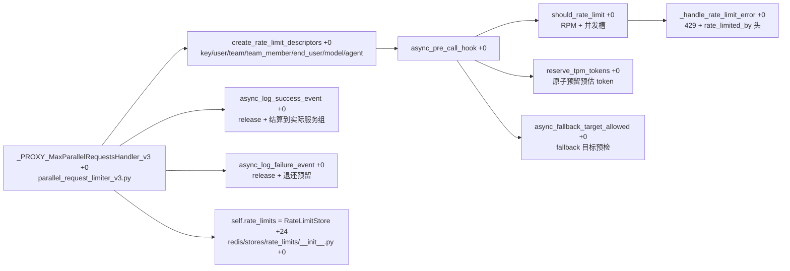

# 函数级解析：请求限流器

> 所属层级：第四层（源码补齐） | 覆盖：`proxy/hooks/parallel_request_limiter_v3.py :: _PROXY_MaxParallelRequestsHandler_v3`、`dynamic_rate_limiter_v3.py`、`redis/stores/rate_limits`

主链路 pre-call 阶段的限流执行者（第三层第 3 篇步骤 8）。注册类 `PROXY_MaxParallelRequestsHandler_v3` 是 `proxy/hooks/__init__.py` 的公开别名（`hooks/__init__.py:25`，`from .parallel_request_limiter_v3 import PROXY_MaxParallelRequestsHandler_v3`），类本体在 `parallel_request_limiter_v3.py :: _PROXY_MaxParallelRequestsHandler_v3`（`+0`，定义行 709）。`PROXY_HOOKS` 字典里 `parallel_request_limiter` 默认指向它，`LEGACY_MULTI_INSTANCE_RATE_LIMITING=true` 时切回 `PROXY_MaxParallelRequestsHandler`（旧 v1）。



计数落在 Rust store 家族（#50170）：`self.rate_limits = rate_limit_store or RateLimitStore(connect(internal_usage_cache.dual_cache.redis_cache).rate_limits(...))`（`__init__ +24`，定义行 734）。`RateLimitStore` 定义在 `litellm/redis/stores/rate_limits/__init__.py :: +0`（定义行 67），`RateLimitScope` / `RateLimitCounter` 在 `litellm/redis/stores/rate_limits/types.py`。

## 1. `__init__()`

```
litellm/proxy/hooks/parallel_request_limiter_v3.py :: _PROXY_MaxParallelRequestsHandler_v3 :: __init__() :: +0
```

| 项 | 内容 |
|---|---|
| 职责 | 组装各维度的计数器句柄 |
| 参数 | `internal_usage_cache`、`time_provider`、tag/model-group/counted-models/media-model/PTU-ceiling/fail-closed/force-hash-tag 各 resolver、`rate_limit_store: RateLimitStore \| None = None` |
| 后置 | `self.rate_limits` 就绪；`window_size` 从 `LITELLM_RATE_LIMIT_WINDOW_SIZE` 读（默认 60）；`tpm_reservation_enabled` 从 `LITELLM_TPM_TOKEN_RESERVATION_ENABLED` 读（默认 true） |

核心状态：

1. `+15`：`self.rate_limits: Final = rate_limit_store or RateLimitStore(connect(...).rate_limits(...))`——计数统一走 Rust `RateLimitStore`（Redis Lua / 内存降级），#50170
2. `+30`：`window_size`
3. `+37`：`tpm_reservation_enabled`——为 false 时 TPM 改为 post-call 从实际 usage 结算，不再 pre-call 预留（省一次 Lua 往返）
4. `+41`：`_batch_rate_limiter` 懒加载；`_check_and_increment_lock` 进程内串行化多阶段 check+increment（跨进程靠 Redis Lua 原子性）

## 2. `async_pre_call_hook()`

```
litellm/proxy/hooks/parallel_request_limiter_v3.py :: _PROXY_MaxParallelRequestsHandler_v3 :: async_pre_call_hook() :: +0
```

| 项 | 内容 |
|---|---|
| 职责 | 请求前扣减全部限流额度，超额即抛 429 |
| 参数 | `user_api_key_dict`、`cache`、`data`、`call_type`、`endpoint_type` |
| 返回 | 通常 `None`（放行）或抛 `RateLimitUnverifiableError`（`+0`，定义行 218，HTTPException 子类，503） |
| 前置 | `UserAPIKeyAuth` 已带出 tpm/rpm 上限（第四层第 2 篇） |
| 后置 | 并发槽位被占用、TPM 被预留；释放责任在 success/failure 回调或断流计费 |

核心算法：

1. `+14`：`claim_request_stash_for_data(data)` 取 request stash（`RequestRateLimiterStash :: +0`，定义行 473，ContextVar 存 per-request 书签）
2. `+22`：`get_rate_limiter_for_call_type` 命中 call-type 特化限流器（如 Batch API）时转交
3. `+35`：`_build_request_rate_limit_descriptors` 构造 `RateLimitDescriptor` 序列：key/user/team/team_member/end-user/model-per-key/model-per-end-user/model-per-org/tag/agent/MCP 多维度（`create_rate_limit_descriptors :: +0` 定义行 2905，`_add_model_per_key_rate_limit_descriptor` / `_end_user_model_rate_limit_descriptor` / `_add_team_model_rate_limit_descriptor_from_metadata` 等逐一 append；多候选 model 时 `_coalesce_rate_limit_descriptors` 合并同 identity）
4. `+81` 附近第一遍：`should_rate_limit(..., skip_tpm_check=tpm_reservation_enabled, parallel_slot_id=...)`——RPM 滑动窗口 + 并发槽；OVER_LIMIT → `_handle_rate_limit_error`
5. TPM 预留（`+105` 起，仅 `tpm_reservation_enabled`）：`_estimate_tokens_for_request`（`+0`，定义行 959）预估 token（prompt tokenizer 计数 + 输出上限 `_get_explicit_output_cap`（`+0`，定义行 843）显式 `max_tokens`；无显式值时 `no_max_tokens_output_floor`（`+0`，定义行 790）给保守下限）；`_estimate_ptu_tokens_for_request`（`+0`，定义行 1007）算 PTU 共享池额度；`reserve_tpm_tokens`（`+0`，定义行 2199）原子 INCRBY 预留
6. PTU 超额度 → `PTUShareExceededError`（400）；预留 OVER_LIMIT → 释放并发槽 + `_handle_rate_limit_error`

## 3. 429 与 rate_limited_by 头

```
litellm/proxy/hooks/parallel_request_limiter_v3.py :: _PROXY_MaxParallelRequestsHandler_v3 :: _handle_rate_limit_error() :: +0
```

`_handle_rate_limit_error`（定义行 3306）遍历 `RateLimitResponse.statuses`，对每个 `code == "OVER_LIMIT"` 的 status：

1. `+9` 起：按 `(descriptor_key, descriptor_value)` 匹配回 `descriptors`（`descriptor_value` 缺省时只用 key），取到具体限流的 value
2. `+21` 起：算 `reset_time = now + window_size`，格式化 UTC
3. `+38` 起：抛 `ProxyRateLimitError`，带四组 429 头（#51228，#51284）：

```python
headers={
    "retry-after": str(self.window_size),
    "rate_limit_type": str(status["rate_limit_type"]),
    "rate_limited_by": descriptor_key,   # +44，新增
    "reset_at": reset_time_formatted,
}
```

`rate_limited_by`（`+44`，定义行 3350）与 `retry-after` / `rate_limit_type` / `reset_at` 并列，把触发限流的 descriptor_key 暴露给客户端，便于按维度定位是哪个桶超额。请求成功时 `x-ratelimit-{descriptor_key}-{remaining|limit}-{rate_limit_type}` 系列头在 `get_rate_limit_headers`（`+0`，定义行 4343 附近）组装。

## 4. per-customer per-model tpm/rpm（#50857）

```
litellm/proxy/hooks/parallel_request_limiter_v3.py :: RateLimitedModel
litellm/proxy/hooks/parallel_request_limiter_v3.py :: _PROXY_MaxParallelRequestsHandler_v3 :: _end_user_model_rate_limit_descriptor() :: +0
```

`RateLimitedModel`（`+0`，定义行 158，frozen dataclass）承载 `requested`（请求名）与 `group`（经 `_model_group_resolver` 展开的模型组）。`limit_in(limits)` 先查 `requested` 精确名，没有再落回 `group`——实现「per-customer 按具体模型或按组」双态取限。

`_end_user_model_rate_limit_descriptor`（定义行 2512）为每个 end-user 生成 per-model 桶：

```python
return RateLimitDescriptor(
    key="model_per_end_user",
    value=f"{user_api_key_dict.end_user_id}:{model.group}",
    rate_limit={
        "requests_per_unit": rpm_limit,
        "tokens_per_unit": tpm_limit,
        "window_size": self.window_size,
    },
)
```

其中 `tpm_limit` / `rpm_limit` 来自 `user_api_key_dict.end_user_model_tpm_limit` / `end_user_model_rpm_limit`（Auth 层从预算表带回）。同 identity 的多个 descriptor（多 model 候选、alias 展开）由 `_coalesce_rate_limit_descriptors`（`+0`，定义行 381，按 `(key, value)` 归并，逐 limit 取最小）合并，`_merge_rate_limit_descriptors`（`+0`，定义行 365）做单组归并。

## 5. 释放路径（三个入口，一个出口）

```
litellm/proxy/hooks/parallel_request_limiter_v3.py :: _PROXY_MaxParallelRequestsHandler_v3 :: _release_parallel_request_slots() :: +0
```

| 入口 | 触发 | 锚点 |
|---|---|---|
| 成功回调 | 响应返回后 | `async_log_success_event() :: +0`（定义行 4900） |
| 失败回调 | 异常路径 | `async_log_failure_event() :: +0`（定义行 5071） |
| 断流计费 | 客户端断开 | `common_request_processing.py :: _dispatch_disconnect_billing_event()` 内部调用 |

`_release_parallel_request_slots()`（`+0`，定义行 1685）统一处理：`parallel_release`（Redis）DECR 并发槽、`_release_stashed_parallel_slot`（`+0`，定义行 1664）按 stash 精确释放单个槽、`_release_parallel_request_slots_in_memory`（`+0`，定义行 1738）内存降级 DECR。成功回调还额外走 `_build_success_event_pipeline_operations`（`+0`，定义行 4681）做 TPM 结算。

### token 结算到实际服务组（#50994/#51082）

`_build_success_event_pipeline_operations`（`+39` 起）决定 TPM 结算记到哪个模型：

```python
served_model = self._rate_limited_model(model_group)
fell_back = (stash is not None and reserved_model is not None and served_model is not None
             and served_model.requested != reserved_model.requested
             and served_model.requested in stash.fallback_models)
reconcile_model = served_model if fell_back or reserved_model is None else reserved_model
```

`fell_back` 为真（路由 fallback 到了本限流器预先 admitted 的 fallback 目标，见 §6）时，结算到**实际服务组** `served_model`，并把被放弃的 per-model 预留 scope 退款（`abandoned_scopes`，`+67` 起）。

### fallback 目标预检

```
litellm/proxy/hooks/parallel_request_limiter_v3.py :: _PROXY_MaxParallelRequestsHandler_v3 :: async_fallback_target_allowed() :: +0
```

`async_fallback_target_allowed`（定义行 3783）在路由 fallback 前预检：对每个候选 fallback 模型，`_build_request_rate_limit_descriptors` 建 descriptor 后只筛 `PER_MODEL_RATE_LIMIT_DESCRIPTOR_KEYS` 的 per-model 桶，`should_rate_limit` 任一 OVER_LIMIT 即返回 False（该 fallback 目标不可用）。通过时把 `model` 记入 `stash.fallback_models`（`+24`），让 post-call 结算能识别 `fell_back`。这是 #50994/#51082 的闭环：fallback 目标先预检容量，再在成功回调里把 token 记到实际服务组。

## 6. 与鉴权层的分工

| 机制 | 位置 | 状态存储 |
|---|---|---|
| 预算检查（spend ≤ max） | 鉴权（第四层第 2 篇） | Postgres + 缓存 |
| TPM/RPM/并发扣减 | 本模块（pre-call） | Rust `RateLimitStore`（Redis + 内存降级） |
| TPM/RPM 值的来源 | `UserAPIKeyAuth` 字段 | 鉴权层带出 |

拆分原因（第三层第 3 篇已述）：限流需要「请求结束归还」的生命周期，必须挂在回调体系上，而鉴权是「校验即结束」。

## 7. 无 Redis 的行为

计数降级为进程内存（`single-flight` 语义仍正确，但多 worker 间不再共享）。`RateLimitStore.has_redis` 为假时各方法走 `local` / `set_local` 内存镜像。`ProxyStartupEvent` 启动时有专门的警告函数（`proxy_server.py :: ProxyStartupEvent :: warn_fail_closed_rate_limits_without_redis() :: +0`，见第四层第 12 篇）——fail-closed 配置配无 Redis 是危险组合，启动即提示。`RateLimitUnverifiableError`（503）是 fail-closed 下 Redis 不可验证时的拒绝信号。

## 8. dynamic_rate_limiter_v3 与计数落 Rust store

```
litellm/proxy/hooks/dynamic_rate_limiter_v3.py :: dynamic_rate_limiter_v3 :: _get_saturation_value_from_cache() :: +0
```

`dynamic_rate_limiter_v3.py` 的动态限流器持有 `self.v3_limiter = PROXY_MaxParallelRequestsHandler_v3(self.internal_usage_cache, ...)`，`self.active_teams = ActiveTeamRegistry(internal_usage_cache)`（活跃团队注册表，priority class 均分用）。`_get_saturation_value_from_cache`（定义行 589）的计数器读走 `rate_limits.get_from_redis`（#51519）：**饱和值以 Redis 里的为准**，让每个 worker 对「模型是否饱和」达成一致；读到的值回写本 worker 内存作 TTL 缓存（`saturation_check_cache_ttl`），Redis 失败或无 Redis 时降级为本地镜像：

```python
async def _get_saturation_value_from_cache(self, counter: RateLimitCounter) -> int | float | str | None:
    rate_limits: Final = self.v3_limiter.rate_limits
    try:
        value: Final = await rate_limits.get_from_redis(counter, backfill_ttl=self._get_saturation_check_cache_ttl())
    except Exception:
        local: Final = rate_limits.local((counter,))[0]
        return None if isinstance(local, dict) else local
    return None if isinstance(value, dict) else value
```

调用处构造：

```python
RateLimitScope("model_saturation_check", model).counter("requests")
RateLimitScope("model_saturation_check", model).counter("tokens")
```

即饱和值桶走 `RateLimitScope`（`redis/stores/rate_limits/types.py :: +0`）的 `counter(kind)` 生成 `RateLimitCounter`，读走 `RateLimitStore.get_from_redis`、写回内存作 TTL 缓存，与主限流器共享同一 Rust store 句柄（#50170）。三阶段语义：先只读检查全部限额，再决定是否放行，放行才原子递增计数；未饱和时 priority 可借空闲容量，饱和后严格按 priority 限额。

## 8b. 团队模型限额的借用机制（#51328/#51359/#51366/#51350/#51415/#51367）

需求视角：当多个团队共享一个模型的 TPM/RPM 限额时，某个团队暂时用不满自己的份额，其他团队不该被空耗的空闲容量挡在 429 后面。本轮让团队能借另一团队的空闲模型容量，借多少有个上限，且借用会精确结算到实际服务的团队，避免多借或拿别人的额度撑场。

技术视角：借用由 `parallel_request_limiter_v3.py` 与 `dynamic_rate_limiter_v3.py` 配合实现。

**借用限额判定**（`parallel_request_limiter_v3.py`）：

| 符号 | 定义行 | 作用 |
|---|---|---|
| `dynamic_rate_limiter_covers` | 171 | 该 model group 是否走动态限流器（借用只在动态限流器覆盖的组内生效） |
| `inherited_team_model_limit` | 186 | 从 team 继承来的 `model_tpm_limit`/`model_rpm_limit` |
| `team_model_limit_max_borrow_multiple` | 234 | 读配置键 `team_model_limit_max_borrow_multiple`，封顶「一个团队最多借到本队限额的几倍」 |
| `BorrowingTeamModelLimits` | 211 | 携带 `tpm`/`rpm`/`max_borrow_multiple` 的借用描述；`borrow_ceiling`（221）算实际借到多少 |
| `NO_BORROWING` | 231 | 无借用空间时返回的哨兵 |
| `borrowing_team_model_limits` | 251 | 入口：按 `user_api_key_dict` + `RateLimitedModel` 组装 `BorrowingTeamModelLimits`，动态限流器不覆盖则 `NO_BORROWING` |

`async_pre_call_hook`（类 `_PROXY_MaxParallelRequestsHandler_v3`，定义 858）在 `+2738` 处调 `borrowing_team_model_limits` 把借用额度喂进释放判定。请求 stash 重构为 `claim_request_stash_for_data`（739）/ `request_stash_for_callback`（799）。

**dynamic_rate_limiter_v3 侧的结算与引导**（`dynamic_rate_limiter_v3.py`）：

| 符号 | 定义行 | 作用 |
|---|---|---|
| `ModelPreference` | 99 | 团队偏好的模型 + 允许的备选 |
| `AlternateGrant` | 90 | 给「偏好模型饱和」的团队一个可用的备选模型授权 |
| `SteeredModel` | 110 | 被引导过去的备选模型 |
| `alternate_grant_for` | 116 | 查该团队/请求在当前模型下有没有可用的备选授权 |
| `alternates_for` | 335 | 列出按价格相近（`_priced_within`，297）筛选的备选模型 |
| `_tightest_team_share` | 383 | 在多个描述符里取最紧的团队份额 |
| `_SettlementMetadata` / `_SettlementLoggingObject` | 350 / 365 | 借用结算的元数据与日志对象 |
| `_team_model_settlement` | 484 | 把一次请求的用量结算到实际服务该请求的团队 |
| `_BorrowingTeamShare` | 437 | 记录借出/借入的 share 与是否被强制（`enforced`） |
| `_get_priority_settings` | 528 | 读 `PriorityReservationSettings`（saturation_check_cache_ttl、share 配置） |

priority class 的均分规则在 `litellm/proxy/hooks/priority_class_share.py`（`pool_member` 32 / `team_member` 38 / `is_pool_member` 43 / `counter_value` 47 / `TeamShare` 54 / `team_share` 60 / `ActiveTeamRegistry` 86）：priority class 的份额在活跃团队间均分（#51366），prometheus 暴露 per team+model 的 share / borrowed / throttle 指标（#51417），模型饱和后 borrower 归还全额 share（#51415）。router fallbacks、嵌套调用、WebSocket turns、超大 prompt 同样受借用约束（#51367）。

**行为语义**：借用只在动态限流器覆盖的 model group 内生效；borrow 有 `max_borrow_multiple` 封顶；结算走 `_team_model_settlement` 落到实际服务团队，不占发起方自己的空闲额度；灵活团队在偏好模型饱和时被引导到 `_priced_within` 的备选。

## 9. v3 与旧版

模块内同时保留 v1/v2 处理器（`hooks/__init__.py` 里 `PROXY_MaxParallelRequestsHandler`、`_PROXY_MaxParallelRequestsHandler` 导出做向后兼容），新配置默认走 v3（descriptor 模型 + PTU 支持）。读代码时按 `_PROXY_MaxParallelRequestsHandler_v3` 找，别被同名旧类带偏。