# 函数级解析（十一）：`PROXY_MaxParallelRequestsHandler_v3` 限流函数

> 所属层级：第四层（函数级解析） | 覆盖：`litellm/proxy/hooks/parallel_request_limiter_v3.py`、`litellm/proxy/hooks/dynamic_rate_limiter_v3.py`、`litellm/proxy/hooks/priority_class_share.py`
> 本篇基准提交：`411b64dc7a`（工作区当前 HEAD）
> 引用规范：`文件 :: 符号 :: +偏移`，`+0` = 定义行，`+N` = 函数体内第 N 行

本篇逐个展开限流这条链里的关键函数：注册类与公开别名、请求书签（`RequestRateLimiterStash`、`claim_request_stash_for_data`、`request_stash_for_callback`）、描述符构造（`create_rate_limit_descriptors`、`_end_user_model_rate_limit_descriptor`、`_coalesce_rate_limit_descriptors`）、额度检查与 TPM 预留（`should_rate_limit`、`reserve_tpm_tokens`）、超额错误（`_handle_rate_limit_error`）、释放路径（`_release_parallel_request_slots`、`_release_stashed_parallel_slot`、`_release_parallel_request_slots_in_memory`）、成功与失败回调（`async_log_success_event`、`async_log_failure_event`、`_build_success_event_pipeline_operations`）、fallback 目标预检（`async_fallback_target_allowed`）、token 估算辅助（`no_max_tokens_output_floor`、`_get_explicit_output_cap`、`_estimate_tokens_for_request`、`_estimate_ptu_tokens_for_request`），以及借用机制（`dynamic_rate_limiter_covers`、`inherited_team_model_limit`、`team_model_limit_max_borrow_multiple`、`BorrowingTeamModelLimits`、`NO_BORROWING`、`borrowing_team_model_limits`）与动态限流器（`dynamic_rate_limiter_v3` 的 `_get_saturation_value_from_cache`、`_team_model_settlement`、`alternate_grant_for`、`alternates_for`）。

术语首现已解释：`描述符`（`RateLimitDescriptor`，一个「按什么维度限、限多少」的条目，key/value/rate_limit 三段）、`并发槽`（`max_parallel_requests` gauge，请求开始占一个、结束还一个）、`TPM 预留`（请求前按预估 token 原子递增，结束后按实际用量结算差额）、`借用`（团队模型限额用不满时把空闲容量借给别的团队，借多少有封顶）、`饱和值`（某模型当前累计用量，以 Redis 里的为准）、`fail-closed`（Redis 不可验证时直接拒绝而非放行）。

第三层《pre-call 与路由》讲的是「限流在请求前哪一步被触发」，本篇只讲「这些函数内部具体怎么实现」；priority class 份额在活跃团队间均分与 prometheus 指标属第五层，本篇只交代函数入口。

## 本篇覆盖函数

| 环节 | 本篇展开的函数 |
|---|---|
| 注册与别名 | `hooks/__init__.py` 的公开导出、`PROXY_MaxParallelRequestsHandler_v3` |
| 请求书签 | `RequestRateLimiterStash`、`claim_request_stash_for_data`、`request_stash_for_callback` |
| 构造 | `_PROXY_MaxParallelRequestsHandler_v3.__init__` |
| 描述符构造 | `create_rate_limit_descriptors`、`_end_user_model_rate_limit_descriptor`、`_coalesce_rate_limit_descriptors` |
| 额度检查 | `should_rate_limit` |
| TPM 预留 | `reserve_tpm_tokens`、`no_max_tokens_output_floor`、`_get_explicit_output_cap`、`_estimate_tokens_for_request`、`_estimate_ptu_tokens_for_request` |
| 超额错误 | `_handle_rate_limit_error` |
| 释放路径 | `_release_parallel_request_slots`、`_release_stashed_parallel_slot`、`_release_parallel_request_slots_in_memory` |
| 成功/失败回调 | `async_log_success_event`、`async_log_failure_event`、`_build_success_event_pipeline_operations` |
| fallback 预检 | `async_fallback_target_allowed` |
| 借用机制 | `dynamic_rate_limiter_covers`、`inherited_team_model_limit`、`team_model_limit_max_borrow_multiple`、`BorrowingTeamModelLimits`、`NO_BORROWING`、`borrowing_team_model_limits` |
| 动态限流器 | `_get_saturation_value_from_cache`、`_team_model_settlement`、`alternate_grant_for`、`alternates_for`、`_tightest_team_share` |

---

### 公开别名与注册（`litellm/proxy/hooks/__init__.py`）

- 职责：把 v3 处理器以新旧两个名字导出，供 `PROXY_HOOKS` 字典按 `parallel_request_limiter` 键取用。
- 算法（贴 `hooks/__init__.py :: +23` 到 `+28`，行 23-28）：

```python
from .parallel_request_limiter_v3 import (  # noqa: F401  # backwards-compatible package export
    PROXY_MaxParallelRequestsHandler_v3,
    _PROXY_MaxParallelRequestsHandler_v3,  # pyright: ignore[reportPrivateUsage]  # backwards-compatible package export
)
```

  类本体在 `litellm/proxy/hooks/parallel_request_limiter_v3.py :: _PROXY_MaxParallelRequestsHandler_v3 :: +0`（绝对行 858），继承 `CustomLogger`；模块末尾 `PROXY_MaxParallelRequestsHandler_v3 = _PROXY_MaxParallelRequestsHandler_v3`（`+0`，绝对行 5667）给出公开别名。旧版 `PROXY_MaxParallelRequestsHandler` / `_PROXY_MaxParallelRequestsHandler` 仍从 `parallel_request_limiter` 导出做向后兼容（行 20-23）。`LEGACY_MULTI_INSTANCE_RATE_LIMITING=true` 时切回旧 v1。
- 调用关系：调用方 = `PROXY_HOOKS` 注册表。被调用方 = `parallel_request_limiter_v3` 模块。

---

### `RequestRateLimiterStash` / `claim_request_stash_for_data` / `request_stash_for_callback`（`litellm/proxy/hooks/parallel_request_limiter_v3.py`）

- 职责：per-request 书签。pre-call 阶段把并发槽 id、TPM 预留、PTU 上限、tag 集合等写进 stash，回调阶段按 call_id 取回，保证「谁占的谁还」。
- 签名/参数：
  - `class RequestRateLimiterStash`（`+0`，绝对行 591）：携带 `parallel_slot`、`reserved_tokens`、`ptu_reserved_tokens`、`reserved_model`、`fallback_models`、`tpm_limited_tags`、`socket_agent_windows`、`ptu_ceiling`、`rate_limit_response` 等字段。
  - `def claim_request_stash_for_data(data: Mapping[str, object]) -> RequestRateLimiterStash`（`+0`，绝对行 739）。
  - `def request_stash_for_callback(kwargs: Mapping[str, object]) -> RequestRateLimiterStash | None`（`+0`，绝对行 799）。
- 返回：前者取到或新建 stash；后者按 `litellm_call_id` 查，查不到返回 `None`。
- 算法：`claim_request_stash_for_data` 从 `data` 里取 call id，命中已有 stash 就复用，否则新建并登记到 ContextVar/映射；`request_stash_for_callback` 从回调 kwargs 还原 call id 再查同一映射。本篇核到签名与调用关系，两者函数体内偏移未逐行核到，属 `[推断]`。
- 调用关系：调用方 = `async_pre_call_hook :: +12`（`claim_request_stash_for_data`）、`async_log_success_event :: +12` / `async_log_failure_event`（`request_stash_for_callback` / `get_request_stash_for_call`）。被调用方 = call id 提取辅助（`_call_id_from_callback_kwargs`）。

---

### `_PROXY_MaxParallelRequestsHandler_v3.__init__`（`litellm/proxy/hooks/parallel_request_limiter_v3.py`）

- 职责：组装各维度计数器句柄、window 大小、TPM 预留开关与进程内串行化锁。
- 签名/参数：`def __init__(self, internal_usage_cache: InternalUsageCache, time_provider: Callable[[], datetime] | None = None, tag_rate_limit_resolver: TagRateLimitResolver = resolve_tag_rate_limits_from_db, model_group_resolver: Callable[[str], str | None] = _resolve_model_group_alias_via_proxy_router, counted_models_resolver: Callable[[str, str | None], Sequence[str]] = _resolve_counted_models_via_proxy_router, media_model_resolver: Callable[[str, str | None], tuple[str, ...]] = _resolve_media_models_via_proxy_router, ptu_team_ceiling_resolver: Callable[[str, str], PTUTeamCeiling | None] = _resolve_ptu_team_ceiling_via_proxy_router, fail_closed_resolver: Callable[[], bool] = _fail_closed_rate_limit_enforcement_from_general_settings, force_hash_tag_grouping_resolver: Callable[[], bool] = _force_redis_hash_tag_grouping_from_litellm_settings, rate_limit_store: RateLimitStore | None = None)`（`litellm/proxy/hooks/parallel_request_limiter_v3.py :: _PROXY_MaxParallelRequestsHandler_v3 :: __init__ :: +0`，绝对行 859）。
- 返回：实例。
- 算法（贴 `__init__ :: +16` 到 `+40`，行 874-895）：

```python
        self.internal_usage_cache = internal_usage_cache
        self._time_provider = time_provider or datetime.now
        ...
        self.rate_limits: Final = rate_limit_store or RateLimitStore(
            connect(internal_usage_cache.dual_cache.redis_cache).rate_limits(
                internal_usage_cache.dual_cache.default_in_memory_ttl
            )
        )

        self.window_size = int(os.getenv("LITELLM_RATE_LIMIT_WINDOW_SIZE", 60))
        ...
        self.tpm_reservation_enabled = os.getenv("LITELLM_TPM_TOKEN_RESERVATION_ENABLED", "true").lower() == "true"
```

  分步：`+16` 到 `+24` 存 usage cache 与各 resolver（tag/model-group/counted-models/media/PTU-ceiling/fail-closed/hash-tag）；`+25` 到 `+29` 建计数器句柄 `self.rate_limits`，计数统一走 Rust `RateLimitStore`（`litellm/redis/stores/rate_limits/__init__.py :: RateLimitStore`，Redis Lua，无 Redis 退内存）；`+31` `window_size` 从 `LITELLM_RATE_LIMIT_WINDOW_SIZE` 读（默认 60）；`+36` `tpm_reservation_enabled` 从 `LITELLM_TPM_TOKEN_RESERVATION_ENABLED` 读（默认 true）——为 false 时 TPM 改为 post-call 从实际 usage 结算，不再 pre-call 预留，省一次 Lua 往返；`+39` 到 `+57`（行 897-915）`_batch_rate_limiter` 懒加载、`BatchEnqueuedTokenStore`、`_check_and_increment_lock`（单个 `asyncio.Lock` 串行化本进程多阶段 check+increment，跨进程靠 Redis Lua 原子性，注释自述高争用可分片到 per-descriptor-key 锁，暂缓）。
- 错误/分支：无 Redis 时 `RateLimitStore` 退内存；预留关闭时跳过 `reserve_tpm_tokens`。
- 调用关系：调用方 = `dynamic_rate_limiter_v3` 的 `self.v3_limiter = PROXY_MaxParallelRequestsHandler_v3(...)`（`dynamic_rate_limiter_v3.py :: +578`，绝对行 579）与测试装配。被调用方 = `connect(...).rate_limits(...)`、`RateLimitStore`、`BatchEnqueuedTokenStore`、`os.getenv`。

---

### `should_rate_limit`（`litellm/proxy/hooks/parallel_request_limiter_v3.py`）

- 职责：检查一组描述符是否超额。窗口计数（RPM/TPM）走滑动窗口，`max_parallel_requests` 走专用 gauge 路径。
- 签名/参数：`async def should_rate_limit(self, descriptors: Sequence[RateLimitDescriptor], parent_otel_span: Span | None = None, read_only: bool = False, skip_tpm_check: bool = False, parallel_slot_id: str | None = None, skip_parallel_check: bool = False) -> RateLimitResponse`（`litellm/proxy/hooks/parallel_request_limiter_v3.py :: _PROXY_MaxParallelRequestsHandler_v3 :: should_rate_limit :: +0`，绝对行 1547）。
- 返回：`RateLimitResponse`（`overall_code` 为 `OK` 或 `OVER_LIMIT`，`statuses` 逐描述符给明细）。
- 算法（贴 `should_rate_limit :: +39` 到 `+86`，行 1586-1632）：

```python
        current_time: Final = self._get_current_time()
        now: Final = current_time.timestamp()
        now_int: Final = int(now)  # Convert to integer for Redis Lua script

        counters, key_metadata, gauges = self._collect_windowed_keys_and_gauges(
            descriptors=descriptors,
            skip_tpm_check=skip_tpm_check,
        )
        windowed_response = RateLimitResponse(overall_code="OK", statuses=[])
        if counters:
            local_response: Final = self.is_cache_list_over_limit(
                counters, self._local_counter_states(counters), key_metadata, read_only=read_only
            )
            if local_response["overall_code"] == "OVER_LIMIT":
                return local_response
            if read_only:
                cache_values = await self._read_counter_values_without_incrementing(counters)
            elif self.rate_limits.has_redis:
                cache_values = await self._execute_redis_batch_rate_limiter_script(counters=counters, now_int=now_int)
                ...
            else:
                cache_values = await self.in_memory_cache_sliding_window(...)
            windowed_response = self.is_cache_list_over_limit(counters, cache_values, key_metadata, read_only=read_only)
            if windowed_response["overall_code"] == "OVER_LIMIT":
                return windowed_response
        if not gauges or skip_parallel_check:
            return windowed_response
        gauge_response: Final = await self._check_parallel_request_gauges(
            gauges=gauges,
            slot_id=parallel_slot_id or uuid.uuid4().hex,
            parent_otel_span=parent_otel_span,
            read_only=read_only,
        )
        return RateLimitResponse(
            overall_code=gauge_response["overall_code"],
            statuses=[*windowed_response["statuses"], *gauge_response["statuses"]],
        )
```

  分步：`+39` 到 `+41` 取当前时间并转成 Redis Lua 要的整数秒；`+43` 到 `+47` `_collect_windowed_keys_and_gauges` 把描述符分成窗口计数器与并发 gauge 两组（`skip_tpm_check` 为真时不收 `:tokens` 计数器）；`+50` 到 `+55` 先用本地镜像快速判一次，超了立即返回（省一次 Redis 往返）；`+57` 到 `+67` 真正读数：`read_only` 只读不增、有 Redis 走批量 Lua 脚本、否则走内存滑动窗口；`+69` 到 `+71` 判窗口是否超额，超了立即返回（docstring 自述 gauge 阶段必须排在窗口之后，否则一次 RPM/TPM 拒绝会泄漏一个已占的 gauge 槽）；`+74` 到 `+82` 有 gauge 且不跳过时 `_check_parallel_request_gauges`（`+0`，绝对行 1709）占/查并发槽，`parallel_slot_id` 缺省时生成一个（只能靠 TTL 回收）；`+84` 到 `+86` 合并窗口与 gauge 的 statuses。
- 错误/分支：本地镜像超限短路返回；`skip_tpm_check`/`skip_parallel_check` 各自跳过对应阶段。
- 调用关系：调用方 = `async_pre_call_hook`、`async_fallback_target_allowed`、`dynamic_rate_limiter_v3`（行 1133、1419）、`raise_if_over_limit_before_body`。被调用方 = `_collect_windowed_keys_and_gauges`、`is_cache_list_over_limit`、`_local_counter_states`、`_read_counter_values_without_incrementing`、`_execute_redis_batch_rate_limiter_script`、`in_memory_cache_sliding_window`、`_check_parallel_request_gauges`、`_get_current_time`。

---

### `reserve_tpm_tokens`（`litellm/proxy/hooks/parallel_request_limiter_v3.py`）

- 职责：请求前按预估 token 对每个带 TPM 的描述符原子预留，避免并发请求都在对方递增前看到「未超额」。
- 签名/参数：`async def reserve_tpm_tokens(self, descriptors: list[RateLimitDescriptor], estimated_tokens: int, parent_otel_span: Span | None = None, scope_estimates: Mapping[str, int] = MappingProxyType({})) -> RateLimitResponse`（`litellm/proxy/hooks/parallel_request_limiter_v3.py :: _PROXY_MaxParallelRequestsHandler_v3 :: reserve_tpm_tokens :: +0`，绝对行 2379）。
- 返回：`RateLimitResponse`（预留结果）。
- 算法（贴 `reserve_tpm_tokens :: +20` 到 `+42`，行 2398-2420）：

```python
        tpm_descriptors: Final[list[RateLimitDescriptor]] = [
            RateLimitDescriptor(
                key=d["key"],
                value=d["value"],
                rate_limit=RateLimitDescriptorRateLimitObject(
                    tokens_per_unit=(d.get("rate_limit") or {}).get("tokens_per_unit"),
                    window_size=(d.get("rate_limit") or {}).get("window_size"),
                ),
            )
            for d in descriptors
            if d["key"] not in (PROJECT_ITPM_DESCRIPTOR_KEY, PROJECT_OTPM_DESCRIPTOR_KEY)
            and (d.get("rate_limit") or {}).get("tokens_per_unit") is not None
        ]
        if not tpm_descriptors:
            return RateLimitResponse(overall_code="OK", statuses=[])

        increments: Final[list[dict[Literal["requests", "tokens"], int]]] = [
            {"tokens": scope_estimates.get(d["key"], estimated_tokens)} for d in tpm_descriptors
        ]
        return await self.atomic_check_and_increment_by_n(
            descriptors=tpm_descriptors,
            increments=increments,
            parent_otel_span=parent_otel_span,
        )
```

  分步：`+20` 到 `+36` 筛出带 `tokens_per_unit` 的描述符，剔除 project ITPM/OTPM（这两类按各自预估由 `reserve_io_tokens` 单独预留）；`+38` 到 `+39` 无 TPM 描述符直接返回 OK；`+41` 到 `+42` `scope_estimates` 按描述符键替换预估额（团队 PTU 上限以 PTU 估算值计入），否则用统一的 `estimated_tokens`；`+44` 到 `+48` 交给 `atomic_check_and_increment_by_n`（`+0`，绝对行 1933）做 all-or-nothing 原子递增（Redis 走 Lua，否则 asyncio 锁 + DualCache）。
- 错误/分支：无 TPM 描述符返回 OK；原子递增 OVER_LIMIT 由调用方释放并发槽后转 `_handle_rate_limit_error`。
- 调用关系：调用方 = `async_pre_call_hook`（TPM 预留段）。被调用方 = `atomic_check_and_increment_by_n`。

---

### `no_max_tokens_output_floor` / `_get_explicit_output_cap` / `_estimate_tokens_for_request` / `_estimate_ptu_tokens_for_request`（`litellm/proxy/hooks/parallel_request_limiter_v3.py`）

- 职责：TPM 预留要的「预估 token」怎么来。显式 `max_tokens` 优先，缺失时给保守下限；PTU 共享池另算一份。
- 签名/参数：
  - `@staticmethod def no_max_tokens_output_floor(min_configured_tpm_limit: int | None) -> int`（`+0`，绝对行 939）。
  - `@staticmethod def _get_explicit_output_cap(data: object, call_type: str | None) -> int | None`（`+0`，绝对行 992）。
  - `def _estimate_tokens_for_request(self, data: object, model: str | None = None, min_configured_tpm_limit: int | None = None, call_type: str | None = None, configured_output_tokens: int | None = None) -> int`（`+0`，绝对行 1139）。
  - `def _estimate_ptu_tokens_for_request(self, ceiling: PTUTeamCeiling | None, data: Mapping[str, object], min_configured_tpm_limit: int | None, call_type: str | None, configured_output_tokens: int | None, ...) -> int`（`+0`，绝对行 1187）。
- 返回：token 数（int）。
- 算法：`no_max_tokens_output_floor`（贴 `+5` 到 `+9`，行 948-951）取 `DEFAULT_MAX_TOKENS_ESTIMATE * NO_MAX_TOKENS_TPM_RESERVATION_FRACTION` 作基线，配置了 `min_configured_tpm_limit` 时用 `min(基线, max(1, limit * fraction))` 封顶，保证小额 per-tenant 上限不会被下限单独触发。`_get_explicit_output_cap` 从请求里取显式 `max_tokens`（排除 bool 与负数），Google GenAI 原生请求从 `generationConfig` 取。`_estimate_tokens_for_request` 组合 prompt tokenizer 计数与输出上限（显式值或 `no_max_tokens_output_floor` 下限）。`_estimate_ptu_tokens_for_request` 在 PTU ceiling 存在时按共享池口径重算一份。后两者的函数体内偏移本篇未逐行核到，按 docstring 与调用点描述，属 `[推断]`。
- 错误/分支：无显式输出上限时用下限；PTU ceiling 为 None 时不走 PTU 估算。
- 调用关系：调用方 = `async_pre_call_hook` 的 TPM 预留段（经 `offload_token_count` 离载）。被调用方 = `no_max_tokens_output_floor`、`_get_explicit_output_cap`、tokenizer 计数辅助、`get_output_candidate_count`（`+0`，绝对行 1032）。

---

### `create_rate_limit_descriptors` / `_end_user_model_rate_limit_descriptor` / `_coalesce_rate_limit_descriptors`（`litellm/proxy/hooks/parallel_request_limiter_v3.py`）

- 职责：把请求按 key/user/team/team_member/end-user/model-per-key/model-per-end-user/tag/agent/MCP 等维度展开成一串描述符；同 identity 的多候选合并。
- 签名/参数：
  - `def create_rate_limit_descriptors(self, user_api_key_dict: UserAPIKeyAuth, data: dict, rpm_limit_type: str | None, tpm_limit_type: str | None, model_has_failures: bool, call_type: str | None = None) -> list[RateLimitDescriptor]`（`+0`，绝对行 3138）。
  - `def _end_user_model_rate_limit_descriptor(self, user_api_key_dict: UserAPIKeyAuth, requested_model: str | None) -> RateLimitDescriptor | None`（`+0`，绝对行 2740）。
  - `def _coalesce_rate_limit_descriptors(descriptors: Sequence[RateLimitDescriptor]) -> Sequence[RateLimitDescriptor]`（`+0`，绝对行 482）；单组归并 `_merge_rate_limit_descriptors`（`+0`，绝对行 466）。
- 返回：`list[RateLimitDescriptor]`（或合并后的序列）。
- 算法：`_end_user_model_rate_limit_descriptor`（贴 `+7` 到 `+24`，行 2746-2763）先 `self._rate_limited_model(requested_model)` 解析模型（`requested` 精确名优先、回落 `group`），end_user_id 缺失或两级限额都为 None 返回 None；否则造 `key="model_per_end_user"`、`value=f"{end_user_id}:{model.group}"` 的描述符，`requests_per_unit`/`tokens_per_unit` 分别取 `end_user_model_rpm_limit`/`end_user_model_tpm_limit`（经 `RateLimitedModel.limit_in` 双态取限），`window_size` 用 `self.window_size`。`create_rate_limit_descriptors` 逐维度 append（key/user/team/team_member/end-user/model-per-key/model-per-end-user/tag/agent/MCP），多候选 model 与 alias 展开产生的同 identity 描述符由 `_coalesce_rate_limit_descriptors` 按 `(key, value)` 归并、逐 limit 取最小。`create_rate_limit_descriptors` 与 `_coalesce_rate_limit_descriptors` 的函数体内偏移本篇未逐行核到，按 docstring 与调用点描述，属 `[推断]`。
- 错误/分支：某维度无限额就不生成描述符；end-user 无模型限额返回 None。
- 调用关系：调用方 = `_build_request_rate_limit_descriptors`（`+0`，绝对行 3966）。被调用方 = `_rate_limited_model`、`RateLimitedModel.limit_in`、`_add_model_per_key_rate_limit_descriptor`（`+0`，绝对行 2765）、`_add_tag_per_key_rate_limit_descriptor`（`+0`，绝对行 2808）、`_add_mcp_per_key_rate_limit_descriptor`（`+0`，绝对行 2845）、`_end_user_model_rate_limit_descriptor`、`_merge_rate_limit_descriptors`。

---

### `_handle_rate_limit_error`（`litellm/proxy/hooks/parallel_request_limiter_v3.py`）

- 职责：把 `OVER_LIMIT` 转成带四组 429 头的 `ProxyRateLimitError`，把触发限流的维度暴露给客户端。
- 签名/参数：`def _handle_rate_limit_error(self, response: RateLimitResponse, descriptors: Sequence[RateLimitDescriptor], requested_model: str | None = None) -> None`（`litellm/proxy/hooks/parallel_request_limiter_v3.py :: _PROXY_MaxParallelRequestsHandler_v3 :: _handle_rate_limit_error :: +0`，绝对行 3546）。
- 返回：`None`（必抛 `ProxyRateLimitError`）。
- 算法（贴 `_handle_rate_limit_error :: +7` 到 `+51`，行 3553-3597）：

```python
        for status in response["statuses"]:
            if status["code"] == "OVER_LIMIT":
                descriptor_key = status["descriptor_key"]
                matching_descriptor = next(
                    (
                        desc
                        for desc in descriptors
                        if desc["key"] == descriptor_key
                        and ((status_value := status.get("descriptor_value")) is None or desc["value"] == status_value)
                    ),
                    None,
                )
                descriptor_value = matching_descriptor["value"] if matching_descriptor is not None else "unknown"
                now = self._get_current_time().timestamp()
                reset_time = now + self.window_size
                reset_time_formatted = datetime.fromtimestamp(reset_time, tz=timezone.utc).strftime(
                    "%Y-%m-%d %H:%M:%S UTC"
                )
                ...
                raise ProxyRateLimitError(
                    detail=detail,
                    headers={
                        "retry-after": str(self.window_size),
                        "rate_limit_type": str(status["rate_limit_type"]),
                        "rate_limited_by": descriptor_key,
                        "reset_at": reset_time_formatted,
                    },
                    rate_limit_type=map_v3_rate_limit_type(status["rate_limit_type"]),
                    model=resolved_model,
                    llm_provider=llm_provider,
                    descriptor_key=descriptor_key,
                )
```

  分步：`+7` 到 `+19` 遍历 statuses，命中 `OVER_LIMIT` 时按 `(descriptor_key, descriptor_value)` 匹配回描述符（value 缺省时只按 key），取到具体限流值，匹配不到记 `"unknown"`；`+20` 到 `+24` 算 `reset_time = now + window_size` 并格式化 UTC；`+27` 到 `+51` 抛 `ProxyRateLimitError`，头里 `retry-after` / `rate_limit_type` / `rate_limited_by` / `reset_at` 四组并列，`rate_limited_by` 就是触发限流的 `descriptor_key`，便于客户端按维度定位是哪个桶超额。请求成功时 `x-ratelimit-{descriptor_key}-{remaining|limit}-{rate_limit_type}` 系列头由 `async_logging_hook`（`+0`，绝对行 5253）把 pre-call 快照镜像进 SLP，让流式成功回调与非流式 `async_post_call_success_hook` 写出同样的头。
- 错误/分支：只处理 `OVER_LIMIT`；描述符匹配不到 value 记 `"unknown"`。
- 调用关系：调用方 = `async_pre_call_hook`（窗口与 TPM 两处）、`reserve_tpm_tokens` 调用后的 OVER_LIMIT 分支。被调用方 = `resolve_llm_provider_for_rate_limit`、`map_v3_rate_limit_type`、`_get_current_time`。

---

### `_release_parallel_request_slots` / `_release_stashed_parallel_slot` / `_release_parallel_request_slots_in_memory`（`litellm/proxy/hooks/parallel_request_limiter_v3.py`）

- 职责：请求结束（成功/失败/断流）后归还 pre-call 占用的 `max_parallel_requests` 槽位。
- 签名/参数：
  - `async def _release_stashed_parallel_slot(self, stash: RequestRateLimiterStash | None, parent_otel_span: Span | None, *, in_logging_callback: bool = False, round_ended_at: datetime | None = None) -> None`（`+0`，绝对行 1844）。
  - `async def _release_parallel_request_slots(self, acquisition: ParallelSlotAcquisition, parent_otel_span: Span | None = None) -> None`（`+0`，绝对行 1865）。
  - `async def _release_parallel_request_slots_in_memory(self, gauges: Sequence[RateLimitScope], slot_id: str) -> None`（`+0`，绝对行 1918）。
- 返回：`None`。
- 算法：`_release_parallel_request_slots`（docstring 自述）把本请求的 slot id 从它注册过的每个 gauge 里移除；移除一个不存在的 slot id 是 no-op，所以没有匹配 acquire 的 release 或重复触发的 release 都不可能释放别人的槽。有 Redis 走 gauge 脚本，无 Redis 走 `_release_parallel_request_slots_in_memory`——它持 `_check_and_increment_lock` 后按 slot id 过滤内存镜像里的时间戳字典（贴 `+1` 到 `+11`，行 1919-1929：`raw_value` 不是 dict 或不含该 slot id 就 `continue`，否则重建去掉该 slot 的字典）。`_release_stashed_parallel_slot` 按 stash 精确释放单个槽，供日志回调与 PTU 超额回退复用。三者的函数体内偏移本篇未逐行核到，按 docstring 与贴出的内存分支描述，属 `[推断]`。
- 错误/分支：释放一个未占用的槽是 no-op（幂等）；无 Redis 退内存 DECR。
- 调用关系：调用方 = `async_log_success_event :: +14`、`async_log_failure_event`、`async_pre_call_hook` 的 PTU 超额回退、断流计费路径。被调用方 = gauge 脚本、`self.rate_limits`、`_check_and_increment_lock`。

---

### `async_log_success_event`（`litellm/proxy/hooks/parallel_request_limiter_v3.py`）

- 职责：成功回调。释放并发槽，把 TPM 从「预留的预估」结算到「实际用量」，必要时退款或补扣。
- 签名/参数：`async def async_log_success_event(self, kwargs, response_obj, start_time, end_time) -> None`（`litellm/proxy/hooks/parallel_request_limiter_v3.py :: _PROXY_MaxParallelRequestsHandler_v3 :: async_log_success_event :: +0`，绝对行 5168）。
- 返回：`None`。
- 算法（贴 `async_log_success_event :: +8` 到 `+47`，行 5175-5214）：

```python
        rate_limit_type: Final = self.get_rate_limit_type()
        litellm_parent_otel_span: Final[Span | None] = get_parent_otel_span_from_kwargs(kwargs)
        try:
            ...
            callback_kwargs: Final = _callback_kwargs_mapping(kwargs)
            stash: Final = get_request_stash_for_call(_call_id_from_callback_kwargs(callback_kwargs))
            await self._release_stashed_parallel_slot(
                stash,
                litellm_parent_otel_span,
                in_logging_callback=True,
                round_ended_at=end_time
                if isinstance(end_time, datetime) and not callback_kwargs.get("stream")
                else None,
            )
            usage_operations: Final = self._build_success_event_pipeline_operations(
                kwargs=kwargs, response_obj=response_obj, rate_limit_type=rate_limit_type,
            )
            io_token_operations: Final = self._build_io_token_reservation_ops(
                kwargs=kwargs, response_obj=response_obj,
            )
            if stash is not None:
                stash.clear_reserved_tokens()
            await self._apply_usage_operations(usage_operations, litellm_parent_otel_span)
            ...
        except Exception as e:
            verbose_proxy_logger.exception("Error in rate limit success event: %s", e)
```

  分步：`+8` 到 `+11` 取限流类型（input/output/total）与 parent OTel span；`+14` 到 `+22` 按 call_id 取 stash 并释放并发槽（非流式传 `round_ended_at=end_time`）；`+24` 到 `+31` `_build_success_event_pipeline_operations`（`+0`，绝对行 4949）按实际 usage 造 TPM 管道递增操作、`_build_io_token_reservation_ops` 造 input/output token 操作；`+32` 到 `+33` 清掉 stash 里的预留标记；`+34` 到 `+45` `_apply_usage_operations`（`+0`，绝对行 5217）把操作分成「无窗口守卫的 `CounterIncrement`」与「窗口守卫的 `WindowGuardedIncrement`」两组，分别走 `async_increment_tokens_with_ttl_preservation` 与 `async_increment_reservation_aware_tokens`；`+47` 到 `+49` 整个函数包在 try 里，异常只记日志不抛（记账失败不阻断调用链）。
- 错误/分支：异常记 exception 日志；stash 查不到也能靠 `_build_success_event_pipeline_operations` 从 standard_logging_object 补出 usage。
- 调用关系：调用方 = 成功事件回调分发。被调用方 = `get_request_stash_for_call`、`_release_stashed_parallel_slot`、`_build_success_event_pipeline_operations`、`_build_io_token_reservation_ops`、`_apply_usage_operations`、`get_parent_otel_span_from_kwargs`。

---

### `_build_success_event_pipeline_operations`（`litellm/proxy/hooks/parallel_request_limiter_v3.py`）

- 职责：把一次成功请求的实际 token 用量，结算到「实际服务的模型/团队」对应的计数器，产出 Redis 管道递增操作。
- 签名/参数：`def _build_success_event_pipeline_operations(self, kwargs: dict[str, Any], response_obj: object, rate_limit_type: Literal["output", "input", "total"]) -> list[ReservationOperation]`（`litellm/proxy/hooks/parallel_request_limiter_v3.py :: _PROXY_MaxParallelRequestsHandler_v3 :: _build_success_event_pipeline_operations :: +0`，绝对行 4949）。
- 返回：`list[ReservationOperation]`。
- 算法（贴 `_build_success_event_pipeline_operations :: +6` 到 `+38`，行 4954-4986）：

```python
        standard_logging_object: Final = kwargs.get("standard_logging_object") or {}
        request_metadata: Final = get_litellm_metadata_from_kwargs(kwargs)
        origin: Final = request_metadata.get(INTERNAL_CALL_ORIGIN_METADATA_KEY)
        if origin and origin != "autorouter_compaction":
            # Background evaluations keep their exemption; foreground compaction
            # is necessary caller traffic and consumes the caller's token limits.
            return []
        standard_logging_metadata: Final = standard_logging_object.get("metadata") or {}
        model_group: Final = get_model_group_from_litellm_kwargs(kwargs)
        _usage: Final[Usage | dict[str, object] | None] = (
            getattr(response_obj, "usage", None)
            if isinstance(response_obj, (ModelResponse, EmbeddingResponse, TextCompletionResponse, BaseLiteLLMOpenAIResponseObject))
            else get_usage_object(response_obj)
            if isinstance(response_obj, ExtractionResponse)
            else _unmodeled_response_usage(kwargs, response_obj)
        )
```

  分步：`+6` 到 `+12` 从 standard_logging_object 与 litellm metadata 取身份；后台评测（非 `autorouter_compaction` 的内部调用来源）保留豁免直接返回空列表，前台 compaction 属调用方流量照常计费；`+14` 到 `+15` 取 model group；`+17` 到 `+33` 取 usage：标准响应类型直接读 `response_obj.usage`，`ExtractionResponse` 走 `get_usage_object`，LiteLLM 未建模的响应（pass-through、Responses WebSocket turn）走 `_unmodeled_response_usage`——docstring 自述否则这类流量永远不会进 TPM 窗口。函数体后半段（`+38` 之后）按 `rate_limit_type` 与 `fell_back` 判定结算到哪个模型/团队、被放弃的 per-model 预留 scope 退款，本篇未逐行读完，属 `[源码未确认]`。
- 错误/分支：后台评测豁免返回空；未建模响应走 `_unmodeled_response_usage` 兜底。
- 调用关系：调用方 = `async_log_success_event :: +24`。被调用方 = `get_litellm_metadata_from_kwargs`、`get_model_group_from_litellm_kwargs`、`get_usage_object`、`_unmodeled_response_usage`、`self._rate_limited_model`。

---

### `async_log_failure_event`（`litellm/proxy/hooks/parallel_request_limiter_v3.py`）

- 职责：失败回调。释放并发槽，并只对「预留时真正递增过的 scope」退还 TPM 预留。
- 签名/参数：`async def async_log_failure_event(self, kwargs, response_obj, start_time, end_time) -> None`（`litellm/proxy/hooks/parallel_request_limiter_v3.py :: _PROXY_MaxParallelRequestsHandler_v3 :: async_log_failure_event :: +0`，绝对行 5339）。
- 返回：`None`。
- 算法：docstring 自述——失败时 DECR `max_parallel_requests`，并按「预留实际 charged 的 scope」退还 pre-call 的 TPM 预留；未预留的 scope 在 pre-call 从未被递增，所以不动。预留明细来自 stash（`reserved_tokens`、`ptu_reserved_tokens`、`ptu_reserved_window_identities`）。函数体内偏移本篇未逐行核到，按 docstring 描述，属 `[推断]`。
- 错误/分支：无预留可退时只释放并发槽。
- 调用关系：调用方 = 失败事件回调分发。被调用方 = `request_stash_for_callback` / `get_request_stash_for_call`、`_release_stashed_parallel_slot`、`_refund_reserved_tokens`（`+0`，绝对行 2422）。

---

### `async_fallback_target_allowed`（`litellm/proxy/hooks/parallel_request_limiter_v3.py`）

- 职责：路由 fallback 前预检候选目标。对每个候选按 per-model 桶做只读容量检查，任一超额即判不可用。
- 签名/参数：`async def async_fallback_target_allowed(self, user_api_key_dict: UserAPIKeyAuth, model: str, request_data: Mapping[str, object]) -> bool`（`litellm/proxy/hooks/parallel_request_limiter_v3.py :: _PROXY_MaxParallelRequestsHandler_v3 :: async_fallback_target_allowed :: +0`，绝对行 4043）。
- 返回：`bool`。docstring 自述——在 fallback 目标上预留调用方的 per-model 限额，任一耗尽返回假。
- 算法：把候选 model 写进 `request_data` 的 `model` 字段，`_build_request_rate_limit_descriptors` 建描述符后只筛 `PER_MODEL_RATE_LIMIT_DESCRIPTOR_KEYS` 的 per-model 桶，`should_rate_limit(read_only=True)` 任一 OVER_LIMIT 即返回假。通过时把 model 记入 `stash.fallback_models`，让 post-call 结算能识别 `fell_back`（成功回调里把 token 记到实际服务的模型/团队）。函数体内偏移本篇未逐行核到，按 docstring 与调用点描述，属 `[推断]`。
- 错误/分支：任一 per-model 桶超额返回假；通过则登记 fallback 候选。
- 调用关系：调用方 = Router 的 fallback 决策（`_Driver.allow_fallback` 之前的 Python 侧预检）。被调用方 = `_build_request_rate_limit_descriptors`、`should_rate_limit(read_only=True)`、stash 登记辅助。

---

### 借用机制（`litellm/proxy/hooks/parallel_request_limiter_v3.py`）

- 职责：多个团队共享一个模型的 TPM/RPM 限额时，某个团队暂时用不满自己的份额，其他团队不该被空闲容量挡在 429 后面。借用由本模块判定额度、由动态限流器结算。
- 关键符号与签名：

| 符号 | 绝对行 | 签名/形态 | 作用 |
|---|---|---|---|
| `dynamic_rate_limiter_covers` | 171 | `def dynamic_rate_limiter_covers(model_group: str) -> bool` | 该 model group 是否走动态限流器（借用只在动态限流器覆盖的组内生效）；内部从 proxy_server 取 `llm_router`，为 None 返回假 |
| `inherited_team_model_limit` | 186 | `def inherited_team_model_limit(user_api_key_dict: UserAPIKeyAuth, model: RateLimitedModel, rate_limit_key: Literal["model_rpm_limit", "model_tpm_limit"]) -> int | None` | 从 team 继承来的 per-model 限额；key 自己设了限额则返回 None |
| `team_model_limit_max_borrow_multiple` | 234 | `def team_model_limit_max_borrow_multiple(user_api_key_dict: UserAPIKeyAuth) -> float | None` | 读配置键 `team_model_limit_max_borrow_multiple`，封顶「一个团队最多借到本队限额的几倍」 |
| `BorrowingTeamModelLimits` | 211 | `@dataclass`，字段 `tpm: int | None`、`rpm: int | None`、`max_borrow_multiple: float | None = None` | 借用描述；`share(rate_limit_type)`（`+10`，行 221）按 `requests`/`tokens` 返回 rpm 或 tpm；`borrow_ceiling()`（`+16`，行 227）算实际能借到多少 |
| `NO_BORROWING` | 240 | `BorrowingTeamModelLimits(tpm=None, rpm=None)` | 无借用空间的哨兵 |
| `borrowing_team_model_limits` | 251 | `def borrowing_team_model_limits(user_api_key_dict: UserAPIKeyAuth, model: RateLimitedModel) -> BorrowingTeamModelLimits` | 入口：动态限流器不覆盖、或开关未开、或无 team_id 时返回 `NO_BORROWING` |

- 算法（贴 `BorrowingTeamModelLimits.borrow_ceiling :: +3` 到 `+10`，行 230-237）：

```python
    def borrow_ceiling(self) -> "BorrowingTeamModelLimits | None":
        """The most the team may use while borrowing, or None when it may borrow up to the model's own limit."""
        if self.max_borrow_multiple is None:
            return None
        return BorrowingTeamModelLimits(
            tpm=None if self.tpm is None else int(self.tpm * self.max_borrow_multiple),
            rpm=None if self.rpm is None else int(self.rpm * self.max_borrow_multiple),
        )
```

  `borrow_ceiling` 把本队限额乘 `max_borrow_multiple` 得到借用时能用到的上限；`max_borrow_multiple` 为 None 表示可借到模型自身限额。`borrowing_team_model_limits`（贴 `+1` 到 `+16`，行 252-266）先查 `litellm.priority_reservation_settings`：设置缺失、`team_model_limit_borrows_idle_capacity_from_other_teams` 未开、或无 `team_id` 都返回 `NO_BORROWING`；否则用 `inherited_team_model_limit` 分别取 `model_tpm_limit`/`model_rpm_limit` 组装描述。`async_pre_call_hook`（`+0`，绝对行 4119）在描述符构造后把借用额度喂进释放判定。
- 错误/分支：借用只在动态限流器覆盖的 group 内生效；无 team、开关未开、覆盖不到都退回 `NO_BORROWING`。
- 调用关系：调用方 = `async_pre_call_hook`、`dynamic_rate_limiter_v3` 的结算段。被调用方 = `inherited_team_model_limit`、`team_model_limit_max_borrow_multiple`、`get_model_rate_limit_from_metadata`、`litellm.priority_reservation_settings`。

---

### `_get_saturation_value_from_cache`（`litellm/proxy/hooks/dynamic_rate_limiter_v3.py`）

- 职责：读某模型某个计数器的饱和值。**饱和值以 Redis 里的为准**，让每个 worker 对「模型是否饱和」达成一致；读到后回写本 worker 内存作 TTL 缓存。
- 签名/参数：`async def _get_saturation_value_from_cache(self, counter: RateLimitCounter) -> int | float | str | None`（`litellm/proxy/hooks/dynamic_rate_limiter_v3.py :: _PROXY_DynamicRateLimitHandlerV3 :: _get_saturation_value_from_cache :: +0`，绝对行 589）。
- 返回：`int | float | str | None`（计数值；dict 表示计数器不存在）。
- 算法（贴 `_get_saturation_value_from_cache :: +8` 到 `+15`，行 597-604）：

```python
        rate_limits: Final = self.v3_limiter.rate_limits
        try:
            value: Final = await rate_limits.get_from_redis(counter, backfill_ttl=self._get_saturation_check_cache_ttl())
        except Exception:
            local: Final = rate_limits.local((counter,))[0]
            return None if isinstance(local, dict) else local
        return None if isinstance(value, dict) else value
```

  分步：`+8` 到 `+10` 走主限流器共享的 Rust `RateLimitStore.get_from_redis`，`backfill_ttl` 取 `_get_saturation_check_cache_ttl()`（`+0`，绝对行 585）；`+11` 到 `+13` Redis 失败或无 Redis 时降级为本地镜像；`+14` 到 `+15` dict 形态表示计数器不存在，归一成 None。调用处构造 `RateLimitScope("model_saturation_check", model).counter("requests")` / `.counter("tokens")`，饱和值桶与主限流器共用同一 store 句柄。三阶段语义：先只读检查全部限额，再决定是否放行，放行才原子递增计数；未饱和时 priority 可借空闲容量，饱和后严格按 priority 限额。
- 错误/分支：Redis 异常降级本地镜像；dict 归一成 None。
- 调用关系：调用方 = 动态限流器的饱和判定（行 734、749、965）。被调用方 = `RateLimitStore.get_from_redis`、`RateLimitStore.local`、`_get_saturation_check_cache_ttl`。

---

### `_team_model_settlement`（`litellm/proxy/hooks/dynamic_rate_limiter_v3.py`）

- 职责：把一次请求的用量结算到实际服务该请求的团队（借用场景下可能是别的团队）。
- 签名/参数：`def _team_model_settlement(...)`（`litellm/proxy/hooks/dynamic_rate_limiter_v3.py :: _team_model_settlement :: +0`，绝对行 487）。
- 关联符号：`_BorrowingTeamShare`（`+0`，绝对行 440，记录借出/借入的 share 与是否被强制 `enforced`）、`_SettlementMetadata`（`+0`，绝对行 353）与 `_SettlementLoggingObject`（`+0`，绝对行 368，借用结算的元数据与日志对象）、`_tightest_team_share`（`+0`，绝对行 386，在多个描述符里取最紧的团队份额）、`_get_priority_settings`（`+0`，绝对行 531，读 `PriorityReservationSettings`）。
- 算法：按 `descriptors` 里最紧的团队份额（`_tightest_team_share`）确定本次该记到哪个团队、记多少，构造 `_BorrowingTeamShare` 与 `_SettlementMetadata`，把用量结算到实际服务团队，不占发起方自己的空闲额度。函数体内偏移本篇未逐行核到，按符号职责与调用点描述，属 `[推断]`。
- 调用关系：调用方 = 动态限流器的 post-call 结算。被调用方 = `_tightest_team_share`、`_BorrowingTeamShare`、`_SettlementMetadata`、`_get_priority_settings`。

---

### `alternate_grant_for` / `alternates_for`（`litellm/proxy/hooks/dynamic_rate_limiter_v3.py`）

- 职责：灵活团队在偏好模型饱和时，被引导到价格相近的备选模型。
- 签名/参数：
  - `async def alternate_grant_for(user_api_key_dict: UserAPIKeyAuth, model: str) -> AlternateGrant | None`（`+0`，绝对行 116）。
  - `def alternates_for(user_api_key_dict: UserAPIKeyAuth, model: str) -> tuple[str, ...]`（`+0`，绝对行 338）。
  - 关联：`AlternateGrant`（`+0`，绝对行 90）、`ModelPreference`（`+0`，绝对行 99）、`SteeredModel`（`+0`，绝对行 110）、`_priced_within`（`+0`，绝对行 300）。
- 返回：前者给「偏好模型饱和」的团队一个可用的备选授权（`AlternateGrant`）或 None；后者列出按价格相近（`_priced_within`）筛选的备选模型名。
- 算法：`alternates_for` 先取团队的 `ModelPreference`（偏好模型 + 允许的备选），再用 `_priced_within` 在价格带内筛出候选；`alternate_grant_for` 在偏好模型饱和时从候选里挑一个可用目标，包成 `AlternateGrant` / `SteeredModel`。两者函数体内偏移本篇未逐行核到，按符号职责与调用点描述，属 `[推断]`。
- 调用关系：调用方 = 动态限流器的引导（steering）段。被调用方 = `_priced_within`、`ModelPreference`、`SteeredModel`、团队偏好读取辅助。

---

### priority class 份额（`litellm/proxy/hooks/priority_class_share.py`）

- 职责：priority class 的份额在活跃团队间均分。本篇只交代函数入口，均分规则与 prometheus 指标属第五层。
- 关键符号与绝对行：`pool_member`（32）、`team_member`（38）、`is_pool_member`（43）、`counter_value`（47）、`TeamShare`（54）、`team_share`（60）、`_members`（78）、`ActiveTeamRegistry`（86）。`ActiveTeamRegistry` 由动态限流器持有（`self.active_teams = ActiveTeamRegistry(internal_usage_cache)`，`dynamic_rate_limiter_v3.py` 行 580），饱和判定处 `await self.active_teams.touch(model, member, priority_class, self.v3_limiter.window_size)`（行 800）登记活跃团队。
- 调用关系：调用方 = 动态限流器的饱和与份额判定。被调用方 = Redis store（活跃团队集合）、`team_share`。

---

### 与鉴权层的分工

| 机制 | 位置 | 状态存储 |
|---|---|---|
| 预算检查（spend ≤ max） | 鉴权（第四层第 2 篇） | Postgres + 缓存 |
| TPM/RPM/并发扣减 | 本模块（pre-call） | Rust `RateLimitStore`（Redis + 内存降级） |
| TPM/RPM 值的来源 | `UserAPIKeyAuth` 字段 | 鉴权层带出 |

拆分原因：限流需要「请求结束归还」的生命周期，必须挂在回调体系上，而鉴权是「校验即结束」。

### 无 Redis 的行为

计数降级为进程内存（`single-flight` 语义仍正确，但多 worker 间不再共享）。`RateLimitStore.has_redis` 为假时各方法走 `local` / `set_local` 内存镜像。`ProxyStartupEvent.warn_fail_closed_rate_limits_without_redis`（`litellm/proxy/proxy_server.py :: +0`，绝对行 11227，见第四层第 12 篇）启动时专门警告——fail-closed 配置配无 Redis 是危险组合。`RateLimitUnverifiableError`（`+0`，绝对行 319，`HTTPException` 子类，503）是 fail-closed 下 Redis 不可验证时的拒绝信号。

## 调用关系表（关键边）

| 调用方与符号 | 关系 | 被调用方与符号 | 触发与输入 | 返回与后续处理 | 错误、状态与副作用 |
|---|---|---|---|---|---|
| 回调分发 pre-call | 进入限流 | `_PROXY_MaxParallelRequestsHandler_v3.async_pre_call_hook :: +0` | `UserAPIKeyAuth` + cache + data + call_type | 通常 None（放行）或抛错 | 超额抛 429 |
| `async_pre_call_hook :: +12` | 取书签 | `claim_request_stash_for_data :: +0` | data | stash | 并发槽/预留写进 stash |
| `async_pre_call_hook :: +45` | 构造描述符 | `_build_request_rate_limit_descriptors :: +0` | user_api_key_dict + data + call_type | `list[RateLimitDescriptor]` | 多维度逐个 append |
| `_build_request_rate_limit_descriptors` | 展开维度 | `create_rate_limit_descriptors :: +0` | user_api_key_dict + data | 描述符列表 | 同 identity 由 `_coalesce_rate_limit_descriptors` 归并 |
| `create_rate_limit_descriptors` | per-end-user | `_end_user_model_rate_limit_descriptor :: +0` | user_api_key_dict + requested_model | 描述符或 None | 无限额返回 None |
| `_end_user_model_rate_limit_descriptor :: +7` | 双态取限 | `RateLimitedModel.limit_in` | limits 映射 | rpm/tpm | requested 优先、回落 group |
| `async_pre_call_hook` 第一遍 | 窗口+并发 | `should_rate_limit :: +0` | descriptors + `skip_tpm_check` | `RateLimitResponse` | OVER_LIMIT 转 `_handle_rate_limit_error` |
| `should_rate_limit :: +50` | 本地短路 | `is_cache_list_over_limit` + `_local_counter_states` | counters | 本地判定 | 超限省一次 Redis 往返 |
| `should_rate_limit :: +60` | 批量读增 | `_execute_redis_batch_rate_limiter_script :: +0` | counters + now_int | 各计数器值 | 无 Redis 走 `in_memory_cache_sliding_window` |
| `should_rate_limit :: +74` | 占并发槽 | `_check_parallel_request_gauges :: +0` | gauges + slot_id | gauge 判定 | 排在窗口后防泄漏槽位 |
| `async_pre_call_hook` 预留段 | 预估 | `_estimate_tokens_for_request :: +0` + `_estimate_ptu_tokens_for_request :: +0` | data + 输出上限 | 预估 token | 显式 `max_tokens` 优先 |
| `_estimate_tokens_for_request` | 输出下限 | `no_max_tokens_output_floor :: +0` | min_configured_tpm_limit | 下限 | 封顶在限额的 fraction |
| `async_pre_call_hook` 预留段 | 原子预留 | `reserve_tpm_tokens :: +0` | descriptors + estimated_tokens | `RateLimitResponse` | OVER_LIMIT 先释放槽再抛 |
| `reserve_tpm_tokens :: +44` | 原子递增 | `atomic_check_and_increment_by_n :: +0` | tpm_descriptors + increments | all-or-nothing | Redis Lua / 内存锁 |
| `should_rate_limit` OVER_LIMIT | 抛 429 | `_handle_rate_limit_error :: +0` | response + descriptors | `ProxyRateLimitError` | 带 `rate_limited_by` 头 |
| 成功回调 | 释放+结算 | `async_log_success_event :: +0` | kwargs + response_obj | None | 异常只记日志 |
| `async_log_success_event :: +14` | 释放槽 | `_release_stashed_parallel_slot :: +0` | stash + span | None | 非流式带 `round_ended_at` |
| `async_log_success_event :: +24` | 造结算 | `_build_success_event_pipeline_operations :: +0` | kwargs + response_obj + rate_limit_type | `list[ReservationOperation]` | 后台评测豁免返回空 |
| `async_log_success_event :: +34` | 分组递增 | `_apply_usage_operations :: +0` | pipeline_operations | None | 无守卫/窗口守卫两组分别递增 |
| 失败回调 | 释放+退款 | `async_log_failure_event :: +0` | kwargs + response_obj | None | 只退真正 charged 的 scope |
| Router fallback 决策 | 目标预检 | `async_fallback_target_allowed :: +0` | user_api_key_dict + model + request_data | `bool` | 任一 per-model 桶超额返回假 |
| `async_pre_call_hook` | 喂借用额度 | `borrowing_team_model_limits :: +0` | user_api_key_dict + RateLimitedModel | `BorrowingTeamModelLimits` | 不覆盖/开关未开返回 `NO_BORROWING` |
| `borrowing_team_model_limits :: +1` | 门控 | `dynamic_rate_limiter_covers :: +0` | model_group | `bool` | `llm_router` 为 None 返回假 |
| `BorrowingTeamModelLimits` | 借用上限 | `borrow_ceiling :: +0` | max_borrow_multiple | 借用时上限 | None 表示可借到模型自身限额 |
| 动态限流器饱和判定 | 读饱和值 | `_get_saturation_value_from_cache :: +0` | `RateLimitCounter` | 计数值 | Redis 失败降级本地镜像 |
| 动态限流器 post-call | 结算团队 | `_team_model_settlement :: +0` | descriptors + 用量 | 结算到实际服务团队 | 取最紧份额 `_tightest_team_share` |
| 动态限流器引导 | 备选授权 | `alternate_grant_for :: +0` / `alternates_for :: +0` | user_api_key_dict + model | `AlternateGrant` / 备选名 | 偏好模型饱和才引导 |

## 未确认项

- `RequestRateLimiterStash` 的 `claim_request_stash_for_data`（行 739）/ `request_stash_for_callback`（行 799）函数体内偏移未逐行核到，属 `[推断]`。
- `_build_request_rate_limit_descriptors`（行 3966）、`create_rate_limit_descriptors`（行 3138）、`_coalesce_rate_limit_descriptors`（行 482）、`_merge_rate_limit_descriptors`（行 466）函数体内偏移未逐行核到，按 docstring 与调用点描述，属 `[推断]`。
- `_estimate_tokens_for_request`（行 1139）、`_estimate_ptu_tokens_for_request`（行 1187）、`async_fallback_target_allowed`（行 4043）、`async_log_failure_event`（行 5339）函数体内偏移未逐行核到，按 docstring 描述，属 `[推断]`。
- `_build_success_event_pipeline_operations` 的 `+38` 之后（fell_back 判定、被放弃预留退款）未逐行读完。
- `_release_parallel_request_slots`（行 1865）的 Redis gauge 脚本分支、`_release_stashed_parallel_slot`（行 1844）函数体内偏移未逐行核到，按 docstring 与内存分支描述，属 `[推断]`。
- `_team_model_settlement`（行 487）、`alternate_grant_for`（行 116）、`alternates_for`（行 338）函数体内偏移未逐行核到，按符号职责描述，属 `[推断]`。
- priority class 份额均分规则与 prometheus 暴露的 per team+model 指标属第五层，本篇只交代入口。
- 实际的 Redis Lua 脚本内容、gauge key 形态随 store 版本变动，属 `[待运行验证]`。

## 源码索引

| 符号 | 文件 :: 符号 | 绝对定义行 |
|---|---|---|
| v3 处理器类 | `litellm/proxy/hooks/parallel_request_limiter_v3.py :: _PROXY_MaxParallelRequestsHandler_v3` | 858 |
| 公开别名 | `litellm/proxy/hooks/parallel_request_limiter_v3.py :: PROXY_MaxParallelRequestsHandler_v3` | 5667 |
| 构造 | `litellm/proxy/hooks/parallel_request_limiter_v3.py :: _PROXY_MaxParallelRequestsHandler_v3 :: __init__` | 859 |
| pre-call 入口 | `litellm/proxy/hooks/parallel_request_limiter_v3.py :: _PROXY_MaxParallelRequestsHandler_v3 :: async_pre_call_hook` | 4119 |
| 额度检查 | `litellm/proxy/hooks/parallel_request_limiter_v3.py :: _PROXY_MaxParallelRequestsHandler_v3 :: should_rate_limit` | 1547 |
| 并发 gauge 检查 | `litellm/proxy/hooks/parallel_request_limiter_v3.py :: _check_parallel_request_gauges` | 1709 |
| 内存滑动窗口 | `litellm/proxy/hooks/parallel_request_limiter_v3.py :: in_memory_cache_sliding_window` | 1340 |
| 批量 Lua 脚本 | `litellm/proxy/hooks/parallel_request_limiter_v3.py :: _execute_redis_batch_rate_limiter_script` | 1474 |
| TPM 预留 | `litellm/proxy/hooks/parallel_request_limiter_v3.py :: reserve_tpm_tokens` | 2379 |
| 原子递增原语 | `litellm/proxy/hooks/parallel_request_limiter_v3.py :: atomic_check_and_increment_by_n` | 1933 |
| token 预留退款 | `litellm/proxy/hooks/parallel_request_limiter_v3.py :: _refund_reserved_tokens` | 2422 |
| 输出下限 | `litellm/proxy/hooks/parallel_request_limiter_v3.py :: no_max_tokens_output_floor` | 939 |
| 显式输出上限 | `litellm/proxy/hooks/parallel_request_limiter_v3.py :: _get_explicit_output_cap` | 992 |
| 输出候选数 | `litellm/proxy/hooks/parallel_request_limiter_v3.py :: get_output_candidate_count` | 1032 |
| token 估算 | `litellm/proxy/hooks/parallel_request_limiter_v3.py :: _estimate_tokens_for_request` | 1139 |
| PTU token 估算 | `litellm/proxy/hooks/parallel_request_limiter_v3.py :: _estimate_ptu_tokens_for_request` | 1187 |
| 请求 token 估算入口 | `litellm/proxy/hooks/parallel_request_limiter_v3.py :: estimate_request_tokens` | 1108 |
| 限流描述符类型 | `litellm/proxy/hooks/parallel_request_limiter_v3.py :: RateLimitDescriptor` | 450 |
| 限流响应类型 | `litellm/proxy/hooks/parallel_request_limiter_v3.py :: RateLimitResponse` | 520 |
| per-customer per-model 模型 | `litellm/proxy/hooks/parallel_request_limiter_v3.py :: RateLimitedModel` | 160 |
| end-user per-model 描述符 | `litellm/proxy/hooks/parallel_request_limiter_v3.py :: _end_user_model_rate_limit_descriptor` | 2740 |
| per-key 描述符 | `litellm/proxy/hooks/parallel_request_limiter_v3.py :: _add_model_per_key_rate_limit_descriptor` | 2765 |
| tag 描述符 | `litellm/proxy/hooks/parallel_request_limiter_v3.py :: _add_tag_per_key_rate_limit_descriptor` | 2808 |
| MCP 描述符 | `litellm/proxy/hooks/parallel_request_limiter_v3.py :: _add_mcp_per_key_rate_limit_descriptor` | 2845 |
| 描述符构造 | `litellm/proxy/hooks/parallel_request_limiter_v3.py :: create_rate_limit_descriptors` | 3138 |
| 请求级描述符构造 | `litellm/proxy/hooks/parallel_request_limiter_v3.py :: _build_request_rate_limit_descriptors` | 3966 |
| 单组归并 | `litellm/proxy/hooks/parallel_request_limiter_v3.py :: _merge_rate_limit_descriptors` | 466 |
| 多候选归并 | `litellm/proxy/hooks/parallel_request_limiter_v3.py :: _coalesce_rate_limit_descriptors` | 482 |
| 超额错误 | `litellm/proxy/hooks/parallel_request_limiter_v3.py :: _handle_rate_limit_error` | 3546 |
| 不可验证错误 | `litellm/proxy/hooks/parallel_request_limiter_v3.py :: RateLimitUnverifiableError` | 319 |
| 释放（按 acquisition） | `litellm/proxy/hooks/parallel_request_limiter_v3.py :: _release_parallel_request_slots` | 1865 |
| 释放（按 stash） | `litellm/proxy/hooks/parallel_request_limiter_v3.py :: _release_stashed_parallel_slot` | 1844 |
| 内存释放 | `litellm/proxy/hooks/parallel_request_limiter_v3.py :: _release_parallel_request_slots_in_memory` | 1918 |
| 成功回调 | `litellm/proxy/hooks/parallel_request_limiter_v3.py :: async_log_success_event` | 5168 |
| 成功结算操作 | `litellm/proxy/hooks/parallel_request_limiter_v3.py :: _build_success_event_pipeline_operations` | 4949 |
| 结算操作分组 | `litellm/proxy/hooks/parallel_request_limiter_v3.py :: _apply_usage_operations` | 5217 |
| 失败回调 | `litellm/proxy/hooks/parallel_request_limiter_v3.py :: async_log_failure_event` | 5339 |
| fallback 目标预检 | `litellm/proxy/hooks/parallel_request_limiter_v3.py :: async_fallback_target_allowed` | 4043 |
| body 前超额检查 | `litellm/proxy/hooks/parallel_request_limiter_v3.py :: raise_if_over_limit_before_body` | 4013 |
| 请求容量 | `litellm/proxy/hooks/parallel_request_limiter_v3.py :: request_capacity` | 4072 |
| pre-call 快照镜像 | `litellm/proxy/hooks/parallel_request_limiter_v3.py :: async_logging_hook` | 5253 |
| 请求书签类 | `litellm/proxy/hooks/parallel_request_limiter_v3.py :: RequestRateLimiterStash` | 591 |
| 取/建书签 | `litellm/proxy/hooks/parallel_request_limiter_v3.py :: claim_request_stash_for_data` | 739 |
| 回调取书签 | `litellm/proxy/hooks/parallel_request_limiter_v3.py :: request_stash_for_callback` | 799 |
| 按 call 取书签 | `litellm/proxy/hooks/parallel_request_limiter_v3.py :: get_request_stash_for_call` | 760 |
| 动态限流覆盖判定 | `litellm/proxy/hooks/parallel_request_limiter_v3.py :: dynamic_rate_limiter_covers` | 171 |
| 继承团队限额 | `litellm/proxy/hooks/parallel_request_limiter_v3.py :: inherited_team_model_limit` | 186 |
| 借用倍数封顶 | `litellm/proxy/hooks/parallel_request_limiter_v3.py :: team_model_limit_max_borrow_multiple` | 234 |
| 借用描述 | `litellm/proxy/hooks/parallel_request_limiter_v3.py :: BorrowingTeamModelLimits` | 211 |
| 无借用哨兵 | `litellm/proxy/hooks/parallel_request_limiter_v3.py :: NO_BORROWING` | 240 |
| 借用额度入口 | `litellm/proxy/hooks/parallel_request_limiter_v3.py :: borrowing_team_model_limits` | 251 |
| 备选授权 | `litellm/proxy/hooks/dynamic_rate_limiter_v3.py :: AlternateGrant` | 90 |
| 团队偏好 | `litellm/proxy/hooks/dynamic_rate_limiter_v3.py :: ModelPreference` | 99 |
| 被引导模型 | `litellm/proxy/hooks/dynamic_rate_limiter_v3.py :: SteeredModel` | 110 |
| 备选授权入口 | `litellm/proxy/hooks/dynamic_rate_limiter_v3.py :: alternate_grant_for` | 116 |
| 价格相近判定 | `litellm/proxy/hooks/dynamic_rate_limiter_v3.py :: _priced_within` | 300 |
| 备选列表 | `litellm/proxy/hooks/dynamic_rate_limiter_v3.py :: alternates_for` | 338 |
| 结算元数据 | `litellm/proxy/hooks/dynamic_rate_limiter_v3.py :: _SettlementMetadata` | 353 |
| 结算日志对象 | `litellm/proxy/hooks/dynamic_rate_limiter_v3.py :: _SettlementLoggingObject` | 368 |
| 最紧团队份额 | `litellm/proxy/hooks/dynamic_rate_limiter_v3.py :: _tightest_team_share` | 386 |
| 借用团队份额 | `litellm/proxy/hooks/dynamic_rate_limiter_v3.py :: _BorrowingTeamShare` | 440 |
| 团队模型结算 | `litellm/proxy/hooks/dynamic_rate_limiter_v3.py :: _team_model_settlement` | 487 |
| priority 设置 | `litellm/proxy/hooks/dynamic_rate_limiter_v3.py :: _get_priority_settings` | 531 |
| 饱和缓存 TTL | `litellm/proxy/hooks/dynamic_rate_limiter_v3.py :: _get_saturation_check_cache_ttl` | 585 |
| 饱和值读取 | `litellm/proxy/hooks/dynamic_rate_limiter_v3.py :: _get_saturation_value_from_cache` | 589 |
| 池成员键 | `litellm/proxy/hooks/priority_class_share.py :: pool_member` | 32 |
| 团队成员键 | `litellm/proxy/hooks/priority_class_share.py :: team_member` | 38 |
| 是否池成员 | `litellm/proxy/hooks/priority_class_share.py :: is_pool_member` | 43 |
| 计数器值键 | `litellm/proxy/hooks/priority_class_share.py :: counter_value` | 47 |
| 团队份额类型 | `litellm/proxy/hooks/priority_class_share.py :: TeamShare` | 54 |
| 团队份额 | `litellm/proxy/hooks/priority_class_share.py :: team_share` | 60 |
| 活跃团队注册表 | `litellm/proxy/hooks/priority_class_share.py :: ActiveTeamRegistry` | 86 |
| 限流计数 store | `litellm/redis/stores/rate_limits/__init__.py :: RateLimitStore` | 67 |

## 本篇函数调用图

```mermaid
flowchart TD
    PRE["async_pre_call_hook<br/>4119"] --> STASH["claim_request_stash_for_data<br/>739"]
    PRE -->|"call-type 特化"| BATCH["get_rate_limiter_for_call_type"]
    PRE --> BRD["_build_request_rate_limit_descriptors<br/>3966"]
    BRD --> CRD["create_rate_limit_descriptors<br/>3138"]
    CRD --> EUM["_end_user_model_rate_limit_descriptor<br/>2740"]
    EUM --> LIM["RateLimitedModel.limit_in<br/>160"]
    CRD --> COAL["_coalesce_rate_limit_descriptors<br/>482"]
    PRE -->|"第一遍 窗口+并发"| SRL["should_rate_limit<br/>1547"]
    SRL --> LOCAL["is_cache_list_over_limit<br/>本地短路"]
    SRL -->|"有 Redis"| LUA["_execute_redis_batch_rate_limiter_script<br/>1474"]
    SRL -->|"无 Redis"| MEM["in_memory_cache_sliding_window<br/>1340"]
    SRL --> GAUGE["_check_parallel_request_gauges<br/>1709"]
    SRL -->|"OVER_LIMIT"| HRE["_handle_rate_limit_error<br/>3546"]
    HRE --> PR429["ProxyRateLimitError<br/>retry-after / rate_limited_by / reset_at"]
    PRE -->|"tpm_reservation_enabled"| EST["_estimate_tokens_for_request<br/>1139"]
    EST --> FLOOR["no_max_tokens_output_floor<br/>939"]
    EST --> CAP["_get_explicit_output_cap<br/>992"]
    PRE --> PTU["_estimate_ptu_tokens_for_request<br/>1187"]
    PTU -->|"超 ceiling"| RELST["_release_stashed_parallel_slot<br/>1844"]
    PRE --> RES["reserve_tpm_tokens<br/>2379"]
    RES --> ATOM["atomic_check_and_increment_by_n<br/>1933"]
    RES -->|"OVER_LIMIT"| RELST
    RES -->|"OVER_LIMIT"| HRE
    PRE --> BORROW["borrowing_team_model_limits<br/>251"]
    BORROW -->|"不覆盖/开关未开"| NOB["NO_BORROWING<br/>240"]
    BORROW --> COV["dynamic_rate_limiter_covers<br/>171"]
    BORROW --> INH["inherited_team_model_limit<br/>186"]
    BORROW --> MULT["team_model_limit_max_borrow_multiple<br/>234"]
    BORROW --> CEIL["BorrowingTeamModelLimits.borrow_ceiling<br/>221"]
    SUCCESS["async_log_success_event<br/>5168"] --> RELST
    SUCCESS --> BOPS["_build_success_event_pipeline_operations<br/>4949"]
    SUCCESS --> APPLY["_apply_usage_operations<br/>5217"]
    FAILURE["async_log_failure_event<br/>5339"] --> RELST
    FAILURE --> REFUND["_refund_reserved_tokens<br/>2422"]
    FB["Router fallback 决策"] --> FBT["async_fallback_target_allowed<br/>4043"]
    FBT --> SRLRO["should_rate_limit read_only=True"]
    DYN["动态限流器"] --> SAT["_get_saturation_value_from_cache<br/>589"]
    SAT --> STORE["RateLimitStore.get_from_redis<br/>67"]
    SAT -->|"Redis 失败"| LMEM["RateLimitStore.local"]
    DYN --> SETTLE["_team_model_settlement<br/>487"]
    SETTLE --> TIGHT["_tightest_team_share<br/>386"]
    DYN --> ALT["alternate_grant_for<br/>116"]
    ALT --> ALTS["alternates_for<br/>338"]
    ALTS --> PRICE["_priced_within<br/>300"]
    DYN --> ATR["ActiveTeamRegistry.touch<br/>priority_class_share.py 86"]
```


