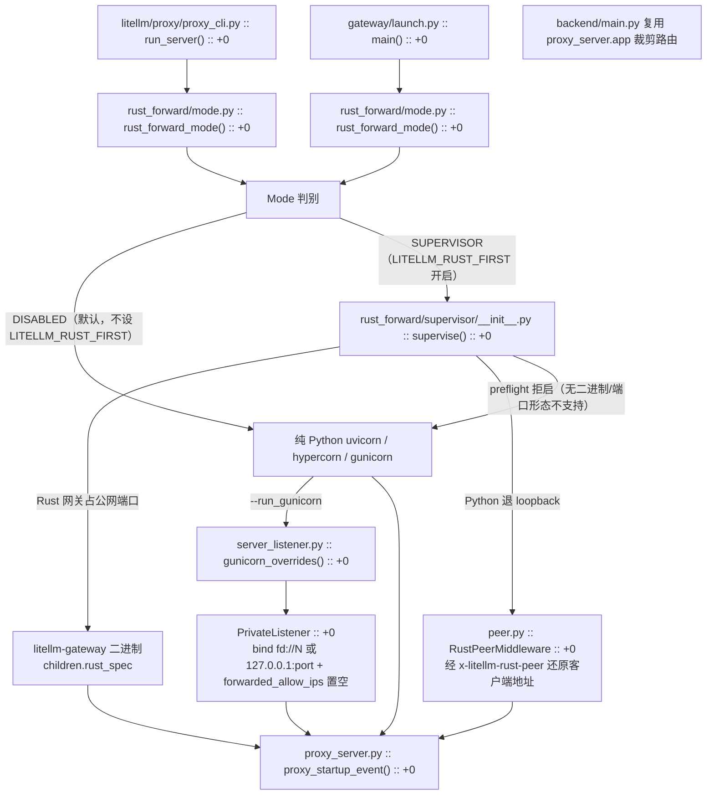

# 函数级解析：启动与生命周期

> 所属层级：第四层（源码补齐） | 覆盖：`proxy/proxy_cli.py :: run_server`、`proxy/proxy_server.py :: proxy_startup_event`、`ProxyStartupEvent`、`proxy/rust_forward/`、`proxy/server_listener.py`

主链路之外的另一半真相：进程怎么起来、后台任务有哪些、怎么退场。第一层第 4 篇的宏观生命周期以「请求已可服务」为前提，本篇补齐前提本身，并新增本代基线最重要的启动路径变化：`LITELLM_RUST_FIRST` 监督模式与 gunicorn 私有监听。

## 0. 启动路径总览

同一份 `proxy_server.app` 有三条进程入口（见第一层第 1 篇），每条入口下又有一个独立的部署形态开关 `LITELLM_RUST_FIRST`。默认不设该环境变量时，进程直接跑纯 Python 服务器；设置后由 supervisor 先起一个 Rust 网关占公网端口、Python 退到 loopback，Rust 起不回来才回退纯 Python。gunicorn 私有监听是另一个正交的端口决策，只在 `--run_gunicorn` 下启用。



图中每个箭头都对应一个真实符号：`run_server` 与 `gateway/launch.py :: main` 都先读 `rust_forward_mode`（`Mode` 只有 `DISABLED` 与 `SUPERVISOR` 两档），`SUPERVISOR` 分支调 `supervise`；被监督的 Python 子进程经 `peer.wrap` 包一层 `RustPeerMiddleware` 恢复客户端地址；gunicorn 场景用 `run_gunicorn_server` 的 `private_listener` 参数走 `server_listener.gunicorn_overrides`。最终全部汇到 `proxy_startup_event` 的 lifespan。

## 1. `run_server()`

```
litellm/proxy/proxy_cli.py :: run_server() :: +0
```

| 项 | 内容 |
|---|---|
| 职责 | `litellm --config ...` CLI 的服务启动编排 |
| 参数 | `cli_args`、`host`、`port`、`api_base`、`api_version`、`model`、config 路径、运行模式旗标（`run_gunicorn`/`run_hypercorn`/`run_granian`/`reload`）与各超时/请求上限参数 |
| 返回 | 不返回（阻塞运行直到进程退出） |

核心算法（相对偏移）：

1. `+85`：`rust_forward_mode(os.environ)` 读转发开关，`ValidationError` 时抛 `click.ClickException`；`stop_with_supervisor(forward_mode)` 让被监督子进程在 supervisor 死亡时随 stdin EOF 优雅退出
2. `+97`：`forward_mode is Mode.SUPERVISOR` 分支——经 `ProxyInitializationHelpers.python_server` 描述公网要服务的形态，调 `rust_forward/supervisor.supervise`；返回非 `StartupError` 时 `raise SystemExit`，`StartupError`（拒启）则继续走下面的纯 Python 路径
3. `+151`：`save_worker_config(...)` 把 CLI/YAML 解析出的配置序列化给 worker（`+151` 起），多 worker/`--reload` 场景下每个 worker 靠 `litellm_cli.main:proxy_worker_app`（`WORKER_APP` 常量，`+0` 定义于 `proxy_cli.py` 267）按字符串重新装配 app
4. `+184` 起：DB 连接池参数、RDS IAM / Azure Entra token 认证、AWS KMS 解密、PgBouncer 容器内起链；`+534` 起 `serving_port` 处理端口占用
5. `+575` 起：uvicorn 目标经 `get_default_unvicorn_init_args` 拼 `uvicorn_args`，再把 `uvicorn_options(forward_mode, WORKER_APP)` 的私有监听与 `proxy_headers: False` 覆盖进去（`+583`），然后 `uvicorn.run(**uvicorn_args)`（`+644`）；`run_gunicorn`/`run_hypercorn`/`run_granian` 走各自分支（`+648` 起）

多 worker 与 Redis 的组合语义见根 AGENTS.md 的 QA 规范：两 worker 共享 router 状态必须指向同一 Redis。`--reload` 与 `--run_gunicorn/--run_hypercorn/--run_granian` 互斥（AGENTS.md QA 规范提醒）。

### 1.1 gunicorn 私有监听（#50871）

`--run_gunicorn` 分支不再无条件自开公网 socket。`run_gunicorn_server`（`proxy_cli.py` 683）新增 `private_listener: PrivateListener | None` 参数，构造 `gunicorn_options` 时把它喂给 `gunicorn_overrides(private_listener)`（`+91`）。`server_listener.py` 定义了私有关口形态：

```
litellm/proxy/server_listener.py :: PrivateListener :: +0
litellm/proxy/server_listener.py :: gunicorn_overrides() :: +0
```

| 项 | 内容 |
|---|---|
| `InheritedFd` | `fd: int`，继承自 supervisor 的文件描述符，bind 映射为 `fd://<fd>` |
| `AssignedPort` | `port: int`，分配给 Python 的 loopback 端口，bind 映射为 `127.0.0.1:<port>` |
| `PrivateListener` | 以上两者的并集 `TypeAlias` |
| `gunicorn_overrides(listener)` | 有 listener 时返回 `{"bind": ..., "forwarded_allow_ips": ""}`，`None` 时返回空映射 |

`forwarded_allow_ips=""` 表示服务器自身不信任任何对端的转发头——被监督的 gunicorn 其 TCP peer 恒为 loopback，若保留默认信任会让任意客户端伪造自身地址与 scheme。非监督（`private_listener is None`）时 `gunicorn_overrides` 返回空映射，行为与旧版一致。

## 2. `proxy_startup_event()`

```
litellm/proxy/proxy_server.py :: proxy_startup_event() :: +0
litellm/proxy/proxy_server.py :: _proxy_lifespan() :: +0
```

| 项 | 内容 |
|---|---|
| 职责 | FastAPI lifespan。本体是薄壳：`GracefulShutdownManager.capture_sigterm()`（`+1`）+ `AsyncExitStack` 包住真正序列 `_proxy_lifespan`（`+2`） |
| 形态 | `AsyncGenerator[ProxyLifespanState, None]` |
| 前置 | 模块级全局（`llm_router`、`user_api_key_cache`、`proxy_logging_obj`）已创建 |
| 后置 | DB 连接、master key、Router、后台任务全部就绪 |

`_proxy_lifespan` 启动段的真实顺序（偏移相对其 `+0`）：

| 序 | 步骤 | 偏移 |
|---|---|---|
| 1 | `resources.callback(_forget_prisma_client)` + `_own_database` + `init_verbose_loggers` | `+19` / `+20` / `+22` |
| 2 | worker 启动钩子（`LITELLM_WORKER_STARTUP_HOOKS`，逐个动态导入执行） | `+33` 至 `+56` |
| 3 | premium license 检查 | `+60`（标记行 `+58`） |
| 4 | master key 从 env 读取（`get_secret_str("LITELLM_MASTER_KEY")`） | `+64` |
| 5 | 配置加载：`WORKER_CONFIG` / `CONFIG_FILE_PATH` → `proxy_config.load_config` → 赋值全局 `llm_router`/`llm_model_list`/`general_settings` | `+66` 至 `+98` |
| 6 | master key 启动裁决（`enforce_master_key_boot_verdict`，缺失且配置要求强制时拒绝启动） | `+103` |
| 7 | `ProxyStartupEvent.setup_prisma_client` + `migrate_if_requested`（Prisma 迁移在服务流量前同步应用，对应根 AGENTS.md 的迁移规范） | `+125` / `+134` |
| 8 | `ProxyStartupEvent` 系列初始化与警告（见第 3 节） | `+196` 至 `+345` |
| 9 | `yield state`（`+407`）后进入服务期 | `+407` |

关停段（`yield` 之后）：`pause_scheduled_jobs`（`+416`）、`GracefulShutdownManager.start_shutdown()` + `wait_for_drain()`（`+420`）、共享 aiohttp 会话关闭、`stop_in_flight_scheduler_jobs`（`+440`）、`_flush_spend_around_logging_drain_on_shutdown`、`proxy_shutdown_event`（`+450`）。关停先停 scheduler 再等 executor 内任务收尾，保证 spend 批量写不因重启丢批。

## 3. `ProxyStartupEvent`

```
litellm/proxy/proxy_server.py :: ProxyStartupEvent :: +0
```

静态/类方法集合（偏移相对类定义行 11249）。多数被 `_proxy_lifespan` 在 `+196` 至 `+345` 区间按序调用：

| 方法 | 偏移 | 职责 |
|---|---|---|
| `attach_router_to_prompt_injection_detectors()` | `+2` | Router 挂到 prompt 注入检测器 |
| `warn_fail_closed_rate_limits_without_redis()` | `+30` | fail-closed 限流 + 无 Redis 的危险组合警告（第四层第 11 篇） |
| `initialize_startup_logging()` | `+46` | 启动日志横幅 |
| `warn_if_mock_testing_params_enabled()` | `+61` | mock 参数门禁未关时的生产警告 |
| `validate_redis_transaction_buffer_config()` | `+94` | Redis 事务缓冲配置校验 |
| `init_coordination_redis_from_db()` | `+126` | 从 DB 恢复协调 Redis 配置 |
| `initialize_semantic_tool_filter()` | `+195` | 语义工具过滤初始化 |
| `initialize_jwt_auth()` | `+230` | JWT 公钥/映射装载 |
| `add_proxy_budget_to_db()` | `+266` | 内置 proxy 预算 upsert |
| `warm_global_spend_cache()` | `+329` | 预热全局花费缓存（`GLOBAL_PROXY_SPEND_CACHE_KEY`） |
| `update_default_team_member_budget()` | `+348` | 默认团队预算对齐 |
| `sync_ui_settings_to_general_settings()` | `+368` | UI 存的设置并回 general_settings |
| `initialize_scheduled_background_jobs()` | `+452` | 见下节 |

## 4. 后台任务（APScheduler）

```
litellm/proxy/proxy_server.py :: ProxyStartupEvent :: initialize_scheduled_background_jobs() :: +0
```

| 项 | 内容 |
|---|---|
| 职责 | 创建 `AsyncIOScheduler` 并注册全部周期任务 |
| 核心算法 | scheduler 配 `AwaitableAsyncIOExecutor`（`+21`），关停时可 await 在跑任务；budget 重调度间隔取 `min_time + random(max-min)` 的抖动（`+42`），避免多 worker 同时打 DB；批量写间隔强制 ≥30 秒（`+51` 的注释写明防内存积压）。executor 与 scheduler 都存模块级全局（`scheduler`、`scheduler_executor`），供关停段复用 |

注册的任务族（这三个 helper 都是 `ProxyStartupEvent` 的类方法，偏移相对类定义行）：

| 方法 | 偏移 | 任务 |
|---|---|---|
| `_initialize_slack_alerting_jobs()` | `+1172` | Slack 告警（超预算/挂起请求） |
| `_initialize_spend_tracking_background_jobs()` | `+927` | spend 批量落库、预算重置、每日聚合 |
| `_initialize_expired_ui_session_key_cleanup_background_job()` | `+1055` | 过期 UI 会话 key 清理 |

`initialize_scheduled_background_jobs` 内部还直接注册 `worker_heartbeat`（`+57`）、`reset_budget`（`+69`）、`update_spend`（`+88`）、`commit_tool_discoveries`（`+102`）、`update_daily_tag_spend`（`+114`）、`flush_gateway_requests`（`+132`）、`flush_request_errors`（`+143`）、`periodic_reload`（`+194`）、`add_deployment` / `reload_search_tools` / `reload_mcp_servers`（`+212` 起）、PTU 每日聚合（`+285` 起）。

这些任务就是第三层第 8 篇「记账异步化」的另一半：`DBSpendUpdateWriter` 的 flush、预算告警、账本窗口都靠这里注册的 job 驱动。

### 4.1 两个非 scheduler 后台循环

`_proxy_lifespan` 里还有两个 `asyncio.create_task` 常驻协程，不挂 APScheduler：

```
litellm/proxy/proxy_server.py :: _run_background_health_check() :: +0
litellm/proxy/proxy_server.py :: _adaptive_router_flusher_loop() :: +0
```

| 协程 | 职责 | 启动偏移（相对 `_proxy_lifespan`） |
|---|---|---|
| `_run_background_health_check` | 周期跑端点健康检查，写 `health_check_results`；Redis 可用时用 `SharedHealthCheckManager` 跨 pod 协调 | `+324` |
| `_adaptive_router_flusher_loop` | 每 10 秒把每个 AdaptiveRouter 的内存态与会话聚合刷进 Postgres（`_ADAPTIVE_ROUTER_FLUSH_INTERVAL_SECONDS`），懒加载 `state_loaded` 以覆盖 `/config/reload` 后热注册的路由 | `+336` |

## 5. Rust 转发监督（#49606，`LITELLM_RUST_FIRST`）

本代基线新增的部署形态。`proxy_cli.py :: run_server` 在进 `proxy_server` 之前读 `rust_forward_mode` 并视模式分支。这个开关是**独立**于 `LITELLM_RUST` 的（`litellm/rust_bridge/configuration.py :: ENV_NAME`），两者互不启用。

### 5.1 模式判定

```
litellm/proxy/rust_forward/mode.py :: Mode :: +0
litellm/proxy/rust_forward/mode.py :: rust_forward_mode() :: +0
```

- `SWITCH_ENV = "LITELLM_RUST_FIRST"`（`mode.py :: SWITCH_ENV`，`+17`）
- `Mode` 只有 `DISABLED` 与 `SUPERVISOR` 两档（`+28` 起，enum）
- `rust_forward_mode(environ)`（`+47`）严格读环境变量：`_Switch.model_validate(environ)` 用 Pydantic 校验，非法值抛 `ValidationError`，由调用方（`run_server` 或 `gateway/launch.py`）在启动时打一行说明并退出。返回 `Mode.SUPERVISOR`（开关为真）或 `Mode.DISABLED`（开关为假/未设）
- `Supervised`（`+33`）是监督子进程收到的完整契约：`listener: PrivateListener` + `trusted_proxies: str`，经 `supervised_environment` 序列化进 `_LITELLM_GATEWAY_SUPERVISED` 变量，子进程再 `rust_forward_mode` 还原
- `uvicorn_options` / `uvicorn_flags` / `private_listener` 把 `Supervised` 翻译成 uvicorn 与 gunicorn 各自的服务设置，转发关闭时它们都是恒等映射（不分支）

### 5.2 supervise

```
litellm/proxy/rust_forward/supervisor/__init__.py :: supervise() :: +0
```

`supervise(server, command, before_start, ...)`（`+0` 定义于 `__init__.py` 22）返回 `int | StartupError`：能起就阻塞到退出并返回退出码，不能起就返回 `StartupError` 让调用方回退纯 Python。执行顺序：

1. `preflight.startup_check`（`preflight.py :: startup_check`，`+0`）决定是否可起：`HYPERCORN`/`GRANIAN` 不支持、`server.listener` 非 TCP、`platform.servers` 不含该 server、`gateway_binary` 找不到，都会拒绝。拒启时 `sys.stderr` 写一行「so Python serves the public port without Rust forwarding」并返回 `StartupError`
2. `before_start()` 只在确认可起之后跑一次，拒启不留任何副作用
3. `asyncio.run(run(...))`（`supervisor/runtime.py :: run`，`+70`）起两个子进程：Rust 网关占公网端口（`children.rust_spec` 写 `LITELLM_FORWARD_*` 变量）、Python 子进程占私网 loopback 监听器（`children.python_spec` 追加 `--port <私有端口>` 并写入 `Supervised` 环境契约）
4. `supervisor/lifecycle.py :: step`（`+111`）是纯函数，把事件（信号、子进程退出、监听就绪）转成下一步动作，`runtime` 只负责执行。信号透传：`relayed_signals` 原样给 Python，`stop_signals` 先给 Rust
5. 子进程的 stdin 是 supervisor 持有的 pipe，supervisor 被 SIGKILL 或终端关闭时 EOF 触发双方优雅退出，子进程绝不比 supervisor 活得久

### 5.3 客户端地址还原

```
litellm/proxy/rust_forward/peer.py :: RustPeerMiddleware :: +0
```

被监督的 Python 其 TCP peer 恒为 loopback（Rust），所以服务器级转发头会信任任何客户端的伪造头，必须关闭。Rust 在 `x-litellm-rust-peer` 头里传真实客户端 TCP peer，且不改写任何转发头（因为 proxy 自己按 `use_x_forwarded_for` / `mcp_xff_num_trusted_hops` 解析 `X-Forwarded-For`，多一跳会偏移语义）。`RustPeerMiddleware._restore_peer` 只在 peer 来自 loopback 时把真实地址写回 `scope["client"]` 并移除该头，然后以运营方配置的 `trusted_proxies` 跑 uvicorn 自己的 `ProxyHeadersMiddleware`。它包在 app 外层，先于任何读客户端地址的代码运行。

## 6. 三个入口的汇合

第一层第 1 篇的三种进程入口最终都汇到 `proxy_startup_event`：传统 CLI 经 `run_server`；`gateway/launch.py :: main`（容器化 supervisor 入口，`+0`）先 `configure_database` 拼好 `DATABASE_URL`、可起 in-container PgBouncer，再把 uvicorn 交给 `gateway.main:app`，worker 经 `worker_app` 用 `peer.wrap` 包 app；`backend/main.py` 直接 uvicorn 复用 `proxy_server.app` 并裁剪路由表（它们模块级的 `DatabaseURLSettings.from_env().apply_to_env()` 在导入 proxy_server 前拼好 DATABASE_URL，见各自文件头注释）。无论走哪条入口，`LITELLM_RUST_FIRST` 都只是「同一入口下的部署形态开关」，不新增入口；默认不设该环境变量时始终是纯 Python uvicorn。