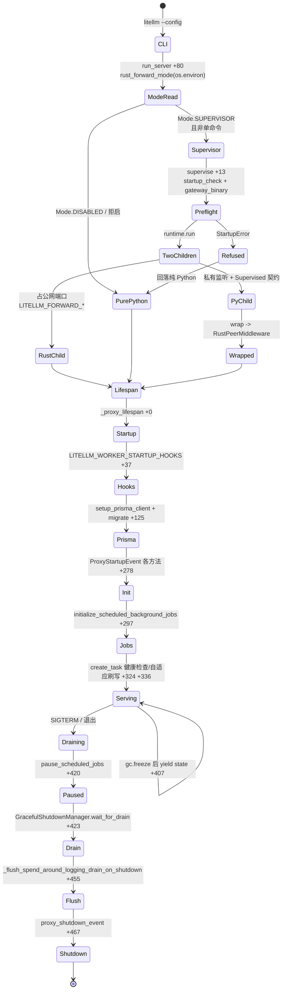

# 函数级解析（十二）：`run_server`、lifespan 与后台任务

> 所属层级：第四层（函数级解析） | 覆盖：`litellm/proxy/proxy_cli.py :: run_server`、`litellm/proxy/proxy_server.py :: proxy_startup_event` / `_proxy_lifespan` / `ProxyStartupEvent`、`litellm/proxy/rust_forward/`、`litellm/proxy/server_listener.py`
> 本篇基准提交：`411b64dc7a`（工作区当前 HEAD）
> 引用规范：`文件 :: 符号 :: +偏移`，`+0` = 定义行，`+N` = 函数体内第 N 行

本篇逐个展开进程生命周期里的关键函数：CLI 启动编排（`run_server`）、监听器形态（`InheritedFd`、`AssignedPort`、`PrivateListener`、`gunicorn_overrides`）、转发模式判定（`Mode`、`Supervised`、`RustForwardMode`、`rust_forward_mode`、`stop_with_supervisor`、`uvicorn_options`、`private_listener`）、客户端地址还原（`RustPeerMiddleware`、`wrap`）、监督器（`supervise`、`startup_check`、`gateway_binary`）、FastAPI lifespan（`proxy_startup_event`、`_proxy_lifespan`）、启动期初始化集合（`ProxyStartupEvent` 的各方法）、后台任务注册（`initialize_scheduled_background_jobs`）与两个非 scheduler 常驻协程（`_run_background_health_check`、`_adaptive_router_flusher_loop`）。

术语首现已解释：`lifespan`（FastAPI/Starlette 的进程级上下文管理器，启动时建依赖、退出时清理）、`监督器`（supervisor，一个父进程同时管 Rust 网关与 Python 子进程两个子进程）、`私有监听`（`PrivateListener`，被监督的 Python 只在 loopback 或继承的 fd 上听，公网端口归 Rust）、`fail-closed`（限流无法验证时直接拒绝）、`抖动`（jitter，给周期任务间隔加随机偏移，避免多 worker 同时打 DB）、`优雅停机`（先停接新请求、等在跑请求收尾，再关依赖）。

第一层讲的是「进程怎么组成」，第三层讲的是「请求怎么走」；本篇只讲「进程起来、后台任务跑、退出收尾」这些函数内部具体怎么实现。

## 本篇覆盖函数

| 环节 | 本篇展开的函数 |
|---|---|
| CLI 启动编排 | `proxy_cli.py :: run_server` |
| 监听器形态 | `server_listener.py :: InheritedFd`、`AssignedPort`、`PrivateListener`、`gunicorn_overrides` |
| 转发模式判定 | `rust_forward/mode.py :: Mode`、`Supervised`、`RustForwardMode`、`rust_forward_mode`、`stop_with_supervisor`、`uvicorn_options`、`private_listener`、`environment_error` |
| 客户端地址还原 | `rust_forward/peer.py :: RustPeerMiddleware`、`wrap` |
| 监督器 | `rust_forward/supervisor/__init__.py :: supervise`、`preflight.py :: startup_check`、`gateway_binary` |
| FastAPI lifespan | `proxy_server.py :: proxy_startup_event`、`_proxy_lifespan` |
| 启动期初始化 | `ProxyStartupEvent` 各方法 |
| 后台任务注册 | `ProxyStartupEvent.initialize_scheduled_background_jobs`、`_initialize_spend_tracking_background_jobs`、`_initialize_slack_alerting_jobs`、`_initialize_expired_ui_session_key_cleanup_background_job` |
| 非 scheduler 常驻协程 | `_run_background_health_check`、`_adaptive_router_flusher_loop` |
| 关停 | `proxy_shutdown_event` |

---

### `run_server`（`litellm/proxy/proxy_cli.py`）

- 职责：`litellm --config ...` CLI 的服务启动编排。解析转发模式、按需交给监督器、保存 worker 配置、最后起 uvicorn/gunicorn/hypercorn/granian 之一。
- 签名/参数：`def run_server(cli_args, host: str, port: int, api_base, api_version, model, alias, add_key, headers, save, debug, detailed_debug, temperature, max_tokens, request_timeout, drop_params, add_function_to_prompt, config, max_budget, test, local, num_workers: int, granian_threads, test_async, iam_token_db_auth, azure_postgresql_auth: bool, num_requests, use_queue, health, setup, version, run_gunicorn, run_hypercorn, run_granian, ssl_keyfile_path, ssl_certfile_path, ciphers, log_config, use_prisma_db_push: bool, skip_server_startup, validate_config: bool, check_migrations_against_existing_data: bool, keepalive_timeout: int | None, timeout_worker_healthcheck, max_request_header_size: int | None, max_requests_before_restart: int | None, max_requests_before_restart_jitter: int | None, limit_concurrency: int | None, enforce_prisma_migration_check: bool, use_v2_migration_resolver: bool, use_legacy_migration_resolver: bool, reload: bool, prometheus_metrics_port: int | None)`（`litellm/proxy/proxy_cli.py :: run_server :: +0`，绝对行 1298）。
- 返回：不返回（阻塞运行直到进程退出）；部分分支 `raise SystemExit` / `click.UsageError` / `click.ClickException`。
- 算法（偏移相对 `+0`，绝对行 1298）：

| 序 | 动作 | 锚点 | 语义 |
|---|---|---|---|
| 1 | `cli_args == ("xai-oauth", "login")` 走 OAuth 登录；其它未知命令抛 `click.UsageError` | `+16` 到 `+25`（行 1313-1322） | CLI 子命令分发 |
| 2 | `setup` 为真走 setup 向导后返回 | `+29` 到 `+32`（行 1326-1329） | 不起服务 |
| 3 | `rust_forward_mode(os.environ)` 读转发开关，`ValidationError` 转 `click.ClickException(environment_error(...))` | `+80` 到 `+85`（行 1378-1382） | 非法值启动即报一行并退出 |
| 4 | `stop_with_supervisor(forward_mode)` | `+88`（行 1385） | 被监督子进程随 supervisor 死亡优雅退出 |
| 5 | `runs_one_command` 判定（version/validate/health/test/skip_server_startup/check_migrations） | `+89` 到 `+95`（行 1386-1392） | 单命令不进监督分支 |
| 6 | `forward_mode is Mode.SUPERVISOR and not runs_one_command` 分支：`ProxyInitializationHelpers.python_server(...)` 描述公网形态，`supervise(server)` 起监督器；返回非 `StartupError` 时 `raise SystemExit` | `+97` 到 `+113`（行 1394-1410） | 监督器拒启返回 `StartupError`，继续走纯 Python |
| 7 | `save_worker_config(...)` 把 CLI/YAML 配置序列化给 worker | `+151` 到 `+170`（行 1448-1467） | 多 worker/`--reload` 下每个 worker 靠 `WORKER_APP`（`+0`，行 267，`litellm_cli.main:proxy_worker_app`）按字符串重新装配 app |
| 8 | `get_default_unvicorn_init_args(...)` 拼 `uvicorn_args`，再把 `uvicorn_options(forward_mode, WORKER_APP)` 的私有监听与 `proxy_headers: False` 覆盖进去 | `+575` / `+583`（行 1872-1881） | 转发关闭时 `uvicorn_options` 返回空映射（恒等） |
| 9 | `uvicorn.run(**uvicorn_args, workers=num_workers)` | `+644`（行 1941-1944） | 默认分支 |
| 10 | `run_gunicorn_server(..., app=wrap(app, forward_mode), private_listener=private_listener(forward_mode))` | `+651` 到 `+661`（行 1948-1958） | gunicorn 分支 |
| 11 | `init_hypercorn_server(...)` / `init_granian_server(...)` | `+664` / `+673`（行 1961-1971） | 另两个服务器分支 |

  第 6 步是本代基线最重要的启动路径变化：监督器起 Rust 网关占公网端口、Python 退到私有监听；拒启（无二进制/端口形态不支持）时 `supervise` 返回 `StartupError`，`run_server` 继续按纯 Python 起。`--reload` 与 `--run_gunicorn`/`--run_hypercorn`/`--run_granian` 互斥。
- 错误/分支：转发模式非法抛 `ClickException`；未知 CLI 命令抛 `UsageError`；监督器拒启回落纯 Python。
- 调用关系：调用方 = `litellm` CLI 入口。被调用方 = `rust_forward_mode`、`stop_with_supervisor`、`environment_error`、`ProxyInitializationHelpers.python_server`、`supervise`、`save_worker_config`、`ProxyInitializationHelpers.get_default_unvicorn_init_args`、`uvicorn_options`、`uvicorn.run`、`ProxyInitializationHelpers.run_gunicorn_server`、`wrap`、`private_listener`、`ProxyInitializationHelpers.init_hypercorn_server`、`init_granian_server`。

---

### `InheritedFd` / `AssignedPort` / `PrivateListener` / `gunicorn_overrides`（`litellm/proxy/server_listener.py`）

- 职责：私有关口的两种形态与 gunicorn 的翻译。文件全 38 行。
- 签名/参数：
  - `@dataclass(frozen=True, slots=True) class InheritedFd: fd: int`（`litellm/proxy/server_listener.py :: InheritedFd :: +0`，绝对行 13）。
  - `@dataclass(frozen=True, slots=True) class AssignedPort: port: int`（`+0`，绝对行 18）。
  - `PrivateListener: TypeAlias = InheritedFd | AssignedPort`（`+0`，绝对行 22）；同文件 `LOOPBACK_HOST = "127.0.0.1"`（行 8）、`NO_TRUSTED_PROXIES = ""`（行 9）。
  - `def gunicorn_overrides(listener: PrivateListener | None) -> Mapping[str, str]`（`+0`，绝对行 35）。
- 返回：`gunicorn_overrides` 返回 `Mapping[str, str]`。
- 算法（贴 `gunicorn_overrides :: +1` 到 `+3`，行 36-38）：

```python
    if listener is None:
        return MappingProxyType({})
    return MappingProxyType({"bind": _gunicorn_bind(listener), "forwarded_allow_ips": NO_TRUSTED_PROXIES})
```

  `_gunicorn_bind`（`+0`，绝对行 25）把 `InheritedFd(fd)` 映射成 `fd://<fd>`、`AssignedPort(port)` 映射成 `127.0.0.1:<port>`。`forwarded_allow_ips=""` 表示服务器自身不信任任何对端的转发头——被监督的 gunicorn 其 TCP peer 恒为 loopback（Rust），若保留默认信任会让任意客户端伪造自身地址与 scheme。非监督（`listener is None`）时返回空映射，行为与旧版一致。
- 错误/分支：`listener is None` 返回空映射；其余两种形态穷尽 match（`assert_never` 兜底）。
- 调用关系：调用方 = `ProxyInitializationHelpers.run_gunicorn_server`（经 `run_server` 的 gunicorn 分支传 `private_listener(forward_mode)`）。被调用方 = `_gunicorn_bind`。

---

### `Mode` / `Supervised` / `RustForwardMode` / `rust_forward_mode`（`litellm/proxy/rust_forward/mode.py`）

- 职责：转发模式的判别与被监督子进程的契约。`Mode` 只有 `DISABLED` 与 `SUPERVISOR` 两档；`Supervised` 是子进程收到的完整契约。
- 签名/参数：
  - `SWITCH_ENV: Final = "LITELLM_RUST_FIRST"`（`litellm/proxy/rust_forward/mode.py :: SWITCH_ENV :: +0`，绝对行 17）；`SUPERVISED_ENV = "_LITELLM_GATEWAY_SUPERVISED"`（行 18）；`RUST_HOP = LOOPBACK_HOST`（行 19）。
  - `class _Switch(BaseModel)`（`+0`，绝对行 22），`rust: RustSwitch = Field(None, validation_alias=SWITCH_ENV)`。
  - `class Mode(Enum)`（`+0`，绝对行 28），`DISABLED = auto()` / `SUPERVISOR = auto()`。
  - `@dataclass(frozen=True, slots=True) class Supervised: listener: PrivateListener; trusted_proxies: str`（`+0`，绝对行 34）。
  - `RustForwardMode: TypeAlias = Mode | Supervised`（`+0`，绝对行 39）。
  - `def rust_forward_mode(environ: Mapping[str, str]) -> RustForwardMode`（`+0`，绝对行 47）。
- 返回：`RustForwardMode`（`Mode.SUPERVISOR` / `Mode.DISABLED` / 还原出的 `Supervised`）。
- 算法（贴 `rust_forward_mode :: +1` 到 `+6`，行 48-52）：

```python
    switch: Final = _Switch.model_validate(environ)
    supervised: Final = environ.get(SUPERVISED_ENV)
    if supervised is not None:
        return _SUPERVISED.validate_json(supervised)
    return Mode.SUPERVISOR if switch.rust else Mode.DISABLED
```

  分步：`+1` 用 Pydantic 严格校验环境变量（非法值抛 `ValidationError`，由 `environment_error`（`+0`，绝对行 82）转成一行说明）；`+2` 到 `+4` 有 `SUPERVISED_ENV` 说明自己是被监督的子进程，直接还原 `Supervised` 契约；`+5` 到 `+6` 否则按 `LITELLM_RUST_FIRST` 开关返回 `SUPERVISOR` 或 `DISABLED`。`Supervised` 经 `supervised_environment`（`+0`，绝对行 43）序列化进 `_LITELLM_GATEWAY_SUPERVISED`，子进程再 `rust_forward_mode` 还原，所以新增字段不需要解析代码。这个开关**独立**于 `LITELLM_RUST`（`litellm/rust_bridge/configuration.py :: ENV_NAME`），两者互不启用。
- 错误/分支：非法环境值抛 `ValidationError`；子进程侧走 `Supervised` 还原分支。
- 调用关系：调用方 = `run_server`、`gateway/launch.py :: main`、被监督子进程。被调用方 = `_Switch.model_validate`、`_SUPERVISED.validate_json`。

---

### `stop_with_supervisor` / `uvicorn_options` / `private_listener`（`litellm/proxy/rust_forward/mode.py`）

- 职责：把 `RustForwardMode` 翻译成 uvicorn/gunicorn 各自的服务设置；转发关闭时它们都是恒等映射（不分支）。
- 签名/参数：
  - `def stop_with_supervisor(mode: RustForwardMode, fd: int = 0, stop: Callable[[], None] = _terminate_self) -> None`（`+0`，绝对行 70）。
  - `def uvicorn_options(mode: RustForwardMode, factory: str) -> Mapping[str, object]`（`+0`，绝对行 103）。
  - `def private_listener(mode: RustForwardMode) -> PrivateListener | None`（`+0`，绝对行 135）。
- 返回：`stop_with_supervisor` 返回 None（副作用起后台线程）；`uvicorn_options` 返回选项映射；`private_listener` 返回 `PrivateListener | None`。
- 算法（贴 `stop_with_supervisor :: +3` 到 `+9`，行 73-79）：

```python
    match mode:
        case Supervised():
            threading.Thread(target=_stop_when_closed, args=(fd, stop), name="supervisor-stdin", daemon=True).start()
        case Mode.DISABLED | Mode.SUPERVISOR:
            pass
        case _:
            assert_never(mode)
```

  `stop_with_supervisor` 只在被监督子进程里起一个守护线程（`_stop_when_closed`，`+0`，绝对行 61）盯 supervisor 的 stdin EOF，EOF 就 `stop()`（默认 `_terminate_self` 发 SIGTERM 给自己）；非监督模式什么都不做。docstring 自述只能在 supervisor 启动的那个进程里调，不能在它的 worker 里调。`uvicorn_options`（贴 `+1` 到 `+9`，行 104-112）：`Supervised(listener)` 时返回 `{"app": factory, "factory": True, **_uvicorn_listener(listener), "proxy_headers": False}`（`_uvicorn_listener`，`+0`，绝对行 93，`InheritedFd` 映射 `{"fd": fd}`、`AssignedPort` 映射 `{"host": RUST_HOP, "port": port}`）；`DISABLED`/`SUPERVISOR` 返回空映射。`private_listener`（贴 `+1` 到 `+6`，行 136-140）：`Supervised(listener)` 返回 listener，否则 None。`uvicorn_flags`（`+0`，绝对行 125）与 `_uvicorn_listener_flags`（`+0`，绝对行 115）是 uvicorn 自身 CLI 的对应翻译（`--fd`/`--host`/`--port`/`--no-proxy-headers`）。
- 错误/分支：穷尽 match，未知形态 `assert_never`。
- 调用关系：调用方 = `run_server`（`stop_with_supervisor`、`uvicorn_options`、`private_listener`）、被监督子进程的 worker 工厂。被调用方 = `_stop_when_closed`、`_terminate_self`、`_uvicorn_listener`、`_uvicorn_listener_flags`。

---

### `RustPeerMiddleware` / `wrap`（`litellm/proxy/rust_forward/peer.py`）

- 职责：让 Python 把每个请求看成客户端直连。被监督的 Python 其 TCP peer 恒为 loopback（Rust），服务器级转发头必须关闭；Rust 在 `x-litellm-rust-peer` 头里传真实客户端 TCP peer，且不改写任何转发头（因为 proxy 自己按 `use_x_forwarded_for` / `mcp_xff_num_trusted_hops` 解析 `X-Forwarded-For`，多一跳会偏移语义）。
- 签名/参数：
  - `PEER_HEADER: Final = b"x-litellm-rust-peer"`（`litellm/proxy/rust_forward/peer.py :: PEER_HEADER :: +0`，绝对行 16）。
  - `def _restore_peer(scope: "WWWScope") -> None`（`+0`，绝对行 27）。
  - `class RustPeerMiddleware`（`+0`，绝对行 41），`__init__(self, app: ASGIApp, mode: Supervised) -> None`（`+0`，绝对行 50）、`async def __call__(self, scope, receive, send) -> None`（`+0`，绝对行 55）。
  - `def wrap(app: "starlette.types.ASGIApp", mode: RustForwardMode) -> ASGIApp`（`+0`，绝对行 61）。
- 返回：`wrap` 返回包好（或原样）的 ASGI app。
- 算法（贴 `_restore_peer :: +1` 到 `+11`，行 28-38）：

```python
    headers: Final = tuple(scope["headers"])
    peer: Final = next((value for name, value in headers if name == PEER_HEADER), None)
    if peer is None:
        return
    remaining: Final = tuple((name, value) for name, value in headers if name != PEER_HEADER)
    scope["headers"] = remaining  # rebind-ok: the peer header is private to the Rust hop
    client: Final = scope["client"]
    if client is None or client[0] != RUST_HOP:
        return
    host, _, port = peer.decode("latin-1").rpartition(":")
    scope["client"] = (host.strip("[]"), int(port))  # rebind-ok: uvicorn's access log reads this same scope
```

  分步：`+1` 到 `+4` 找 `x-litellm-rust-peer` 头，没有直接返回；`+5` 到 `+6` 从 headers 里摘掉该头（它对 Rust hop 私有）；`+7` 到 `+9` 只有 peer 来自 loopback（`RUST_HOP`）时才信任——loopback 是私有监听的信任边界（任何本机进程都能连私有监听并伪造该头）；`+10` 到 `+11` 解出真实 host/port 写回 `scope["client"]`。`RustPeerMiddleware.__init__` 把 app 包进 uvicorn 自己的 `ProxyHeadersMiddleware(app, mode.trusted_proxies)`（运营方配置的信任表，本包不设默认）；`__call__` 对非 lifespan scope 先 `_restore_peer` 再交给内层。`wrap`（贴 `+1` 到 `+8`，行 62-68）：`Supervised()` 包一层 `RustPeerMiddleware`，`DISABLED`/`SUPERVISOR` 原样返回。它包在 app 外层，先于任何读客户端地址的代码运行。
- 错误/分支：无 peer 头、peer 非 loopback 都不还原；转发关闭时 `wrap` 是恒等。
- 调用关系：调用方 = `run_server` 的 gunicorn 分支、被监督子进程的 worker 工厂。被调用方 = `_restore_peer`、uvicorn `ProxyHeadersMiddleware`。

---

### `supervise` / `startup_check` / `gateway_binary`（`litellm/proxy/rust_forward/supervisor/`）

- 职责：起 Rust 网关占公网端口、Python 子进程占私有监听，或说明为什么起不了。`preflight` 是唯一拒绝的地方，拒绝是返回 `StartupError` 而非退出，让调用方回落纯 Python。
- 签名/参数：
  - `def supervise(server: PythonServer, command: Sequence[str] = OWN_COMMAND, before_start: Callable[[], None] = _nothing_to_prepare, scripts_dir: str = sysconfig.get_path("scripts"), platform: Platform | None = None) -> int | StartupError`（`litellm/proxy/rust_forward/supervisor/__init__.py :: supervise :: +0`，绝对行 23）；`OWN_COMMAND = (sys.executable, *sys.orig_argv[1:])`（行 15）、`SERVING_WITHOUT_RUST`（行 16）。
  - `def startup_check(platform: Platform, server: PythonServer, binary: str | None) -> str | StartupError`（`litellm/proxy/rust_forward/supervisor/preflight.py :: startup_check :: +0`，绝对行 19）。
  - `def gateway_binary(platform: Platform, scripts_dir: str) -> str | None`（`+0`，绝对行 15）；`@dataclass class StartupError: reason: str`（`+0`，绝对行 11）。
- 返回：`supervise` 返回退出码或 `StartupError`；`startup_check` 返回二进制路径或 `StartupError`。
- 算法（贴 `supervise :: +12` 到 `+24`，行 35-51）：

```python
    chosen: Final = current_platform() if platform is None else platform
    checked: Final = startup_check(chosen, server, gateway_binary(chosen, scripts_dir))
    if isinstance(checked, StartupError):
        sys.stderr.write(f"{checked.reason}, {SERVING_WITHOUT_RUST}\n")
        return checked
    before_start()
    try:
        outcome: Final = asyncio.run(run(chosen, checked, command, server))
    except OSError as error:
        return _startup_failed(error)
    match outcome:
        case SpawnFailed(error):
            return _startup_failed(error)
        case int():
            return exit_like(outcome, chosen.stop_signals)
        case _:
            assert_never(outcome)
```

  分步：`+12` 到 `+13` 取平台并跑 preflight；`+14` 到 `+17` 拒启时 `sys.stderr` 写一行「so Python serves the public port without Rust forwarding」并返回 `StartupError`（`before_start` 不跑，拒启不留副作用）；`+18` 确认可起后才跑一次 `before_start()`；`+20` 到 `+22` `asyncio.run(run(...))`（`supervisor/runtime.py :: run`）起两个子进程并阻塞；`+24` 到 `+31` 把结果归一：`SpawnFailed` / `OSError` 返回失败码，`int` 退出码经 `exit_like` 按平台信号规则换算（容器 PID 1 不能死于自己发的信号）。`startup_check`（贴 `+1` 到 `+9`，行 20-28）依次拒绝：`HYPERCORN`/`GRANIAN` 不支持、该平台不含该 server、`server.listener` 非 TCP、`gateway_binary` 找不到。子进程的 stdin 是 supervisor 持有的 pipe，supervisor 被 SIGKILL 或终端关闭时 EOF 触发双方优雅退出，子进程绝不比 supervisor 活得久。
- 错误/分支：preflight 拒绝回落纯 Python；spawn 失败/OSError 返回失败码；正常退出按 `exit_like` 换算。
- 调用关系：调用方 = `run_server`、`gateway/launch.py :: main`。被调用方 = `current_platform`、`gateway_binary`、`startup_check`、`before_start`、`supervisor/runtime.run`、`_startup_failed`、`exit_like`。

---

### `proxy_startup_event` / `_proxy_lifespan`（`litellm/proxy/proxy_server.py`）

- 职责：FastAPI lifespan。`proxy_startup_event` 是薄壳：`GracefulShutdownManager.capture_sigterm()` + `AsyncExitStack` 包住真正序列 `_proxy_lifespan`。
- 签名/参数：
  - `async def proxy_startup_event(app: FastAPI) -> AsyncGenerator[ProxyLifespanState, None]`（`litellm/proxy/proxy_server.py :: proxy_startup_event :: +0`，绝对行 1615）。
  - `@asynccontextmanager async def _proxy_lifespan(app: FastAPI, resources: AsyncExitStack) -> AsyncGenerator[ProxyLifespanState, None]`（`+0`，绝对行 1622）。
- 返回：`AsyncGenerator[ProxyLifespanState, None]`（`yield state` 后进入服务期）。
- 算法（贴 `proxy_startup_event :: +1` 到 `+3`，行 1616-1618）：

```python
    with GracefulShutdownManager.capture_sigterm():
        async with AsyncExitStack() as resources, _proxy_lifespan(app, resources) as state:
            yield state
```

  `_proxy_lifespan` 启动段的真实顺序（偏移相对其 `+0`，行 1622）：

| 序 | 步骤 | 偏移 |
|---|---|---|
| 1 | `global` 声明 16 个模块级全局（prisma_client、master_key、llm_router、llm_model_list、general_settings、premium_user、shared_aiohttp_session 等） | `+1` 到 `+17`（行 1623-1639） |
| 2 | `resources.callback(_forget_prisma_client)` + `_own_database(resources, prisma_client)` + `init_verbose_loggers()` | `+20` / `+21` / `+23`（行 1641-1643） |
| 3 | 慢 GC 检测（debug loop 下 `log_slow_gc_passes`）与 `PROMETHEUS_MULTIPROC_DIR` 死 worker 标记 | `+25` 到 `+32`（行 1646-1653） |
| 4 | worker 启动钩子（`LITELLM_WORKER_STARTUP_HOOKS`，逐个动态导入执行，`module.path:function_name` 格式，async 则 await） | `+37` 至 `+59`（行 1658-1681） |
| 5 | premium license 检查（`_license_check.is_premium()`） | `+60` 至 `+61`（行 1682-1683） |
| 6 | master key 从 env 读取（`get_secret_str("LITELLM_MASTER_KEY")`） | `+64`（行 1686） |
| 7 | 配置加载：`WORKER_CONFIG` / `CONFIG_FILE_PATH` → `proxy_config.load_config` → 赋值全局 `llm_router`/`llm_model_list`/`general_settings` | `+66` 至 `+90`（行 1688-1712） |
| 8 | master key 启动裁决（`enforce_master_key_boot_verdict`，缺失且配置要求强制时拒绝启动） | `+103`（行 1725） |
| 9 | `ProxyStartupEvent.setup_prisma_client` + `migrate_if_requested`（Prisma 迁移在服务流量前同步应用） | `+125` / `+134`（行 1747-1756） |
| 10 | `ProxyStartupEvent` 系列初始化与警告（见下节） | `+279` 至 `+343`（行 1901-1965） |
| 11 | `create_task(_run_background_health_check())` 与 `create_task(_adaptive_router_flusher_loop())` | `+324` / `+336`（行 1946-1958） |
| 12 | `gc.freeze()` 固定启动对象后 `yield state` | `+407`（行 2028-2029） |

  关停段（`yield` 之后）：`model_info_scheduler` 移除并 shutdown（`+412` 到 `+416`，行 2033-2037）、`pause_scheduled_jobs(scheduler)`（`+420`，行 2041）、`GracefulShutdownManager.start_shutdown()` + `wait_for_drain()`（`+422` 到 `+423`，行 2043-2044）、共享 aiohttp 会话关闭（`+430` 到 `+437`，行 2051-2058）、`_drain_spend_event_producer_on_shutdown()`（`+439`，行 2060）、telemetry 收尾（`+440` 到 `+443`）、`stop_in_flight_scheduler_jobs(scheduler, scheduler_executor)`（`+449` 到 `+452`，行 2070-2073）、`_flush_spend_around_logging_drain_on_shutdown()`（`+455`，行 2077）、config sync 与 auth cache 失效订阅者停止（`+458` 到 `+464`）、`proxy_shutdown_event(worker_heartbeat=...)`（`+467`，行 2072-2078）、`mark_worker_exit`（`+470` 到 `+471`）。关停先停 scheduler 再等 executor 内任务收尾，保证 spend 批量写不因重启丢批。
- 错误/分支：master key 裁决可拒启；各关停步骤分别 try/except，保证一路收尾不中断。
- 调用关系：调用方 = FastAPI app 的 `lifespan=` 参数（行 2176）。被调用方 = `GracefulShutdownManager`、`_own_database`、`init_verbose_loggers`、`proxy_config.load_config`、`enforce_master_key_boot_verdict`、`ProxyStartupEvent` 各方法、`migrate_if_requested`、`_run_background_health_check`、`_adaptive_router_flusher_loop`、`pause_scheduled_jobs`、`stop_in_flight_scheduler_jobs`、`_flush_spend_around_logging_drain_on_shutdown`、`proxy_shutdown_event`。

---

### `ProxyStartupEvent`（`litellm/proxy/proxy_server.py`）

- 职责：启动期初始化与警告的静态/类方法集合。多数被 `_proxy_lifespan` 在 `+278` 至 `+340` 区间按序调用。
- 类定义：`class ProxyStartupEvent`（`litellm/proxy/proxy_server.py :: ProxyStartupEvent :: +0`，绝对行 11197）。偏移相对类定义行：

| 方法 | 偏移 | 职责 |
|---|---|---|
| `attach_router_to_prompt_injection_detectors()` | `+2`（行 11199） | Router 挂到 prompt 注入检测器 |
| `warn_budget_without_db()` | `+15`（行 11212） | 配了预算但无 DB 时的警告 |
| `warn_fail_closed_rate_limits_without_redis()` | `+30`（行 11227） | fail-closed 限流 + 无 Redis 的危险组合警告（第四层第 11 篇） |
| `initialize_startup_logging()` | `+46`（行 11243） | 启动日志横幅 |
| `warn_if_mock_testing_params_enabled()` | `+61`（行 11258） | mock 参数门禁未关时的生产警告 |
| `validate_redis_transaction_buffer_config()` | `+94`（行 11291） | Redis 事务缓冲配置校验 |
| `init_coordination_redis_from_db()` | `+126`（行 11323） | 从 DB 恢复协调 Redis 配置 |
| `initialize_semantic_tool_filter()` | `+195`（行 11392） | 语义工具过滤初始化 |
| `initialize_jwt_auth()` | `+230`（行 11427） | JWT 公钥/映射装载 |
| `add_proxy_budget_to_db()` | `+266`（行 11463） | 内置 proxy 预算 upsert（异步 backfill 走 `_upsert_proxy_budget_with_reset_at_backfill`，`+276`，行 11473） |
| `warm_global_spend_cache()` | `+329`（行 11526） | 预热全局花费缓存 |
| `update_default_team_member_budget()` | `+348`（行 11545） | 默认团队预算对齐 |
| `sync_ui_settings_to_general_settings()` | `+368`（行 11565） | UI 存的设置并回 general_settings |
| `init_dd_tracer()` / `init_pyroscope()` | `+1334` / `+1361`（行 12531 / 12558） | 可观测性 tracer |
| `initialize_scheduled_background_jobs()` | `+452`（行 11649） | 见下节 |
| `setup_prisma_client()` | `+1274`（行 12471） | 建 Prisma 客户端 |

  生命周期里的调用顺序（偏移相对 `_proxy_lifespan`）：`attach_router_to_prompt_injection_detectors`（行 1901）、`add_proxy_budget_to_db` + `warm_global_spend_cache`（行 1905-1912）、`warn_budget_without_db`（行 1912）、`warn_fail_closed_rate_limits_without_redis`（行 1916）、`initialize_scheduled_background_jobs`（行 1923）、`update_default_team_member_budget`（行 1935）、`sync_ui_settings_to_general_settings`（行 1938）、`init_dd_tracer` / `init_pyroscope`（行 1961-1964）。
- 调用关系：调用方 = `_proxy_lifespan`。被调用方 = 各自的子系统（Prisma、Redis、JWT、告警、tracer 等）。

---

### `ProxyStartupEvent.initialize_scheduled_background_jobs`（`litellm/proxy/proxy_server.py`）

- 职责：创建 `AsyncIOScheduler` 并注册全部周期任务，返回 `ProxyWorkerHeartbeat`。
- 签名/参数：`async def initialize_scheduled_background_jobs(cls, general_settings: dict, prisma_client: PrismaClient, proxy_budget_rescheduler_min_time: int, proxy_budget_rescheduler_max_time: int, proxy_batch_write_at: int, proxy_logging_obj: ProxyLogging) -> ProxyWorkerHeartbeat`（`litellm/proxy/proxy_server.py :: ProxyStartupEvent :: initialize_scheduled_background_jobs :: +0`，绝对行 11649）。
- 返回：`ProxyWorkerHeartbeat`（供关停段 deregister）。
- 算法（贴 `initialize_scheduled_background_jobs :: +22` 到 `+64`，行 11670-11712）：

```python
        scheduler_executor = AwaitableAsyncIOExecutor()  # rebind-ok: shutdown awaits the jobs this executor runs
        scheduler = AsyncIOScheduler(
            job_defaults={
                "coalesce": APSCHEDULER_COALESCE,
                "misfire_grace_time": APSCHEDULER_MISFIRE_GRACE_TIME,
                "max_instances": APSCHEDULER_MAX_INSTANCES,
            },
            jobstores={"default": MemoryJobStore()},
            executors={"default": scheduler_executor},
            timezone=None,
        )
        budget_interval: Final = proxy_budget_rescheduler_min_time + random.randint(
            0, min(30, proxy_budget_rescheduler_max_time - proxy_budget_rescheduler_min_time),
        )
        batch_writing_interval: Final = proxy_batch_write_at + random.randint(0, _BATCH_WRITE_JITTER_MAX_SECONDS)
        spend_counter_store.set_committed_ttl(
            2 * (SPEND_LOG_QUEUE_MAX_BACKOFF_SECONDS + proxy_batch_write_at + _BATCH_WRITE_JITTER_MAX_SECONDS)
        )
```

  分步：`+22` executor 与 scheduler 都存模块级全局（`scheduler`、`scheduler_executor`），供关停段复用；executor 用 `AwaitableAsyncIOExecutor`，关停时可 await 在跑任务；`+23` 到 `+38` scheduler 配置：注释自述这是内存泄漏修复（去掉 APScheduler 的 jitter 计算、加大 `misfire_grace_time` 防积压、显式 `MemoryJobStore` 限 job store 大小）；`+40` 到 `+45` budget 重调度间隔取 `min_time + random(0, min(30, max-min))` 的小随机偏移替代 jitter，避免多 worker 同时打 DB；`+47` 到 `+48` 批量写间隔强制 `proxy_batch_write_at + 随机`（防内存积压），并把 committed TTL 设成两倍周期；`+51` 到 `+59`（行 11718-11727）`ProxyWorkerHeartbeat` 注册 `proxy_worker_heartbeat_job`；`+62` 到 `+80`（行 11730-11747）`disable_reset_budget` 未开时注册 `reset_budget_job`；`+82` 到 `+92`（行 11749-11759）注册 `update_spend_job`；`+95` 到 `+105`（行 11762-11772）注册 `commit_tool_discoveries_job`。函数体后半段继续注册其余任务族（`_initialize_spend_tracking_background_jobs`、`_initialize_slack_alerting_jobs`、`_initialize_expired_ui_session_key_cleanup_background_job` 等），本篇未逐行读完，属 `[源码未确认]`。
- 三个 helper（都是 `ProxyStartupEvent` 的类方法，偏移相对类定义行 11197）：

| 方法 | 偏移 | 任务 |
|---|---|---|
| `_initialize_spend_tracking_background_jobs()` | `+939`（行 12108） | spend 批量落库、预算重置、每日聚合 |
| `_initialize_expired_ui_session_key_cleanup_background_job()` | `+1039`（行 12236） | 过期 UI 会话 key 清理 |
| `_initialize_slack_alerting_jobs()` | `+1156`（行 12353） | Slack 告警（超预算/挂起请求） |

  这些任务就是第三层第 8 篇「记账异步化」的另一半：`DBSpendUpdateWriter` 的 flush、预算告警、账本窗口都靠这里注册的 job 驱动。
- 错误/分支：`disable_reset_budget` 开关跳过预算重置任务。
- 调用关系：调用方 = `_proxy_lifespan`（行 1929）。被调用方 = `AwaitableAsyncIOExecutor`、`AsyncIOScheduler`、`ProxyWorkerHeartbeat`、`ResetBudgetJob`、`update_spend`、`commit_tool_discoveries`、三个 helper。

---

### `_run_background_health_check` / `_adaptive_router_flusher_loop`（`litellm/proxy/proxy_server.py`）

- 职责：两个 `asyncio.create_task` 常驻协程，不挂 APScheduler。
- 签名/参数：
  - `async def _run_background_health_check() -> None`（`litellm/proxy/proxy_server.py :: _run_background_health_check :: +0`，绝对行 5026）。
  - `async def _adaptive_router_flusher_loop() -> None`（`+0`，绝对行 4995）；间隔常量 `_ADAPTIVE_ROUTER_FLUSH_INTERVAL_SECONDS: Final = 10`（`+0`，绝对行 4992）。
- 返回：`None`（循环直到取消）。
- 算法：`_run_background_health_check` 周期跑端点健康检查，写 `health_check_results`；Redis 可用时用 `SharedHealthCheckManager` 跨 pod 协调。`_adaptive_router_flusher_loop` 每 `_ADAPTIVE_ROUTER_FLUSH_INTERVAL_SECONDS`（10 秒）把每个 AdaptiveRouter 的内存态与会话聚合刷进 Postgres，懒加载 `state_loaded` 以覆盖 `/config/reload` 后热注册的路由。两者循环体偏移本篇未逐行核到，按职责与常量描述，属 `[推断]`。启动偏移（相对 `_proxy_lifespan`）：`_run_background_health_check` 在 `+324`（行 1946）、`_adaptive_router_flusher_loop` 在 `+336`（行 1958）。
- 调用关系：调用方 = `_proxy_lifespan` 的 `asyncio.create_task`。被调用方 = 健康检查器、`SharedHealthCheckManager`、AdaptiveRouter 的 flush。

---

### `proxy_shutdown_event`（`litellm/proxy/proxy_server.py`）

- 职责：关停收尾。worker heartbeat 注销、审计任务与请求累加器 flush、Redis batch 与缓存断连。
- 签名/参数：`async def proxy_shutdown_event(worker_heartbeat: ProxyWorkerHeartbeat | None = None) -> None`（`litellm/proxy/proxy_server.py :: proxy_shutdown_event :: +0`，绝对行 1458）。
- 返回：`None`。
- 算法（贴 `proxy_shutdown_event :: +3` 到 `+11`，行 1461-1469）：

```python
    verbose_proxy_logger.info("Shutting down LiteLLM Proxy Server")
    if worker_heartbeat is not None and prisma_client:
        await worker_heartbeat.deregister()
    if prisma_client:
        await asyncio.gather(_drain_audit_tasks_on_shutdown(), _flush_request_accumulators(prisma_client))
    else:
        await _drain_audit_tasks_on_shutdown()
    await drain_post_call_redis_batches()
    if litellm.cache is not None:
        await litellm.cache.disconnect()
```

  分步：`+3` 起始日志；`+4` 到 `+5` 有 DB 时先注销 worker heartbeat；`+6` 到 `+9` 并发 drain 审计任务与请求累加器（gateway requests、request errors），无 DB 时只 drain 审计；`+10` 到 `+12` drain post-call Redis batch 并断开缓存。
- 错误/分支：无 DB 时跳过与 prisma 相关的 flush。
- 调用关系：调用方 = `_proxy_lifespan` 关停段（行 2078）。被调用方 = `worker_heartbeat.deregister`、`_drain_audit_tasks_on_shutdown`、`_flush_request_accumulators`、`drain_post_call_redis_batches`、`litellm.cache.disconnect`。

---

## 调用关系表（关键边）

| 调用方与符号 | 关系 | 被调用方与符号 | 触发与输入 | 返回与后续处理 | 错误、状态与副作用 |
|---|---|---|---|---|---|
| `litellm` CLI | 启动编排 | `run_server :: +0` | CLI 参数 | 阻塞直到退出 | 转发模式非法抛 `ClickException` |
| `run_server :: +80` | 读转发开关 | `rust_forward_mode :: +0` | `os.environ` | `RustForwardMode` | 非法值转 `environment_error` |
| `run_server :: +88` | 子进程随父退出 | `stop_with_supervisor :: +0` | forward_mode | None | 只有 `Supervised` 起监听线程 |
| `run_server :: +97` | 监督分支 | `supervise :: +0` | `PythonServer` | 退出码 / `StartupError` | 拒启回落纯 Python |
| `supervise :: +13` | 拒启判定 | `startup_check :: +0` + `gateway_binary :: +0` | platform + server | 二进制路径 / `StartupError` | 拒启写一行说明返回 |
| `supervise :: +20` | 起双子进程 | `supervisor/runtime.run` | platform + command + server | `int` / `SpawnFailed` | 子进程 stdin 是 supervisor 的 pipe |
| `run_server :: +151` | 序列化配置 | `save_worker_config` | CLI/YAML 字段 | 写入 worker config | 多 worker 靠 `WORKER_APP` 重装配 |
| `run_server :: +583` | 私有监听覆盖 | `uvicorn_options :: +0` | forward_mode + factory | 选项映射 | 关闭时恒等（空映射） |
| `run_server :: +651` | gunicorn 分支 | `run_gunicorn_server` + `wrap :: +0` + `private_listener :: +0` | app + forward_mode | 阻塞运行 | `gunicorn_overrides` 置 `forwarded_allow_ips=""` |
| `wrap :: +1` | 包中间件 | `RustPeerMiddleware :: +0` | app + `Supervised` | ASGI app | 关闭时原样返回 |
| `RustPeerMiddleware.__call__ :: +1` | 还原地址 | `_restore_peer :: +0` | scope | None | 仅 peer 来自 loopback 才信任 |
| `rust_forward_mode :: +2` | 子进程还原 | `_SUPERVISED.validate_json` | `_LITELLM_GATEWAY_SUPERVISED` | `Supervised` | 新字段不需解析代码 |
| FastAPI app `lifespan=` | 进程上下文 | `proxy_startup_event :: +0` | app | `ProxyLifespanState` | `capture_sigterm` 包住 |
| `proxy_startup_event :: +2` | 真正序列 | `_proxy_lifespan :: +0` | app + resources | yield state | `AsyncExitStack` 管清理 |
| `_proxy_lifespan :: +20` | DB 归属 | `_own_database` + `_forget_prisma_client` | resources | None | 退出时忘掉 prisma_client |
| `_proxy_lifespan :: +37` | worker 钩子 | `LITELLM_WORKER_STARTUP_HOOKS` 动态导入 | env 变量 | None | 失败记日志并 raise |
| `_proxy_lifespan :: +103` | 启动裁决 | `enforce_master_key_boot_verdict` | master_key + settings | None 或拒启 | 强制要求缺失即拒启 |
| `_proxy_lifespan :: +125` | 建 Prisma | `ProxyStartupEvent.setup_prisma_client :: +1274` | resources | prisma_client | 迁移在服务流量前应用 |
| `_proxy_lifespan :: +278` | 初始化集合 | `ProxyStartupEvent` 各方法 | llm_router / settings | None | 见 `ProxyStartupEvent` 表 |
| `_proxy_lifespan :: +297` | 注册任务 | `initialize_scheduled_background_jobs :: +0` | settings + prisma_client + logging_obj | `ProxyWorkerHeartbeat` | scheduler/executor 存模块级全局 |
| `_proxy_lifespan :: +324` | 健康检查 | `_run_background_health_check :: +0` | 无 | 循环 | Redis 可用时跨 pod 协调 |
| `_proxy_lifespan :: +336` | 自适应路由刷写 | `_adaptive_router_flusher_loop :: +0` | 无 | 每 10 秒循环 | 覆盖热注册路由 |
| `_proxy_lifespan :: +420` | 停 scheduler | `pause_scheduled_jobs` | scheduler | None | 在跑任务保留 drain 窗口 |
| `_proxy_lifespan :: +422` | 等请求排空 | `GracefulShutdownManager.start_shutdown` + `wait_for_drain` | 无 | None | SIGTERM 不丢在跑请求 |
| `_proxy_lifespan :: +449` | 收尾在跑任务 | `stop_in_flight_scheduler_jobs` | scheduler + executor | None | 失败记日志继续 |
| `_proxy_lifespan :: +455` | 花费 flush | `_flush_spend_around_logging_drain_on_shutdown` | 无 | None | 防重启丢批 |
| `_proxy_lifespan :: +467` | 关停事件 | `proxy_shutdown_event :: +0` | worker_heartbeat | None | 注销 heartbeat + flush 累加器 |

## 未确认项

- `initialize_scheduled_background_jobs` 的 `+64` 之后（其余任务族注册明细）未逐行读完；三个 helper（行 12108 / 12236 / 12353）函数体内偏移未逐行核到。
- `_run_background_health_check`（行 5026）、`_adaptive_router_flusher_loop`（行 4995）循环体内偏移未逐行核到，按职责与常量描述，属 `[推断]`。
- `ProxyStartupEvent.initialize_jwt_auth`（行 11427）、`initialize_semantic_tool_filter`（行 11392）、`init_coordination_redis_from_db`（行 11323）、`validate_redis_transaction_buffer_config`（行 11291）函数体内偏移未逐行核到，按方法名与调用点描述，属 `[推断]`。
- `supervisor/runtime.run`、`supervisor/lifecycle.step`、`children.python_spec` / `rust_spec` 的内部实现未逐行读，只确认 `supervise` 对它们的调用关系与 EOF/信号规则（来自 `supervisor/AGENTS.md` 与 docstring）。
- 实际的迁移 SQL、调度间隔随配置变动，属 `[待运行验证]`。

## 源码索引

| 符号 | 文件 :: 符号 | 绝对定义行 |
|---|---|---|
| CLI 启动编排 | `litellm/proxy/proxy_cli.py :: run_server` | 1298 |
| worker app 常量 | `litellm/proxy/proxy_cli.py :: WORKER_APP` | 267 |
| 默认 uvicorn 参数 | `litellm/proxy/proxy_cli.py :: ProxyInitializationHelpers.get_default_unvicorn_init_args` | 411 |
| 继承 fd 形态 | `litellm/proxy/server_listener.py :: InheritedFd` | 13 |
| 分配端口形态 | `litellm/proxy/server_listener.py :: AssignedPort` | 18 |
| 私有监听别名 | `litellm/proxy/server_listener.py :: PrivateListener` | 22 |
| gunicorn bind | `litellm/proxy/server_listener.py :: _gunicorn_bind` | 25 |
| gunicorn 覆盖 | `litellm/proxy/server_listener.py :: gunicorn_overrides` | 35 |
| 转发开关 env | `litellm/proxy/rust_forward/mode.py :: SWITCH_ENV` | 17 |
| 子进程契约 env | `litellm/proxy/rust_forward/mode.py :: SUPERVISED_ENV` | 18 |
| 开关模型 | `litellm/proxy/rust_forward/mode.py :: _Switch` | 22 |
| 模式枚举 | `litellm/proxy/rust_forward/mode.py :: Mode` | 28 |
| 被监督契约 | `litellm/proxy/rust_forward/mode.py :: Supervised` | 34 |
| 模式别名 | `litellm/proxy/rust_forward/mode.py :: RustForwardMode` | 39 |
| 契约序列化 | `litellm/proxy/rust_forward/mode.py :: supervised_environment` | 43 |
| 模式判定 | `litellm/proxy/rust_forward/mode.py :: rust_forward_mode` | 47 |
| 随父退出 | `litellm/proxy/rust_forward/mode.py :: stop_with_supervisor` | 70 |
| 环境错误说明 | `litellm/proxy/rust_forward/mode.py :: environment_error` | 82 |
| uvicorn 监听翻译 | `litellm/proxy/rust_forward/mode.py :: _uvicorn_listener` | 93 |
| uvicorn 选项 | `litellm/proxy/rust_forward/mode.py :: uvicorn_options` | 103 |
| uvicorn 旗标 | `litellm/proxy/rust_forward/mode.py :: uvicorn_flags` | 125 |
| 私有监听取值 | `litellm/proxy/rust_forward/mode.py :: private_listener` | 135 |
| peer 头 | `litellm/proxy/rust_forward/peer.py :: PEER_HEADER` | 16 |
| 地址还原 | `litellm/proxy/rust_forward/peer.py :: _restore_peer` | 27 |
| peer 中间件 | `litellm/proxy/rust_forward/peer.py :: RustPeerMiddleware` | 41 |
| 包 app | `litellm/proxy/rust_forward/peer.py :: wrap` | 61 |
| PythonServer 描述 | `litellm/proxy/rust_forward/server.py :: PythonServer` | 27 |
| uvicorn CLI 参数 | `litellm/proxy/rust_forward/server.py :: UvicornCliParams` | 39 |
| 监督器入口 | `litellm/proxy/rust_forward/supervisor/__init__.py :: supervise` | 23 |
| 启动错误 | `litellm/proxy/rust_forward/supervisor/preflight.py :: StartupError` | 11 |
| 网关二进制 | `litellm/proxy/rust_forward/supervisor/preflight.py :: gateway_binary` | 15 |
| preflight 检查 | `litellm/proxy/rust_forward/supervisor/preflight.py :: startup_check` | 19 |
| FastAPI lifespan 壳 | `litellm/proxy/proxy_server.py :: proxy_startup_event` | 1615 |
| lifespan 真正序列 | `litellm/proxy/proxy_server.py :: _proxy_lifespan` | 1622 |
| 关停事件 | `litellm/proxy/proxy_server.py :: proxy_shutdown_event` | 1458 |
| 自适应路由刷写间隔 | `litellm/proxy/proxy_server.py :: _ADAPTIVE_ROUTER_FLUSH_INTERVAL_SECONDS` | 4992 |
| 自适应路由刷写循环 | `litellm/proxy/proxy_server.py :: _adaptive_router_flusher_loop` | 4995 |
| 后台健康检查 | `litellm/proxy/proxy_server.py :: _run_background_health_check` | 5026 |
| 启动期初始化集合 | `litellm/proxy/proxy_server.py :: ProxyStartupEvent` | 11197 |
| fail-closed 无 Redis 警告 | `litellm/proxy/proxy_server.py :: ProxyStartupEvent :: warn_fail_closed_rate_limits_without_redis` | 11227 |
| 后台任务注册 | `litellm/proxy/proxy_server.py :: ProxyStartupEvent :: initialize_scheduled_background_jobs` | 11649 |
| spend 后台任务 | `litellm/proxy/proxy_server.py :: ProxyStartupEvent :: _initialize_spend_tracking_background_jobs` | 12108 |
| UI 会话清理任务 | `litellm/proxy/proxy_server.py :: ProxyStartupEvent :: _initialize_expired_ui_session_key_cleanup_background_job` | 12236 |
| Slack 告警任务 | `litellm/proxy/proxy_server.py :: ProxyStartupEvent :: _initialize_slack_alerting_jobs` | 12353 |
| 建 Prisma 客户端 | `litellm/proxy/proxy_server.py :: ProxyStartupEvent :: setup_prisma_client` | 12471 |
| Rust 开关 | `litellm/rust_bridge/configuration.py :: ENV_NAME` | 11 |

## 本篇启动与关停时序图


