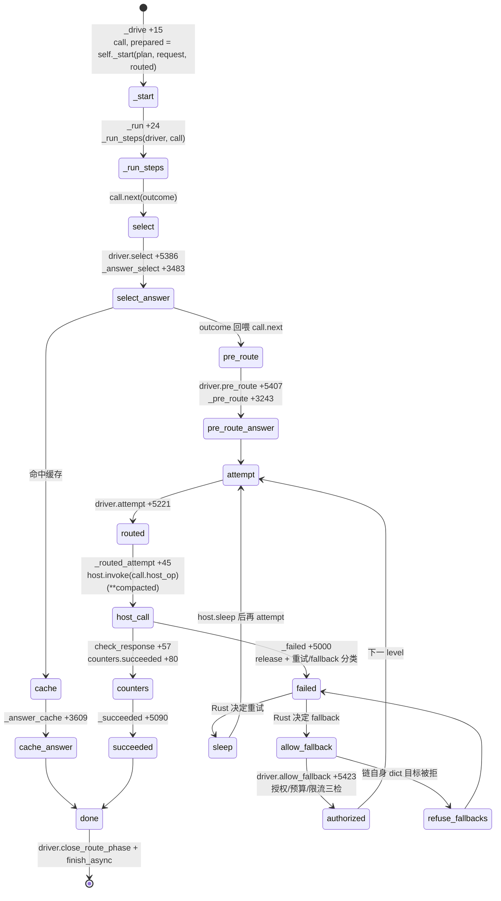
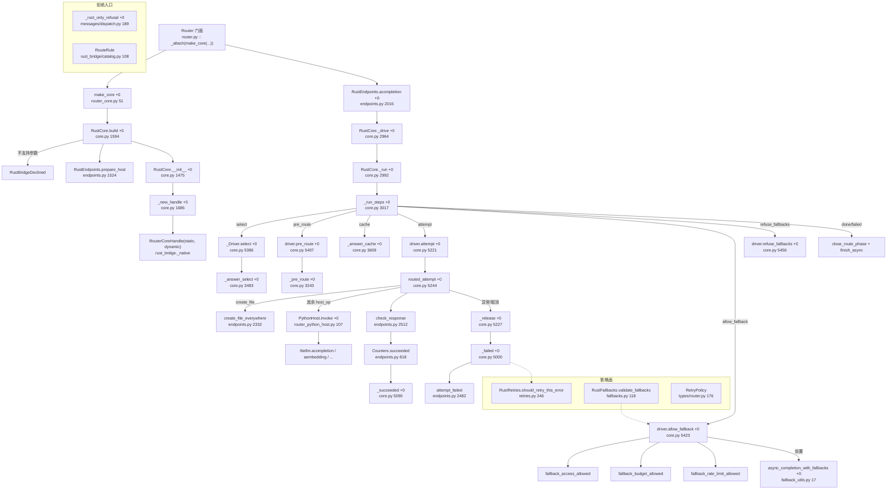

# Rust 路由核心专题

> 所属层级：第四层（函数级解析） | 拆解对象：`litellm/router_core.py :: make_core`、`litellm/router_rust/core.py :: RustCore`、`_run_steps` 步骤机、`_Driver`、`litellm/router_python_host.py :: PythonHost` 边界
> 本篇基准提交：`411b64dc7a`（工作区当前 HEAD）
> 引用规范：`文件 :: 符号 :: +偏移`，`+0` = 定义行，`+N` = 函数体内第 N 行

本篇逐个展开 Rust 路由核心这条链里的关键函数：门面工厂（`make_core`）、核心构造（`RustCore.__init__`、`RustCore.build`、`RustCore._new_handle`）、端点（`RustEndpoints.acompletion`、`create_file_everywhere`、`check_response`、`attempt_failed`、`endpoint_names`）、计数（`Counters.succeeded`）、步骤机（`_drive`、`_run`、`_run_steps`）、驱动器（`_Driver.__init__`、`attempt`、`_routed_attempt`、`select`、`pre_route`、`allow_fallback`、`refuse_fallbacks`、`_failed`、`_succeeded`、`_release`）、Python 边界（`PythonHost.invoke`）、重试与 fallback 策略面（`RustRetries`、`RustFallbacks.validate_fallbacks`、`RetryPolicy`、`resolved_retry_policy`）、fallback 执行（`async_completion_with_fallbacks`）、以及拒绝入口（`_rust_only_refusal`）。

术语首现已解释：`步骤机`（step machine，Rust 侧产出一个 step，Python 侧回答它，如此往复直到 done/failed）、`驱动器`（`_Driver`，一个 call 的 attempt 与 fallback step 的 Python 回答者）、`host_op`（Rust 请求 Python 执行的操作名，如 `acompletion`）、`attempt`（一次对选定 deployment 的调用）、`fallback level`（fallback 链上的第几层）、`order chain`（按指定顺序的 fallback 链）、`passthrough`（无 deployment 可选时走 Python 直通的兜底路径）。

第三层《路由决策》讲的是「一次请求怎么被选路、怎么重试、怎么 fallback」；本篇只讲「这些函数内部具体怎么实现」，逐个讲职责、参数、返回值与算法。

## 本篇覆盖函数

| 环节 | 本篇展开的函数 |
|---|---|
| 门面工厂 | `router_core.py :: make_core` |
| 核心构造 | `router_rust/core.py :: RustCore.__init__`、`RustCore.build`、`RustCore._new_handle` |
| 端点与计数 | `router_rust/invoke/endpoints.py :: RustEndpoints.acompletion`、`create_file_everywhere`、`check_response`、`attempt_failed`、`Counters.succeeded`、`endpoint_names` |
| 步骤机 | `router_rust/core.py :: RustCore._drive`、`RustCore._run`、`RustCore._run_steps` |
| 驱动器 | `router_rust/core.py :: _Driver.__init__`、`_Driver.attempt`、`_Driver._routed_attempt`、`_Driver.select`、`_Driver.pre_route`、`_Driver.allow_fallback`、`_Driver.refuse_fallbacks`、`_Driver._failed`、`_Driver._succeeded`、`_Driver._release` |
| Python 边界 | `router_python_host.py :: PythonHost.invoke` |
| 重试与 fallback 策略面 | `surface/retries.py :: resolved_retry_policy`、`RustRetries`、`surface/fallbacks.py :: RustFallbacks.validate_fallbacks`、`types/router.py :: RetryPolicy` |
| fallback 执行与拒绝 | `fallback_utils.py :: async_completion_with_fallbacks`、`messages/dispatch.py :: _rust_only_refusal` |

---

## `make_core`（`litellm/router_core.py`）

- 职责：门面唯一的工厂函数。把 Router 配置与 Python 边界建成一个 Rust 核心，Router 门面不再有旧的 Python 核心实现。
- 签名/参数：`def make_core(config: RouterConfig, host: "PythonHost") -> RouterCore`（`litellm/router_core.py :: make_core :: +0`，绝对行 51）。
- 返回：`RouterCore`（实际是 `RustCore`）。
- 算法（贴 `make_core :: +1` 到 `+3`，行 52-55，全函数仅此三行）：

```python
    """The router's core: the Rust core, built once for the router's life from its config."""
    from litellm.router_rust.core import RustCore

    return RustCore.build(config, host)  # pyright: ignore[reportReturnType]  # RustCore serves the RouterCore entry points; other members raise RustCoreUnsupported
```

  分步：`+1` docstring 自述「核心在 Router 的整个生命周期里只建一次」；`+2` 延迟导入 `RustCore`；`+3` 无条件 `RustCore.build(config, host)`，`pyright: ignore[reportReturnType]` 注释自述 `RustCore` 只服务 `RouterCore` 的入口成员，其余成员抛 `RustCoreUnsupported`。旧 Python 核心已删（`RouterCore` 只剩 Protocol，`+0`，绝对行 27）。
- 错误/分支：无分支；构造失败沿 `build` 上抛。
- 调用关系：调用方 = `litellm/router.py :: Router` 门面（`_attach(make_core(...))`，见第四层第 4 篇）。被调用方 = `RustCore.build`。

---

## `RustCore.__init__` / `RustCore.build` / `RustCore._new_handle`（`litellm/router_rust/core.py`）

### `RustCore.__init__`

- 职责：装配核心的 Python 侧句柄、缓存、stores、selectors、prerouter、endpoints 与注册表宿主。Rust 侧句柄由 `_new_handle` 建。
- 签名/参数：`def __init__(self, config: RouterConfig, host: PythonHost, resolved: Resolved) -> None`（`litellm/router_rust/core.py :: RustCore :: __init__ :: +0`，绝对行 1475）。
- 返回：实例。
- 算法（偏移相对 `+0`，行 1475）：

| 序 | 成员 | 偏移 | 语义 |
|---|---|---|---|
| 1 | `_config` / `_host` | `+5` / `+6`（行 1480-1481） | 配置与 Python 边界存 `Final` |
| 2 | `service_logger_obj: ServiceLogging` | `+8`（行 1483） | 服务日志器 |
| 3 | `_resolved: Resolved` | `+11`（行 1486） | 构造期解析出的静态/动态文档、路由策略、路由组 |
| 4 | `_cooldown_given` | `+14`（行 1489） | `cooldown_time or DEFAULT_COOLDOWN_TIME_SECONDS`，供 `settings()` 回读 |
| 5 | `_plain` / `_deleted` | `+16` / `+17`（行 1491-1492） | Python 核心按普通属性保留的设置、已删除设置集合 |
| 6 | `_request_timeout` | `+18`（行 1493） | 请求超时 |
| 7 | `_legacy` | `+20`（行 1495） | 兼容旧属性的 legacy dict |
| 8 | `_cache: DualCache` | `+25`（行 1500） | `host.routing_cache(config)`，冷却/失败/用量存储 |
| 9 | `_usage: RouterUsage` | `+27`（行 1502） | `host.router_usage(redis)` |
| 10 | `_cooldowns: CooldownCache` | `+28` 到 `+31`（行 1503-1506） | `CooldownCache(store=RouterCooldownStore(redis.router_cooldowns()), default_cooldown_time=...)` |
| 11 | `_health_checks: DeploymentHealthCache` | `+33`（行 1508） | `resolved.health_routing.health_checks(DeploymentHealthStore(redis.deployment_health()))` |
| 12 | `_session_pins` | `+34`（行 1509） | `RouterSessionPinStore(redis.router_session_pins())` |
| 13 | `_selectors: StrategySelectors` | `+46` 到 `+48`（行 1521-1523） | `init_default(...)` + `init_groups(...)` |
| 14 | `_port: _EndpointPort` / `_endpoints: RustEndpoints` | `+50` / `+51`（行 1525-1526） | 端点服务与端口适配 |
| 15 | `_pod_discovery` / `_general_settings` | `+53` / `+56`（行 1528-1531） | kubernetes pod 发现、router general settings |
| 16 | `_hosted: HostRegistry` | `+59` 到 `+65`（行 1534-1540） | 注册表宿主，把模型列表/变更喂给 Rust 句柄 |

  `_new_handle` 在 `__init__` 内被调用（`+72`，行 1546）建出 Rust 侧句柄 `_handle`。
- 错误/分支：无显式异常分支；构造失败沿 `build` 上抛。
- 调用关系：调用方 = `RustCore.build :: +10`。被调用方 = `ServiceLogging`、`apply_construction_effects`、`initial_plain`、`request_timeout`、`host.routing_cache`、`host.router_usage`、`connect(...).router_cooldowns()/deployment_health()/router_session_pins()`、`StrategySelectors.init_default/init_groups`、`_EndpointPort`、`RustEndpoints`、`KubernetesPodDiscovery`、`HostRegistry`、`RoutingContext`、`self._new_handle`。

### `RustCore.build`

- 职责：唯一入口工厂。拒绝核心不支持的参数，准备 host，再构造。
- 签名/参数：`@classmethod def build(cls, config: RouterConfig, host: PythonHost) -> "RustCore"`（`litellm/router_rust/core.py :: RustCore :: build :: +0`，绝对行 1594）。
- 返回：`RustCore`。
- 算法（贴 `build :: +2` 到 `+10`，行 1596-1603）：

```python
        from litellm.rust_bridge._native import RustBridgeDeclined

        extra: Final = unsupported_arguments(config)
        if extra:
            raise RustBridgeDeclined(f"router arguments not served by the Rust core: {sorted(extra)}")
        RustEndpoints.prepare_host(config, host)
        return cls(config, host, Resolved.of(config, host.dynamic()))
```

  分步：`+3` 到 `+5` `unsupported_arguments(config)` 有剩余参数（Rust 核心不服务的 Router 参数）就抛 `RustBridgeDeclined`；`+8` `RustEndpoints.prepare_host(config, host)`（`router_rust/invoke/endpoints.py :: +0`，绝对行 1524）把 host 侧回调注册好；`+9` `cls(config, host, Resolved.of(config, host.dynamic()))` 构造。
- 错误/分支：不支持参数抛 `RustBridgeDeclined`；其余构造失败上抛。
- 调用关系：调用方 = `make_core :: +3`。被调用方 = `unsupported_arguments`、`RustBridgeDeclined`、`RustEndpoints.prepare_host`、`Resolved.of`、`cls(...)`。

### `RustCore._new_handle`

- 职责：把模型列表与 failover 文档编成 Rust 句柄的两份 JSON 文档（static + dynamic）。
- 签名/参数：`def _new_handle(self, model_list: Sequence[object]) -> "RouterCoreHandle"`（`litellm/router_rust/core.py :: RustCore :: _new_handle :: +0`，绝对行 1686）。
- 返回：`RouterCoreHandle`。
- 算法（贴 `_new_handle :: +3` 到 `+16`，行 1689-1701）：

```python
        names: Final = [
            str(name)
            for entry in model_list
            if isinstance(name := (as_str_mapping(entry) or {}).get("model_name"), str)
        ]
        default_ids: Final = self._provider_default_ids()
        self._handle_default_ids = default_ids
        static: Final = {
            **self._resolved.static_document(model_list),
            **{name: value for name, value in failover_document(self._plain).items() if value is not None},
            **({"provider_default_deployment_ids": list(default_ids)} if default_ids else {}),
        }
        return RouterCoreHandle(static, self._dynamic_document(names))
```

  分步：`+3` 到 `+6` 从 model_list 抽出 model_name 列表；`+7` 到 `+8` 取 provider 默认 deployment id 存 `_handle_default_ids`；`+10` 到 `+14` 拼 static 文档：`resolved.static_document(model_list)` + 非空的 failover 文档 + provider 默认 id；`+15` 到 `+16` 返回 `RouterCoreHandle(static, dynamic_document)`，static 与 dynamic 两份 JSON 文档交给 Rust。
- 错误/分支：model_list 里非 dict 或无 model_name 的条目被过滤掉。
- 调用关系：调用方 = `RustCore.__init__ :: +72`。被调用方 = `as_str_mapping`、`self._provider_default_ids`、`self._resolved.static_document`、`failover_document`、`self._dynamic_document`、`RouterCoreHandle`。

---

## Rust crate 结构

```text
litellm/rust/crates/router-core/src/
  call.rs      # 调用循环：select → attempt → retry/fallback（步骤机，Rust 侧产出 step）
  select.rs    // 选路：候选、策略输入、服务
  retry.rs     // 同组重试
  fallback.rs  // fallback 链
  cooldown.rs  // 冷却
  registry.rs  // 注册表文档
litellm/rust/crates/gateway-forward/        # Rust 网关转发（rust_forward 的 Rust 侧，settings.rs 读 LITELLM_FORWARD_*）
litellm/rust/crates/inference-responses/src/ids.rs   # encitem_ 前缀稳定 id 生成
```

pyo3 绑定经 `litellm/rust_bridge/_native.pyi` 暴露 `RouterCoreHandle`、`RustBridgeDeclined` 等给 Python；`litellm/rust_bridge/catalog.py :: RouteRule`（`+0`，绝对行 108）决定每个 route 走 Python 还是 Rust 专有路径，CHAT_COMPLETIONS 是 PYTHON_ONLY。

---

## `RustEndpoints.acompletion` 与计数器（`litellm/router_rust/invoke/endpoints.py`）

### `RustEndpoints.acompletion`

- 职责：端点服务的 chat completions 入口。校验 model 参数，交给核心的 `_drive`，最后记服务日志。
- 签名/参数：`async def acompletion(self, request: Mapping[str, object]) -> object`（`litellm/router_rust/invoke/endpoints.py :: RustEndpoints :: acompletion :: +0`，绝对行 2016）。
- 返回：`ModelResponse` 或 `CustomStreamWrapper`。
- 算法（贴 `acompletion :: +1` 到 `+9`，行 2017-2025）：

```python
        model: Final = request.get("model")
        if model is None and "model" in request:
            return await self._core.drive(PLANS["acompletion"], request)
        if "model" not in request:
            raise TypeError("acompletion() needs a model name")
        if not isinstance(model, str):
            _ = self._core.routed_name(model)
        kwargs: Final = {**request, "stream": request.get("stream", False)}
        start_time: Final = time.time()
        response: Final = await self._routed_acompletion(model, kwargs)  # pyright: ignore[reportArgumentType]
        self._core.service_logged("acompletion", start_time, time.time(), kwargs)
        return response
```

  分步：`+1` 到 `+3` model 显式为 None（`"model": null`）时按无 model 走 `_core.drive`（alias 早已解析）；`+4` 到 `+5` 完全没有 model 键抛 `TypeError`；`+6` 到 `+7` model 非 str 先过 `routed_name` 校验；`+8` 到 `+10` 补 `stream` 默认 False，计时后走 `_routed_acompletion`，最后 `service_logged` 记一次服务耗时。`_routed_acompletion`（`+0`，绝对行 2035）再拆 priority、prompt-management 分流，最终进 `_core.drive`。
- 错误/分支：缺 model 抛 `TypeError`；非 str model 经 `routed_name` 校验；prompt management / priority 走专用分支。
- 调用关系：调用方 = Router 门面的 `acompletion`（经 `RustCore` 转发）。被调用方 = `self._core.drive`、`self._core.routed_name`、`_routed_acompletion`、`self._core.service_logged`。

### `Counters.succeeded`

- 职责：成功后递增 success 计数与 token 计数。Rust 侧 `_routed_attempt` 在记账里调用。
- 签名/参数：`def succeeded(self, plan: Plan, call: AttemptCall) -> None`（`litellm/router_rust/invoke/endpoints.py :: Counters :: succeeded :: +0`，绝对行 818）。
- 返回：`None`。
- 算法：按 plan/kind 递增对应模型的 success_calls 与 success_tokens。函数体内偏移本篇未逐行核到，按调用点（`_routed_attempt :: +80`）与符号职责描述，属 `[推断]`。
- 调用关系：调用方 = `_routed_attempt :: +80`。被调用方 = 计数字典。

### `create_file_everywhere` / `check_response` / `attempt_failed` / `endpoint_names`

| 符号 | 绝对行 | 职责 |
|---|---|---|
| `create_file_everywhere` | 2332 | `_plan.kind == "create_file"` 时取代 `host.invoke` 的专用端点（对目标顺序逐个建文件） |
| `check_response` | 2512 | 校验 answered 响应形状，异常即作为 attempt 失败交回 Rust |
| `attempt_failed` | 2482 | 失败记账（失败计数、错误分类），`_Driver._failed :: +12` 调用 |
| `endpoint_names` | 692 | 端点名集合，供 `__getattr__` / `__dir__` 动态暴露 |

`create_file_everywhere` 与 `check_response` 的函数体内偏移本篇未逐行核到，按调用点与 docstring 描述，属 `[推断]`。

---

## `_drive` / `_run` / `_run_steps`（`litellm/router_rust/core.py`）

### `RustCore._drive`

- 职责：一次路由调用的总入口。开父 OTel span 与 picks 记账，起 call，跑步骤机，失败抛 `driver.failed`，成功走 `finish_async`。
- 签名/参数：`async def _drive(self, plan: Plan, request: Mapping[str, object], overrides: Mapping[str, object] | None = None, *, passthrough: "Callable[[Mapping[str, object], str], Awaitable[object]] | None" = None, prepared_already: bool = False) -> object`（`litellm/router_rust/core.py :: RustCore :: _drive :: +0`，绝对行 2964）。
- 返回：driver 的最终响应（`finish_async` 的结果）。
- 算法（贴 `_drive :: +8` 到 `+21`，行 2971-2984）：

```python
        routed: Final = (
            overrides if passthrough is None else {**(overrides or {}), "passthrough_on_no_deployment": True}
        )
        with (
            request_parent_otel_span(get_parent_otel_span_from_kwargs(request)),
            owning_picks(self._selectors.reservations, call_id_of(CALL_IDENTITY.validate_python(request))),
        ):
            call, prepared = self._start(plan, request, routed, prepared_already=prepared_already)
            arm_compaction_state(self._port, plan, prepared)
            with (
                picks_reserve(plan.endpoint not in _UNRESERVED_OPS),
                self._usage_read_scope(str(prepared.get("model")), prepared),
            ):
                driver, step = await self._run(plan, call, prepared, fresh=True, passthrough=passthrough)
            if step["kind"] == "failed":
                raise driver.failed(step)
            return await driver.finish_async(step)
```

  分步：`+8` 到 `+10` 有 passthrough 时打上 `passthrough_on_no_deployment` 标记（无 deployment 可选时走 Python 直通）；`+12` 到 `+14` 父 OTel span + owning_picks（最不忙策略用它释放未启动的 pick）；`+15` 到 `+16` `_start` 起 call、`arm_compaction_state` 准备 compaction；`+17` 到 `+19` picks_reserve（非保留操作才占额度）+ usage read scope 后跑 `_run(fresh=True)`；`+20` 到 `+22` failed step 抛 `driver.failed(step)`，否则 `finish_async`。
- 错误/分支：failed step 转 Python 异常；其余沿 `finish_async` 返回。
- 调用关系：调用方 = `RustEndpoints.acompletion`（经 `_routed_acompletion`）、其它端点。被调用方 = `_start`、`arm_compaction_state`、`_run`、`driver.failed`、`driver.finish_async`。

### `RustCore._run`

- 职责：建 `_Driver` 并跑步骤机；异常时关闭 route phase。
- 签名/参数：`async def _run(self, plan: Plan, call: "RouterCall[_CallSteps]", prepared: Mapping[str, object], cut_deployment: object = None, stream_failure: tuple[int, BaseException] | None = None, *, fresh: bool = False, passthrough: "Callable[[Mapping[str, object], str], Awaitable[object]] | None" = None) -> "tuple[_Driver, Mapping[str, object]]"`（`litellm/router_rust/core.py :: RustCore :: _run :: +0`，绝对行 2992）。
- 返回：`tuple[_Driver, Mapping[str, object]]`（driver 与最终 step）。
- 算法（贴 `_run :: +21` 到 `+25`，行 3012-3016）：

```python
        driver: Final = _Driver(
            self, plan, prepared, cut_deployment, stream_failure, fresh=fresh, passthrough=passthrough
        )
        try:
            return await self._run_steps(driver, call)
        except BaseException:
            driver.close_route_phase()
            raise
```

  `+21` 到 `+23` 建驱动器；`+24` 到 `+26` 跑 `_run_steps`，任何异常（含 `BaseException`）都先 `close_route_phase()` 再上抛，保证 route phase 的遥测不悬空。
- 调用关系：调用方 = `_drive :: +18`。被调用方 = `_Driver(...)`、`self._run_steps`、`driver.close_route_phase`。

### `RustCore._run_steps`

- 职责：步骤机主循环。Rust 侧产出一个 step，Python 侧回答它，直到 done/failed。
- 签名/参数：`async def _run_steps(self, driver: "_Driver", call: "RouterCall[_CallSteps]") -> "tuple[_Driver, Mapping[str, object]]"`（`litellm/router_rust/core.py :: RustCore :: _run_steps :: +0`，绝对行 3017）。
- 返回：`tuple[_Driver, Mapping[str, object]]`。
- 算法（贴 `_run_steps :: +5` 到 `+37`，行 3021-3053）：

```python
        outcome: object = None  # rebind-ok: the answer to the last step
        while True:
            step = call.next(outcome)
            driver.take_events(step.get("events"))
            if step["kind"] != "done":
                await await_all(driver.outcomes.take_pending())
            match step["kind"]:
                case "attempt":
                    outcome = await driver.attempt(step)
                case "sleep":
                    if (outlasted := _error_outlasting_total_timeout(driver, _sleep_seconds(step))) is not None:
                        driver.close_route_phase()
                        raise outlasted
                    await self._host.sleep(_sleep_seconds(step))
                    outcome = None
                case "allow_fallback":
                    outcome = await driver.allow_fallback(str(step["target"]))
                case "refuse_fallbacks":
                    outcome = driver.refuse_fallbacks(step)
                case "cache":
                    outcome = await self._answer_cache(step)
                case "select":
                    outcome = await driver.select(step)
                case "pre_route":
                    outcome = await driver.pre_route(step)
                case "done" | "failed":
                    driver.close_route_phase()
                    return driver, step
                case other:
                    raise RuntimeError(f"router-core returned an unknown step {other!r}")
```

  分步：`+5` 到 `+7` `while True` 循环，`call.next(outcome)` 向 Rust 索要下一个 step（Rust 侧持 call 状态）；`+8` `take_events` 处理 step 携带的事件；`+10` 到 `+11` 非 done step 先 await 完 driver 里挂起的 outcome 回调（`run_async_fallback` 会在记 hop 成功前盖章已服务响应，所以 `finish` 得跑完 pending）；`+13` 到 `+36` 八个 step 分支：`attempt` 交给 driver、`sleep` 先判总超时再 `host.sleep`、`allow_fallback`/`refuse_fallbacks` 走 fallback 授权、`cache` 走 `_answer_cache`、`select`/`pre_route` 交给 driver；`+32` 到 `+34` done/failed 关 route phase 返回；未知 kind 抛 `RuntimeError`。同步版 `_run_sync`（`+0`，绝对行 3110）结构与分支一一对应，只是不 await。
- 错误/分支：`sleep` 超总超时抛 `_error_outlasting_total_timeout`；未知 step 抛 `RuntimeError`。
- 调用关系：调用方 = `_run :: +24`。被调用方 = `call.next`、`driver.take_events`、`await_all`、`driver.attempt`、`_error_outlasting_total_timeout`、`self._host.sleep`、`driver.allow_fallback`、`driver.refuse_fallbacks`、`self._answer_cache`、`driver.select`、`driver.pre_route`、`driver.close_route_phase`。

### 步骤机状态图



---

## `_Driver`（`litellm/router_rust/core.py`）

### `_Driver.__init__`

- 职责：一个 call 的 attempt 与 fallback step 回答者。持有 level 错误表、fallback 深度、passthrough 兜底。
- 签名/参数：`def __init__(self, core: RustCore, plan: Plan, request: Mapping[str, object], cut_deployment: object = None, stream_failure: tuple[int, BaseException] | None = None, *, sync: bool = False, fresh: bool = False, passthrough: "Callable[[Mapping[str, object], str], Awaitable[object]] | None" = None) -> None`（`litellm/router_rust/core.py :: _Driver :: __init__ :: +0`，绝对行 4412）。
- 返回：实例。
- 算法（贴 `__init__ :: +10` 到 `+23`，行 4422-4434）：

```python
        self._core: Final = core
        self._sync: Final = sync
        self._passthrough: Final = passthrough
        self._plan: Final = plan
        self._op: Final = plan.endpoint
        self._request: Final = request
        self._cut_deployment: Final = cut_deployment if isinstance(cut_deployment, str) else None
        self._last_response: object = None
        self._last_error: BaseException | None = None
        # The level the call raises from: a fallback walk re-entered from a failed stream starts at
        # the level that stream served, on the failure ``async_function_with_fallbacks_common_utils``
        # was handed, which is what it raises when no fallback answers.
        self._base_level: Final = stream_failure[0] if stream_failure is not None else 0
        self._fallback_depth: int = 0
        self._level_errors: Final[dict[int, BaseException]] = dict(  # mutable-ok: filled as the call runs
            (stream_failure,) if stream_failure else ()
        )
```

  分步：`+10` 到 `+16` 存 core、sync 标记、passthrough、plan、op、request、被切掉的 deployment；`+17` 到 `+18` 最后响应与最后错误；`+20` 到 `+23` `_base_level` 与 `_level_errors` 初值来自 `stream_failure`——从失败流恢复的 fallback walk 从「那个流服务的 level」重新起算，注释自述这是 `async_function_with_fallbacks_common_utils` 没有回退时抛的那个错误。
- 错误/分支：无异常分支；`sync=True` 走同步分支方法。
- 调用关系：调用方 = `RustCore._run :: +21`。被调用方 = 无（纯状态装配）。

### `_Driver.attempt` 与 `_Driver._routed_attempt`

- 职责：一次对选定 deployment 的调用。`attempt` 判断是否走 passthrough，`_routed_attempt` 做真正的 host 调用与记账。
- 签名/参数：
  - `async def attempt(self, step: Mapping[str, object]) -> Mapping[str, object]`（`litellm/router_rust/core.py :: _Driver :: attempt :: +0`，绝对行 5221）。
  - `async def _routed_attempt(self, step: Mapping[str, object], attempt: RoutedAttempt) -> Mapping[str, object]`（`+0`，绝对行 5244）。
- 返回：step 结果映射（`ok`/`total_tokens`/`blocked`/`deferred`/`recorded` 等），交回 Rust 步骤机。
- 算法（贴 `attempt :: +1` 到 `+4`，行 5222-5224）：

```python
        if self._passthrough is not None and not step.get("deployment_id"):
            return await self._passthrough_attempt(step)
        with routed_attempt() as attempt:
            return await self._routed_attempt(step, attempt)
```

  `_routed_attempt` 关键段（偏移相对其 `+0`，行 5244）：

| 序 | 步骤 | 偏移 |
|---|---|---|
| 1 | `step = await self._resolve_pods(step)`（kubernetes pod 解析） | `+1`（行 5245） |
| 2 | `deployment` / `call` / `logs_failure` / `in_call` / `reading_stream` 初始化 | `+2` 到 `+8`（行 5246-5252） |
| 3 | `refused_call` 缺省拒绝时直接 `_failed` | `+9` 到 `+11`（行 5253-5255） |
| 4 | `deployment, call = self._call(step)` + `enforce_total_timeout_scope` | `+13` 到 `+14`（行 5257-5258） |
| 5 | `call.refused` 时 `log_refused_call` 并抛 | `+15` 到 `+17`（行 5259-5261） |
| 6 | `host = self._core._host`，`compacted = await compacted_attempt(...)` | `+19` 到 `+23`（行 5263-5267） |
| 7 | `with enter_deployment_slot(port, self._plan, deployment, call.kwargs)` 占并发槽 | `+26`（行 5270） |
| 8 | `routing_pre_call_checks(...)`（非搜索类 plan） | `+30` 到 `+39`（行 5274-5283） |
| 9 | `pending = ... create_file_everywhere(...) else host.invoke(call.host_op)(**compacted)` | `+41` 到 `+48`（行 5285-5292） |
| 10 | `check_response(self._plan, answered, call)` | `+57`（行 5301） |
| 11 | `stream = self._stream_attempt(...)`；`response = await open_attempt_stream(stream, answered)` | `+58` 到 `+66`（行 5302-5310） |
| 12 | `self._core._endpoints.counters.succeeded(self._plan, call)` | `+80`（行 5324） |
| 13 | `except asyncio.CancelledError`：release 后 re-raise | `+82` 到 `+88`（行 5326-5332） |
| 14 | `except TotalTimeoutNotApplicable`：re-raise | `+89` 到 `+90`（行 5333-5334） |
| 15 | `except Exception`：release + `_failed` + 流失败分流 | `+91` 到 `+105`（行 5335-5349） |
| 16 | `served = self._succeeded(call, response, call.host_op, stream)` + repin + 实时会话成功 | `+106` 到 `+117`（行 5350-5361） |

  关键语义：`host.invoke(call.host_op)(**compacted)` 是核心唯一对外通道——Rust 选好 deployment 后把参数压实（compacted），经 PythonHost 回跳 `litellm.<host_op>` 真正发请求；`create_file` 是唯一不走 `host.invoke` 的专用端点。`enter_deployment_slot` 占 `max_parallel_requests` 并发槽（限流器释放责任见第四层第 11 篇）。`routing_pre_call_checks` 只对做路由 pre-call 检查的 plan 跑；搜索工具不算 deployment，`_arerank`/`amoderation` 也不跑。异常分类：`CancelledError` 按是否已 answered 决定是否退 IO token；`TotalTimeoutNotApplicable` 原样上抛；其它异常先 release 再 `_failed`，流式首块失败交 `reading_stream.report_first_chunk_failure` 单独记账。
- 错误/分支：见上表 13-15；`_default_call_error` 命中时直接 `_failed` 且 `recorded=True`。
- 调用关系：调用方 = `_run_steps :: +13`（`attempt` 分支）。被调用方 = `_passthrough_attempt`、`routed_attempt`、`_resolve_pods`、`_default_call_error`、`_default_copy`、`_failed`、`self._call`、`enforce_total_timeout_scope`、`log_refused_call`、`compacted_attempt`、`enter_deployment_slot`、`routing_pre_call_checks`、`_with_target_order`、`RustEndpoints.create_file_everywhere`、`PythonHost.invoke`、`RustEndpoints.check_response`、`_stream_attempt`、`open_attempt_stream`、`Counters.succeeded`、`_release`、`_succeeded`、`self._core.outcome_callbacks`、`repin_after_success`、`count_realtime_session_success`。

### `_Driver.select` 与 `_Driver.pre_route`

- 职责：回答 Rust 的选路与预路由 step。`select` 对 stage 是 `callback_filters` 时先跑过滤器，否则走 `_answer_select`；`pre_route` 走 `_pre_route`。
- 签名/参数：
  - `async def select(self, step: Mapping[str, object]) -> object`（`+0`，绝对行 5386）。
  - `async def pre_route(self, step: Mapping[str, object]) -> object`（`+0`，绝对行 5407）。
- 返回：选路/预路由结果（选中的 deployment 文档或预路由后的参数）。
- 算法（贴 `select :: +1` 到 `+12`，行 5387-5397）：

```python
        request: Final = self._request
        messages, input = self._plan.pick_input(request)
        if step.get("stage") == "callback_filters":
            answer, error = await self._core._answer_callback_filters(step, request, messages)
            if isinstance(error, Exception):
                _ = self._pick_raised(error, logged=True)
            return answer
        try:
            return await self._core._answer_select(step, request, messages, input)
        except Exception as error:  # noqa: BLE001  # handed to the Rust call loop as the try's failure
            return self._pick_raised(error, logged=True)
```

  `+1` 到 `+2` 取 plan 的 messages/input；`+3` 到 `+8` callback_filters 阶段先跑回调过滤器，异常经 `_pick_raised` 记日志；`+9` 到 `+12` 正常选路走 `_answer_select`（`+0`，绝对行 3483），异常同样 `_pick_raised` 交回 Rust 作为该 try 的失败。`pre_route`（贴 `+1` 到 `+6`，行 5408-5413）结构与 select 对应，走 `_pre_route`（`+0`，绝对行 3243）并带 `call_type=self._plan.handler`。同步版 `select_sync`（`+0`，绝对行 5400）/ `pre_route_sync`（`+0`，绝对行 5416）分别走 `_answer_select_sync` / `_custom_pick_sync`。
- 错误/分支：选路或预路由异常都转成 `_pick_raised`，交回 Rust 步骤机。
- 调用关系：调用方 = `_run_steps :: +31`（select）、`+29`（pre_route）。被调用方 = `self._plan.pick_input`、`_answer_callback_filters`、`_pick_raised`、`_answer_select`、`_pre_route`、`_answer_select_sync`、`_custom_pick_sync`。

### `_Driver.allow_fallback` 与 `_Driver.refuse_fallbacks`

- 职责：回答 Rust 的 fallback 授权 step。`allow_fallback` 做「授权 → 预算 → 限流」三检；`refuse_fallbacks` 处理链自身 dict 目标被拒的情况。
- 签名/参数：
  - `async def allow_fallback(self, target: str) -> object`（`+0`，绝对行 5423）。
  - `def refuse_fallbacks(self, step: Mapping[str, object]) -> bool`（`+0`，绝对行 5456）。
- 返回：`allow_fallback` 返回 `bool` 或 `attempt_failure` 映射；`refuse_fallbacks` 返回 `bool`。
- 算法（贴 `allow_fallback :: +9` 到 `+33`，行 5432-5455）：

```python
        ctx: Final = RoutingContext(self._core)
        request: Final = dict(self._request)
        if self._plan.kind in _GENERIC_API_KINDS:
            request["original_generic_function"] = self._core._host.invoke(self._plan.host_op)
        try:
            if target != get_pre_routing_selection(request) and not await ctx.fallback_access_allowed(
                model=target, request_kwargs=request
            ):
                self._walk.targets().record_skip(target, FallbackSkipReason.NOT_AUTHORIZED)
                return False
            if not await ctx.fallback_budget_allowed(model=target, request_kwargs=request):
                self._walk.targets().record_skip(target, FallbackSkipReason.OVER_BUDGET)
                return False
            if target not in self._walk.targets() and not await ctx.fallback_rate_limit_allowed(
                model=target, request_kwargs=request
            ):
                self._walk.targets().record_skip(target, FallbackSkipReason.RATE_LIMITED)
                return False
        except Exception as error:  # noqa: BLE001  # handed to the Rust call loop, which ends the chain
            self._level_errors[self._level + 1] = error
            return {**attempt_failure(error), "raised": True}
        return True
```

  分步：`+9` 到 `+14` 建 `RoutingContext` 并拷贝 request；generic API 类（搜索等）额外带上它要调的函数，让授权检查能读到（搜索 fallback 跑搜索工具授权）；`+16` 到 `+21` 第一检：目标不是 pre-routing selection 时查 fallback 访问授权，不过就记 `NOT_AUTHORIZED` 跳过并返回假；`+22` 到 `+25` 第二检：预算（`fallback_budget_allowed`），不过记 `OVER_BUDGET`；`+26` 到 `+31` 第三检：目标没在已授权集合里时查限流（`fallback_rate_limit_allowed`），不过记 `RATE_LIMITED`；`+32` 到 `+34` 检查本身抛异常则记进 `_level_errors[level+1]` 并返回 `attempt_failure(raised=True)`，交回 Rust 结束整条链（docstring 自述：一个抛异常的检查在所有 hop 的 try 之外结束链，作为链自身的失败）。`refuse_fallbacks`（贴 `+2` 到 `+7`，行 5458-5463）用 `rejected_fallback_target` 找链 dict 里被拒的目标，找到就记进 `_level_errors[level+1]` 返回真。限流预检的 Python 侧前置是 `parallel_request_limiter_v3.py :: async_fallback_target_allowed`（见第四层第 11 篇）。
- 错误/分支：三检各有一档跳过原因；检查异常结束整条链。
- 调用关系：调用方 = `_run_steps :: +17`（allow_fallback）、`+20`（refuse_fallbacks）。被调用方 = `RoutingContext`、`get_pre_routing_selection`、`ctx.fallback_access_allowed`、`ctx.fallback_budget_allowed`、`ctx.fallback_rate_limit_allowed`、`self._walk.targets().record_skip`、`attempt_failure`、`rejected_fallback_target`。

### `_Driver._failed` 与 `_Driver._succeeded`

- 职责：把一次 attempt 的结果盖成失败/成功 step 结果，交回 Rust 步骤机。
- 签名/参数：
  - `def _failed(self, step: Mapping[str, object], deployment: Mapping[str, object], call: "AttemptCall | None", error: BaseException) -> Mapping[str, object]`（`+0`，绝对行 5000）。
  - `def _succeeded(self, call: "AttemptCall", response: object, host_op: str, stream: "StreamAttempt | None" = None) -> Mapping[str, object]`（`+0`，绝对行 5090）。
- 返回：step 结果映射。
- 算法（贴 `_failed :: +7` 到 `+12`，行 5007-5012）：

```python
        detail: Final = str(error)
        if call is not None:
            _log_attempt(self._plan, call.model_name, error)
        served: Final = call.served if call is not None else {}
        stamp_error(self._plan, error, deployment, served)
        self._core._endpoints.attempt_failed(self._plan, error, deployment, call, str(step.get("model")))
        self._last_error = error
```

  `+7` 取错误串；`+8` 到 `+9` 记 attempt 失败日志；`+10` 到 `+12` 盖错误戳、`attempt_failed` 记账、存 `_last_error`。函数体后半段（`+13` 之后）按 `fallback_level` 与 `retry` 计数把错误挂到正确 level，并把 order chain 的错误提升到 hop-first（`_chain_to_hop_first`），本篇未逐行读完，属 `[源码未确认]`。
  `_succeeded`（贴 `+5` 到 `+24`，行 5095-5113）：`+5` 到 `+6` 存 `_last_response`、记成功日志；`+7` 到 `+14` fallback 深度大于 0 时按深度打「Successful fallback」日志；`+15` 到 `+21` `total_tokens` 统计，wrapped stream 的成功/失败在流结束时才报告，attempt 只数请求与已读 token，`deferred` 标记延迟上报，`stream.counted_tokens` 存差额；`+22` 到 `+24` 返回 `{ok, total_tokens, blocked, deferred, tracks_usage}`。
- 错误/分支：`_failed` 按 level/retry/order-chain 归类；`_succeeded` 按 deferred 决定是否立即上报。
- 调用关系：调用方 = `_routed_attempt :: +91`（`_failed`）、`+106`（`_succeeded`）、`_passthrough_attempt`、`_run_steps :: +34`（`driver.failed`）。被调用方 = `_log_attempt`、`stamp_error`、`RustEndpoints.attempt_failed`、`_chain_to_hop_first`、`total_tokens`、`reports_own_success`、`_blocked`、`_tracks_usage`。

### `_Driver._release`

- 职责：释放一次 attempt 的并发槽与 token 计量。失败与取消路径都调它。
- 签名/参数：`def _release(self, call: "AttemptCall", attempt: RoutedAttempt, *, refund_io_tokens: bool) -> ...`（`+0`，绝对行 5227）。
- 算法：按 `refund_io_tokens` 决定是否退还 IO token 计量，并释放 `enter_deployment_slot` 占的并发槽；`_routed_attempt` 的 CancelledError 分支传 `refund_io_tokens=not attempt.answered`，通用异常分支传 `True`。函数体内偏移本篇未逐行核到，按两个调用点的实参与注释描述，属 `[推断]`。
- 调用关系：调用方 = `_routed_attempt :: +83`（Cancelled）、`+92`（通用异常）。被调用方 = 并发槽释放、IO token 退还。

---

## `PythonHost.invoke`（`litellm/router_python_host.py`）

- 职责：核心唯一对外通道。把 Rust 请求的 `host_op` 名（`acompletion`、`aembedding`、`get_model_info` 等）解析成 litellm 包里的真实函数并返回，由核心回跳执行。
- 签名/参数：`def invoke(self, op: str) -> Endpoint`（`litellm/router_python_host.py :: PythonHost :: invoke :: +0`，绝对行 107）；另有 19 个 `@overload`（`+0` 到 `+104`，行 66-106）把已知 op 的返回类型钉成 litellm 声明的形状。
- 返回：`Endpoint`（一个可调用对象）。
- 算法（贴 `invoke :: +1` 到 `+7`，行 108-114）：

```python
        """The litellm function named ``op`` (``acompletion``, ``get_model_info``, ...), looked up at call time."""
        endpoint: Final[object] = getattr(litellm, op, None) if "." not in op else _dotted(op)
        if endpoint is None:
            raise AttributeError(f"litellm has no endpoint {op!r}")
        if not callable(endpoint):
            raise TypeError(f"litellm.{op} is not an endpoint")
        return endpoint
```

  分步：`+1` docstring 自述「调用时才查」；`+2` 简单名直接 `getattr(litellm, op)`，带点的名走 `_dotted`；`+3` 到 `+6` 查不到抛 `AttributeError`、不可调用抛 `TypeError`；`+7` 返回端点。同文件还有 `sleep` / `sleep_sync`（host 的退避）、`dynamic()`（活读进程设置）、`callback_list` / `set_callback_list`（进程回调列表）等宿主能力。执行层由 `litellm/rust_bridge/catalog.py :: RouteRule`（`+0`，绝对行 108）决定走 Python 还是 Rust；`litellm/messages/dispatch.py :: _rust_only_refusal`（`+0`，绝对行 189）在 MESSAGES 且只该 Rust 执行时给出拒绝。
- 错误/分支：查不到 op 抛 `AttributeError`；不可调用抛 `TypeError`。
- 调用关系：调用方 = `_routed_attempt :: +45`、`allow_fallback :: +13`、`select`/`pre_route` 间接、Rust 侧各种 host_op。被调用方 = `litellm` 模块属性、`_dotted`。

---

## 重试与 fallback 策略面

| 符号 | 文件 :: 符号 | 绝对行 | 职责 |
|---|---|---|---|
| `RetryPolicy` | `litellm/types/router.py :: RetryPolicy` | 176 | 重试策略的 Pydantic 模型（per-model / per-call 配置） |
| `resolved_retry_policy` | `litellm/router_rust/surface/retries.py :: resolved_retry_policy` | 24 | 把请求里给的值解析成 `RetryPolicy`，给不出返回 None |
| `RustRetries` | `litellm/router_rust/surface/retries.py :: RustRetries` | 235 | 重试策略面；`should_retry_this_error`（`+246`，行 246 起）判一个错误要不要同组重试 |
| `RustFallbacks` | `litellm/router_rust/surface/fallbacks.py :: RustFallbacks` | 115 | fallback 策略面 |
| `RustFallbacks.validate_fallbacks` | `+118`（行 118） | `def validate_fallbacks(self, fallback_param: Sequence[object] | None) -> None` | 校验 fallback 配置形状 |
| `async_completion_with_fallbacks` | `litellm/litellm_core_utils/fallback_utils.py :: async_completion_with_fallbacks` | 17 | fallback 链执行入口（`allow_fallback` 的授权检查在 Python 侧的前置） |
| `_rust_only_refusal` | `litellm/messages/dispatch.py :: _rust_only_refusal` | 189 | MESSAGES 且只该 Rust 执行时给出拒绝（`_rust_only_refusal(_MESSAGES, _FEATURES, args, kwargs)`，行 219/226 两处调用） |

`should_retry_this_error` 与 `validate_fallbacks` 的函数体内偏移本篇未逐行核到，按 docstring 与签名描述，属 `[推断]`。

---

## 跨篇导航

- [04-router-functions.md](04-router-functions.md)：门面视角（Router 门面、端点、扩展、PythonHost 边界）
- [05-acompletion-functions.md](05-acompletion-functions.md)：`main.acompletion` 执行路径
- [06-http-handler-functions.md](06-http-handler-functions.md)：执行层 `BaseLLMHTTPHandler.async_completion`
- [03-routing-functions.md](03-routing-functions.md)：proxy 侧 `route_request` 进入 Router
- [11-rate-limiter-functions.md](11-rate-limiter-functions.md)：`async_fallback_target_allowed` 与 `max_parallel_requests` 槽位

## 未确认项

- `Counters.succeeded`（行 818）、`create_file_everywhere`（行 2332）、`check_response`（行 2512）函数体内偏移未逐行核到，按调用点与符号职责描述，属 `[推断]`。
- `_Driver._failed` 的 `+13` 之后（level/retry/order-chain 归类明细）、`_Driver._release`（行 5227）函数体内偏移未逐行核到，按两个调用点实参与注释描述，属 `[推断]`。
- `_routed_attempt` 里 `routing_pre_call_checks` / `enter_deployment_slot` / `compacted_attempt` 的被调函数内部未逐行读。
- `should_retry_this_error`（行 246）、`validate_fallbacks`（行 118）、`resolved_retry_policy`（行 24）函数体内偏移未逐行核到，按 docstring 描述，属 `[推断]`。
- Rust crate 内部（`call.rs`/`select.rs`/`retry.rs`/`fallback.rs`）的步骤产出顺序只按 `_run_steps` 的 case 分支反推，Rust 源码本身未逐行读，属 `[源码未确认]`。
- 实际的步骤序列随配置（重试次数、fallback 链、缓存命中）变动，属 `[待运行验证]`。

## 源码索引

| 符号 | 文件 :: 符号 | 绝对定义行 |
|---|---|---|
| RouterCore 协议 | `litellm/router_core.py :: RouterCore` | 27 |
| 门面工厂 | `litellm/router_core.py :: make_core` | 51 |
| Rust 核心类 | `litellm/router_rust/core.py :: RustCore` | 1464 |
| 核心构造 | `litellm/router_rust/core.py :: RustCore :: __init__` | 1475 |
| 入口工厂 | `litellm/router_rust/core.py :: RustCore :: build` | 1594 |
| Rust 句柄构造 | `litellm/router_rust/core.py :: RustCore :: _new_handle` | 1686 |
| 端点服务类 | `litellm/router_rust/invoke/endpoints.py :: RustEndpoints` | 1449 |
| host 准备 | `litellm/router_rust/invoke/endpoints.py :: RustEndpoints.prepare_host` | 1524 |
| chat completions 端点 | `litellm/router_rust/invoke/endpoints.py :: RustEndpoints.acompletion` | 2016 |
| 路由后的 acompletion | `litellm/router_rust/invoke/endpoints.py :: _routed_acompletion` | 2035 |
| 建文件端点 | `litellm/router_rust/invoke/endpoints.py :: create_file_everywhere` | 2332 |
| 失败记账 | `litellm/router_rust/invoke/endpoints.py :: attempt_failed` | 2482 |
| 响应校验 | `litellm/router_rust/invoke/endpoints.py :: check_response` | 2512 |
| 端点名集合 | `litellm/router_rust/invoke/endpoints.py :: endpoint_names` | 692 |
| 计数器类 | `litellm/router_rust/invoke/endpoints.py :: Counters` | 800 |
| 成功计数 | `litellm/router_rust/invoke/endpoints.py :: Counters.succeeded` | 818 |
| 调用总入口 | `litellm/router_rust/core.py :: RustCore._drive` | 2964 |
| 建 driver 并跑 | `litellm/router_rust/core.py :: RustCore._run` | 2992 |
| 步骤机主循环 | `litellm/router_rust/core.py :: RustCore._run_steps` | 3017 |
| 同步步骤机 | `litellm/router_rust/core.py :: RustCore._run_sync` | 3110 |
| 预路由 | `litellm/router_rust/core.py :: RustCore._pre_route` | 3243 |
| 选路回答 | `litellm/router_rust/core.py :: RustCore._answer_select` | 3483 |
| 缓存回答 | `litellm/router_rust/core.py :: RustCore._answer_cache` | 3609 |
| 核心级失败 | `litellm/router_rust/core.py :: RustCore._failed` | 4133 |
| 驱动器类 | `litellm/router_rust/core.py :: _Driver` | 4403 |
| 驱动器构造 | `litellm/router_rust/core.py :: _Driver :: __init__` | 4412 |
| 驱动器失败 | `litellm/router_rust/core.py :: _Driver._failed` | 5000 |
| 驱动器成功 | `litellm/router_rust/core.py :: _Driver._succeeded` | 5090 |
| attempt 入口 | `litellm/router_rust/core.py :: _Driver.attempt` | 5221 |
| 释放 | `litellm/router_rust/core.py :: _Driver._release` | 5227 |
| 路由后的 attempt | `litellm/router_rust/core.py :: _Driver._routed_attempt` | 5244 |
| 选路 step 回答 | `litellm/router_rust/core.py :: _Driver.select` | 5386 |
| 同步选路 | `litellm/router_rust/core.py :: _Driver.select_sync` | 5400 |
| 预路由 step 回答 | `litellm/router_rust/core.py :: _Driver.pre_route` | 5407 |
| 同步预路由 | `litellm/router_rust/core.py :: _Driver.pre_route_sync` | 5416 |
| fallback 授权 | `litellm/router_rust/core.py :: _Driver.allow_fallback` | 5423 |
| 拒绝 fallback 链 | `litellm/router_rust/core.py :: _Driver.refuse_fallbacks` | 5456 |
| 选路器集合 | `litellm/router_rust/steps/selection.py :: StrategySelectors` | 99 |
| 建选路器 | `litellm/router_rust/steps/selection.py :: build_selector` | 68 |
| 异步选路 | `litellm/router_rust/steps/selection.py :: pick_async` | 264 |
| 路由 pre-call 检查 | `litellm/router_rust/steps/selection.py :: routing_pre_call_checks` | 353 |
| PreRouter 类 | `litellm/router_rust/steps/prerouting.py :: PreRouter` | 761 |
| PreRouter.pre_route | `litellm/router_rust/steps/prerouting.py :: PreRouter.pre_route` | 784 |
| Python 边界类 | `litellm/router_python_host.py :: PythonHost` | 60 |
| host_op 解析 | `litellm/router_python_host.py :: PythonHost.invoke` | 107 |
| 重试策略面 | `litellm/router_rust/surface/retries.py :: RustRetries` | 235 |
| 是否重试该错误 | `litellm/router_rust/surface/retries.py :: RustRetries.should_retry_this_error` | 246 |
| 重试策略解析 | `litellm/router_rust/surface/retries.py :: resolved_retry_policy` | 24 |
| fallback 策略面 | `litellm/router_rust/surface/fallbacks.py :: RustFallbacks` | 115 |
| fallback 配置校验 | `litellm/router_rust/surface/fallbacks.py :: RustFallbacks.validate_fallbacks` | 118 |
| 重试策略模型 | `litellm/types/router.py :: RetryPolicy` | 176 |
| fallback 链执行 | `litellm/litellm_core_utils/fallback_utils.py :: async_completion_with_fallbacks` | 17 |
| Rust-only 拒绝 | `litellm/messages/dispatch.py :: _rust_only_refusal` | 189 |
| 执行层规则 | `litellm/rust_bridge/catalog.py :: RouteRule` | 108 |
| 冷却句柄协议 | `litellm/redis/stores/router_cooldowns/handle.py :: RouterCooldownsHandle` | 11 |
| 用量句柄协议 | `litellm/redis/stores/router_usage/handle.py :: RouterUsageHandle` | 19 |
| Redis 断路器设置 | `litellm/redis/store_settings.py :: RedisBreakerSettings` | 13 |
| Redis 存储设置 | `litellm/redis/store_settings.py :: RedisStoreSettings` | 20 |
| 限流 fallback 预检 | `litellm/proxy/hooks/parallel_request_limiter_v3.py :: async_fallback_target_allowed` | 4043 |

## 本篇调用图


