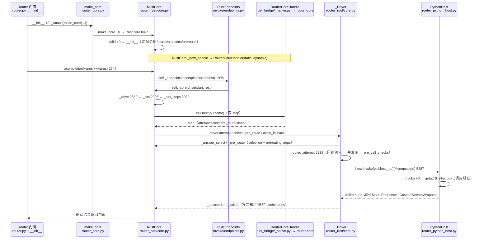

# Rust 路由核心专题

> 所属层级：第四层（源码补齐） | 阅读顺序/拆解对象：进程内 Rust 决策体 —— make_core → RustCore.build → 端点 → steps（selection / prerouting）→ _Driver（attempt / 重试 / fallback）→ PythonHost.invoke 回 Python 执行

## 0. 一句话定位

`litellm.Router` 的核心（`RouterCore`，`router_core.py :: RouterCore` 27）由 `make_core`（`router_core.py :: make_core` 51）无条件构建为 `litellm/router_rust/core.py :: RustCore`（1394 起）。`RustCore` 是 pyo3 句柄：经 `litellm/rust_bridge/_native.pyi` 绑定 `litellm/rust/crates/router-core`（Rust crate），在**同一个进程内**拥有选路、重试、fallback、冷却、用量计数。Rust 核心不直接发推理请求：它让宿主 step 经 `litellm/router_python_host.py :: PythonHost :: invoke` 回调 litellm 包里的 `acompletion` / `aembedding` 等端点，由 litellm 的 HTTP 处理层实际打 provider。执行层由 `litellm/rust_bridge/catalog.py :: RouteRule` 决定走 Python 还是 Rust 专有路径。

## 1. 架构总览

```text
 Router 门面（零逻辑，见 04 篇）
        │ __init__ +0: _attach(make_core(...))
        ▼
 router_core.py :: make_core +0（51 起，全文件 55 行）
        │ 无条件 RustCore.build(config, host)
        ▼
 router_rust/core.py :: RustCore（1394 起）
   ├─ __init__ +0（1405）：装配句柄、缓存、stores、selectors、prerouter、endpoints
   ├─ build +0（1519）：拒绝不支持参数 → RustEndpoints.prepare_host → __init__
   ├─ _new_handle +0（1611）：RouterCoreHandle(static, dynamic)  → Rust 句柄
   ├─ 端点：acompletion +0（2547）→ self._endpoints.acompletion(...)
   │        RustEndpoints.acompletion +0（endpoints.py 1998）→ self._core.drive(...)
   ├─ _drive +0（2880）→ _run +0（2905）→ _run_steps +0（2930）：step 循环
   └─ _Driver（_Driver 4396 起）
        ├─ attempt +0（5214）→ _routed_attempt +0（5238）
        │      └─ host.invoke(call.host_op)(**compacted)（5287）
        ├─ select +0（5380）→ core._answer_select +0（3393）
        ├─ pre_route +0（5401）→ core._pre_route +0（3153）→ prerouter
        └─ allow_fallback +0（5417）→ fallback 访问/预算/限流检查
        ▼ host step
 PythonHost.invoke +0（107）→ litellm.<op>（acompletion/aembedding/...）
        ▼ 执行层
 litellm/llms/... 按 provider 发请求（catalog 决定 PYTHON_ONLY / RUST_REQUIRED）
```

## 2. `make_core` 与 `RustCore.build`

```
litellm/router_core.py :: make_core() :: +0（51 起）
litellm/router_rust/core.py :: RustCore :: build() :: +0（1519 起，@classmethod）
```

| 项 | 内容 |
|---|---|
| 职责 | 进程内唯一核心工厂：把 `RouterConfig` + `PythonHost` 建成一个 `RustCore` |
| 参数 | `make_core(config: RouterConfig, host: PythonHost)`；`build(config, host)` |
| 返回 | 一个 `RustCore` 实例 |
| 前置 | Rust 桥可用；构造参数被核心支持 |
| 后置 | 句柄已建，端点、缓存、stores、selectors、prerouter 全部就位 |
| 核心算法 | `build`（`+0`）：① `unsupported_arguments(config)` 有剩余参数 → 抛 `RustBridgeDeclined`；② `RustEndpoints.prepare_host(config, host)`；③ `cls(config, host, Resolved.of(config, host.dynamic()))`。`make_core` 只有一行 `return RustCore.build(config, host)` |
| 错误处理 | `RustBridgeDeclined`（Rust 桥拒绝该 Router 参数）在 `build` 抛；构建期装配失败向上抛 |

`__init__`（`+0`，1405）装配内容：

| 成员 | 职责 |
|---|---|
| `_host: PythonHost` | 宿主边界 |
| `_handle: RouterCoreHandle`（`_new_handle` 1611） | pyo3 句柄，持有 static + dynamic 两份 JSON 文档（`RouterCoreHandle(static, self._dynamic_document(names))`） |
| `_cache: DualCache` | `host.routing_cache(config)`：内存 + 可选 Redis 的冷却/失败/用量存储 |
| `_cooldowns: CooldownCache` | `RouterCooldownStore(redis.router_cooldowns())` + `default_cooldown_time` |
| `_usage: RouterUsage` | `host.router_usage(redis)` → `RouterUsageStore` |
| `_selectors: StrategySelectors` | `init_default(...)` + `init_groups(...)` |
| `_prerouter: PreRouter` | 预路由（model group 重写、自定义策略） |
| `_endpoints: RustEndpoints` | 端点服务 |
| `_hosted: HostRegistry` | 注册表宿主，把模型列表/变更喂给 Rust 句柄 |

## 3. Rust crate 结构

```text
litellm/rust/crates/router-core/src/      # Rust 路由核心（pyo3 暴露给 _native）
  call.rs      // 调用循环：select → attempt → retry/fallback（步骤机）
  select.rs    // 选路：候选、策略输入、服务
  retry.rs     // 同组重试
  fallback.rs  // 跨组回退
  prerouting.rs// 预路由
  precall.rs / eligibility.rs / ptu.rs   // 预检 / 资格 / 每 token 用量
  registry.rs / settings.rs / health.rs / health_routing.rs
  routing_groups.rs / routing_plugins.rs / weights.rs
  outcome.rs   // 结果回调
  host.rs / host_index.rs                // 宿主索引
  resolve.rs / group_info.rs / model_info.rs / lookup.rs

litellm/rust/crates/router-types/        # 跨 crate 共享类型
litellm/rust/crates/gateway-forward/     # Rust 网关转发（LITELLM_RUST_FIRST 路径，非本篇路由核心）
```

Rust 核心产出一串 **step**（`call.rs`），宿主 `_run_steps` 逐个应答：`attempt` / `select` / `pre_route` / `sleep` / `allow_fallback` / `refuse_fallbacks` / `cache` / `done` / `failed`（`_run_steps` `+0` 的 `match step["kind"]`）。

## 4. 端点：从 `Router.acompletion` 到 `RustEndpoints`

```
litellm/router_rust/invoke/endpoints.py :: RustEndpoints :: acompletion() :: +0（1998 起）
litellm/router_rust/invoke/endpoints.py :: endpoint_names() :: +0（686 起）
```

| 项 | 内容 |
|---|---|
| 职责 | 公共端点方法：拆 model、解析 priority、分发到核心驱动循环 |
| 参数 | `request: Mapping[str, object]`（`request_from_call("acompletion", args, kwargs)` 由 `router_attempt.py` 拼出） |
| 返回 | `ModelResponse \| CustomStreamWrapper`（经核心 `drive`） |
| 核心算法 | `acompletion`（`+0`）：`model` 缺省抛 `TypeError`；非字符串先 `routed_name` 解析；`kwargs = {**request, "stream": request.get("stream", False)}`；`_routed_acompletion`（`+14`）：priority 存在走 `_schedule` 调度队列，否则 `self._core.drive(plan, rest)`。`_routed_acompletion` 先查 `is_prompt_management_model` 走 `prompt_management_acompletion` |
| 错误处理 | model 缺失抛 `TypeError`；priority 无效抛 `priority_error` |

`endpoint_names()`（`+0`）返回所有可服务端点名（`PLANS`、`_HOST_GENERIC`、`_ASSISTANTS`、`_DIRECT_ENDPOINTS` 等并集），供门面 `__dir__` 和 `__getattr__` 判断成员是否是端点。

## 5. steps：selection 与 prerouting（宿主侧决策）

### 5.1 `StrategySelectors` 与 `pick_async`

```
litellm/router_rust/steps/selection.py :: StrategySelectors :: +0（97 起）
litellm/router_rust/steps/selection.py :: build_selector() :: +0（67 起）
litellm/router_rust/steps/selection.py :: pick_async() :: +0（261 起）
litellm/router_rust/steps/selection.py :: routing_pre_call_checks() :: +0（350 起）
```

| 符号 | 职责 |
|---|---|
| `StrategySelectors`（`+0`） | 一个 Router 的选路器集合：默认组的、每个 routing group 的、按请求惰性建的 override 的；`reservations: InMemoryCache` 供 least-busy 预留 |
| `build_selector`（`+0`） | 策略字符串 → `Selector`：`least-busy`→`LeastBusyLoggingHandler`、`usage-based-routing`→`LowestTPMLoggingHandler`、`usage-based-routing-v2`→`LowestTPMLoggingHandler_v2`、`latency-based-routing`→`LowestLatencyLoggingHandler`、`cost-based-routing`→`LowestCostLoggingHandler`、其余返回 `None`（simple-shuffle 无 selector） |
| `pick_async`（`+0`） | `_select_deployment_async`：按策略 `match selector` 调对应 selector 的 `async_get_available_deployments`；`reserve` 时 least-busy 预留该 pick |
| `routing_pre_call_checks`（`+0`） | `async_routing_strategy_pre_call_checks`：每个 `CustomLogger` 回调对选中部署跑 `async_pre_call_check`；检查失败使该次尝试失败 |

### 5.2 `PreRouter` 与预路由函数

```
litellm/router_rust/steps/prerouting.py :: PreRouter :: +0（755 起）
litellm/router_rust/steps/prerouting.py :: as_output_cap() :: +0（627 起）
litellm/router_rust/steps/prerouting.py :: stamped_client_ceiling() :: +0（639 起）
```

| 符号 | 职责 |
|---|---|
| `PreRouter`（`+0`） | 预路由器：把 step 的 `model` 解析成 model group / 自定义策略部署 / `None` |
| `as_output_cap`（`+0`） | 客户端输出上限强转为 int：int/float/数字字符串，排除 bool 与负数；解析失败返回 `None` |
| `stamped_client_ceiling`（`+0`） | 读 metadata 里客户端输出上限的盖章（`CLIENT_OUTPUT_CEILING_METADATA_KEY`），映射 carrier → cap |

宿主 step `pre_route`（`_Driver.pre_route` `+0`，5401）把请求交给 `core._pre_route`（3153），后者：① 自定义 async pick（`_core_async_get_available_deployment`）；② 自定义策略 `async_get_available_deployment`；③ fallback hop 复制 metadata；④ `self._prerouter.pre_route(...)`。

## 6. `_Driver`：一次调用的宿主决策机

```
litellm/router_rust/core.py :: _Driver :: +0（4396 起）
```

`_Driver` 是一次 `_drive` 的宿主状态机，在 `_run_steps`（`+0`，2930）的 step 循环里被驱动。每个 step 由 `call.next(outcome)` 从 Rust 句柄取到，`driver.take_events(step.get("events"))` 处理事件，然后 `match step["kind"]` 分发。

| 方法 | 职责与锚点 |
|---|---|
| `attempt`（`+0`，5214） | 一次尝试：`_passthrough` 且无 deployment_id 走 `_passthrough_attempt`（5195），否则 `with routed_attempt(): return await self._routed_attempt(step, attempt)` |
| `_routed_attempt`（`+0`，5238） | 完整尝试：解析 pod → `_call(step)` 建 `AttemptCall` → 压缩输入（`compacted_attempt`）→ `enter_deployment_slot` 并发闸 → `routing_pre_call_checks` → `host.invoke(call.host_op)(**compacted)`（5287）真调用 → `check_response` → `open_attempt_stream` 读首块 → 成功计数。失败：`_failed`（4993）+ 释放预留（`_release` 5220）+ 冷却/失败计数 |
| `select`（`+0`，5380） | 选路 step：`_answer_select`（3393）按 `stage` 分发（`pre_call`/`routing_plugins`/`tags`/`override_check`/`provider_request`…） |
| `pre_route`（`+0`，5401） | 预路由 step：`_pre_route`（3153） |
| `allow_fallback`（`+0`，5417） | 回退授权：`fallback_access_allowed` → `fallback_budget_allowed` → `fallback_rate_limit_allowed`，拒绝则 `record_skip` 并返回 `False` |
| `_failed`（`+0`，4993） | 失败处理：记录日志、`stamp_error`、`failure_exits` 冷却判定、返回 `attempt_failure(error)` 文档 |
| `_succeeded`（`+0`，5083） | 成功处理：返回 `{"ok": True, "total_tokens", "blocked", "deferred", "tracks_usage"}` |

## 7. 重试 / fallback 宿主面

```
litellm/router_rust/surface/retries.py :: resolved_retry_policy() :: +0（24 起）
litellm/router_rust/surface/retries.py :: RustRetries :: +0（235 起）
litellm/router_rust/surface/fallbacks.py :: RustFallbacks :: +0（115 起）
litellm/types/router.py :: RetryPolicy :: +0（176 起）
```

| 符号 | 职责 |
|---|---|
| `RetryPolicy`（`types/router.py` 176） | 每个异常类型的重试数：`BadRequestErrorRetries` / `AuthenticationErrorRetries` / `TimeoutErrorRetries` / `RateLimitErrorRetries` / `ContentPolicyViolationErrorRetries` / `InternalServerErrorRetries` / `ServiceUnavailableErrorRetries` / `NotFoundErrorRetries` / `DefaultRetries` |
| `resolved_retry_policy`（`+0`） | 把 Router 的 `retry_policy` 归一：`RetryPolicy` 原样、`Mapping` 读成 `RetryPolicy(**fields)`、其它返回 `None` |
| `RustRetries`（`+0`） | 重试成员，从核心句柄读：`should_retry_this_error`（246）调 `self._handle.should_retry(...)` |
| `RustFallbacks`（`+0`） | fallback 宿主面：`validate_fallbacks` 拒畸形 fallback 参数 |

这些 mixin 被 `RustCore` 继承（`core.py :: RustCore` 1394 的基类列表含 `RustRetries`、`RustFallbacks`）。实际的重试/回退决策在 Rust 句柄里（`call.rs` 的 `retry` / `fallback` 模块），宿主通过 `_Driver` 的 step 循环参与。

`_retry_policy_raises`（`+0`，2853）把 `model_group_retry_policy` 查表会抛错的 group 列表发给 Rust 句柄，让那个 hop 以查表错误结束。

## 8. 冷却 / 用量持久化（Redis stores）

```
litellm/redis/stores/router_cooldowns/handle.py :: RouterCooldownsHandle :: +0（11 起）
litellm/redis/stores/router_usage/__init__.py :: RouterUsage :: +0（26 起）
litellm/redis/stores/router_usage/handle.py :: RouterUsageHandle :: +0（10 起）
litellm/redis/store_settings.py :: RedisStoreSettings :: +0（20 起）
```

`RustCore.__init__`（`+0`）装配：`self._cooldowns = CooldownCache(store=RouterCooldownStore(redis.router_cooldowns()), default_cooldown_time=...)`（1427），`self._usage = host.router_usage(redis)`（1426）。二者都是 `redis/stores` 家族的 store，经 `_answer_cache`（`+0`，3546）的 `increment_usage` / `increment` 写。`RedisStoreSettings` 从 `RedisCache` 捕获连接参数。

| Store | 写什么 |
|---|---|
| `RouterCooldownStore` / `RouterCooldownsHandle` | 部署冷却：`put` / `increment_allowed_fails` / `active` / `minimum` / `snapshot`，多 worker 共享 |
| `RouterUsageStore` / `RouterUsageHandle` | 每部署每分钟 tpm/rpm：`increment` / `increment_deployment` / `get_many` |

## 9. 执行层：PYTHON_ONLY vs RUST_REQUIRED

```
litellm/rust_bridge/catalog.py :: RouteRule :: +0（108 起）
litellm/messages/dispatch.py :: _rust_only_refusal() :: +0（189 起）
```

`catalog.py` 的 `RouteRule`（`+0`）声明每类路由的 rollout：`chat_completions` 是 `PYTHON_ONLY`（`RouteRule(Route.CHAT_COMPLETIONS, Rollout.PYTHON_ONLY, ...)`，192），`anthropic` provider 的 `messages` 是 `RUST_REQUIRED`（`RouteRule(Route.MESSAGES, Rollout.RUST_REQUIRED, providers=frozenset({"anthropic"}))`，198）。`_rust_only_refusal`（`dispatch.py` 189）在 anthropic 走 `/v1/messages` 时按 catalog 判 `RUST_REQUIRED`，若请求用了 Rust 路径不支持的参数就抛 `UnsupportedParamsError`，拒绝 Python 执行。

也就是说：**两套路由共用一个 Router**。聊天补全由 Router 决策后用 Python 执行（经 `PythonHost.invoke("acompletion")` → litellm HTTP 处理层），anthropic messages 必须走 Rust 桥的执行路径。

## 10. 关键调用链（一次 `router.acompletion`）



## 11. 已确认事实清单

| 事实 | 锚点 |
|---|---|
| `make_core` 无条件返回 RustCore | `router_core.py :: make_core` `+0` |
| `RustCore.build` 拒绝不支持的 Router 参数 | `core.py :: RustCore.build` `+0` |
| 每次尝试经 `host.invoke(call.host_op)` 回 Python | `core.py :: _Driver._routed_attempt` `+49`（5287） |
| 步骤机由 `call.next(outcome)` 驱动 | `core.py :: _run_steps` `+6`（2936） |
| 端点名集合 | `invoke/endpoints.py :: endpoint_names` `+0` |
| 冷却写 Redis stores | `core.py :: RustCore.__init__` `+22`（1427）；`redis/stores/router_cooldowns/handle.py :: RouterCooldownsHandle` `+0` |
| 用量写 Redis stores | `core.py :: RustCore.__init__` `+21`（1426）；`redis/stores/router_usage` |
| chat_completions 是 PYTHON_ONLY | `rust_bridge/catalog.py :: RouteRule`（192 起的 RULES） |
| anthropic messages 是 RUST_REQUIRED | `rust_bridge/catalog.py :: RouteRule`（198）；`messages/dispatch.py :: _rust_only_refusal` `+0` |

## 12. 源码索引（绝对行号为生成时快照）

| 符号 → 文件 |
|---|
| `make_core` → litellm/router_core.py:51 |
| `RustCore` → litellm/router_rust/core.py:1394 |
| `RustCore.build` → litellm/router_rust/core.py:1519 |
| `RustCore.acompletion` → litellm/router_rust/core.py:2547 |
| `_drive` → litellm/router_rust/core.py:2880 |
| `_run_steps` → litellm/router_rust/core.py:2930 |
| `_retry_policy_raises` → litellm/router_rust/core.py:2853 |
| `_pick_with_prefetched_usage` → litellm/router_rust/core.py:3940 |
| `_Driver.attempt` → litellm/router_rust/core.py:5214 |
| `_Driver._routed_attempt` → litellm/router_rust/core.py:5238 |
| `_Driver.select` → litellm/router_rust/core.py:5380 |
| `_Driver.pre_route` → litellm/router_rust/core.py:5401 |
| `_Driver.allow_fallback` → litellm/router_rust/core.py:5417 |
| `RustEndpoints.acompletion` → litellm/router_rust/invoke/endpoints.py:1998 |
| `endpoint_names` → litellm/router_rust/invoke/endpoints.py:686 |
| `StrategySelectors` → litellm/router_rust/steps/selection.py:97 |
| `pick_async` → litellm/router_rust/steps/selection.py:261 |
| `routing_pre_call_checks` → litellm/router_rust/steps/selection.py:350 |
| `build_selector` → litellm/router_rust/steps/selection.py:67 |
| `PreRouter` → litellm/router_rust/steps/prerouting.py:755 |
| `as_output_cap` → litellm/router_rust/steps/prerouting.py:627 |
| `stamped_client_ceiling` → litellm/router_rust/steps/prerouting.py:639 |
| `resolved_retry_policy` → litellm/router_rust/surface/retries.py:24 |
| `RustRetries` → litellm/router_rust/surface/retries.py:235 |
| `RustFallbacks` → litellm/router_rust/surface/fallbacks.py:115 |
| `RetryPolicy` → litellm/types/router.py:176 |
| `PythonHost.invoke` → litellm/router_python_host.py:107 |
| `RouteRule` → litellm/rust_bridge/catalog.py:108 |
| `_rust_only_refusal` → litellm/messages/dispatch.py:189 |
| `RouterCooldownsHandle` → litellm/redis/stores/router_cooldowns/handle.py:11 |
| `RouterUsageHandle` → litellm/redis/stores/router_usage/handle.py:10 |
| `RedisStoreSettings` → litellm/redis/store_settings.py:20 |
| `async_completion_with_fallbacks` → litellm/litellm_core_utils/fallback_utils.py:17 |

## 13. 跨篇导航

- [04-router-functions.md](04-router-functions.md)：门面视角（Router 门面、端点、扩展、PythonHost 边界）
- [05-acompletion-functions.md](05-acompletion-functions.md)：`main.acompletion` 执行路径
- [06-http-handler-functions.md](06-http-handler-functions.md)：执行层 `BaseLLMHTTPHandler.async_completion`
- [03-routing-functions.md](03-routing-functions.md)：proxy 侧 `route_request` 进入 Router