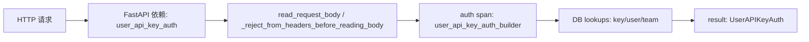
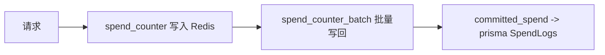

# 鉴权与速率控制逐环节拆解

> **代码基准**：`main@e46fe2e2dc1bdd19f7953bd47dc3d770876ac74e（工作区干净）`；核实日期：2026-11-17。
> **范围**：Proxy 的 API Key/JWT 鉴权链 + 每用户/每团队的访问控制，然后是 **Rate Limit（速率限制）/ 预算/模型访问控制**。
> **前置**：U02 确认入口 `chat_completion` 接收 `user_api_key_dict: UserAPIKeyAuth = Depends(user_api_key_auth)`；U03 确认 router 层在等。
> **纪律**：只读。

## 0. 结论速览

鉴权是四段：**Header 读取 → key 匹配 DB/本地 → feature/route 授权 → 速率/预算控制**，在每次请求中顺序执行。速率控制四重：每 key（user 级别）、每 team、每模型、每部署（`per_model_rate_limit`），最后外围是 budget。
- `user_api_key_auth`（`user_api_key_auth.py 3423`）是所有 endpoint 的 FastAPI `Depends`，并且每个错误码映射为 401/403。
- Rate Limit 不在 auth 里而是 `common_request_processing.py` 的 `_pre_call_with_fallbacks`，由 `ProxyRateLimitError` 处理（决定是 fallback 还是 429 拒绝）。
- 预算/花费用 `budget_manager.py` 和 `litellm/proxy/spend_tracking/`。
- 模型访问（`get_key_models`/`get_team_models`）在 `model_checks.py` 中，丢弃未授权模型。

## 1. 鉴权链：先读取 header，再匹配 key



### 1.1 Header 处理（`user_api_key_auth.py 3423`）

`user_api_key_auth` 是 FastAPI `Depends()` 的父级：
```python
async def user_api_key_auth(request, api_key=fastapi.Security(api_key_header), ...)
```
- 创建 server span（`_ensure_parent_otel_span_on_request_state`）
- `route` = `get_request_route(request)`
- `_reject_from_headers_before_reading_body(...)`：从 header 读 `Authorization`, `api_key` 等。
- `_read_request_body_deferring_parse_failure`: 安全地读 body。
- 进入 `phase_span("auth {route}")` + `service_target(AUTH_OBJECTS_TARGET)`，所有 DB 查找声。

### 1.2 Builder（`user_api_key_auth_builder 2022`）

构造 `UserAPIKeyAuth` 对象，做三件事：
1. key → user。
2. team。
3. key 的 `model_access_check`。

**auth 方法**在 `auth_method.py`：`api_key`, `Bearer`, `hash`，支持分配到 Mt。

### 1.3 Master Key 启动（`master_key_boot_check.py 79`）

`master_key_boot_verdict()` 检查 `LITELLM_MASTER_KEY` 是否在启动时合法（`enforce_master_key_boot_verdict`），不合法拒绝启动。

## 2. 速率限制（四重：每 key / 每 team / 每模型 / 每部署）

速率限制在 `common_request_processing.py 3367` `_pre_call_with_fallbacks` 中，由 `ProxyRateLimitError` 处理。

速率限制三支柱：
- **每 key 速率**（`KeyRateLimit`），由 Redis `SpendCounterStore` 持有（`litellm/redis/stores/spend_counters.py`）。
- **每模型/每部署速率**（`per_model_rate_limit`），走 `litellm/proxy/auth/` 的授权。
- **`RateLimitFallback`**（`fallback_rate_limit.py` `RouterFallbackRateLimitCheck`，需要 v3 `ParallelRequestLimiterHook`）。

`ProxyRateLimitError`（`common_utils/proxy_rate_limit_error.py 305`，`HTTPException` 与 `RateLimitError` 二合一）：
- `descriptor_key` 是 per-model 哪一把 rate。
- `type` 在 headers 上通过 `rate_limit_fallback_headers` 标记（`with_rate_limit_fallback`）。
- 流程图（生产视角）：`_pre_call_with_fallbacks` → `ProxyRateLimitError` caught → 尝试 `fallback_on_saturation_enabled`（`saturation_fallback_walk`）→ 若失败则 `mark_saturation_fallbacks_exhausted` → 拒绝 429。

## 3. 预算与花费

- **`litellm/proxy/spend_tracking/`** 是花费追踪主目录：
  - `spend_counter_batch.py` 把 spend 批量写回（`SpendCounterStore`）；
  - `committed_spend.py` 把已 commit 的 spend 通过 `db_insert_spend` 写回 DB（prisma `SpendLogs`）；
  - `budget_reservation.py` / `cost_finalization.py` 做预算预留和最终结算。
- **`budget_manager.py`**（router 端）：`BudgetManager` 类，按 key/team 做预算 check；**`litellm/proxy/auth/budget_throttle.py`** 的 `should_throttle_budget_exceeded` 决定是否按阈值节流。
- 每个请求记录 per-request spend（`spend_counter`）到 Redis，由 `reset_budget_job.py` 做 periodic resett。

消费模型（从流到盘）：


## 4. access: API Key vs Model Access

`model_checks.py` 有：
- `get_key_models`（203）：key 的指名 model。
- `get_team_models`（247）：team 的指名 model。
- `get_complete_model_list`（280）：合并后的 model。
- `get_provider_models`（133）：获取 provider 的 real model，带 `provider` 调用。
- `_check_wildcard_routing`（119）处理 `*`。

**模型访问范围**：`UserAPIKeyAuth` 可以（model 列表/`model_access`）限制，具体在 user_api_key_auth 的 `model_access_check`。

## 5. 四重速率控制的生产表现

| 表现 | 根因 | 定位 |
|---|---|---|
| 401 Unauthorized | key 不合法/过期 | `auth_checks` |
| 403 Forbidden | 模型未授/花式 | `model_checks` |
| 429 Too Many Requests | rate limit 超量 | `ProxyRateLimitError` |
| 429 Thyper | 预算耗尽 | `budget_throttle` |
| 500 | 供应商报错 | `Auth` |

## 6. 后续

- U03 备路由。
- U04 是 auth 层——看完。
- U05 是 cost 追踪，带 callback。
