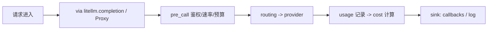

# 成本控制与可观测性逐环节拆解

> **代码基准**：`main@e46fe2e2dc1bdd19f7953bd47dc3d770876ac74e（工作区干净）`；核实日期：2026-11-17。
> **范围**：成本追踪（模型价格/预算检查/花费落盘）+ 可观测性（logging 回调/prometheus 指标/告警）。
> **前置**：U02 确认调用入口 + U03 确认 router 层在等。

## 0. 结论速览

一个请求的生命周期：


成本追踪四件：
1. `litellm.model_cost`（来自 `model_prices_and_context_window.json`，由 `litellm/__init__.py 566` 加载为价格源）。
2. `custom_pricing`（`litellm_params` 的 `custom_pricing` 或每 token 价格，通过 `litellm.main.py 5895-5910` 覆盖平率）→ `litellm/utils.py 4073` 覆盖 `tiered_pricing`。
3. `BudgetManager`（`litellm/budget_manager.py 30`）在 pre_call。
4. 一切支出最终落到 Redis → `spend_tracking` → `db_spend_update_writer` 涌入 `prisma LiteLLM_SpendLogs`（`litellm/schema.prisma 816`）。

可观测性三件套：
- logging 回调：`litellm.utils.dispatch_success_logging` / `_client_async_logging_helper` / `handle_sync_failure_callbacks`。
- prometheus 指标：`litellm/integrations.prometheus` 注册到 `ProxyLogging` 上。
- 告警端点：`litellm/proxy/alerting_endpoints/`。

## 1. 成本计算（cost_per_token + model_prices）

`litellm/cost_calculator.py 466` `cost_per_token` 是核心：
```python
def cost_per_token(input_cost_ratio, input_tokens, output_tokens): ...
```
它从 `litellm.model_cost` 中按 `model` 读 `input_cost_per_token`/`output_cost_per_token`，然后算：

| 计费类型 | 语义 | 码 |
|---|---|---|
| 按 token | `input_cost_per_token * input_tokens + output_cost_per_token * output_tokens` | `_get_additional_costs` |
| 按秒 | `_per_second_pricing_cost`（`cost_calculator.py 419`） | 一样 `input_cost_per_second` |
| 混合 | 同一个 model — 只算一个 | `_bills_wall_clock_seconds` |

**Cost 计算步骤**：
1. 从 `litellm.completion` 的 `cost` 字段读，如果 `custom_pricing` 由用户明着写。
2. `custom_pricing` 注册在 `litellm.utils._get_model_info_helper`。
3. 解析 `cost_per_token` 时 `litellm/utils.py` 的 `calculate_cost` 和 `_get_additional_costs` 把 cost 组装。
4. 结果存入 `logging_obj`，过 `success_callback`。

`litellm.model_cost` 顶层是 `model_name → {input_cost_per_token..., output_cost_per_token...}`。

## 2. logging 回调链

**核心**：`litellm.utils.dispatch_success_logging(logging_obj, result, start_time, end_time, is_completion_with_fallbacks, is_litellm_internal_call)`：
- `_schedule_async_success_logging`：如果 `logging_obj.defer_async_logging`，则交给 `Spawning`。
- `_client_async_logging_helper` 调用 `save_logging_results`，最终 `handle_success_callbacks`。
- 如果 `is_litellm_internal_call` 则跳过。
- failures 通过 `handle_failure_callbacks`。

回调类型做在 `litellm/__init__.py`：
- `input_callback` / `success_callback` / `failure_callback` / `service_callback` / `audit_log_callbacks`。
- 也可以注册原生 `CustomLogger`（`CustomVectorStore` uses this for `litellm.logging_dispatch`）。

每个事件（success/failure）的 `logging_obj` 字段的模型是 `litellm/litellm_core_utils/litellm_logging.py 939` `class Logging(LiteLLMLoggingBaseClass)`.

## 3. prometheus 指标

- `litellm/integrations/prometheus.py`：`PrometheusLogger`，在 `litellm.utils._get_cached_prometheus_logger()` 注册。
- 通过 `ProxyLogging` 产生 `prometheus` 计数。
- 服务器的指标在 `litellm/proxy/proxy_server.py`，携带 `PROMETHEUS_MULTIPROC_DIR`。
- 通过 `/metrics` 暴露。

通过 `litellm/proxy/spend_tracking/committed_spend.py` 更新 counter（与 `spend_counter` twin，Prometheus 专用）。

## 4. budget 检查

**`litellm/budget_manager.py 30` `BudgetManager`**（`litellm/utils.py` pre_call 调用）：
- 计算 key/team/org/budget计划。
- `budget_throttle` — `litellm/proxy/auth/budget_throttle.py`（`should_throttle_budget_exceeded`）决定在 50% 阈值是否 pre-check。
- 它跟踪每 key 的 spend 总量（`spend_counter`）到 Redis，通过 `spend_counter_batch` 去写。

兜底：
- `litellm/proxy/auth/budget_throttle.py` 的 `should_throttle_budget_exceeded` 在中途停止。
- 实际额度在 `spend_counter` 里，通过 `litellm/proxy/spend_tracking/spend_counter_batch.py` 完成。

## 5. 告警端点

`litellm/proxy/alerting_endpoints/alerts.py` — 通过 `_authorize`，`list_alerts`，`update_open_alerts`，`get_monitoring`。

**告警**（`alerts.py`）和 **模型弃用告警**（`model_deprecation_alerts.py`）—— model 使用的版本。

## 6. 生产状表现

| 现象 | 根因 | 定位 |
|---|---|---|
| cost 为 0 | `model_cost` 无定价 / 未走 `CustomPricingLiteLLMParams` | `litellm/cost_calculator` |
| 一次 call 两次 log | `is_litellm_internal_call` 未 intercept → 嵌套 | `litellm/utils.py` |
| 未跟踪 spend | Redis 没配 / `spend_counter` 没挂 | `spend_tracking` |
| Prometheus 不更新 | `PrometheusLogger` 未注册 | `_get_cached_prometheus_logger` |

## 7. 验证与后续

- 走读这层的正确姿势：`litellm/__init__.py` 的 `CallbackType` + `litellm/utils.py` 的 `dispatch_success_logging`。
- 相关产品（`Implementation-Plan`）可以在 `U07` 以后。
