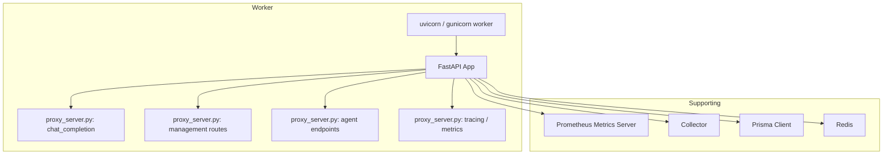

# Proxy Server 与 API

> **代码基准**：`main@e46fe2e2dc1bdd19f7953bd47dc3d770876ac74e（工作区干净）`；核实日期：2026-11-17。
> **范围**：Proxy Server 的 FastAPI 应用结构、端点注册、管理 API、OpenAPI、UI  mounts、worker/多进程。
> **前置**：U1/U2 已确认入口；U04 已确认鉴权。

## 0. 结论速览

Proxy 是一个 **FastAPI 应用**，所有端点通过 `@router.post/@router.get` 在 `litellm/proxy/proxy_server.py` 注册，依赖 `fastapi.Security(...)`.
- 入口：`app = FastAPI(...)` （`proxy_server.py 2220`），由 `pytest/proxy.env` + `litellm/proxy/proxy_cli.py` 驱动。
- 端点分三类：**模型代理端点**（chat/completions/agent/embeddings/realtime等 83+），**管理端点**（key/team/usage/monitoring等 classes），**UI/其他**（`/ui` mount、`/metrics`、`/traces`）。
- 请求处理：`chat_completion` → `ProxyBaseLLMRequestProcessing.base_process_llm_request` → `_process_llm_request` → `Router`。
- 配置源：`litellm.yaml` 前缀/DB（`/v1/models`/`/config`）/环境变量（`_GENERAL_SETTINGS_ADAPTER`），在 `proxy_startup_event` 合并。
- 多进程：`uvicorn`/`gunicorn` worker (`proxy_cli.py` 里的 `build_worker_args`/`num_workers`)，`prometheus_metrics_server` 单独进程，`collector.py` 轻量推。

## 1. 应用结构



### 1.1 应用创建

`proxy_server.py 2220`：
```python
app = FastAPI(
    title="LiteLLM Proxy",
    version="...",
    ...
)
```
lifespan 是 `proxy_startup_event`（`proxy_server.py 1643`），需要 `AsyncExitStack`。

### 1.2 路由注册

**模型代理端点**（`proxy_server.py 13559` 起）：
```python
@router.post(
    "/v1/chat/completions",
    dependencies=[Depends(user_api_key_auth)],
    tags=["chat/completions"],
)
```
代表性的有 83 个路由。

**管理端点**挂载在 `litellm/proxy/management_endpoints/`：
- `key_management_endpoints.py` — `/key/*`
- `team_endpoints.py` — `/team/*`
- `model_management_endpoints.py` — `/models`
- `router_settings_endpoints.py` — `/router/settings`
- `budget_management_endpoints.py` — `/budget/*`
- `organization_endpoints.py` — `/organization/*`
- `user_agent_analytics_endpoints.py` — `/analytics/*`
- `daily_activity_routes.py` — `/daily_activity/*`
- `cb` — callback 管理
- `sso` / `alerting_endpoints`

**Agent 端点**：
- `/agent/*` (A2A, agent MCP)
- `/chat/completions` (v1)
- `/realtime` (WebSocket)
- `/v1/realtime` (WebSocket)

**Tracing/UI**：`/api/trace` 走 `tracing_endpoints.py`；`/ui` 挂载 Next.js UI；`/metrics` 暴露 Prometheus。

### 1.3 组件挂载（mounts）

- `app.mount("/ui", StaticFiles(directory=ui_path, html=True))` — `proxy_server.py 2980`
- `app.mount("/swagger", StaticFiles(...))` — Swagger UI（`mount_swagger_ui()` 3121）
- `PrometheusLogger._mount_metrics_endpoint()` — 7353，由 `prometheus_metrics_server` 服务

## 2. 开/关机（启动/销毁）

### 2.1 启动（`proxy_startup_event`）

`proxy_server.py 1643` `async def proxy_startup_event(app: FastAPI)` 做的事：
- `ProxyStartupEvent.initialize_startup_logging`
- 认证加载（`master_key_boot_check` + `master_key_boot_verdict`）
- `prisma migrate` / DB setup（`PrismaManager.setup_database`）
- `read_model_list` / `_llm_model_list` 加载
- `redis` 连接建立
- `agent` 注册 + `a2a` 服务
- `scheduler`（调度器按照而非 `litellm.scheduler.py`）
- `PrometheusLogger` 指标注册（`_get_cached_prometheus_logger`）

### 2.2 关闭

`AsyncExitStack` 里 all `cleanup` 操作，退出信号有 2 秒缓冲。

## 3. 请求路由（核心）

`ProxyBaseLLMRequestProcessing`（`common_request_processing.py 3710`）：
1. `_pre_call_with_fallbacks` 前置包括鉴权/速率/预算
2. 检查 `complete_model_list`
3. **`_route_realtime_websocket_session`** 对 WebSocket
4. `Router` 调用（`Router.completion` 已经 U03 确认）
5. `handle_llm_api_exception` + 错误
6. 日志 `proxy_logging_obj`

`route_llm_request.py` 是 path 确认（`UserConfigRouters`, `_route_user_config_request`）。

## 4. 多进程 & worker

`litellm/proxy/proxy_cli.py 1014` `@click.command()`：
```python
def main(
    config=<default>, model=None, port=4000, workers=1, ...
)
```
- `--num_workers N` → `gunicorn`/`uvicorn`，每个 worker 持有独立 `app`。
- `--prometheus_metrics_port` 里，`prometheus_metrics_server` 是独立的 FastAPI 应用。
- worker 退出 `prometheus_cleanup.mark_worker_exit`。

## 5. 管理 API（常用端点）

| 端点 | 文件 | 用途 |
|---|---|---|
| `/v1/models` | `proxy_server.py 13091` | 列出模型 |
| `/v1/model/groups` | `proxy_server.py` | 模型组 |
| `/v1/billing/usage` | `budget_management_endpoints.py` | 查询花费 |
| `/v1/key/generate` | `key_management_endpoints.py` | 生成 key |
| `/v1/key/delete` | `key_management_endpoints.py` | 删除 key |
| `/v1/team/update` | `team_endpoints.py` | 更新团队 |
| `/v1/organization` | `organization_endpoints.py` | 组织管理 |
| `/v1/router/settings` | `router_settings_endpoints.py` | 路由设置 |
| `/v1/auth/jwt_key` | `jwt_key_mapping_endpoints.py` | JWT 密钥 |
| `/v1/alerts` | `alerting_endpoints/alerts.py` | 告警 |
| `/v1/agent` | `agent_endpoints` | A2A agent |
| `/v1/chat/assistants` | `assistants_endpoints.py` | Assistants API |
| `/v1/banner` | `banner_endpoints.py` | banner |
| `/v1/audit` | `audit_logs.py` | 审计日志 |

## 6. 开发注释

- **注意**管理端点前缀规范：`/management/*` 也存，但是 `proxy_server` 的 `@router` 的 prefix 是 `/v1/...`，不是 `management/`.
- 子路径（`errors/`/`token` etc）在 `litellm/proxy/management_endpoints/<name>` 中。
- `user_api_key_auth` 是所有管理端点的 `Depends`。
