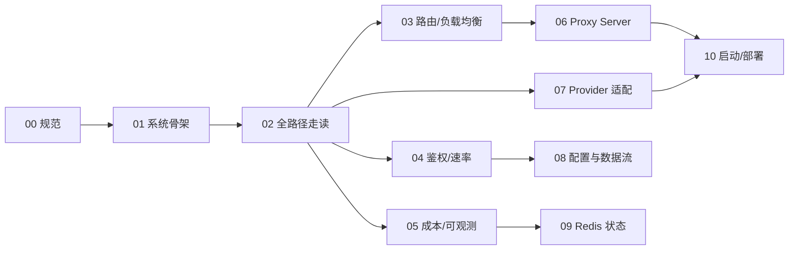

# docs/sourceReader 文档库

> **代码基准**：`main@e46fe2e2dc1bdd19f7953bd47dc3d770876ac74e（工作区干净）`；核实日期：2026-11-17。
> **维护**：当 `litellm/` 下代码发生实质性变更（尤其 `proxy/`, `router*`, `llms/`, `types/`）时同步更新。文档的锚点（文件:函数:行号）由 `source-doc-4layer`/`source-doc-refresh` 的 `verify` 阶段逐篇检查。

## 目录

| 编号 | 文档 | 层 | 一句话定位 | 状态 |
|---|---|---|---|---|
| 0 | [规范与定位约定](00-docs-style-guide.md) | — | 读库前必读的规范身份 | 已完成 |
| 1 | [生产总览与系统骨架](01-系统骨架.md) | L1 | 谁在做什么、真实入口、主流程、失败表现 | 已完成 |
| 2 | [一次真实操作全路径走读](02-全路径走读.md) | L2 | `POST /v1/chat/completions` 从入口到返回的 9 步链 | 已完成 |
| 3 | [请求路由与负载均衡](03-请求路由与负载均衡.md) | L3 | router → RustCore CompletableFuture 的选择/fallback/重试 | 已完成 |
| 4 | [鉴权与速率控制](04-鉴权与速率控制.md) | L3 | auth chain + 4 重 rate limit + budget | 已完成 |
| 5 | [成本控制与可观测性](05-成本控制与可观测性.md) | L3 | cost_per_token + callbacks + prometheus + 告警 | 已完成 |
| 6 | [Proxy Server与API](06-Proxy Server与API.md) | L4 | FastAPI 应用/端点注册/管理API/OpenAPI/worker | 已完成 |
| 7 | [Provider适配层](07-Provider适配层.md) | L4 | BaseLLM/CustomLLM 请求抽象/流式/参数表 | 已完成 |
| 8 | [配置与数据流](08-配置与数据流.md) | L4 | config.yaml/环境变量/DB + litellm_params map | 已完成 |
| 9 | [Redis分布式与状态](09-Redis分布式与状态.md) | L4 | 7 个 state domain/连接池/RateLimitStore/spend | 已完成 |
| 10 | [启动生命周期与部署](10-启动生命周期与部署.md) | L4 | CLI/entrypoint/worker 启动/优雅停机/deploy | 已完成 |

## 学习路径（按阅读顺序）



## 穿透顺序

1. **先生产**：L1→L2，手里先拿到 "API 端点能做什么"。
2. **再逐层**：L3 把核心链路拆开（路由/鉴权/成本），每一层一个进程/一个实体。
3. **最后开发**：L4 补到文件/函数/字段，开发时查。

## 验证与扫描

所有文档锚点通过 `litellm` 下的 `rg` 可快速回核。扫描：

```bash
cd /Users/vincent/workspace/16_AI/litellm
grep -rn "00-docs-style-guide\|01-系统骨架\|02-全路径走读" docs/sourceReader/ | grep "\.md:" 
```

注意：`docs/sourceReader/01-系统骨架.md` 中 L1 部分只覆盖接口，不是实现。

## 低覆盖区域

- `litellm/e2e` / `litellm/scripts` — 处于 U7+ 覆盖外，具体看。
- 部分 Abstract 层（类型/Protocol/Function field）只在文中出现，细节是 `[推断]`。
- `litellm/enterprise` 与外部授权了对接：只记了显示表面。
- `litellm/proxy/experimental`、`litellm/proxy/enterprise_billing` 属于端点层。

---

*生成于 2026-11-17，手动维护。*
